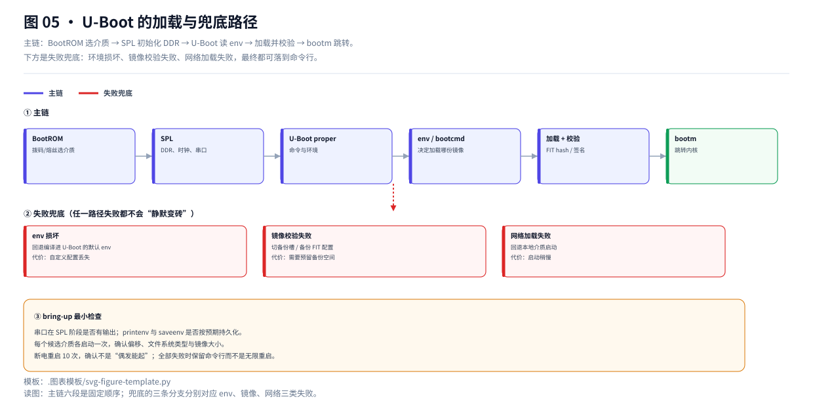

# U-Boot 工程实践

一句话结论：U-Boot 的工程价值集中在三件事——**`bootcmd` 决定从哪加载什么，`bootargs` 决定内核怎么起来，镜像格式（FIT）决定能不能校验与回滚**；其余都是围绕这三件事的调试手段。

> 本篇定位：讲环境变量、常用命令、镜像加载与失败兜底。启动链各阶段的理论见 [21-Linux/03-启动链](../../21-Linux/03-启动与根文件系统/00-启动链.md)；分区布局见 [00-固件布局与启动介质](./00-固件布局与启动介质.md)；A/B 与签名见 [02-升级回滚与安全启动](./02-升级回滚与安全启动.md)。

## 目录

- [1 一句话模型](#s1)
- [2 速览](#s2)
- [3 环境变量与镜像结构](#s3)
- [4 启动流程与失败兜底](#s4)
- [5 状态机与定时器](#s5)
- [6 设计取舍与边界](#s6)
- [7 与相邻主题的关系](#s7)
- [名词解释](#名词解释)
- [8 参考与关联](#s8)

## 1 · 一句话模型

```text
上电 → SPL → U-Boot ──env──► bootcmd ──► 加载(kernel/DTB) ──► bootm ──► 内核
                               │
                          bootargs（console/root/…）
```

三个关键认知：

1. **env 是“板上的配置数据库”**：改启动行为通常改 env，不必重编 U-Boot。
2. **`bootcmd` 是启动脚本，不是单一命令**：可以用 `if`/`test`/`run` 组合出多路径与兜底。
3. **镜像要可校验**：裸 `bootm` 只能算加载成功，FIT + 签名才能证明“加载的是正确的东西”。

## 2 · 速览

| 项 | 内容 |
| --- | --- |
| 所属层/领域 | 嵌入式引导 |
| 核心对象 | 环境变量、启动命令、FIT 镜像、加载介质 |
| 关键参数 | `bootcmd`、`bootargs`、`bootdelay`、`fdtfile`、`serverip` |
| 典型场景 | bring-up、切换启动介质、量产出厂配置、救援启动 |
| 主要标准 | U-Boot 文档、FIT 镜像规范、Linux `bootargs` 约定 |

## 3 · 环境变量与镜像结构

### 3.1 常用环境变量

| 变量 | 作用 | 边界/坑 |
| --- | --- | --- |
| `bootcmd` | 自动启动时执行的一组命令 | 写错会停在命令行或反复重启 |
| `bootargs` | 传给内核的命令行 | `root=` 与 `console=` 错一个就看不到日志 |
| `bootdelay` | 自动启动前等待秒数 | 量产设为 0~1，研发留 3 秒便于打断 |
| `fdtfile` / `fdt_addr_r` | 设备树文件名与加载地址 | 与内核加载地址重叠会踩内存 |
| `serverip`/`ipaddr` | TFTP/NFS 启动时的网络参数 | 与主机网段不一致时表现为超时 |
| `ethaddr` | MAC 地址 | 量产需从 factory 区读取，不能全板相同 |

### 3.2 常用命令族

| 命令 | 用途 | 说明 |
| --- | --- | --- |
| `mmc read/write` | 读写 eMMC/SD 扇区 | 偏移按扇区算，注意与分区表一致 |
| `fatload`/`ext4load` | 从文件系统加载文件 | 需要先 `mmc dev` 选设备 |
| `nand read/write/erase` | 裸 NAND 操作 | 必须按块，坏块需跳过 |
| `tftp` | 网络加载 | 依赖 `serverip` 与主机 TFTP 服务 |
| `bootm`/`booti` | 启动内核（FIT/legacy、Image） | `bootm` 可校验 FIT，`booti` 只管加载 |
| `setenv/saveenv` | 改并保存 env | `saveenv` 写 Flash，频繁写会磨损 |

### 3.3 FIT 镜像结构

```text
FIT (image tree)
├── images/
│   ├── kernel-1      { data, arch, os, compression, hash, signature }
│   ├── fdt-1         { data, hash }
│   └── ramdisk-1     { data, hash }
└── configurations/
    └── conf-1        { kernel, fdt, ramdisk }
```

| 字段 | 作用 | 边界 |
| --- | --- | --- |
| `data` | 内嵌镜像或外部引用 | 外部引用时校验依赖文件位置 |
| `hash` | 完整性校验 | 只防损坏，不防篡改 |
| `signature` | 来源认证 | 需要公钥在 U-Boot 的信任库中 |
| `configurations` | 选择哪组镜像启动 | 多配置可用于 A/B 或不同板型 |

## 4 · 启动流程与失败兜底



**读图**：主链是 BootROM→SPL→U-Boot→env→加载→校验→启动内核；下方三条是失败兜底（环境损坏回默认、校验失败换备份、网络失败转本地），最终都可落到命令行。

> 图源：`images/图05-U-Boot加载与兜底.svg`

### 4.1 正常流程

```text
① SPL 初始化 DDR/时钟，加载 U-Boot proper
② U-Boot 读 env（双份，校验失败用默认）
③ autoboot 倒计时结束，执行 bootcmd
④ 从介质加载 kernel/DTB（或 FIT）
⑤ 校验（hash/签名），设置 bootargs
⑥ bootm/booti 跳转内核
```

### 4.2 失败兜底策略

| 失败点 | 兜底做法 | 代价 |
| --- | --- | --- |
| env 损坏 | 使用编译进 U-Boot 的默认 env | 自定义配置丢失，但能启动 |
| 主镜像校验失败 | 切到备份分区/备份 FIT 配置 | 需要预留备份空间 |
| 网络加载失败 | 回退本地介质启动 | 启动稍慢 |
| 全部失败 | 停在命令行，保留串口 | 现场无法自恢复，需要人工介入 |
| 启动挂死 | 看门狗复位，配合 bootcount 切槽 | 需要 U-Boot 支持 `altbootcmd` |

### 4.3 bring-up 阶段的最小检查

- 串口能否在 SPL 阶段就有输出（`earlycon`/debug UART）。
- `printenv` 是否符合预期，`saveenv` 后重启是否仍生效。
- 从每个候选介质各启动一次，确认偏移与文件系统类型。
- 断电重启 10 次，确认不是“偶发能起”。

## 5 · 状态机与定时器

没有连接状态机，只有**自动启动倒计时**：

```text
上电 → bootdelay 倒计时 ──按键──► 命令行
                    └──超时──► bootcmd
```

与时间相关的还有看门狗（启动阶段未喂狗即复位）和 `bootcount`（记录连续启动失败次数，供 `altbootcmd` 切槽）。倒计时长度是安全与可维护性的取舍：太长影响启动时间，太短来不及打断。

## 6 · 设计取舍与边界

### 6.1 env 放 Flash 还是编译进默认值

放 Flash 便于现场修改，但断电写入可能损坏，需要双份 + CRC；只放默认值最稳，但每次改配置都要重编。工程上常用“默认值兜底 + Flash 覆盖”。

### 6.2 网络启动 vs 本地启动

TFTP/NFS 启动便于研发迭代（改完即测），但依赖网络与服务器，量产不可用。通常研发留网络路径，量产关闭或加超时。

### 6.3 安全启动的代价

开启签名校验后，任何未签名镜像都无法启动，包括研发的自编内核；需要区分“开发密钥/量产密钥”，并接受密钥一旦泄露只能换硬件的风险。

### 6.4 什么时候不适用

- 极小单片机没有 U-Boot：直接用厂商 bootloader 或裸机启动。
- 安全要求极高的产品：可能用更小的校验引导 + 签名内核，减少攻击面。

### 6.5 常见误判

- **“`bootargs` 改了没生效”**：`bootcmd` 里可能重新 `setenv bootargs`，覆盖了 env 中的值。
- **“`bootm` 成功就是镜像没问题”**：不带 FIT 校验时，`bootm` 只保证加载与解压。
- **“`saveenv` 随便调”**：每次都是一次 Flash 擦写，频繁调用会缩短寿命。

## 7 · 与相邻主题的关系

| 相邻对象 | 关系 |
| --- | --- |
| [00-固件布局与启动介质](./00-固件布局与启动介质.md) | env、kernel 所在分区与偏移 |
| [02-升级回滚与安全启动](./02-升级回滚与安全启动.md) | `bootcount`/`altbootcmd` 支撑回滚 |
| [21-Linux/03-启动链](../../21-Linux/03-启动与根文件系统/00-启动链.md) | U-Boot 之后内核做了什么 |
| [30-平台与芯片](../../../30-平台与芯片/.readme.md) | 各平台 U-Boot 分支与烧录方式 |

一句话：**U-Boot 篇是“板子怎么被点着”，启动链篇是“点着之后怎么跑起来”。**

## 名词解释

> 缩写给出英文全称；非缩写用“—”表示。

| 术语 | 英文全称 | 解释 |
| --- | --- | --- |
| U-Boot | Universal Boot Loader | 常用的开源引导程序。 |
| env | Environment | U-Boot 的键值配置区，可持久化到 Flash。 |
| bootcmd | Boot Command | 自动启动时执行的命令序列。 |
| bootargs | Boot Arguments | 传给 Linux 内核的启动参数。 |
| FIT | Flattened Image Tree | 把内核、DTB、initrd 与校验信息打包的格式。 |
| DTB | Device Tree Blob | 设备树二进制。 |
| TFTP | Trivial File Transfer Protocol | 常用于研发阶段加载镜像的简单文件传输协议。 |
| MMC | MultiMediaCard | eMMC/SD 的统称，U-Boot 中为设备类别。 |
| NAND | Not-AND Flash | 按块擦写、有坏块的闪存。 |
| watchdog | — | 看门狗，超时未喂狗触发复位。 |
| bootcount | Boot Counter | 记录连续启动次数，用于失败切槽。 |
| altbootcmd | Alternative Boot Command | `bootcount` 超阈值时执行的备用启动命令。 |
| SPL | Secondary Program Loader | 初始化 DDR 并加载 U-Boot 的小程序。 |

## 8 · 参考与关联

**参考**

- U-Boot 文档：`doc/usage/environment.rst`、`doc/develop/fit/`
- Linux 内核文档：`Documentation/admin-guide/kernel-parameters.rst`
- 源仓库 `1.知识体系/4.linux源码/Linux011启动流程.md`（引导阶段对照）

**关联**

- [00-固件布局与启动介质](./00-固件布局与启动介质.md)
- [02-升级回滚与安全启动](./02-升级回滚与安全启动.md)
- [21-Linux/03-启动与根文件系统](../../21-Linux/03-启动与根文件系统/.readme.md)
- [23-嵌入式基础](../.readme.md)

---

> **本篇定位**：U-Boot 的 env、bootcmd/bootargs、FIT 与失败兜底。
> **素材来源**：通用 U-Boot 知识补写；平台差异参考 `studyspace/1.知识体系/7.openwrt/6.其他/upgrade.md`。
> **待验证**：具体平台的 env 存储位置、`bootcmd` 默认脚本与 FIT 签名配置。
