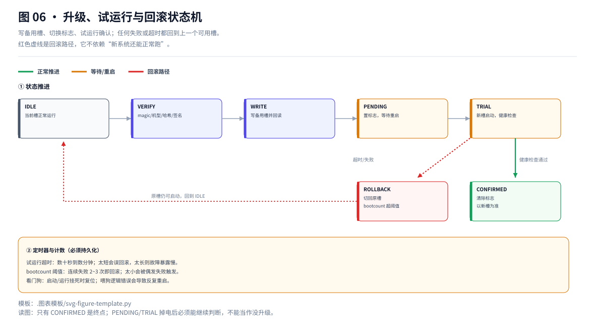

# 升级回滚与安全启动

一句话结论：可靠升级 = **原子性 + 可回滚 + 可验证**；分别由“写备用槽”“bootcount/试运行”“哈希与签名校验”保证，缺一项就会在现场变成变砖或降级攻击。

> 本篇定位：讲通用固件升级的状态机、A/B 切换、失败回滚与安全启动的信任链。OpenWrt `sysupgrade`/failsafe 的具体实现见 [22-OpenWrt/05-升级与恢复](../../22-OpenWrt/05-升级与恢复/.readme.md)；分区布局见 [00-固件布局与启动介质](./00-固件布局与启动介质.md)。

## 目录

- [1 一句话模型](#s1)
- [2 速览](#s2)
- [3 升级包与槽位结构](#s3)
- [4 升级、试运行与回滚流程](#s4)
- [5 状态机与定时器](#s5)
- [6 设计取舍与边界](#s6)
- [7 与相邻主题的关系](#s7)
- [名词解释](#名词解释)
- [8 参考与关联](#s8)

## 1 · 一句话模型

```text
运行 A ──写 B──► 切标志 ──重启──► 试运行 B ──确认──► 以 B 为准
                                   └──失败/超时──► 回滚 A
```

三个关键认知：

1. **永远不要在“正在运行的系统”上原地覆盖写**：要么写另一个槽，要么进恢复模式写。
2. **切换靠一个可持久化的标志**：bootloader 只认标志与 `bootcount`，不认“升级脚本说成功”。
3. **签名解决“谁允许启动”，哈希只解决“有没有写坏”**；两者不能互相替代。

## 2 · 速览

| 项 | 内容 |
| --- | --- |
| 所属层/领域 | 固件生命周期 / 安全 |
| 核心对象 | 升级包、A/B 槽、bootcount、签名密钥 |
| 关键参数 | 镜像版本、机型匹配、哈希、签名、试运行超时 |
| 典型场景 | OTA 升级、量产烧录、变砖恢复、防降级 |
| 主要标准 | UEFI Secure Boot 思路、U-Boot FIT 签名、TPM/OTP 信任根 |

## 3 · 升级包与槽位结构

### 3.1 升级包应包含什么

| 字段 | 作用 | 缺失后果 |
| --- | --- | --- |
| `magic` + 版本 | 快速识别格式，拒绝错包 | 误刷其他产品固件 |
| 机型/硬件版本 | 防止跨机型刷写 | 驱动不匹配，起不来 |
| 镜像长度 + 哈希 | 完整性校验 | 传输截断被当成正常镜像 |
| 签名 | 来源认证 | 可被替换为恶意固件 |
| 版本号/防降级计数 | 阻止回退到有漏洞的旧版 | 降级攻击 |
| payload（kernel/rootfs） | 实际写入内容 | — |

### 3.2 槽位与元数据

| 对象 | 位置 | 写入者 | 读取者 |
| --- | --- | --- | --- |
| `slot_a` / `slot_b` | 系统分区 | 升级程序 | bootloader |
| `active_slot` | env 或独立元数据区 | 升级程序 | bootloader |
| `bootcount` | env 或 RTC 备份寄存器 | bootloader | bootloader |
| `upgrade_flag` | 元数据区 | 升级程序 | bootloader/应用 |
| 版本与回滚计数 | 元数据区（建议双份 + CRC） | 升级程序 | 应用/ bootloader |

元数据区必须**双份 + 校验**：单份写入时掉电，设备就不知道该启动哪个槽。

## 4 · 升级、试运行与回滚流程



**读图**：从 IDLE 进入校验，只有校验通过才写备用槽；PENDING 重启后进入 TRIAL，健康检查通过才 CONFIRMED。任何超时或失败都走红色虚线回滚，且回滚不依赖“系统还能正常跑”。

> 图源：`images/图06-升级回滚状态机.svg`

### 4.1 正常流程

```text
① 下载/上传升级包到临时区（不覆盖运行分区）
② 校验 magic、机型、长度、哈希、签名
③ 写入备用槽，回读校验
④ 置 upgrade_flag + active_slot=备用，重启
⑤ bootloader 按标志启动新槽，bootcount 清零
⑥ 应用做健康检查（网络、关键服务、配置），通过后确认
```

### 4.2 异常分支

| 失败点 | 处理 | 关键点 |
| --- | --- | --- |
| 校验失败 | 删除临时包，保持原槽 | 不要“强行刷”跳过校验 |
| 写入中掉电 | 备用槽作废，标志不变 | 原槽仍可启动 |
| 新槽起不来 | `bootcount` 超阈值，`altbootcmd` 切回原槽 | bootloader 必须能独立判断 |
| 新槽起来但服务异常 | 健康检查失败，主动回滚 | 回滚要能“从应用侧触发” |
| 回滚后仍失败 | 进入恢复模式（USB/TFTP/串口） | 保留最小可用系统 |
| 版本被降级 | 防降级计数拒绝 | 计数需可持久化且防篡改 |

### 4.3 安全启动的信任链

```text
OTP/fuse 中的公钥哈希
   └─► 校验 SPL/U-Boot 签名
         └─► 校验 FIT（kernel+DTB）签名
               └─► 内核校验根文件系统（dm-verity 等）
```

每一级只信任上一级给的公钥；**信任根在硬件**（OTP/eFuse），不能放在可写 Flash 里。开启后调试会变麻烦，通常用“开发密钥 + 量产密钥”两套，并在产线切换。

## 5 · 状态机与定时器

```text
IDLE ──► VERIFY ──► WRITE ──► PENDING ──重启──► TRIAL ──► CONFIRMED
  ▲        │          │           │              │
  └────────┴──────────┴───────────┴──失败/超时──► ROLLBACK
```

| 定时器/计数 | 作用 | 典型取值 | 风险 |
| --- | --- | --- | --- |
| 下载超时 | 防止升级卡死 | 与包大小/网络相关 | 太短导致大包失败 |
| 试运行超时 | 健康检查窗口 | 数十秒到数分钟 | 太短会误回滚，太长故障暴露慢 |
| `bootcount` 阈值 | 连续启动失败次数 | 2~3 次 | 太小偶发失败就回滚 |
| 看门狗 | 启动/运行挂死复位 | 秒级 | 喂狗逻辑错误会反复重启 |

状态必须**持久化**：设备在 PENDING 与 TRIAL 之间掉电，重启后要能继续判断，而不是回到 IDLE 当作没升级。

## 6 · 设计取舍与边界

### 6.1 双分区 vs 单分区 + 恢复镜像

双分区切换快、回滚可靠，代价是 Flash 容量翻倍。单分区 + recovery 省空间，但升级时系统不可用，且 recovery 自身损坏就无解。容量紧张的设备常用“单系统 + 小 recovery + USB 救援”。

### 6.2 全量包 vs 差分包

全量包实现简单、校验直接；差分包省流量，但依赖基线版本，基线错就生成错误镜像。差分升级必须校验“升级后镜像的完整哈希”，不能只校验补丁。

### 6.3 签名密钥放哪

公钥/哈希放 OTP 最安全但不可改；放 bootloader 分区可更新但可被替换。量产设备优先 OTP，并保留“密钥轮换”预案（多槽公钥哈希）。

### 6.4 什么时候不适用

- 研发阶段频繁刷机：可以临时关闭签名，但要有明显标识，避免误流向市场。
- 无持久化存储的设备：只能靠外部烧录器，谈不上 OTA 回滚。

### 6.5 常见误判

- **“写入成功就是升级成功”**：没有试运行确认，失败要等用户发现。
- **“哈希校验通过就可信”**：哈希只能证明没写坏，不能证明来源。
- **“回滚就是再刷一次旧包”**：旧包可能已被防降级策略拒绝，回滚要走保留的原槽。

## 7 · 与相邻主题的关系

| 相邻对象 | 关系 |
| --- | --- |
| [00-固件布局与启动介质](./00-固件布局与启动介质.md) | 槽位与元数据放在哪些分区 |
| [01-U-Boot工程实践](./01-U-Boot工程实践.md) | `bootcount`/`altbootcmd`/FIT 校验 |
| [22-OpenWrt/05-升级与恢复](../../22-OpenWrt/05-升级与恢复/.readme.md) | OpenWrt 的 sysupgrade 与 failsafe 实现 |
| [30-产品与方案](../../../30-产品与方案/.readme.md) | 产品侧的 OTA 策略与运维约束 |

一句话：**升级篇定义“怎么安全地换”，布局篇与 U-Boot 篇提供“换在哪、谁来换”。**

## 名词解释

> 缩写给出英文全称；非缩写用“—”表示。

| 术语 | 英文全称 | 解释 |
| --- | --- | --- |
| A/B | A/B Slots | 两套系统分区，交替升级与启动。 |
| slot | — | 一套可启动的系统分区。 |
| OTA | Over-The-Air | 通过网络下发固件升级。 |
| bootcount | Boot Counter | 记录连续启动失败次数的计数器。 |
| rollback | — | 回滚到上一个可用版本或槽位。 |
| hash | — | 哈希值，用于完整性校验。 |
| signature | — | 数字签名，用于来源与完整性认证。 |
| anti-rollback | — | 防降级机制，拒绝低于安全版本的固件。 |
| OTP | One-Time Programmable | 一次性可编程存储，常用作信任根。 |
| eFuse | Electronic Fuse | 芯片内一次性熔丝，可存密钥哈希或启动配置。 |
| FIT | Flattened Image Tree | 可携带哈希与签名的镜像打包格式。 |
| dm-verity | Device Mapper Verity | 内核态的块设备完整性校验机制。 |
| watchdog | — | 看门狗，超时触发复位。 |
| recovery | — | 最小恢复系统，用于救援与重新烧录。 |

## 8 · 参考与关联

**参考**

- U-Boot 文档：FIT 签名、`bootcount` 与 `altbootcmd`
- Linux 内核文档：`Documentation/admin-guide/device-mapper/verity.rst`
- RAUC / SWUpdate 项目文档（A/B 与增量升级的工程实现）
- 源仓库 `1.知识体系/7.openwrt/6.其他/upgrade.md`、`recovery.md`

**关联**

- [00-固件布局与启动介质](./00-固件布局与启动介质.md)
- [01-U-Boot工程实践](./01-U-Boot工程实践.md)
- [22-OpenWrt/05-升级与恢复](../../22-OpenWrt/05-升级与恢复/.readme.md)
- [23-嵌入式基础](../.readme.md)

---

> **本篇定位**：通用固件升级的状态机、A/B 切换、回滚与安全启动信任链。
> **素材来源**：`studyspace/1.知识体系/7.openwrt/6.其他/upgrade.md`、`recovery.md`（分区与恢复思路）；通用 A/B 与签名知识补写。
> **待验证**：具体产品的槽位元数据格式、bootcount 存储位置与密钥轮换方案。
