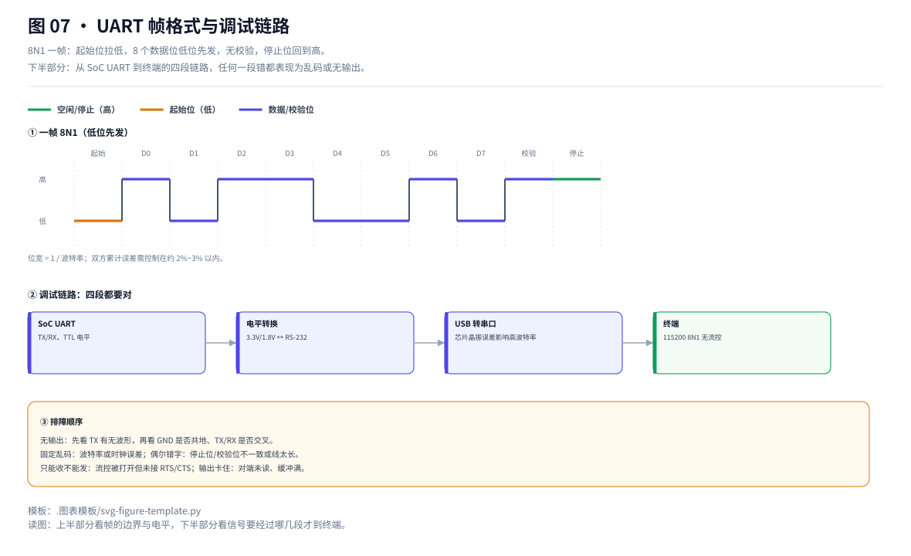

# UART 与串口调试

一句话结论：UART 是**没有时钟线的异步串行**，双方只靠“波特率 + 帧格式”对齐；它的价值不在速率，而在于**从 BootROM 开始就能看见系统**，是嵌入式排障的第一只手。

> 本篇定位：讲帧格式、电平标准、调试连接方式与常见误判。GPIO 与中断见 [02-GPIO与中断](./02-GPIO与中断.md)；高速板级总线见 [01-I2C与SPI总线](./01-I2C与SPI总线.md)；启动阶段日志见 [21-Linux/03-启动链](../../21-Linux/03-启动与根文件系统/00-启动链.md)。

## 目录

- [1 一句话模型](#s1)
- [2 速览](#s2)
- [3 帧格式与电气层](#s3)
- [4 从串口到 console 的链路](#s4)
- [5 状态机与定时器](#s5)
- [6 设计取舍与边界](#s6)
- [7 与相邻主题的关系](#s7)
- [名词解释](#名词解释)
- [8 参考与关联](#s8)

## 1 · 一句话模型

```text
空闲(高) ─ 起始(低) ─ D0…D7 ─ 校验 ─ 停止(高) ─ 空闲
```

三个关键认知：

1. **没有时钟线**：靠双方各自的波特率采样，误差超过约半个位宽就会错位。
2. **电平不是协议**：TTL、RS-232、RS-485 是三种电气层，接错会没输出甚至损坏接口。
3. **调试链路是“芯片 UART → 电平转换 → USB 转串口 → 终端”**，任何一段错都表现为乱码或无输出。

## 2 · 速览

| 项 | 内容 |
| --- | --- |
| 所属层/领域 | 嵌入式硬件接口 / 调试 |
| 核心对象 | UART 控制器、电平转换、USB 转串口、console |
| 关键参数 | 波特率、数据位、校验位、停止位、流控 |
| 典型场景 | bring-up、内核日志、bootloader 交互、产线测试 |
| 主要标准 | RS-232（TIA-232）、RS-485（TIA-485）、16550 寄存器模型 |

## 3 · 帧格式与电气层

### 3.1 帧格式

| 字段 | 作用 | 边界 |
| --- | --- | --- |
| 起始位 | 从空闲高电平拉低，标志一帧开始 | 干扰可能被误判为起始位 |
| 数据位 | 通常 5~8 位，低位先发 | 位序配反会得到“看似乱码”的固定模式 |
| 校验位 | 奇/偶/无校验 | 只能发现单比特错，不能纠错 |
| 停止位 | 1/1.5/2 位高电平 | 双方不一致时表现为偶发错帧 |
| 空闲位 | 线路保持高电平 | 长线悬空会被拉成随机电平 |

常见配置写作 `115200 8N1`：波特率 115200、8 数据位、无校验、1 停止位。

### 3.2 电平标准

| 标准 | 电平 | 距离 | 场景 |
| --- | --- | --- | --- |
| TTL/CMOS | 0~3.3V（或 1.8V） | 板内 | SoC 引脚、模块间 |
| RS-232 | ±3~±15V，负逻辑 | 十几米 | 老式 DB9 串口 |
| RS-485 | 差分 A/B | 千米级 | 工业总线、多点半双工 |

**TTL 直接接 RS-232 设备会损坏接口**；反之 RS-232 电平进入 SoC 也可能击穿引脚。中间必须有电平转换芯片。

### 3.3 波特率与误差

UART 在每位中间采样，累计误差超过约 0.5 位就会采错。工程上要求双方总误差控制在 **2%~3% 以内**。误差来源：

- SoC 时钟分频不能整除目标波特率（如 25 MHz 分频出 115200）。
- USB 转串口芯片的晶振偏差。
- 低波特率下分频系数大，误差反而更容易被吸收；高波特率对时钟更敏感。

## 4 · 从串口到 console 的链路



**读图**：上半部分是 8N1 的一帧：起始位拉低、8 个数据位、校验位、停止位回到高；下半部分是“SoC UART → 电平转换 → USB 转串口 → 终端”的完整链路，任何一段错都表现为乱码或无输出。

> 图源：`images/图07-UART帧格式.svg`

### 4.1 正常流程

```text
① 确认引脚：TX/RX/GND（必要时 RTS/CTS）
② 确认电平：3.3V TTL / 1.8V / RS-232
③ 确认参数：波特率、8N1、无流控
④ 上电，从 BootROM 阶段开始抓日志
⑤ 内核阶段确认 console=ttySx 与 earlycon
```

### 4.2 异常分支

| 现象 | 可能原因 | 排查 |
| --- | --- | --- |
| 完全无输出 | TX/RX 接反、GND 未接、电平不符 | 示波器看 TX 是否有波形 |
| 固定乱码 | 波特率不一致、时钟误差大 | 逐档尝试常见波特率 |
| 偶尔错字 | 停止位/校验位不一致、线太长 | 换短线下试，核对 8N1 |
| 只能收不能发 | 流控被打开但未接 RTS/CTS | 关闭流控 |
| 输出到一半卡住 | 对端未读导致缓冲满 | 检查流控与读取程序 |
| 重启后波特率变了 | bootloader 与内核配置不同 | 分别核对两阶段参数 |

## 5 · 状态机与定时器

UART 没有连接状态机，接收侧有两个与时间相关的机制：

1. **帧同步**：以起始位下降沿重新对齐，之后按位宽采样。
2. **空闲检测/接收超时**：用于 DMA 或中断模式判断“一帧结束”，超时值通常按 3.5 个字符时间设定（Modbus 等协议明确要求）。

发送侧只有 FIFO 水位与移位寄存器状态，没有协议层重传。

## 6 · 设计取舍与边界

### 6.1 高波特率 vs 可靠性

速率越高，线长与时钟误差越敏感。调试口常用 115200；产线日志量大时可到 921600 或 1.5 Mbps，但要求线短、地完整、转换芯片支持。

### 6.2 硬件流控要不要接

RTS/CTS 能防止接收方缓冲溢出，但多两根线、多两个引脚，且很多 USB 转串口只引出部分信号。调试口通常关闭流控；高速数据链路建议接。

### 6.3 调试口是否保留在量产

保留便于现场排障，但会暴露 shell 与日志；安全要求高的产品会关闭 console 或加认证。折中做法是保留只读日志、禁止登录。

### 6.4 什么时候不适用

- 需要多设备总线：用 I2C/SPI/RS-485，不要用多个 UART 硬堆。
- 长距离、强干扰：RS-485 或光纤，而不是拉长 TTL 线。

### 6.5 常见误判

- **“有波形就是通的”**：波形存在但电平/波特率不对，仍然全是乱码。
- **“USB 转串口一定支持目标波特率”**：部分芯片在高波特率下误差超标。
- **“GND 可以不接”**：共地是电平判定的参考，不接会随机误码。

## 7 · 与相邻主题的关系

| 相邻对象 | 关系 |
| --- | --- |
| [02-GPIO与中断](./02-GPIO与中断.md) | 复用引脚与中断接收 |
| [01-I2C与SPI总线](./01-I2C与SPI总线.md) | 板内中高速总线的替代选择 |
| [21-Linux/03-启动链](../../21-Linux/03-启动与根文件系统/00-启动链.md) | 启动阶段的唯一可见通道 |
| [02-Boot与升级/01-U-Boot工程实践](../02-Boot与升级/01-U-Boot工程实践.md) | U-Boot 命令行与日志输出 |

一句话：**串口篇解决“看不见”，其他接口篇解决“连得上、传得快”。**

## 名词解释

> 缩写给出英文全称；非缩写用“—”表示。

| 术语 | 英文全称 | 解释 |
| --- | --- | --- |
| UART | Universal Asynchronous Receiver/Transmitter | 异步串行收发器，无独立时钟线。 |
| USART | Universal Synchronous/Asynchronous Receiver/Transmitter | 支持同步模式的串行收发器。 |
| TTL | Transistor-Transistor Logic | 此处指板级 3.3V/1.8V 单端电平。 |
| RS-232 | Recommended Standard 232 | 负逻辑、较高电压的串口电气标准。 |
| RS-485 | Recommended Standard 485 | 差分、支持多点与长距离的串行标准。 |
| baud | — | 波特率，每秒符号数；UART 中近似等于比特率。 |
| oversampling | — | 过采样，接收端以多倍时钟采样一位。 |
| FIFO | First In First Out | 收发缓冲队列。 |
| DMA | Direct Memory Access | 直接内存访问，减少 CPU 搬运。 |
| console | — | 系统控制台，内核日志与登录的输出端。 |
| earlycon | Early Console | 内核早期的串口输出机制。 |
| RTS/CTS | Request To Send / Clear To Send | 硬件流控信号。 |

## 8 · 参考与关联

**参考**

- TIA-232 / TIA-485 电气标准
- Linux 内核文档：`Documentation/driver-api/serial/`
- 16550 UART 寄存器模型（FIFO、LCR、MCR、LSR）
- 源仓库 `1.知识体系/4.linux源码/Linux011启动流程.md`（早期串口输出背景）

**关联**

- [01-I2C与SPI总线](./01-I2C与SPI总线.md)
- [02-GPIO与中断](./02-GPIO与中断.md)
- [03-Flash与存储接口](./03-Flash与存储接口.md)
- [23-嵌入式基础](../.readme.md)

---

> **本篇定位**：UART 帧格式、电平标准、调试链路与乱码/无输出的排查顺序。
> **素材来源**：通用硬件接口知识补写；启动阶段背景见源仓库 `1.知识体系/4.linux源码/`。
> **待验证**：具体板卡的调试串口编号、电平（1.8V/3.3V）与默认波特率。
