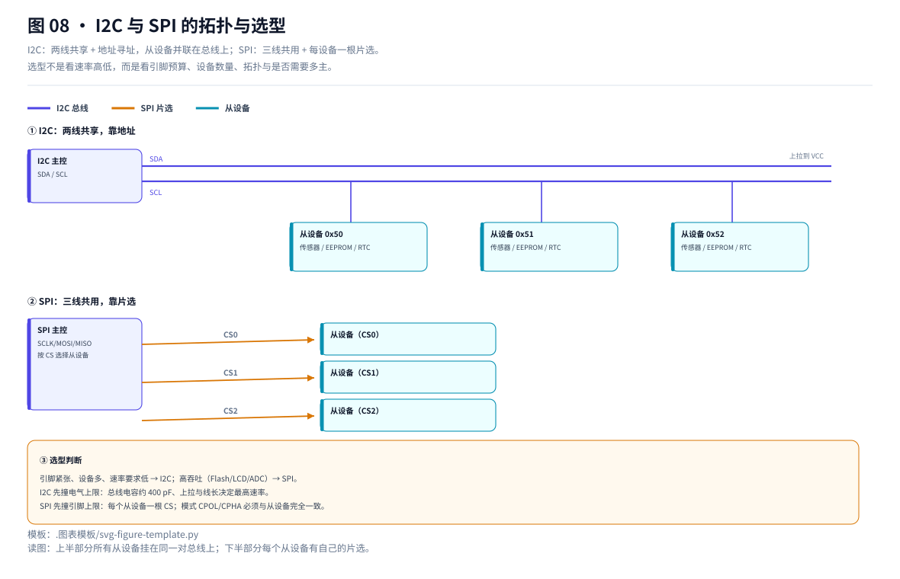

# I2C 与 SPI 总线

一句话结论：I2C 用**两根线共享总线、按地址寻址**，SPI 用**四根线点对点、按片选选择**；选型看引脚预算、速率、拓扑与是否需要多主，而不是看哪个“更先进”。

> 本篇定位：讲两条总线的帧结构、时序参数与故障模式。单线 GPIO 与中断见 [02-GPIO与中断](./02-GPIO与中断.md)；串口见 [00-UART与串口调试](./00-UART与串口调试.md)；驱动层的总线注册见 [21-Linux/02-驱动与设备树](../../21-Linux/02-驱动与设备树/.readme.md)。

## 目录

- [1 一句话模型](#s1)
- [2 速览](#s2)
- [3 帧结构与电气约束](#s3)
- [4 一次传输的流程与故障](#s4)
- [5 状态机与定时器](#s5)
- [6 设计取舍与边界](#s6)
- [7 与相邻主题的关系](#s7)
- [名词解释](#名词解释)
- [8 参考与关联](#s8)

## 1 · 一句话模型

```text
I2C：主 ──SDA/SCL──┬── 从 0x50
                   └── 从 0x51        （地址寻址，两线共享）
SPI：主 ──SCLK/MOSI/MISO── 从1  ←CS0
                          └ 从2  ←CS1 （片选寻址，四线点对点）
```

三个关键认知：

1. **I2C 的瓶颈是总线电容与上拉**：线越长、挂的设备越多，上升沿越慢，速率上不去。
2. **SPI 的瓶颈是片选与走线**：每个从设备一根 CS，设备多则引脚多；模式（CPOL/CPHA）错一位就全错。
3. **两者都没有“重传”**：协议层只做 ACK/无 ACK，可靠性要靠驱动重试与 CRC（如 SMBus PEC）。

## 2 · 速览

| 维度 | I2C | SPI |
| --- | --- | --- |
| 线数 | 2（SDA/SCL）+ 上拉 | 4（SCLK/MOSI/MISO/CS）+ 每设备一根 CS |
| 寻址 | 7/10 位地址 | 片选信号 |
| 拓扑 | 多主多从共享总线 | 单主多从，点对点 |
| 典型速率 | 100 k/400 k/1 M/3.4 MHz | 数 MHz ~ 数十 MHz |
| 双工 | 半双工 | 全双工 |
| 流控 | 时钟拉伸 | 无（靠主设备节奏） |
| 典型设备 | 传感器、EEPROM、PMIC、RTC | Flash、LCD、ADC、射频前端 |
| 故障特征 | NACK、总线锁死 | 数据错位、片选串扰 |

## 3 · 帧结构与电气约束

### 3.1 I2C 帧

| 字段 | 作用 | 边界 |
| --- | --- | --- |
| START | SCL 高时 SDA 由高变低 | 重复起始用于切换读写方向 |
| 地址 + R/W | 7 位地址 + 1 位方向 | 地址冲突会导致两个设备同时应答 |
| ACK/NACK | 每字节后接收方拉低 SDA | 无应答通常是器件不在或地址错 |
| 数据 | 8 位，高位先发 | 寄存器地址宽度因器件而异（8/16 位） |
| STOP | SCL 高时 SDA 由低变高 | 缺 STOP 会让总线停在占用态 |

电气约束：

- **开漏 + 上拉**：所有设备只能拉低，不能主动拉高，因此需要上拉电阻。
- **总线电容上限**：标准模式约 400 pF，设备越多、线越长越容易超。
- **上拉取值**：太小增加功耗与灌电流，太大导致上升沿变慢；按 `RC` 与上升时间要求折中。

### 3.2 SPI 帧与四种模式

| 模式 | CPOL | CPHA | 采样沿 |
| --- | --- | --- | --- |
| 0 | 0 | 0 | 第一个边沿（上升） |
| 1 | 0 | 1 | 第二个边沿（下降） |
| 2 | 1 | 0 | 第一个边沿（下降） |
| 3 | 1 | 1 | 第二个边沿（上升） |

`CPOL` 决定空闲电平，`CPHA` 决定在第几个边沿采样。**主从模式必须完全一致**，否则读回的数据会整体移位。

### 3.3 关键时序参数

| 参数 | 含义 | 影响 |
| --- | --- | --- |
| `tSU;DAT` | 数据建立时间 | 太小则在采样沿读到旧值 |
| `tHD;DAT` | 数据保持时间 | 与走线延迟相关 |
| `tLOW`/`tHIGH` | 时钟高低电平时间 | I2C 最小值为速率上限的来源 |
| `tR`/`tF` | 上升/下降时间 | 由上拉与电容决定 |
| CS setup/hold | 片选相对时钟的建立保持 | 不足会丢首尾字节 |

## 4 · 一次传输的流程与故障



**读图**：上半部分是 I2C——两线总线加地址，所有从设备并联；下半部分是 SPI——三线共用、每个从设备单独一根片选。下方“选型判断”给出取舍条件。

> 图源：`images/图08-I2C与SPI拓扑.svg`

### 4.1 正常流程

```text
I2C 写寄存器：START → 地址+W → ACK → 寄存器号 → ACK → 数据 → ACK → STOP
I2C 读寄存器：START → 地址+W → ACK → 寄存器号 → ACK
              → RESTART → 地址+R → ACK → 数据 → NACK → STOP
SPI 传输：拉低 CS → 按时钟沿逐位收发 → 拉高 CS
```

### 4.2 异常分支

| 现象 | 总线 | 根因 | 处理方向 |
| --- | --- | --- | --- |
| 地址无应答（NACK） | I2C | 器件未上电、地址错、引脚复用未配 | 扫描地址、查电源与 pinmux |
| 总线一直忙（SDA 低） | I2C | 从设备在传输中复位，卡住 SDA | 发 9 个时钟做总线恢复 |
| 读回全 0 或全 1 | 两者 | 片选/地址错，或 MISO 未接 | 示波器看波形与 CS |
| 数据整体移位 | SPI | CPOL/CPHA 不匹配 | 四种模式逐一验证 |
| 偶发错字节 | 两者 | 走线过长、上拉不当、地不完整 | 降速验证，再查硬件 |
| 多设备互相干扰 | I2C | 地址冲突、总线电容超限 | 改地址、加缓冲器/分总线 |

## 5 · 状态机与定时器

I2C 控制器有明确的**总线状态机**：

```text
IDLE ──START──► ADDR ──ACK──► DATA ──ACK/NACK──► … ──STOP──► IDLE
                  │
                  └──NACK/仲裁丢失──► 错误处理（释放总线 / 重试）
```

SPI 没有协议状态机，只有“片选有效期间”的移位状态；超时通常由驱动用定时器兜底（等待 FIFO/完成中断）。

## 6 · 设计取舍与边界

### 6.1 选 I2C 还是 SPI

- 引脚紧张、设备多、速率要求低：I2C。
- 需要高吞吐（Flash、LCD、ADC 连续采样）：SPI。
- 需要多主或热插拔：I2C 更自然；SPI 基本是单主。
- 长距离、强干扰：两者都不适合，考虑 RS-485/CAN 或差分方案。

### 6.2 上拉电阻怎么定

按总线电容与目标上升时间估算，再留余量；多个设备板载上拉会并联，导致等效阻值过小。**换板/加设备后要重新核对**，这是 I2C 偶发失败最常见的原因之一。

### 6.3 片选用 GPIO 还是硬件 CS

硬件 CS 时序准、CPU 负担小；GPIO 模拟 CS 灵活但容易在中断/调度中被拉长。高速 SPI 优先硬件 CS。

### 6.4 什么时候不适用

- 需要可靠性传输（校验、重传、确认）：用带链路层的总线（CAN、以太网）。
- 需要长距离：I2C/SPI 都不合适。

### 6.5 常见误判

- **“I2C 能挂 127 个设备”**：地址够不等于电气允许，电容与上拉先到极限。
- **“SPI 只要线接对就能通”**：模式、位序、CS 极性任一不符都会读到错数据。
- **“NACK 一定是器件坏了”**：多数是地址、上电时序或引脚复用问题。

## 7 · 与相邻主题的关系

| 相邻对象 | 关系 |
| --- | --- |
| [00-UART与串口调试](./00-UART与串口调试.md) | 低速调试通道，可与 I2C 互补 |
| [02-GPIO与中断](./02-GPIO与中断.md) | 片选、复位、中断引脚 |
| [03-Flash与存储接口](./03-Flash与存储接口.md) | SPI NOR/NAND 是 SPI 的主要用途 |
| [21-Linux/02-驱动与设备树](../../21-Linux/02-驱动与设备树/.readme.md) | I2C/SPI 控制器与设备驱动 |

一句话：**总线篇讲“怎么连、怎么错”，驱动篇讲“怎么注册、怎么读写”。**

## 名词解释

> 缩写给出英文全称；非缩写用“—”表示。

| 术语 | 英文全称 | 解释 |
| --- | --- | --- |
| I2C | Inter-Integrated Circuit | 两线、多主多从的同步串行总线。 |
| SMBus | System Management Bus | 基于 I2C 的系统管理总线，增加超时与 PEC。 |
| SPI | Serial Peripheral Interface | 四线、单主多从的同步串行总线。 |
| SDA | Serial Data | I2C 数据线。 |
| SCL | Serial Clock | I2C 时钟线。 |
| SCLK | Serial Clock | SPI 时钟线。 |
| MOSI | Master Out Slave In | SPI 主出从入数据线。 |
| MISO | Master In Slave Out | SPI 主入从出数据线。 |
| CS | Chip Select | SPI 片选信号。 |
| CPOL | Clock Polarity | SPI 时钟空闲电平。 |
| CPHA | Clock Phase | SPI 采样边沿选择。 |
| ACK/NACK | Acknowledge / Not Acknowledge | I2C 应答与非应答。 |
| clock stretching | — | 从设备拉低 SCL 暂停时钟的流控方式。 |
| arbitration | — | 多主同时发送时的冲突裁决。 |
| open-drain | — | 开漏输出，只能拉低，需要上拉。 |
| PEC | Packet Error Code | SMBus 的 CRC 校验字节。 |

## 8 · 参考与关联

**参考**

- NXP I2C-bus Specification（UM10204）
- SMBus 规范（System Management Bus Specification）
- SPI 时序参数以各器件数据手册为准
- Linux 内核文档：`Documentation/i2c/`、`Documentation/spi/`

**关联**

- [00-UART与串口调试](./00-UART与串口调试.md)
- [02-GPIO与中断](./02-GPIO与中断.md)
- [03-Flash与存储接口](./03-Flash与存储接口.md)
- [23-嵌入式基础](../.readme.md)

---

> **本篇定位**：I2C/SPI 的帧结构、时序约束、拓扑差异与故障模式。
> **素材来源**：通用总线知识补写；Linux 侧实现见 [21-Linux/02-驱动与设备树](../../21-Linux/02-驱动与设备树/.readme.md)。
> **待验证**：具体板卡的上拉阻值、总线电容与 SPI 模式，需以原理图与器件手册为准。
