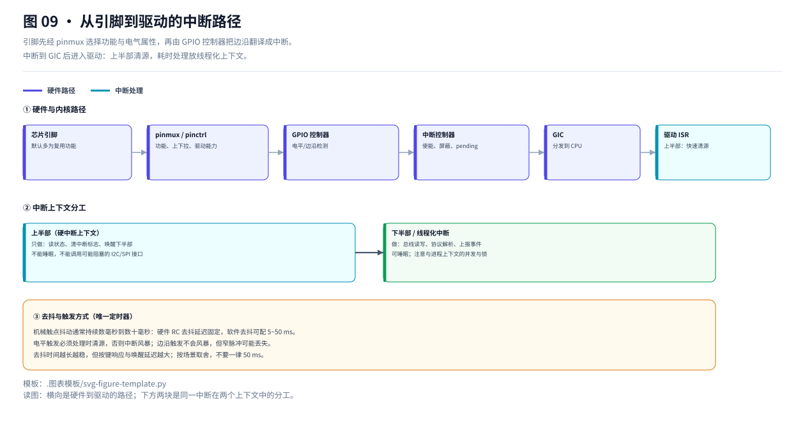

# GPIO 与中断

一句话结论：GPIO 是**软件可控的一根电平线**，价值在“电平/边沿”；中断把这根线的变化变成事件，但真正难的是**复用配置、电气匹配、去抖与并发**，不是 `gpio_set_value` 本身。

> 本篇定位：讲引脚复用、电气配置、中断路径与去抖。总线接口见 [01-I2C与SPI总线](./01-I2C与SPI总线.md)；串口见 [00-UART与串口调试](./00-UART与串口调试.md)；Linux 侧驱动模型见 [21-Linux/02-驱动与设备树](../../21-Linux/02-驱动与设备树/.readme.md)。

## 目录

- [1 一句话模型](#s1)
- [2 速览](#s2)
- [3 引脚、电气与中断属性](#s3)
- [4 从边沿到驱动的流程](#s4)
- [5 状态机与定时器](#s5)
- [6 设计取舍与边界](#s6)
- [7 与相邻主题的关系](#s7)
- [名词解释](#名词解释)
- [8 参考与关联](#s8)

## 1 · 一句话模型

```text
引脚 ──pinmux──► GPIO 控制器 ──► 中断控制器 ──► GIC ──► 驱动 ISR
                        │                                  │
                     电平/边沿                        上半部/下半部
```

三个关键认知：

1. **引脚默认不是 GPIO**：上电后多数引脚是复用功能，必须先配 pinmux 与电气属性。
2. **中断是“边沿/电平的翻译”**：触发方式选错，会丢事件或中断风暴。
3. **机械触点一定会抖**：去抖放在硬件、驱动还是应用，决定了延迟与 CPU 占用。

## 2 · 速览

| 项 | 内容 |
| --- | --- |
| 所属层/领域 | 嵌入式硬件接口 / 中断 |
| 核心对象 | 引脚复用、GPIO 控制器、中断控制器、驱动 ISR |
| 关键参数 | 方向、上下拉、驱动能力、触发方式、去抖时间 |
| 典型场景 | 按键、复位、LED、电源使能、外设中断线 |
| 主要标准 | SoC pinctrl 文档、Linux gpiod/gpiochip 接口 |

## 3 · 引脚、电气与中断属性

### 3.1 引脚复用（pinmux）

| 配置 | 作用 | 配错的后果 |
| --- | --- | --- |
| 功能选择 | 把引脚切到 GPIO / UART / I2C / SPI | 写 GPIO 无效，或总线完全不通 |
| 方向 | 输入/输出 | 输出对输出会打架，甚至损坏 |
| 上下拉 | 悬空时确定电平 | 浮空输入读到随机值 |
| 驱动能力 | 输出电流/斜率 | 太小驱动不动，太大引起过冲 |
| 电压域 | 1.8V/3.3V 组 | 跨压域直连会损坏引脚 |

### 3.2 输出类型

| 类型 | 行为 | 适用 | 边界 |
| --- | --- | --- | --- |
| 推挽 | 主动输出高/低 | 普通数字信号 | 两个推挽输出短接会大电流 |
| 开漏 | 只能拉低，需上拉 | I2C、共享信号、电平转换 | 上升沿由 RC 决定 |
| 输入+中断 | 只读电平并触发中断 | 按键、外设 IRQ | 需要去抖与触发方式配置 |

### 3.3 中断触发方式

| 方式 | 触发条件 | 适用 | 风险 |
| --- | --- | --- | --- |
| 上升沿 | 低→高 | 脉冲型信号 | 窄脉冲可能被漏掉 |
| 下降沿 | 高→低 | 低有效中断 | 同上 |
| 双边沿 | 任意跳变 | 需要计数的信号 | 抖动会放大成多次中断 |
| 高/低电平 | 电平保持 | 共享中断、需要保持的请求 | 未及时处理会中断风暴 |

## 4 · 从边沿到驱动的流程



**读图**：左边是引脚与 pinmux，中间是 GPIO 控制器与中断控制器，右边是 GIC 与驱动；下方标出上半部/下半部与去抖定时器的位置。

> 图源：`images/图09-GPIO中断路径.svg`

### 4.1 正常流程

```text
① 设备树描述：gpios = <&gpio1 12 GPIO_ACTIVE_LOW>
② pinctrl 配置复用与上下拉
③ 驱动申请 GPIO 与中断号，注册 handler
④ 使能中断，等待边沿
⑤ 上半部快速清中断标志，下半部做耗时处理
⑥ 关闭时释放中断与 GPIO
```

### 4.2 异常分支

| 现象 | 根因 | 处理方向 |
| --- | --- | --- |
| 申请 GPIO 失败 | 引脚已被其他驱动占用 | 查设备树与 `/sys/kernel/debug/gpio` |
| 中断一直不来 | pinmux 未配、触发方式不符 | 示波器看边沿，核对 `interrupt-parent` |
| 中断风暴 | 电平触发但未清源 | 改为边沿或先屏蔽再处理 |
| 按键一次触发多次 | 机械抖动 | 硬件 RC 或软件去抖 |
| 休眠后中断丢失 | 唤醒源未配置 | 设置 `wakeup-source` 与电源域 |
| 偶发丢中断 | 中断被长时间屏蔽 | 缩短上半部，改用线程化中断 |

## 5 · 状态机与定时器

引脚有四个状态：

```text
复位(default) ──► 复用(function) ──► GPIO 输入/输出 ──► 中断使能
```

中断控制器侧有 `pending → active → masked` 的状态迁移；电平触发若在 active 期间再次拉低，会产生嵌套/重复。

去抖定时器是唯一的常规定时器：常见 5~50 ms，取决于触点与使用场景；时间越长越稳，但按键响应越迟钝。

## 6 · 设计取舍与边界

### 6.1 轮询 vs 中断

轮询实现简单、无并发问题，但占 CPU 且响应受调度影响；中断响应快，但要处理去抖、共享与唤醒。低频按键可以轮询，外设的“数据就绪”信号必须用中断。

### 6.2 上半部 vs 线程化中断

上半部在中断上下文执行，不能睡眠；耗时操作放下半部（tasklet/workqueue）或线程化中断。I2C/SPI 读写这类会睡眠的操作**必须**放在线程化上下文。

### 6.3 电平触发 vs 边沿触发

电平触发适合“请求保持到被处理”的共享中断，但必须保证处理时清源；边沿触发不会风暴，但窄脉冲可能丢。两者不能靠“试出来”，要按器件手册的 IRQ 行为选。

### 6.4 什么时候不适用

- 需要精确时间戳/高频计数：用定时器捕获或专用外设，不要靠 GPIO 中断软件计数。
- 需要隔离：GPIO 直连没有隔离，工业场景要加光耦/数字隔离器。

### 6.5 常见误判

- **“设备树写了 gpios 就能用”**：pinctrl 没配，引脚仍是别的功能。
- **“中断不来就是驱动问题”**：先看波形与触发方式，再看驱动。
- **“去抖越长越稳”**：会吞掉快速脉冲，也会增加唤醒延迟。

## 7 · 与相邻主题的关系

| 相邻对象 | 关系 |
| --- | --- |
| [01-I2C与SPI总线](./01-I2C与SPI总线.md) | 片选/复位/中断引脚常由 GPIO 控制 |
| [00-UART与串口调试](./00-UART与串口调试.md) | 调试串口的引脚复用 |
| [21-Linux/02-驱动与设备树](../../21-Linux/02-驱动与设备树/.readme.md) | gpiod、pinctrl、设备树绑定 |
| [04-功耗与热设计/01-休眠与唤醒](../04-功耗与热设计/01-休眠与唤醒.md) | GPIO 作为唤醒源 |

一句话：**硬件篇讲“引脚怎么配”，驱动篇讲“事件怎么接”。**

## 名词解释

> 缩写给出英文全称；非缩写用“—”表示。

| 术语 | 英文全称 | 解释 |
| --- | --- | --- |
| GPIO | General-Purpose Input/Output | 通用输入输出引脚。 |
| pinmux | Pin Multiplexer | 引脚功能复用选择器。 |
| pinctrl | Pin Controller | Linux 中管理引脚复用与电气属性的子系统。 |
| GIC | Generic Interrupt Controller | ARM 架构的通用中断控制器。 |
| ISR | Interrupt Service Routine | 中断服务程序。 |
| IRQ | Interrupt Request | 中断请求信号/编号。 |
| threaded IRQ | — | 线程化中断，处理函数运行在进程上下文。 |
| debounce | — | 去抖，消除机械触点抖动。 |
| open-drain | — | 开漏输出，只能拉低。 |
| pull-up/pull-down | — | 上拉/下拉电阻配置。 |
| active-low | — | 低电平有效。 |
| wakeup-source | — | 设备树属性，标记该引脚可唤醒系统。 |

## 8 · 参考与关联

**参考**

- Linux 内核文档：`Documentation/driver-api/gpio/`、`Documentation/devicetree/bindings/gpio/`
- 各 SoC pinctrl 绑定文档
- ARM GIC 架构规范（ARM IHI 0048）
- 源仓库 `1.知识体系/3.linux驱动/gpio/ARCHITECTURE_ANALYSIS.md`

**关联**

- [01-I2C与SPI总线](./01-I2C与SPI总线.md)
- [00-UART与串口调试](./00-UART与串口调试.md)
- [21-Linux/02-驱动与设备树](../../21-Linux/02-驱动与设备树/.readme.md)
- [23-嵌入式基础](../.readme.md)

---

> **本篇定位**：GPIO 复用与电气配置、中断路径、去抖与并发取舍。
> **素材来源**：`studyspace/1.知识体系/3.linux驱动/gpio/ARCHITECTURE_ANALYSIS.md`；通用 GPIO/中断知识补写。
> **待验证**：具体 SoC 的 pinctrl 属性名、中断控制器层级与唤醒配置。
