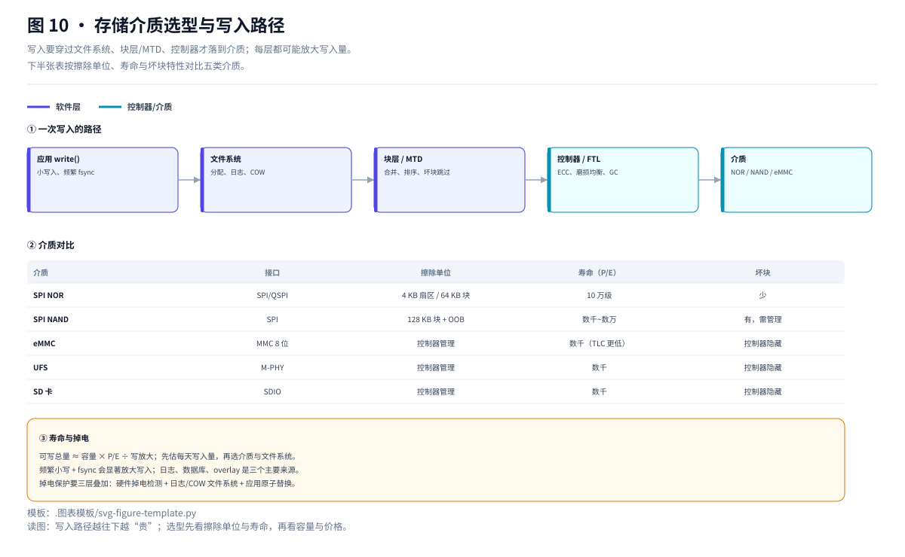

# Flash 与存储接口

一句话结论：存储选型看四个硬指标——**擦除块、寿命、坏块、接口**；文件系统必须匹配介质特性，否则断电与坏块出现时就会丢数据，而这通常发生在出货之后。

> 本篇定位：讲 NOR/NAND/eMMC/UFS 的差异、寿命估算与文件系统匹配。分区布局见 [02-Boot与升级/00-固件布局与启动介质](../02-Boot与升级/00-固件布局与启动介质.md)；总线时序见 [01-I2C与SPI总线](./01-I2C与SPI总线.md)。

## 目录

- [1 一句话模型](#s1)
- [2 速览](#s2)
- [3 介质结构与寿命参数](#s3)
- [4 一次写操作的流程与失败](#s4)
- [5 状态机与定时器](#s5)
- [6 设计取舍与边界](#s6)
- [7 与相邻主题的关系](#s7)
- [名词解释](#名词解释)
- [8 参考与关联](#s8)

## 1 · 一句话模型

```text
应用 ──► 文件系统 ──► 块层 / MTD ──► 控制器(FTL) ──► 介质
                          │                    │
                    擦除/坏块/ECC        磨损均衡/GC
```

三个关键认知：

1. **写之前必须擦**：Flash 的编程只能把位从 1 变 0，恢复 1 只能整块擦除。
2. **寿命按“写入量 × 写放大”消耗**：文件系统与日志策略直接决定设备能活多久。
3. **坏块是常态不是故障**：NAND 出厂就有坏块，运行中还会新增，必须有管理机制。

## 2 · 速览

| 项 | 内容 |
| --- | --- |
| 所属层/领域 | 嵌入式存储 |
| 核心对象 | NOR/NAND/eMMC/UFS、FTL、文件系统 |
| 关键参数 | 容量、擦除块、P/E 次数、ECC、写放大 |
| 典型场景 | 固件存储、配置持久化、日志、录像/缓存 |
| 主要标准 | JEDEC JESD84（eMMC）、ONFI（NAND）、UFS 规范 |

## 3 · 介质结构与寿命参数

### 3.1 介质对比

| 介质 | 接口 | 容量 | 擦除单位 | 寿命（P/E） | 坏块 | 典型用途 |
| --- | --- | --- | --- | --- | --- | --- |
| SPI NOR | SPI/QSPI | MB | 4 KB 扇区 / 64 KB 块 | 10 万级 | 少 | bootloader、小系统 |
| SPI NAND | SPI | 百 MB | 128 KB 块 + OOB | 数千~数万 | 有 | 低成本网关、IoT |
| eMMC | MMC 8 位 | GB | 控制器管理 | 数千（TLC 更低） | 控制器隐藏 | CPE、网关、主板系统盘 |
| UFS | M-PHY | GB~百 GB | 控制器管理 | 数千 | 控制器隐藏 | 高性能终端 |
| SD 卡 | SDIO | GB | 控制器管理 | 数千 | 控制器隐藏 | 研发、可插拔 |

### 3.2 寿命怎么估

```text
可写总量 ≈ 容量 × P/E 次数 ÷ 写放大
每天写入 × 年数 × 365 ≤ 可写总量
```

写放大的来源：文件系统块大小与擦除块不匹配、日志/数据库频繁小写、overlay 反复改写同一文件、GC 搬移。

### 3.3 关键参数

| 参数 | 作用 | 边界 |
| --- | --- | --- |
| 擦除块 | 擦除的最小单位 | 跨块写需要“读-改-擦-写” |
| 页大小 | 编程的最小单位 | 页内只能整页写，位翻转受限 |
| OOB | NAND 每页的额外区 | 存 ECC、坏块标记、文件系统元数据 |
| ECC | 纠错码 | 纠错能力不足时出现不可恢复读错 |
| P/E cycle | 擦写寿命 | 超过后块可能无法保持数据 |
| 写放大 | 实际写入/用户写入 | 直接决定寿命 |

## 4 · 一次写操作的流程与失败



**读图**：上半部分是写入路径：应用→文件系统→块层/MTD→控制器→介质；下半张表按容量、擦除单位、寿命、坏块对比五类介质。

> 图源：`images/图10-存储选型与写入路径.svg`

### 4.1 正常流程

```text
① 应用 write()，进入页缓存
② 文件系统决定块分配与日志提交
③ 块层合并/排序，MTD 层做擦除与坏块跳过
④ 控制器做 ECC、磨损均衡，写入介质
⑤ 回读校验（关键配置建议显式校验）
```

### 4.2 异常分支

| 现象 | 根因 | 处理方向 |
| --- | --- | --- |
| 掉电后文件系统损坏 | 无日志/未及时 flush | 用日志型或只读+overlay |
| 启动时坏块增多 | NAND 寿命消耗或出厂坏块未标记 | `nanddump`/坏块扫描，确认 UBI 健康 |
| 写入变慢、最后只读 | eMMC 寿命耗尽进入只读 | 监控 `life_time`，提前更换策略 |
| 读出错但重试可过 | ECC 接近极限 | 降低写入量，检查温度 |
| 容量“凭空变小” | 预留 OP 空间与坏块替换 | 正常现象，按可用容量规划 |
| 频繁 fsync 导致卡顿 | 小写入触发擦除与 GC | 合并写、批量提交 |

## 5 · 状态机与定时器

介质本身没有协议状态机；与时间相关的是**垃圾回收与磨损均衡**：

```text
空闲块 ──写入──► 有效数据块 ──失效──► 待回收 ──GC──► 空闲块
```

GC 会在写入过程中触发，造成**尾延迟尖峰**；实时性要求高的写入要预留带宽或使用 pSLC 区域。

## 6 · 设计取舍与边界

### 6.1 SLC/MLC/TLC 怎么选

SLC 寿命长、速度快、成本高；TLC 容量大、便宜但寿命与写性能差。工业/户外设备优先 pSLC 模式（用 TLC 模拟 SLC），消费类可用 TLC + 大 OP。

### 6.2 日志文件系统 vs 只读 + overlay

日志文件系统（ext4/jffs2/ubifs）能承受异常断电，但写入放大大；只读 squashfs + overlay 写入集中、恢复简单，适合系统分区。**不要把频繁写的数据库放在 overlay 上**。

### 6.3 掉电保护做到哪一层

- 硬件：掉电检测 + 超级电容，给最后几次写留时间。
- 文件系统：日志/写时复制。
- 应用：原子替换（写临时文件 + rename）、双份配置 + CRC。

三者叠加才可靠；只靠 `sync` 不能保证掉电安全。

### 6.4 什么时候不适用

- 只读固件、几乎不写：SPI NOR 足够，不必上 eMMC。
- 大容量视频缓存：优先 eMMC/UFS + 大 OP，不要用 NAND 硬扛。

### 6.5 常见误判

- **“容量够就没问题”**：寿命由写入量决定，不是容量。
- **“eMMC 有控制器就不用管坏块”**：控制器隐藏坏块，但寿命耗尽会整盘只读。
- **“`sync` 之后就一定安全”**：缓存刷到设备，设备内部仍可能有未落盘的写缓存。

## 7 · 与相邻主题的关系

| 相邻对象 | 关系 |
| --- | --- |
| [02-Boot与升级/00-固件布局与启动介质](../02-Boot与升级/00-固件布局与启动介质.md) | 分区如何按介质特性划分 |
| [01-I2C与SPI总线](./01-I2C与SPI总线.md) | SPI NOR/NAND 的物理接口 |
| [02-GPIO与中断](./02-GPIO与中断.md) | 写保护、卡检测等控制引脚 |
| [21-Linux/02-驱动与设备树](../../21-Linux/02-驱动与设备树/04-块设备与MMC.md) | 块设备与 MMC 子系统 |

一句话：**存储篇回答“用哪种介质、能写多少次”，布局篇回答“怎么分区”。**

## 名词解释

> 缩写给出英文全称；非缩写用“—”表示。

| 术语 | 英文全称 | 解释 |
| --- | --- | --- |
| NOR | Not-OR Flash | 可随机读、按扇区擦写的闪存。 |
| NAND | Not-AND Flash | 高密度、按块擦写、有坏块的闪存。 |
| eMMC | Embedded MultiMediaCard | 集成控制器的嵌入式闪存。 |
| UFS | Universal Flash Storage | 高性能移动存储接口与协议。 |
| FTL | Flash Translation Layer | 把擦除块映射为块设备的中间层。 |
| ECC | Error Correcting Code | 纠错码，纠正介质位翻转。 |
| OOB | Out Of Band | NAND 每页的额外存储区。 |
| P/E cycle | Program/Erase Cycle | 擦写次数，衡量寿命。 |
| OP | Over-Provisioning | 预留空间，用于 GC 与坏块替换。 |
| GC | Garbage Collection | 垃圾回收，搬移有效数据并擦除失效块。 |
| wear leveling | — | 磨损均衡，把擦写分散到全盘。 |
| TBW | Total Bytes Written | 总可写入字节数，寿命指标。 |
| pSLC | pseudo-SLC | 用多阶单元模拟单阶，提升寿命与性能。 |
| UBIFS | UBI File System | 建立在 UBI 之上的 NAND 日志文件系统。 |

## 8 · 参考与关联

**参考**

- JEDEC JESD84（eMMC）、JESD220（UFS）、ONFI 规范
- Linux 内核文档：`Documentation/mtd/`、`Documentation/filesystems/ubifs.rst`
- 源仓库 `1.知识体系/3.linux驱动/linuxMMC子系统.drawio`（MMC 子系统结构）
- 源仓库 `1.知识体系/7.openwrt/6.其他/upgrade.md`（分区与擦写实践）

**关联**

- [02-Boot与升级/00-固件布局与启动介质](../02-Boot与升级/00-固件布局与启动介质.md)
- [01-I2C与SPI总线](./01-I2C与SPI总线.md)
- [21-Linux/02-驱动与设备树](../../21-Linux/02-驱动与设备树/.readme.md)
- [23-嵌入式基础](../.readme.md)

---

> **本篇定位**：存储介质差异、寿命估算、掉电与坏块下的文件系统选择。
> **素材来源**：`studyspace/1.知识体系/3.linux驱动/linuxMMC子系统.drawio`、`7.openwrt/6.其他/upgrade.md`；通用存储知识补写。
> **待验证**：具体器件的 P/E 次数、OP 比例与 eMMC 寿命寄存器定义。
