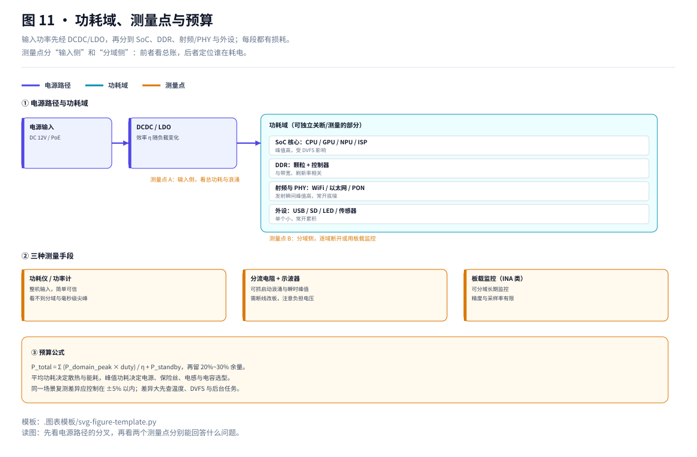

# 功耗测量与预算

一句话结论：功耗要**按电源域分解、按场景测量**；只测整机一个电流值，既定位不了问题，也做不出预算——预算 = 各域（峰值 × 占空比）+ 转换损耗 + 余量。

> 本篇定位：讲功耗域划分、测量方法与预算方法。休眠与唤醒见 [01-休眠与唤醒](./01-休眠与唤醒.md)；结温与散热见 [02-温控与散热](./02-温控与散热.md)；电源域划分与产品形态相关部分链接 [40-产品与方案](../../../40-产品与方案/.readme.md)。

## 目录

- [1 一句话模型](#s1)
- [2 速览](#s2)
- [3 功耗域与测量点](#s3)
- [4 测量流程与预算方法](#s4)
- [5 状态机与定时器](#s5)
- [6 设计取舍与边界](#s6)
- [7 与相邻主题的关系](#s7)
- [名词解释](#名词解释)
- [8 参考与关联](#s8)

## 1 · 一句话模型

```text
电源输入 ──► DCDC/LDO ──► 域1(SoC)   ┐
   │            │       域2(DDR)   ├─► 总功耗 = Σ域 + 损耗
   └─ 测量点 ───┘       域3(射频)  ┘
```

三个关键认知：

1. **平均功耗决定散热与电费，峰值功耗决定电源选型**：两者要分开测。
2. **转换损耗是真实功耗的一部分**：DCDC 效率 85% 时，负载 10 W 要从输入取约 11.8 W。
3. **没有分域测量就没有优化方向**：整机数值只能判断“超没超”，不能判断“谁超了”。

## 2 · 速览

| 项 | 内容 |
| --- | --- |
| 所属层/领域 | 嵌入式电源与可靠性 |
| 核心对象 | 电源域、DCDC/LDO、测量点、场景 |
| 关键参数 | 电压、电流、占空比、效率、浪涌 |
| 典型场景 | 电源选型、待机功耗达标、散热设计输入 |
| 主要标准 | 能效法规（如 CoC/DoE 外部电源）、产品企标 |

## 3 · 功耗域与测量点

### 3.1 常见功耗域

| 域 | 内容 | 特点 |
| --- | --- | --- |
| SoC 核心 | CPU/GPU/NPU/ISP | 峰值高、随负载波动大，受 DVFS 影响 |
| DDR | 内存颗粒与控制器 | 与带宽/刷新率相关，休眠时自刷新 |
| 射频 | WiFi/BT/蜂窝 | 发射瞬间峰值高，占空比低 |
| 有线 PHY | 以太网/PON/PCIe | 常开，待机功耗的主要来源之一 |
| 外设 | USB、SD、LED、传感器 | 单个小，但常开设备会累积 |
| 转换损耗 | DCDC/LDO 自身 | 效率曲线随负载变化，轻载最差 |

### 3.2 测量点与手段

| 手段 | 测什么 | 优点 | 局限 |
| --- | --- | --- | --- |
| 功耗仪/功率计 | 整机交流或直流输入 | 简单、可信 | 看不到分域与瞬时 |
| 分流电阻 + 示波器 | 瞬时电流、浪涌 | 能看毫秒级尖峰 | 需要断线改板，量程要匹配 |
| 电流探头 | 动态电流 | 不改电路 | 小电流精度差，易受干扰 |
| 板载监控（INA 类） | 分域长期功耗 | 可量产监控 | 精度与采样率有限 |
| 软件估算 | 粗略趋势 | 零成本 | 不能用于验收 |

**分流电阻的负担电压**（burden voltage）会压低负载端电压，测量时要用 Kelvin 接法并核算压降；量程选大了小电流不准，选小了浪涌会饱和。

## 4 · 测量流程与预算方法



**读图**：上半部分把输入到各域的路径画出来，测量点分别落在“输入侧”和“分域侧”；下半部分给出预算公式与三种测量手段的取舍。

> 图源：`images/图11-功耗域与测量.svg`

### 4.1 测量流程

```text
① 定义场景：关机/待机/空闲/典型业务/满载/启动
② 每个场景稳定运行 ≥ 5 分钟，记录均值与峰值
③ 分域测量：至少拆出 SoC、DDR、射频、常开外设
④ 同步记录温度与电压（功耗随温度与电压漂移）
⑤ 用同一场景复测，确认可重复性（±5% 以内）
```

### 4.2 预算公式

```text
P_total = Σ (P_domain_peak × duty) / η + P_standby
```

- `η`：DCDC/LDO 效率，轻载时明显下降。
- `duty`：该域在场景中的占空比，射频尤其关键。
- `P_standby`：常开域（PHY、RTC、监控）的底噪。
- 再留 20%~30% 余量给电源与散热，不要按理论值选器件。

### 4.3 异常分支

| 现象 | 根因 | 排查 |
| --- | --- | --- |
| 峰值超过电源能力，偶发重启 | 启动浪涌、射频突发、电容不足 | 示波器抓启动 10 ms 波形 |
| 待机功耗不达标 | 常开 PHY、LDO 静态电流、未关的外设时钟 | 分域断开测量 |
| 测量值与规格书差很多 | 量程/线损/负担电压 | 换量程、四线测量、核对探头 |
| 同一场景两次差异大 | 温度、DVFS 状态、后台任务 | 固定频率、关闭后台、控温 |

## 5 · 状态机与定时器

功耗本身没有协议状态机，但**场景状态**必须明确：

```text
关机 → 待机 → 空闲 → 典型业务 → 满载
                 └── 休眠（见休眠篇）
```

没有定时器；但测量要覆盖“启动浪涌”这一短暂状态（通常几十毫秒到数百毫秒），它决定保险丝、MOS 与电容选型。

## 6 · 设计取舍与边界

### 6.1 DCDC 还是 LDO

DCDC 效率高、适合大压差与大电流，但有纹波与 EMI；LDO 干净、简单，但压差大时损耗全变热。射频/模拟域常用 LDO，数字核心用 DCDC。

### 6.2 电源域切分越细越好吗

切得细能单独关断、单独测量，但增加器件、成本与静态功耗。按“是否能独立关断 + 是否需要独立测量”划分，不要为每一颗芯片都做一路。

### 6.3 峰值余量怎么留

按最坏场景（启动 + 射频发射 + 满载）叠加，再留 20%~30%；同时看电感的饱和电流与电容的 ESR，不能只看平均电流。

### 6.4 什么时候不适用

- 电池供电设备：还要测放电曲线与内阻，单点功耗不够。
- 高压/隔离场景：测量需要差分探头与安规隔离，不能用普通探头直接测。

### 6.5 常见误判

- **“整机功耗达标就没事”**：某域超了、另一域低了，整机可能刚好达标但局部过热。
- **“平均电流乘电压就是功耗”**：功率因数、纹波与占空比会让瞬时值差很多。
- **“规格书的典型值可以直接用”**：测试条件（电压、温度、负载）不同，结果差一倍很常见。

## 7 · 与相邻主题的关系

| 相邻对象 | 关系 |
| --- | --- |
| [01-休眠与唤醒](./01-休眠与唤醒.md) | 休眠是降低待机功耗的主要手段 |
| [02-温控与散热](./02-温控与散热.md) | 功耗是热设计的输入 |
| [03-硬件接口](../03-硬件接口/.readme.md) | 外设常开功耗与接口选型相关 |
| [40-产品与方案](../../../40-产品与方案/.readme.md) | 产品能效指标与电源方案 |

一句话：**测量篇给出“耗多少”，散热篇回答“散得掉吗”。**

## 名词解释

> 缩写给出英文全称；非缩写用“—”表示。

| 术语 | 英文全称 | 解释 |
| --- | --- | --- |
| PMIC | Power Management Integrated Circuit | 电源管理芯片，含多路 DCDC/LDO。 |
| DCDC | DC-to-DC Converter | 直流变换器，效率高但有纹波。 |
| LDO | Low Dropout Regulator | 低压差线性稳压器，干净但效率低。 |
| DVFS | Dynamic Voltage and Frequency Scaling | 动态调压调频，按负载调整功耗。 |
| SoC | System on Chip | 片上系统。 |
| PHY | Physical Layer | 物理层收发器，如以太网/PON PHY。 |
| duty cycle | — | 占空比，设备处于活动状态的时间比例。 |
| quiescent current | — | 静态电流，器件无负载时的自身消耗。 |
| shunt resistor | — | 分流电阻，用于测量电流。 |
| burden voltage | — | 分流电阻引入的压降，会影响负载。 |
| efficiency | — | 转换效率，输出功率与输入功率之比。 |
| inrush current | — | 启动浪涌电流。 |
| power budget | — | 功耗预算，按域与场景分配的功率上限。 |

## 8 · 参考与关联

**参考**

- 各厂商 PMIC/DCDC 数据手册的效率曲线与静态电流参数
- 外部电源能效法规（CoC、DoE Level VI）作为待机指标参考
- 源仓库 `1.知识体系/7.openwrt/6.其他/故障排查.md`（功耗相关现象）

**关联**

- [01-休眠与唤醒](./01-休眠与唤醒.md)
- [02-温控与散热](./02-温控与散热.md)
- [03-硬件接口](../03-硬件接口/.readme.md)
- [23-嵌入式基础](../.readme.md)

---

> **本篇定位**：功耗域划分、测量手段、场景化预算与电源余量。
> **素材来源**：通用电源与测量知识补写；产品侧电源方案见 [40-产品与方案](../../../40-产品与方案/.readme.md)。
> **待验证**：具体产品的能效指标、电源效率曲线与测试工况。
