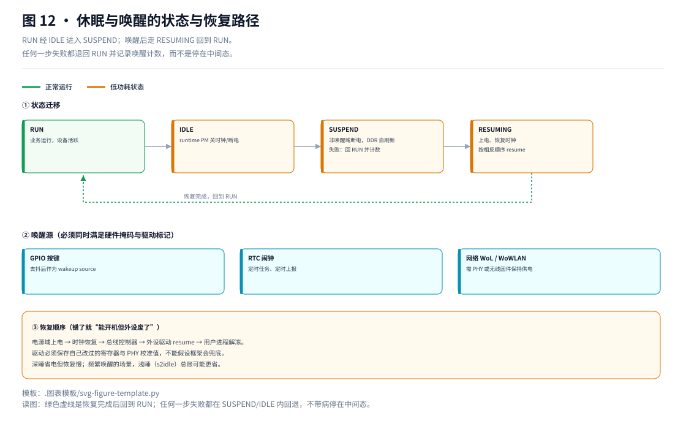

# 休眠与唤醒

一句话结论：休眠不是“调用一个 suspend 接口”，而是**关掉不必要的电源域、保留唤醒源、保证恢复后状态一致**；三者任一缺失，就会出现“睡不下去、醒不来、醒来外设废了”。

> 本篇定位：讲休眠层级、唤醒源、恢复路径与失败模式。功耗测量见 [00-功耗测量与预算](./00-功耗测量与预算.md)；结温与降频见 [02-温控与散热](./02-温控与散热.md)；GPIO 中断配置见 [03-硬件接口/02-GPIO与中断](../03-硬件接口/02-GPIO与中断.md)。

## 目录

- [1 一句话模型](#s1)
- [2 速览](#s2)
- [3 休眠层级与唤醒源](#s3)
- [4 进入与退出流程](#s4)
- [5 状态机与定时器](#s5)
- [6 设计取舍与边界](#s6)
- [7 与相邻主题的关系](#s7)
- [名词解释](#名词解释)
- [8 参考与关联](#s8)

## 1 · 一句话模型

```text
RUN ──空闲──► IDLE(runtime PM) ──► SUSPEND ──唤醒源──► RESUME ──► RUN
                                      │
                                 DDR 自刷新 / 部分域断电
```

三个关键认知：

1. **休眠深度是连续的**：从关时钟、关电源域到 DDR 自刷新，越深越省电、恢复越慢。
2. **唤醒源必须双向配置**：设备树/驱动标记为 wakeup source，且硬件中断掩码允许唤醒。
3. **恢复失败多半是状态没保存**：外设寄存器、PHY 校准、时钟树，任何一项没恢复都会表现为“能开机但网口不通”。

## 2 · 速览

| 项 | 内容 |
| --- | --- |
| 所属层/领域 | 嵌入式低功耗 |
| 核心对象 | 电源域、时钟、唤醒源、恢复顺序 |
| 关键参数 | 休眠深度、唤醒延迟、唤醒计数、自动休眠超时 |
| 典型场景 | 电池设备待机、CPE 夜间低功耗、按键唤醒 |
| 主要标准 | Linux PM 框架（`/sys/power/state`）、ACPI S 状态概念 |

## 3 · 休眠层级与唤醒源

### 3.1 常见层级

| 层级 | 做什么 | 功耗 | 恢复时间 | 适用 |
| --- | --- | --- | --- | --- |
| Runtime PM | 单个设备空闲时关时钟/断电 | 略降 | 微秒~毫秒 | 常开系统的细粒度省电 |
| Idle（WFI） | CPU 停时钟等中断 | 小幅下降 | 微秒 | 轻负载 |
| s2idle | 系统进入浅睡，靠空闲+中断唤醒 | 中等 | 毫秒级 | 需要快速响应 |
| Deep/STR | 大部分域断电，DDR 自刷新 | 低 | 数十~数百毫秒 | 待机数小时~数天 |
| Hibernation | 内存镜像写存储后断电 | 最低 | 秒级 | 长期存放、电池耗尽保护 |
| Poweroff | 全关 | — | 完整启动 | 关机 |

### 3.2 唤醒源

| 唤醒源 | 典型用途 | 注意 |
| --- | --- | --- |
| GPIO 按键 | 用户唤醒 | 需去抖、配置为 wakeup source |
| RTC 闹钟 | 定时任务、定时上报 | 时区与闰秒由应用处理 |
| 网络（WoL/WoWLAN） | 远程唤醒 | 需 PHY/无线固件保持供电 |
| 定时器 | 周期采样 | 精度与功耗折中 |
| 外设中断 | 传感器事件 | 共享中断要确认来源 |

### 3.3 必须保存的状态

| 状态 | 保存方式 | 丢失后果 |
| --- | --- | --- |
| CPU 上下文 | 内核负责 | 无法恢复执行 |
| DDR 内容 | 自刷新 | 内存数据丢失 |
| 外设寄存器 | 驱动 suspend/resume 回调 | 网口不通、音频失声 |
| PHY 校准值 | 驱动保存或重校准 | 链路不稳、速率下降 |
| 时钟/电源域配置 | 时钟框架与 PM domain | 恢复后频率错、功耗异常 |
| 文件系统 | 同步/日志 | 数据损坏 |

## 4 · 进入与退出流程



**读图**：RUN 经 IDLE 进入 SUSPEND，唤醒后走 RESUME 回到 RUN；下方列出唤醒源与“恢复顺序”，任何一步失败都会退回 RUN 并记录唤醒计数。

> 图源：`images/图12-休眠唤醒状态机.svg`

### 4.1 正常流程

```text
① 应用/策略决定休眠，检查 wakeup count 是否允许
② 冻结用户进程，设备按依赖顺序 suspend
③ 关闭非唤醒域电源，DDR 进入自刷新
④ 等待唤醒源（按键/RTC/网络）
⑤ 恢复电源与时钟，按相反顺序 resume 设备
⑥ 恢复用户进程，核对时间与网络状态
```

### 4.2 异常分支

| 现象 | 根因 | 排查 |
| --- | --- | --- |
| 睡不下去（立即返回） | 有 wakeup source 处于 active，或驱动 suspend 返回错误 | `/sys/power/wakeup_count`、dmesg |
| 睡下去立刻醒 | 中断未清、唤醒源持续有效 | `/sys/kernel/debug/wakeup_sources` |
| 醒不来 | 唤醒源未使能、电源域未上电 | 硬件唤醒线、PMIC 配置 |
| 醒来网口不通 | PHY 未复位/未重校准 | 驱动 resume 顺序 |
| 唤醒后时间错乱 | RTC 未同步或时区处理错 | RTC 驱动与 NTP |
| 反复休眠/唤醒 | 自动休眠超时太短、后台任务唤醒 | 调整 autosuspend 与任务策略 |

## 5 · 状态机与定时器

```text
RUN ──► IDLE ──► SUSPEND ──► RESUMING ──► RUN
  ▲        │          │           │
  └────────┴──────────┴───────────┘  失败：回 RUN 并计数
```

| 定时器/计数 | 作用 | 风险 |
| --- | --- | --- |
| autosuspend 超时 | 设备空闲多久后自动挂起 | 太短频繁挂起/恢复，反而更耗电 |
| 系统自动休眠 | 无操作多久进入休眠 | 与业务周期冲突 |
| RTC 闹钟 | 定时唤醒 | 时区/闰秒处理 |
| wakeup_count | 防止“准备休眠时又来事件”的竞态 | 计数不匹配会直接放弃休眠 |
| 看门狗 | 恢复挂死时复位 | 恢复时间超过喂狗周期会误复位 |

## 6 · 设计取舍与边界

### 6.1 深睡 vs 浅睡

深睡省电但恢复慢，且外设状态更容易丢；浅睡恢复快但省得少。按“待机时长 × 唤醒频率”算总账：频繁唤醒的场景，浅睡可能更省。

### 6.2 休眠时是否保持网络

保持 WoL/WoWLAN 需要 PHY 或无线固件持续供电，待机功耗显著上升；不保持则无法远程唤醒。产品上常做“有线保持、无线关闭”或按时间段切换。

### 6.3 驱动 suspend/resume 的职责边界

驱动应保存自己改过的寄存器，而不是假设“框架会兜底”；恢复顺序按依赖关系（电源→时钟→总线→设备），顺序错会出现“寄存器写进去又丢失”。

### 6.4 什么时候不适用

- 需要持续实时响应的设备：深睡会带来不可接受的唤醒延迟。
- 电源本身不支持域关断：只能做 CPU idle，收益有限。

### 6.5 常见误判

- **“能进入 suspend 就说明休眠正常”**：恢复失败往往在几秒后才暴露。
- **“唤醒源配置一次就够”**：固件升级、设备树变更、驱动改动都可能破坏它。
- **“休眠功耗等于待机功耗”**：休眠瞬间的浪涌与周期唤醒会拉高平均值。

## 7 · 与相邻主题的关系

| 相邻对象 | 关系 |
| --- | --- |
| [00-功耗测量与预算](./00-功耗测量与预算.md) | 休眠收益要用分场景测量验证 |
| [02-温控与散热](./02-温控与散热.md) | 休眠降低功耗，也影响温度策略 |
| [03-硬件接口/02-GPIO与中断](../03-硬件接口/02-GPIO与中断.md) | 按键与中断作为唤醒源 |
| [21-Linux/04-进程与并发](../../21-Linux/04-进程与并发/.readme.md) | 冻结进程与恢复的调度行为 |

一句话：**休眠篇讲“怎么省”，测量篇讲“省了多少”，温控篇讲“热是否受控”。**

## 名词解释

> 缩写给出英文全称；非缩写用“—”表示。

| 术语 | 英文全称 | 解释 |
| --- | --- | --- |
| suspend | — | 系统或设备进入低功耗状态。 |
| resume | — | 从低功耗状态恢复。 |
| runtime PM | Runtime Power Management | 运行期按设备空闲状态动态省电。 |
| autosuspend | — | 设备空闲超时后自动挂起。 |
| s2idle | Suspend-to-Idle | 浅休眠，保持内存供电，靠空闲进入。 |
| STR | Suspend-to-RAM | 深度休眠，DDR 自刷新，其余域断电。 |
| hibernation | — | 休眠到磁盘，内存镜像写入存储后断电。 |
| wakeup source | — | 能够把系统从休眠中唤醒的事件源。 |
| wakeup_count | — | 唤醒事件计数，用于避免休眠竞态。 |
| DDR self-refresh | — | DDR 自刷新，休眠期间保持内存内容。 |
| WoL | Wake-on-LAN | 通过网络报文唤醒。 |
| WoWLAN | Wake-on-WLAN | 通过无线报文唤醒。 |
| RTC | Real-Time Clock | 实时时钟，可定时唤醒。 |
| PHY | Physical Layer | 物理层收发器。 |
| DVFS | Dynamic Voltage and Frequency Scaling | 动态调压调频。 |

## 8 · 参考与关联

**参考**

- Linux 内核文档：`Documentation/power/`（suspend、runtime PM、wakeup sources）
- `/sys/power/state`、`/sys/power/wakeup_count` 接口说明
- 各 SoC PMIC 与电源域手册

**关联**

- [00-功耗测量与预算](./00-功耗测量与预算.md)
- [02-温控与散热](./02-温控与散热.md)
- [03-硬件接口/02-GPIO与中断](../03-硬件接口/02-GPIO与中断.md)
- [23-嵌入式基础](../.readme.md)

---

> **本篇定位**：休眠层级、唤醒源、恢复顺序与失败模式。
> **素材来源**：通用 Linux PM 与硬件低功耗知识补写；功耗背景见 [00-功耗测量与预算](./00-功耗测量与预算.md)。
> **待验证**：具体 SoC 支持的休眠深度、唤醒源掩码与 PMIC 域关断能力。
