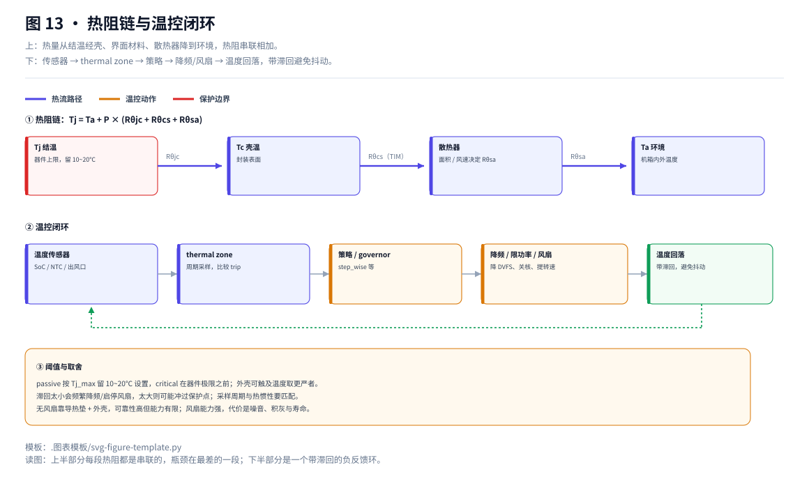

# 温控与散热

一句话结论：结温 = 环境温度 + 功耗 × 热阻链总和；温控是在**结温撞上限之前**用降频、限功率、风扇把热耗散掉，而不是等过热保护关机——那时用户已经感知到故障了。

> 本篇定位：讲热阻链、散热路径、温度传感器与降频策略。功耗是热设计的输入，见 [00-功耗测量与预算](./00-功耗测量与预算.md)；休眠对温度的影响见 [01-休眠与唤醒](./01-休眠与唤醒.md)。

## 目录

- [1 一句话模型](#s1)
- [2 速览](#s2)
- [3 热阻链与散热路径](#s3)
- [4 温控闭环与异常](#s4)
- [5 状态机与定时器](#s5)
- [6 设计取舍与边界](#s6)
- [7 与相邻主题的关系](#s7)
- [名词解释](#名词解释)
- [8 参考与关联](#s8)

## 1 · 一句话模型

```text
Tj ──Rθjc──► Tc ──Rθcs──► 散热器 ──Rθsa──► Ta
 │            │             │              │
结温        壳温         界面材料        环境温度
```

三个关键认知：

1. **热阻是串联的**：哪一段最大，哪一段就是瓶颈；涂再好的硅脂也救不了散热面积不足。
2. **壳温是安规指标，结温是器件指标**：外壳不烫不代表结温安全，反之亦然。
3. **温控是闭环**：传感器 → 策略 → 降频/风扇 → 温度变化，必须考虑滞后与超调。

## 2 · 速览

| 项 | 内容 |
| --- | --- |
| 所属层/领域 | 嵌入式可靠性与结构 |
| 核心对象 | 结温、热阻、散热器、温度传感器、降频策略 |
| 关键参数 | `Tj_max`、`Rθja`、功耗、环境温度、风速 |
| 典型场景 | 无风扇 CPE、密闭机箱、高温户外设备 |
| 主要标准 | JEDEC JESD51（热阻测量）、IEC 60950/62368（可触及温度） |

## 3 · 热阻链与散热路径

### 3.1 热阻链

| 符号 | 含义 | 典型来源 | 降低手段 |
| --- | --- | --- | --- |
| `Tj` | 结温 | 芯片内部 | 降低功耗 |
| `Rθjc` | 结到壳 | 封装 | 选低热阻封装、加散热焊盘 |
| `Rθcs` | 壳到散热器 | 导热垫/硅脂 | 合适厚度与压力，避免气隙 |
| `Rθsa` | 散热器到环境 | 散热面积、风速 | 加大面积、增加风道 |
| `Ta` | 环境温度 | 机箱内外 | 风道设计、避免热源堆叠 |

估算：

```text
Tj = Ta + P × (Rθjc + Rθcs + Rθsa)
```

先算最坏场景（最高环境温度 + 最大功耗），再看 `Tj` 是否低于 `Tj_max` 并留 10~20 ℃ 余量。

### 3.2 散热方式

| 方式 | 能力 | 成本/代价 | 适用 |
| --- | --- | --- | --- |
| 自然对流 | 低 | 无噪音、无活动件 | 低功耗、密闭外壳 |
| 导热垫 + 金属外壳 | 中 | 需要结构压力与平整度 | 无风扇 CPE、网关 |
| 散热片 | 中 | 体积与重量 | 中等功耗 |
| 风扇 | 高 | 噪音、寿命、积灰 | 高功耗、可维护设备 |
| 均热板/热管 | 高 | 成本与工艺 | 局部热点、紧凑空间 |

### 3.3 温度传感器

| 位置 | 作用 | 风险 |
| --- | --- | --- |
| SoC 内部 | 反映结温趋势 | 与真实热点有偏差 |
| 板载 NTC | 反映局部环境 | 位置不当会误判 |
| 外壳/出风口 | 安规与用户体验 | 响应慢 |
| 射频/电源 | 独立热点监控 | 需要单独策略 |

## 4 · 温控闭环与异常



**读图**：上半部分是串联热阻链，热量从结温一路降到环境；下半部分是温控闭环：传感器采样 → thermal zone 比较 trip point → 降频/风扇 → 温度回落，带滞回避免抖动。

> 图源：`images/图13-热阻链与温控闭环.svg`

### 4.1 正常流程

```text
① 传感器周期性采样（典型 100 ms~1 s）
② 与 trip point 比较，超过 passive 开始降频
③ 超过 active 打开风扇/提高转速
④ 接近 critical 时进一步限功率或关机
⑤ 温度回落后按滞回逐步恢复性能
```

### 4.2 异常分支

| 现象 | 根因 | 处理方向 |
| --- | --- | --- |
| 频繁降频、性能抖动 | trip point 太近、滞回太小 | 拉开阈值，增加滞回 |
| 外壳超温但结温正常 | 热源贴近外壳、风道短路 | 调整布局与导热路径 |
| 结温高但外壳不热 | 界面材料失效、气隙 | 检查导热垫压缩量与平整度 |
| 风扇反复启停 | 阈值过窄 | 设置启动/停止双阈值 |
| 高温下随机重启 | 保护点设置过低或电源降额 | 核对 `Tj_max` 与电源余量 |
| 低温启动失败 | 晶振/存储/液晶低温特性 | 预热或选宽温器件 |

## 5 · 状态机与定时器

thermal zone 有明确状态：

```text
NORMAL ──trip(passive)──► THROTTLING ──trip(active)──► FAN ──trip(critical)──► SHUTDOWN
   ▲                          │                          │
   └────── 温度回落 + 滞回 ────┴──────────────────────────┘
```

| 定时器/参数 | 作用 | 风险 |
| --- | --- | --- |
| 采样周期 | 轮询温度 | 太慢会冲过保护点，太快增加开销 |
| 滞回（hysteresis） | 防止阈值附近抖动 | 太小会频繁切换 |
| 风扇启停延时 | 避免反复启停 | 太长会过热 |
| 降频步进 | 每次降多少频/压 | 太猛影响业务，太缓压不住温度 |

## 6 · 设计取舍与边界

### 6.1 无风扇 vs 有风扇

无风扇可靠性高、无噪音，但散热能力受限，必须靠外壳与导热路径；有风扇能力强，但引入活动件寿命、积灰与噪音问题。户外/工业设备优先无风扇 + 宽温器件。

### 6.2 降频还是限功率

降频直接降低动态功耗，但影响性能；限功率（限制射频发射、关闭部分核）对体验影响更直接。通常先降频，再考虑关核/限射频。

### 6.3 温度阈值怎么定

按 `Tj_max` 留 10~20 ℃ 余量设 passive，critical 设在器件极限之前；同时满足外壳可触及温度要求（安规），两者取更严的那个。

### 6.4 什么时候不适用

- 功耗极低（<1 W）的设备：自然散热足够，不需要闭环温控。
- 极端环境（高温炉、真空）：需要专门的热设计与降额，通用策略不适用。

### 6.5 常见误判

- **“外壳不烫就没问题”**：热量可能集中在芯片内部，结温已接近上限。
- **“加风扇就万事大吉”**：风道短路或进风口堵塞时，风扇只是耗电。
- **“温度一高就关机最安全”**：频繁关机比降频更影响可用性，且可能掩盖设计缺陷。

## 7 · 与相邻主题的关系

| 相邻对象 | 关系 |
| --- | --- |
| [00-功耗测量与预算](./00-功耗测量与预算.md) | 功耗是热阻计算的输入 |
| [01-休眠与唤醒](./01-休眠与唤醒.md) | 休眠降低功耗，间接降低温度 |
| [03-硬件接口](../03-硬件接口/.readme.md) | 传感器接口与风扇控制引脚 |
| [40-产品与方案](../../../40-产品与方案/.readme.md) | 产品形态、外壳与安规要求 |

一句话：**功耗篇给“热源”，本篇算“热阻”，产品篇定“外壳与安规”。**

## 名词解释

> 缩写给出英文全称；非缩写用“—”表示。

| 术语 | 英文全称 | 解释 |
| --- | --- | --- |
| Tj | Junction Temperature | 芯片结温，器件可靠性的关键指标。 |
| Tc | Case Temperature | 封装壳温。 |
| Ta | Ambient Temperature | 环境温度。 |
| Rθ | Thermal Resistance | 热阻，单位功耗下的温升（℃/W）。 |
| Rθjc | Junction-to-Case Thermal Resistance | 结到壳的热阻。 |
| Rθcs | Case-to-Sink Thermal Resistance | 壳到散热器的热阻。 |
| Rθsa | Sink-to-Ambient Thermal Resistance | 散热器到环境的热阻。 |
| TIM | Thermal Interface Material | 导热界面材料，如硅脂、导热垫。 |
| thermal zone | — | Linux 中一个温度监控区域及其策略。 |
| trip point | — | 温度触发点，分 passive/active/critical 等。 |
| throttling | — | 降频/降额，降低发热。 |
| DVFS | Dynamic Voltage and Frequency Scaling | 动态调压调频。 |
| hysteresis | — | 滞回，避免阈值附近反复切换。 |
| NTC | Negative Temperature Coefficient | 负温度系数热敏电阻。 |
| JESD51 | JEDEC Standard 51 | 封装热阻测量标准。 |

## 8 · 参考与关联

**参考**

- JEDEC JESD51 系列（热阻与热测试方法）
- IEC 62368-1（可触及表面温度要求）
- Linux 内核文档：`Documentation/driver-api/thermal/`
- 各 SoC 数据手册的 `Tj_max`、`Rθja` 与功耗曲线

**关联**

- [00-功耗测量与预算](./00-功耗测量与预算.md)
- [01-休眠与唤醒](./01-休眠与唤醒.md)
- [03-硬件接口](../03-硬件接口/.readme.md)
- [23-嵌入式基础](../.readme.md)

---

> **本篇定位**：热阻链估算、散热方式对比、温控闭环与阈值取舍。
> **素材来源**：通用热设计与 Linux thermal 框架知识补写；功耗输入见 [00-功耗测量与预算](./00-功耗测量与预算.md)。
> **待验证**：具体器件的 `Tj_max`、封装热阻与外壳温度限值。
