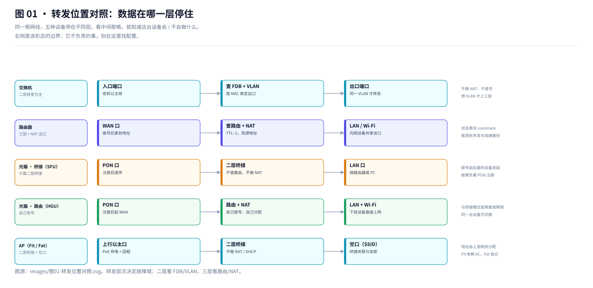
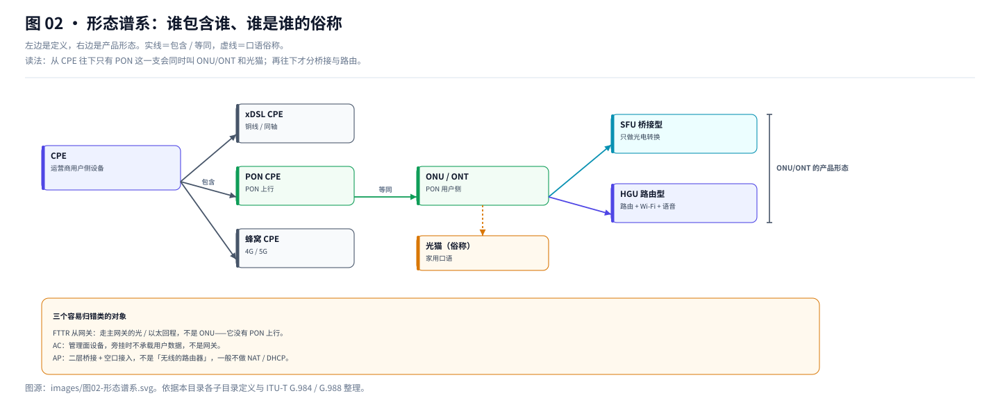
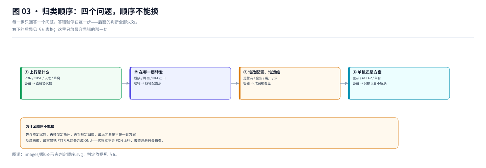

# 设备形态对比

交换机、路由器、CPE、智能网关、FTTR、ONU/ONT、AP/AC 不是七个并列的盒子，而是三组坐标的组合：**上行介质**（接谁）、**转发位置**（怎么走）、**管理归属**（谁说了算）。同一块硬件换一套软件包和管理通道，在另一个场景里就叫另一个名字。

> 本篇定位：只回答三件事——这台设备算哪类形态、它和相邻形态的边界在哪、要深入该去哪个子目录。协议报文去 [10-基础理论](../10-基础理论/.readme.md)，Linux/OpenWrt 实现去 [20-平台与系统](../20-平台与系统/.readme.md)，SoC/SDK 差异去 [40-平台与芯片](../40-平台与芯片/.readme.md)。

## 目录

- [1 一句话模型](#s1)
- [2 速览](#s2)
- [3 先分清六个概念](#s3)
- [4 形态对照表](#s4)
- [5 形态关系](#s5)
- [6 判定顺序](#s6)
- [7 设计取舍与边界](#s7)
- [8 与相邻主题的关系](#s8)
- [名词解释](#名词解释)
- [9 参考与关联](#s9)

## 1 · 一句话模型：三个坐标定形态

```text
上行介质（接谁）          转发位置（怎么走）           管理归属（谁说了算）
以太 / xDSL / PON         二层桥接（查 FDB）           运营商：OMCI / TR-069
蜂窝 / 光纤到房间          三层路由（查路由表）          企业：SNMP / CAPWAP / CLI
                          NAT 出口（改地址）            用户：本地 Web / App
                          纯空口接入（不分配地址）       云：厂商云平台

三者组合起来，才是这台设备在项目里的形态名。
```

三个关键认知：

1. **形态名描述角色，不描述硬件**：光猫路由一体机同时是 ONU、路由器、AP、语音网关，按它此刻在干什么归类。
2. **名称由责任边界决定**：谁负责开通、谁负责排障，就归到哪一类。所以同一台设备在运营商叫 CPE，在电商页面叫路由器。
3. **判边界看上行与转发位置，不看外观**：4 个 LAN 口加天线的盒子，可能是路由器、AP，也可能是开了路由模式的光猫。

> **推论**：听到「智能网关」先别问性能，先问「它上面挂了谁的插件、谁远程管它」——那才是它和路由器的差别。
> **边界**：这套模型只用于「归类与找配置入口」。它不解释性能差异：同样叫路由器，转发走 CPU 还是硬件加速，性能差一个数量级，那要去 20/40 看实现与平台。

## 2 · 速览

| 项 | 内容 |
| --- | --- |
| 本篇对象 | 9 种形态：交换机、路由器、CPE、智能网关、FTTR、ONU/ONT、光猫、AP、AC |
| 分类坐标 | 上行介质 / 转发位置 / 管理归属 |
| 最易混的三对 | CPE vs 路由器、光猫 vs ONU/ONT、FTTR vs 光猫 |
| 判定入口 | §6 四个问题，顺序不能换 |
| 主要标准 | IEEE 802.1Q/802.1AX、ITU-T G.984/G.988、BBF TR-069、RFC 5415 |
| 主要风险 | 把一机多角色当单一形态；按外观分类；把组网方案当成一台设备 |

## 3 · 先分清六个概念

这六条是实际沟通里最容易吵起来的地方。左列是常听到的说法，中列是技术事实，右列是误判之后会去做的错事。

| 常见说法 | 实际 | 误判后果 |
| --- | --- | --- |
| 「光猫就是 ONU」 | 口语成立。ONU 是 PON 用户侧的统称，ONT 强调单个用户终端；产品上再分桥接型 SFU 与路由型 HGU | 拿通用 ONU 行为去套 HGU，会把「设备自己拨号」当成不该有的事 |
| 「FTTR 是更好的光猫」 | FTTR 是「主网关 + 从网关 + 光纤」的组网方案；从网关走主网关的光/以太回程，没有 PON 上行 | 去查从网关的 PON 注册，其实该查主从回程与配对 |
| 「智能网关 = 路由器 + App」 | 差别在插件框架与云管通道（能远程装/停业务）；转发面通常仍是 Linux 路由加硬件加速 | 把「智能」当性能指标，选型时漏掉转发能力 |
| 「AP 是无线交换机」 | AP 主要做二层桥接与空口接入，一般不做 NAT、不跑 DHCP；Fit AP 可由 AC 隧道集中转发 | 在 AP 上找 NAT/拨号配置，找不到是正常的 |
| 「CPE 是运营商的路由器」 | CPE 按「部署在用户侧 + 受运营商管理」定义，桥接光猫也是 CPE | 把 CPE 等同于「带路由」，桥接场景下找错配置点 |
| 「AC 一定是硬件盒子」 | 软件 AC、云 AC 同样成立；旁挂 AC 只走管理面，直连/串联 AC 才承载用户数据 | 以为所有流量都过 AC，容量规划与故障域都算错 |

## 4 · 形态对照表

拆成两张看：4.1 回答「它是谁、边界在哪」，4.2 回答「它靠什么实现、该测什么」。先用 4.1 定角色，再用 4.2 找验证点。

### 4.1 定位与边界

| 形态 | 核心定位 | 关键能力 | 转发位置 | 边界与易混 |
| --- | --- | --- | --- | --- |
| 交换机 | 二层/三层转发 | VLAN、STP、LACP、端口镜像 | 以二层 FDB 转发为主，三层交换机才做路由 | 通常不做 NAT 与拨号；「路由交换机」是加了三层转发的交换机，不是路由器 |
| 路由器 | 路由与出口 | NAT、QoS、VPN、Wi-Fi | 三层路由 + NAT 出口 | 家用无线路由器 = 路由 + 交换 + AP 三合一；企业路由器常不带 Wi-Fi |
| CPE | 运营商客户侧终端 | 拨号、路由、远程管理 | 桥接或路由，由运营商业务模板决定 | 按部署位置和管理归属定义；桥接光猫也是 CPE |
| 智能网关 | 家庭/企业智能中枢 | 插件、云管、智能家居 | 仍是三层路由/转发，智能在管理面 | 「智能」指可远程装业务，不指转发性能 |
| FTTR | 光纤到房间组网 | 主从网关、光纤组网、漫游 | 主网关做 PON 上行与路由；从网关做二层桥接与覆盖 | 是方案不是单机；从网关不是 ONU |
| ONU/ONT | PON 用户侧设备 | 注册、业务、语音/IPTV | 桥接（SFU）或路由（HGU） | ONU 是统称，ONT 强调单用户终端；光猫是俗称 |
| 光猫 | 家用 PON 终端（ONU/ONT 的俗称） | 光电转换、桥接/路由、Wi-Fi/语音 | 桥接或路由，看是否开了路由模式 | 不是独立技术类别；同一台设备可被叫光猫或智能网关 |
| AP | 无线接入点 | Wi-Fi 覆盖、PoE、集中管理 | 二层桥接 + 空口接入 | 一般不做 NAT/DHCP；Fat AP 可独立，Fit AP 依赖 AC |
| AC | 无线控制器 | AP 管理、射频调优、漫游 | 管理面；旁挂时不承载用户数据 | 不等于网关；没有 AC 时 Fit AP 不能独立工作 |

上面「转发位置」一列是分水岭，展开成图看：

### 图 01 · 转发位置对照



**读图**：五行设备，中间那一格就是分水岭——交换机查 FDB，路由器查路由表并做 NAT，桥接光猫只透传，路由光猫自己拨号，AP 只做二层桥接与空口。右侧是该形态「不负责的事」，排障时先看这一列，能少走一半弯路。

> 图源：`images/图01-转发位置对照.svg`

### 4.2 实现与验收

| 形态 | 关键协议/技术 | 软件栈 | 管理通道 | 测试重点 | 为什么测这些 |
| --- | --- | --- | --- | --- | --- |
| 交换机 | Ethernet、VLAN、STP、LACP | 交换 SDK/OpenWrt | 本地 CLI、SNMP、Web | 吞吐、时延、环网、稳定性 | 转发在交换芯片，软件只下配置，所以测的是表项容量与硬件路径 |
| 路由器 | IP、NAT、PPPoE、Wi-Fi | OpenWrt/Linux | 本地 Web/CLI；运营商版加 TR-069 | 转发性能、并发、稳定性 | 有 NAT 与状态表，瓶颈在 conntrack 与加速路径，不在接口速率 |
| CPE | PPPoE、DHCP、TR-069 | OpenWrt/厂商 SDK | ACS（TR-069）、OMCI（PON 侧）、本地 Web | 拨号、业务、入网认证 | 开通与运维都走远程通道，失败必须能远程定位 |
| 智能网关 | Matter/Thread、Wi-Fi、TR-069 | OpenWrt/容器/插件 | 厂商云、TR-069、本地 App | 业务兼容、安全、云管 | 插件能远程安装，兼容性与权限是主要风险 |
| FTTR | PON、OMCI、EasyMesh | 海思/厂商 SDK | 主网关统一管理，运营商侧走 ACS | 光功率、组网、漫游、运维 | 多了光回程与主从协同，故障点从单机变成一条链路 |
| ONU/ONT | PON、OMCI、VoIP | 厂商 SDK/OpenWrt | OMCI（OLT 侧）、TR-069（可选） | 注册、业务、互通、稳定性 | 注册由 OLT 授权，互通性取决于 OMCI 实现，不只看本机 |
| 光猫 | PON、OMCI、TR-069、SIP | 厂商 SDK/OpenWrt | OMCI、ACS、本地 Web | 注册、桥接/路由、三网业务、光功率 | 桥接与路由是两套故障域，测之前先确认当前模式 |
| AP | 802.11、CAPWAP、PoE | Fat/Fit/云固件 | AC（CAPWAP）、云平台、本地 Web | 覆盖、并发、漫游、PoE | 空口是共享介质，测的是干扰与并发，不是有线线速 |
| AC | CAPWAP、802.11k/v/r、802.1X | 硬件/软件/云 AC | 本地网管、云网管 | AP 容量、切换、可靠性 | 管的是 AP 生命周期与射频参数，用户数据不一定过它 |

> **推论**：测试重点能从「转发在哪一层 + 谁下配置」推出来，不用背。转发在芯片 → 测表项与线速；转发在 CPU → 测并发与 NAT 表；配置在远端 → 测开通链路与远程排障。
> **边界**：这张表给的是默认形态。同一型号可能同时支持桥接与路由，验收前先确认当前角色，否则测的是另一台设备的指标。

## 5 · 形态关系：包含、组合、配合

```text
CPE（运营商用户侧设备）
  ├─ xDSL CPE
  ├─ PON CPE ── ONU/ONT ── 光猫（家用俗称）
  └─ 蜂窝 CPE

ONU/ONT 的产品形态：SFU（桥接，不拨号）/ HGU（路由，自己拨号）
FTTR = 主光猫（PON + 路由）+ 从网关（房间覆盖）+ 光纤
智能网关 = 路由/光猫底座 + 插件 + 云管 + 智能家居协议
WLAN = AC（管理/漫游）+ Fit AP（覆盖/接入）；Fat AP 可独立组网
```

### 图 02 · 形态谱系



**读图**：从 CPE 往右，只有 PON 那一支会同时叫 ONU/ONT 和光猫，再往右才分 SFU 与 HGU；xDSL 与蜂窝两支没有 PON 口，所以不会叫光猫。底部三个对象不在谱系里：FTTR 从网关没有 PON 上行，AC 在管理面，AP 在二层。

> 图源：`images/图02-形态谱系.svg`

- **光猫与 ONU/ONT 是同一类设备**：规范名是 ONU/ONT，光猫是家用场景的俗称。产品上还要再分一层——SFU 只做 PON 注册与桥接，拨号交给后面的路由器；HGU 自己拨号，并带 Wi-Fi 与语音。产品形态见 [光猫产品形态](./36-ONU-ONT/03-光猫产品形态.md)。
- **ONU/ONT 与 CPE 是包含关系**：PON CPE 就是 ONU/ONT；CPE 还包括 xDSL 和蜂窝终端。反过来不成立——蜂窝 CPE 没有 PON 口，不会注册到 OLT。
- **FTTR 不是一种「猫」**：它是一套「主网关 + 从网关 + 光纤」的组网方案，主网关通常由光猫/网关承担。**边界**：从网关不是 ONU，它没有 PON 上行；把它当光猫排障，会去查一个不存在的注册流程。
- **AP 与 AC 是配合关系**：Fit AP 负责空口接入，AC 负责发现/配置/射频/漫游；Fat AP 可脱离 AC 独立工作。**边界**：旁挂 AC 只走管理面，用户数据不经过它；只有直连/串联部署才把数据也串进去。
- **AP 不是路由器**：AP 主要做二层桥接，NAT/路由通常在网关或 AC 侧；产品形态见 [AP 产品架构](./37-AP-AC/00-AP产品架构.md)。**边界**：企业 Fit AP 可以用 CAPWAP 数据隧道把流量集中到 AC，但那是隧道转发，不是 AP 自己在做 NAT。
- **智能网关不是新的转发平面**：转发仍是 Linux 路由与硬件加速，「智能」体现在插件框架与云管通道。**边界**：插件越多，内存与升级风险越大，这部分见 [34-智能网关](./34-智能网关/.readme.md)。

> **推论**：判断两类设备是不是同一类，只看两件事——上行介质是否相同、转发位置是否相同。两者都相同，差异通常只在软件包和管理通道。

## 6 · 判定顺序：拿到一台设备怎么归类

归类不是查型号，是问四个问题。顺序有依赖：前一个答错，后一个就没有意义。

### 图 03 · 归类顺序



**读图**：四个问题从左到右，每张卡片第二行是「答错会怎样」。卡片颜色只区分问题，不表示重要程度——四步同等重要，缺一步就会归错类。

> 图源：`images/图03-形态判定顺序.svg`

| 步骤 | 问什么 | 怎么答 | 答错的后果 |
| --- | --- | --- | --- |
| ① 判上行 | 它上行接什么 | 看接口与模块：PON 口、DSL 口、以太 WAN、SIM | 上行判错，会去查错的协议栈（PON 注册 vs PPPoE） |
| ② 判转发位置 | 只做二层桥接，还是做路由/NAT | 看有没有 WAN/LAN 之分、有没有 NAT 与 DHCP 服务 | 在 AP 上找 NAT，或把桥接光猫当路由器排障 |
| ③ 判管理归属 | 谁改配置、谁排障 | 看有没有 ACS/OMCI/AC 通道，改完是否被远程覆盖 | 改本地配置被 ACS 下发覆盖，或去 ACS 找一个它不支持的能力 |
| ④ 判单机还是方案 | 一台设备，还是一套组网 | 看有无主从、多 AP 协同、光纤回程 | 只换一台设备，问题其实在链路或主从协同 |

**走查一遍**：一台带 4 个 LAN 口、1 个 PON 口、天线的设备，开了路由模式，运营商能远程下发配置。① PON → ONU 家族；② 路由 + NAT → HGU；③ 运营商 ACS → CPE/光猫；④ 单机 → 光猫（HGU）。若同一台设备下挂 3 个从网关，第④步就变成 FTTR 方案，主设备仍叫光猫，但从网关不是。

> **推论**：这四步也能反过来用——问「这个功能该在哪台设备上配」。先在③定位管理通道，再回①看上行，基本不会找错盒子。

## 7 · 设计取舍与边界

本篇不涉及状态机与定时器：形态是静态分类，运行状态（PON 注册、PPPoE 拨号、AP 关联）在各自子目录的笔记里，这里不重复。

### 7.1 为什么会长出这么多形态

- **责任边界不同**：运营商要远程开通与排障，CPE/光猫就必须有 OMCI 或 TR-069 通道；企业要集中管控，交换机与 AP 就走 SNMP/CAPWAP；家庭要即插即用，光猫默认开路由与 Wi-Fi。
- **部署位置决定上行介质**，介质决定协议栈，协议栈再决定形态名：PON 口带来 OMCI，DSL 口带来 PPPoE over ATM/PTM，蜂窝带来 SIM 鉴权。
- **成本档位不同**：桥接型 SFU 便宜、功耗低；路由型 HGU 多一颗 CPU 的活；FTTR 用光纤换距离和穿墙能力。
- **不用会怎样**：如果只有「路由器」一种形态，运营商无法远程开通业务，企业无法统一改射频参数，家庭用户得自己配 PPPoE——三方的运维成本最后都转给用户。

### 7.2 代价与失效条件

- 代价是**一机多角色**：光猫路由一体机同时是 ONU、路由器、AP、语音网关，按型号命名必然失真。所以本篇按「当前角色」归类。
- **按外观分类一定失败**：4 个 LAN 口加天线，可能是路由器、AP，也可能是开了路由的光猫。
- **按型号分类也会失败**：同一型号刷不同固件，在运营商那里叫光猫，在零售市场叫智能网关。
- **什么时候不适用**：做性能优化、协议互通、驱动排障时，形态分类只帮你找到配置入口，不解释差异——那要去 [20-平台与系统](../20-平台与系统/.readme.md) 和 [40-平台与芯片](../40-平台与芯片/.readme.md)。

> **边界**：本篇的「形态」是产品定义层面的划分，不是标准术语。同一台设备在不同运营商的招标文件里可能叫「智能网关」「家庭网关」「光猫」，以合同与技术规范为准。

## 8 · 与相邻主题的关系

| 相邻对象 | 关系 | 边界（细节去哪看） |
| --- | --- | --- |
| [10-基础理论](../10-基础理论/.readme.md) | 协议报文与原理（PPPoE、VLAN、NAT、DHCP、PON、Wi-Fi、TR-069） | 本篇只出现协议名，不展开报文与状态机 |
| [20-平台与系统](../20-平台与系统/.readme.md) | Linux/OpenWrt 实现（netifd、fw3/fw4、DSA、QoS、无线、升级） | 本篇不写配置方法与代码路径 |
| [40-平台与芯片](../40-平台与芯片/.readme.md) | SoC/SDK/芯片差异（海思、MTK、QCA、展锐等） | 本篇不写选型与性能数字 |
| [31-交换机](./31-交换机/.readme.md) | 三平面架构、VLAN/STP/LACP/镜像、测试与验收 | 交换机内部结构不在本篇 |
| [32-路由器](./32-路由器/.readme.md) | 整机架构、路由/NAT/端口映射、QoS 与流控 | 转发与 NAT 细节不在本篇 |
| [33-CPE](./33-CPE/.readme.md) | CPE 架构、宽带拨号、TR-069/ACS、运营商定制 | 开通流程不在本篇 |
| [34-智能网关](./34-智能网关/.readme.md) | 网关架构、插件与云管、智能家居与安全 | 插件框架不在本篇 |
| [35-FTTR](./35-FTTR/.readme.md) | 主从组网、光层预算与运维 | 组网与光功率不在本篇 |
| [36-ONU-ONT](./36-ONU-ONT/.readme.md) | ONU/ONT 架构、PON 注册/OMCI、VoIP/IPTV、光猫形态 | 注册与业务配置不在本篇 |
| [37-AP-AC](./37-AP-AC/.readme.md) | AP 架构、AC 与 CAPWAP、组网与漫游、覆盖与验收 | 射频与漫游不在本篇 |

一句话总结边界：**本篇是地图，子目录是街区**。地图上找不到的细节，说明它本来就该去子目录看。

使用方式：

- 原理放 `10-基础理论/`，平台差异放 `40-平台与芯片/`，产品细节放本目录对应子目录。
- 每写一个产品，补充「典型芯片、软件栈、关键协议、测试重点、常见问题」。

## 名词解释

> 缩写给出英文全称；非缩写用“—”表示。

| 术语 | 英文全称 | 解释 |
| --- | --- | --- |
| CPE | Customer Premises Equipment | 用户侧设备。 |
| ONU | Optical Network Unit | 光网络单元；PON 用户侧的统称。 |
| ONT | Optical Network Terminal | 光网络终端；强调单个用户终端。 |
| SFU | Single Family Unit | 单家庭单元；桥接型光猫，只做 PON 注册与二层桥接，不拨号。 |
| HGU | Home Gateway Unit | 家庭网关单元；路由型光猫，自己拨号并带 Wi-Fi/语音。 |
| 光猫 | — | 家用 ONU/ONT 的俗称。 |
| FTTR | Fiber To The Room | 光纤到房间。 |
| 从网关 | — | FTTR 中负责房间覆盖的设备，经光纤/以太回程接主网关，不走 PON 上行。 |
| PON | Passive Optical Network | 无源光网络。 |
| OMCI | ONT Management and Control Interface | ONT 管理控制接口；OLT 配置 ONT 的通道（ITU-T G.988）。 |
| TR-069 | CPE WAN Management Protocol（CWMP） | 运营商 ACS 远程管理 CPE 的协议。 |
| ACS | Auto Configuration Server | 自动配置服务器，TR-069 的服务端。 |
| VLAN | Virtual Local Area Network | 虚拟局域网。 |
| STP | Spanning Tree Protocol | 生成树协议。 |
| LACP | Link Aggregation Control Protocol | 链路聚合控制协议（IEEE 802.1AX，原 802.3ad）。 |
| NAT | Network Address Translation | 网络地址转换。 |
| QoS | Quality of Service | 服务质量。 |
| AP | Access Point | 无线接入点。 |
| AC | Access Controller | 无线控制器。 |
| CAPWAP | Control and Provisioning of Wireless Access Points | AP 控制与配置协议（RFC 5415）。 |
| PoE | Power over Ethernet | 以太网供电。 |
| SSID | Service Set Identifier | 无线网络名称。 |
| FDB | Forwarding Database | 二层转发表，即 MAC 地址表。 |
| EasyMesh | — | Wi-Fi 联盟的多 AP 组网标准，负责 AP 间组网与漫游协同。 |
| xDSL | — | 数字用户线；ADSL/VDSL 等铜线接入方式的统称。 |

## 9 · 参考与关联

**标准**

- IEEE 802.1Q（VLAN、MSTP）、802.1D（STP，RSTP 已并入 2004 版）、802.1AX（LACP，原 802.3ad）、802.3ah（EPON）、802.11（WLAN）。
- ITU-T G.984.x（GPON）、G.9807.1（XGS-PON）、G.988（OMCI）。
- Broadband Forum TR-069（CWMP），配套数据模型 TR-098 / TR-181。
- IETF RFC 2131（DHCPv4）、RFC 2516（PPPoE）、RFC 5415 / 5416（CAPWAP）。
- CSA Matter、Thread Group Thread：智能家居侧协议，版本以联盟发布为准。

**关联**

- [31-交换机](./31-交换机/.readme.md)：三平面架构、VLAN/STP/LACP/镜像、测试验收。
- [32-路由器](./32-路由器/.readme.md)：整机架构、路由/NAT/端口映射、QoS。
- [33-CPE](./33-CPE/.readme.md)：CPE 架构、宽带拨号、TR-069、运营商定制。
- [34-智能网关](./34-智能网关/.readme.md)：网关架构、插件/云管、智能家居与安全。
- [35-FTTR](./35-FTTR/.readme.md)：主从组网、光层与运维。
- [36-ONU-ONT](./36-ONU-ONT/.readme.md)：ONU/ONT 架构、PON 注册/OMCI、VoIP/IPTV、光猫形态。
- [37-AP-AC](./37-AP-AC/.readme.md)：AP 架构、AC 与 CAPWAP、组网与漫游、覆盖与验收。

---

> **本篇定位**：9 种设备形态的边界、归类顺序与对照表；不含报文、实现与芯片差异。
> **素材来源**：本笔记 2026-11-12 版原文与本目录各子目录 `.readme.md`；标准编号按 IEEE / ITU-T / BBF / IETF 公开目录核对（访问 2026-11-22）。
> **待验证**：各厂商对「智能网关」的命名、FTTR 主从管理协议（私有协议与 EasyMesh 的比例）差异较大，具体以产品规格书与运营商技术规范为准。
