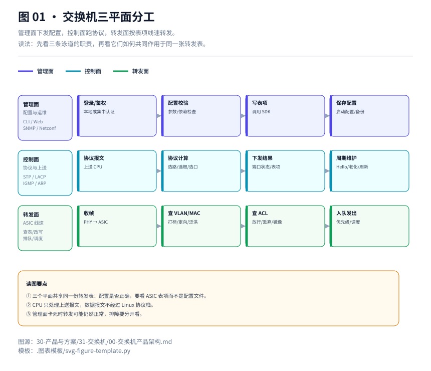
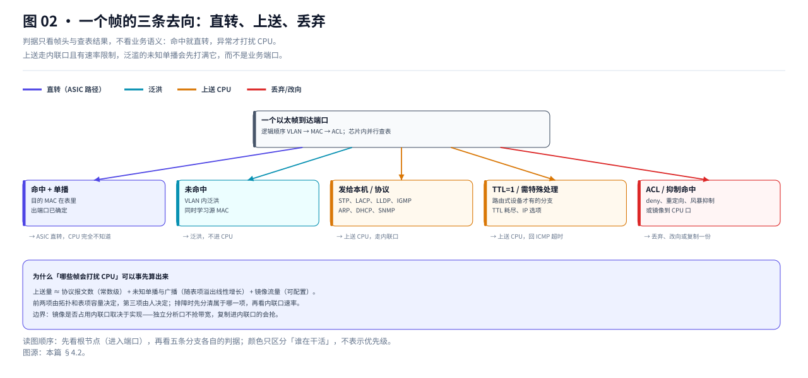
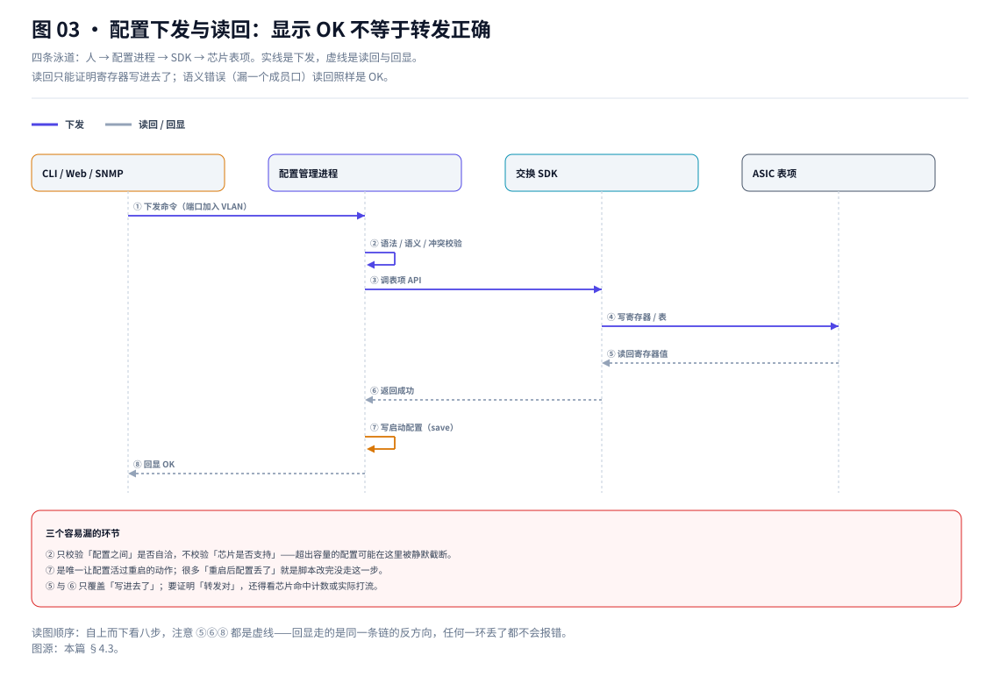
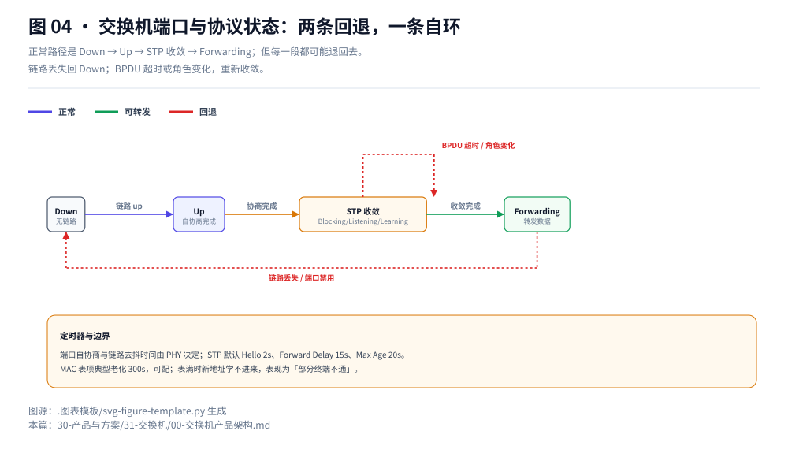

# 交换机产品架构

交换机是「专用交换芯片做线速转发 + 通用 CPU 做协议和管理」的分工型设备。产品差异不在「会不会转发」，而在端口形态、表项容量、软件特性、可靠性和可运维性。

> 本篇定位：讲整机分层、硬件组成、关键表项和启动/转发路径，属于产品层。VLAN/STP/LACP 的原理去 `10-基础理论`，OpenWrt/DSA 实现去 `20-平台与系统`，具体芯片去 `40-平台与芯片`。

## 目录

- [1 一句话模型](#s1)
- [2 速览](#s2)
- [3 结构与字段](#s3)
- [4 交互流程](#s4)
- [5 状态机与定时器](#s5)
- [6 设计取舍与边界](#s6)
- [7 与相邻主题的关系](#s7)
- [名词解释](#名词解释)
- [8 参考与关联](#s8)

## 1 · 一句话模型：CPU 管规则，ASIC 管转发

```text
管理面  CLI / Web / SNMP / Netconf
   │  下发配置
控制面  STP、LACP、IGMP snooping、ARP、路由协议
   │  写表项
转发面  MAC 表 + VLAN 表 + ACL + 队列，线速转发
   │
   └─ 端口 PHY / 光模块 / 堆叠口
```

**为什么必须拆成两半？** 因为两者的时间尺度差了六个数量级：一个 64 字节帧在 1G 口上的串行化时间约 0.5 µs，而 STP 从发现拓扑变化到重新收敛是秒级。让同一条执行路径既处理「每纳秒都要做一次查表」又处理「每两秒发一个 BPDU」，两边都会拖死对方。拆开的代价是：**表项成了唯一的耦合点**——CPU 写进去的是一份影子，ASIC 真正转发时用的是另一份，两者不同步时，界面显示成功、流量却不符合预期。

三个关键认知：

1. **转发面不跑 Linux**：报文由 ASIC 按表项直接转发，CPU 只处理上送报文（协议报文、异常报文、管理报文）。所以「SSH 卡住」和「业务丢包」不是同一类故障，别用一个思路查。
2. **表项容量决定产品档位**：MAC 表、VLAN 数、ACL 条目、路由前缀数、队列数，比「端口数量」更能区分低端和高端。48 口全千兆的盒子可能只有 8K MAC 表，塞满一个 /16 的终端就退化成泛洪。
3. **管理型和无管理型是两类产品**：无管理交换机没有 CPU 软件栈，只有固定转发逻辑，不能拿来套管理型的功能清单。

> **推论**：判断一台交换机「卡在哪」，先给故障归类到平面——「配不上、告警丢」是管理面，「收敛慢、聚合不生效」是控制面，「跑不满、时延抖」是转发面。三个平面的观测工具不通用，先归类能省掉大半排查。
> **边界**：这套分工只对「有可写表项的 ASIC 交换机」成立。无管理机型把转发逻辑烧在芯片里，没有表项可写；纯 CPU 转发的软交换（如 OpenWrt 上关了硬件加速的 DSA 路径）反过来，表项在内存里，改一条立刻生效，但跑不满多口线速。
> **待验证**：各厂商 CPU 内联口的实际带宽与上送限速策略差异很大，选型时要查 datasheet 或实测 `CPU 口收包速率`，不能用「都有 1G 内联口」推断。

## 2 · 速览

| 项 | 内容 | 边界与误判 |
| --- | --- | --- |
| 产品定位 | 二层/三层以太网转发设备，按端口密度和软件能力分档 | 「接入/汇聚/核心」是营销与组网口径，不是能力上限；同档位不同厂商的表项差数倍 |
| 核心对象 | 端口、VLAN、MAC 表、ACL、队列、聚合组、生成树实例 | CLI 里能配出来 ≠ 芯片里有对应表项；有些对象是软件模拟的，容量只有几十条 |
| 关键能力 | 线速转发、VLAN 隔离、环网保护、链路聚合、端口镜像、PoE 供电 | PoE、堆叠、三层路由常是选配或 license 项，报价单写「支持」要问到型号与版本 |
| 典型形态 | 无管理、Web 管理、二层管理、三层管理、数据中心/堆叠 | 同一块板换软件包就跨档；按外形判断档位一定错 |
| 软件栈 | Boot + Linux + 交换 SDK + 管理应用（部分产品基于 OpenWrt） | 「基于 OpenWrt」不等于开源；交换 SDK 基本闭源，可改的只有管理应用层 |
| 关键标准 | IEEE 802.3、802.1Q、802.1D/w、802.3ad、802.1X、RFC 2544 | 声明支持某标准 ≠ 实现了全部可选特性；QinQ、ERPS 属于扩展，常单独标注 |
| 主要成本项 | 交换芯片、PHY/光模块、PoE 电源、散热、外壳与认证 | 光模块与 PoE 电源容易被漏算，多口 PoE 机型里它们可能超过芯片本身 |

**因为**这张表里的每一项都常被当成「规格」引用，**所以**读的时候要连着第三列一起读：它标的是这一项在什么条件下不成立。

## 3 · 结构与字段

### 3.1 三个平面

| 平面 | 承载 | 典型实现 | 失效表现 | 边界与误判 |
| --- | --- | --- | --- | --- |
| 管理面 | CLI、Web、SNMP、Netconf、Syslog | Linux 用户态进程 | 能转发但配不了、告警丢失 | 管理面挂了转发照常，容易被误判成「设备正常」，直到需要改配置才发现 |
| 控制面 | STP、LACP、IGMP snooping、ARP/ND、路由协议 | Linux 协议栈 + 协议进程 | 环路、聚合不生效、组播泛洪 | 协议进程在 CPU 上跑，CPU 被上送报文打满时先崩的是控制面，不是转发面 |
| 转发面 | 以太帧查表、改写、排队、调度 | 交换 ASIC | 丢包、时延抖动、吞吐不达标 | ASIC 不感知业务语义；「端口 up、灯亮、Ping 不通」多半不是转发面的问题 |

分工边界：**协议报文上送 CPU，数据报文走 ASIC**。CPU 端口通常有速率限制（如 1G/2.5G 内联口），所以「上送报文过多」会先打满 CPU 链路，而不是打满业务端口。

**为什么这个边界值得单独记？** 因为它决定了故障的传播方向：上送量一涨，先丢的是 BPDU 和 LACPDU，于是 STP 超时、聚合翻动，看起来像「环路」或「链路抖动」，根因却在管理面（比如某个进程在狂发 ARP）。反过来，业务端口打满不会影响协议——协议报文走的是另一条物理通道。

> **推论**：看到「STP 反复重收敛 + 业务时通时断」，先看 CPU 占用和内联口收包速率，再看拓扑。因为 CPU 一满，协议报文最先被丢，拓扑看起来就像一直在变。

### 3.2 硬件组成

| 部件 | 作用 | 产品关注点 | 边界与误判 |
| --- | --- | --- | --- |
| 交换 ASIC | MAC 学习、查表、VLAN/ACL、队列调度 | 交换容量、包转发率、表项容量、是否支持堆叠 | 标称容量含双向与堆叠口，口径不同能差一倍；「支持堆叠」还要看是否需要专用堆叠卡 |
| CPU | 启动、协议、管理、上送报文处理 | 核数/主频、内存、是否够跑管理应用 | 主频高不等于上送能力强，瓶颈常在内联口带宽与中断处理，不在算力 |
| PHY | 电口编码解码、自协商 | 速率组合、PoE 支持、浪涌防护 | 2.5G/5G 电口对线缆有要求（Cat5e 起），协商不上时先换线再怀疑设备 |
| 光模块接口 | SFP/SFP+/SFP28 等 | 速率/距离/波长、DDM、兼容性 | 「兼容」多为厂商白名单；同速率不同波长（1310/1550、灰光/彩光）不能互插 |
| PoE 控制器 | 给 AP/IPC 供电 | 总功率预算、单口功率、802.3af/at/bt | 端口数 × 单口最大功率 > 总预算时，后上电的端口会被拒；预算要按整机算，不按端口算 |
| Flash/内存 | 固件、配置、日志 | 双镜像、配置备份、日志容量 | 双镜像占双份空间，低容量机型升级大版本时会因为放不下而失败 |
| 电源/风扇 | 供电与散热 | 冗余电源、温控调速、噪声 | 冗余电源只保证不断电，不保证 PoE 预算翻倍；两路电源通常共享同一份功率预算 |

### 3.3 转发面关键表项

| 表项 | 查什么 | 容量不足时 | 边界 |
| --- | --- | --- | --- |
| MAC 表 | 目的 MAC → 出端口 | 退化为泛洪，性能下降 | 有老化时间，典型 300 s；这个值是惯例不是标准，改小会增加泛洪 |
| VLAN 表 | VLAN ID → 成员端口 | 新 VLAN 建不起来 | 802.1Q 可用 4094 个（VID 1–4094，0 与 4095 保留） |
| ACL | 五元组/二层字段 → 动作 | 规则下发失败或被合并 | 依赖 TCAM 资源，规则顺序敏感；同一条 ACL 下发到多端口会按端口数消耗条目 |
| 三层表 | 目的 IP → 下一跳 | 转 CPU 或丢包 | 主机路由和网段路由占不同空间；IPv6 前缀长度更长，同容量下能装的条数更少 |
| 队列/调度表 | 优先级 → 队列 | 高优先级无法保证 | 队列数由芯片决定；8 队列的机器做不了 8 个严格优先级业务 |
| 组播表 | 组播组 → 出端口 | 退化为广播 | 依赖 IGMP snooping；没开 snooping 时组播按广播泛洪，表项再大也用不上 |

> **待验证**：不同芯片的 MAC/ACL/路由表项数量和共享方式差异很大，选型时必须查具体 datasheet，不能按「同档位」估算。

### 3.4 容量口径：为什么「交换容量」不能直接比

规格书第一页的两个数字，经常被当成性能排名，其实它们只是**端口组合的算术结果**，不是实测能力：

```text
交换容量（Gbps）   = Σ(端口速率) × 2        ← 全双工，收发各算一份
包转发率（Mpps）   = Σ(端口线速 pps)        ← 按最小帧算
  1G  : 1e9 / (84 × 8)  ≈ 1.488 Mpps/口
  10G : 10e9 / (84 × 8) ≈ 14.88 Mpps/口
  84 B = 64 B 最小帧 + 8 B 前导码 + 12 B 帧间隙
```

所以一台 24×1G + 4×10G 的机器，标称 128 Gbps / 95.2 Mpps 只是「端口都跑满」的同义词。**它证明了架构没缩水，没证明任何实测性能。**

真正区分档位的是三个不进公式的量：表项容量、共享缓冲、以及「上送通道」的带宽。三者的共同点是——**规格书首页不写**。

> **推论**：比两台交换机，先比「同口径下的表项与缓存」，再看标称容量。标称容量只用来排除残废架构（比如 24 口只有 32 Gbps，说明内部有收敛比）。

## 4 · 交互流程



**读图**：上行是配置和协议，下行是表项；真正决定转发结果的是 ASIC 里的表，不是 Linux 里的配置文本。

> 图源：`images/图01-交换机三平面.svg`

### 4.1 上电启动

```text
上电 → BootROM → U-Boot → 加载固件（双镜像择一）
  → Linux 内核启动 → 挂载根文件系统
  → 交换 SDK 初始化（复位 ASIC、加载默认表）
  → 管理应用启动（CLI/Web/SNMP）
  → 读取启动配置并下发 → 端口 up
```

产品层的两个关键点：

- **双镜像**：升级失败要能回滚，镜像选择逻辑通常在 U-Boot 里。代价是 Flash 要留两份空间，且回滚判断（启动计数、校验和）一旦写错，会把「可回滚」变成「反复重启」。
- **配置恢复**：配置文件和固件版本绑定，跨版本恢复要做兼容处理。降级刷回旧版本时，新版本写下的配置项旧版本不认识，常见表现是「配置在、但不生效」或者直接启动失败。

**为什么启动时间要写进验收项？** 因为「端口灯亮」不等于「业务可用」。从端口 up 到能转发，中间还隔着 STP 收敛、聚合协商、DHCP 拿地址。运维感受到的是整段时间，而规格书只写内核启动时间。PoE 机型还要再加一段：PSE 逐个端口检测、分级、上电，端口越多越慢。

> **边界**：双镜像只保护「镜像本身损坏」，不保护配置。配置分区写坏时，两个镜像都会正常启动然后读到一份坏配置——所以配置备份与镜像回滚是两件事，不能互相替代。

### 4.2 一个数据帧的转发路径

```text
端口收帧 → PHY → ASIC 解析
  → 查 VLAN 表（是否带 tag、PVID 怎么打）
  → 查 MAC 表（命中则定向，未命中则泛洪）
  → 查 ACL（是否重定向/丢弃/限速）
  → 入队 → 调度 → 出端口
```

CPU 只在以下情况介入：目的 MAC 是设备自己、协议报文（STP/LACP/IGMP/ARP）、TTL 耗尽、需要采样/镜像到 CPU 口的报文。

上面这段是**逻辑顺序**。真实芯片是流水线：VLAN、MAC、ACL 的查表在同一拍里并行发起，命中结果再统一裁决。这个差别不是学究式的——它解释了为什么「ACL 里写了 deny，但转发还是过了」：如果 ACL 的查表结果比 MAC 转发晚一拍，或者 ACL 根本没被编译进流水线的那个 stage，规则就会静默失效。



**读图**：左边两支是常态（直转与泛洪，CPU 都不参与）；中间两支是上送（协议与异常，走内联口）；最右一支是丢弃或改向（ACL、风暴抑制）。判据只看帧头和查表结果，不看业务语义——所以「哪些帧会打扰 CPU」是可以预先算出来的，不是玄学。

> 图源：`images/图02-帧的三条去向.svg`

> **推论**：规划上送量时，按「每秒协议报文数 × 单包开销」估，不要按「业务带宽的百分比」估。100 台交换机的 STP+LACP+LLDP 是常数级流量，而一次 MAC 表溢出引发的未知单播泛洪是线性增长——后者才是打满内联口的常见原因。
> **一处别过度断言**：镜像到 CPU 口的实现各家不同。有的把镜像流量复制进内联口，有的走独立的分析口；前者会和管理流量抢带宽，后者不会。看到「开了镜像后 CPU 占用飙升」，先确认镜像目的口是不是内联口。

### 4.3 管理面下发配置

配置不是「改一个文件就生效」，而是一条链：

```text
CLI/Web/SNMP → 配置管理进程 → 校验
  → 写 SDK 表项 → 读回确认 → 保存配置
```



**读图**：四条泳道从左到右是「人在敲」到「芯片里真的有」。注意第 ⑤ 步的读回只能证明「寄存器写进去了」，证明不了「转发行为对」——语义错误（比如 VLAN 成员漏了一个口）读回照样是 OK。

> 图源：`images/图03-配置下发与读回.svg`

异常分支：

| 异常 | 表现 | 定位方向 | 误判点 |
| --- | --- | --- | --- |
| 配置成功但转发不生效 | 显示已配置，流量不符预期 | 表项是否真正写入、是否有更高优先级规则覆盖 | 只看 `show running-config` 就下结论；要查芯片侧表项与命中计数 |
| 重启后配置丢失 | 运行配置在、启动配置无 | 保存动作、配置文件权限、双镜像配置分区 | 把「没保存」当成「Flash 坏了」，其实多数是脚本改配置后没调 save |
| 管理面卡死但转发正常 | 业务不断，Web/CLI 无响应 | CPU 被上送报文打满、内存泄漏、进程崩溃 | 误判成整机死机而直接断电重启，丢掉现场；此时转发面仍是好的 |
| 升级后无法启动 | 卡在 U-Boot 或内核 | 镜像校验、分区偏移、回滚标志 | 把「回滚标志没置位」当成镜像损坏，反复重刷同一个坏包 |

## 5 · 状态机与定时器



**读图**：正常链是 Down→Up→STP 收敛→Forwarding；两条回退边分别是「链路丢失回 Down」和「BPDU 超时/角色变化重新收敛」，不是一条到死的分支。

> 图源：`images/图04-交换机端口与协议状态.svg`

交换机没有「整机连接状态机」，但有端口和协议状态。这些状态是**并行的**：同一个端口上，物理层状态、STP 状态、聚合状态各走各的，任何一个没到位，业务就不通。

### 5.1 状态表

| 对象 | 状态 | 在等什么 | 卡住的典型原因 |
| --- | --- | --- | --- |
| 端口 | Down → Up（自协商完成） | 对端发来的能力集与链路训练 | 光模块不兼容、单纤接反、一端强制一端自协商 |
| STP 端口 | Blocking → Listening → Learning → Forwarding | 定时器到期 + 没有更优 BPDU | 根桥优先级被别人抢走；边缘口收到了 BPDU |
| LACP 端口 | Detached → Attached | 收到对端 LACPDU，且成员被 Selected | 对端是静态聚合、成员口速率不一致、系统优先级相同导致选不出主 |
| MAC 表项 | 学习 → 老化删除 | 老化计时器 | 终端在两个口之间来回漂移（环路或双归未聚合） |
| PoE 端口 | 检测 → 分级 → 供电 → 故障 | PD 的有效签名电阻、分级结果、功率预算 | 非标 PD、线缆电阻过大、总预算已满 |

> **边界**：`Listening` 只存在于原版 802.1D。IEEE 802.1D-2004 起把 STP 并入 RSTP，端口状态收敛成 Discarding / Learning / Forwarding 三个。看到设备只有三个状态，不是它没实现完整 STP，而是它跑的是 RSTP。

### 5.2 定时器表

| 定时器/参数 | 管什么 | 默认值 | 调小/调大的后果 |
| --- | --- | --- | --- |
| Hello Time | 根桥发 BPDU 的周期 | 2 s | 调小加快故障发现，但 BPDU 与 CPU 负载上升；它不能单独改，802.1D 要求 Max Age ≥ 2×(Hello+1) |
| Forward Delay | Listening / Learning 各停留多久 | 15 s | 调小省收敛时间但可能引入临时环路（拓扑还没传遍就转发） |
| Max Age | BPDU 多久没收到就认为失效 | 20 s | 调小对丢包敏感，一次拥塞就重收敛；调大故障发现变慢 |
| LACP 周期 | LACPDU 发送间隔 | Fast 1 s / Slow 30 s | Fast 收敛快、CPU 与对端负担高；超时是周期的 3 倍（3 s / 90 s） |
| MAC 老化 | 表项多久不用就删 | 典型 300 s | 调小导致频繁泛洪；调大让失效终端长期占用表项 |
| PoE 检测/分级 | 上电前的探测窗口 | 由 802.3af/at/bt 定义 | 非标 PD 会在这个窗口被判定为无效而拒绝供电 |

产品验收时要区分「协议定时器」和「产品去抖」：前者是标准行为，后者是厂商为了抑制闪断加的，参数不公开时只能实测。**为什么必须分开？** 因为报告上写「收敛 3 秒」时，如果里面含了 2 秒厂商去抖，换一台设备就复现不了；只有把两段时间拆开，结论才有可移植性。

> **待验证**：STP 三定时器只有在使用 802.1D 默认值时才是 2/15/20；实际项目里常被改成 2/4/10 之类，验收前要读设备当前值，不要按默认值算收敛窗口。

## 6 · 设计取舍与边界

### 6.1 无管理 vs 管理型

无管理交换机成本低、即插即用，但没有 VLAN/STP/镜像，也不能远程运维；管理型增加 CPU、软件和认证成本，换来可配置和可观测。**不要把无管理机型放进需要环网或隔离的拓扑**。

代价要说清：管理型多出来的不只是 CPU，还有一整套要维护的软件（固件升级、配置备份、账号权限、SNMP 团体名）。**运维能力不到位时，管理型反而更危险**——一个配错的 STP 比没有 STP 更容易造成大面积中断。

### 6.2 存储转发 vs 直通

存储转发收完整帧再校验，能丢弃 CRC 错帧，时延略高；直通转发边收边转，时延低，但会把坏帧传下去。多数企业级产品默认存储转发，低时延场景才考虑直通。

**为什么时延差这么重要？** 存储转发必须等整帧收完，按「首比特进 → 首比特出」的口径，时延下限就是串行化时间：1518 B 在 1G 口上约 12 µs，64 B 只有约 0.5 µs。所以「小包时延」和「大包时延」不是同一个指标，混着报会掩盖真实差异。直通模式在跨设备级联时还会把前一级的坏帧一路带下去，等于把 CRC 校验推给了终端。

### 6.3 交换芯片转发 vs CPU 转发

全走 CPU 的「软交换」灵活但性能有限，适合低流量或需要复杂策略的场景；ASIC 转发性能高，但受表项容量和特性支持限制。产品定义阶段就要把「哪些流量必须走硬件」写清楚。

判据是**pps 而不是带宽**：一路 100 Mbps 的 64 B 小包流是 148.8 Kpps，和一路 1 Gbps 的大包流对 CPU 的压力完全不同。软交换的瓶颈几乎总是 pps 与中断开销。

### 6.4 堆叠的代价

堆叠把多台设备当成一台管理，换来统一配置和跨设备聚合，代价是堆叠口带宽、堆叠线缆可靠性和分裂（split-brain）处理。堆叠不是免费的「端口扩展」。

三个具体代价：① 跨成员转发要过堆叠口，实际可用带宽不是各成员之和；② 堆叠线缆断一根，可能整组重启；③ 分裂后两台都认为自己是主，地址和 MAC 会冲突，必须靠 MAD（多主检测）或 LACP 拆分来兜底。**没有分裂检测的堆叠，比不堆叠更脆。**

### 6.5 什么时候不需要管理型交换机

家庭/小微场景只要即插即用、没有 VLAN 隔离和环路风险时，无管理交换机更合适；一旦有 AP 多 SSID、摄像头隔离、双上行，就必须上管理型。

再补一条失效条件：**只要有第二个网管设备需要「看得见」这台交换机**（比如统一 SNMP 监控），就需要管理型——可观测性本身就是需求，不必等到有隔离需求才上。

### 6.6 选型走查：五个问题

| 步骤 | 问什么 | 怎么答 | 答错的后果 |
| --- | --- | --- | --- |
| ① 端口与介质 | 电口/光口比例、速率组合、要不要 PoE | 数现有终端与上联，留 20% 余量 | 端口够但光口不够，后期加模块比换整机贵 |
| ② 表项容量 | MAC/VLAN/ACL/路由要装多少 | 按终端数、VLAN 数、策略数各留一倍余量 | 容量按「同档位」猜，上线三个月后退化成泛洪 |
| ③ 软件特性 | STP 实例数、聚合组数、镜像会话数、ACL 深度 | 对着规格书的「数量」栏逐条核 | 功能「有」但只支持 1 个实例，组网方案直接作废 |
| ④ 供电与散热 | PoE 总预算、冗余电源、风扇噪声 | 按满载端口 + 满负荷 PoE 算功耗 | 预算按端口数乘出来，实际一上电就拒供 |
| ⑤ 可运维性 | 带外管理口、双镜像、配置备份、SNMP 覆盖度 | 问「升级失败怎么回滚」 | 现场升级失败只能返厂，停机时间按天算 |

## 7 · 与相邻主题的关系

**因为**一台交换机同时被四个学科解释（以太网帧、VLAN/STP 协议、Linux 实现、芯片执行），**所以**本篇只留一份正本，其余全部用链接指出去。下表左列是相邻主题，右列写明「本篇不讲的那部分在哪」。

| 相邻对象 | 关系 | 边界（细节去哪看） |
| --- | --- | --- |
| [以太网与 MAC](../../10-基础理论/11-网络科学/02-链路层/01-以太网与MAC.md) | 交换机的转发对象和 MAC 学习基础 | 本篇只讲「表项在芯片里怎么用」，不讲帧格式与 CSMA/CD 历史 |
| [VLAN 与 Trunk](../../10-基础理论/11-网络科学/02-链路层/02-VLAN与Trunk.md) | 端口隔离与 tag 处理的原理 | 端口类型怎么配、配错什么表现，在 [01-交换机业务与组网](./01-交换机业务与组网.md) |
| [STP/RSTP/MSTP](../../10-基础理论/11-网络科学/02-链路层/03-STP-RSTP-MSTP.md) | 环网保护的协议基础 | 本篇只列状态与定时器，不推导选举过程 |
| [链路聚合 LACP](../../10-基础理论/11-网络科学/02-链路层/04-链路聚合LACP.md) | 多链路带宽叠加与冗余 | 聚合组怎么配、单通怎么查，在 01 篇 |
| [DSA 与 bridge/VLAN](../../20-平台与系统/22-OpenWrt/03-网络数据面/02-DSA与bridge-VLAN.md) | Linux/OpenWrt 侧如何配置交换芯片 | 那是「软件怎么下配置」，本篇是「硬件怎么执行」；DSA 的 `bridge vlan` 与厂商 CLI 是两套入口 |
| [交换机业务与组网](./01-交换机业务与组网.md) | 本篇的配置与组网展开 | 本篇不写具体命令与端口类型判定 |
| [交换机测试与验收](./02-交换机测试与验收.md) | 产品交付前的验证方法 | 本篇给「应该达到什么」，02 篇给「怎么证明」 |

一句话：**交换机产品 = 端口与芯片的硬件组合 + 一套把业务意图翻译成表项的软件。**

## 名词解释

> 缩写给出英文全称；非缩写用“—”表示。**因为**同一缩写在相邻领域可能指别的东西，**所以**这一列按本目录的用法展开，遇到同名不同义时分行列出，不合并。

| 术语 | 英文全称 | 解释 |
| --- | --- | --- |
| ASIC | Application-Specific Integrated Circuit | 专用集成电路，这里指交换芯片。 |
| MAC | Media Access Control | 介质访问控制，MAC 表存目的 MAC 到端口的映射。 |
| PHY | Physical Layer Device | 物理层收发器件。 |
| ACL | Access Control List | 访问控制列表，按字段匹配并执行放行/丢弃/重定向。 |
| TCAM | Ternary Content-Addressable Memory | 三态内容寻址存储器，常用于 ACL 和路由查找。 |
| PoE | Power over Ethernet | 以太网供电。 |
| PSE | Power Sourcing Equipment | 供电设备，即交换机侧；对端受电设备叫 PD（Powered Device）。 |
| STP | Spanning Tree Protocol | 生成树协议。 |
| RSTP | Rapid Spanning Tree Protocol | 快速生成树协议，IEEE 802.1w，已并入 802.1D-2004。 |
| MSTP | Multiple Spanning Tree Protocol | 多实例生成树协议，IEEE 802.1s，可让不同 VLAN 走不同转发树。 |
| LACP | Link Aggregation Control Protocol | 链路聚合控制协议。 |
| DSA | Distributed Switch Architecture | Linux 下的分布式交换架构。 |
| SFP | Small Form-factor Pluggable | 可插拔光模块封装。 |
| DDM | Digital Diagnostic Monitoring | 光模块数字诊断监控。 |
| VLAN | Virtual Local Area Network | 虚拟局域网，二层隔离边界。 |
| IGMP | Internet Group Management Protocol | 因特网组管理协议，snooping 靠它决定组播往哪些口转发。 |
| SNMP | Simple Network Management Protocol | 简单网络管理协议，管理面最常用的采集通道。 |
| NETCONF | Network Configuration Protocol | 基于 YANG 模型的配置协议，比 SNMP 更适合批量下发。 |
| QinQ | — | 802.1Q 双层标签封装（802.1ad），外层标识租户或运营商。 |
| 上送 | Punt / Trap to CPU | 把本该硬件转发的报文送给 CPU 处理，走内联口，有速率限制。 |
| 线速 | Wire Speed | 端口在最小帧下也能满速率转发、不丢包的状态。 |
| Mpps | Million Packets per Second | 每秒百万包，包转发率的单位；千兆口线速约 1.488 Mpps。 |
| 堆叠 | Stacking | 多台设备通过专用口或业务口组成一个逻辑设备，统一管理与转发。 |
| MAD | Multi-Active Detection | 多主检测，堆叠分裂后用来发现「两边都以为自己是主」。 |

## 8 · 参考与关联

**标准**

- IEEE 802.3：Ethernet
- IEEE 802.1Q：VLAN 与优先级
- IEEE 802.1D / 802.1w / 802.1s：STP / RSTP / MSTP
- IEEE 802.3ad：Link Aggregation（已撤销，内容并入 IEEE 802.1AX）
- IEEE 802.1X：端口接入认证
- RFC 2544：网络互连设备基准测试方法

**因为**「支持 802.1Q」在规格书里可能只覆盖基础 VLAN，**所以**上面只列标准入口，判断设备是否符合时要回到具体条款与可选特性。

**关联**

- [设备形态对比](../00-设备形态对比.md)
- [交换机业务与组网](./01-交换机业务与组网.md)
- [交换机测试与验收](./02-交换机测试与验收.md)
- [平台对比](../../40-平台与芯片/00-平台对比.md)

---

> **本篇定位**：交换机整机的三平面分工、硬件组成、表项与启动/转发路径。
> **素材来源**：`studyspace/1.知识体系/8.路由与交换/`（VLAN/STP/LACP 素材）、`studyspace/1.知识体系/7.openwrt/5.驱动/1.以太网switch驱动.md`。
> **待验证**：各芯片的 MAC/ACL/路由表项容量、CPU 上送带宽、PoE 总功率与散热设计。
