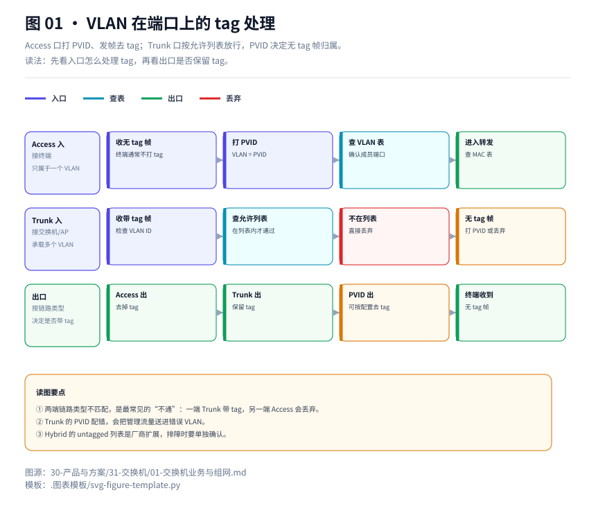
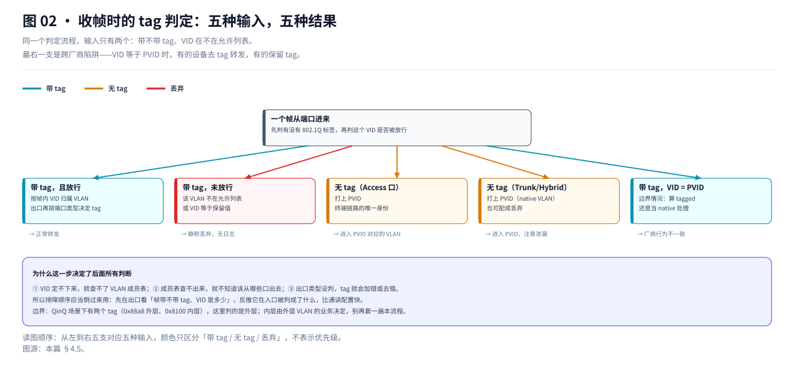
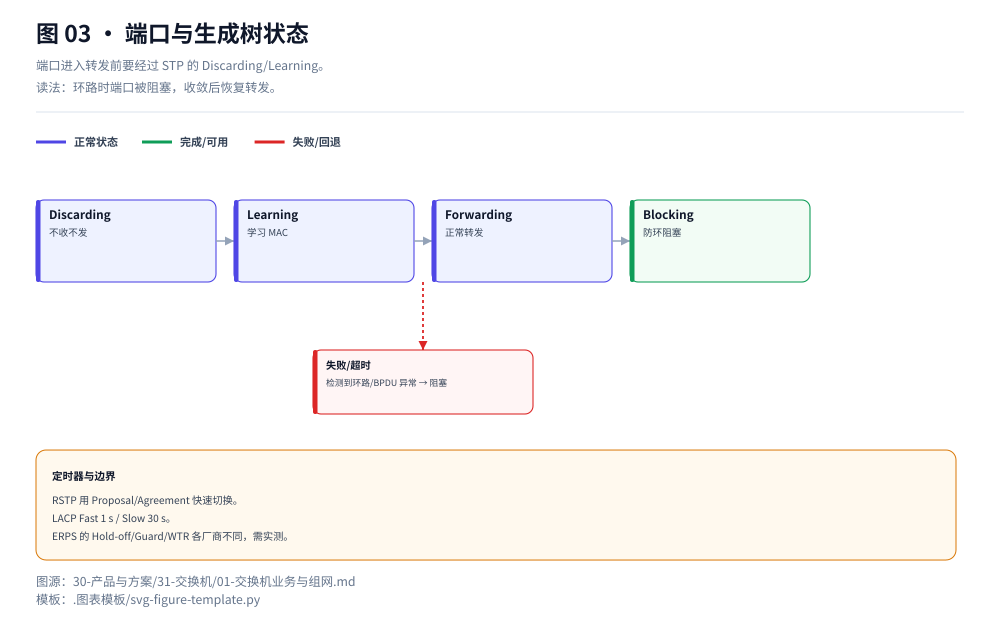

# 交换机业务与组网

交换机的业务配置本质是「把端口放进正确的 VLAN、正确的生成树实例、正确的聚合组」，再决定哪些流量镜像或限速。配置错的表现通常只有三类：**不通、环路、单通**。

> 本篇定位：从产品配置模型讲 VLAN、STP、LACP、镜像、环网和堆叠，原理只给结论并链接到 `10-基础理论`。芯片寄存器和 SDK 命令不在本篇。

## 目录

- [1 一句话模型](#s1)
- [2 速览](#s2)
- [3 配置对象与字段](#s3)
- [4 交互流程](#s4)
- [5 状态机与定时器](#s5)
- [6 设计取舍与边界](#s6)
- [7 与相邻主题的关系](#s7)
- [名词解释](#名词解释)
- [8 参考与关联](#s8)

## 1 · 一句话模型：端口是入口，VLAN 是边界，实例是范围

```text
物理端口
  ├─ 链路类型：Access / Trunk / Hybrid
  ├─ PVID：不收 tag 时打哪个 VLAN
  ├─ 允许列表：哪些 VLAN 能过
  └─ 加入实例：STP 实例、聚合组、镜像会话
```

**为什么端口上必须有这三件套？** 因为一个帧进入交换机时，交换机只能看到「从哪个口进来」和「带不带 tag」这两个事实，**它不知道这个帧属于哪个业务**。于是三件套各回答一个问题：链路类型（这个口的语义是单 VLAN 还是多 VLAN）、PVID（没有 tag 时补哪个身份）、允许列表（这个口信任哪些身份）。三个答案合起来，才把「一个帧」变成「某个 VLAN 里的一个帧」。

关键的一点：**这三件事都只在本机生效**。VLAN 是本地语义，不是端到端协议——两端交换机对同一个 VID 的理解可以完全不同，中间只要有一个口没放行，业务就在那里断掉，而链路本身是好的。

三个关键认知：

1. **Access 口只属于一个 VLAN，Trunk 口承载多个 VLAN**；Hybrid 是厂商扩展，能同时以 tagged/untagged 方式放行多个 VLAN。
2. **VLAN 隔离是二层的，跨 VLAN 必须过三层**；交换机上的「VLAN 接口」只是三层网关，不是二层互通。
3. **STP 和 LACP 都作用在端口角色上**：前者决定端口通不通，后者决定多条链路怎么合成一条。

三类症状可以直接反推到三张表，这张对应关系就是本篇的骨架：

| 症状 | 首先怀疑的表 | 原因 |
| --- | --- | --- |
| 不通 | 端口允许列表 / VLAN 成员表 | 帧在这个口就没有「身份」，或者出口不认这个身份 |
| 环路 | 生成树实例 / 边缘端口配置 | 备份链路没被阻塞，同一个帧从两个口出去又回来 |
| 单通 | 聚合组成员 / 镜像方向 / 单向 ACL | 收得到、发不出，说明两侧对「这条链路」的理解不一致 |

> **推论**：所有 VLAN 类故障都能压缩成一个问题——「这个帧在入口拿到的是哪个 VID，在出口需不需要 tag」。答不出来就去查 PVID 与允许列表，不要在应用层找原因。
> **边界**：这套模型只覆盖单台或同厂商组网。跨厂商时「Hybrid」「native VLAN」「untagged 允许列表」的语义有差异，同一份配置在两端可能不等价，这时要以帧的实际 tag 为准。
> **待验证**：各厂商对「Access 口收到带 tag 帧」的处理不统一（有的丢弃，有的接受同 VID），跨厂商混用时必须实测。

## 2 · 速览

| 项 | 内容 | 边界与误判 |
| --- | --- | --- |
| 核心对象 | 端口、VLAN、STP 实例、聚合组、镜像会话、ACL | 对象都在同一台设备上，但归属不同平面：VLAN 与端口在转发面，生成树与聚合在控制面 |
| 常见业务 | 多 SSID 隔离、摄像头/办公/访客分区、双上行冗余、端口镜像审计 | 「隔离」是二层隔离；要限制跨 VLAN 访问，得在三层网关上加 ACL，二层配置做不到 |
| 关键协议 | 802.1Q、802.1D/w/s、802.3ad、IGMP snooping、ERPS、LLDP | 802.3ad 已撤销并入 802.1AX；ERPS 是 ITU-T G.8032，与 STP 不互通 |
| 典型组网 | 接入-汇聚-核心三层、环网、堆叠、双归 | 拓扑层级是运维约定，不影响协议行为；环网与堆叠混用时故障域会叠加 |
| 配置载体 | CLI、Web、SNMP、Netconf/YANG（部分产品） | Web 与 CLI 不是所有厂商都等价；有的参数只有 CLI 能配，有的只有 Web |
| 主要风险 | 环路广播风暴、VLAN 泄漏、聚合单通、镜像口过载 | 四类风险里有三类在「配置看起来对」时也会发生——因为两端不一致 |

**因为**这张表混了「测什么」和「靠什么判断」，**所以**第三列专门标两者的错配：最贵的错误不是配错，而是把「能通」当成「配对了」。

## 3 · 配置对象与字段

### 3.1 端口

端口是所有业务的落点。**因为 VLAN、生成树、聚合最终都要落到「某个物理口」上，所以这里的每一个字段配错，都会表现为整片业务异常，而不是单个用户异常。**

| 字段 | 作用 | 坑/边界 |
| --- | --- | --- |
| 管理状态 | 手动 up/down | down 后 PoE 是否断电要看产品实现 |
| 链路类型 | Access/Trunk/Hybrid | 两端类型不匹配是最常见的「不通」原因 |
| PVID | 收无 tag 帧时打的 VLAN | Trunk 口 PVID 配错会把管理流量送进错误 VLAN |
| 允许 VLAN 列表 | 该口能通过的 VLAN | 列表为空时可能默认全放行，也可能全阻断，厂商行为不同 |
| 速率/双工 | 自协商或强制 | 一端强制一端自协商，易出现半双工和 CRC 错包 |
| 流控 | 收发 PAUSE | 与 QoS 叠加时可能引发队头阻塞 |
| MTU | 最大帧长 | 跨厂商对 jumbo frame 的计入口径不同 |
| 风暴抑制 | 广播/组播/未知单播限速 | 阈值过低会误伤正常广播 |

> **边界**：上表每一项的默认值都不可假定。同一厂商的不同系列，允许列表为空时的行为就可能相反；交付前用一收一发的实测确认，不要读配置文本推断。

### 3.2 VLAN

**为什么 VLAN 表只有五个字段却最容易出错？** 因为它的正确性取决于「所有相关端口」的集合关系，而不是单点配置。漏一个上行口，整片不通；多一个口，就是泄漏。

| 字段 | 作用 | 坑/边界 |
| --- | --- | --- |
| VLAN ID | 二层隔离标识 | 1 通常是默认 VLAN，不建议承载业务；VID 0 与 4095 保留，不能配 |
| 名称 | 运维标识 | 仅本地有效，不随协议传递 |
| 成员端口 | 哪些口属于该 VLAN | 漏配一个上行口就会断一片 |
| VLAN 接口 | 三层网关地址 | 需要开启三层功能并配置路由 |
| QinQ 外层 | 运营商/多租户隔离 | 内外层 MTU 和 TPID 要匹配 |

> **推论**：查 VLAN 故障时，把「该 VLAN 的成员端口集合」和「路径上每个口的允许列表」两列并排看，比逐个口 `show` 快得多。前者决定「谁能进这个 VLAN」，后者决定「这个 VLAN 能走哪条路」，两者都满足才通。

### 3.3 生成树实例

| 字段 | 作用 | 坑/边界 |
| --- | --- | --- |
| 模式 | STP/RSTP/MSTP | 混跑时按最保守的 STP 收敛 |
| 实例与 VLAN 映射 | MSTP 多实例负载分担 | 映射不一致会导致部分 VLAN 阻塞；两端 instance 编号相同但 VLAN 映射不同，等于没对齐 |
| 根桥优先级 | 决定根桥位置 | 默认优先级可能让接入交换机抢根 |
| 边缘端口 | 接终端，跳过学习和收敛 | 接交换机时配边缘口会引入环路 |
| BPDU 保护 | 边缘口收到 BPDU 就关端口 | 防私接交换机，但会误伤 |

**为什么根桥一定要手工指定？** 因为默认优先级是 32768，所有设备相同，最后比的是 MAC 地址——谁的 MAC 小谁当根。这意味着换一块板子就可能换根，全网拓扑跟着重算。把汇聚设备的优先级固定成最低值（如 4096）是唯一稳定的做法。

### 3.4 聚合组与镜像

| 对象 | 关键字段 | 说明与边界 |
| --- | --- | --- |
| LACP 聚合组 | 成员口、模式（静态/动态）、负载均衡哈希 | 成员口速率/双工/VLAN 配置必须一致；其中速率与双工是标准强制，VLAN 一致是部署要求，不一致时可能 Selected 失败或单通 |
| 镜像会话 | 源端口、目的端口、方向（收/发/双向） | 目的口带宽要 ≥ 源口总带宽，否则丢镜像包；「≥」按峰值算，不按平均值 |
| 镜像 VLAN | 源 VLAN、目的口 | 用于远程镜像时要注意 VLAN 穿越；中间设备没放行该 VLAN 时，镜像包在途中就被丢了 |

## 4 · 交互流程



**读图**：Access 口收无 tag 帧打 PVID、发帧去 tag；Trunk 口只放行允许列表内的 VLAN，PVID 决定无 tag 帧归属。

> 图源：`images/图01-VLAN端口处理.svg`

### 4.1 Access 口收发的 tag 处理

```text
收：无 tag 帧 → 打 PVID → 查 VLAN 表 → 转发
    带 tag 帧 → 默认丢弃（除非允许）
发：出 Access 口 → 去 tag → 终端看到无 tag 帧
```

**为什么 Access 口要在出口去 tag？** 因为对端是终端，终端不理解 802.1Q，带 tag 的帧会被它当成畸形帧丢掉。所以 Access 口的本质是「一条只有单个 VLAN 身份的边界链路」，tag 只在这条链路的内部存在，进交换机加、出交换机去。

> **边界**：「带 tag 帧默认丢弃」不是所有实现的默认。有的设备会接受 VID 等于 PVID 的带 tag 帧并正常转发，有的直接丢。做互通测试时，这一条比链路速率更值得先确认。

### 4.2 Trunk 口收发的 tag 处理

```text
收：带 tag 帧 → 检查允许列表 → 通过
    无 tag 帧 → 打 PVID（常见做法，也可丢弃）
发：VLAN 在允许列表 → 带 tag 发出
    VLAN 等于 PVID → 可按产品配置决定是否去 tag
```

Trunk 口的 PVID 在 802.1Q 里叫 **native VLAN**：不带 tag 的帧归它。**为什么要有这个概念？** 因为要兼容只发无 tag 帧的老设备（管理口、某些 IP 电话、虚拟化宿主机）。代价是它成了最常见的泄漏点——两端 native VLAN 不一致时，无 tag 帧会被送进不同的 VLAN，二层看起来「通」，实际上跨了隔离边界。

> **推论**：安全要求高的组网里，Trunk 口把 native VLAN 指到一个不承载业务的空 VLAN（或直接丢弃无 tag 帧），泄漏面就消失了。这是配置习惯问题，不是设备能力问题。

### 4.3 双上行与环网

```text
接入交换机 A ── 汇聚 1
      │            │
      └── 汇聚 2 ──┘
```

两种做法：

- **STP/RSTP/MSTP**：一条链路阻塞，故障后重新收敛。兼容性好，收敛时间秒级（RSTP 可到亚秒）。
- **ERPS 等环网保护**：专用环协议，收敛更快，但需要同一厂商或互通认证，配置更复杂。

**为什么 STP 慢而 ERPS 快？** STP 的收敛依赖「等」：等 BPDU 传播、等 Max Age 到期、等 Forward Delay 逐级放行，慢的根源是它不相信任何一跳能立刻确认拓扑。RSTP 用 Proposal/Agreement 握手把这个「等」换成了「问」，所以能到亚秒。ERPS 更进一步：环上固定有一个阻塞点（RPL Owner），故障时靠 R-APS 报文直接通知 Owner 打开阻塞口，不用重新算树，所以能到 50 ms 级。

代价随之而来：ERPS 的基础模型是**单环**，多环相交（子环、相交环）要额外配置、互通性更差；而 STP 是通用拓扑算法，任意拓扑都能收敛（只是慢）。**收敛时间和适用范围是此消彼长的。**

> **边界**：双上行如果做了链路聚合，就不再需要 STP 阻塞——两条链路被当成一条。此时若同时又开了 STP 且两端聚合模式不一致（一端静态、一端动态），会同时出现「聚合单通」和「STP 阻塞」，症状非常难判。

### 4.4 异常分支

| 异常 | 典型现象 | 定位方向 | 误判点 |
| --- | --- | --- | --- |
| 环路 | 广播风暴、CPU 高、全口丢包 | 查 STP 是否启用、边缘口是否接交换机、是否有双上行未聚合 | 只看「STP 是否 enable」；要看端口角色与阻塞口是否符合预期 |
| VLAN 泄漏 | 不同业务能互相访问 | 查 Trunk 允许列表、PVID、Hybrid 的 untagged 列表 | 只在两台交换机上查，漏了中间的传输设备（它可能把 tag 剥了） |
| 聚合单通 | 大流量丢包、部分会话不通 | 查成员口配置一致性、哈希算法、对端是否也是 LACP | 把「聚合口 up」当成「聚合生效」；要看成员是否 Selected |
| 镜像丢包 | 抓包不完整 | 目的口带宽不足、镜像口被限速 | 用平均值算带宽，忽略突发 |
| 私接路由器 | 地址池冲突、DHCP 混乱 | 开 DHCP snooping、端口隔离、BPDU 保护 | 只用端口隔离，没防 DHCP 服务器；两者要一起上 |

### 4.5 收帧的判定顺序

同一个帧从端口进来，交换机按固定顺序做五个判断。**顺序不能换**：先判 tag，才能定 VID；定了 VID，才能查成员表；查完成员表，才知道出口该不该带 tag。

| 步骤 | 问什么 | 怎么答 | 答错的后果 |
| --- | --- | --- | --- |
| ① 判 tag | 这个帧带不带 802.1Q 标签 | 看以太类型是否为 0x8100（QinQ 为 0x88a8） | 判错会把带 tag 的帧当成普通帧，多打一层 tag 变成双层 |
| ② 判放行 | 这个 VID 在该口的允许列表里吗 | 查端口允许列表 | 漏判就是 VLAN 泄漏；错判就是整片不通 |
| ③ 定 VID | 无 tag 时用 PVID，有 tag 时用帧里的 VID | 查端口 PVID | PVID 错，管理流量会掉进业务 VLAN |
| ④ 查成员 | 这个 VID 的成员口有哪些，目的 MAC 在哪个口 | 查 VLAN 成员表 + MAC 表 | 成员表漏一个上行口，该 VLAN 从这台设备「消失」 |
| ⑤ 定出口 tag | 出口是 Access 还是 Trunk，VID 是否等于 PVID | 按端口类型决定加 tag / 去 tag | 出口该去 tag 没去，终端丢帧；该带 tag 没带，上游不认识 |



**读图**：五个分支不是五种设备行为，而是同一个判定在五种输入下的结果。左边两支是「带 tag」，中间两支是「不带 tag」，最右一支是边界情况（VID 等于 PVID）——它最容易在跨厂商时表现不一致。

> 图源：`images/图02-收帧tag判定.svg`

> **推论**：任何「VLAN 不通」都能用这五步走一遍，而且每一步都能用一次单向打流验证：在入口打已知 VID 的帧，在出口看它是带 tag 还是不带。五步里只有一步会错，逐段排除比通读配置快。

## 5 · 状态机与定时器



**读图**：端口要经过 Discarding/Learning 才转发；环路时被阻塞，收敛后恢复。

> 图源：`images/图03-端口与生成树状态.svg`

**因为**物理层、STP、聚合三套状态机是并行跑在同一个口上的，**所以**「端口灯亮」只说明第一套过了；业务要通，三套都得到位。排障时按 物理 → 生成树 → 聚合 的顺序过一遍，比看到 up 就往下查应用层省时间。

### 5.1 状态表

| 对象 | 状态 | 在等什么 | 失败表现 |
| --- | --- | --- | --- |
| STP 端口 | Disabled → Blocking → Listening → Learning → Forwarding | 定时器到期，且没有收到更优 BPDU | 长期停在 Blocking：根桥选错或存在更优路径 |
| RSTP 端口 | Discarding → Learning → Forwarding | 收到下游的 Agreement | 一直 Discarding：对端不回应 Proposal，常见于对端是 legacy STP |
| LACP 端口 | Detached → Attached | 收到对端 LACPDU，且本端成员被 Selected | 长期 Detached：对端静态聚合、系统优先级相同、成员速率不一致 |
| MAC 表项 | 学习 → 老化 | 老化计时器 | 表项在两个口间漂移：环路或双归未聚合 |
| ERPS 环 | Idle → Protection → Pending → Idle | R-APS 报文与 WTR 计时 | 卡在 Protection：故障未清或 RPL 口被人工阻塞 |

> **边界**：`Listening` 只属于原版 802.1D。跑 RSTP/MSTP 时只有三个状态，看到「少了 Listening」不是缺陷。反过来，如果一台声称支持 RSTP 的设备还能看到 Listening，说明它实际跑在兼容 STP 模式。

### 5.2 定时器表

| 定时器/参数 | 管什么 | 默认值 | 调小/调大的后果 |
| --- | --- | --- | --- |
| Hello Time | 根桥发 BPDU 的周期 | 2 s | 调小加快故障发现，但 BPDU 与 CPU 负载上升 |
| Forward Delay | Listening / Learning 各自的停留时间 | 15 s | 调小省收敛时间，但拓扑未传遍就转发会引入临时环路 |
| Max Age | 多久收不到 BPDU 就判失效 | 20 s | 调小对丢包敏感，一次拥塞就重收敛 |
| LACP 周期 | LACPDU 发送间隔 | Fast 1 s / Slow 30 s | 收敛快慢的分水岭；超时是周期的 3 倍（3 s / 90 s），不是 1 s/30 s |
| MAC 老化 | 表项多久不用就删 | 典型 300 s | 调小导致频繁泛洪，调大让失效终端长期占表 |
| ERPS Hold-off | 故障消失后等多久再切回 | 各厂商不同，常见 0–10 s | 调大避免抖动反复切换，代价是带故障运行时间变长 |
| ERPS Guard | 收到 R-APS 后静默多久 | 各厂商不同，通常 500 ms 级 | 防环上残留报文引发误切换；调小可能漏抑制 |
| ERPS WTR | 故障恢复后等多久回切 | 常见 5 min 级 | 调小会在链路不稳定时反复倒换 |

> **待验证**：ERPS 的 Hold-off、Guard、WTR 默认值各厂商差异较大，交付前要按设备手册实测。

## 6 · 设计取舍与边界

### 6.1 二层隔离 vs 三层网关

用 VLAN 做隔离简单、性能好，但跨 VLAN 要过三层，网关位置和路由策略必须提前规划。全部塞进一个大 VLAN 最省事，但广播域和故障域会失控。

**代价的具体形状**：一个 VLAN 就是一个广播域。1000 个终端的 ARP 广播要泛洪到每个口，交换机 CPU 和终端都要处理；切成 10 个 VLAN 后，单次广播的波及面降到 1/10。所以「隔离」不只是安全需求，也是性能需求。

### 6.2 MSTP vs ERPS

MSTP 是标准协议，多厂商互通好，适合一般企业网；ERPS 收敛快，适合对中断敏感的环网，但跨厂商互通和运维复杂度更高。

判据不是「谁更快」，而是「故障模型是什么」：树状拓扑用 STP 就够，因为任意一条链路断掉，树都能重算；只有「明确的单环 + 50 ms 级中断要求」才值得上 ERPS。

### 6.3 堆叠 vs 独立组网

堆叠简化管理、支持跨设备聚合，但堆叠分裂会引发双主和地址冲突；独立组网更简单，故障域小，但配置要逐台维护。

**分裂之后会发生什么？** 两台都认为自己是主，都保留原来的 IP 和 MAC，于是网络里出现两份相同的地址，表现为「时通时断 + ARP 冲突告警」。没有 MAD 检测的堆叠，分裂时比不堆叠更难查——因为配置和拓扑看起来都「正常」。

### 6.4 端口镜像的边界

镜像会复制流量，源口总带宽超过目的口时必然丢包；镜像口本身也可能被 STP、ACL 影响。生产环境做长期镜像时，优先用 dedicated 镜像口并单独核算带宽。

**为什么长期镜像一定要单独核带宽？** 因为镜像流量是「复制」不是「分流」：源口 1 Gbps 满载，镜像口也要 1 Gbps，而它往往还挂在同一颗芯片的普通业务口上，挤占的是业务带宽。短期排障无所谓，长期跑就是持续的成本。

### 6.5 什么时候不该用 Hybrid

Hybrid 灵活但语义复杂，排障时很难一眼看出某个 VLAN 是 tagged 还是 untagged。能用 Access/Trunk 表达清楚的拓扑，不要用 Hybrid。

**具体代价**：Hybrid 把「端口类型」和「tag 行为」解耦成两个维度，于是同一个口可以「对 VLAN 10 打 tag、对 VLAN 20 不打 tag」。这在单厂商内很方便，但配置文本读不出最终行为——你必须把 untagged 列表和 tagged 列表都看一遍，再和 PVID 对齐。跨厂商时，对方可能根本没有这个概念。

### 6.6 症状归因：三类表现各查什么

开头说「配置错的表现只有三类」。这里把它变成可执行的顺序——**先判症状，再判位置，最后判对象**，顺序反了就会在错的方向上查很久。

| 步骤 | 问什么 | 怎么答 | 答错的后果 |
| --- | --- | --- | --- |
| ① 判症状 | 完全不通、单向通、还是全网抖动 | 看现象：一端 ping 不通 / 只有一侧有回包 / 广播风暴 + CPU 高 | 把「单通」当「不通」查，会一直在查路由和 VLAN，其实问题在聚合 |
| ② 判位置 | 单口、单 VLAN、还是整机 | 换口、换 VLAN、换设备各试一次 | 不区分范围，会在整机级问题上逐个口改配置，越改越乱 |
| ③ 判对象 | 端口配置、VLAN 成员、实例、聚合组 | 按 ①② 的结果只看一张表 | 一次改多处，问题消失也不知道是哪一处生效的 |

> **推论**：「单通」是最有信息量的一类：它说明二层路径存在但某个方向被丢。丢的方向如果是「从交换机出去」，先查出口的允许列表与 tag 行为；如果是「进交换机」，先查入口 PVID。因为 tag 处理是单向的，症状本身就是证据。
> **边界**：这三类只覆盖配置错误。硬件故障（光模块、PHY、芯片表项损坏）的表现可以完全一样，走查前先确认「换个口是否复现」，排除单点硬件问题。

## 7 · 与相邻主题的关系

**因为**「链路层」这件事横跨协议原理、Linux 实现和芯片执行三层，同一句话在这三处的含义并不相同，**所以**下表给每个相邻对象都写一条边界，指明「本篇不讲的那部分」在哪。

| 相邻对象 | 关系 | 边界（细节去哪看） |
| --- | --- | --- |
| [VLAN 与 Trunk](../../10-基础理论/11-网络科学/02-链路层/02-VLAN与Trunk.md) | tag、PVID、Access/Trunk 的原理 | 那篇讲 802.1Q 帧格式与标准行为；本篇讲「同一概念在不同厂商 CLI 里怎么落地」 |
| [STP/RSTP/MSTP](../../10-基础理论/11-网络科学/02-链路层/03-STP-RSTP-MSTP.md) | 生成树状态与定时器 | 选举算法与 BPDU 字段在那篇；本篇只给状态与参数，不推导 |
| [链路聚合 LACP](../../10-基础理论/11-网络科学/02-链路层/04-链路聚合LACP.md) | 聚合协商与哈希 | 哈希算法细节在那篇；本篇只讲「配不一致会怎样」 |
| [交换机产品架构](./00-交换机产品架构.md) | 三平面与表项 | 那篇讲硬件怎么执行；本篇讲业务意图怎么翻译成表项 |
| [交换机测试与验收](./02-交换机测试与验收.md) | 上述业务的验证方法 | 本篇给「应该怎么配」，02 篇给「怎么证明配对了」 |
| [DSA 与 bridge/VLAN](../../20-平台与系统/22-OpenWrt/03-网络数据面/02-DSA与bridge-VLAN.md) | Linux 侧 bridge/VLAN 配置 | 那是软件实现（`bridge vlan add`）；厂商 CLI 的 Hybrid 在 Linux 里没有直接对应物，别硬套 |

一句话：**交换机组网就是把「端口—VLAN—实例」三张表对齐；对不齐，就一定会出现不通、环路或单通。**

## 名词解释

> 缩写给出英文全称；非缩写用“—”表示。**因为**同一缩写在相邻领域可能指别的东西，**所以**这一列按本目录的用法展开，遇到同名不同义时分行列出，不合并。

| 术语 | 英文全称 | 解释 |
| --- | --- | --- |
| VLAN | Virtual Local Area Network | 虚拟局域网，二层隔离边界。 |
| PVID | Port VLAN Identifier | 端口默认 VLAN，收无 tag 帧时使用。 |
| Access | — | 端口类型，只属于一个 VLAN，收发都不带 tag。 |
| Trunk | — | 承载多个 VLAN 的干道链路。 |
| Hybrid | — | 可同时以 tagged/untagged 放行多个 VLAN 的端口类型；厂商扩展，不在 802.1Q 标准里。 |
| native VLAN | — | 802.1Q 术语：Trunk 口上承载无 tag 帧的那个 VLAN，对应厂商 CLI 里的 PVID。 |
| STP | Spanning Tree Protocol | 生成树协议。 |
| RSTP | Rapid Spanning Tree Protocol | 快速生成树协议，IEEE 802.1w。 |
| MSTP | Multiple Spanning Tree Protocol | 多实例生成树协议，IEEE 802.1s。 |
| MSTI | Multiple Spanning Tree Instance | MSTP 的实例，每个实例是一棵独立的树，可绑定一组 VLAN。 |
| ERPS | Ethernet Ring Protection Switching | 以太环网保护倒换，ITU-T G.8032。 |
| R-APS | Ring Auto Protection Switching | ERPS 的环上控制报文，用于通告故障与阻塞状态。 |
| WTR | Wait To Restore | ERPS 故障恢复后的回切等待时间，防止链路抖动导致反复倒换。 |
| Hold-off | — | ERPS 中故障消失后的延迟处理时间，用来过滤瞬时抖动。 |
| LACP | Link Aggregation Control Protocol | 链路聚合控制协议。 |
| LAG | Link Aggregation Group | 链路聚合组，即多个成员口合成的一个逻辑口。 |
| BPDU | Bridge Protocol Data Unit | 生成树协议报文。 |
| BPDU Guard | — | 边缘端口收到 BPDU 就关口的保护机制，防私接交换机成环。 |
| QinQ | — | 802.1Q 双层标签封装（802.1ad），外层标识租户或运营商。 |
| TPID | Tag Protocol Identifier | 以太帧里的标签协议标识，0x8100 是 802.1Q，0x88a8 是 802.1ad。 |
| LLDP | Link Layer Discovery Protocol | 链路层发现协议，用于邻居拓扑与厂商信息交换。 |
| IGMP snooping | Internet Group Management Protocol snooping | 交换机监听 IGMP 报文，按需转发组播而非泛洪（RFC 4541）。 |
| DHCP snooping | Dynamic Host Configuration Protocol snooping | 监听 DHCP，建立「端口—MAC—地址」绑定，阻断私接 DHCP 服务器。 |
| MTU | Maximum Transmission Unit | 最大传输单元。 |

## 8 · 参考与关联

**标准**

- IEEE 802.1Q：Virtual Bridged Local Area Networks
- IEEE 802.1D / 802.1w / 802.1s：STP / RSTP / MSTP
- IEEE 802.3ad：Link Aggregation（已撤销，内容并入 IEEE 802.1AX）
- ITU-T G.8032：Ethernet Ring Protection Switching
- RFC 4541：IGMP/MLD Snooping 考虑

**因为** QinQ、MSTP、ERPS 分属不同标准的不同修订，**所以**本节按标准号列而不按厂商功能名——同一个功能名在不同厂商的规格书里可能对应不同标准。

**关联**

- [设备形态对比](../00-设备形态对比.md)
- [交换机产品架构](./00-交换机产品架构.md)
- [交换机测试与验收](./02-交换机测试与验收.md)
- [OpenWrt 数据面总览](../../20-平台与系统/22-OpenWrt/03-网络数据面/00-数据面总览.md)

---

> **本篇定位**：交换机 VLAN/STP/LACP/镜像/环网的产品配置模型与排障边界。
> **素材来源**：`studyspace/1.知识体系/8.路由与交换/m-3-VLAN.md`、`m-4-STP.md`、`m-5-链路聚合.md`。
> **待验证**：各厂商 Hybrid 的 untagged 行为、ERPS 定时器默认值、镜像口限速策略。
