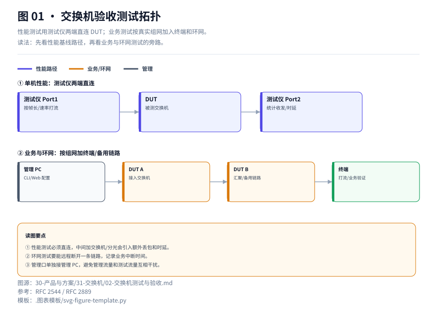
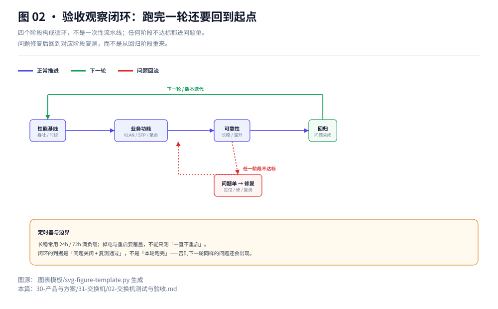

# 交换机测试与验收

交换机的验收不是「能通就行」，而是分三层验证：**单机性能（吞吐/时延/丢包）→ 业务功能（VLAN/STP/聚合/镜像）→ 整机可靠性（长稳/温升/掉电/环网收敛）**。

> 本篇定位：产品交付视角的测试项、拓扑、判据和边界。协议原理去 `10-基础理论`，芯片/SDK 调试去 `40-平台与芯片`，生产线测试只列入口不展开。

## 目录

- [1 一句话模型](#s1)
- [2 速览](#s2)
- [3 测试项与判据](#s3)
- [4 测试流程](#s4)
- [5 状态观察与计时](#s5)
- [6 设计取舍与边界](#s6)
- [7 与相邻主题的关系](#s7)
- [名词解释](#名词解释)
- [8 参考与关联](#s8)

## 1 · 一句话模型：先测「能不能线速」，再测「出问题能不能扛」

```text
性能基线：吞吐、时延、丢包、背靠背
   └─ 业务功能：VLAN、STP、LACP、镜像、ACL、组播
        └─ 可靠性：长稳、环网收敛、掉电恢复、温升、PoE
```

三个关键认知：

1. **吞吐不达标先怀疑测试方法**：帧长、端口配对、仪表精度、流控、镜像口都会影响结果。
2. **功能测试要覆盖「配置错误」**：只测正确配置，发现不了 VLAN 泄漏和环路。
3. **长稳和温升是产品问题**：实验室短测通过，不代表夏天满负载能撑住。

## 2 · 速览

| 项 | 内容 |
| --- | --- |
| 测试对象 | 单机、堆叠系统、环网、PoE 供电 |
| 关键指标 | 吞吐、时延、丢包率、背靠背、MAC 学习速率、收敛时间 |
| 关键仪表 | 以太网测试仪、打流仪、光功率计、温箱、功率计 |
| 主要标准 | RFC 2544、RFC 2889、RFC 3918、ITU-T Y.1564 |
| 测试阶段 | 研发自测、型式试验、运营商/客户验收、生产抽检 |
| 交付物 | 测试报告、问题单、配置基线、验收记录 |

## 3 · 测试项与判据

### 3.1 性能测试

| 测试项 | 方法 | 典型判据 | 边界 |
| --- | --- | --- | --- |
| 吞吐 | 逐帧长打流，找到无丢包最大速率 | 达到端口线速（如 1G/10G） | 受帧长、流数量、哈希分布影响 |
| 时延 | 记录发送/接收时间戳 | 存储转发通常在百微秒级，待实测 | 仪表精度和时钟同步决定可信度 |
| 丢包率 | 固定速率下统计收发差 | 0（线速下） | 突发流量比平均流量更苛刻 |
| 背靠背 | 短时满速突发 | 无丢包的最大突发长度 | 依赖缓存和队列设计 |
| MAC 学习速率 | 注入大量不同源 MAC | 达到标称学习能力 | 表项满后行为要单独验证 |
| 表项容量 | 填满 MAC/ACL/路由表 | 达到规格书标称值 | 共享表项要按最坏组合测 |

> 待验证：具体产品的时延、背靠背和表项规格以规格书为准，本篇不给绝对值。

### 3.2 功能测试

| 测试项 | 覆盖点 | 常见失败 |
| --- | --- | --- |
| VLAN | Access/Trunk/Hybrid、PVID、允许列表、QinQ | VLAN 泄漏、PVID 错、上行口漏配 |
| STP | 根桥选举、阻塞/转发、边缘口、BPDU 保护 | 抢根、收敛慢、边缘口环路 |
| LACP | 静态/动态聚合、成员故障、负载均衡 | 单通、哈希不均、对端不协商 |
| 镜像 | 收/发/双向、VLAN 镜像、远程镜像 | 镜像丢包、镜像口被 STP 阻塞 |
| ACL | 二层/三层匹配、计数、优先级 | 规则顺序错、TCAM 满、计数不准 |
| 组播 | IGMP snooping、查询器、快速离开 | 组播泛洪、离开慢 |
| PoE | 检测/分级/供电/断电、总功率 | 功率不足、端口反复重启 |

### 3.3 可靠性与环境

| 测试项 | 方法 | 关注点 |
| --- | --- | --- |
| 长稳 | 满负载 24 h/72 h 连续打流 | 内存泄漏、表项老化异常、端口 flap |
| 环网收敛 | 断环/恢复，记录中断时间 | 收敛时间、是否短暂环路 |
| 掉电恢复 | 反复断电上电 | 配置保存、镜像校验、启动时间 |
| 温升 | 满载 + 高温箱 | 芯片结温、降频、风扇策略 |
| 电源 | 拉偏、浪涌、双电源切换 | 重启、丢配置、PoE 掉电 |
| 电磁兼容 | EMC/ESD | 端口误码、重启 |

## 4 · 测试流程



**读图**：测试仪两端分别接 DUT 的入/出端口；性能测试用直连，业务测试按实际组网加交换机/终端；环网测试要能远程断开一条链路。

> 图源：`images/图01-交换机测试拓扑.svg`

### 4.1 推荐顺序

```text
① 单机基础：端口 up、自协商、MAC 学习、VLAN 连通
② 性能基线：吞吐 → 时延 → 丢包 → 背靠背
③ 业务功能：VLAN/STP/LACP/镜像/ACL/组播/PoE
④ 组网场景：双上行、环网、堆叠
⑤ 可靠性：长稳、掉电、温升、电源
⑥ 回归：问题修复后重跑相关用例
```

### 4.2 性能测试方法

1. 确认端口速率/双工/流控配置一致。
2. 用测试仪逐帧长（64/128/256/512/1024/1518 字节）打流。
3. 从低速率逐步提高，记录丢包拐点。
4. 记录吞吐、时延、丢包率，保存原始数据。
5. 多流场景要覆盖不同哈希组合，避免「单流达标、多流不均」。

### 4.3 异常分支

| 现象 | 优先怀疑 | 处理 |
| --- | --- | --- |
| 小包吞吐低 | CPU 上送、ACL 未下硬件、流控 | 查表项和 CPU 占用 |
| 大包丢包 | MTU、jumbo frame、缓存不足 | 统一 MTU，查队列 |
| 时延抖动大 | 队列调度、镜像、低优先级拥塞 | 关闭镜像复测，查 QoS |
| 环网切换后不通 | STP 实例/VLAN 映射不一致 | 对齐实例和允许列表 |
| 长稳后性能下降 | 表项泄漏、内存碎片、温升降频 | 看日志、温度、表项计数 |

## 5 · 状态观察与计时




**读图**：四个阶段首尾相接（回归完进下一轮）；不达标进问题单，修好回到**对应阶段**复测，不是从回归重来。

> 图源：`images/图02-验收观察闭环.svg`

测试期间要持续观察，而不是只看最终结果：

| 观察项 | 采集方式 | 异常信号 |
| --- | --- | --- |
| 端口状态 | 设备日志/SNMP trap | 频繁 up/down、CRC 增长 |
| CPU/内存 | SNMP/CLI | 缓慢上升、周期抖动 |
| 表项计数 | CLI/SNMP | 只增不减、达到上限 |
| 温度/风扇 | 传感器 | 高温降频、风扇全速 |
| 丢包计数 | 端口统计 | 特定队列/端口持续增长 |
| 收敛时间 | 测试仪打流+断链 | 超过业务允许的中断窗口 |

> 待验证：不同产品的传感器精度、日志粒度和 SNMP OID 不同，验收前要确认采集口径。

## 6 · 设计取舍与边界

### 6.1 线速 vs 突发

线速测试用稳定速率，背靠背测试用短时突发。两者都过，才能说明「平均性能和缓存都够」；只看平均吞吐会漏掉突发丢包。

### 6.2 仪表测试 vs 真实终端

仪表能精确控制帧长和速率，但模拟不了真实业务分布；真实终端能发现兼容性问题，但不可重复。验收应两者结合。

### 6.3 全测 vs 抽测

研发阶段全测，生产阶段按批量抽测；抽测项应覆盖「最容易出错的装配和校准」，而不是重复研发用例。

### 6.4 实验室 vs 现场

实验室温控和电源稳定，现场有灰尘、高温、电压波动和雷击。户外/工业机型必须做环境和防护测试，不能只交实验室报告。

### 6.5 测试报告的边界

报告要写清「测了什么、没测什么、用什么仪表、什么固件版本」。只写「测试通过」而不写条件，无法复现，也无法作为验收依据。

## 7 · 与相邻主题的关系

| 相邻对象 | 关系 |
| --- | --- |
| [交换机产品架构](./00-交换机产品架构.md) | 被测对象的组成与表项 |
| [交换机业务与组网](./01-交换机业务与组网.md) | 功能测试的配置基线 |
| [以太网与 MAC](../../10-基础理论/11-网络科学/02-链路层/01-以太网与MAC.md) | 帧长、CRC、自协商 |
| [STP/RSTP/MSTP](../../10-基础理论/11-网络科学/02-链路层/03-STP-RSTP-MSTP.md) | 环网收敛的协议背景 |
| [无线覆盖与干扰优化](../../10-基础理论/12-通信科学/04-无线通信/05-无线测试与优化/00-无线覆盖与干扰优化.md) | 整机测试方法的参照 |

一句话：**验收报告的价值在于「条件可复现、判据可比较」，而不是「结论写了通过」。**

## 名词解释

> 缩写给出英文全称；非缩写用“—”表示。

| 术语 | 英文全称 | 解释 |
| --- | --- | --- |
| DUT | Device Under Test | 被测设备。 |
| RFC 2544 | — | 网络互连设备基准测试方法标准。 |
| RFC 2889 | — | 局域网交换机基准测试方法。 |
| Y.1564 | — | ITU-T 以太网业务开通测试方法。 |
| CRC | Cyclic Redundancy Check | 循环冗余校验。 |
| MTU | Maximum Transmission Unit | 最大传输单元。 |
| EMC | Electromagnetic Compatibility | 电磁兼容。 |
| ESD | Electrostatic Discharge | 静电放电。 |
| SNMP | Simple Network Management Protocol | 简单网络管理协议。 |
| OID | Object Identifier | SNMP 对象标识。 |

## 8 · 参考与关联

**标准**

- RFC 2544：Benchmarking Methodology for Network Interconnect Devices
- RFC 2889：Benchmarking Methodology for LAN Switching Devices
- RFC 3918：Multicast Benchmarking
- ITU-T Y.1564：Ethernet Service Activation Test Methodology
- IEEE 802.3：Ethernet

**关联**

- [设备形态对比](../00-设备形态对比.md)
- [交换机产品架构](./00-交换机产品架构.md)
- [交换机业务与组网](./01-交换机业务与组网.md)

---

> **本篇定位**：交换机从单机性能到整机可靠性的验收项、方法和判据边界。
> **素材来源**：`studyspace/1.知识体系/8.路由与交换/`（业务场景）、`studyspace/1.知识体系/7.openwrt/`（设备实现）。
> **待验证**：具体型号的时延、背靠背、表项容量、PoE 功率与温升数据。
