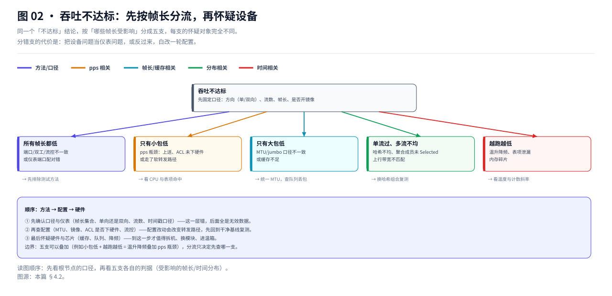

# 交换机测试与验收

交换机的验收不是「能通就行」，而是分三层验证：**单机性能（吞吐/时延/丢包）→ 业务功能（VLAN/STP/聚合/镜像）→ 整机可靠性（长稳/温升/掉电/环网收敛）**。

> 本篇定位：产品交付视角的测试项、拓扑、判据和边界。协议原理去 `10-基础理论`，芯片/SDK 调试去 `40-平台与芯片`，生产线测试只列入口不展开。

## 目录

- [1 一句话模型](#s1)
- [2 速览](#s2)
- [3 测试项与判据](#s3)
- [4 测试流程](#s4)
- [5 状态观察与计时](#s5)
- [6 设计取舍与边界](#s6)
- [7 与相邻主题的关系](#s7)
- [名词解释](#名词解释)
- [8 参考与关联](#s8)

## 1 · 一句话模型：先测「能不能线速」，再测「出问题能不能扛」

```text
性能基线：吞吐、时延、丢包、背靠背
   └─ 业务功能：VLAN、STP、LACP、镜像、ACL、组播
        └─ 可靠性：长稳、环网收敛、掉电恢复、温升、PoE
```

**为什么必须是这个顺序？** 因为三层的结论会互相污染。性能基线没过，业务测试里的「时通时断」就无法归因——可能是 VLAN 配错，也可能是设备本来就在丢包。先把转发能力钉死成一条基线，后面的每个异常才有参照物。

反过来也一样：**只做性能基线就交付，等于只测了空载**。线速打流是最理想的输入（固定帧长、无突发、无协议报文），而现网是混合流量、有广播、有突发、有 CPU 上送。三层各自回答一个问题，缺一层就有一种故障类型测不到。

三个关键认知：

1. **吞吐不达标先怀疑测试方法**：帧长、端口配对、仪表精度、流控、镜像口都会影响结果。
2. **功能测试要覆盖「配置错误」**：只测正确配置，发现不了 VLAN 泄漏和环路。
3. **长稳和温升是产品问题**：实验室短测通过，不代表夏天满负载能撑住。

> **推论**：一份验收报告的说服力来自「口径」而不是「结论」。同一条「吞吐 100%」的结论，在「单向、单流、64 字节、无背景流量」下和「双向、多流、混合帧长、开镜像」下是两件事。写清口径的短报告，比写满「通过」的长报告有用。
> **边界**：本篇的三层划分适用于盒式交换机的整机验收，不适用于芯片 IP 核验证、软件协议栈单元测试和生产线单板测试——那三类的判据与工具都不同。
> **待验证**：具体型号的时延、背靠背、表项容量、PoE 功率与温升数据以规格书与实测为准，本篇只给口径与方法。

## 2 · 速览

| 项 | 内容 | 边界与误判 |
| --- | --- | --- |
| 测试对象 | 单机、堆叠系统、环网、PoE 供电 | 堆叠与环网要按「系统」验收，单机全过不代表组网全过 |
| 关键指标 | 吞吐、时延、丢包率、背靠背、MAC 学习速率、收敛时间 | 指标之间不独立：加大流数量，吞吐与时延会同时变差 |
| 关键仪表 | 以太网测试仪、打流仪、光功率计、温箱、功率计 | 打流仪 ≠ 测试仪：前者能给压力，后者才有符合标准的时延与背靠背口径 |
| 主要标准 | RFC 2544、RFC 2889、RFC 3918、ITU-T Y.1564 | 前三个测设备，Y.1564 测业务开通；混用会把「业务 SLA」当成「设备能力」 |
| 测试阶段 | 研发自测、型式试验、运营商/客户验收、生产抽检 | 阶段不同判据不同：研发看拐点，验收看是否达标，抽检看一致性 |
| 交付物 | 测试报告、问题单、配置基线、验收记录 | 没有配置基线的报告不可复现，等于没有报告 |

**因为**这张表混了「测什么」和「靠什么判定」，**所以**第三列专门标错配：最大的一类验收争议不是设备不行，而是仪表、标准、阶段三者对不上（比如用打流仪的数据去填 Y.1564 的表格）。

## 3 · 测试项与判据

### 3.1 性能测试

| 测试项 | 方法 | 典型判据 | 边界 |
| --- | --- | --- | --- |
| 吞吐 | 逐帧长打流，找到无丢包最大速率 | 达到端口线速（如 1G/10G） | 受帧长、流数量、哈希分布影响；「单向达标」不等于双向达标 |
| 时延 | 记录发送/接收时间戳 | 存储转发千兆通常十几微秒级（1518 B 仅串行化就约 12 µs），万兆更低；以规格书与实测为准 | 仪表精度和时钟同步决定可信度；测的是哪两点（首比特/末比特）必须写清 |
| 丢包率 | 固定速率下统计收发差 | 0（线速下） | 突发流量比平均流量更苛刻 |
| 背靠背 | 短时满速突发 | 无丢包的最大突发长度 | 依赖缓存和队列设计；缓存被多口共享时，单口数值不可叠加 |
| MAC 学习速率 | 注入大量不同源 MAC | 达到标称学习能力 | 表项满后行为要单独验证（泛洪还是丢弃，厂商不同） |
| 表项容量 | 填满 MAC/ACL/路由表 | 达到规格书标称值 | 共享表项要按最坏组合测 |
| 系统恢复 | 触发主控/协议重启，观察业务恢复时间 | 达到规格书承诺的恢复时间 | 恢复时间含协议收敛，别只算进程起来 |
| 复位 | 硬复位/软复位后检查配置与转发 | 配置不丢、转发恢复 | 软复位不重启 ASIC 时，表项残留会掩盖问题 |

> **修正一处常见口径**：RFC 2544 建议的帧长是**七种**——64、128、256、512、1024、1280、1518 字节。只打 64/128/256/512/1024/1518 六种会漏掉 1280，而 1280 恰好是 IPv6 最小 MTU，跨协议栈测试时这一档不能省。

> **待验证**：具体产品的时延、背靠背和表项规格以规格书为准，本篇不给绝对值。

RFC 2544 本身的测试项是六项：吞吐、时延、帧丢失率、背靠背、系统恢复、复位。**它们的分工是**：前四项刻画「稳态与突发下的转发能力」，后两项刻画「异常之后能不能回到稳态」。只做前四项，等于假设设备永不重启。

### 3.2 功能测试

功能测试的价值不在「配对了能通」，而在「配错了会怎样」——所以每一行都要有反向用例。

| 测试项 | 覆盖点 | 常见失败 | 判据边界 |
| --- | --- | --- | --- |
| VLAN | Access/Trunk/Hybrid、PVID、允许列表、QinQ | VLAN 泄漏、PVID 错、上行口漏配 | 「通」不等于「隔离对」；必须用两个 VLAN 互 ping 验证隔离 |
| STP | 根桥选举、阻塞/转发、边缘口、BPDU 保护 | 抢根、收敛慢、边缘口环路 | 收敛时间要注明拓扑规模与定时器取值，否则不可比 |
| LACP | 静态/动态聚合、成员故障、负载均衡 | 单通、哈希不均、对端不协商 | 「聚合口 up」不等于成员 Selected；要看成员状态与哈希分布 |
| 镜像 | 收/发/双向、VLAN 镜像、远程镜像 | 镜像丢包、镜像口被 STP 阻塞 | 判据是「镜像完整」而不是「能收到包」；要按峰值带宽核 |
| ACL | 二层/三层匹配、计数、优先级 | 规则顺序错、TCAM 满、计数不准 | 计数只统计命中硬件的包；上送 CPU 的包可能不计 |
| 组播 | IGMP snooping、查询器、快速离开 | 组播泛洪、离开慢 | 没开 snooping 时组播按广播泛洪，看起来「也能用」 |
| PoE | 检测/分级/供电/断电、总功率 | 功率不足、端口反复重启 | 总预算按整机算；单口最大功率之和通常大于总预算 |

### 3.3 可靠性与环境

| 测试项 | 方法 | 关注点 | 边界 |
| --- | --- | --- | --- |
| 长稳 | 满负载 24 h/72 h 连续打流 | 内存泄漏、表项老化异常、端口 flap | 「跑通 72 h」不等于无泄漏；要看内存与表项计数的斜率 |
| 环网收敛 | 断环/恢复，记录中断时间 | 收敛时间、是否短暂环路 | 单次测量不可信，要统计多次并区分「断链」与「恢复」两个方向 |
| 掉电恢复 | 反复断电上电 | 配置保存、镜像校验、启动时间 | 断电时机不同结果不同（写 Flash 过程中断电最危险） |
| 温升 | 满载 + 高温箱 | 芯片结温、降频、风扇策略 | 箱内温度不等于机内温度；要记录进风口与芯片结温两个点 |
| 电源 | 拉偏、浪涌、双电源切换 | 重启、丢配置、PoE 掉电 | 双电源切换要测「拔一路」，不是「两路都拔」 |
| 电磁兼容 | EMC/ESD | 端口误码、重启 | 判定看误码率与是否重启，不看「有没有感觉」 |

### 3.4 判据从哪来

判据不是测出来的，是**事先约定的**。来源有四种，优先级从高到低：

| 来源 | 用途 | 边界与误判 |
| --- | --- | --- |
| 合同/技术规范 | 最终判定依据 | 写「达到线速」而不写帧长与流数，等于没写判据 |
| 规格书 datasheet | 研发自测的初判 | 标称值常按最优条件给出（单向、单流、大包），照抄会得到偏乐观的基线 |
| 标准（RFC/IEEE/ITU-T） | 方法与口径 | 标准只规定「怎么测」，不规定「必须达到多少」；别把标准当合格线 |
| 竞品对标 | 争议时的参照 | 竞品配置与固件版本不同，数字不可直接比 |

> **推论**：验收启动前先把「判据表」签掉，比测完再争「这个数算不算过」省一周。判据表至少要写五列：项、口径（帧长/流数/方向）、条件（温度/固件/配置）、门限、测量工具。

## 4 · 测试流程


**读图**：测试仪两端分别接 DUT 的入/出端口；性能测试用直连，业务测试按实际组网加交换机/终端；环网测试要能远程断开一条链路。

> 图源：`images/图01-交换机测试拓扑.svg`

### 4.1 推荐顺序

```text
① 单机基础：端口 up、自协商、MAC 学习、VLAN 连通
② 性能基线：吞吐 → 时延 → 丢包 → 背靠背
③ 业务功能：VLAN/STP/LACP/镜像/ACL/组播/PoE
④ 组网场景：双上行、环网、堆叠
⑤ 可靠性：长稳、掉电、温升、电源
⑥ 回归：问题修复后重跑相关用例
```

**为什么②必须在③之前？** 因为功能测试会改变转发路径（加 ACL、开镜像、改 VLAN），一旦性能不达标，你无法判断是设备能力问题还是这些配置引起的。先在没有策略的干净路径上取基线，后面每一步才有对照。

### 4.2 性能测试方法

1. 确认端口速率/双工/流控配置一致。
2. 用测试仪逐帧长（64/128/256/512/1024/1280/1518 字节）打流。
3. 从低速率逐步提高，记录丢包拐点。
4. 记录吞吐、时延、丢包率，保存原始数据。
5. 多流场景要覆盖不同哈希组合，避免「单流达标、多流不均」。

这五步里，第 3 步最容易被省成「直接打线速，过就过」。**为什么不行？** 因为「线速过」只证明了一个点，而丢包拐点的位置决定了余量：拐点在 98% 和 100% 的两台设备，标称相同，抗突发能力差很多。找拐点用二分比线性扫快，步长取 1% 足够。

第 5 步的哈希组合也有个隐含前提：**多流只有在经过聚合口或堆叠口时才真正被分散**。单机单口打多流，哈希不影响结果；把「单机多流通过」当成「聚合口多流通过」，是最常见的过度外推。



**读图**：同一个「吞吐不达标」的结论，按「哪些帧长受影响」分成五支，每支对应完全不同的怀疑对象。先分对支，再动手改配置——分错支的代价是把设备问题当仪表问题，或反过来。

> 图源：`images/图02-吞吐不达标分流.svg`

> **推论**：「只有小包低」几乎总是 pps 瓶颈（上送、ACL 未下硬件、软转发），「只有大包低」几乎总是缓存或 MTU 问题。这两支的排查工具完全不同：前者看 CPU 与表项，后者看队列与帧长统计。

### 4.3 异常分支

| 现象 | 优先怀疑 | 处理 | 边界 |
| --- | --- | --- | --- |
| 小包吞吐低 | CPU 上送、ACL 未下硬件、流控 | 查表项和 CPU 占用 | 别先换仪表；先用大包复测确认是否只跟 pps 相关 |
| 大包丢包 | MTU、jumbo frame、缓存不足 | 统一 MTU，查队列 | 跨厂商 jumbo 计入口径不同（是否含 tag），要按实际帧长对齐 |
| 时延抖动大 | 队列调度、镜像、低优先级拥塞 | 关闭镜像复测，查 QoS | 「抖动大」要先确认仪表时间戳精度，纳秒级抖动多半是测量噪声 |
| 环网切换后不通 | STP 实例/VLAN 映射不一致 | 对齐实例和允许列表 | 也可能是收敛时间超过业务中断窗口，看起来像「不通」 |
| 长稳后性能下降 | 表项泄漏、内存碎片、温升降频 | 看日志、温度、表项计数 | 先看斜率再看绝对值；温升与泄漏的曲线形状不同，能区分 |

## 5 · 状态观察与计时


**读图**：四个阶段首尾相接（回归完进下一轮）；不达标进问题单，修好回到**对应阶段**复测，不是从回归重来。

> 图源：`images/图03-验收观察闭环.svg`

本篇不涉及设备状态机：验收过程没有协议状态迁移，只有「测试阶段闭环」和「判据窗口」。真正的状态机（端口、STP、LACP、ERPS）在 [00-交换机产品架构](./00-交换机产品架构.md) 与 [01-交换机业务与组网](./01-交换机业务与组网.md) 里。

**因为**结论由过程数据支撑而不是由最后一个数字支撑，**所以**下面列的是采集项与采样窗口，不是判据——判据在 §3。

测试期间要持续观察，而不是只看最终结果：

| 观察项 | 采集方式 | 异常信号 | 采样窗口与边界 |
| --- | --- | --- | --- |
| 端口状态 | 设备日志/SNMP trap | 频繁 up/down、CRC 增长 | 秒级采样会漏掉毫秒级闪断；闪断要看日志不是看轮询 |
| CPU/内存 | SNMP/CLI | 缓慢上升、周期抖动 | 只看峰值没意义；要看 24 h 斜率与是否回落 |
| 表项计数 | CLI/SNMP | 只增不减、达到上限 | 老化周期内的正常增长不算泄漏，要跨过一个老化周期再看 |
| 温度/风扇 | 传感器 | 高温降频、风扇全速 | 传感器位置不同读数差很多，报告要写测点 |
| 丢包计数 | 端口统计 | 特定队列/端口持续增长 | 计数器溢出后会回绕，长稳测试要按增量算 |
| 收敛时间 | 测试仪打流+断链 | 超过业务允许的中断窗口 | 断链与恢复是两个方向，收敛时间要分开报 |

> **待验证**：不同产品的传感器精度、日志粒度和 SNMP OID 不同，验收前要确认采集口径。

## 6 · 设计取舍与边界

### 6.1 线速 vs 突发

线速测试用稳定速率，背靠背测试用短时突发。两者都过，才能说明「平均性能和缓存都够」；只看平均吞吐会漏掉突发丢包。

**为什么两者不能互相替代？** 线速测的是持续能力（受制于背板与调度），背靠背测的是缓冲深度（受制于队列与共享缓存）。一台缓存很小的设备可以轻松跑满线速，但一遇到微突发就丢；反过来，缓存大的设备可能背靠背很好，却因为调度算法跑不满线速。

### 6.2 仪表测试 vs 真实终端

仪表能精确控制帧长和速率，但模拟不了真实业务分布；真实终端能发现兼容性问题，但不可重复。验收应两者结合。

分工建议：**用仪表定能力上限，用终端定互操作下限**。仪表过不了的，终端一定过不了；仪表过了的，终端仍可能因为协议实现差异失败（比如 PoE 分级、LLDP 邻居、EAP 认证）。

### 6.3 全测 vs 抽测

研发阶段全测，生产阶段按批量抽测；抽测项应覆盖「最容易出错的装配和校准」，而不是重复研发用例。

判据也不同：研发看「能不能达到」，生产看「这一批与样机是否一致」。用研发用例做生产抽检，成本高且发现不了批次性偏差（比如某批光模块插损偏大）。

### 6.4 实验室 vs 现场

实验室温控和电源稳定，现场有灰尘、高温、电压波动和雷击。户外/工业机型必须做环境和防护测试，不能只交实验室报告。

**代价要说清**：环境测试的成本可能超过功能测试——温箱按天计费，EMC 要去认证实验室。所以它通常放在样机定型后做一次，而不是每轮都做；这也意味着**环境问题发现得最晚，改设计最贵**。

### 6.5 测试报告的边界

报告要写清「测了什么、没测什么、用什么仪表、什么固件版本」。只写「测试通过」而不写条件，无法复现，也无法作为验收依据。

一份可用的报告至少要有：配置基线（含固件版本）、拓扑图、每项的帧长/流数/方向、原始数据文件、未测项清单。**「未测项清单」比「通过项清单」更能说明边界。**

### 6.6 报告的失效条件

即使报告写得很全，下面任一条件成立时，结论就不再适用：

- **固件变了**：换版本等于换了一套转发与协议实现，性能与功能都要重测关键项。
- **配置变了**：加一条 ACL、开一个镜像，都可能改变转发路径与缓存占用。
- **温度变了**：高温下降频或风扇策略切换，吞吐与时延会同步变化。
- **口径变了**：单向换双向、单流换多流、平均换峰值，数字不可比。
- **样本不代表批量**：抽测通过只说明这一台，批次一致性要靠产线数据。

> **边界**：本篇给的是「怎么把结论做实」的方法，不承诺任何具体数字。竞品对比、招标应答里的数字，必须回到同一口径下重测，否则只是两张纸的对比。

## 7 · 与相邻主题的关系

**因为**验收的每一项判据都要落到一个具体机制上（帧、协议、配置），**所以**下面这张表把「测什么」和「机制在哪篇」对齐；本篇只留判据与口径，不复制协议与配置细节。

| 相邻对象 | 关系 | 边界（细节去哪看） |
| --- | --- | --- |
| [交换机产品架构](./00-交换机产品架构.md) | 被测对象的组成与表项 | 那篇讲「硬件怎么执行」，本篇讲「怎么证明它执行得对」；表项容量测法在本篇，表项结构在 00 篇 |
| [交换机业务与组网](./01-交换机业务与组网.md) | 功能测试的配置基线 | 配置模型与排障顺序在 01 篇；本篇只取「正确配置」作为测试输入，不重复讲配置 |
| [以太网与 MAC](../../10-基础理论/11-网络科学/02-链路层/01-以太网与MAC.md) | 帧长、CRC、自协商 | 帧格式与 CRC 计算在那篇；本篇只用到「最小帧 64 B 决定线速 pps」这一个结论 |
| [STP/RSTP/MSTP](../../10-基础理论/11-网络科学/02-链路层/03-STP-RSTP-MSTP.md) | 环网收敛的协议背景 | 选举与定时器在那篇；本篇只测「断链到恢复」的时间，不解释为什么慢 |
| [无线覆盖与干扰优化](../../10-基础理论/12-通信科学/04-无线通信/05-无线测试与优化/00-无线覆盖与干扰优化.md) | 整机测试方法的参照 | 空口是共享介质，判据是覆盖率与并发；有线交换机的判据是线速与丢包，别套用 |

一句话：**验收报告的价值在于「条件可复现、判据可比较」，而不是「结论写了通过」。**

## 名词解释

> 缩写给出英文全称；非缩写用“—”表示。**因为**同一缩写在相邻领域可能指别的东西，**所以**这一列按本目录的用法展开，遇到同名不同义时分行列出，不合并。

| 术语 | 英文全称 | 解释 |
| --- | --- | --- |
| DUT | Device Under Test | 被测设备。 |
| RFC 2544 | Request for Comments 2544 | 网络互连设备基准测试方法标准，规定吞吐/时延/丢包/背靠背/恢复/复位的测法。 |
| RFC 2889 | Request for Comments 2889 | 局域网交换机基准测试方法，补充地址学习速率与表项容量等交换机专属项。 |
| RFC 3918 | Request for Comments 3918 | IP 组播基准测试方法，测组播转发能力与组播表项。 |
| Y.1564 | ITU-T Recommendation Y.1564 | 以太网业务开通测试方法，按业务 SLA 验证带宽/丢包/时延/可用性。 |
| 背靠背 | Back-to-Back | 以线速发送一串连续帧，测无丢包的最大突发长度，反映缓存深度。 |
| 吞吐 | Throughput | 无丢包条件下能达到的最大转发速率，通常以线速百分比或 Mpps 表示。 |
| 线速 | Wire Speed | 端口在最小帧下也能满速率转发、不丢包的状态。 |
| Mpps | Million Packets per Second | 每秒百万包；千兆口线速约 1.488 Mpps，万兆约 14.88 Mpps。 |
| 收敛时间 | Convergence Time | 拓扑变化后业务恢复到可用状态所需的时间。 |
| 型式试验 | Type Test | 对定型样机做的完整验证，覆盖性能、环境、安规与 EMC。 |
| CIR | Committed Information Rate | 承诺信息速率，Y.1564 中保证转发的带宽档位。 |
| EIR | Excess Information Rate | 超额信息速率，CIR 之上允许转发但不保证的带宽。 |
| CRC | Cyclic Redundancy Check | 循环冗余校验。 |
| MTU | Maximum Transmission Unit | 最大传输单元。 |
| EMC | Electromagnetic Compatibility | 电磁兼容。 |
| ESD | Electrostatic Discharge | 静电放电。 |
| SNMP | Simple Network Management Protocol | 简单网络管理协议。 |
| OID | Object Identifier | SNMP 对象标识。 |
| PoE | Power over Ethernet | 以太网供电。 |

## 8 · 参考与关联

**标准**

- RFC 2544：Benchmarking Methodology for Network Interconnect Devices
- RFC 2889：Benchmarking Methodology for LAN Switching Devices
- RFC 3918：Multicast Benchmarking
- ITU-T Y.1564：Ethernet Service Activation Test Methodology
- IEEE 802.3：Ethernet

**因为**这四个标准分别管「设备转发能力」「交换机专属项」「组播」和「业务开通」，**所以**引用时必须说清是哪一类，不能互相替代——用 Y.1564 的结论回答设备吞吐问题，等于答错了题。

**关联**

- [设备形态对比](../00-设备形态对比.md)
- [交换机产品架构](./00-交换机产品架构.md)
- [交换机业务与组网](./01-交换机业务与组网.md)

---

> **本篇定位**：交换机从单机性能到整机可靠性的验收项、方法和判据边界。
> **素材来源**：`studyspace/1.知识体系/8.路由与交换/`（业务场景）、`studyspace/1.知识体系/7.openwrt/`（设备实现）。
> **待验证**：具体型号的时延、背靠背、表项容量、PoE 功率与温升数据。
