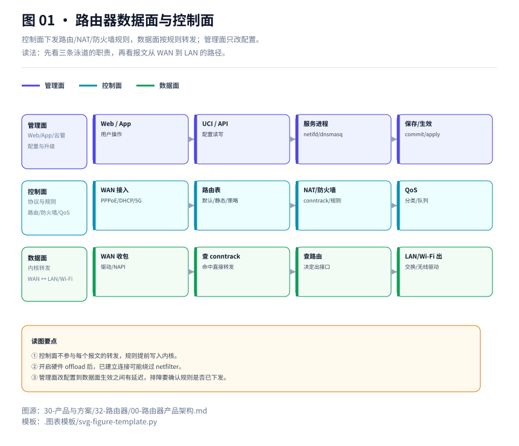
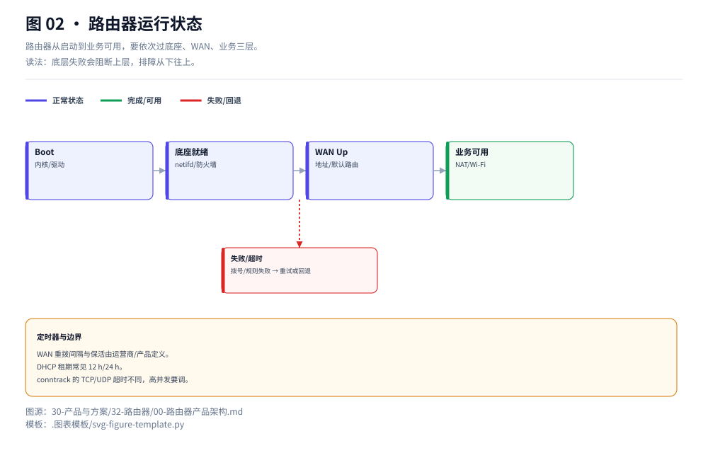

# 路由器产品架构

路由器产品的核心是「一条从 WAN 到 LAN 的策略转发链」：**接入 → 地址 → 路由 → NAT/防火墙 → 无线/交换 → 终端**。硬件决定性能上限，软件决定业务边界。

> 本篇定位：路由器的整机架构、软硬件组成、转发路径和产品形态，属于产品层。IP/NAT/QoS 的原理去 `10-基础理论`，OpenWrt 实现去 `20-平台与系统`，芯片差异去 `40-平台与芯片`。

## 目录

- [1 一句话模型](#s1)
- [2 速览](#s2)
- [3 结构与字段](#s3)
- [4 交互流程](#s4)
- [5 状态机与定时器](#s5)
- [6 设计取舍与边界](#s6)
- [7 与相邻主题的关系](#s7)
- [名词解释](#名词解释)
- [8 参考与关联](#s8)

## 1 · 一句话模型：WAN 进、策略过、LAN 出

```text
WAN（PPPoE/DHCP/静态/5G）
  └─ 路由查表 → NAT/防火墙 → QoS → LAN 交换/Wi-Fi → 终端
        └─ DHCP/DNS 给终端发地址
```

三个关键认知：

1. **路由器首先是「策略设备」**：默认路由只解决「往哪走」，NAT、防火墙、QoS 才决定「谁能走、走多快」。
2. **有线转发和无线转发是两条路径**：有线走交换芯片/网卡，无线走 Wi-Fi 驱动和软件桥接，性能瓶颈不同。
3. **产品档位由「转发能力 + 并发 + 无线」共同决定**，只看 CPU 主频会误判。

## 2 · 速览

| 项 | 内容 |
| --- | --- |
| 产品定位 | 家庭/企业出口网关，做地址转换、路由、无线接入和安全管理 |
| 核心对象 | WAN 口、LAN 口、路由表、NAT 表、防火墙规则、DHCP 池、无线 SSID |
| 关键能力 | 多 WAN、PPPoE、NAT、端口映射、QoS、VPN、Wi-Fi、家长控制 |
| 典型形态 | 家用无线路由、企业路由、工业路由、5G CPE 路由 |
| 软件栈 | Linux/OpenWrt + 厂商 SDK + 加速驱动 + Web/App 管理 |
| 关键标准 | RFC 791/8200、RFC 3022、RFC 2131、RFC 4861/4862、802.11 |
| 主要成本项 | SoC、交换芯片、Wi-Fi 射频、内存/闪存、天线与认证 |

## 3 · 结构与字段

### 3.1 硬件组成

| 部件 | 作用 | 产品关注点 |
| --- | --- | --- |
| 主控 SoC | 跑 Linux、协议栈、NAT、管理 | 核数、主频、是否带硬件加速 |
| 交换芯片 | LAN 多口交换、VLAN | 端口速率、DSA/驱动支持 |
| Wi-Fi 芯片 | 2.4G/5G/6G 射频 | 频宽、空间流、FEM、并发 |
| 内存 | 连接跟踪、缓存、服务 | NAT 并发高时内存是瓶颈 |
| 闪存 | 固件、配置、日志 | 双分区、剩余空间 |
| 以太网 PHY | WAN/LAN 物理接口 | 2.5G/10G、PoE、防雷 |
| 按键/LED | 复位、WPS、状态指示 | 长按复位时长、LED 语义 |

### 3.2 软件分层

| 层 | 组件 | 职责 |
| --- | --- | --- |
| 引导 | BootROM/U-Boot | 镜像选择、恢复模式、升级入口 |
| 内核 | Linux 网络栈、netfilter、驱动 | 收发包、NAT、桥接、无线 |
| 基础服务 | netifd、dnsmasq、odhcpd、firewall | 接口、DHCP/DNS、IPv6、规则 |
| 业务 | QoS、VPN、DDNS、家长控制、插件 | 产品差异化 |
| 管理 | Web/App、TR-069、云管 | 配置、升级、诊断 |

### 3.3 关键资源与表项

| 资源 | 作用 | 不足时 |
| --- | --- | --- |
| 路由表 | 目的网段 → 下一跳 | 路由加不上、回退默认路由 |
| conntrack 表 | 连接跟踪，NAT 的基础 | 新连接被丢、表现为「网页打不开」 |
| NAT 表 | 内网地址:端口 → 外网地址:端口 | 端口映射失败、并发受限 |
| DHCP 池 | 给终端分配地址 | 地址冲突、终端拿不到地址 |
| 防火墙规则 | 放行/阻断/转发 | 规则顺序错导致误阻断 |
| 无线关联表 | STA 关联与认证 | 连不上、频繁掉线 |

> 待验证：不同 SoC 的 NAT 并发、路由表容量和硬件加速能力差异很大，选型要查具体规格。

## 4 · 交互流程



**读图**：终端的流量先到 LAN 交换/Wi-Fi，再进内核转发链；控制面只负责下发路由、NAT 和防火墙规则，数据面按规则转发。

> 图源：`images/图01-路由器数据面与控制面.svg`

### 4.1 上电到上网

```text
上电 → Boot → Linux → 挂载配置
  → 初始化 LAN（交换/VLAN/DHCP）
  → 初始化 WAN（PPPoE/DHCP/静态/5G）
  → 获取地址/DNS/默认路由
  → 下发 NAT/防火墙规则
  → Wi-Fi 起 SSID → 终端关联 → 上网
```

### 4.2 一个出方向报文

```text
终端 → LAN 口/Wi-Fi → 桥/路由判断
  → 查路由表 → 命中默认路由（WAN）
  → netfilter：DNAT（如有端口映射）→ 过滤 → SNAT
  → conntrack 记录 → 从 WAN 发出
```

回包按 conntrack 反向还原，不需要重新查 NAT 规则。

### 4.3 异常分支

| 异常 | 现象 | 定位方向 |
| --- | --- | --- |
| 拨号失败 | WAN 无地址 | 账号/认证/VLAN/线路 |
| 能上部分网站 | DNS 或 MTU 问题 | DNS 配置、MSS 钳制 |
| 端口映射不生效 | 外网访问不到内网服务 | NAT 规则、防火墙、运营商封端口 |
| 连接数一多就卡 | conntrack/内存不足 | 并发连接数、超时时间 |
| Wi-Fi 能连不能上网 | 桥接/VLAN/防火墙 | SSID 绑定的网络、转发规则 |
| 重启后配置丢失 | 保存/分区问题 | 配置文件、双镜像 |

## 5 · 状态机与定时器




**读图**：从 Boot 到业务可用要过底座、WAN、业务三层；底层失败会阻断上层。

> 图源：`images/图02-路由器运行状态.svg`

路由器没有单一状态机，关键状态分散在几个对象上：

| 对象 | 状态 | 关键定时器/参数 |
| --- | --- | --- |
| WAN 接口 | Down → 拨号/请求 → Up → 断开重拨 | 重拨间隔、保活周期 |
| DHCP 租约 | 分配 → 续租 → 过期 | 租期（常见 12 h/24 h） |
| conntrack 表项 | NEW → ESTABLISHED → 超时删除 | TCP 建立/关闭超时、UDP 超时 |
| 无线 STA | 认证 → 关联 → 授权 → 转发 | 空闲超时、漫游阈值 |
| 升级 | 下载 → 校验 → 写入 → 重启 | 回滚超时、看门狗 |

## 6 · 设计取舍与边界

### 6.1 硬件加速 vs 纯软件转发

硬件 NAT/offload 能大幅提升吞吐、降低 CPU 占用，但会绕过部分 netfilter 规则，导致 QoS、抓包、流量统计失真。开加速前要确认业务链是否兼容。

### 6.2 路由模式 vs 桥接模式

路由模式做 NAT 和防火墙，适合家庭/企业出口；桥接模式把 WAN 直接透传给内网设备，适合已有上游网关的场景。桥接模式下本机的 QoS/家长控制基本失效。

### 6.3 多 WAN 的代价

多 WAN 能做冗余和负载均衡，但会带来策略路由、连接保持、源地址选择等复杂问题；游戏、银行、VoIP 这类对源 IP 敏感的业务容易受影响。

### 6.4 无线不是「加个 AP」

路由器的 Wi-Fi 与有线共享 CPU/内存/总线，满速无线转发会挤占 NAT 和防火墙处理资源。产品标称「AX3000」不等于「无线吞吐 3000 Mbps」。

### 6.5 什么时候该用企业路由

终端多、需要多 WAN、VLAN 隔离、行为管理、VPN 站点互联时，家用路由的会话数和功能边界不够，应上企业路由或专业防火墙。

## 7 · 与相邻主题的关系

| 相邻对象 | 关系 |
| --- | --- |
| [IPv4](../../10-基础理论/11-网络科学/03-网络层/01-IPv4.md) | 地址、路由、分片 |
| [NAT](../../10-基础理论/11-网络科学/03-网络层/05-NAT.md) | SNAT/DNAT/NAPT 原理 |
| [DHCPv4](../../10-基础理论/11-网络科学/05-应用层/01-DHCPv4.md) | LAN 侧地址分配 |
| [PPPoE](../../10-基础理论/11-网络科学/02-链路层/06-PPP与PPPoE.md) | WAN 拨号 |
| [OpenWrt 数据面总览](../../20-平台与系统/22-OpenWrt/03-网络数据面/00-数据面总览.md) | fw3/fw4、DSA、offload |
| [路由转发与 NAT 方案](./01-路由转发与NAT方案.md) | 本篇的业务展开 |
| [QoS 与流控方案](./02-QoS与流控方案.md) | 带宽管理 |

一句话：**路由器 = 一台会做地址转换和策略转发的小型 Linux 主机 + 交换/Wi-Fi 外设。**

## 名词解释

> 缩写给出英文全称；非缩写用“—”表示。

| 术语 | 英文全称 | 解释 |
| --- | --- | --- |
| WAN | Wide Area Network | 广域网接口，通常接运营商。 |
| LAN | Local Area Network | 局域网接口，接终端。 |
| NAT | Network Address Translation | 网络地址转换。 |
| SNAT | Source NAT | 源地址转换，家庭上网最常用。 |
| DNAT | Destination NAT | 目的地址转换，端口映射的基础。 |
| NAPT | Network Address Port Translation | 地址+端口转换。 |
| conntrack | Connection Tracking | 连接跟踪，NAT 和防火墙的状态基础。 |
| DHCP | Dynamic Host Configuration Protocol | 动态主机配置协议。 |
| DNS | Domain Name System | 域名系统。 |
| QoS | Quality of Service | 服务质量。 |
| VPN | Virtual Private Network | 虚拟专用网。 |
| SoC | System on Chip | 系统级芯片。 |
| FEM | Front-End Module | 射频前端模块。 |

## 8 · 参考与关联

**标准**

- RFC 791：Internet Protocol
- RFC 3022：Traditional IP Network Address Translator
- RFC 2131：Dynamic Host Configuration Protocol
- RFC 4861 / 4862：Neighbor Discovery / SLAAC
- IEEE 802.11：Wireless LAN

**关联**

- [设备形态对比](../00-设备形态对比.md)
- [路由转发与 NAT 方案](./01-路由转发与NAT方案.md)
- [QoS 与流控方案](./02-QoS与流控方案.md)
- [OpenWrt 网络数据面](../../20-平台与系统/22-OpenWrt/03-网络数据面/00-数据面总览.md)

---

> **本篇定位**：路由器整机的软硬件分层、WAN→LAN 转发链和产品形态边界。
> **素材来源**：`studyspace/1.知识体系/7.openwrt/3.网络业务/`（WAN/LAN/网络管理）、`studyspace/1.知识体系/8.路由与交换/m-7-路由.md`。
> **待验证**：各平台的 NAT 并发、硬件加速兼容性、无线满速转发能力。
