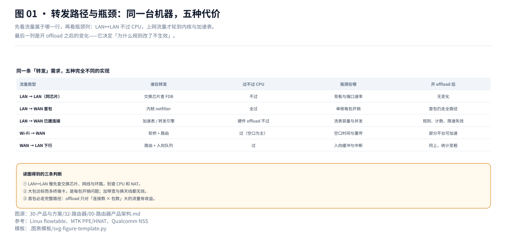

# 路由器产品架构

路由器产品的核心是「一条从 WAN 到 LAN 的策略转发链」：**接入 → 地址 → 路由 → NAT/防火墙 → 无线/交换 → 终端**。硬件决定性能上限，软件决定业务边界。

> 本篇定位：路由器的整机架构、软硬件组成、转发路径和产品形态，属于产品层。IP/NAT/QoS 的原理去 `10-基础理论`，OpenWrt 实现去 `20-平台与系统`，芯片差异去 `40-平台与芯片`。本篇不写报文格式、不写配置命令、不比较具体型号的跑分。

## 目录

因为本目录沿用 `#sN` 锚点惯例，所以章节标题带固定编号、TOC 与之逐条对应；改标题时必须同步 TOC，否则锚点失效。

- [1 一句话模型](#s1)
- [2 速览](#s2)
- [3 结构与字段](#s3)
- [4 交互流程](#s4)
- [5 状态机与定时器](#s5)
- [6 设计取舍与边界](#s6)
- [7 与相邻主题的关系](#s7)
- [名词解释](#名词解释)
- [8 参考与关联](#s8)

## 1 · 一句话模型：WAN 进、策略过、LAN 出

```text
WAN（PPPoE/DHCP/静态/5G）
  └─ 路由查表 → NAT/防火墙 → QoS → LAN 交换/Wi-Fi → 终端
        └─ DHCP/DNS 给终端发地址
```

三个关键认知：

1. **路由器首先是「策略设备」**：默认路由只解决「往哪走」，NAT、防火墙、QoS 才决定「谁能走、走多快」。因为地址和路由是运营商给的，产品差异只能长在策略层，所以两个同芯片方案的路由器，功能差别几乎全在软件。
2. **有线转发和无线转发是两条路径**：有线走交换芯片/网卡，无线走 Wi-Fi 驱动和软件桥接，性能瓶颈不同。因为空口是共享介质、还要经过「以太帧 → 802.11 帧」的转换，所以无线侧的第一瓶颈通常不是 CPU 主频，而是空口时间与重传。
3. **产品档位由「转发能力 + 并发 + 无线」共同决定**，只看 CPU 主频会误判。因为小包转发吃的是每包开销（中断、查表、netfilter 钩子），大包吞吐吃的是内存带宽，两种负载对硬件的偏好相反。

> **推论**：看一台路由器的规格，要按「包转发率（pps）+ 并发会话数 + 无线空间流」三行读，任何一行缺失，标称数字都不能横向比较。
> **边界**：这套模型假设设备是「一台 Linux 主机 + 交换/Wi-Fi 外设」。虚拟化软路由、纯交换芯片转发（无 CPU 参与）的设备，分层与瓶颈位置都不同，本篇 §3.4 会单独说明。

## 2 · 速览

因为速览只回答「这台设备是什么、边界在哪」，所以每行都补了「什么情况下会误判」，机制细节留给后面章节。

| 项 | 内容 | 边界与误判 |
| --- | --- | --- |
| 产品定位 | 家庭/企业出口网关，做地址转换、路由、无线接入和安全管理 | 「网关」不必然带 NAT；桥接模式下它只做透传，别按路由模式排障 |
| 核心对象 | WAN 口、LAN 口、路由表、NAT 表、防火墙规则、DHCP 池、无线 SSID | 表项都有容量上限；「配置成功」不等于「运行期够用」 |
| 关键能力 | 多 WAN、PPPoE、NAT、端口映射、QoS、VPN、Wi-Fi、家长控制 | 能力清单是软件许可，不等于同型号都能开；有些依赖硬件加速才有线速 |
| 典型形态 | 家用无线路由、企业路由、工业路由、5G CPE 路由 | 形态由「上行介质 + 转发位置」定，不由外观定，见 [设备形态对比](../00-设备形态对比.md) |
| 软件栈 | Linux/OpenWrt + 厂商 SDK + 加速驱动 + Web/App 管理 | 厂商 SDK 常改内核转发路径；照搬 OpenWrt 文档会与实机行为不符 |
| 关键标准 | RFC 791/8200、RFC 3022、RFC 2131、RFC 4861/4862、802.11 | 标准只管互通，不管性能与产品行为；NAT 行为细节看 RFC 4787 |
| 主要成本项 | SoC、交换芯片、Wi-Fi 射频、内存/闪存、天线与认证 | 认证（运营商入库、Wi-Fi 联盟、能效）常比物料更影响排期 |
| 本篇不覆盖 | 报文格式、配置命令、芯片选型、具体型号跑分 | 需要时去 10 / 20 / 40 三个目录 |

## 3 · 结构与字段

整机可以按「硬件 → 软件分层 → 运行期表项」三刀切开。先看硬件能做什么，再看软件把硬件组织成哪几层，最后看运行期真正会耗尽的是哪些表。

### 3.1 硬件组成

| 部件 | 作用 | 产品关注点 | 边界与误判 |
| --- | --- | --- | --- |
| 主控 SoC | 跑 Linux、协议栈、NAT、管理 | 核数、主频、是否带硬件加速 | 主频高不等于转发快；小包性能由每包开销与是否多核并行决定 |
| 交换芯片 | LAN 多口交换、VLAN | 端口速率、DSA/驱动支持 | LAN↔LAN 转发不过 CPU；把它算进「路由性能」会高估 CPU 负载 |
| Wi-Fi 芯片 | 2.4G/5G/6G 射频 | 频宽、空间流、FEM、并发 | 标称速率是 PHY 速率之和，不是用户可得的 TCP 吞吐 |
| 内存 | 连接跟踪、缓存、服务 | NAT 并发高时内存是瓶颈 | 内存大不等于会话多，会话上限由 `nf_conntrack_max` 决定 |
| 闪存 | 固件、配置、日志 | 双分区、剩余空间 | 剩余空间不足时升级失败往往发生在写入阶段，不是下载阶段 |
| 以太网 PHY | WAN/LAN 物理接口 | 2.5G/10G、PoE、防雷 | PHY 速率与 SoC 侧接口速率可能不一致（如 2.5G PHY 挂 1G MAC） |
| 按键/LED | 复位、WPS、状态指示 | 长按复位时长、LED 语义 | 复位键常区分「短按重启 / 长按恢复出厂」，误按会清配置 |

**为什么需要交换芯片而不是让 CPU 接所有 LAN 口？** 因为 LAN 内互访（NAS、打印机、投屏）流量远大于上网流量，交给交换芯片查 FDB 转发，CPU 只处理「要出 WAN」的那部分，整机才有余量做 NAT 和无线。代价是交换芯片有独立的 VLAN/表项模型，配置错在 CPU 侧看不出来。

### 3.2 软件分层

| 层 | 组件 | 职责 | 边界与失败表现 |
| --- | --- | --- | --- |
| 引导 | BootROM/U-Boot | 镜像选择、恢复模式、升级入口 | 引导坏了网络层无法自救，只能靠恢复模式或烧录 |
| 内核 | Linux 网络栈、netfilter、驱动 | 收发包、NAT、桥接、无线 | 内核版本与厂商补丁决定 offload、DSA 行为，换版本等于换转发路径 |
| 基础服务 | netifd、dnsmasq、odhcpd、firewall | 接口、DHCP/DNS、IPv6、规则 | 服务起不来时「有地址但上不了网」，现象容易被误判成 WAN 故障 |
| 业务 | QoS、VPN、DDNS、家长控制、插件 | 产品差异化 | 业务越多，内存与升级风险越大；插件崩溃可拖垮管理面 |
| 管理 | Web/App、TR-069、云管 | 配置、升级、诊断 | 远程通道可覆盖本地配置；改完不生效先查是否被 ACS 下发覆盖 |

**为什么要把「基础服务」和「业务」分开？** 因为基础服务是上网的必要条件，业务是加分项：dnsmasq 挂了整机不可用，家长控制挂了只是少一个功能。分层让故障域可切割，也让升级可以只换业务包。代价是跨层调用变多，「配置写了但没生效」这类问题要在层间找断点。

### 3.3 关键资源与表项

运行期的瓶颈几乎总是某张表先满，而不是 CPU 先满。下表每行都写了「不足时会怎样」和「容易被误判成什么」。

| 资源 | 作用 | 不足时 | 边界与误判 |
| --- | --- | --- | --- |
| 路由表 | 目的网段 → 下一跳 | 路由加不上、回退默认路由 | 路由「在表里」不等于「能用」：下一跳不可达时照样不转发 |
| conntrack 表 | 连接跟踪，NAT 的基础 | 新连接被丢、表现为「网页打不开」 | 表满只丢新连接，老连接正常，所以现象是「部分网站打不开」而非全断 |
| NAT 表 | 内网地址:端口 → 外网地址:端口 | 端口映射失败、并发受限 | NAT 映射依附 conntrack，不是独立表；清 conntrack 会同时清映射 |
| DHCP 池 | 给终端分配地址 | 地址冲突、终端拿不到地址 | 池子够大也可能耗尽：租期太长 + 终端频繁更换 MAC |
| 防火墙规则 | 放行/阻断/转发 | 规则顺序错导致误阻断 | 规则数多会拖慢首包；已建连接走 conntrack，不受新规则影响 |
| 无线关联表 | STA 关联与认证 | 连不上、频繁掉线 | 关联数达标不代表可用：空口时间被低速终端占满时，新终端照样卡 |

> **推论**：排「上网慢/打不开」时，先判断是「全都慢」还是「新连接建不上」。后者指向 conntrack 容量与超时，而不是带宽。
> **待验证**：不同 SoC 的 NAT 并发、路由表容量和硬件加速能力差异很大，选型要查具体规格。内核按内存估算 `nf_conntrack_max`（常见经验值是每 16 KB 内存一条），厂商固件普遍会改这个值，实测以 `/proc/sys/net/netfilter/nf_conntrack_max` 为准。

### 3.4 转发路径与瓶颈：同一台机器，五种代价

「路由器转发快不快」这句话没有意义——要先说清是哪一类流量。五类流量的转发位置不同，瓶颈也就不同。

### 图 01 · 转发路径与瓶颈对照



**读图**：左边一列是流量类型，中间两列回答「谁在转发、过不过 CPU」，右边两列是瓶颈与开启 offload 后的变化。读法是先定位流量属于哪一行，再看对应瓶颈——LAN↔LAN 卡要查交换芯片与网线，LAN→WAN 卡才轮到查 CPU 与 conntrack。

> 图源：`images/图01-转发路径与瓶颈.svg`

**为什么硬件 offload 只加速「已建立连接」？** 因为首包必须走完整路径才能建 conntrack 表项、确定 NAT 映射和出口，后续包才能按五元组直接命中加速表。所以 offload 的收益与「连接数 × 包数」成正比：长连接大流量收益最大，短连接（DNS、HTTP 小请求）几乎无收益。

> **边界**：硬件 offload（MTK 的 PPE/HNAT、Qualcomm 的 NSS、Broadcom 的 Runner 一类）与软件 flowtable 不是一回事。软件 flowtable 仍在内核里，只是跳过 netfilter 钩子；硬件 offload 把转发下到 SoC 的转发引擎，CPU 连收包都不做。前者影响规则命中，后者还影响计数器与限速。
> **推论**：如果产品要求「每条连接都可限速、可统计」，就不能对这类流量开硬件 offload；反过来，只做 NAT 共享、不限速的家用场景，开 offload 是性价比最高的一步优化。

### 3.5 产品形态与档位

| 形态 | 典型硬件特征 | 边界与易混 |
| --- | --- | --- |
| 家用无线路由 | 单 SoC + 交换 + 2~3 个射频，1~2.5G WAN | 路由、交换、AP 三合一；说「路由器坏了」可能只是 Wi-Fi 侧问题 |
| 企业路由 | 多核 SoC 或无 Wi-Fi，多 WAN、VLAN、VPN | 常不带 Wi-Fi，别拿家用机的无线指标去比 |
| 工业路由 | 宽温、双电源、DIN 导轨、串口/4G | 强调长期在线与看门狗，不追求峰值吞吐 |
| 5G CPE 路由 | 蜂窝模组 + 路由 + Wi-Fi | 上行是共享空口，带宽随时延与信号波动，不能按固网带宽做 QoS 假设 |
| 软路由/虚拟化 | x86 + 网卡直通 | 没有交换芯片，LAN↔LAN 也过 CPU；本篇文章的分层仍成立，瓶颈位置全变 |

> **边界**：形态名是产品定义，不是标准术语；同一台设备在运营商招标文件里可能叫「智能网关」。归类方法见 [设备形态对比](../00-设备形态对比.md) §6。

## 4 · 交互流程


**读图**：终端的流量先到 LAN 交换/Wi-Fi，再进内核转发链；控制面只负责下发路由、NAT 和防火墙规则，数据面按规则转发。

> 图源：`images/图02-路由器数据面与控制面.svg`

控制面与数据面分离，是整机架构里最重要的一条分界线：**规则是提前写进内核的，不是每个包都去问管理进程**。因为管理进程（Web、netifd）随时可能重启，若每个包都依赖它，一次页面刷新就可能断网；代价是「改完配置到真正生效」之间有延迟，排障时必须确认规则已下发。

### 4.1 上电到上网

```text
上电 → Boot → Linux → 挂载配置
  → 初始化 LAN（交换/VLAN/DHCP）
  → 初始化 WAN（PPPoE/DHCP/静态/5G）
  → 获取地址/DNS/默认路由
  → 下发 NAT/防火墙规则
  → Wi-Fi 起 SSID → 终端关联 → 上网
```

**为什么 LAN 要先于 WAN 起来？** 因为 WAN 起来后要立刻下发 NAT/防火墙规则，而规则引用的是「LAN zone / LAN 网段」；LAN 还没建好时，规则要么下不进去，要么下进去后匹配不到流量。同理，DHCP 服务要先于终端接入，否则第一批终端会拿不到地址。

> **推论**：排「上电后一段时间内不能上网」时，按这个顺序逐层确认，比直接看 WAN 状态快：LAN 起没起 → WAN 有没有地址 → 默认路由有没有 → NAT 规则在不在 → SSID 广播没有。
> **边界**：部分产品为了缩短首包时间会并行初始化 WAN 与 LAN，出现「WAN 已 Up 但 LAN 还没 zone」的短暂窗口，这时的失败是设计内的，不是缺陷。

### 4.2 一个出方向报文

```text
终端 → LAN 口/Wi-Fi → 桥/路由判断
  → 查路由表 → 命中默认路由（WAN）
  → netfilter：DNAT（如有端口映射）→ 过滤 → SNAT
  → conntrack 记录 → 从 WAN 发出
```

回包按 conntrack 反向还原，不需要重新查 NAT 规则。

**为什么顺序是「先路由、再 DNAT、最后 SNAT」？** 因为 DNAT 必须在路由决策看到目的地址之前改，SNAT 必须在出口确定之后改，否则都会选错路径。这条因果的完整推导与例外见 [路由转发与 NAT 方案](./01-路由转发与NAT方案.md) §4.1，本篇不重复。

> **推论**：一条「出方向也做 DNAT」的规则（内网访问公网映射地址）如果不生效，问题通常不在 NAT 表，而在路由：包在 PREROUTING 被改到内网地址后，路由要能把它送回 LAN。
> **边界**：以上顺序对「新连接首包」成立。已建立的连接只查 conntrack，不再走 NAT 规则——所以改完 NAT 规则后，老连接仍然按旧映射工作，必须等超时或主动清理。

### 4.3 异常分支

| 异常 | 现象 | 先查什么 | 容易误判成 |
| --- | --- | --- | --- |
| 拨号失败 | WAN 无地址 | 账号/认证/VLAN/线路 | 「路由器坏了」——其实上游 OLT/DSLAM 侧问题同样表现 |
| 能上部分网站 | DNS 或 MTU 问题 | DNS 配置、MSS 钳制 | 网站故障——实际是 PPPoE 的 1492 MTU 卡住大包 |
| 端口映射不生效 | 外网访问不到内网服务 | NAT 规则、防火墙、运营商封端口 | 内网服务故障——先用内网地址自测可排除 |
| 连接数一多就卡 | conntrack/内存不足 | 并发连接数、超时时间 | 带宽不足——加带宽无效，因为新连接根本建不上 |
| Wi-Fi 能连不能上网 | 桥接/VLAN/防火墙 | SSID 绑定的网络、转发规则 | WAN 故障——有线终端此时通常是好的 |
| 重启后配置丢失 | 保存/分区问题 | 配置文件、双镜像 | 固件缺陷——先确认是否写进了 overlay |
| LAN 口互访变慢 | 交换芯片/环路/协商速率 | 端口协商、STP、镜像口 | CPU 过载——LAN↔LAN 本来不过 CPU |

## 5 · 状态机与定时器


**读图**：从 Boot 到业务可用要过底座、WAN、业务三层；底层失败会阻断上层。

> 图源：`images/图03-路由器运行状态.svg`

路由器没有单一状态机——它是一组互相独立、通过依赖关系串起来的子状态。因为每个子状态由不同组件维护（内核、netifd、dnsmasq、驱动），所以不存在「整机状态」这个变量，只有「哪些子状态已就绪」。

| 对象 | 状态 | 在等什么 | 失败表现 |
| --- | --- | --- | --- |
| 整机启动 | Boot → 内核 → 用户态 → 服务就绪 | 每个服务的就绪信号 | 卡在任一层，后面全部不可用 |
| WAN 接口 | Down → 拨号/请求 → Up → 断开重拨 | 上游认证或地址分配 | 一直重拨；有地址但无默认路由 |
| LAN 接口 | Down → 桥/VLAN 就绪 → Up | 交换芯片与驱动初始化 | 端口灯亮但终端拿不到地址 |
| DHCP 租约 | 分配 → 续租 → 过期 | 终端续租请求 | 终端换地址、地址池回收慢、IP 冲突 |
| conntrack 表项 | NEW → ESTABLISHED → 超时删除 | 双向报文 | 只有单向流量时很快被回收 |
| 无线 STA | 认证 → 关联 → 授权 → 转发 | 认证与密钥协商 | 能扫描到但连不上；连上但无转发 |
| 业务规则 | 配置写入 → 提交 → 内核生效 | commit/apply | 配置界面显示已启用，实际规则未下发 |
| 升级 | 下载 → 校验 → 写入 → 重启 | 校验结果与看门狗 | 校验失败回滚；写入中断可能变砖 |

| 定时器/参数 | 管什么 | 边界与说明 |
| --- | --- | --- |
| WAN 重拨间隔 | 拨号失败后的重试节奏 | 太短会给 BRAS/OLT 压力并被惩罚性拒绝，太长则恢复慢 |
| PPPoE 保活（LCP Echo） | 判断链路是否还活着 | 运营商侧会话老化时间不同，保活周期要小于它 |
| DHCP 租约 | 终端地址有效期 | RFC 2131 默认 T1=50%、T2=87.5% 续租；租期太长会让地址池回收变慢 |
| conntrack TCP 建立/关闭超时 | 未完成握手、TIME_WAIT 的存活时间 | 上游默认值偏长（ESTABLISHED 以天计），家用固件通常改到小时级 |
| conntrack UDP/ICMP 超时 | 无连接协议的表项存活 | UDP 短，ICMP 更短；P2P/游戏会因此快速建新表项 |
| 看门狗 | 整机假死时复位 | 复位会丢现场，日志要先落盘再复位 |

> **推论**：现象「每天固定时间断一次」优先怀疑定时器（租约续期、保活、运营商强制下线），而不是硬件不稳定。
> **待验证**：conntrack 各状态的超时值随内核版本与厂商补丁变化，具体以 `/proc/sys/net/netfilter/` 下的实际值为准。

## 6 · 设计取舍与边界

### 6.1 硬件加速 vs 纯软件转发

硬件 NAT/offload 能大幅提升吞吐、降低 CPU 占用，但会绕过部分 netfilter 规则，导致 QoS、抓包、流量统计失真。开加速前要确认业务链是否兼容。

**代价**：一旦流量进了加速表，改规则不影响已建立连接，排障时会出现「规则明明在，计数不涨」。**失效条件**：需要按连接限速、需要按应用计费、需要审计日志的产品，不能对相关流量开硬件 offload。

### 6.2 路由模式 vs 桥接模式

路由模式做 NAT 和防火墙，适合家庭/企业出口；桥接模式把 WAN 直接透传给内网设备，适合已有上游网关的场景。桥接模式下本机的 QoS/家长控制基本失效。

**为什么还有人要桥接？** 因为上游网关（光猫、企业防火墙）已经承担了 NAT 与拨号，二级路由再做一次 NAT 会引入双重转换与双重故障域，端口映射要在两层各配一遍。**失效条件**：桥接模式下本机拿不到终端的流量视图，所以任何依赖「看到五元组」的功能都不能承诺。

### 6.3 多 WAN 的代价

多 WAN 能做冗余和负载均衡，但会带来策略路由、连接保持、源地址选择等复杂问题；游戏、银行、VoIP 这类对源 IP 敏感的业务容易受影响。

**为什么源地址会漂移？** 因为负载均衡按「新连接」选出口，同一个内网主机的不同连接可能从不同 WAN 出去；对端看到的是不同公网 IP，风控就会判定异常。**失效条件**：只做「主备 + 故障切换」而不做逐连接负载均衡时，源地址漂移只在切换瞬间发生，影响面小得多。

### 6.4 无线不是「加个 AP」

路由器的 Wi-Fi 与有线共享 CPU/内存/总线，满速无线转发会挤占 NAT 和防火墙处理资源。产品标称「AX3000」不等于「无线吞吐 3000 Mbps」。

**拆开看这个数字**：AX3000 通常是 2.4G（2×2、40 MHz，574 Mbps）+ 5G（2×2、160 MHz，2402 Mbps）的 PHY 速率之和。PHY 速率要扣掉前导码、ACK、竞争退避与重传，整机实测通常是标称值的五到六成；若终端只有 1×1，结果再差一倍。

> **推论**：验收无线性能要写清「终端型号 + 距离 + 干扰环境 + 单/多流 + TCP/UDP」，只写「测到多少兆」的结论无法复现。

### 6.5 什么时候该用企业路由

终端多、需要多 WAN、VLAN 隔离、行为管理、VPN 站点互联时，家用路由的会话数和功能边界不够，应上企业路由或专业防火墙。

**判据**：不是看带机量标称，而是看「并发会话数 × 每会话包率」和「是否需要按用户/应用做策略」。家用方案通常没有 per-user 策略与审计能力，加插件也补不上内核转发层的缺口。

### 6.6 产品档位怎么估

先定三类负载，再选硬件，顺序不能反：

| 负载 | 决定因素 | 估错的表现 |
| --- | --- | --- |
| 大包吞吐（下载/视频） | 内存带宽、offload、WAN 口速率 | 标称千兆，实测 600~700 Mbps |
| 小包转发（游戏/语音/多终端） | 每包开销、核数、是否多核并行 | 大包达标，多终端时延抖动大 |
| 并发会话（P2P/物联网） | conntrack 容量、内存 | 连接数一多，新网页打不开 |

### 6.7 本篇模型什么时候失效

- **纯交换芯片转发**：企业级设备可能把三层转发也下到芯片，CPU 只跑协议；这时「Linux 主机 + 外设」的瓶颈分析不适用。
- **虚拟化/容器化网关**：没有交换芯片，virtio/直通网卡的中断开销成为主瓶颈。
- **Mesh/FTTR 从设备**：转发可能经隧道集中到主网关，单机视角看不到真实路径，见 [35-FTTR](../35-FTTR/.readme.md)。
- **运营商定制机**：ACS 会下发并锁定部分配置，本地看到的状态可能不是最终生效值。

## 7 · 与相邻主题的关系

因为相邻主题的细节都在各自目录维护，所以本表只写「关系 + 边界」，不复制正文——复制出来的第二份一定会过期。

| 相邻对象 | 关系 | 边界（细节去哪看） |
| --- | --- | --- |
| [IPv4](../../10-基础理论/11-网络科学/03-网络层/01-IPv4.md) | 地址、路由、分片 | 本篇只用「目的地址 → 出口」这一层，不展开报文头与分片重组 |
| [NAT](../../10-基础理论/11-网络科学/03-网络层/05-NAT.md) | SNAT/DNAT/NAPT 原理 | 映射行为与 conntrack 细节在 10；本篇只讲它在整机里的位置 |
| [DHCPv4](../../10-基础理论/11-网络科学/05-应用层/01-DHCPv4.md) | LAN 侧地址分配 | 报文与选项在 10；本篇只关心租约对地址池的影响 |
| [PPPoE](../../10-基础理论/11-网络科学/02-链路层/06-PPP与PPPoE.md) | WAN 拨号 | 会话建立过程在 10；本篇只取「MTU 1492、需要保活」两个产品结论 |
| [OpenWrt 数据面总览](../../20-平台与系统/22-OpenWrt/03-网络数据面/00-数据面总览.md) | fw3/fw4、DSA、offload | 配置与代码路径在 20；本篇不写命令与文件位置 |
| [设备形态对比](../00-设备形态对比.md) | 路由器与 CPE/网关/AP 的形态边界 | 归类方法在那篇；本篇默认读者已经确认「这是路由器」 |
| [路由转发与 NAT 方案](./01-路由转发与NAT方案.md) | 本篇的业务展开 | 路由表、策略路由、端口映射的配置模型在那篇 |
| [QoS 与流控方案](./02-QoS与流控方案.md) | 带宽管理 | 队列、限速点与分类在那篇；本篇只讲它在转发链的哪个位置 |

一句话：**路由器 = 一台会做地址转换和策略转发的小型 Linux 主机 + 交换/Wi-Fi 外设。** 这句话的边界是：它描述职责与瓶颈位置，不描述性能数字——同样符合这句话的两台设备，吞吐可以差一个数量级。

## 名词解释

> 缩写给出英文全称；非缩写用“—”表示。

因为同一个词在不同目录含义不同（例如「网关」在 NAT 语境与 CPE 语境下指的不是一回事），所以本表只解释本篇用法，跨目录对照以各自笔记为准。

| 术语 | 英文全称 | 解释 |
| --- | --- | --- |
| WAN | Wide Area Network | 广域网接口，通常接运营商。 |
| LAN | Local Area Network | 局域网接口，接终端。 |
| NAT | Network Address Translation | 网络地址转换。 |
| SNAT | Source NAT | 源地址转换，家庭上网最常用。 |
| DNAT | Destination NAT | 目的地址转换，端口映射的基础。 |
| NAPT | Network Address Port Translation | 地址+端口转换。 |
| conntrack | Connection Tracking | 连接跟踪，NAT 和防火墙的状态基础。 |
| DHCP | Dynamic Host Configuration Protocol | 动态主机配置协议。 |
| DNS | Domain Name System | 域名系统。 |
| QoS | Quality of Service | 服务质量。 |
| VPN | Virtual Private Network | 虚拟专用网。 |
| SoC | System on Chip | 系统级芯片。 |
| FEM | Front-End Module | 射频前端模块。 |
| PPPoE | Point-to-Point Protocol over Ethernet | 以太网上的点对点协议，家庭宽带最常见的拨号方式；开销 8 字节，MTU 因此是 1492。 |
| MTU | Maximum Transmission Unit | 最大传输单元，接口一次能发的最长载荷；PPPoE 下常见 1492。 |
| MSS | Maximum Segment Size | TCP 最大报文段长度；常按 MTU 减 40 字节推导，PPPoE 下常见 1452。 |
| DDNS | Dynamic DNS | 动态域名解析，把变化的公网地址绑定到固定域名。 |
| TR-069 | CPE WAN Management Protocol | 运营商 ACS 远程管理 CPE 的协议（CWMP）。 |
| DSA | Distributed Switch Architecture | Linux 的交换芯片驱动模型，每个端口呈现为独立网络接口。 |
| offload | — | 把转发/加解密等工作交给专用硬件或内核快速路径，绕过常规协议栈。 |
| U-Boot | Universal Boot Loader | 常见的嵌入式引导程序，负责选镜像、进恢复模式。 |
| netifd | — | OpenWrt 的接口管理守护进程，负责把配置变成接口与路由。 |
| dnsmasq | — | 轻量 DNS/DHCP 服务，家用路由器常见实现。 |
| odhcpd | — | OpenWrt 的 DHCPv6/RA 服务。 |
| NAPI | New API | Linux 网卡收包的中断合并机制，决定小包转发时的每包开销。 |
| VLAN | Virtual Local Area Network | 虚拟局域网，用于在交换芯片上隔离 LAN 口与 WAN 口。 |
| WPS | Wi-Fi Protected Setup | 一键配网协议，方便但存在被暴力破解的风险。 |

## 8 · 参考与关联

因为标准会被新版本取代（例如 NAT 行为后来由 RFC 4787 细化），所以本节只列本篇直接引用的条目，版本以发布组织的最新文档为准。

**标准**

- RFC 791：Internet Protocol
- RFC 3022：Traditional IP Network Address Translator
- RFC 2131：Dynamic Host Configuration Protocol
- RFC 4861 / 4862：Neighbor Discovery / SLAAC
- IEEE 802.11：Wireless LAN

**关联**

- [设备形态对比](../00-设备形态对比.md)
- [路由转发与 NAT 方案](./01-路由转发与NAT方案.md)
- [QoS 与流控方案](./02-QoS与流控方案.md)
- [OpenWrt 网络数据面](../../20-平台与系统/22-OpenWrt/03-网络数据面/00-数据面总览.md)

---

> **本篇定位**：路由器整机的软硬件分层、WAN→LAN 转发链和产品形态边界。
> **素材来源**：`studyspace/1.知识体系/7.openwrt/3.网络业务/`（WAN/LAN/网络管理）、`studyspace/1.知识体系/8.路由与交换/m-7-路由.md`。
> **待验证**：各平台的 NAT 并发、硬件加速兼容性、无线满速转发能力；`nf_conntrack_max` 的内存估算公式随内核版本变化，以实机 `/proc` 值为准；DHCP 租约默认值以 RFC 2131 为准，厂商可改。
