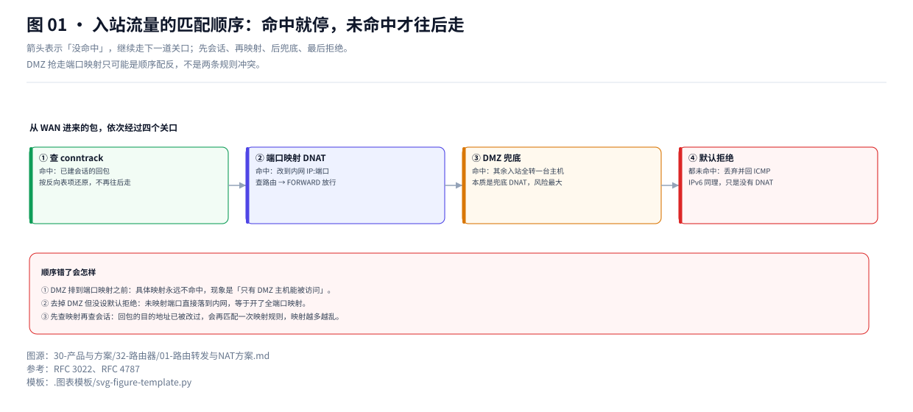
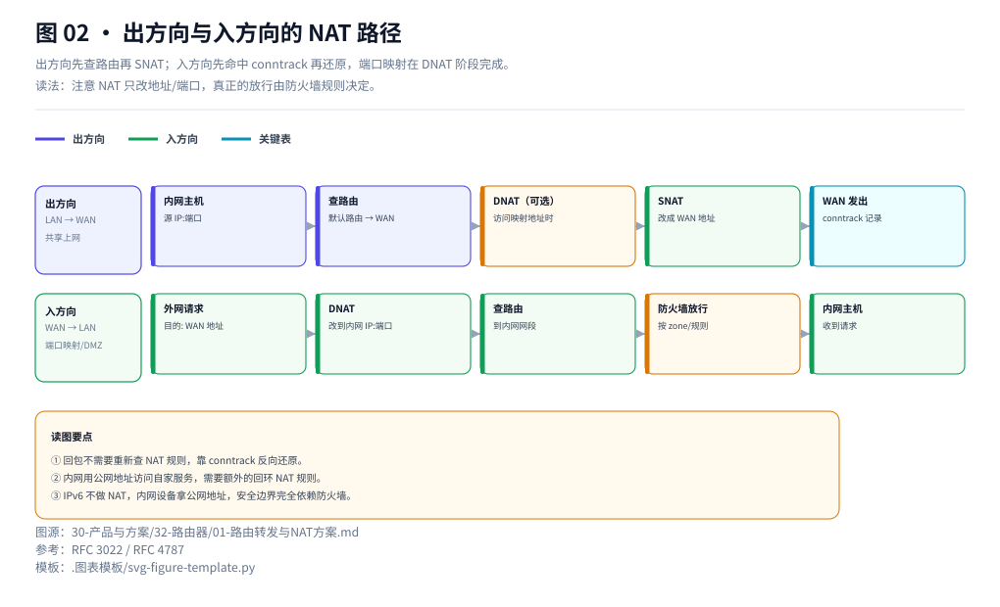
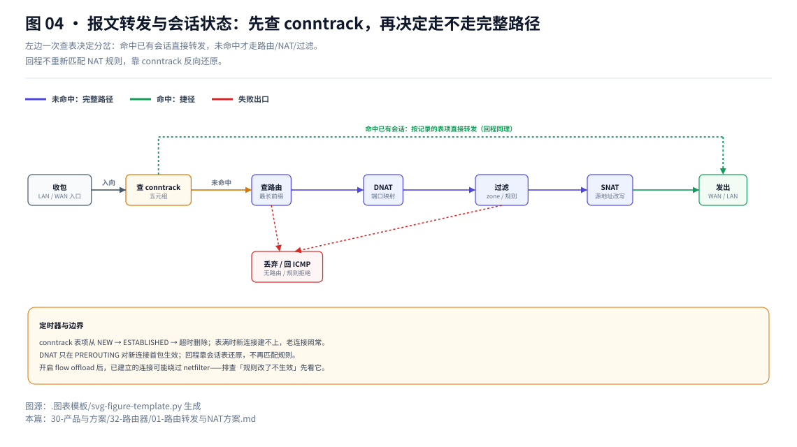

# 路由转发与 NAT 方案

路由器的转发方案可以拆成四步：**查路由决定出口 → DNAT 改目的 → SNAT 改源 → conntrack 记住映射**。IPv6 不走 NAT，靠前缀下发和防火墙放行，这是双栈产品最容易出问题的地方。

> 本篇定位：产品配置视角的路由表、策略路由、NAT/端口映射/DMZ/UPnP、IPv6 双栈与回环 NAT。协议细节链接到 `10-基础理论`，OpenWrt 的 fw3/fw4 和 offload 链接到 `20-平台与系统`。本篇不写 `nft`/`iptables` 语法，也不写各芯片的加速实现。

## 目录

因为本目录沿用 `#sN` 锚点惯例，所以章节标题带固定编号、TOC 与之逐条对应；改标题时必须同步 TOC，否则锚点失效。

- [1 一句话模型](#s1)
- [2 速览](#s2)
- [3 规则与字段](#s3)
- [4 交互流程](#s4)
- [5 状态与定时器](#s5)
- [6 设计取舍与边界](#s6)
- [7 与相邻主题的关系](#s7)
- [名词解释](#名词解释)
- [8 参考与关联](#s8)

## 1 · 一句话模型：先选路，再改地址，最后记住

```text
出方向：查路由 → DNAT（可选）→ 过滤 → SNAT → 发出
入方向：命中 conntrack → 反向还原 → 查路由 → 交给内网
```

三个关键认知：

1. **路由决定「从哪个口出」，NAT 决定「源/目的地址长什么样」**，两者顺序不能颠倒。因为路由查的是「目的地址 + 源地址策略」，DNAT 必须先改完目的地址才能查对出口，SNAT 必须等出口确定后才能选对源地址。
2. **NAT 是有状态的**：所有回包都依赖 conntrack 表项，表项超时或丢失，连接就断。因为 NAT 规则只对新连接的首包生效，回包不做反向匹配，所以「规则删了但连接还在」和「表清空了连接立刻断」都是正常现象。
3. **IPv6 默认不做 NAT**：内网拿到公网前缀，靠防火墙控制访问；把 IPv4 的 NAT 思维套到 IPv6 会出问题。因为 IPv6 的设计前提是端到端可达，地址不是稀缺资源，隐藏内网要靠防火墙策略而不是地址转换。

> **推论**：排「外网访问不到内网服务」，按 ① 有没有 DNAT ② 防火墙放没放 ③ 回程路由通不通 三步走；顺序反了会把「防火墙拒绝」误判成「映射没生效」。
> **边界**：这套四步模型只对「经过本机转发的 IPv4 单播」成立。组播、桥转发、本机自己发起的流量走的是别的路径，见 [netfilter 框架入门](../../20-平台与系统/21-Linux/06-网络子系统/01-netfilter/netfilter框架入门.md)。

## 2 · 速览

因为转发方案的风险集中在「多出口 + 双栈」这两个维度，所以速览的每一行都标了它什么时候不成立，先判题型再查细节。

| 项 | 内容 | 边界与误判 |
| --- | --- | --- |
| 核心对象 | 路由表、策略路由规则、NAT 规则、conntrack、防火墙 zone | zone 是厂商抽象，不是协议概念；跨固件对照要看实际规则而不是 zone 名 |
| 常见业务 | 多 WAN 选路、端口映射、DMZ、UPnP、双栈上网、VPN 分流 | 每多一种业务，就多一层「谁先匹配」的顺序问题 |
| 关键机制 | 最长前缀匹配、源地址路由、SNAT/DNAT、NAPT、NPTv6（少用） | NPTv6 是无状态前缀转换，和「NAT66」不是一回事，见 §6.4 |
| 典型配置 | 默认路由、静态路由、策略路由、端口转发、IPv6 PD | 「配置成功」不等于「命中」；要确认计数器与 conntrack |
| 主要风险 | 路由环路、NAT 回环、非对称路由、IPv6 暴露内网 | 四个风险里三个只在「多出口/双栈」时出现，单 WAN 单栈很难复现 |
| 诊断入口 | 路由表、conntrack、防火墙计数器、抓包 | 计数器只涨首包是正常的，不代表规则没生效 |

## 3 · 规则与字段

四类规则按「先粗后细」排列：路由表决定大方向，策略路由在方向上再做分流，NAT 改地址，端口映射/DMZ 决定入站去哪。**顺序就是优先级**，这也是本节反复出现的边界。

### 3.1 路由表

| 字段 | 作用 | 坑/边界 |
| --- | --- | --- |
| 目的前缀 | 匹配目标网段 | 最长前缀优先，默认路由是 `0.0.0.0/0`；前缀写错会「看起来有路由但不命中」 |
| 下一跳 | 交给谁 | 下一跳不可达时路由不生效；直连路由可以只有出接口、没有下一跳 |
| 出接口 | 从哪个口发 | 多 WAN 时出接口决定源地址，进而决定回程走哪个口 |
| 度量值 | 多路径优先级 | 同前缀多路由时按度量选择；不同协议的度量不可直接比较 |
| 表号 | 策略路由的多张表 | 主表之外的表要配合规则使用，只加表不加规则等于没配 |

**为什么是「最长前缀」而不是「先配先生效」？** 因为路由表要支持聚合：一条 `10.0.0.0/8` 覆盖整个私网，同时又要能给 `10.1.2.0/24` 单独指定出口。若按配置顺序匹配，聚合路由会吃掉所有明细路由。代价是「路由表里有两条都能匹配」时，人眼容易看错——判断命中要看前缀长度，不是看行号。

路由不是只有一张表。Linux 内置三张，规则按优先级串起来：

| 优先级 | 表 | 用途 | 边界 |
| --- | --- | --- | --- |
| 0 | local | 本机地址、广播地址 | 优先级最高，改这里会直接影响「访问路由器自己」 |
| 32766 | main | 常规路由（`ip route` 默认写这里） | 策略路由常把它整体挪到自定义表，main 变空 |
| 32767 | default | 兜底 | 一般留空；往里加默认路由会盖住所有未命中流量 |

> **推论**：`ip route show` 只看到 main 表；多 WAN 产品里「路由明明配了却不生效」，十有八九在别的表里。
> **边界**：以上是 Linux 的默认约定，厂商固件可以改优先级；表号本身没有语义，语义来自 `ip rule` 的匹配条件。

### 3.2 策略路由

| 字段 | 作用 | 坑/边界 |
| --- | --- | --- |
| 匹配条件 | 源地址、目的地址、端口、Mark | 条件越细，规则越多，排障越难；先按源地址分流最稳 |
| 优先级 | 规则匹配顺序 | 顺序错会导致流量走错 WAN；新增规则默认插在最前，容易盖住旧规则 |
| 动作 | 查指定路由表 / 丢弃 | 表里没有默认路由会直接丢包，现象是「能 ping 通网关但出不去」 |
| 标记 | fwmark 在防火墙和路由间传递 | 标记被后续规则覆盖是常见问题；mark 只在本机有效，不会跟着包出门 |

**为什么要用 mark 而不是直接按源地址分流？** 因为很多策略的条件不是地址：按应用、按时间段、按连接类型分流时，只有在防火墙里才能判断，判断结果只能通过 mark 传给路由层。代价是 mark 的生命周期跨了 mangle 表、ip rule、路由表三处，「标没标上」和「标了没匹配」是两类完全不同的故障。

> **边界**：策略路由只决定「出方向走哪个口」，不保证回程。多 WAN 下回程要靠 conntrack 记住入口，或用 connmark 把标记粘到整条连接上；否则会出现「去程走 WAN1、回程走 WAN2」的非对称路径，防火墙状态检查会丢包。

### 3.3 NAT 规则

| 类型 | 作用 | 典型场景 | 边界 |
| --- | --- | --- | --- |
| SNAT | 改源地址 | 家庭/企业共享上网 | 多 WAN 要按出接口选源地址；写死地址后换 WAN 就不通 |
| DNAT | 改目的地址 | 端口映射、DMZ | 只能映射到内网可达地址；目标主机路由不通时映射「成功但不通」 |
| NAPT | 地址+端口转换 | 多个内网主机共用公网 IP | 端口耗尽、并发受限；单个外网 IP 约 6.4 万个端口是硬上限 |
| 回环 NAT | 内网访问公网映射地址 | 内网用域名访问自家服务 | 需要额外规则，否则不通；只做 DNAT 不够，还要 SNAT |
| NPTv6 | IPv6 前缀转换 | 少数过渡场景 | 破坏端到端，一般不推荐；只换前缀、不改端口，和 NAPT 不等价 |

**SNAT 与 MASQUERADE 怎么选？** SNAT 要求写死源地址，匹配快、行为确定，适合固定公网 IP；MASQUERADE 每次取出口接口的当前地址，适合 PPPoE/DHCP 这类地址会变的 WAN。因为家庭宽带地址经常变，家用固件默认用 MASQUERADE；代价是每个连接要查一次接口地址，高并发下有额外开销。

> **推论**：NAT 规则只在「新连接首包」被匹配。改完映射后测不通，先清 conntrack 或用新源端口重试，否则测的是旧表项。
> **边界**：`NAPT 端口上限 6.4 万`只对「一个公网 IP + 一个协议」成立；TCP 与 UDP 各自独立计数，多公网 IP 可以叠加。

### 3.4 端口映射与 DMZ

| 对象 | 字段 | 说明 | 边界与误判 |
| --- | --- | --- | --- |
| 端口映射 | 外网口、外网端口、内网 IP、内网端口、协议 | 一对一或端口段映射 | 外网端口被运营商封（常见 80/443/25）时，怎么看本机规则都正常 |
| DMZ 主机 | 内网 IP | 把所有未映射入站流量转给一台主机，风险高 | 本质是兜底 DNAT，必须排在具体映射之后；顺序错会让所有端口映射失效 |
| UPnP IGD | 启用开关、租期 | 应用自动开端口，方便但有安全风险 | 租期由应用请求，应用不续租就失效；恶意程序也能借此开洞 |
| 端口触发 | 触发端口、开放端口 | 按出站连接临时放行入站 | 只对「先出后入」的协议有效；空闲超时后自动关闭，长连接会断 |

**为什么 DMZ 这么危险却一直存在？** 因为它是「让不懂 NAT 的用户也能跑起服务」的最低成本方案：不用查端口，全转过去就行。代价是那台主机暴露全部入站端口，一旦它有漏洞，等同于把内网的一台机器直接放到公网。生产环境应优先端口映射。

### 3.5 入站流量的匹配顺序

入站不是「一条规则决定去哪」，而是一条按顺序走下来的链。顺序错了，具体映射会被兜底规则覆盖。

### 图 01 · 入站流量的匹配顺序



**读图**：从左到右四个关口，每个关口「命中就停」，不再往后走。第一关口是 conntrack——回包根本不进后面的映射逻辑；第二关口才是端口映射；DMZ 是第三关口的兜底；都没命中就落到默认拒绝。所以「DMZ 抢了端口映射」只可能是顺序配反，不是功能冲突。

> 图源：`images/图01-入站流量匹配顺序.svg`

> **推论**：想让「内网能访问、外网不能」，不要靠删 DMZ，而要在第二关口把映射删掉并确保默认拒绝——DMZ 在第三关口，删了它只是让流量落到第四关口。
> **边界**：IPv6 侧没有 DNAT，但仍然有「先查会话、再查 pinhole、最后默认拒绝」的同构顺序，只是第二关口换成防火墙放行规则。

## 4 · 交互流程



**读图**：出方向先查路由再 SNAT，入方向先命中 conntrack 再还原；端口映射在 DNAT 阶段改变目的地址，回程由 conntrack 自动处理。

> 图源：`images/图02-NAT转发路径.svg`

### 4.1 出方向

```text
内网主机 → LAN → 路由查表（默认路由指向 WAN）
  → PREROUTING：DNAT（如果访问的是映射地址）
  → FORWARD：防火墙放行
  → POSTROUTING：SNAT（改成 WAN 地址）
  → conntrack 记录五元组映射 → 发出
```

**为什么 DNAT 必须在 PREROUTING、SNAT 必须在 POSTROUTING？** 这是整篇最重要的一条因果：PREROUTING 在路由决策之前，这时改目的地址，路由才会把包送往「内网目标」；POSTROUTING 在所有决策之后，这时改源地址不会影响任何路由与策略判断。反过来放，DNAT 会让包按旧目的地址出门，SNAT 会让源地址策略路由失效。

链与表的完整分工见 [netfilter 框架入门](../../20-平台与系统/21-Linux/06-网络子系统/01-netfilter/netfilter框架入门.md) §1.1，本篇只取「顺序由链的位置决定」这一个结论。

> **推论**：这也解释了为什么 filter 表在 FORWARD 看到的是「DNAT 之后、SNAT 之前」的地址——防火墙规则要按改过的目的地址写，按原始公网地址写会永远不命中。
> **边界**：如果开了 flow offload，首包仍走这条完整路径，后续包跳过 netfilter；此时改规则对已建连接无效。

### 4.2 入方向（端口映射）

```text
外网请求 → WAN → PREROUTING：DNAT 到内网 IP:端口
  → 查路由 → FORWARD 放行 → 内网主机
内网回包 → conntrack 反向还原 → 从 WAN 发出
```

**为什么回包不用再查 NAT 规则？** 因为 conntrack 在建链首包时就把「原始五元组 ↔ 转换后五元组」记下来了，回包按反向键查表即可。代价是这张表成了单点：表项被清、超时或表满，连接立刻断，且重建时可能换一个源端口，对端看到的就是「连接重置」。

### 4.3 回环 NAT：内网访问公网映射地址

```text
内网主机 → 访问 WAN 公网 IP:端口
  → PREROUTING：DNAT 到内网服务器
  → 服务器回包给「内网主机地址」→ 直接走 LAN，不回路由器
  → 内网主机期待「来自公网 IP」的回包 → 丢弃 → 表现为连接超时
  加 SNAT（把源改成网关地址）后：回包必须经路由器 → 能对上
```

**为什么只做 DNAT 的回环一定失败？** 因为服务器看到的是内网源地址，回包直接二层送到客户端，不经过路由器；客户端却认为自己在和公网 IP 通信，源地址不符就丢包。补一条 SNAT，让服务器把回包送回网关，网关再按 conntrack 还原，路径才闭合。

> **推论**：回环 NAT 不是「可选优化」，只要产品提供「内网用域名访问自家服务」的能力，就必须同时配 DNAT 与 SNAT。
> **边界**：如果内网服务器与客户端在不同网段、回程本来就要经过网关，只做 DNAT 也可能通——所以「回环必须 SNAT」这条结论依赖同网段这个前提。

### 4.4 IPv6 双栈

```text
WAN 获取 IPv6 地址 + 前缀（PD）
  → LAN 用前缀做 SLAAC/RA 或 DHCPv6
  → 终端拿到全球地址
  → 防火墙默认拒绝入站，按需放行
```

IPv6 没有 NAT，内网设备地址对外可见，安全边界完全依赖防火墙。PD 前缀变化时，内网地址会变，DDNS 和防火墙规则要能跟随。

### 图 03 · IPv4 与 IPv6 的分水岭


**读图**：左右两列是同一台设备上的两套逻辑。分水岭在第三行——IPv4 靠 NAT 隐藏内网、靠端口映射开放入站；IPv6 地址本身全球可达，隐藏与开放都落在防火墙上。最后一列是「出问题时先看哪」，双栈产品最常见的误判就是把 v6 的故障按 v4 的 NAT 思路去查。

> 图源：`images/图03-双栈对照.svg`

**为什么 IPv6 不需要端口映射？** 因为每个终端都有全球地址，外网可以直接寻址到它；产品要做的不是「转换地址」，而是「决定放不放行」。所以 IPv6 的「端口映射」页在实现上往往只是一条防火墙 pinhole，改的是放行规则，不是地址。

> **边界**：IPv6 也有地址隐藏需求（例如不想让前缀暴露内网规模），可用 ULA + NPTv6，但那是过渡手段；标准做法仍是防火墙默认拒绝 + 按需放行。
> **待验证**：各运营商下发的 PD 前缀长度不同（常见 /56、/60、/64），可分配的 LAN 子网数与「前缀变化后地址存活时间」也不同，验收要按实际运营商确认。

### 4.5 异常分支

| 异常 | 现象 | 定位方向 | 容易误判成 |
| --- | --- | --- | --- |
| 端口映射外网不通 | 内网可访问，外网不行 | 防火墙、运营商封端口、DNAT 目标不可达 | 内网服务故障——先用内网地址自测即可排除 |
| 内网访问映射地址不通 | 用公网 IP/域名回环失败 | 缺回环 NAT 规则 | DNS 故障——直接访问公网 IP 同样失败就是回环问题 |
| 双 WAN 部分业务异常 | 银行/游戏登录失败 | 源地址漂移、连接未保持 | 对方服务器故障——换单 WAN 立刻正常即可确认 |
| IPv6 能 ping 不能上网 | 有地址无路由/DNS | RA 默认路由、DNS、防火墙 | 运营商故障——v4 通常同时是好的 |
| 大包不通 | 网页能开、下载失败 | MTU/MSS、PPPoE 开销、隧道封装 | 网站限速——换小文件能下就是 MTU 问题 |
| NAT 表满 | 新连接失败 | conntrack 容量、超时时间、P2P 连接 | 带宽不足——加带宽无效，因为连接建不上 |
| 双栈网站偶发很慢 | 部分站点首屏延迟高 | v6 路径不通但 AAAA 仍被优先 | DNS 慢——其实是客户端在等 v6 超时 |

## 5 · 状态与定时器



**读图**：第一站是 conntrack——命中已有会话就直接转发（顶部捷径），未命中才走查路由→DNAT→过滤→SNAT。无路由或规则拒绝从下方出口丢弃/回 ICMP。

> 图源：`images/图04-报文转发与会话状态.svg`

NAT 没有独立状态机，它的状态就是 conntrack 表项的状态。因为 NAT 映射依附于会话，所以「NAT 的生命周期」和「连接的生命周期」是同一个东西。

| 对象 | 状态 | 在等什么 | 失败表现 |
| --- | --- | --- | --- |
| 路由表项 | 有效/无效 | 下一跳可达性 | 表里有路由但包发不出去 |
| conntrack 表项 | NEW → ESTABLISHED → 超时 | 双向报文 | 只有单向流量时很快被回收 |
| conntrack 特殊态 | RELATED / INVALID / UNTRACKED | 关联连接、非法包、raw 放行 | INVALID 被默认丢；UNTRACKED 不参与 NAT |
| NAT 映射 | 建立 → 刷新 → 回收 | 与 conntrack 同生命周期 | 清表即断连，重建后源端口可能变化 |
| DHCPv6-PD 租约 | 请求 → 绑定 → 续租 → 过期 | 上游服务器响应 | 前缀变了但 LAN 没跟着重建，地址「看起来还在」但不可路由 |
| UPnP 映射 | 创建 → 续租 → 过期 | 应用请求续租 | 应用不续租，映射静默消失 |

| 定时器/参数 | 管什么 | 边界与说明 |
| --- | --- | --- |
| TCP 建立超时 | 未完成握手的表项存活 | 太短会让高延迟链路握手失败，太长会被半开连接占满 |
| TCP ESTABLISHED 超时 | 空闲长连接存活 | 上游默认以天计，家用固件常改到小时级；改小会让长连接被静默断开 |
| TCP TIME_WAIT 超时 | 主动关闭方的表项 | 太短会导致端口复用冲突 |
| UDP 超时 | 无连接表项存活 | 短于应用的保活间隔时，NAT 映射被回收，表现为「语音每几十秒断一次」 |
| ICMP 超时 | ping/traceroute 表项 | 比 UDP 更短；大量 ping 会快速占用表项 |
| DHCPv6-PD T1/T2 | 续租与重绑定时机 | 由服务器给，客户端不协商；T2 到期后换服务器重绑 |
| UPnP 租期 | 映射有效期 | 由应用请求，固件可设上限 |

> **推论**：VoIP/游戏「固定间隔断一下」优先查 UDP 超时是否短于应用保活周期，而不是查带宽。
> **待验证**：各系统的 conntrack 默认超时和容量不同，高并发场景要按实测调优；PD 的 T1/T2 由运营商服务器决定，客户端无法单方面延长。

## 6 · 设计取舍与边界

### 6.1 NAT 的代价

NAT 让 IPv4 地址复用成为可能，但破坏了端到端连接：外网主动访问内网必须靠映射，P2P/游戏/VoIP 需要 STUN/TURN/UPnP。NAT 不是安全机制，防火墙才是。

**代价的具体形态**：NAT 之后，内网主机对外的「身份」是共享的公网地址 + 端口，任何需要「被主动连接」的协议都要先打洞。**失效条件**：对称 NAT（每个目的地址分配不同映射）下，STUN 打洞大概率失败，只能走 TURN 中继——这是「开了 NAT 但语音质量差」的常见根因。

> **待验证**：口语里的「全锥/受限/端口受限/对称」四类 NAT 来自 STUN 的旧分类（RFC 3489），RFC 4787 改用「映射行为 + 过滤行为」两组独立属性描述。产品文档写「支持全锥 NAT」时，要问清是哪种映射/过滤组合。

### 6.2 端口映射 vs DMZ

端口映射只暴露必要端口，风险可控；DMZ 把所有未映射入站流量转给一台主机，排障简单但攻击面大。生产环境优先端口映射。

**为什么 DMZ 排障简单？** 因为它把「端口对不对」这个问题消掉了：所有入站都到同一台机器，通了就是通了。代价是这台机器必须自己扛住所有扫描与攻击。**失效条件**：DMZ 主机自己也有防火墙时，问题会变成「两层防火墙谁拒的」，排障反而更难。

### 6.3 策略路由 vs 多 WAN 负载均衡

策略路由按规则选路，行为可预测；负载均衡按权重/哈希分流，能提高总带宽，但会破坏需要固定源 IP 的会话。两者可以组合，但要先保证关键业务有稳定出口。

**组合的正确顺序**：先用策略路由给关键业务（游戏、银行、VoIP、VPN）钉死出口，再对剩余流量做负载均衡。反过来先均衡再排除，会出现「同一应用的不同连接走不同 WAN」。**失效条件**：只有一条 WAN 有公网地址（另一条是 CGNAT）时，负载均衡会让一半入站连接不可达，此时只能做主备。

### 6.4 IPv6 要不要开 NAT66

NAT66 能让内网地址不暴露，但违背 IPv6 端到端设计，且部分应用会异常。除非有明确合规要求，否则用防火墙而不是 NAT66。

**先分清两个词**：IETF 标准化的是 NPTv6（RFC 6296，无状态、只换前缀、校验和中性），而「NAT66」通常指厂商实现的带状态地址转换，二者不等价。**失效条件**：需要隐藏内网规模又不接受地址变化时，NPTv6 是折中；需要「像 IPv4 那样按端口复用地址」时，IPv6 没有对应标准方案。

### 6.5 硬件 offload 与 NAT 的冲突

开启 flow offload 后，已建立的连接绕过 netfilter，端口映射、QoS、流量统计可能失效。需要精细策略时，建议关闭 offload 或只对特定流量开启。

**准确的边界**：端口映射本身在首包已完成，offload 后仍能工作；真正失效的是「改规则后对已建连接生效」和「按包统计/限速」。**失效条件**：只做 NAT 共享、不做限速与审计时，offload 的副作用可以接受。

### 6.6 UPnP 该不该开

| 场景 | 建议 | 理由 | 边界 |
| --- | --- | --- | --- |
| 家庭 + 游戏主机/PT 下载 | 开，但限制租期 | 手动映射门槛高，用户会直接放弃 | 租期太长等于长期开洞，恶意程序可自行续租 |
| 企业/办公 | 关 | 任何内网程序都能自行开洞，绕过审批 | 有例外需求的终端应走正式端口申请 |
| 运营商定制机 | 默认关，页面可开 | 远程可管的设备不能默认暴露入站 | 部分业务（如机顶盒回传）依赖 UPnP，关前要确认 |
| 有公网 IPv6 | 视需求 | v6 不需要 UPnP 打洞，但需要 pinhole，部分实现仍走 IGD | pinhole 由防火墙管，别以为关了 UPnP 就没有入站通路 |

### 6.7 本篇模型什么时候失效

- **CGNAT 之后**：运营商已经做了一层 NAT，本机拿到的不是公网地址，端口映射无论怎么配都不可能从公网访问。
- **双栈但只有 v4 公网**：v6 只能内部使用，对外仍是 v4 映射，别把两套边界混着配。
- **VPN/隧道封装**：MTU 与路由都要按隧道接口重算，本篇的「PPPoE 1492」不再适用。
- **多级路由**：两级 NAT 下 conntrack 与映射要在两层各查一遍，「映射不通」可能出在任意一层。

## 7 · 与相邻主题的关系

因为协议原理与平台实现各有正本，所以这里只保留「关系一句话 + 细节去哪看」，避免同一段报文解释在两处维护。

| 相邻对象 | 关系 | 边界（细节去哪看） |
| --- | --- | --- |
| [路由与路由协议](../../10-基础理论/11-网络科学/03-网络层/04-路由与路由协议.md) | 最长前缀匹配、静态/动态路由 | 协议收敛与选路算法在那篇；本篇只讲「路由表怎么被产品使用」 |
| [NAT](../../10-基础理论/11-网络科学/03-网络层/05-NAT.md) | SNAT/DNAT/NAPT 与 conntrack | 报文级行为在那篇；本篇讲多 WAN、DMZ、回环这些产品组合 |
| [IPv6](../../10-基础理论/11-网络科学/03-网络层/02-IPv6.md) | 地址、RA、SLAAC、PD | 地址格式与 ND 在那篇；本篇只取「双栈产品的配置边界」 |
| [DHCPv6](../../10-基础理论/11-网络科学/05-应用层/02-DHCPv6.md) | 前缀下发与地址分配 | 报文与选项在那篇；本篇只关心 PD 租约对地址稳定性的影响 |
| [NAT 与 offload](../../20-平台与系统/22-OpenWrt/03-网络数据面/03-NAT与offload.md) | OpenWrt 实现与加速 | 配置与代码路径在那篇；本篇不复制实现细节 |
| [路由器产品架构](./00-路由器产品架构.md) | 整机转发链 | 硬件/软件分层在那篇；本篇只展开路由与 NAT 这一段 |
| [QoS 与流控方案](./02-QoS与流控方案.md) | 转发链上的带宽控制 | 队列与限速在那篇；NAT 只决定「地址长什么样」，不影响分类结果 |

一句话：**路由解决「往哪走」，NAT 解决「以谁的身份走」，conntrack 保证「回得来」。** 边界是：这三句话只描述单播 IPv4 转发；IPv6 没有第二句，组播与桥转发三句都不完全成立。

## 名词解释

> 缩写给出英文全称；非缩写用“—”表示。

因为缩写会撞名（`PCP` 在本篇是 Port Control Protocol，在 VLAN 里是 Priority Code Point），所以冲突词分列两行，按上下文取用。

| 术语 | 英文全称 | 解释 |
| --- | --- | --- |
| NAT | Network Address Translation | 网络地址转换。 |
| SNAT | Source NAT | 源地址转换。 |
| DNAT | Destination NAT | 目的地址转换。 |
| NAPT | Network Address Port Translation | 地址+端口转换。 |
| DMZ | Demilitarized Zone | 隔离区，这里指把所有入站流量转给一台内网主机。 |
| UPnP | Universal Plug and Play | 通用即插即用。 |
| IGD | Internet Gateway Device | UPnP 的网关设备规范。 |
| PD | Prefix Delegation | DHCPv6 前缀委派。 |
| SLAAC | Stateless Address Autoconfiguration | 无状态地址自动配置。 |
| RA | Router Advertisement | 路由器通告。 |
| MSS | Maximum Segment Size | TCP 最大报文段长度。 |
| NPTv6 | Network Prefix Translation for IPv6 | IPv6 前缀转换。 |
| STUN | Session Traversal Utilities for NAT | NAT 会话穿越工具。 |
| TURN | Traversal Using Relays around NAT | 中继式 NAT 穿越，打洞失败时的兜底。 |
| fwmark | firewall mark | 防火墙给报文打的内部标记，只在设备内部有效，用于把判断结果传给路由层。 |
| zone | — | 防火墙的接口分组抽象，同一 zone 内默认互通；不是协议概念。 |
| 回环 NAT | Hairpin NAT / NAT Loopback | 内网主机访问自家公网映射地址时的特殊处理，需要 DNAT 与 SNAT 配合。 |
| conntrack | Connection Tracking | 连接跟踪，NAT 与状态防火墙的基础。 |
| MTU | Maximum Transmission Unit | 最大传输单元；PPPoE 下常见 1492。 |
| ICMP | Internet Control Message Protocol | 互联网控制消息协议，用于差错与探测。 |
| ND | Neighbor Discovery | IPv6 的邻居发现，承担 ARP 与部分路由发现职责。 |
| GUA | Global Unicast Address | IPv6 全球单播地址，可被公网寻址。 |
| ULA | Unique Local Address | IPv6 私网地址，仅本地有效，不可公网路由。 |
| CGNAT | Carrier-Grade NAT | 运营商级 NAT，用户拿不到真正的公网地址。 |
| Pinhole | — | 防火墙上的定向放行规则，IPv6 里替代端口映射。 |
| Happy Eyeballs | — | 双栈客户端的连接尝试策略，先试 IPv6，超时后回落 IPv4。 |
| PCP | Port Control Protocol | 替代 UPnP/NAT-PMP 的端口控制协议，按需申请映射（RFC 6887）。 |
| PCP | Priority Code Point | VLAN 标签里的 3 位优先级（802.1p），与上一个 PCP 同名不同义。 |

## 8 · 参考与关联

因为 RFC 会迭代（旧的 NAT UDP 要求 RFC 3489 已被 RFC 4787 的「映射/过滤行为」描述取代），所以本节按现行文档列出，旧编号只在正文对照时出现。

**标准**

- RFC 791：Internet Protocol
- RFC 3022：Traditional IP Network Address Translator
- RFC 4787：NAT Behavioral Requirements for Unicast UDP
- RFC 4861 / 4862：Neighbor Discovery / SLAAC
- RFC 8415：DHCPv6
- RFC 6296：IPv6-to-IPv6 Network Prefix Translation
- RFC 6887：Port Control Protocol
- RFC 8305：Happy Eyeballs Version 2

**关联**

- [设备形态对比](../00-设备形态对比.md)
- [路由器产品架构](./00-路由器产品架构.md)
- [QoS 与流控方案](./02-QoS与流控方案.md)
- [NAT](../../10-基础理论/11-网络科学/03-网络层/05-NAT.md)

---

> **本篇定位**：路由器路由表、策略路由、NAT/端口映射/DMZ/UPnP 与 IPv6 双栈的产品方案。
> **素材来源**：`studyspace/1.知识体系/2.TCP IP协议/m-6-NAT协议.md`、`studyspace/1.知识体系/7.openwrt/3.网络业务/2.关键组件服务/3.NAT&防火墙/`。
> **待验证**：各平台的 conntrack 容量/超时、offload 与 QoS 的兼容性、运营商对入站端口的限制；NAT 类型术语与 RFC 4787 的对应关系以具体实现文档为准。
