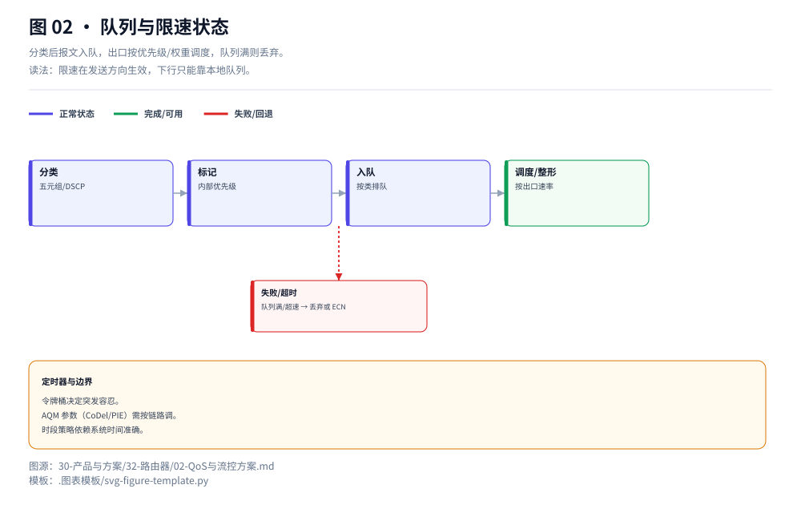

# QoS 与流控方案

路由器上的 QoS 只做三件事：**把流量分到不同类 → 给每类分配带宽/优先级 → 在出口按队列调度**。效果好坏取决于「限速点选在哪」和「分类准不准」，而不是队列算法多高级。

> 本篇定位：产品层的 QoS 业务模型、限速位置、队列与调度、家长控制/游戏加速的边界。TCP 拥塞控制和队列算法原理去 `10-基础理论`，OpenWrt 的 tc/HTB 实现去 `20-平台与系统`。

## 目录

- [1 一句话模型](#s1)
- [2 速览](#s2)
- [3 分类与队列字段](#s3)
- [4 交互流程](#s4)
- [5 状态与定时器](#s5)
- [6 设计取舍与边界](#s6)
- [7 与相邻主题的关系](#s7)
- [名词解释](#名词解释)
- [8 参考与关联](#s8)

## 1 · 一句话模型：先分类，再排队，最后按出口整形

```text
报文 → 分类（端口/五元组/DSCP/应用识别）
  → 标记 → 入队（按类）→ 调度（优先级/权重）
  → 出口整形（限速）→ 发出
```

三个关键认知：

1. **限速只能在「发送方向」生效**：路由器能控制自己发出去的流量，控制不了运营商什么时候把包送过来。
2. **上行 QoS 在 WAN 出口最有效**：下行要靠「入口丢弃/整形」间接影响对端，效果弱。
3. **分类错了，后面全错**：把游戏流量分进「大文件下载」类，再好的队列也救不回来。

## 2 · 速览

| 项 | 内容 |
| --- | --- |
| 核心对象 | 分类规则、标记、队列、调度器、整形器、限速策略 |
| 常见业务 | 游戏加速、视频优先、下载限速、家长控制、访客限速 |
| 关键机制 | DSCP、五元组、应用识别、HTB、FQ-CoDel、优先级队列 |
| 典型位置 | WAN 出口（上行）、LAN 入口（下行）、SSID/终端维度 |
| 主要风险 | 限速过低、分类误判、bufferbloat、加速规则绕过防火墙 |
| 观测指标 | 队列长度、丢包、时延抖动、各类速率 |

## 3 · 分类与队列字段

### 3.1 分类依据

| 依据 | 粒度 | 优点 | 边界 |
| --- | --- | --- | --- |
| 端口 | 五元组 | 简单、确定 | 应用换端口就失效 |
| DSCP | 报文标记 | 跨设备一致 | 终端不一定标记，公网可能重标记 |
| 应用识别 | 协议特征/域名/IP | 贴近业务 | 加密流量难识别，误判 |
| 终端/SSID | 来源 | 适合家长控制/访客 | 终端换 MAC/私接会绕过 |
| 时间 | 时段 | 适合作息管理 | 依赖系统时间准确 |

### 3.2 队列与调度

| 机制 | 作用 | 代价 |
| --- | --- | --- |
| 优先级队列 | 高优先级先发 | 低优先级可能饿死 |
| 加权公平队列 | 按权重分配带宽 | 权重配置不当会失衡 |
| HTB | 分层令牌桶，支持借带宽 | 配置复杂，层级多时难排障 |
| FQ-CoDel | 流公平 + 主动队列管理 | 对分类粒度不敏感，但参数需调 |
| 整形（shaping） | 平滑发送速率 | 增加时延和缓存 |
| 限速（policing） | 超速直接丢 | 丢包引发重传，体验差 |

### 3.3 产品化策略

| 策略 | 典型配置 | 说明 |
| --- | --- | --- |
| 游戏优先 | 游戏特征 → 最高优先级 + 小带宽保证 | 游戏包小，重时延不重带宽 |
| 视频优先 | 流媒体 → 较高优先级 | 需要足够带宽，否则卡顿 |
| 下载限速 | P2P/大文件 → 低优先级 + 上限 | 防止占满上行 |
| 家长控制 | 终端/时段 → 放行/阻断/限速 | 依赖终端识别 |
| 访客网络 | SSID/VLAN → 总带宽上限 | 与主网络隔离 |
| 智能限速 | 按链路速率动态调整 | 依赖测速准确度 |

## 4 · 交互流程


**读图**：分类在入口完成，标记随报文走，队列和整形在出口生效；上行限速在 WAN 出口，下行限速在 LAN/Wi-Fi 入口做丢弃或整形。

> 图源：`images/图01-QoS分类调度.svg`

### 4.1 上行 QoS

```text
LAN 终端 → 路由 → 分类/标记 → WAN 出口队列
  → 整形到运营商实际带宽的 90%~95%
  → 按优先级/权重调度发出
```

### 4.2 下行 QoS

```text
WAN 收包 → 分类 → LAN/Wi-Fi 出口队列 → 终端
```

下行无法控制运营商发送速率，只能在本地出口排队；队列满时丢包，靠 TCP 退避间接降速。更有效的方法是在上游做整形，或使用 AQM 控制缓冲。

### 4.3 家长控制/时段策略

```text
识别终端 → 绑定策略（放行/阻断/限速）
  → 命中时段 → 下发规则
  → 到期自动恢复
```

### 4.4 异常分支

| 异常 | 现象 | 定位方向 |
| --- | --- | --- |
| 限速后整体变慢 | 所有业务都卡 | 限速值低于实际带宽、队列太小 |
| 游戏仍然高延迟 | 优先级没生效 | 分类未命中、offload 绕过 QoS |
| 视频卡顿 | 带宽不足或分类错 | 保证带宽、队列丢包 |
| 下载占满上行 | 网页打不开 | 上行未限速、P2P 未识别 |
| 家长控制被绕过 | 换 MAC/改 DNS 后恢复 | 终端识别方式、DNS 拦截边界 |
| 测速不准 | 限速值反复调整 | 测速服务器、单线程/多线程差异 |

## 5 · 状态与定时器




**读图**：分类后入队，出口按优先级/权重调度；队列满或超速则丢弃/标记。

> 图源：`images/图02-队列与限速状态.svg`

QoS 本身没有连接状态机，关键是队列和策略的时间行为：

| 对象 | 状态/参数 | 说明 |
| --- | --- | --- |
| 队列 | 空 → 排队 → 满 → 丢弃 | 队列长度决定时延上限 |
| 令牌桶 | 有令牌 → 耗尽 → 等待 | 桶大小决定突发容忍 |
| 分类规则 | 命中/未命中 | 规则顺序影响结果 |
| 时段策略 | 生效 → 到期 | 依赖系统时间 |
| 测速 | 采样 → 计算 → 应用 | 频繁测速会干扰业务 |

> 待验证：各产品的队列长度、AQM 参数和测速算法不同，默认值不一定适合高带宽链路。

## 6 · 设计取舍与边界

### 6.1 限速 vs 整形

限速超速就丢，简单但会引发重传；整形把包排队再发，平滑但增加时延。交互业务优先整形，纯带宽管理可以用限速。

### 6.2 分类精度 vs 性能

逐包做深度识别会消耗 CPU，高吞吐场景通常只做五元组/DSCP 分类。加密流量（QUIC、TLS）越来越难识别，产品要接受「部分流量只能按端口/终端分类」。

### 6.3 优先级不是越多越好

队列和优先级越多，配置和排障越复杂，且低优先级队列容易被饿死。家用产品通常 3~4 类足够。

### 6.4 硬件加速与 QoS 的冲突

flow offload 会让已建立连接绕过 tc/netfilter，导致限速失效。开 QoS 时要确认加速是否关闭，或使用支持 QoS 的加速方案。

### 6.5 什么时候不需要 QoS

链路带宽远大于峰值需求、终端少、没有实时业务时，QoS 收益有限，反而增加配置错误的风险。

## 7 · 与相邻主题的关系

| 相邻对象 | 关系 |
| --- | --- |
| [传输性能与调优](../../10-基础理论/11-网络科学/04-传输层/03-传输性能与调优.md) | 拥塞控制、缓冲区、时延 |
| [NAT](../../10-基础理论/11-网络科学/03-网络层/05-NAT.md) | 转发链上的 NAT 与 conntrack |
| [QoS 与流量控制（OpenWrt）](../../20-平台与系统/22-OpenWrt/03-网络数据面/05-QoS与流量控制.md) | tc/HTB 实现 |
| [路由器产品架构](./00-路由器产品架构.md) | 整机转发链 |
| [路由转发与 NAT 方案](./01-路由转发与NAT方案.md) | QoS 前的路由/NAT 处理 |
| [交换机业务与组网](../31-交换机/01-交换机业务与组网.md) | 二层优先级与队列 |

一句话：**QoS 的效果 = 限速点是否合理 × 分类是否准确 × 队列是否匹配业务。**

## 名词解释

> 缩写给出英文全称；非缩写用“—”表示。

| 术语 | 英文全称 | 解释 |
| --- | --- | --- |
| QoS | Quality of Service | 服务质量。 |
| DSCP | Differentiated Services Code Point | IP 头中的差分服务标记。 |
| HTB | Hierarchical Token Bucket | 分层令牌桶。 |
| AQM | Active Queue Management | 主动队列管理。 |
| CoDel | Controlled Delay | 一种基于时延的 AQM 算法。 |
| P2P | Peer-to-Peer | 点对点传输。 |
| QUIC | Quick UDP Internet Connections | 基于 UDP 的传输协议。 |
| SSID | Service Set Identifier | 无线网络名称。 |
| VLAN | Virtual Local Area Network | 虚拟局域网。 |
| MAC | Media Access Control | 介质访问控制地址。 |

## 8 · 参考与关联

**标准/文档**

- RFC 2474：Definition of the Differentiated Services Field
- RFC 8290：The Flow Queue CoDel Packet Scheduler and AQM Algorithm
- RFC 8033：PIE AQM
- Linux tc/HTB 文档

**关联**

- [设备形态对比](../00-设备形态对比.md)
- [路由器产品架构](./00-路由器产品架构.md)
- [路由转发与 NAT 方案](./01-路由转发与NAT方案.md)
- [QoS 与流量控制（OpenWrt）](../../20-平台与系统/22-OpenWrt/03-网络数据面/05-QoS与流量控制.md)

---

> **本篇定位**：路由器 QoS 的分类、队列、限速位置与家长控制/游戏加速的产品边界。
> **素材来源**：`studyspace/1.知识体系/7.openwrt/3.网络业务/2.关键组件服务/6.CPE专属业务/2.Qos.md`、`3.流量控制.md`、`4.端口限速.md`。
> **待验证**：各平台的队列参数、offload 兼容性、应用识别准确率和测速算法。
