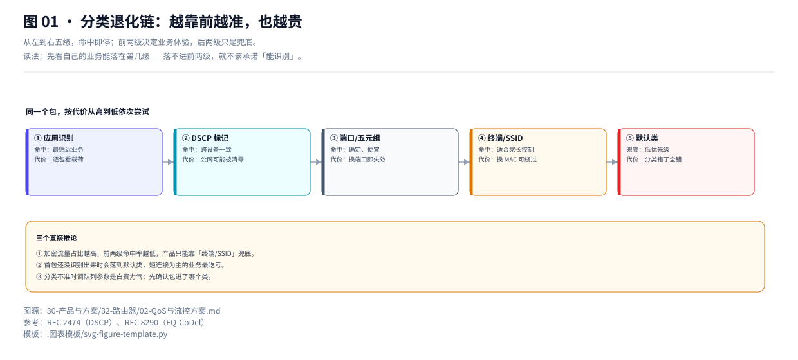
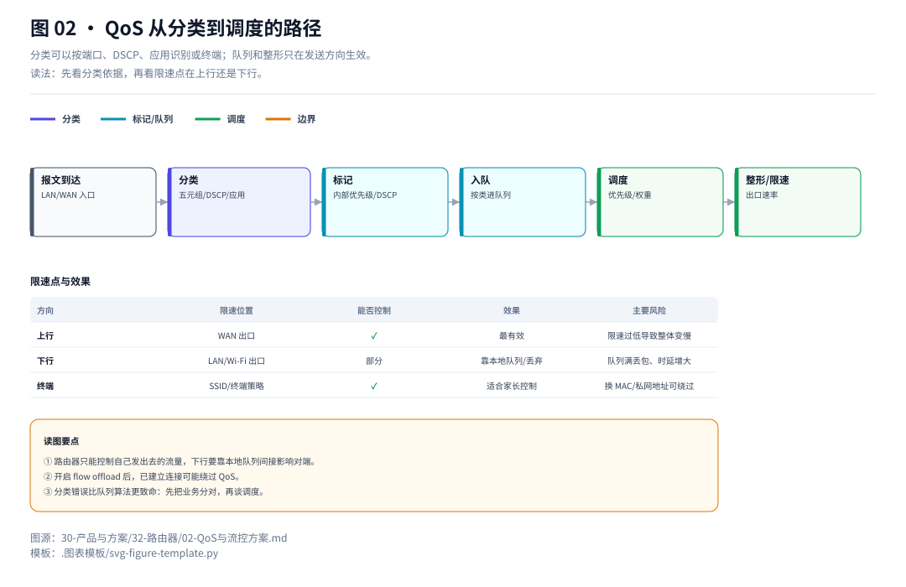

# QoS 与流控方案

路由器上的 QoS 只做三件事：**把流量分到不同类 → 给每类分配带宽/优先级 → 在出口按队列调度**。效果好坏取决于「限速点选在哪」和「分类准不准」，而不是队列算法多高级。

> 本篇定位：产品层的 QoS 业务模型、限速位置、队列与调度、家长控制/游戏加速的边界。TCP 拥塞控制和队列算法原理去 `10-基础理论`，OpenWrt 的 tc/HTB 实现去 `20-平台与系统`。本篇不写 `tc` 命令，也不评价具体芯片的队列数量。

## 目录

因为本目录沿用 `#sN` 锚点惯例，所以章节标题带固定编号、TOC 与之逐条对应；改标题时必须同步 TOC，否则锚点失效。

- [1 一句话模型](#s1)
- [2 速览](#s2)
- [3 分类与队列字段](#s3)
- [4 交互流程](#s4)
- [5 状态与定时器](#s5)
- [6 设计取舍与边界](#s6)
- [7 与相邻主题的关系](#s7)
- [名词解释](#名词解释)
- [8 参考与关联](#s8)

## 1 · 一句话模型：先分类，再排队，最后按出口整形

```text
报文 → 分类（端口/五元组/DSCP/应用识别）
  → 标记 → 入队（按类）→ 调度（优先级/权重）
  → 出口整形（限速）→ 发出
```

三个关键认知：

1. **限速只能在「发送方向」生效**：路由器能控制自己发出去的流量，控制不了运营商什么时候把包送过来。因为队列只能在「本机往外发」这一侧建立，入口方向没有队列可排，只能丢弃或重标记。
2. **上行 QoS 在 WAN 出口最有效**：下行要靠「入口丢弃/整形」间接影响对端，效果弱。因为真正的瓶颈队列在运营商侧，你只能通过丢包让对端拥塞控制降速，而降速是「秒级」的，实时业务等不了。
3. **分类错了，后面全错**：把游戏流量分进「大文件下载」类，再好的队列也救不回来。因为一旦入错队，后续调度器看到的只是「一类流量」，它没有能力再纠正业务语义。

> **推论**：评估一个 QoS 方案，先问「限速点在哪」，再问「分类靠什么」，最后才问「用什么队列算法」。顺序反了，就会在算法上反复折腾却始终没有效果。
> **边界**：这套模型只覆盖「经过本机三层转发的流量」。桥转发（LAN↔LAN）、空口内部的 WMM 调度、运营商侧的整形，都不在这三件事里。

## 2 · 速览

因为 QoS 的效果由「限速点 × 分类 × 队列」相乘决定，所以速览里每一行都标了它失效的那一侧，避免把单点调优当成整体方案。

| 项 | 内容 | 边界与误判 |
| --- | --- | --- |
| 核心对象 | 分类规则、标记、队列、调度器、整形器、限速策略 | 分类规则与队列是两处独立配置，改一处不保证另一处跟随 |
| 常见业务 | 游戏加速、视频优先、下载限速、家长控制、访客限速 | 业务名是营销语言；要看它落到哪个队列、限的是上行还是下行 |
| 关键机制 | DSCP、五元组、应用识别、HTB、FQ-CoDel、优先级队列 | 机制可叠加但代价叠加；多层整形会把时延和配置复杂度一起放大 |
| 典型位置 | WAN 出口（上行）、LAN 入口（下行）、SSID/终端维度 | 「SSID 维度限速」实际在 AP 出口做，不在 WAN 出口 |
| 主要风险 | 限速过低、分类误判、bufferbloat、加速规则绕过防火墙 | 前三个都能靠调参缓解，offload 绕过只能改架构 |
| 观测指标 | 队列长度、丢包、时延抖动、各类速率 | 队列长度是瞬时值，采样间隔不同结论就不同 |

## 3 · 分类与队列字段

QoS 的配置项可以归成两组：**分类依据**（决定包进哪个队）与**队列机制**（决定谁先发、发多快）。前者是产品体验的主要来源，后者是工程实现的主要成本。

### 3.1 分类依据

| 依据 | 粒度 | 优点 | 边界 |
| --- | --- | --- | --- |
| 端口 | 五元组 | 简单、确定 | 应用换端口就失效；HTTPS 全在 443，等于没法分 |
| DSCP | 报文标记 | 跨设备一致 | 终端不一定标记，公网可能重标记；跨域后语义不保证 |
| 应用识别 | 协议特征/域名/IP | 贴近业务 | 加密流量难识别，误判；识别库要持续更新 |
| 终端/SSID | 来源 | 适合家长控制/访客 | 终端换 MAC/私接会绕过；MAC 随机化让识别率下降 |
| 时间 | 时段 | 适合作息管理 | 依赖系统时间准确；设备无 RTC 时开机初期会错判 |

**为什么分类要有「退化顺序」而不是并列可选？** 因为越准的依据越贵：深度识别要逐包看载荷，DSCP 只看一个字节，端口只看头部。产品必须按「贵的先试、失败就降级」组织，否则要么全用最贵的方式（CPU 撑不住），要么全用最便宜的方式（分类不准）。这个顺序本身就决定了高负载下的实际行为。

### 图 01 · 分类退化链：命中即停，逐级降级



**读图**：从左到右五级，每级标注「命中后得到什么」。前两级决定业务体验，后两级是兜底：三级只认端口，四级只认来源，五级是默认类。读法是先看自己的业务落在第几级——落不进前两级，就不该承诺「能识别并优先」。

> 图源：`images/图01-分类退化链.svg`

> **推论**：加密流量（QUIC、TLS 1.3）越来越多，产品实际能稳定识别的比例在下降；所以「按终端/SSID 限速」比「按应用识别限速」更可交付，前提是接受 MAC 随机化带来的漏判。
> **边界**：退化链只描述「同一个包怎么分类」。同一条连接的不同包可能因为识别缓存未命中而在前几包落到默认类——首包分类错误对短连接影响最大。

### 3.2 队列与调度

| 机制 | 作用 | 代价 | 边界与误判 |
| --- | --- | --- | --- |
| 优先级队列 | 高优先级先发 | 低优先级可能饿死 | 只在「出口持续拥塞」时有意义；链路空闲时优先级不起作用 |
| 加权公平队列 | 按权重分配带宽 | 权重配置不当会失衡 | 权重是相对值，不是绝对值；总带宽仍受父节点 ceil 限制 |
| HTB | 分层令牌桶，支持借带宽 | 配置复杂，层级多时难排障 | `rate` 是保证、`ceil` 是上限；只配 rate 不配 ceil 会借不到空闲带宽 |
| FQ-CoDel | 流公平 + 主动队列管理 | 对分类粒度不敏感，但参数需调 | 默认 interval 100 ms、target 5 ms；链路 RTT 差异大时要重算 |
| 整形（shaping） | 平滑发送速率 | 增加时延和缓存 | 整形速率必须略低于真实带宽，否则队列建在本机之外，等于没整形 |
| 限速（policing） | 超速直接丢 | 丢包引发重传，体验差 | 对 TCP 有退避效果，对 UDP（游戏/语音）就是直接损伤 |

**为什么整形比限速「温和」？** 因为整形把超速的包排队等一会儿再发，链路利用率不降；限速直接丢，丢掉的包要靠上层重传，重传又会加剧拥塞。代价是整形需要缓冲，缓冲过长就变成 bufferbloat——所以整形必须配 AQM，否则只是把「丢包」换成「时延」。

### 3.3 产品化策略

| 策略 | 典型配置 | 说明 | 边界与误判 |
| --- | --- | --- | --- |
| 游戏优先 | 游戏特征 → 最高优先级 + 小带宽保证 | 游戏包小，重时延不重带宽 | 加速只在出口拥塞时有效；瓶颈在空口或运营商侧时无感 |
| 视频优先 | 流媒体 → 较高优先级 | 需要足够带宽，否则卡顿 | 视频有自适应码率，降码率后仍然「能看」，效果不易被察觉 |
| 下载限速 | P2P/大文件 → 低优先级 + 上限 | 防止占满上行 | 多连接 P2P 会绕过单连接限速，要按类聚合限速 |
| 家长控制 | 终端/时段 → 放行/阻断/限速 | 依赖终端识别 | 换 MAC、改 DNS、用蜂窝网络都能绕过 |
| 访客网络 | SSID/VLAN → 总带宽上限 | 与主网络隔离 | 限的是访客 SSID 的总量，不是每个访客；人多时人均更低 |
| 智能限速 | 按链路速率动态调整 | 依赖测速准确度 | 测速偏高会长期排队（时延大），偏低会浪费带宽 |

### 3.4 为什么上行只整形到 90%~95%

瓶颈队列必须留在本机，AQM 才有东西可管。如果把整形速率设成「测出来的带宽」甚至更高，本机队列永远不积压，真正的排队发生在运营商/OLT 的缓冲区里——那里的缓冲往往是几百毫秒级，且你无法管理。留 5%~10% 余量，等于主动把瓶颈搬到本机，代价是峰值带宽少一点，换来的是可控的时延。

> **推论**：「千兆宽带跑不满」有时是 QoS 的故意设计，不是故障；关掉整形能跑满，但游戏时延会变差。
> **边界**：余量比例取决于链路稳定性。PON/专线抖动小，3%~5% 足够；LTE/5G 波动大，10% 仍可能不够，因为「真实可用带宽」本身在变。

## 4 · 交互流程



**读图**：分类在入口完成，标记随报文走，队列和整形在出口生效；上行限速在 WAN 出口，下行限速在 LAN/Wi-Fi 入口做丢弃或整形。

> 图源：`images/图02-QoS分类调度.svg`

### 4.1 上行 QoS

```text
LAN 终端 → 路由 → 分类/标记 → WAN 出口队列
  → 整形到运营商实际带宽的 90%~95%
  → 按优先级/权重调度发出
```

**为什么分类要在 NAT 之前？** 因为 NAT 会改源地址与端口，分类规则若依赖「内网 IP」或「原始端口」，必须在转换前匹配；转换后再分类，只能看到公网地址，按终端限速就失效了。所以实际实现常在 PREROUTING 打 mark，在 POSTROUTING 的队列上按 mark 入队。

### 4.2 下行 QoS

```text
WAN 收包 → 分类 → LAN/Wi-Fi 出口队列 → 终端
```

下行无法控制运营商发送速率，只能在本地出口排队；队列满时丢包，靠 TCP 退避间接降速。更有效的方法是在上游做整形，或使用 AQM 控制缓冲。

**为什么下行「整形」经常只是「丢弃」？** 因为包已经到了本机，你只能选择「马上转发」或「丢掉」，没有「晚点再收」的选项；要真的整形，得先把包收进本地缓冲（IFB/入口重定向），这会消耗 CPU 与内存。所以低端产品对下行只做 policing，效果就是「丢包 + 重传」。

> **边界**：下行 QoS 对 UDP 实时业务几乎无效——UDP 不理会丢包，只是画面花/声音断；真正的下行保障要在上游（OLT/BRAS/企业出口）做。

### 4.3 家长控制/时段策略

```text
识别终端 → 绑定策略（放行/阻断/限速）
  → 命中时段 → 下发规则
  → 到期自动恢复
```

**为什么「时段策略」经常在半夜失效？** 因为它依赖系统时间：设备没有 RTC 时，开机后要先等 NTP 同步，这段时间里的「现在几点」是错的；跨时区/夏令时也可能算错。代价是要把「时间可信」当成前置条件，而不是假设它天然成立。

### 4.4 异常分支

| 异常 | 现象 | 定位方向 | 容易误判成 |
| --- | --- | --- | --- |
| 限速后整体变慢 | 所有业务都卡 | 限速值低于实际带宽、队列太小 | 宽带故障——关掉 QoS 立刻恢复即可确认 |
| 游戏仍然高延迟 | 优先级没生效 | 分类未命中、offload 绕过 QoS | 服务器延迟——换服务器无改善才是本地问题 |
| 视频卡顿 | 带宽不足或分类错 | 保证带宽、队列丢包 | 宽带不足——同时段测速可能仍然很高 |
| 下载占满上行 | 网页打不开 | 上行未限速、P2P 未识别 | DNS 故障——DNS 查询也被上行拥塞拖慢 |
| 家长控制被绕过 | 换 MAC/改 DNS 后恢复 | 终端识别方式、DNS 拦截边界 | 规则没保存——换回原终端又能生效即为绕过 |
| 测速不准 | 限速值反复调整 | 测速服务器、单线程/多线程差异 | 运营商虚标——多服务器多线程复测可区分 |
| 开 QoS 后 Wi-Fi 更差 | 无线侧时延变大 | 整形速率与空口实际速率是否匹配 | 路由器性能不足——有线侧通常正常 |

### 4.5 限速没生效时的判断顺序

顺序不能换：前一步答错，后一步就是白查。

| 步骤 | 问什么 | 怎么答 | 答错的后果 |
| --- | --- | --- | --- |
| ① 判方向 | 限的是上行还是下行 | 从内网往外打流测上行，从外网往内拉测下行 | 方向判反，会一直调错侧的队列 |
| ② 判路径 | 流量是否经过本机三层转发 | 看是否桥转发、是否同网段、是否走了 Mesh 隧道 | 桥转发不经过 WAN 出口，挂在 WAN 上的队列看不到它 |
| ③ 判绕过 | 是否命中 offload/硬件加速 | 看连接是否已建立、加速开关状态 | 已建连接绕过队列，规则只对新连接生效 |
| ④ 判分类 | 包进了哪个队列 | 看队列计数与类统计 | 分类未命中时，调队列参数全是无用功 |

> **推论**：四步里最常被跳过的是第③步——因为「规则在、计数器不动」看起来像 bug，其实是加速路径的正常表现。
> **边界**：这套顺序假设产品用「出口 qdisc」实现限速。若限速做在交换芯片或 Wi-Fi 驱动里，观测点完全不同，第④步要看的是芯片侧统计。

## 5 · 状态与定时器


**读图**：分类后入队，出口按优先级/权重调度；队列满或超速则丢弃/标记。

> 图源：`images/图03-队列与限速状态.svg`

QoS 本身没有连接状态机，关键是队列和策略的时间行为。因为 QoS 处理的是「每个包此刻该不该排队」，它不维护连接语义；真正有状态的是令牌桶与队列占用。

| 对象 | 状态/参数 | 说明 | 失败表现 |
| --- | --- | --- | --- |
| 队列 | 空 → 排队 → 满 → 丢弃 | 队列长度决定时延上限 | 队列长 = 时延大；队列短 = 丢包多 |
| 令牌桶 | 有令牌 → 耗尽 → 等待 | 桶大小决定突发容忍 | 桶太小，突发业务（网页首屏）被误伤 |
| 分类规则 | 命中/未命中 | 规则顺序影响结果 | 未命中全部落默认类，优先级形同虚设 |
| 时段策略 | 生效 → 到期 | 依赖系统时间 | 时间不准时策略提前/延后生效 |
| 测速 | 采样 → 计算 → 应用 | 频繁测速会干扰业务 | 测速本身占满带宽，触发错误的限速值 |

| 定时器/参数 | 管什么 | 边界与说明 |
| --- | --- | --- |
| 整形速率 | 出口平均速率 | 设为链路的 90%~95%；设成 100% 会让队列建在运营商侧 |
| 令牌桶深度 | 允许的突发量 | 太小会误伤突发，太大会让整形失效（瞬间超速） |
| AQM interval/target | CoDel 的判定窗口与目标时延 | 默认 100 ms / 5 ms；低带宽链路要按 RTT 调整 |
| 测速周期 | 自适应限速的更新频率 | 太频繁会干扰业务，太慢跟不上带宽变化 |
| 时段边界 | 策略生效/失效时刻 | 依赖 NTP 同步；跨天边界要确认时区 |
| 连接空闲超时 | 分类状态/流表老化 | 短连接反复重建分类状态，CPU 开销上升 |

> **待验证**：各产品的队列长度、AQM 参数和测速算法不同，默认值不一定适合高带宽链路；FQ-CoDel 的默认参数以 RFC 8290 为准，厂商固件常改。

## 6 · 设计取舍与边界

因为每个 QoS 选择都是在「效果 / 成本 / 可排障性」三者之间换，所以本节逐条写「结论 + 代价 + 失效条件」，不写没有反例的推荐。

### 6.1 限速 vs 整形

限速超速就丢，简单但会引发重传；整形把包排队再发，平滑但增加时延。交互业务优先整形，纯带宽管理可以用限速。

**判据**：这条流量对「丢包」敏感还是对「时延」敏感？语音/游戏怕时延也怕丢包，只能整形 + 小缓冲；大文件下载怕丢包（重传浪费），可以 policing。**失效条件**：链路本身抖动很大时，整形队列会被动缩短，效果接近 policing。

### 6.2 分类精度 vs 性能

逐包做深度识别会消耗 CPU，高吞吐场景通常只做五元组/DSCP 分类。加密流量（QUIC、TLS）越来越难识别，产品要接受「部分流量只能按端口/终端分类」。

**代价落在哪**：DPI 的成本随「新建连接数」而不是「字节数」增长最明显，所以短连接密集的场景（网页、消息）最先被打满。**失效条件**：有专用识别引擎（DPI 卸载）时，分类不占主核，但可识别的协议集受硬件与特征库限制。

### 6.3 优先级不是越多越好

队列和优先级越多，配置和排障越复杂，且低优先级队列容易被饿死。家用产品通常 3~4 类足够。

**为什么 3~4 类够**：用户能理解的差异只有「实时 / 交互 / 批量」三档，再加一个「访客/受限」就够；超过之后，类间差异小于测量噪声。**失效条件**：企业多业务（语音、视频会议、生产系统、办公）需要更多类，但那时应该用标记 + 策略，而不是让用户手工排队列。

### 6.4 硬件加速与 QoS 的冲突

flow offload 会让已建立连接绕过 tc/netfilter，导致限速失效。开 QoS 时要确认加速是否关闭，或使用支持 QoS 的加速方案。

**精确一点**：offload 绕过的是「每包处理」，分类与首包仍在慢路径完成；所以「限速对新连接生效、对已建连接失效」是典型表现，不是完全失效。**失效条件**：只做「按 SSID/端口的总量限速」且能接受粒度变粗时，部分平台的硬件队列仍可工作。

### 6.5 什么时候不需要 QoS

链路带宽远大于峰值需求、终端少、没有实时业务时，QoS 收益有限，反而增加配置错误的风险。

**反例**：千兆入户、两三台终端、只刷网页和视频——开整形后测速从 940 掉到 880，游戏时延没有可测改善，这就是纯粹的负收益。**失效条件**：只要有一条低带宽上行（ADSL、LTE、共享 5G），或者有人在跑 P2P，QoS 立刻从「可选」变成「必要」。

### 6.6 WAN 的队列管不到空口

WAN 出口的优先级只在「出口拥塞」时起作用；Wi-Fi 侧的排队由 802.11 的 EDCA/WMM 四类访问类别决定，两套队列互不相通。**原因**：空口是共享介质，竞争由 CSMA/CA 与退避决定，不是「谁先出队谁先发」。

> **边界**：所以在「Wi-Fi 卡」的场景里关掉 WAN QoS 往往毫无改善；要改善空口体验，得看 [37-AP-AC](../37-AP-AC/.readme.md) 的射频与 WMM 配置。

### 6.7 本篇模型什么时候失效

- **交换芯片内联限速**：限速在芯片里做，qdisc 统计看不到，本篇的观测方法不适用。
- **运营商侧整形**：真正的瓶颈在 OLT/BRAS，本机怎么调都只能影响「自己发出去的那一段」。
- **Mesh/FTTR 隧道转发**：流量经隧道集中到主网关，子设备的「出口」不是真正的出口。
- **加密隧道（VPN）**：QoS 看到的是外层五元组，内层业务无法分类，只能按隧道整体限速。

## 7 · 与相邻主题的关系

因为相邻主题各自维护正本，所以本表只写「关系 + 边界」，把报文、命令和参数留在对应目录。

| 相邻对象 | 关系 | 边界（细节去哪看） |
| --- | --- | --- |
| [传输性能与调优](../../10-基础理论/11-网络科学/04-传输层/03-传输性能与调优.md) | 拥塞控制、缓冲区、时延 | 算法与窗口在那篇；本篇只讲「产品在哪一侧排队」 |
| [NAT](../../10-基础理论/11-网络科学/03-网络层/05-NAT.md) | 转发链上的 NAT 与 conntrack | 地址转换在那篇；本篇只取「分类要在 NAT 前」这一条约束 |
| [QoS 与流量控制（OpenWrt）](../../20-平台与系统/22-OpenWrt/03-网络数据面/05-QoS与流量控制.md) | tc/HTB 实现 | 配置与代码路径在那篇；本篇不复制命令与参数 |
| [路由器产品架构](./00-路由器产品架构.md) | 整机转发链 | 硬件与分层在那篇；本篇只讲转发链末端的队列 |
| [路由转发与 NAT 方案](./01-路由转发与NAT方案.md) | QoS 前的路由/NAT 处理 | 路由与映射在那篇；NAT 会改地址，所以分类必须在它之前 |
| [交换机业务与组网](../31-交换机/01-交换机业务与组网.md) | 二层优先级与队列 | 802.1p/PCP 与端口队列在那篇；那是二层标记，与三层 DSCP 可映射但不等价 |
| [37-AP-AC](../37-AP-AC/.readme.md) | 空口调度与 WMM | EDCA/空口公平在那组笔记；WAN QoS 管不到空口竞争 |

一句话：**QoS 的效果 = 限速点是否合理 × 分类是否准确 × 队列是否匹配业务。** 这三个因子是乘法关系——任何一项为 0，整体就是 0，所以「只换更高级的队列算法」几乎从不解决问题。

## 名词解释

> 缩写给出英文全称；非缩写用“—”表示。

因为缩写会撞名（`AF` 在 QoS 里是 Assured Forwarding，在套接字编程里是 Address Family），所以本表只给本篇语境的英文全称。

| 术语 | 英文全称 | 解释 |
| --- | --- | --- |
| QoS | Quality of Service | 服务质量。 |
| DSCP | Differentiated Services Code Point | IP 头中的差分服务标记。 |
| HTB | Hierarchical Token Bucket | 分层令牌桶。 |
| AQM | Active Queue Management | 主动队列管理。 |
| CoDel | Controlled Delay | 一种基于时延的 AQM 算法。 |
| P2P | Peer-to-Peer | 点对点传输。 |
| QUIC | Quick UDP Internet Connections | 基于 UDP 的传输协议。 |
| SSID | Service Set Identifier | 无线网络名称。 |
| VLAN | Virtual Local Area Network | 虚拟局域网。 |
| MAC | Media Access Control | 介质访问控制地址。 |
| CAKE | Common Applications Kept Enhanced | Linux 的整合型队列算法，含整形、流公平与 AQM。 |
| TBF | Token Bucket Filter | 令牌桶过滤器，最基础的整形器。 |
| ECN | Explicit Congestion Notification | 显式拥塞通知，用标记代替丢包通知拥塞（RFC 3168）。 |
| BDP | Bandwidth-Delay Product | 带宽时延积，链路在途数据量，决定缓冲需求。 |
| bufferbloat | — | 缓冲区过大导致的持续高时延现象。 |
| PHB | Per-Hop Behavior | 差分服务中每跳对报文的处理行为，如 EF、AF。 |
| EF | Expedited Forwarding | 加速转发，低时延低抖动的 PHB（RFC 3246）。 |
| AF | Assured Forwarding | 确保转发，按类与丢弃优先级划分的 PHB 组。 |
| qdisc | Queueing Discipline | Linux 的队列规则，决定包如何排队与发出。 |
| policing | — | 监管：超速直接丢弃或降级。 |
| shaping | — | 整形：把超速的包排队延后发送。 |
| WMM | Wi-Fi Multimedia | 802.11 的服务质量扩展，用四个访问类别做空口优先级。 |
| EDCA | Enhanced Distributed Channel Access | WMM 的竞争接入机制，按访问类别设置不同参数。 |
| DPI | Deep Packet Inspection | 深度包检测，按载荷特征识别应用。 |

## 8 · 参考与关联

因为队列算法与参数默认值仍在演进（CoDel 系列尤其如此），所以本节只列本篇直接引用的条目，参数以 RFC 与实现文档为准。

**标准/文档**

- RFC 2474：Definition of the Differentiated Services Field
- RFC 8290：The Flow Queue CoDel Packet Scheduler and AQM Algorithm
- RFC 8033：PIE AQM
- Linux tc/HTB 文档

**关联**

- [设备形态对比](../00-设备形态对比.md)
- [路由器产品架构](./00-路由器产品架构.md)
- [路由转发与 NAT 方案](./01-路由转发与NAT方案.md)
- [QoS 与流量控制（OpenWrt）](../../20-平台与系统/22-OpenWrt/03-网络数据面/05-QoS与流量控制.md)

---

> **本篇定位**：路由器 QoS 的分类、队列、限速位置与家长控制/游戏加速的产品边界。
> **素材来源**：`studyspace/1.知识体系/7.openwrt/3.网络业务/2.关键组件服务/6.CPE专属业务/2.Qos.md`、`3.流量控制.md`、`4.端口限速.md`。
> **待验证**：各平台的队列参数、offload 兼容性、应用识别准确率和测速算法；FQ-CoDel 参数以 RFC 8290 默认值为参照，厂商实现可能不同。
