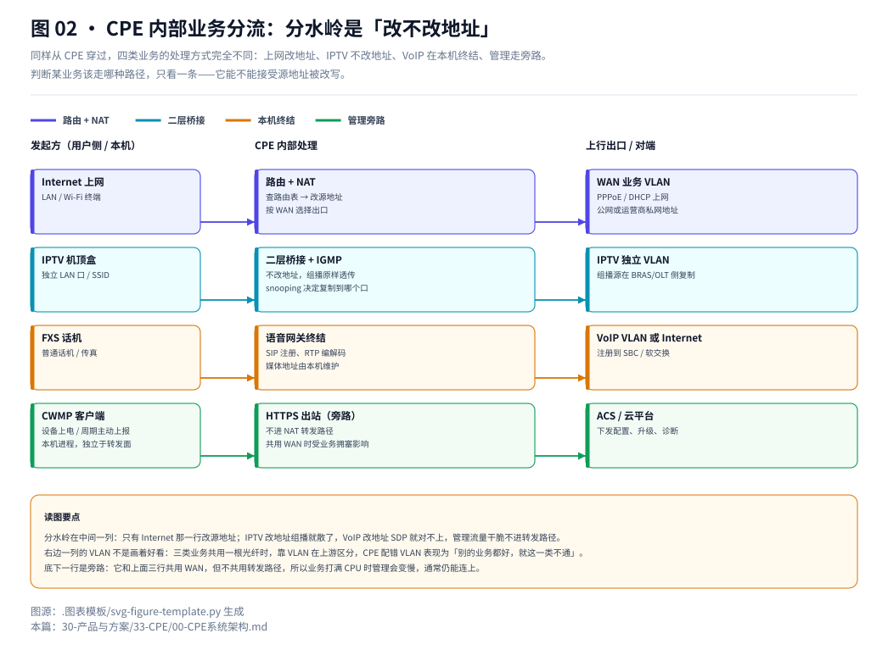
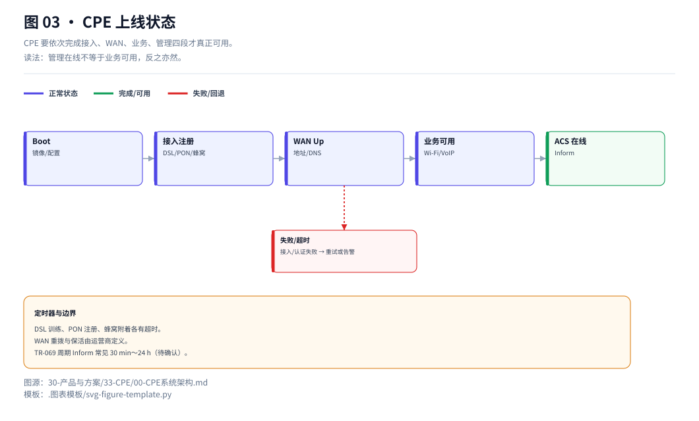

# CPE 系统架构

CPE（Customer Premises Equipment）是运营商放在用户侧的「业务终结设备」：**上行接一种或多种接入网，下行给用户提供上网、语音、视频和 Wi-Fi，同时接受运营商远程管理**。

> 本篇定位：CPE 的形态分类、软硬件组成、业务模型和产品指标。PPPoE/DHCP/TR-069 的协议细节去 `10-基础理论`，OpenWrt 实现去 `20-平台与系统`，芯片方案去 `40-平台与芯片`。本篇不展开任何单协议的报文与状态机。

## 目录

- [1 一句话模型](#s1)
- [2 速览](#s2)
- [3 结构与字段](#s3)
- [4 交互流程](#s4)
- [5 状态机与定时器](#s5)
- [6 设计取舍与边界](#s6)
- [7 与相邻主题的关系](#s7)
- [名词解释](#名词解释)
- [8 参考与关联](#s8)

## 1 · 一句话模型：上行接入、下行组网、旁路管理

```text
接入侧（xDSL / PON / 蜂窝 / 以太）
  └─ CPE：认证/拨号 → 路由/NAT → 交换/Wi-Fi/VoIP
        └─ 用户侧：PC/手机/机顶盒/话机
  └─ 管理侧：TR-069/TR-369/云管 → ACS/平台
```

三个关键认知：

1. **CPE 是「运营商定制设备」**，不是普通家用路由：默认配置、远程管理、升级策略都由运营商定义。
2. **接入方式决定硬件和软件栈**：xDSL 有 DSL PHY，PON 有 PON MAC/光模块，蜂窝有 Modem 和 QMI/MBIM。
3. **业务是分域的**：上网、VoIP、IPTV 可能走不同 VLAN/接口，不能用一个 LAN 通吃。

把整机拆成三个面看：**接入面**（把上行接通）、**转发面**（决定包往哪走、改不改地址）、**管理面**（谁远程改配置、怎么升级）。三面共用一颗 SoC 和一套 Linux，但故障域不同——因为它们的失败现象完全不同，所以排障必须先判「坏在哪一面」，而不是一上来翻日志。

一个类比：CPE 像一栋楼的**进户配电箱**——进户总线是接入面，分路开关是转发面，物业远程抄表是管理面。

> **边界**：类比失效的地方是「可远程改线」。配电箱的线路不会自己变，CPE 会被 ACS 下发改 VLAN、改 SSID、甚至重启整机，所以「昨天好用今天不行」在 CPE 上是常态，不能默认配置没变。

> **推论**：既然三面共用一颗 SoC，任何一面的资源耗尽都会拖垮另外两面——VoIP 抖动、Wi-Fi 掉线、管理不上线，可能都源于同一颗 CPU 被转发打满。看到「多个不相关业务同时变差」，先查资源，再查各自配置。

## 2 · 速览

| 项 | 内容 | 边界与误判 |
| --- | --- | --- |
| 产品定位 | 运营商用户侧终端，负责接入、路由、语音/视频和远程管理 | 桥接形态下不承担路由与 NAT，别按路由型指标验收 |
| 典型形态 | xDSL CPE、PON ONT/HGU、4G/5G CPE、融合 CPE | 同一型号可跨形态（桥接/路由），形态按「当前角色」算 |
| 核心对象 | WAN 连接、LAN/VLAN、Wi-Fi SSID、VoIP 账号、管理参数 | 对象多不等于都要配；业务分域决定实际用哪几个 |
| 关键能力 | 拨号/认证、NAT、DHCP/DNS、Wi-Fi、VoIP、TR-069、升级回滚 | 能力列表是上限，具体项目按合同裁剪 |
| 软件栈 | Boot + Linux/OpenWrt + 厂商 SDK + 运营商应用 | 原生包与厂商 SDK 混用，升级路径不统一 |
| 关键标准 | TR-069/TR-369、TR-098/TR-181、G.984/G.987、802.11、SIP | 标准给框架，参数取值由运营商规范定 |
| 主要指标 | 接入速率、NAT 吞吐、Wi-Fi 吞吐、并发数、启动时间、升级成功率 | 指标必须带口径，否则跨厂商不可比（见 §3.5） |
| 本篇覆盖 | 整机的分层、业务分域、指标口径与定位顺序 | 只到整机层，单协议与实现去子篇和 10/20 |
| 本篇不覆盖 | 拨号报文（见 [01](./01-宽带接入与拨号.md)）、CWMP 会话（见 [02](./02-TR-069与ACS运维.md)）、集采流程（见 [03](./03-运营商定制与入网.md)） | 「不覆盖」不等于不重要，链接里才是正本 |
| 判定入口 | §4.4 五段定位，顺序不能换 | 跳步会把链路问题误判成配置问题 |
| 最易混的三对 | 桥接 vs 路由、管理通道 vs 业务通道、一体机 vs 分离式 | 三对都是「角色 vs 实现」的混淆，按角色判 |
| 主要风险 | 用「能上网」当验收通过；指标不带口径；把 CPE 防火墙当安全边界 | 风险来自验收口径，不是功能缺失 |

> **边界**：这张表描述的是「一整台 CPE 的默认形态」。同一型号可能同时支持桥接与路由，验收前必须先确认当前角色，否则测到的是另一台设备的指标。

因为速览只负责定位，所以每一行都对应后文一节：指标口径在 §3.5，业务分域在 §3.4，定位顺序在 §4.4。读的时候不必记数字，记住「哪一行该去哪一节」就够了。

## 3 · 结构与字段

### 3.1 形态分类

| 形态 | 上行接口 | 典型场景 | 差异点 | 边界与误判 |
| --- | --- | --- | --- | --- |
| xDSL CPE | DSL（VDSL2/ADSL2+） | 铜线宽带 | DSL PHY、线路训练、抗噪 | 速率上限由铜线质量决定，同型号换一条线可能差一倍；profile 与矢量化要按局端核对，只看 CPE 规格书会高估 |
| PON ONT/HGU | PON（GPON/XG(S)-PON） | 光纤入户 | PON MAC、OMCI、光功率 | 注册成功 ≠ 业务通：还要 OMCI 下发业务 VLAN。SFU 只桥接不拨号，把它当 HGU 排障会找不到 WAN 配置 |
| 蜂窝 CPE | LTE/5G | 无线宽带/应急 | Modem、SIM、QMI/MBIM | 常在运营商 NAT 后面，拿不到公网 IP；端口映射、外网访问这类需求可能根本不成立 |
| 融合 CPE | 多种上行 | 多接入备份 | 上行切换、策略路由 | 切换会换源地址，需要固定源 IP 的会话必断；「双上行」不等于「双活」 |
| 企业 CPE | 以太/PON/专线 | 政企分支 | VPN、多 LAN、安全 | VPN 与多 LAN 是产品差异，不是 CPE 的定义；拿消费级 CPE 套政企需求会漏掉安全与组网能力 |

**为什么按上行分类**：上行接口决定 PHY、驱动和认证栈，这三样恰好是移植成本最高的部分。反例是 PON SFP stick——同一块主板插上 stick 就从以太 CPE 变成 PON CPE，所以形态跟着接口走，不跟着主板走。

### 3.2 硬件组成

| 部件 | 作用 | 产品关注点 | 边界与误判 |
| --- | --- | --- | --- |
| 主控 SoC | Linux、NAT、管理 | 转发性能、加速能力 | 标称主频不等于转发能力；有没有硬件加速/NPU 决定的是数量级差异，不是百分比 |
| 接入模块 | DSL/PON/Modem | 与 SoC 的接口（PCIe/USB/RGMII） | USB 接 Modem 会抢 CPU；RGMII 带宽有限，多口千兆要看是否共享 |
| 交换芯片 | LAN 多口、VLAN | 端口速率、DSA 支持 | 不支持 DSA 的老方案只能靠 VLAN 打标，端口级隔离与限速会受限 |
| Wi-Fi 芯片 | 2.4G/5G/6G | 频宽、空间流、FEM | 天线数与空间流不是一回事；不带 FEM 的机型穿墙能力差一个档 |
| 语音模块 | FXS 口、编解码 | 支持的话机数、回声消除 | FXS 口数量是硬约束，软件补不出来；回声消除依赖 DSP 或 SoC 能力 |
| 存储 | 固件、配置、日志 | 双镜像、配置备份 | 单分区没有回滚，升级失败只能返修；日志分区太小会把关键记录冲掉 |
| 按键/LED | 复位、WPS、状态 | 语义要与运营商规范一致 | LED 语义各家不同，排障时以规范为准，不要凭颜色猜 |
| 电源/散热 | 整机供电、PoE | 适配器余量、高温降频 | 高温降频表现为「夏天变慢」，不是软件 bug；PoE 机型要算整机功率预算 |

**为什么硬件表要按「产品关注点」排**：同一颗 SoC 能做出完全不同的产品，差异在接口组合与外围器件。选型会先在 SoC 上对错，再在 FEM/交换芯片上对错，最后才是成本。

### 3.3 软件分层

| 层 | 组件 | 职责 | 边界与误判 |
| --- | --- | --- | --- |
| 引导 | BootROM/U-Boot | 镜像选择、恢复、升级 | 恢复模式是升级失败的最后一条路，被裁掉就没有兜底 |
| 内核 | Linux、驱动、netfilter | 接入驱动、转发、NAT | 运营商差异不该改内核，一改就是每个项目一份内核 |
| 基础服务 | netifd、dnsmasq、odhcpd、firewall | 接口、DHCP/DNS、IPv6、规则 | 直接改 `/etc/config` 会被 ACS 下发的配置覆盖；配置源要唯一 |
| 业务 | VoIP、IPTV、Wi-Fi、QoS | 运营商业务 | VoIP/IPTV 多来自厂商 SDK，不是 OpenWrt 原生包，升级要跟 SDK 走 |
| 管理 | Web、TR-069/TR-369、云管 | 配置、升级、诊断 | Web 与 TR-069 必须写同一份配置，两套配置源会互相「改回去」 |
| 定制 | 默认配置、LOGO、插件 | 运营商差异 | 定制只做默认值、资源与插件；改代码就分叉，分叉就难合并 |

**为什么分层**：分层的目的是让升级只替换一层——换 Web 不动内核，换运营商默认值不动驱动。反过来，只要有两层都能写同一个参数，就必然出现覆盖冲突，这是「改了又变回去」类问题的共同根因。

> **推论**：判断一个定制需求该放哪层，问「它会不会随运营商变、会不会随版本变」。两个都「会」，就放配置层；只有平台会变，放代码层。

### 3.4 业务与接口

| 业务 | 承载 | 关键配置 | 边界与误判 |
| --- | --- | --- | --- |
| Internet | WAN 连接 + NAT | 拨号方式、MTU、DNS | 桥接模式下 CPE 不做 NAT，「上网配置」在上游网关，找错设备是常见误判 |
| VoIP | 独立 WAN/VLAN 或 Internet | SIP 账号、编解码、拨号计划 | 注册成功不等于媒体通；SIP ALG 经常帮倒忙，媒体单通要先看 NAT 类型 |
| IPTV | 独立 VLAN/桥接 | 组播、IGMP snooping、QoS | 组播必须在离用户最近的节点复制；NAT 改地址会破坏组播组，不能靠 NAT 承载 |
| 管理 | TR-069/TR-369 | ACS 地址、认证、周期上报 | 管理 WAN 与业务 WAN 共用时，ACS 地址可能不可达；带外管理要先于业务可用 |
| 访客 Wi-Fi | 独立 SSID/VLAN | 隔离、限速 | 只做二层隔离不够，还要防火墙与限速，否则访客能扫内网管理口 |

**为什么业务要分域**：因为三类业务的「地址语义」不同——上网需要 NAT（私网复用一个公网地址），IPTV 需要组播原样透传（一改地址组就散了），VoIP 需要 SIP/SDP 里的地址与真实媒体地址一致。用一条 LAN 通吃，必然有一类业务被牺牲。

> **边界**：分域的前提是上游能给多个 VLAN。只有一条业务的现网（部分小区宽带），强行分域只会增加配置复杂度而没有收益。

### 3.5 指标口径：同一个名字，量的不是一件事

| 指标 | 怎么测 | 边界与误判 |
| --- | --- | --- |
| 接入速率 | DSL 训练速率、PON 线路速率、蜂窝实测下行 | 物理层上限，不等于用户可用带宽；还受 BRAS/OLT 限速与 Wi-Fi 瓶颈 |
| NAT 吞吐 | 有线 WAN→LAN，注明包长（64B/1518B）、单向/双向 | 只测大包会高估；小包要看 PPS 不看 bps；开 QoS、PPPoE 封装后下降 |
| Wi-Fi 吞吐 | 屏蔽箱或近场，单终端 iperf，注明频段与频宽 | 空口是共享介质，多终端与干扰下腰斩；不能与有线吞吐相加当整机能力 |
| 并发会话 | conntrack 表容量 + 新建速率 | 表满表现为「能 ping 不能开网页」，且不一定有日志 |
| 启动时间 | 上电到 WAN 可用 / 到 Wi-Fi 可关联 | 两个口径差很多；PON 注册与 DSL 训练常占大头，只报「开机几秒」没有意义 |
| 升级成功率 | 批量升级后的版本一致率 | 弱网与断电下失败，必须同时统计回滚次数，否则成功率会被「假成功」抬高 |

> **边界**：指标必须带口径（包长、并发数、终端数、测试仪型号），否则跨厂商、跨项目的数字不可比。集采规范里每个指标都带测试条件，原因就在这里。

## 4 · 交互流程


**读图**：自下而上是接入（对上游）→ 系统 → 转发（内核）→ 业务（对终端）；右侧管理通道独立，不承载业务流量。

> 图源：`images/图01-CPE功能框图.svg`

管理通道画在右侧而不是串在转发链上，是因为它**旁路**：ACS 的流量从 WAN 进来后被本机进程收下，不经过 NAT 转发路径。这样管理面挂了不会拖垮业务面，业务面打满 CPU 时管理面会变慢但通常还能连——这决定了「业务全断还能不能远程救」的答案。

### 4.1 上电到业务可用

```text
上电 → Boot → 内核 → 根文件系统
  → 读取运营商默认配置
  → 初始化接入模块（DSL 训练 / PON 注册 / Modem 拨号）
  → WAN 认证/拨号 → 获取地址/DNS/前缀
  → 下发 NAT/防火墙/QoS
  → 起 Wi-Fi/VoIP → 业务可用
  → 向 ACS 发起 Inform（管理上线）
```

这个顺序不是随便排的：接入模块没起来就没有 WAN，没有 WAN 就没有到 ACS 的 IP 路径，所以「管理上线」天然排在业务之后。**代价**是：一旦 WAN 配置错了，设备就永远上不了线，只能靠现场恢复出厂。

例外是有**带外通道**的产品：管理 VLAN 与业务 VLAN 分开，或蜂窝做管理备份。这时 ACS 可以先于业务上线，也是「远程救砖」的前提。

> **推论**：集采规范要求「管理通道独立」不是洁癖，而是把「配置错了还能远程改回来」做成硬能力。没有带外通道的产品，任何 WAN 侧误配置都等于现场工单。

### 4.2 业务数据路径

```text
用户终端 → LAN/Wi-Fi → 桥/路由 → NAT → WAN
IPTV → 独立 VLAN → 桥接/组播 → WAN
VoIP → FXS → 语音网关 → SIP → WAN
管理 → TR-069 → WAN 或独立管理通道
```



**读图**：四类业务从左到右穿过同一台 CPE，中间那一列才是分水岭——Internet 走路由 + NAT（改源地址），IPTV 走二层桥接（不改地址、组播原样过），VoIP 在本机终结（SIP/RTP 由语音网关处理），管理流量被本机进程收下（旁路）。右侧是各自的出口，多数现网是不同 VLAN。

> 图源：`images/图02-CPE业务分流.svg`

> **推论**：判断一个业务「该走桥还是走路由」，只看一条——它能不能接受地址被改。能接受（普通上网）走 NAT；不能接受（组播、SIP 信令里的地址）走桥接或本机终结。
> **边界**：桥接不是万能的。桥接意味着 CPE 看不到三层信息，QoS、家长控制、流量统计这类按应用识别的功能会失效，这是桥接模式的功能代价。

### 4.3 异常分支

| 异常 | 现象 | 定位方向（先排除的误判） |
| --- | --- | --- |
| 接入不上 | WAN 无地址 | 线路/光功率/DSL 训练/SIM |
| 认证失败 | 拨号被拒 | 账号密码、认证方式、绑定关系 |
| 业务不通但管理正常 | ACS 能连，用户不能上网 | NAT/防火墙/VLAN/地址池 |
| 管理正常但 IPTV 不通 | 上网可用，电视黑屏 | 组播 VLAN、IGMP、复制点 |
| IPTV 卡顿 | 组播丢包 | 组播复制点、VLAN、QoS |
| VoIP 无声/单通 | 注册成功但媒体不通 | NAT、编解码、防火墙、SIP ALG |
| 升级变砖 | 重启后不启动 | 镜像校验、回滚、双分区 |
| 业务时通时断 | 短时断流后自愈 | 链路误码、LCP Echo、加速表老化、高温降频 |

### 4.4 定位顺序：五段，顺序不能换

| 步骤 | 问什么 | 怎么答 | 答错的后果 |
| --- | --- | --- | --- |
| ① 接入起来了吗 | DSL 训练、PON 注册、以太 Link、蜂窝注册 | 看接口状态与光功率/训练速率 | 接入没起来就查 NAT，永远查不到；会把线路问题当成配置问题 |
| ② 认证/地址过了吗 | PPPoE 会话、IPCP、DHCP、RA | 看 WAN 是否拿到地址/前缀/DNS | 把「认证被拒」当成「路由不通」，会去改防火墙 |
| ③ 转发通吗 | 默认路由、NAT、DNS | 从 LAN 侧 ping 网关与公网 IP，再试域名 | 不区分「IP 不通」与「DNS 不解析」，会误判为断网 |
| ④ 业务终结对吗 | VLAN、组播、SIP 注册 | 按业务逐项看注册/组播组/编解码 | 用上网正常的结论推断 IPTV 正常，漏掉分域故障 |
| ⑤ 管理通道通吗 | ACS 可达、证书、时间 | 看 Inform 是否成功、有无 401 | 管理不通时仍远程下发任务，问题会积压到现场 |

> **推论**：这五步也能反过来用——设计验收用例时，每一步都要有一个「故意配错」的负向用例，否则测不出这一段的边界。

## 5 · 状态机与定时器



**读图**：接入注册、WAN、业务、管理四段依次完成；管理在线不等于业务可用。

> 图源：`images/图03-CPE上线状态.svg`

因为这四段是串联的，所以「管理在线」只能证明最后一段通了，不能反推业务可用；反过来，业务可用时管理通常也已在线，除非管理通道走的是另一条链路。

| 对象 | 状态 | 在等什么 | 失败表现 | 关键参数 |
| --- | --- | --- | --- | --- |
| DSL 线路 | 训练 → 同步 → 激活 | 与局端握手成功、SNR 达标 | 反复训练、速率跳变 | 训练时间、重训练阈值 |
| PON ONU | 注册 → 测距 → 授权 → 运营 | OLT 授权、OMCI 配置下发 | 注册灯闪、无业务 VLAN | 注册超时、保活 |
| 蜂窝 Modem | 搜网 → 注册 → 数据连接 | 小区驻留、APN 激活 | 有信号无数据 | 制式、APN、重试 |
| WAN 连接 | 未连接 → 拨号 → 已连接 → 重拨 | 认证通过、地址获取 | 一直重拨或停在认证 | 重拨间隔、保活 |
| TR-069 会话 | 空闲 → 连接 → 会话 → 结束 | ACS 响应、认证通过 | 周期 Inform 失败 | 周期 Inform、连接请求 |
| 升级 | 下载 → 校验 → 写入 → 重启 → 确认 | 校验通过、新镜像启动 | 版本不变或变砖 | 回滚超时 |

| 对象 | 定时器/阈值 | 管什么 | 边界 |
| --- | --- | --- | --- |
| DSL | 训练超时、重训练阈值（SNR 余量） | 判定线路是否可用 | 阈值放太松，会把不稳定线路判成可用 |
| PON | 注册超时、测距/保活周期 | 判定 ONU 是否在线 | 注册成功不代表业务 VLAN 已下发 |
| 蜂窝 | 搜网/附着重试间隔 | 避免无效重试 | 重试过密会拖慢回落与省电 |
| WAN | 重拨间隔、LCP Echo 周期与次数 | 检测断链并恢复 | 间隔过短造成重拨风暴，BRAS 侧会限速 |
| TR-069 | 周期 Inform、Connection Request 超时 | 保持可管理 | 周期过短会给 ACS 造成压力 |
| 升级 | 回滚超时、看门狗 | 判定新镜像是否可用 | 超时太短会在慢启动设备上误回滚 |

> **推论**：状态机的价值在「停在哪一段」，不在「有几个状态」。现场报「上不了网」时，先定位停在哪一段，再查该段的参数，比逐项试配置快一个数量级。
> **待验证**：各运营商的 DSL 重训练阈值、PON 注册超时、LCP Echo 次数差异较大，具体值以现网配置与集采规范为准。

## 6 · 设计取舍与边界

这一节的每个取舍都问三句：为什么这样设计、代价是什么、什么时候不成立。因为 CPE 是成本敏感的量产设备，所以没有一个选项是「全面更优」——只有「在这份合同、这张现网里更合适」。

### 6.1 桥接 vs 路由

桥接模式下 CPE 只做二层透传，业务由上游网关处理，适合已有路由/认证体系的运营商；路由模式下 CPE 做 NAT/防火墙，功能完整但排障面更大。产品要明确「默认哪种、能否切换」。

**为什么运营商还要桥接**：认证与计费在 BRAS 侧，CPE 不参与拨号，用户自备路由也能上网，运维责任清晰。**代价**是 CPE 失去 QoS、家长控制、远程诊断这些能力——它看不到三层信息。**失效条件**：需要远程排障、按业务限速的现网，桥接模式撑不住，最终还是要回到路由模式或加一层网关。

### 6.2 单栈 vs 双栈

IPv4 仍是主流，IPv6 是长期方向。双栈增加地址管理、防火墙和 PD 复杂度，但能避免二次升级；只做 IPv4 的产品在 IPv6 集采中会被淘汰。

**代价具体在哪**：PD 前缀长度不统一（/56 与 /60 都有）、防火墙要写两套规则、DNS 要能同时返回 A 与 AAAA。**失效条件**：上游只给 IPv6 单栈而现网应用仍依赖 IPv4 时，必须配 NAT64/DNS64 或 464XLAT，这不是「开个开关」能解决的。

### 6.3 一体机 vs 分离式

一体机（路由+Wi-Fi+VoIP）成本低、部署简单；分离式（ONT + 路由 + AP）升级灵活、故障隔离好。FTTR 就是把「分离」做到房间级。

**取舍的实质**：一体机把故障域合并——Wi-Fi 挂了可能连带整机重启；分离式把故障域拆开，但多了一跳供电与一段回程。**失效条件**：房间多、墙体厚时，一体机的 Wi-Fi 覆盖注定不够，分离或 FTTR 不是「更好」，而是唯一可行。

### 6.4 运营商定制 vs 通用固件

定制能满足集采规范，但会形成多个分支，升级和维护成本高。产品上应把「平台基线」和「运营商差异」分层，差异只做配置和插件，不改内核。

**为什么分支一定会失控**：每个分支都要单独回归、单独发版，N 个运营商就是 N 倍测试量，且修一个漏洞要合 N 次。**代价**是配置层要做得很厚（模板、开关、校验），前期投入比直接改代码高。**失效条件**：某运营商要求的行为与基线架构冲突（比如换管理协议栈），这时只能开分支，但要把分支范围压到最小并约定回收时间。

### 6.5 CPE 不是防火墙

CPE 的防火墙以 NAT 和基础过滤为主，不能替代企业防火墙。把它当安全边界，会低估内网横向移动和入站攻击的风险。

**为什么容易误判**：NAT 天然挡住入站，给人一种「默认安全」的错觉。但 NAT 不是防火墙——出站连接建立后，回程与相关端口是通的；内网横向移动根本不经过 NAT。**边界**：政企场景要在 CPE 后面再加一层安全设备，CPE 只负责出口与基础 ACL。

## 7 · 与相邻主题的关系

| 相邻对象 | 关系 | 边界（细节去哪看） |
| --- | --- | --- |
| [PPPoE](../../10-基础理论/11-网络科学/02-链路层/06-PPP与PPPoE.md) | 宽带拨号 | 本篇只把它当「认证/地址」一段，报文与状态机不在本篇 |
| [DHCPv4](../../10-基础理论/11-网络科学/05-应用层/01-DHCPv4.md) | LAN 地址分配 | 本篇只提地址池是业务配置项 |
| [DHCPv6](../../10-基础理论/11-网络科学/05-应用层/02-DHCPv6.md) | IPv6 前缀与地址 | PD 前缀长度与 RA 参数去该篇 |
| [TR-069](../../10-基础理论/11-网络科学/05-应用层/07-TR-069.md) | 远程管理协议 | 本篇只讲管理面在整机里的位置，会话与 RPC 见 [02](./02-TR-069与ACS运维.md) |
| [PON 技术概览](../../10-基础理论/12-通信科学/03-光通信/00-PON技术概览.md) | PON 上行 | 注册/测距/OMCI 细节不在本篇 |
| [WAN 接入与 PPPoE](../../20-平台与系统/22-OpenWrt/03-网络数据面/04-WAN接入与PPPoE.md) | OpenWrt 实现 | 本篇不写 netifd 配置方法与代码路径 |
| [宽带接入与拨号](./01-宽带接入与拨号.md) | 本篇的接入展开 | 讲四类上行与失败定位，不重复整机分层 |
| [TR-069 与 ACS 运维](./02-TR-069与ACS运维.md) | 管理面展开 | 讲 CWMP 会话与升级回滚，不重复业务分域 |

一句话：**CPE = 接入模块 + 路由/NAT + 用户侧接口 + 运营商管理通道。** 这句也是本篇与子篇的分界——子篇各讲一段，本篇讲它们怎么拼成一台整机。因为这些主题各自有正本，所以表里只保留一句关系与一条边界；需要报文、配置或芯片细节时，按链接跳转。

## 名词解释

> 缩写给出英文全称；非缩写用“—”表示。因为术语表只服务于本篇的阅读，所以不追求收全；跨目录的协议细节去对应笔记。

| 术语 | 英文全称 | 解释 |
| --- | --- | --- |
| CPE | Customer Premises Equipment | 用户侧设备。 |
| ONT | Optical Network Terminal | 光网络终端。 |
| HGU | Home Gateway Unit | 家庭网关型 ONT。 |
| SFU | Single Family Unit | 单家庭单元；只做 PON 注册与二层桥接，不拨号。 |
| xDSL | x Digital Subscriber Line | 各类数字用户线。 |
| PON | Passive Optical Network | 无源光网络。 |
| OMCI | ONT Management and Control Interface | ONT 管理控制接口。 |
| ACS | Auto Configuration Server | 自动配置服务器。 |
| TR-069 | — | CWMP 远程管理协议标准。 |
| CWMP | CPE WAN Management Protocol | TR-069 定义的协议。 |
| TR-098 | — | InternetGatewayDevice 数据模型。 |
| TR-181 | — | Device:2 数据模型。 |
| TR-369 | — | USP 用户服务平台协议标准。 |
| USP | User Services Platform | TR-369 定义的平台协议。 |
| VoIP | Voice over IP | IP 语音。 |
| SIP | Session Initiation Protocol | 会话发起协议。 |
| SBC | Session Border Controller | 会话边界控制器；VoIP 注册与信令的落点。 |
| FXS | Foreign Exchange Subscriber | 连接普通话机的语音接口。 |
| APN | Access Point Name | 蜂窝网络接入点名称。 |
| QMI | Qualcomm MSM Interface | 高通 Modem 接口协议。 |
| MBIM | Mobile Broadband Interface Model | 移动宽带接口模型。 |
| SoC | System on Chip | 片上系统；CPE 的主控芯片。 |
| SDK | Software Development Kit | 软件开发工具包；厂商提供的驱动与业务组件集合。 |
| DSA | Distributed Switch Architecture | 分布式交换架构；Linux 下的交换芯片端口模型。 |
| FEM | Front End Module | 射频前端模块；含功放与低噪放。 |
| IGMP | Internet Group Management Protocol | 互联网组管理协议；IPTV 组播加入/离开。 |
| QoS | Quality of Service | 服务质量；按优先级调度与限速。 |
| MTU | Maximum Transmission Unit | 最大传输单元。 |
| NAT | Network Address Translation | 网络地址转换。 |
| VLAN | Virtual Local Area Network | 虚拟局域网。 |
| DHCP | Dynamic Host Configuration Protocol | 动态主机配置协议。 |
| DNS | Domain Name System | 域名系统。 |
| IPTV | Internet Protocol Television | IP 电视。 |

## 8 · 参考与关联

**标准**

- TR-069 / TR-369：CPE WAN 管理与用户服务平台
- TR-098 / TR-181：CPE 数据模型
- ITU-T G.984 / G.987 / G.9807：GPON / XG-PON / XGS-PON
- IEEE 802.11：无线局域网
- RFC 3261：SIP

**关联**

- [设备形态对比](../00-设备形态对比.md)
- [宽带接入与拨号](./01-宽带接入与拨号.md)
- [TR-069 与 ACS 运维](./02-TR-069与ACS运维.md)
- [运营商定制与入网](./03-运营商定制与入网.md)

因为规范会改版、集采指标按项目定，所以这里只给编号与名称；具体条款以标准原文与运营商技术规范为准。

---

> **本篇定位**：CPE 的形态分类、软硬件分层、业务分域、指标口径与五段定位；不含单协议报文、实现代码与芯片选型。
> **素材来源**：`studyspace/1.知识体系/7.openwrt/3.网络业务/1.基础网络模型/`、`6.CPE专属业务/`、`studyspace/3.协议应用/1.tr069/`；本篇 2026-11-11 版原文。
> **待验证**：各运营商的业务 VLAN 划分、接入认证方式、管理通道要求和集采指标口径；DSL 重训练阈值与 PON 注册超时的现网取值。
