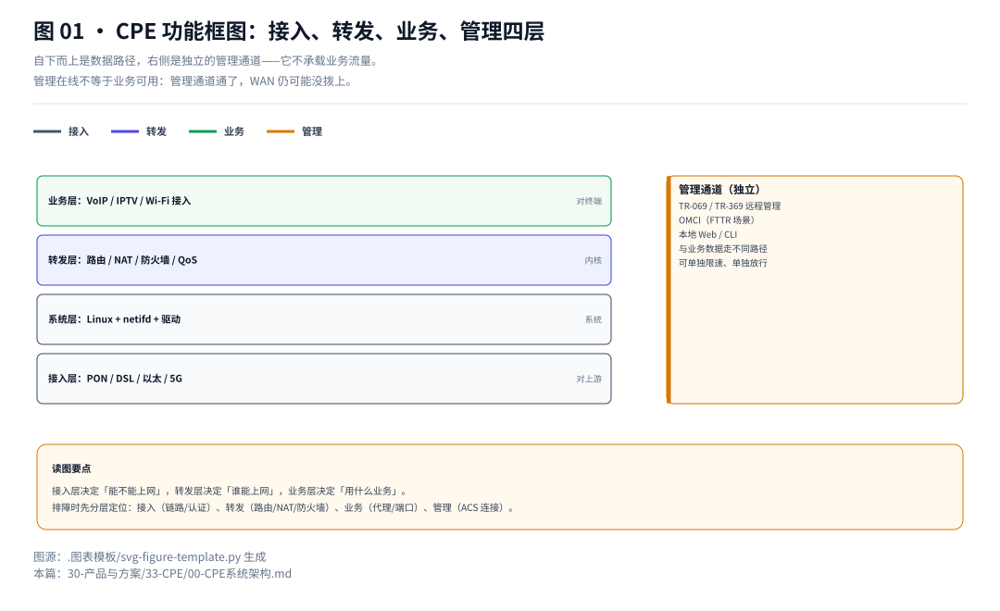
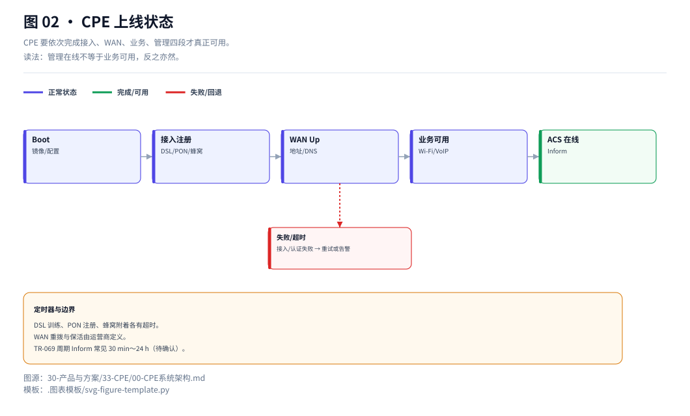

# CPE 系统架构

CPE（Customer Premises Equipment）是运营商放在用户侧的「业务终结设备」：**上行接一种或多种接入网，下行给用户提供上网、语音、视频和 Wi-Fi，同时接受运营商远程管理**。

> 本篇定位：CPE 的形态分类、软硬件组成、业务模型和产品指标。PPPoE/DHCP/TR-069 的协议细节去 `10-基础理论`，OpenWrt 实现去 `20-平台与系统`，芯片方案去 `40-平台与芯片`。

## 目录

- [1 一句话模型](#s1)
- [2 速览](#s2)
- [3 结构与字段](#s3)
- [4 交互流程](#s4)
- [5 状态机与定时器](#s5)
- [6 设计取舍与边界](#s6)
- [7 与相邻主题的关系](#s7)
- [名词解释](#名词解释)
- [8 参考与关联](#s8)

## 1 · 一句话模型：上行接入、下行组网、旁路管理

```text
接入侧（xDSL / PON / 蜂窝 / 以太）
  └─ CPE：认证/拨号 → 路由/NAT → 交换/Wi-Fi/VoIP
        └─ 用户侧：PC/手机/机顶盒/话机
  └─ 管理侧：TR-069/TR-369/云管 → ACS/平台
```

三个关键认知：

1. **CPE 是「运营商定制设备」**，不是普通家用路由：默认配置、远程管理、升级策略都由运营商定义。
2. **接入方式决定硬件和软件栈**：xDSL 有 DSL PHY，PON 有 PON MAC/光模块，蜂窝有 Modem 和 QMI/MBIM。
3. **业务是分域的**：上网、VoIP、IPTV 可能走不同 VLAN/接口，不能用一个 LAN 通吃。

## 2 · 速览

| 项 | 内容 |
| --- | --- |
| 产品定位 | 运营商用户侧终端，负责接入、路由、语音/视频和远程管理 |
| 典型形态 | xDSL CPE、PON ONT/HGU、4G/5G CPE、融合 CPE |
| 核心对象 | WAN 连接、LAN/VLAN、Wi-Fi SSID、VoIP 账号、管理参数 |
| 关键能力 | 拨号/认证、NAT、DHCP/DNS、Wi-Fi、VoIP、TR-069、升级回滚 |
| 软件栈 | Boot + Linux/OpenWrt + 厂商 SDK + 运营商应用 |
| 关键标准 | TR-069/TR-369、TR-098/TR-181、G.984/G.987、802.11、SIP |
| 主要指标 | 接入速率、NAT 吞吐、Wi-Fi 吞吐、并发数、启动时间、升级成功率 |

## 3 · 结构与字段

### 3.1 形态分类

| 形态 | 上行接口 | 典型场景 | 差异点 |
| --- | --- | --- | --- |
| xDSL CPE | DSL（VDSL2/ADSL2+） | 铜线宽带 | DSL PHY、线路训练、抗噪 |
| PON ONT/HGU | PON（GPON/XG(S)-PON） | 光纤入户 | PON MAC、OMCI、光功率 |
| 蜂窝 CPE | LTE/5G | 无线宽带/应急 | Modem、SIM、QMI/MBIM |
| 融合 CPE | 多种上行 | 多接入备份 | 上行切换、策略路由 |
| 企业 CPE | 以太/PON/专线 | 政企分支 | VPN、多 LAN、安全 |

### 3.2 硬件组成

| 部件 | 作用 | 产品关注点 |
| --- | --- | --- |
| 主控 SoC | Linux、NAT、管理 | 转发性能、加速能力 |
| 接入模块 | DSL/PON/Modem | 与 SoC 的接口（PCIe/USB/RGMII） |
| 交换芯片 | LAN 多口、VLAN | 端口速率、DSA 支持 |
| Wi-Fi 芯片 | 2.4G/5G/6G | 频宽、空间流、FEM |
| 语音模块 | FXS 口、编解码 | 支持的话机数、回声消除 |
| 存储 | 固件、配置、日志 | 双镜像、配置备份 |
| 按键/LED | 复位、WPS、状态 | 语义要与运营商规范一致 |

### 3.3 软件分层

| 层 | 组件 | 职责 |
| --- | --- | --- |
| 引导 | BootROM/U-Boot | 镜像选择、恢复、升级 |
| 内核 | Linux、驱动、netfilter | 接入驱动、转发、NAT |
| 基础服务 | netifd、dnsmasq、odhcpd、firewall | 接口、DHCP/DNS、IPv6、规则 |
| 业务 | VoIP、IPTV、Wi-Fi、QoS | 运营商业务 |
| 管理 | Web、TR-069/TR-369、云管 | 配置、升级、诊断 |
| 定制 | 默认配置、LOGO、插件 | 运营商差异 |

### 3.4 业务与接口

| 业务 | 承载 | 关键配置 |
| --- | --- | --- |
| Internet | WAN 连接 + NAT | 拨号方式、MTU、DNS |
| VoIP | 独立 WAN/VLAN 或 Internet | SIP 账号、编解码、拨号计划 |
| IPTV | 独立 VLAN/桥接 | 组播、IGMP snooping、QoS |
| 管理 | TR-069/TR-369 | ACS 地址、认证、周期上报 |
| 访客 Wi-Fi | 独立 SSID/VLAN | 隔离、限速 |

## 4 · 交互流程



**读图**：自下而上是接入（对上游）→ 系统 → 转发（内核）→ 业务（对终端）；右侧管理通道独立，不承载业务流量。

> 图源：`images/图01-CPE功能框图.svg`

### 4.1 上电到业务可用

```text
上电 → Boot → 内核 → 根文件系统
  → 读取运营商默认配置
  → 初始化接入模块（DSL 训练 / PON 注册 / Modem 拨号）
  → WAN 认证/拨号 → 获取地址/DNS/前缀
  → 下发 NAT/防火墙/QoS
  → 起 Wi-Fi/VoIP → 业务可用
  → 向 ACS 发起 Inform（管理上线）
```

### 4.2 业务数据路径

```text
用户终端 → LAN/Wi-Fi → 桥/路由 → NAT → WAN
IPTV → 独立 VLAN → 桥接/组播 → WAN
VoIP → FXS → 语音网关 → SIP → WAN
管理 → TR-069 → WAN 或独立管理通道
```

### 4.3 异常分支

| 异常 | 现象 | 定位方向 |
| --- | --- | --- |
| 接入不上 | WAN 无地址 | 线路/光功率/DSL 训练/SIM |
| 认证失败 | 拨号被拒 | 账号密码、认证方式、绑定关系 |
| 业务不通但管理正常 | ACS 能连，用户不能上网 | NAT/防火墙/VLAN/地址池 |
| IPTV 卡顿 | 组播丢包 | 组播复制点、VLAN、QoS |
| VoIP 无声/单通 | 注册成功但媒体不通 | NAT、编解码、防火墙、SIP ALG |
| 升级变砖 | 重启后不启动 | 镜像校验、回滚、双分区 |

## 5 · 状态机与定时器




**读图**：接入注册、WAN、业务、管理四段依次完成；管理在线不等于业务可用。

> 图源：`images/图02-CPE上线状态.svg`

| 对象 | 状态 | 关键参数 |
| --- | --- | --- |
| DSL 线路 | 训练 → 同步 → 激活 | 训练时间、重训练阈值 |
| PON ONU | 注册 → 测距 → 授权 → 运营 | 注册超时、保活 |
| 蜂窝 Modem | 搜网 → 注册 → 数据连接 | 制式、APN、重试 |
| WAN 连接 | 未连接 → 拨号 → 已连接 → 重拨 | 重拨间隔、保活 |
| TR-069 会话 | 空闲 → 连接 → 会话 → 结束 | 周期 Inform、连接请求 |
| 升级 | 下载 → 校验 → 写入 → 重启 → 确认 | 回滚超时 |

## 6 · 设计取舍与边界

### 6.1 桥接 vs 路由

桥接模式下 CPE 只做二层透传，业务由上游网关处理，适合已有路由/认证体系的运营商；路由模式下 CPE 做 NAT/防火墙，功能完整但排障面更大。产品要明确「默认哪种、能否切换」。

### 6.2 单栈 vs 双栈

IPv4 仍是主流，IPv6 是长期方向。双栈增加地址管理、防火墙和 PD 复杂度，但能避免二次升级；只做 IPv4 的产品在 IPv6 集采中会被淘汰。

### 6.3 一体机 vs 分离式

一体机（路由+Wi-Fi+VoIP）成本低、部署简单；分离式（ONT + 路由 + AP）升级灵活、故障隔离好。FTTR 就是把「分离」做到房间级。

### 6.4 运营商定制 vs 通用固件

定制能满足集采规范，但会形成多个分支，升级和维护成本高。产品上应把「平台基线」和「运营商差异」分层，差异只做配置和插件，不改内核。

### 6.5 CPE 不是防火墙

CPE 的防火墙以 NAT 和基础过滤为主，不能替代企业防火墙。把它当安全边界，会低估内网横向移动和入站攻击的风险。

## 7 · 与相邻主题的关系

| 相邻对象 | 关系 |
| --- | --- |
| [PPPoE](../../10-基础理论/11-网络科学/02-链路层/06-PPP与PPPoE.md) | 宽带拨号 |
| [DHCPv4](../../10-基础理论/11-网络科学/05-应用层/01-DHCPv4.md) | LAN 地址分配 |
| [DHCPv6](../../10-基础理论/11-网络科学/05-应用层/02-DHCPv6.md) | IPv6 前缀与地址 |
| [TR-069](../../10-基础理论/11-网络科学/05-应用层/07-TR-069.md) | 远程管理协议 |
| [PON 技术概览](../../10-基础理论/12-通信科学/03-光通信/00-PON技术概览.md) | PON 上行 |
| [WAN 接入与 PPPoE](../../20-平台与系统/22-OpenWrt/03-网络数据面/04-WAN接入与PPPoE.md) | OpenWrt 实现 |
| [宽带接入与拨号](./01-宽带接入与拨号.md) | 本篇的接入展开 |
| [TR-069 与 ACS 运维](./02-TR-069与ACS运维.md) | 管理面展开 |

一句话：**CPE = 接入模块 + 路由/NAT + 用户侧接口 + 运营商管理通道。**

## 名词解释

> 缩写给出英文全称；非缩写用“—”表示。

| 术语 | 英文全称 | 解释 |
| --- | --- | --- |
| CPE | Customer Premises Equipment | 用户侧设备。 |
| ONT | Optical Network Terminal | 光网络终端。 |
| HGU | Home Gateway Unit | 家庭网关型 ONT。 |
| xDSL | x Digital Subscriber Line | 各类数字用户线。 |
| PON | Passive Optical Network | 无源光网络。 |
| OMCI | ONT Management and Control Interface | ONT 管理控制接口。 |
| ACS | Auto Configuration Server | 自动配置服务器。 |
| TR-069 | — | CWMP 远程管理协议标准。 |
| TR-369 | — | USP 用户服务平台协议标准。 |
| VoIP | Voice over IP | IP 语音。 |
| SIP | Session Initiation Protocol | 会话发起协议。 |
| FXS | Foreign Exchange Subscriber | 连接普通话机的语音接口。 |
| APN | Access Point Name | 蜂窝网络接入点名称。 |
| QMI | Qualcomm MSM Interface | 高通 Modem 接口协议。 |
| MBIM | Mobile Broadband Interface Model | 移动宽带接口模型。 |

## 8 · 参考与关联

**标准**

- TR-069 / TR-369：CPE WAN 管理与用户服务平台
- TR-098 / TR-181：CPE 数据模型
- ITU-T G.984 / G.987 / G.9807：GPON / XG-PON / XGS-PON
- IEEE 802.11：无线局域网
- RFC 3261：SIP

**关联**

- [设备形态对比](../00-设备形态对比.md)
- [宽带接入与拨号](./01-宽带接入与拨号.md)
- [TR-069 与 ACS 运维](./02-TR-069与ACS运维.md)
- [运营商定制与入网](./03-运营商定制与入网.md)

---

> **本篇定位**：CPE 的形态分类、软硬件分层、业务模型与产品指标。
> **素材来源**：`studyspace/1.知识体系/7.openwrt/3.网络业务/1.基础网络模型/`、`6.CPE专属业务/`、`studyspace/3.协议应用/1.tr069/`。
> **待验证**：各运营商的业务 VLAN 划分、接入认证方式、管理通道要求和集采指标。
