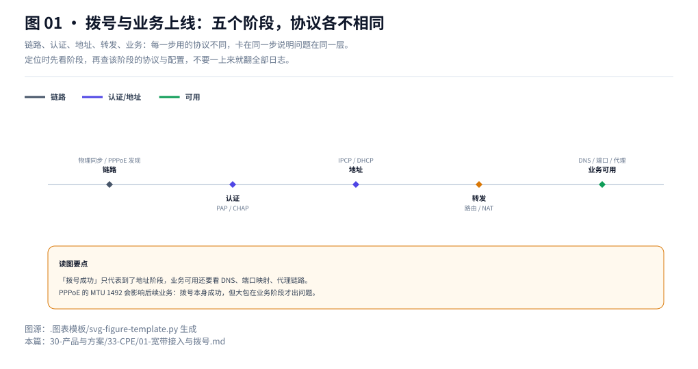
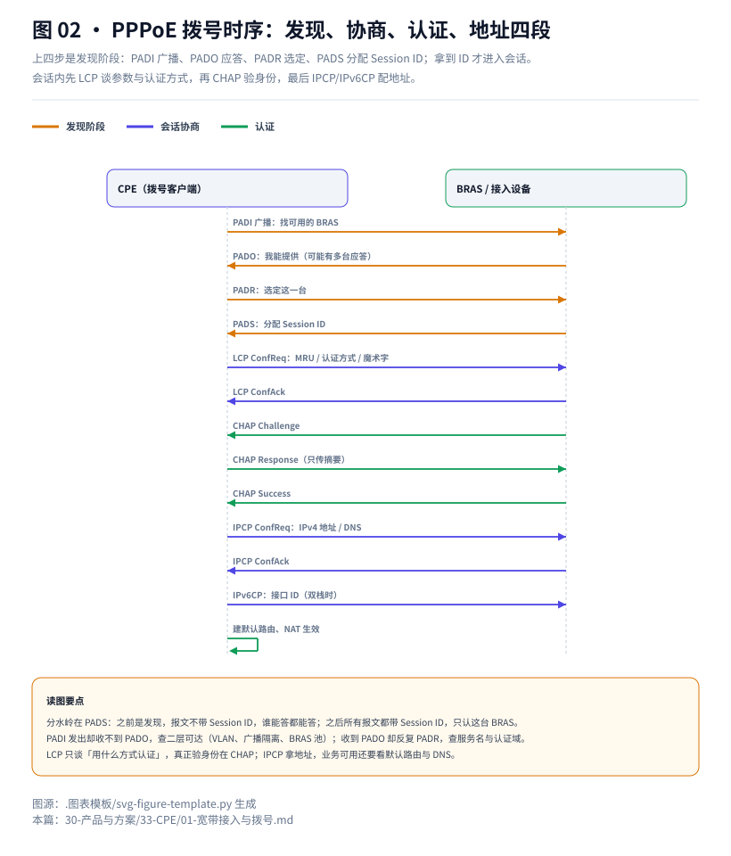
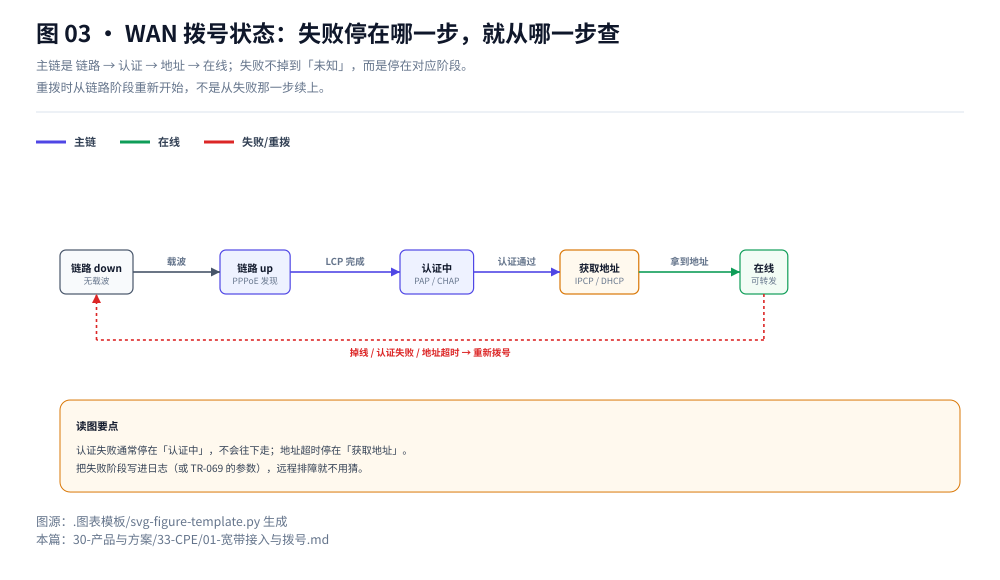

# 宽带接入与拨号

CPE 的第一件事是「把上行接通」：**选对接入方式 → 完成认证/拨号 → 拿到地址/DNS/前缀 → 建立默认路由 → 下发 NAT**。任何一步失败，用户看到的现象都只是「上不了网」。

> 本篇定位：xDSL/PON/以太/蜂窝四类上行的拨号方案、双栈与多 WAN 切换，以及接入失败的定位顺序。PPPoE 报文和 DHCP 协议细节去 `10-基础理论`，OpenWrt 的 netifd 实现去 `20-平台与系统`。本篇不写整机分层（见 [00](./00-CPE系统架构.md)），也不写运营商集采流程（见 [03](./03-运营商定制与入网.md)）。

## 目录

- [1 一句话模型](#s1)
- [2 速览](#s2)
- [3 接入方式与字段](#s3)
- [4 交互流程](#s4)
- [5 状态机与定时器](#s5)
- [6 设计取舍与边界](#s6)
- [7 与相邻主题的关系](#s7)
- [名词解释](#名词解释)
- [8 参考与关联](#s8)

## 1 · 一句话模型：先通链路，再验身份，最后配地址

```text
物理/链路层（DSL 训练、PON 注册、蜂窝注册、以太 Link Up）
  → 认证/拨号（PPPoE / 802.1X / SIM）
  → 地址配置（IPCP / DHCP / RA / PD）
  → 默认路由 + DNS → 业务可用
```

三个关键认知：

1. **「拨号失败」要分层看**：链路没起来、认证被拒、地址没拿到，是三类完全不同的问题。
2. **PPPoE 有 8 字节开销**，MTU 通常是 1492，不处理会导致「小包通、大包不通」。
3. **IPv6 不靠 NAT**：WAN 拿地址和 PD 前缀，LAN 通过 RA/DHCPv6 下发，防火墙默认拒绝入站。

一个类比：拨号像进小区——先确认门开着（链路），再过门禁（认证），最后领房号（地址）。

> **边界**：类比失效的地方是「门禁和房号可能由同一个系统发」。IPoE 场景里认证信息藏在 DHCP 报文里（Option 82、Option 60），地址与身份在同一次交换里完成，不能按 PPPoE 的三段去拆。

**为什么排障必须按这三段走**：因为三段的失败信号完全不同，而用户只会说「上不了网」，所以只能用「停在哪一段」来分流。链路段看物理/注册状态，认证段看 PPP 协商与拒绝码，地址段看有没有 IP/前缀/网关。跳过前两段直接查 NAT，等于在没通水时修水龙头。

## 2 · 速览

| 项 | 内容 | 边界与误判 |
| --- | --- | --- |
| 接入方式 | PPPoE、DHCP、静态 IP、蜂窝（QMI/MBIM/ECM/RNDIS） | 桥接模式下 CPE 不参与认证，这一段不在本机 |
| 认证方式 | PPP 的 PAP/CHAP、802.1X、SIM 鉴权、绑定 MAC/SN | 认证点可能在 BRAS/AAA 侧，本机只透传时找不到配置 |
| 地址来源 | IPCP、DHCPv4、RA/SLAAC、DHCPv6-PD | 「拿到地址」不等于「拿到默认路由」，RA 与 PD 是两件事 |
| 关键对象 | WAN 接口、拨号配置、默认路由、DNS、MTU/MSS | 对象之间互相依赖，改 MTU 要同步 MSS 与隧道封装 |
| 典型业务 | 家庭宽带、企业专线、5G 备份、双 WAN 负载 | 企业专线常有固定源 IP 要求，不能与负载均衡混用 |
| 主要风险 | MTU 不匹配、双栈优先级、多 WAN 源地址漂移、重拨风暴 | 风险多在「切换/重连」时暴露，稳态测试测不出 |
| 本篇覆盖 | 四类上行的「链路→认证→地址」流程、双栈、多 WAN 与失败定位 | 只到流程与判据，报文格式与状态机去 10 |
| 本篇不覆盖 | 报文格式与协议状态机（去 `10-基础理论`）、netifd 配置（去 `20-平台与系统`） | 「不覆盖」不等于不重要，链接里才是正本 |
| 判定入口 | §4.6 五步定位，顺序不能换 | 跳步会把认证失败误判成路由问题 |
| 最易混 | 「有地址」当「能上网」；「PPPoE 成功」当「链路正常」 | 两者都只证明某一段完成，不证明端到端可用 |

> **边界**：本篇的流程按「CPE 自己拨号」描述。桥接模式下 CPE 不参与认证，这一段整体上移到 BRAS 与用户路由器，别在本机找 PPPoE 会话。

因为这张表只给坐标，所以每一行都指向后文的展开：四类上行的差异在 §3.1，MTU 的算术在 §3.4，定位顺序在 §4.6。

## 3 · 接入方式与字段

### 3.1 四类上行

| 方式 | 链路建立 | 认证/地址 | 典型问题 | 边界与误判 |
| --- | --- | --- | --- | --- |
| xDSL | DSL 训练/同步 | PPPoE + IPCP | 线路噪声、训练速率、重训练 | 铜线封装有 PPPoA 与 PPPoE 两种，换局端可能换封装；只看 CPE 配置会漏掉局端差异 |
| PON | ONU 注册/测距/授权 | OMCI 配置 + PPPoE/DHCP | 光功率、注册失败、VLAN | 注册成功 ≠ 业务通，业务 VLAN 由 OMCI 下发；把注册灯常亮当成「线路没问题」是常见误判 |
| 以太 | Link Up | PPPoE/DHCP/静态 | 自协商、VLAN、802.1X | 802.1X 的认证点可能在 BRAS 侧，CPE 只是透传；在本机找 supplicant 会找不到 |
| 蜂窝 | 搜网/注册/附着 | SIM 鉴权 + 数据连接 | 信号、APN、制式、IP 分配 | 附着成功不等于拿到地址；还要看 APN、IP 类型（v4/v6/v4v6）与运营商 NAT |

**为什么按「链路建立」分列**：因为这一列决定失败时该看哪里——DSL 看训练参数、PON 看光功率与注册、以太看自协商、蜂窝看信号与附着。认证与地址三列反而高度相似，都是 PPP/DHCP 那一套。

### 3.2 WAN 连接字段

| 字段 | 作用 | 坑/边界 |
| --- | --- | --- |
| 连接类型 | PPPoE/DHCP/静态 | 选错类型直接不通；现网换类型要同步改 MTU 与认证方式 |
| VLAN ID | 运营商业务 VLAN | 漏配或优先级错会导致拨号失败；部分现网 VLAN 与业务一一对应，不能复用 |
| 账号/密码 | PPP 认证 | 特殊字符转义、大小写；密码含 `@` 时可能被当成域名分隔符 |
| 服务名 | PPPoE 服务匹配 | 多 BRAS 环境可能要求匹配；填空表示接受任意服务名 |
| MTU/MRU | 最大收发单元 | PPPoE 常见 1492，PPPoE+隧道更小；两端不一致会出现单向大包丢失 |
| DNS | 域名解析 | 自动获取 vs 手动指定；手动 DNS 指向不可达地址会表现为「能 ping IP 不能开网页」 |
| IPv6 开关 | 双栈 | 只开 v4 会拿不到前缀；开了 v6 但没放行 RA 会「有开关无效」 |
| 拨号模式 | 自动/手动/按需 | 按需拨号容易「假在线」；被探测流量唤醒后又空闲断开，用户感知为随机断网 |

### 3.3 蜂窝接入的接口模型

| 模式 | 宿主侧看到 | 适用 | 边界 |
| --- | --- | --- | --- |
| QMI | /dev/cdc-wdm + wwan | 高通 Modem，控制面丰富 | 需要 qmi_wwan 驱动 |
| MBIM | /dev/cdc-wdm + wwan | 标准化的移动宽带接口 | 功能集取决于 Modem |
| ECM | usbnet 网卡 | 免驱、简单 | 控制能力弱 |
| RNDIS | usbnet 网卡 | Windows 兼容好 | Linux 下性能和稳定性一般 |
| NDIS | 厂商私有 | 特定平台 | 依赖厂商驱动 |

**为什么接口模型会影响产品能力**：QMI/MBIM 有独立控制通道，能读信号、小区、SIM 状态，所以能做信号显示与自动重连；ECM/RNDIS 只是一个网卡，Modem 内部状态拿不到，产品上只能做「通/不通」。选型时先定要做哪些蜂窝功能，再定接口模型。

### 3.4 MTU/MSS 的算术：为什么「小包通、大包不通」

| 封装 | 每层开销 | 有效 MTU | 边界与误判 |
| --- | --- | --- | --- |
| 以太网 | 0（基准 1500） | 1500 | 只看 LAN 侧 1500 会高估 WAN 能力 |
| + 802.1Q VLAN | 4 | 1496 | 单层 tag；QinQ 再减 4 |
| + PPPoE | 8 | 1492（PPPoE 单独时） | 8 = PPPoE 头 6 + PPP 协议字段 2 |
| PPPoE over VLAN | 12 | 1488 | 现网常见组合，最容易漏 |
| + IPsec/GRE 等隧道 | 20–70+（随封装） | 逐层递减 | 具体值按封装实测，不要套固定数 |

TCP 的 MSS 由 MTU 推出：`MSS = MTU - 20（IP 头）- 20（TCP 头）`。所以 PPPoE 下 MSS 应为 1452，PPPoE over VLAN 下为 1448。**MSS 钳制只对 TCP 有效**，UDP 与 ICMP 要靠路径 MTU 发现（PMTUD）或分片，ICMP 被防火墙拦掉时 PMTUD 会静默失效。

> **推论**：验证链路 MTU 不需要抓包——用不同长度的 ping 逐级试探（1500 字节 IP 对应 payload 1472，1492 对应 1464），哪一档开始丢，就说明那一段的 MTU 是上一档。命令只是手段，判据是「哪一跳开始不响应」。
> **边界**：运营商在 BRAS 上做 MSS clamp 时，终端侧不改也能通；但一旦换到不做 clamp 的专线，同样的配置立刻暴露，所以「现网能通」不能证明 MTU 配对。

## 4 · 交互流程



**读图**：五个阶段各有自己的协议——链路看 PPPoE 发现、认证看 PAP/CHAP、地址看 IPCP/DHCP、之后才是路由/NAT 与业务可用。

> 图源：`images/图01-拨号与业务上线.svg`

这张图是**阶段划分**，回答「卡在哪一段」；下一张是**报文时序**，回答「这一段里谁对谁说了什么」。两张图不能互相替代：阶段图看不出重传与拒绝，时序图看不出业务是否可用。

### 4.1 PPPoE 拨号

```text
WAN Link Up → PADI/PADO/PADR/PADS 拿 Session ID
  → LCP 协商（MRU/认证/魔术字）
  → PAP/CHAP 认证
  → IPCP 拿 IPv4/DNS；IPv6CP 拿接口 ID
  → 建立默认路由 → NAT 生效
```



**读图**：上半段是发现（PADI 广播 → PADO 应答 → PADR 选定 → PADS 分配 Session ID），会话 ID 到手后才有资格进入下半段；LCP 先谈参数与认证方式，再由 CHAP 验身份，最后 IPCP/IPv6CP 配地址。

> 图源：`images/图02-PPPoE拨号时序.svg`

**为什么发现阶段要四步而不是三次握手**：因为 PADI 是广播，可能有多台 BRAS 同时应答 PADO，所以 CPE 必须用 PADR 明确选定一台，BRAS 再用 PADS 发 Session ID。所以「一直发 PADI」只有两种可能：没有 BRAS 收到广播，或收到了但 CPE 不认（服务名/VLAN 不匹配）。

> **推论**：PADI 发得出去、PADO 收不到，问题在二层可达性（VLAN、广播隔离、BRAS 池）；PADO 收到了却反复 PADR，问题在服务名或认证域匹配。两种情况在「拨号失败」这个现象下长得一样。
> **边界**：PAP 明文传密码，CHAP 只传摘要；现网多数用 CHAP，但 PAP 并非「不能用」——在二层可信的接入网里仍有部署，别把「PAP 不安全」当成配置错误。

### 4.2 DHCP / 静态

```text
DHCP：Discover → Offer → Request → Ack（拿地址/网关/DNS/租期）
静态：配置地址/掩码/网关/DNS → 直接建默认路由
```

DHCP 与 PPPoE 的关键差别是**谁持有会话状态**：PPPoE 有明确的会话与拆除，DHCP 只有租期。所以 DHCP 接入的「断线」往往要等租期或探测才发现，恢复也依赖续租与重绑定，不像 PPPoE 那样有即时事件。

### 4.3 IPv6 双栈

```text
WAN：DHCPv6-PD 申请前缀 + RA 获取默认路由
LAN：用 PD 前缀做 RA/SLAAC，或 DHCPv6 下发地址
防火墙：默认拒绝入站，按需放行
```

**为什么 IPv6 不需要 NAT 却更需要防火墙**：地址足够，不需要靠 NAT 隐藏内网；但这也意味着每台终端都有全局地址，默认拒绝入站是唯一的安全底线。PD 前缀长度决定 LAN 能切多少子网，`/60` 只能切 16 个，规划时先算再配。

> **边界**：RA 同时承担「地址前缀」与「默认路由」两件事。只放行前缀、拦掉 RA 里的路由信息，会出现「终端有地址但出不去」——这是双栈排障里最常见的半边通。

### 4.4 多 WAN 与切换

```text
主 WAN 探测（Ping/DNS/HTTP）→ 失败计数 → 切备 WAN
  → 更新默认路由/源地址 → 已有连接按策略保持或重建
```

| 探测方式 | 判据 | 边界与误判 |
| --- | --- | --- |
| Ping 网关 | 下一跳可达 | 网关通不代表出口通，BRAS 挂了网关仍可能应答 |
| Ping 公网地址 | 出口路由与回程 | 目标被禁 ICMP 时误判为断网 |
| DNS 查询 | 解析链路可用 | DNS 服务器故障会被当成「整条 WAN 断」 |
| HTTP 探针 | 业务级可用 | 探针地址被劫持/限速会误判；流量也会计入资费 |

**为什么必须有回切抑制**：主 WAN 抖动时，探测失败 → 切备 → 主 WAN 恢复 → 切回，每次切换都重建会话。没有抑制时间（或滞回阈值），链路轻微丢包就能让 VoIP 反复中断，用户感知比「一直用备线」更差。

> **推论**：多 WAN 的可用性上限由「探测判据」决定，不由链路数量决定。判据选错，两条线也会一起「假正常」。

### 4.5 异常分支

| 现象 | 阶段 | 优先排查（含误判） |
| --- | --- | --- |
| WAN 灯不亮 | 物理/链路 | 网线/光功率/DSL 训练/模块供电 |
| 一直发 PADI | 发现 | VLAN、BRAS 可达性、广播隔离 |
| PADO 有、PADR 无响应 | 发现 | 服务名、认证域、BRAS 池绑定 |
| 认证被拒 | 认证 | 账号密码、绑定、欠费、认证方式 |
| 拿到地址但无法上网 | 路由/NAT | 默认路由、NAT 规则、DNS |
| 小包通大包不通 | MTU | PPPoE 开销、MSS 钳制、隧道封装 |
| IPv6 有地址不能上网 | 双栈 | RA 默认路由、DNS、防火墙 |
| 部分网站打不开 | MTU/PMTUD | 中间设备拦 ICMP、隧道 MTU 偏小 |
| 频繁重拨 | 保活 | LCP Echo、链路误码、运营商限制 |

### 4.6 定位顺序：五步，顺序不能换

| 步骤 | 问什么 | 怎么答 | 答错的后果 |
| --- | --- | --- | --- |
| ① 链路通吗 | DSL 训练/PON 注册/Link Up/蜂窝附着 | 接口状态、光功率、训练速率 | 链路没通就查账号，会反复改一个没生效的配置 |
| ② 会话建了吗 | PPPoE 发现是否完成、Session ID 是否拿到 | 看 PADI/PADO 与 LCP 阶段 | 把「发现失败」当「认证失败」，会去重置密码 |
| ③ 认证过了吗 | PAP/CHAP/SIM 是否成功 | 看拒绝原因与 BRAS 侧记录 | 认证失败时改 MTU，永远无效 |
| ④ 地址/路由有了吗 | IP、网关、DNS、前缀 | 看 WAN 地址与默认路由 | 有地址没路由表现为「能 ping 自己不能出网」 |
| ⑤ 转发与解析通吗 | NAT、DNS、MTU | 先 ping 公网 IP，再试域名，再试大包 | 不区分 DNS 与 NAT，会把解析问题当成断网 |

> **推论**：这五步与 §5 的状态表一一对应。排障时先在状态表里定位「停在哪」，再用本表决定「下一步查什么」，不要凭经验跳步。

## 5 · 状态机与定时器



**读图**：主链是 链路 → 认证 → 地址 → 在线；失败不掉进「未知」，而是停在对应阶段，重拨从链路重新开始。

> 图源：`images/图03-WAN拨号状态.svg`

因为这些状态由不同的定时器驱动，所以「停在哪一段」比「有几个状态」更有用：定时器决定它多久重试一次、多久被判死。

| 对象 | 状态 | 在等什么 | 失败表现 | 关键定时器/参数 |
| --- | --- | --- | --- | --- |
| PPPoE | 发现 → 会话 → 认证 → 网络 → 断开 | PADO/PADS 应答、LCP 协商、认证结果 | 停在发现或认证，反复重来 | PADI/PADR 重传、LCP Echo |
| DHCP | INIT → SELECTING → REQUESTING → BOUND → RENEW | Offer、Ack、续租应答 | 拿不到地址或租期到期后掉线 | 租期、续租 T1/T2 |
| IPv6 RA | 等待 → 收到 RA → 配置地址/默认路由 | RA 报文与路由信息 | 有地址无默认路由 | RA 间隔、路由生命周期 |
| 蜂窝 | 搜网 → 注册 → 附着 → 数据连接 | 小区驻留、APN 激活 | 有信号无数据 | 重试间隔、APN 超时 |
| 多 WAN 探测 | 正常 → 怀疑 → 切换 → 回切 | 连续失败/成功计数 | 来回切换（抖动） | 探测周期、失败阈值、回切抑制 |

| 定时器 | 典型作用 | 设置过短的后果 | 设置过长的后果 |
| --- | --- | --- | --- |
| PADI/PADR 重传 | 发现阶段重试 | 广播风暴，BRAS 侧被判异常 | 发现慢，用户感知为「拨号很久」 |
| LCP Echo | 检测会话是否还活着 | 链路抖动即重拨，形成重拨风暴 | 链路已断仍显示在线，流量黑洞 |
| DHCP T1/T2 | 续租时机（50%/87.5% 租期） | 续租频繁，服务器压力大 | 租期将尽才续租，失败即掉线 |
| RA 间隔/生命周期 | 保持默认路由有效 | 终端频繁刷新，空口开销 | 路由过期后终端静默断网 |
| 探测周期/失败阈值 | 多 WAN 判活 | 误切换，会话反复重建 | 真故障时切换太慢 |

> **推论**：所有「频繁重拨」「时通时断」类问题，本质都是定时器与真实链路质量不匹配。先量链路质量（误码、丢包、时延抖动），再调定时器；反过来调，只是把症状推迟。
> **待验证**：各运营商的 LCP Echo、DHCP 租期、PD 前缀长度和重拨抑制策略不同，需按现网配置。

## 6 · 设计取舍与边界

这一节的取舍都指向同一个约束：认证体系由运营商定，产品只能在给定框架里优化。因为框架改不了，所以这里的选择不是「选技术最优」，而是「在既定框架下少留隐患」。

### 6.1 PPPoE vs DHCP/IPoE

PPPoE 认证和计费成熟，但多 8 字节开销、需要客户端；DHCP/IPoE 简单、开销小，但认证依赖 802.1X/Option 82 等机制。选哪种由运营商认证体系决定，不是纯技术优劣。

**为什么不能「哪个先进选哪个」**：PPPoE 的会话状态让运营商能精确控制在线与计费，也给了 CPE 一个明确的「断线」信号；IPoE 把身份塞进 DHCP，省了开销但把状态责任推给了租期与探测。**代价**：IPoE 的故障更隐蔽，因为「有没有会话」这个判据消失了。

### 6.2 自动拨号 vs 按需拨号

自动拨号保持在线，适合常驻业务；按需拨号省连接数，但首次访问有延迟，且容易被探测流量「误唤醒」。CPE 默认自动拨号更稳。

**代价**：自动拨号在资费敏感场景（蜂窝）会持续产生保活流量；按需拨号省流量，但任何后台 App 的心跳都能把它唤醒，最后既没省下流量又增加了时延。**失效条件**：蜂窝按流量计费且保活成本高时，按需或长保活间隔才有意义。

### 6.3 双栈优先级

IPv4/IPv6 同时可用时，终端按 RFC 6724 选择地址。CPE 要保证两条路径的 DNS、MTU、防火墙一致，否则会出现「有的应用走 v6 不通」。

**为什么「一致」很难**：v4 与 v6 的 MTU、防火墙、DNS 是两套配置，任何一套缺项都会让终端选到坏路径。**推论**：验收双栈不能只测「v6 能 ping 通」，要测「同时开 v4/v6 时，常用应用是否都正常」。

### 6.4 多 WAN 的边界

多 WAN 提高可用性，但会破坏需要固定源 IP 的会话；切换时连接重建，VoIP/游戏会中断。关键业务应做「主备 + 连接保持」，而不是简单负载均衡。

**代价**：连接保持需要 conntrack 同步或应用层重连，实现复杂；不做就只能接受中断。**失效条件**：对端有源 IP 白名单（专线、网银、VPN）时，负载均衡会让一半请求被拒——这类业务只能绑主 WAN。

### 6.5 蜂窝 CPE 的特殊性

蜂窝接入有流量资费、信号波动和运营商 NAT（可能拿不到公网 IP）。产品要支持流量统计、信号质量显示、APN 配置和断线重连，不能照搬有线 CPE 的假设。

**为什么不能照搬**：有线 CPE 假设「带宽稳定、地址固定、断线可感知」；蜂窝三条全不成立——速率随信号与小区负载变化，地址可能在重连后变化，NAT 超时会让长连接静默失效。**边界**：需要公网可达的业务（远程访问、端口映射）在蜂窝 CPE 上要用反向隧道或 VPN，不能靠端口映射。

## 7 · 与相邻主题的关系

| 相邻对象 | 关系 | 边界（细节去哪看） |
| --- | --- | --- |
| [PPP 与 PPPoE](../../10-基础理论/11-网络科学/02-链路层/06-PPP与PPPoE.md) | 拨号报文与三阶段 | 本篇只给时序与定位判据，报文格式与状态机不在本篇 |
| [DHCPv4](../../10-基础理论/11-网络科学/05-应用层/01-DHCPv4.md) | 动态地址 | 租期与续租细节去该篇 |
| [DHCPv6](../../10-基础理论/11-网络科学/05-应用层/02-DHCPv6.md) | 前缀委派 | PD 前缀规划与 DUID 不在本篇 |
| [IPv6](../../10-基础理论/11-网络科学/03-网络层/02-IPv6.md) | 地址与 RA | RA 报文格式与地址选择算法去该篇 |
| [PON 复用测距与注册](../../10-基础理论/12-通信科学/03-光通信/01-PON复用测距与注册.md) | PON 上行注册 | 注册流程细节不在本篇 |
| [WAN 接入与 PPPoE](../../20-平台与系统/22-OpenWrt/03-网络数据面/04-WAN接入与PPPoE.md) | OpenWrt 实现 | 本篇不写 netifd 配置与脚本 |
| [CPE 系统架构](./00-CPE系统架构.md) | 整机业务模型 | 讲整机分层与业务分域，不重复拨号流程 |
| [运营商定制与入网](./03-运营商定制与入网.md) | 现网差异 | 讲定制项与入网阶段，不重复协议 |

一句话：**拨号方案的本质是「链路、认证、地址」三段式，排障也必须按这三段走。** 三段之外的东西（QoS、DNS 策略、多 WAN）都建立在这三段之上。因为相邻篇各有正本，所以表里只写关系与边界，报文与配置去链接里看。

## 名词解释

> 缩写给出英文全称；非缩写用“—”表示。因为术语表只服务于本篇的阅读，所以不追求收全；同一个缩写在相邻篇含义不同时，各自列出。

| 术语 | 英文全称 | 解释 |
| --- | --- | --- |
| PPPoE | Point-to-Point Protocol over Ethernet | 以太网上的 PPP 拨号。 |
| PPP | Point-to-Point Protocol | 点对点协议；PPPoE 的会话与认证框架。 |
| PADI | PPPoE Active Discovery Initiation | 发现阶段广播，寻找可用的 BRAS。 |
| PADO | PPPoE Active Discovery Offer | BRAS 对 PADI 的应答。 |
| PADR | PPPoE Active Discovery Request | CPE 选定一台 BRAS 的请求。 |
| PADS | PPPoE Active Discovery Session-confirmation | BRAS 分配 Session ID 的确认。 |
| LCP | Link Control Protocol | PPP 的链路控制协议；协商 MRU、认证方式、魔术字。 |
| PAP | Password Authentication Protocol | 明文口令认证协议。 |
| CHAP | Challenge Handshake Authentication Protocol | 挑战握手认证协议；只传摘要。 |
| IPCP | Internet Protocol Control Protocol | PPP 上的 IPv4 配置协议。 |
| IPv6CP | IPv6 Control Protocol | PPP 上的 IPv6 配置协议。 |
| IPoE | IP over Ethernet | 以太网直接承载 IP 的接入方式；认证靠 DHCP 选项或 802.1X。 |
| DHCP | Dynamic Host Configuration Protocol | 动态主机配置协议。 |
| PD | Prefix Delegation | DHCPv6 前缀委派。 |
| RA | Router Advertisement | 路由器通告。 |
| SLAAC | Stateless Address Autoconfiguration | 无状态地址自动配置。 |
| MTU | Maximum Transmission Unit | 最大传输单元。 |
| MRU | Maximum Receive Unit | 最大接收单元；PPP 侧对等 MTU。 |
| MSS | Maximum Segment Size | TCP 最大报文段长度。 |
| PMTUD | Path MTU Discovery | 路径 MTU 发现；依赖 ICMP 差错报文。 |
| BRAS | Broadband Remote Access Server | 宽带远程接入服务器。 |
| APN | Access Point Name | 蜂窝接入点名称。 |
| QMI | Qualcomm MSM Interface | 高通 Modem 接口。 |
| MBIM | Mobile Broadband Interface Model | 移动宽带接口模型。 |
| ECM | Ethernet Control Model | USB 以太网控制模型。 |
| RNDIS | Remote NDIS | 远程网络驱动接口规范。 |
| 802.1X | IEEE 802.1X Port-Based Network Access Control | 基于端口的网络访问控制。 |

## 8 · 参考与关联

**标准**

- RFC 2516：PPPoE
- RFC 1661 / 1332 / 1994：PPP / IPCP / CHAP
- RFC 2131 / 8415：DHCPv4 / DHCPv6
- RFC 4861 / 4862：ND / SLAAC
- RFC 6724：Default Address Selection
- 3GPP TS 27.010 / 27.007：终端与 Modem 的 AT/QMI 相关规范

**关联**

- [设备形态对比](../00-设备形态对比.md)
- [CPE 系统架构](./00-CPE系统架构.md)
- [TR-069 与 ACS 运维](./02-TR-069与ACS运维.md)
- [运营商定制与入网](./03-运营商定制与入网.md)

因为现网参数按省、按局端版本变化，所以这里只给 RFC 与框架；具体 VLAN、账号与 APN 以运营商规范为准。

---

> **本篇定位**：CPE 四类上行的拨号配置、双栈/多 WAN 流程与接入失败定位；不含报文格式、协议状态机与平台配置。
> **素材来源**：`studyspace/1.知识体系/7.openwrt/3.网络业务/1.基础网络模型/1.WAN/`、`7.5G拨号/5G拨号.md`、`studyspace/3.协议应用/6.pppoe/pppoe.md`；本篇 2026-11-11 版原文。
> **待验证**：各运营商的 VLAN/认证/PD 前缀/重拨策略与蜂窝 APN 参数；隧道场景的实测 MTU。
