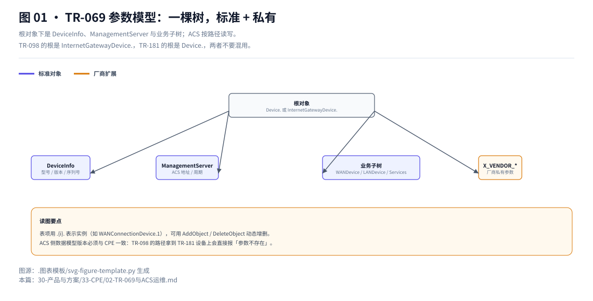
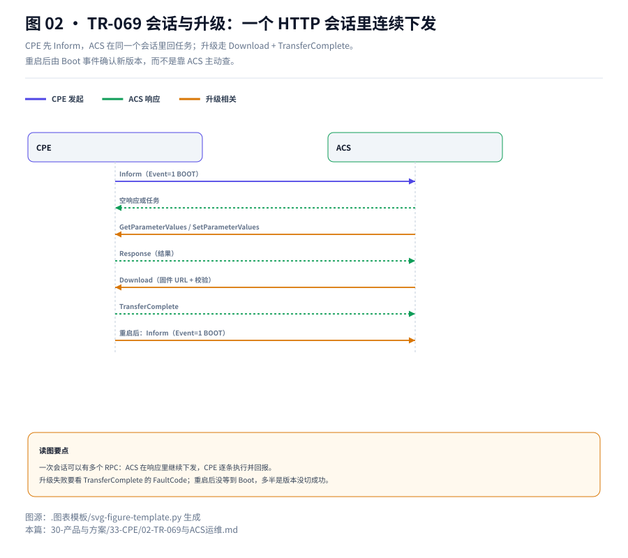
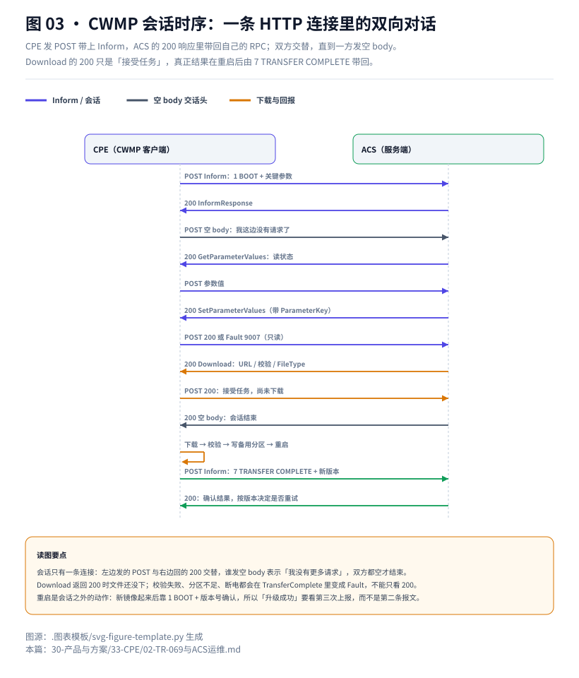
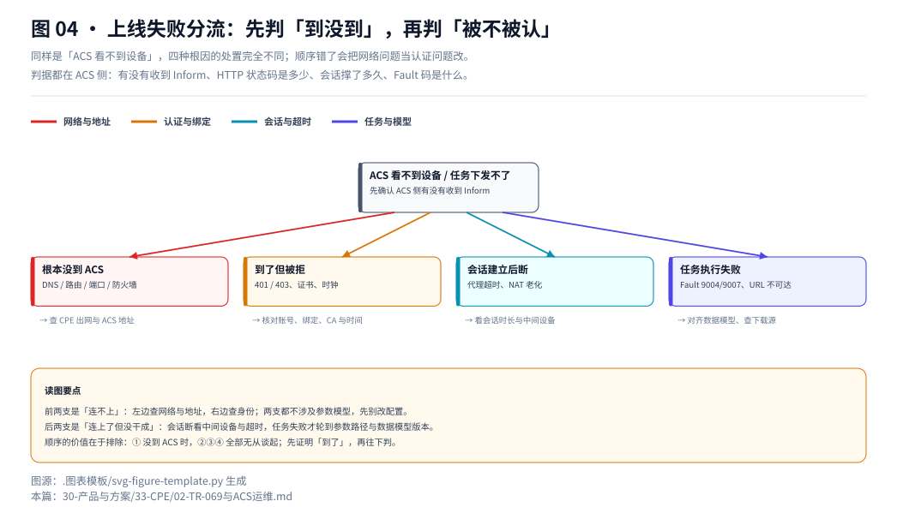
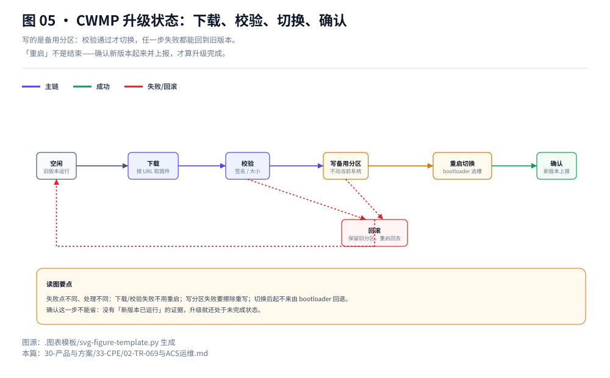

# TR-069 与 ACS 运维

运营商批量管理 CPE，靠的是「设备主动上报 + ACS 下发任务」：**上电 Inform 报到，ACS 读参数、改配置、推升级、做诊断**。TR-069 不负责业务转发，但没有它，CPE 就无法远程开通和运维。

> 本篇定位：CWMP 会话、参数模型、连接请求、固件升级与诊断的产品实现。协议报文细节去 [`10-基础理论/05-应用层/07-TR-069.md`](../../10-基础理论/11-网络科学/05-应用层/07-TR-069.md)，OpenWrt 实现去 `20-平台与系统`。本篇不写整机业务分域（见 [00](./00-CPE系统架构.md)），也不写运营商集采判据（见 [03](./03-运营商定制与入网.md)）。

## 目录

- [1 一句话模型](#s1)
- [2 速览](#s2)
- [3 会话与参数模型](#s3)
- [4 交互流程](#s4)
- [5 状态机与定时器](#s5)
- [6 设计取舍与边界](#s6)
- [7 与相邻主题的关系](#s7)
- [名词解释](#名词解释)
- [8 参考与关联](#s8)

## 1 · 一句话模型：设备报到，ACS 派活

```text
CPE 上电 → Inform（我是谁、我有哪些参数）
  → ACS 认证/绑定 → 下发任务（读/写/升级/诊断/重启）
  → CPE 执行 → 回响应 → 会话结束
```

三个关键认知：

1. **TR-069 是「拉」模型**：CPE 主动连 ACS；ACS 想主动下发，要先发 Connection Request 让 CPE 回连。
2. **参数模型是合同**：TR-098（InternetGatewayDevice）和 TR-181（Device）定义路径和语义，厂商私有参数不能替代标准参数。
3. **升级是高风险动作**：必须校验、双分区、失败回滚，不能「下载完直接覆盖」。

一个类比：设备是员工，ACS 是人事——员工上班主动报到（Inform），领导想临时派活，得先打电话把人叫回来（Connection Request）。

> **边界**：类比失效的地方是「员工在公司里，设备可能在 NAT 后面」。领导打不进来时，只能等员工下次报到——这就是为什么现网大量任务其实是「等下一个周期 Inform 才执行」。

**为什么是拉模型而不是 ACS 直接连设备**：因为 CPE 在运营商 NAT 或家庭 NAT 后面，没有固定可达地址，所以只能让 CPE 主动往外连——连接方向与 NAT 一致。代价是 ACS 失去实时性。

> **推论**：凡是「配置下发延迟」「改了没生效」类问题，先看这条链路是「ACS 主动推」还是「等设备来拉」。前者依赖 Connection Request 可达，后者只依赖 Inform 周期，两者的排障入口完全不同。

## 2 · 速览

| 项 | 内容 | 边界与误判 |
| --- | --- | --- |
| 协议 | CWMP（TR-069），基于 HTTP/HTTPS 的 SOAP RPC | 协议只定义 RPC，不定义业务语义；语义在数据模型里 |
| 角色 | CPE（客户端）、ACS（服务器） | 「客户端」指 HTTP 方向，不代表只能 CPE 发请求 |
| 关键能力 | 参数读写、属性通知、文件下载/上传、重启、诊断、定时任务 | 能力要 CPE 与 ACS 两侧都实现，单侧支持等于不可用 |
| 数据模型 | TR-098、TR-181、厂商扩展 | 模型版本不对齐时，路径存在也会读空 |
| 传输 | HTTP/HTTPS，默认端口由 ACS 指定（常见 7547） | 7547 是惯例不是强制，换 ACS 要重核端口与路径 |
| 认证 | CPE 侧 Basic/Digest；ACS 侧可校验证书 | 只做单向认证时，伪造 ACS 可下发配置，风险在 ACS 侧 |
| 典型周期 | 上电 Inform、周期 Inform（如 30 min～24 h，待运营商确认） | 周期是运营策略，不是协议常量；过短会造成 Inform 风暴 |
| 本篇覆盖 | 会话、参数模型、连接请求、升级回滚、诊断与失败分流 | 只到会话与运维动作，SOAP 结构去 10 |
| 本篇不覆盖 | SOAP 报文结构（去 `10-基础理论`）、UCI/ubus 落地（去 `20-平台与系统`） | 「不覆盖」不等于不重要，链接里才是正本 |
| 判定入口 | §4.6 五步分流，顺序不能换 | 跳步会把网络问题当认证问题改 |
| 最易混 | 「设备在线」当「配置已生效」；「收到 200」当「任务已完成」 | 在线只证明会话通，200 只证明请求被接受 |

> **边界**：表中的「默认端口 7547」是行业惯例，不是标准强制。换 ACS 时端口、路径、认证方式都要按对端配置核对，照抄旧参数是上线失败的高频原因。

因为速览只给坐标，所以每一行都指向后文：RPC 在 §3.1，事件码在 §3.3，会话机制在 §3.4，失败分流在 §4.6。

## 3 · 会话与参数模型



**读图**：根对象下是 DeviceInfo、ManagementServer、业务子树与厂商扩展；ACS 按路径读写，标准模型优先、私有参数补充。

> 图源：`images/图01-TR069参数模型.svg`

参数模型决定了「ACS 能看见什么」。标准模型覆盖通用能力（设备信息、WAN、Wi-Fi、管理服务器），私有参数补运营商特有业务；路径一旦定错，ACS 读到的就是空值或故障码，而不是「设备不支持」。

### 3.1 会话中的主要 RPC

| RPC | 方向 | 作用 | 边界 |
| --- | --- | --- | --- |
| Inform | CPE → ACS | 上报事件、参数、序列号 | 事件码决定 ACS 后续动作；参数集过大会拖慢会话 |
| InformResponse | ACS → CPE | 确认收到 | 空响应也算成功 |
| GetParameterValues | ACS → CPE | 读参数 | 路径不存在返回故障码；部分参数读取有副作用（触发拨号/扫描） |
| SetParameterValues | ACS → CPE | 写参数 | 可能触发重启/重连；带 ParameterKey 时，键不一致会被拒绝 |
| GetParameterNames | ACS → CPE | 遍历参数树 | 数据模型版本要对齐，否则遍历到的是另一棵树 |
| SetParameterAttributes | ACS → CPE | 设置通知属性（是否主动上报） | 通知过多会造成 Inform 风暴 |
| AddObject / DeleteObject | ACS → CPE | 增删实例（如 WAN 连接） | 实例号由 CPE 分配，ACS 不能自己指定 |
| Download | ACS → CPE | 下载固件/配置文件 | 需要文件类型、校验和、URL；只是「接受任务」，不等于下载完成 |
| Upload | ACS → CPE | 上传日志/配置 | 大文件要限速/分段，否则挤占管理通道 |
| Reboot | ACS → CPE | 远程重启 | 要确认业务影响；重启后靠 1 BOOT 事件续上 |
| FactoryReset | ACS → CPE | 恢复出厂 | 会清掉 ACS 地址本身，可能直接失联 |
| Diagnostic | ACS → CPE | Ping/Traceroute/测速 | 依赖 CPE 实现；结果靠 8 DIAGNOSTICS COMPLETE 上报 |
| Connection Request | ACS → CPE | 通知 CPE 回连 | 依赖 CPE 可达或 STUN |

**为什么 RPC 要分「同步确认」与「异步完成」**：SetParameterValues 返回 200 只代表参数写进去了；Download 返回 200 只代表任务被接受。真正的结果要等下一个事件（TransferComplete、DiagnosticsComplete）。把「200」当「完成」，是升级与诊断类工单最常见的误判。

### 3.2 关键参数

| 参数组 | 典型内容 | 产品关注点 | 边界与误判 |
| --- | --- | --- | --- |
| 设备信息 | 厂商、型号、序列号、硬件/软件版本 | 与 ACS 绑定、升级匹配 | 序列号重复或写错会导致两台设备互相顶替；版本号格式不统一会让 ACS 判错升级目标 |
| 管理服务器 | ACS URL、用户名/密码、周期 Inform | 首次上线和换 ACS | 改 ACS 地址是「高危写操作」，写错即失联；必须保留本地兜底 |
| WAN | 连接类型、VLAN、账号、IP/DNS | 业务开通 | 写 WAN 参数常触发重连，会话会中断，ACS 看不到「成功」响应 |
| LAN/DHCP | 网段、地址池、租期 | 用户侧配置 | 改网段会让已连终端掉线；与 ACS 同网段时可能把自己踢下线 |
| Wi-Fi | SSID、密码、信道、功率 | 远程改 Wi-Fi | 改信道/功率受区域码限制，越界的值应被拒绝而不是静默生效 |
| 语音 | SIP 账号、注册状态 | VoIP 开通 | 账号写对但注册失败，要看 SBC 侧与网络，不要只查参数 |
| 防火墙/QoS | 规则、限速 | 业务策略 | 规则顺序与默认策略不在标准模型里，私有参数一换平台就失效 |
| 日志/诊断 | 日志级别、诊断结果 | 远程排障 | 日志级别调高会加速 Flash 磨损与分区写满 |

### 3.3 事件码

| 事件 | 含义 | ACS 常见动作 | 边界与误判 |
| --- | --- | --- | --- |
| `0 BOOTSTRAP` | 首次连接/恢复出厂 | 下发全量配置 | 恢复出厂后 ACS 地址可能已丢，先有地址才有 BOOTSTRAP |
| `1 BOOT` | 每次上电 | 检查版本/配置 | 重启后必发，不能拿它当「首次上线」判据 |
| `2 PERIODIC` | 周期上报 | 巡检、拉日志 | 周期过短会造成 Inform 风暴 |
| `3 SCHEDULED` | 定时任务触发 | 执行计划任务 | 依赖设备时钟准确，时间错乱会提前/延后执行 |
| `4 VALUE CHANGE` | 参数变化 | 同步配置 | 只有被设置通知属性的参数才上报，没设就静默 |
| `5 KICKED` | 被 ACS 踢出会话 | 重新调度 | 多出现在并发会话冲突，不代表设备故障 |
| `6 CONNECTION REQUEST` | ACS 主动请求 | 建立会话 | 只说明「回连成功」，任务还在后面 |
| `7 TRANSFER COMPLETE` | 下载完成 | 校验/重启 | 下载失败也发这个事件，靠 FaultStruct 区分 |
| `8 DIAGNOSTICS COMPLETE` | 诊断完成 | 取结果 | 诊断失败同样上报，要看结果码 |
| `M Reboot` / `M ScheduleReboot` | 重启相关 | 计划任务 | M 前缀属扩展事件，ACS 未必识别，不能当标准流程依赖 |

### 3.4 会话跑在 HTTP 上：一条连接里的双向对话

CWMP 不是「一个 RPC 一个连接」，而是**一次会话一条 HTTP 连接**：CPE 发 POST 带上 SOAP 请求，ACS 在响应里带回自己的请求；双方交替，直到某一方发空 body 表示没有更多事。

```text
CPE ── POST(Inform) ──────────────→ ACS
CPE ←─ 200(InformResponse) ─────── ACS
CPE ── POST(空 body，表示"我这边没有请求了") → ACS
CPE ←─ 200(GetParameterValues) ─── ACS     ← 同一个连接里继续
CPE ── POST(参数值) ──────────────→ ACS
...
CPE ── POST(空 body) ─────────────→ ACS
CPE ←─ 200(空 body) ────────────── ACS     ← 会话结束
```

**为什么 ACS 能在「同一个连接」里连续下指令**：因为 HTTP 的方向在这里被用成了双向管道——请求体里装谁的 RPC 由内容决定，不由方向决定，所以 ACS 不必等 CPE 再发新请求就能捎带指令。代价是会话必须保持，中间有任何代理超时、NAT 老化，会话就断在半路。

> **推论**：会话中断的典型现象是「ACS 显示任务已下发，设备只执行了一半」。这时不要重发全部任务，先看会话时长与中间设备超时，否则会重复执行写操作。
> **边界**：Cookie 用于把同一会话的多次 POST 关联起来。CPE 不支持 Cookie 时，ACS 可能把一次会话当成多次独立请求，表现为参数读一半就断。

## 4 · 交互流程



**读图**：CPE 先 Inform，ACS 在同一个 HTTP 会话里连续下发 RPC；升级走 Download + TransferComplete，重启后由 Boot 事件确认新版本。

> 图源：`images/图02-TR069会话与升级.svg`

这张图给的是**角色与阶段**；下面这张时序图给的是**一条会话里报文的来回**，包括「谁先发空 body 结束会话」这种只在时序里才看得出的细节。

### 4.1 首次上线

```text
CPE 上电 → 读取 ACS 地址 → 建立 HTTPS → Inform（BOOTSTRAP/1 BOOT）
  → ACS 认证/绑定（序列号/OUI/证书）
  → 下发 WAN/Wi-Fi/语音配置 → CPE 应用 → 回响应
  → 业务开通完成
```

**为什么首次上线要区分 BOOTSTRAP 与 1 BOOT**：BOOTSTRAP 表示「这台设备还没有被配置过」，ACS 应该下发全量；1 BOOT 只是「又开机了」，只做增量核对。混用会让每次重启都触发全量下发，既慢又容易覆盖用户改过的设置。

> **边界**：因为恢复出厂会把 ACS 地址一起清掉，所以此时设备根本发不出 BOOTSTRAP。产品必须提供「出厂预置 ACS 地址」或「DHCP Option 43 自动发现」，否则恢复出厂等于失联。

### 4.2 周期巡检

```text
周期 Inform（2 PERIODIC）→ ACS 读版本/状态/告警
  → 需要时下发 SetParameterValues 或诊断
  → 记录结果 → 结束
```

周期巡检的价值在「发现漂移」：版本被回滚、配置被本地改动、WAN 频繁重拨。代价是每次 Inform 都要建立 TLS 与会话，几十万台设备乘以周期就是 ACS 的常态负载。

### 4.3 远程升级

```text
ACS 下发 Download（URL、文件类型、校验和）
  → CPE 下载到临时分区 → 校验（大小/哈希/签名）
  → 写升级标志 → 重启
  → 新镜像启动 → Inform（1 BOOT + 版本）→ ACS 确认
  → 失败则回滚到旧分区
```



**读图**：左边 CPE、右边 ACS，一条竖线就是一条 HTTP 连接。Inform 之后由 CPE 发空 POST 把话头交出去，ACS 才能连续下发读、写、下载；Download 的 200 只是「接受任务」，真正的结果在重启后由 7 TRANSFER COMPLETE 带回。

> 图源：`images/图03-CWMP会话时序.svg`

**为什么 Download 的 200 不能当成功**：下载是异步的，CPE 先答应「我去下」，之后可能超时、校验失败、分区空间不足。只有 TransferComplete 里的 FaultStruct 为空，才算下载成功；再看 1 BOOT 的版本号，才算升级成功。**代价**：ACS 必须能关联「任务 — 设备 — 结果」三件事，否则批量升级会留下无法解释的失败。

> **推论**：升级成功率要按「任务下发数 → TransferComplete 成功数 → 新版本在线数」三段统计。只统计最后一段，会把「下发了但设备没重启」算成成功。

### 4.4 ACS 主动下发

```text
ACS → Connection Request（HTTP GET 到 CPE）
  → CPE 返回 200 → 反向建立会话 → Inform（6 CONNECTION REQUEST）
  → 执行任务
```

CPE 在 NAT 后面时，ACS 可能连不进来，需要 CPE 保持长连接、使用 STUN，或等周期 Inform。

**为什么 Connection Request 只是「敲门」**：它不带任何配置，只让 CPE 回连；真正的任务仍在随后建立的 CWMP 会话里。所以「Connection Request 失败」与「配置下发失败」是两件事，前者是可达性问题，后者是参数或权限问题。

> **边界**：STUN/TR-111 能解决 NAT 后的可达性，但要求 NAT 支持 UDP 打洞；对称 NAT 下仍会失败，最终还是要靠缩短周期或长连接兜底。

### 4.5 异常分支

| 异常 | 现象 | 定位方向（先排除的误判） |
| --- | --- | --- |
| 一直不上线 | ACS 看不到设备 | ACS 地址/DNS/端口/证书/时间 |
| 认证失败 | 401/403 | 账号密码、证书、绑定关系 |
| 参数写不进去 | 返回故障码 | 参数路径、只读属性、数据模型版本 |
| 升级失败 | 版本没变/变砖 | URL 可达、校验和、分区空间、回滚 |
| Connection Request 失败 | ACS 主动任务下发不了 | CPE 在 NAT 后、端口未放行 |
| 周期 Inform 风暴 | ACS 压力大 | 周期过短、随机抖动缺失 |
| 会话中途断开 | 任务执行一半 | 代理超时、NAT 老化、会话超时设置 |
| 改完参数又变回去 | 本地与 ACS 互相覆盖 | 配置源不唯一、通知属性未设 |

### 4.6 上线失败分流



**读图**：从「ACS 看不到设备」出发，先看 ACS 侧有没有收到 Inform——没收到是网络与地址问题，收到了但被拒是认证与绑定问题，会话建立后断是超时与中间设备问题，任务失败才是参数与数据模型问题。

> 图源：`images/图04-TR069上线失败分流.svg`

| 步骤 | 问什么 | 怎么答 | 答错的后果 |
| --- | --- | --- | --- |
| ① 到没到 | ACS 有没有收到 Inform | 看 ACS 侧会话日志/接入日志 | 没到就查认证，会改一堆无效参数 |
| ② 被不被认 | 401/403 还是证书错误 | 看 HTTP 状态码与 TLS 告警 | 把证书问题当密码问题，反复重置账号 |
| ③ 会话稳不稳 | 会话能撑多久、是否中途断 | 看会话时长与中间代理/NAT 超时 | 把「断在半路」当「设备不支持」，误换型号 |
| ④ 任务成不成 | Fault 码与事件码 | 9004/9007 查路径与只读属性；TransferComplete 查 FaultStruct | 把「参数写不进」当「网络不好」 |
| ⑤ 生效没生效 | 版本/配置是否真的变了 | 重启后再读一次参数 | 用 200 当生效，问题留到用户投诉 |

## 5 · 状态机与定时器



**读图**：升级写的是备用分区：下载、校验、写分区、切换、确认五步；任一步失败都能回滚到旧版本，「重启」不等于完成。

> 图源：`images/图05-CWMP会话与升级状态.svg`

因为升级的每一步都由超时与看门狗兜底，所以「重启」只是中间态：没有回滚超时，失败就没有终点，设备会停在「已写入、未确认」上。

| 对象 | 状态 | 在等什么 | 失败表现 | 关键参数 |
| --- | --- | --- | --- | --- |
| CWMP 会话 | 空闲 → 连接 → 会话 → 结束 | ACS 响应、下一条 RPC | 中途断开、任务半执行 | 会话超时、最大并发 |
| Inform | 未上报 → 上报中 → 成功/失败 | ACS 200 响应 | 周期到了仍不上线 | 周期、重试、随机抖动 |
| 下载 | 未开始 → 下载 → 校验 → 应用 | 文件下载完成、校验通过 | TransferComplete 带 Fault | 超时、重试、校验方式 |
| 升级 | 待升级 → 已写入 → 重启 → 确认/回滚 | 新镜像启动并上报版本 | 版本不变或变砖 | 回滚超时、看门狗 |
| Connection Request | 空闲 → 收到 → 回连 | CPE 可达、认证通过 | 敲门无响应 | 认证、超时 |

| 定时器 | 典型作用 | 设置过短的后果 | 设置过长的后果 |
| --- | --- | --- | --- |
| 周期 Inform | 保持可管理 | ACS 压力大、设备耗电与流量上升 | 配置漂移发现慢，故障设备长期失联 |
| Inform 重试退避 | 上线失败后重试 | 重试风暴打垮 ACS | 弱网恢复后长时间不上线 |
| 会话超时 | 判定会话是否还活着 | 大参数集读写被误杀 | 半开连接长期占用 ACS 资源 |
| Connection Request 超时 | 判定敲门是否成功 | 误判为不可达，改用周期 | ACS 侧线程被长时间占用 |
| 下载超时 | 判定文件传输失败 | 大包在慢链路上失败率上升 | 失败任务迟迟不释放 |
| 回滚超时/看门狗 | 判定新镜像是否可用 | 慢启动机型被误回滚 | 坏镜像长期占线，设备无法服务 |

> **推论**：所有「升级后批量变砖」的事故，几乎都能在这张表里找到一项配置缺失——没有回滚超时、没有看门狗、或双分区根本没启用。
> **待验证**：各运营商 ACS 的 Inform 周期、重试次数、证书校验和升级确认策略不同，必须以现网规范为准。

## 6 · 设计取舍与边界

这一节的取舍都围绕一个约束：ACS 是远端、设备是海量、升级不可逆。因为三个条件同时成立，所以这里的每个选择都在拿「实时性」换「可控性」。

### 6.1 TR-069 vs TR-369

TR-069 成熟、运营商存量最大；TR-369（USP）支持 MQTT/WebSocket、多控制器和更灵活的数据模型，适合云管和智能网关。新产品可双栈共存，但不要假设 ACS 一定支持 USP。

**为什么不能直接换**：TR-069 的价值不在协议本身，而在「ACS 已经建好、参数模型已经对齐、运维流程已经跑通」。换 USP 要同时换 ACS、数据模型与工单系统。**代价**：双栈共存意味着两套参数映射，任何配置改动都要同步两处，长期是维护负担。

### 6.2 标准参数 vs 厂商私有参数

标准参数保证互通，私有参数能快速实现定制。原则是「业务配置尽量用标准参数，私有参数只做补充」，否则换 ACS 或换平台时迁移成本很高。

**代价**：标准参数往往「不够用」——运营商的某个业务开关在 TR-181 里没有对应节点，只能开私有分支。**失效条件**：一旦私有参数承载了开通主流程，换平台就必须重写 ACS 侧脚本，迁移成本远高于当初省下的开发时间。

### 6.3 远程升级的边界

升级包要签名/校验，升级过程不能断电；双分区是底线，单分区产品必须保留恢复模式。批量升级要分批灰度，不能一次推全网。

**为什么灰度是硬要求**：升级失败率再低，乘上几十万台也是事故；灰度把「未知问题」限制在一个批次内。**代价**：灰度要维护多个版本并存，ACS 要能按批次筛选设备，工单系统要能回滚。

### 6.4 管理通道与业务通道

管理流量可以走业务 WAN，也可以走独立管理 VLAN。走业务 WAN 成本低，但受 NAT/防火墙影响；独立通道更可靠，但增加组网复杂度。

**为什么独立通道更可靠**：业务 WAN 断了、NAT 老化了、用户改了密码，管理都不受影响。**代价**：要多一个 VLAN、一段地址规划，且设备出厂就要配好，现场改不回来。

### 6.5 隐私与安全

TR-069 能读 Wi-Fi 密码、设备位置、连接记录，必须用 HTTPS、最小权限和审计。ACS 账号泄露等于批量设备失守。

**为什么 ACS 是最高价值目标**：一台设备被攻破是一个用户，ACS 被攻破是全网设备。**边界**：只做 HTTPS 不够，还要限制 ACS 能下发哪些参数、能下载哪些 URL，否则 ACS 本身就成了攻击跳板。

### 6.6 ACS 是单点，本地必须留兜底

全网设备都依赖 ACS 下发配置，ACS 故障时设备仍能上网，但改不了配置、升不了级、查不了故障。产品必须保留本地 Web/CLI 的只读或应急写入能力。

**代价**：本地入口是安全面，要做权限与审计；完全关掉又会在 ACS 故障时失去最后手段。**失效条件**：只保留本地入口而没有带外通道时，配错 WAN 仍然只能现场恢复。

## 7 · 与相邻主题的关系

| 相邻对象 | 关系 | 边界（细节去哪看） |
| --- | --- | --- |
| [TR-069](../../10-基础理论/11-网络科学/05-应用层/07-TR-069.md) | CWMP 协议与报文 | 本篇只讲会话与运维动作，SOAP 结构不在本篇 |
| [TR-369](../../10-基础理论/11-网络科学/05-应用层/08-TR-369.md) | USP 协议 | USP 的传输与消息模型去该篇 |
| [OMA-DM](../../10-基础理论/11-网络科学/05-应用层/09-OMA-DM.md) | 移动设备管理协议 | 与 TR-069 是并列的存量体系，本篇不比较细节 |
| [CPE 系统架构](./00-CPE系统架构.md) | 被管理对象的整体 | 讲管理面在整机的位置，不重复会话流程 |
| [宽带接入与拨号](./01-宽带接入与拨号.md) | 管理通道依赖的 WAN | 讲 WAN 何时可用，不重复 CWMP |
| [运营商定制与入网](./03-运营商定制与入网.md) | ACS 参数与集采要求 | 讲定制项清单与阶段门，不重复参数模型 |
| [OpenWrt 系统框架](../../20-平台与系统/22-OpenWrt/02-系统框架/00-系统框架总览.md) | UCI/ubus 配置落地 | 讲配置怎么落到系统，不涉及 ACS 协议 |

一句话：**TR-069 的价值 = 设备可被发现 × 参数可被读写 × 升级可被回滚。** 三者缺一，远程运维就退化成「打电话指导用户按复位键」。因为相邻篇各有正本，所以表里只写关系与边界，报文与平台落地去链接里看。

## 名词解释

> 缩写给出英文全称；非缩写用“—”表示。因为术语表只服务于本篇的阅读，所以不追求收全；同一缩写在相邻篇含义不同时，各自列出。

| 术语 | 英文全称 | 解释 |
| --- | --- | --- |
| TR-069 | — | CPE WAN 管理协议标准，协议名 CWMP。 |
| CWMP | CPE WAN Management Protocol | TR-069 定义的协议。 |
| ACS | Auto Configuration Server | 自动配置服务器。 |
| Inform | — | CPE 主动上报事件与参数的 RPC，会话的起点。 |
| Connection Request | — | ACS 发起的 HTTP 请求，通知 CPE 回连。 |
| BOOTSTRAP | — | 事件码 0，表示首次连接或恢复出厂。 |
| TransferComplete | — | 文件传输结束后上报的 RPC，携带成功或失败结果。 |
| ParameterKey | — | 参数集版本标识，用于检测并发写冲突。 |
| Fault | — | CWMP 故障响应，带 9000 系列故障码。 |
| RPC | Remote Procedure Call | 远程过程调用。 |
| SOAP | Simple Object Access Protocol | 简单对象访问协议。 |
| TR-098 | — | InternetGatewayDevice 数据模型。 |
| TR-181 | — | Device:2 数据模型。 |
| TR-369 | — | USP 用户服务平台协议。 |
| USP | User Services Platform | TR-369 定义的平台协议。 |
| TR-111 | — | TR-069 的 NAT 穿透扩展，基于 STUN。 |
| OUI | Organizationally Unique Identifier | 组织唯一标识符。 |
| STUN | Session Traversal Utilities for NAT | NAT 会话穿越工具。 |
| NAT | Network Address Translation | 网络地址转换。 |
| HTTPS | Hypertext Transfer Protocol Secure | 安全超文本传输协议。 |
| TLS | Transport Layer Security | 传输层安全协议。 |
| Digest | Digest Access Authentication | HTTP 摘要认证；口令不以明文传输。 |
| Cookie | — | HTTP 状态标识，CWMP 用它关联同一次会话。 |
| 会话超时 | — | CPE 与 ACS 之间判定会话失效的时间阈值。 |

## 8 · 参考与关联

**标准**

- TR-069：CPE WAN Management Protocol
- TR-098：Internet Gateway Device Data Model
- TR-181：Device Data Model
- TR-369：User Services Platform
- TR-111：TR-069 的 NAT 穿透扩展

**关联**

- [设备形态对比](../00-设备形态对比.md)
- [CPE 系统架构](./00-CPE系统架构.md)
- [宽带接入与拨号](./01-宽带接入与拨号.md)
- [运营商定制与入网](./03-运营商定制与入网.md)

因为这些规范由 BBF 维护、ACS 实现各有差异，所以这里只给编号；参数路径与故障码语义以规范原文和 ACS 厂商文档为准。

---

> **本篇定位**：TR-069 会话、参数模型、连接请求、升级回滚和 ACS 运维边界；不含 SOAP 报文格式、平台配置与集采判据。
> **素材来源**：`studyspace/3.协议应用/1.tr069/`、`studyspace/1.知识体系/7.openwrt/3.网络业务/2.关键组件服务/6.CPE专属业务/1.TR069&TR369.md`；本篇 2026-11-11 版原文。
> **待验证**：各运营商 ACS 的 URL/认证/周期/证书/升级确认策略，以及私有参数清单；M 前缀事件在具体 ACS 上的处理方式。
