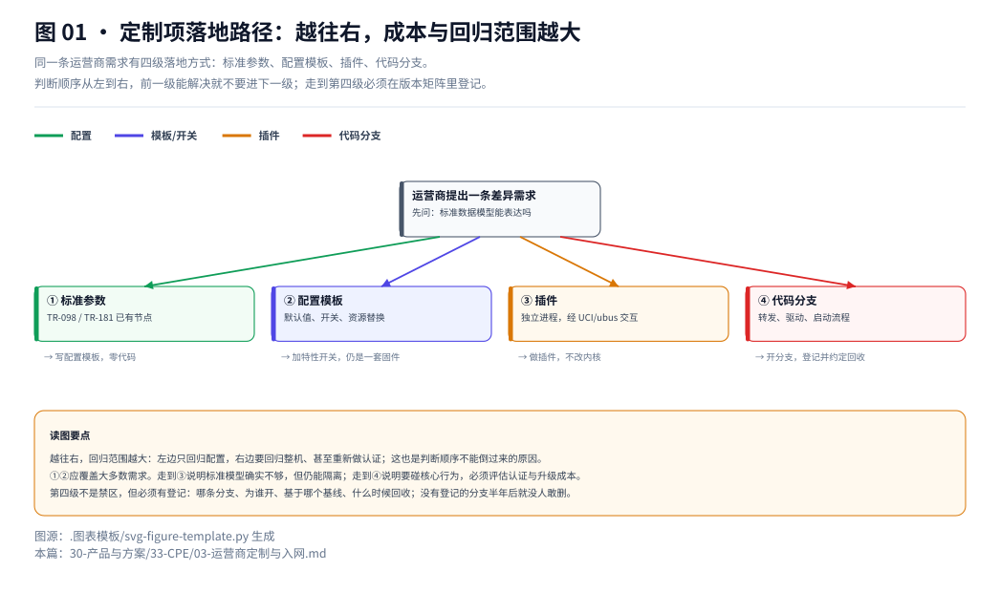
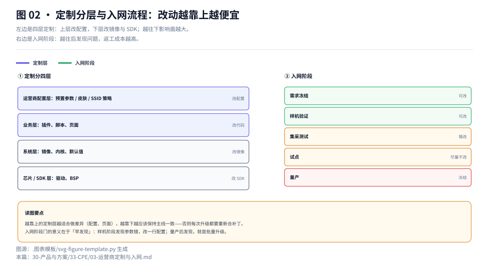
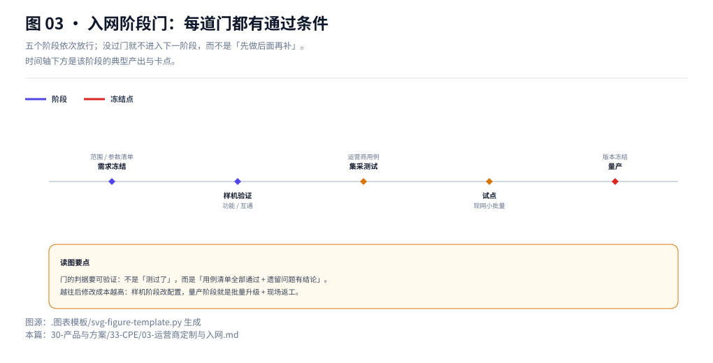

# 运营商定制与入网

同一个硬件平台卖给不同运营商，差异不在主板，而在「**默认配置、界面、管理参数、业务模板、认证与锁网**」。定制做得好是配置分层，做得差就是一堆互不兼容的固件分支。

> 本篇定位：运营商定制的分层模型、典型定制项、入网测试流程和版本管理边界。协议细节链接到 10，平台实现链接到 20/40。本篇不写具体运营商的规范条文（不公开），也不重复拨号与 CWMP 的协议流程（见 [01](./01-宽带接入与拨号.md)、[02](./02-TR-069与ACS运维.md)）。

## 目录

- [1 一句话模型](#s1)
- [2 速览](#s2)
- [3 定制分层与字段](#s3)
- [4 交互流程](#s4)
- [5 状态与定时器](#s5)
- [6 设计取舍与边界](#s6)
- [7 与相邻主题的关系](#s7)
- [名词解释](#名词解释)
- [8 参考与关联](#s8)

## 1 · 一句话模型：平台做一次，定制做一层

```text
平台基线（内核/驱动/SDK/基础服务）
  └─ 产品型号（硬件配置、端口、Wi-Fi）
       └─ 运营商定制（默认配置、ACS、业务模板、UI）
            └─ 区域/项目差异（频段、语言、法规、锁网）
```

三个关键认知：

1. **能配置的不要改代码**：默认值、开关、SSID 模板、ACS 地址都应该走配置，而不是每个运营商拉一个分支。
2. **定制项要能追溯**：哪个版本、哪个运营商、哪个项目、改了哪些参数，必须可查。
3. **入网不是「测完就行」**：集采测试、互通测试、现网试点、量产抽检，每一关的判据不同。

一个类比：同一套底盘，不同 4S 店加不同选装包——真皮座椅、轮毂、车机主题都能换，但底盘和碰撞结构不能动。

> **边界**：类比失效的地方是「选装也要重新认证」。CPE 改射频功率、改默认密码策略、改锁网逻辑，都可能触发重新测试；不是「配置改了就不用管认证」。

**为什么必须分层**：因为四层的变更频率差一个数量级——内核一年动几次，运营商默认值一周改几次，所以必须让高频变更停在数据层，而不是驱动整机重新回归。混在一起，改一个 SSID 前缀也要重新回归内核，发布节奏被最慢的一层拖住。不用分层会怎样：每个运营商一份固件，修一个安全漏洞要合 N 次，且没人说得清哪份固件对应哪条规范。

> **推论**：判断一个定制需求该放哪层，问两句——「它随运营商变吗」「它随版本变吗」。都「是」就放配置层；只有平台变，才动代码层。

## 2 · 速览

| 项 | 内容 | 边界与误判 |
| --- | --- | --- |
| 定制对象 | 默认配置、Web/App、ACS、业务模板、LOGO/语言、锁网 | 对象都能改，但不是每项都能「只改配置」 |
| 关键差异 | 频段/信道、VoIP 参数、IPTV VLAN、TR-069 参数、升级策略 | 频段与功率属法规项，不能按项目随意配 |
| 入网阶段 | 需求对齐 → 样机 → 集采测试 → 试点 → 量产 | 阶段是顺序门，不能跳；跳过的风险留到现网 |
| 交付物 | 固件、默认配置、MIB/数据模型、测试报告、升级包 | 缺数据模型与默认配置，下个版本无法复现 |
| 主要风险 | 分支爆炸、认证不通过、锁网误伤、升级不可回滚 | 风险集中在「分支」与「批量动作」，单机测试测不出 |
| 管理方式 | 配置分层、特性开关、版本矩阵、灰度发布 | 开关与分支都要登记，否则半年后无人敢删 |
| 本篇覆盖 | 定制分层、定制项落地路径、入网阶段门与版本矩阵 | 只到分类与判断顺序，不含具体规范条文 |
| 本篇不覆盖 | 具体运营商规范条文、协议报文、平台 SDK 差异 | 「不覆盖」不等于不重要，链接里才是正本 |
| 判定入口 | §3.4 四级落地判断，顺序不能换 | 跳步会把配置需求做成代码分支 |
| 最易混 | 「配置能改」当「不用测试」；「统一固件」当「不用定制」 | 配置变更同样可能触发重新认证 |

> **边界**：本篇给的是分类框架与判断顺序，不含任何一家运营商的具体参数值。落到项目上，一律以集采规范与技术协议为准；二手总结只能用来预判工作量，不能当验收依据。

因为速览只给坐标，所以每一行都指向后文：分层在 §3.1，落地路径在 §3.4，阶段门在 §4.2，版本矩阵在 §3.3。

## 3 · 定制分层与字段

### 3.1 分层模型

| 层 | 内容 | 谁维护 | 变更频率 | 越界的后果 |
| --- | --- | --- | --- | --- |
| 平台基线 | 内核、驱动、SDK、基础服务 | 平台/芯片团队 | 低 | 在这一层做运营商差异，等于所有运营商一起回归，且芯片原厂不再认基线 |
| 产品型号 | 硬件配置、端口、Wi-Fi、语音 | 产品团队 | 中 | 改端口或射频要重做认证与测试，不能当「配置项」处理 |
| 运营商定制 | 默认配置、ACS、业务模板、UI | 定制/项目团队 | 高 | 改到代码就分叉，分叉后每次平台升级都要人工合并 |
| 区域/项目 | 频段、语言、法规、锁网 | 项目团队 | 高 | 法规项（功率、信道、语言）不能靠配置绕过，越界是合规问题不是功能问题 |

**为什么「变更频率」这一列最重要**：它决定发布节奏与回归范围。频率高的层必须做成数据（配置/资源），频率低的层才允许是代码。反过来设计，高频变更就会驱动高频发版。

### 3.2 典型定制项

| 类别 | 定制内容 | 实现方式 | 边界 |
| --- | --- | --- | --- |
| 网络 | WAN 模式、VLAN、MTU、DNS | 默认配置/业务模板 | 运营商间差异大；VLAN 与业务一一对应，不能跨省复用模板 |
| 无线 | SSID 前缀、默认密码、信道、功率 | 配置/区域码 | 法规限制；功率与信道越界会被入网测试直接判不合格 |
| 语音 | SIP 服务器、编解码、拨号计划 | 配置 | 需要互通测试；编解码顺序影响单通与杂音 |
| IPTV | VLAN、组播、IGMP 版本 | 配置/驱动参数 | 依赖上游网络；组播复制点不在 CPE，改本机改不出组播源 |
| 管理 | ACS URL、认证、周期、参数集 | 配置/插件 | 数据模型要对齐；私有参数过多会让换 ACS 变成重开发 |
| 界面 | LOGO、语言、菜单、向导 | 前端资源 | 不要改业务逻辑；改逻辑就分叉，且每次 UI 升级都要重做 |
| 安全 | 默认密码策略、端口封闭、锁网 | 配置/代码 | 锁网要有解锁流程；无解锁流程等于制造电子垃圾 |
| 升级 | 升级服务器、灰度策略、回滚 | 配置/后台 | 必须可回滚；单分区产品不满足批量升级前提 |

**为什么定制项表要带「实现方式」**：同一句需求可以用三种方式实现，成本差一个数量级。先定实现方式，再谈排期；反过来先答应需求，最后一定落到改代码。

### 3.3 版本矩阵

| 维度 | 示例 | 说明 | 边界与误判 |
| --- | --- | --- | --- |
| 硬件版本 | HW V1/V2 | 器件替换要兼容 | 换器件不改版本号，现场无法区分，返修与召回都失控 |
| 软件基线 | 主版本.次版本.补丁 | 平台统一 | 用「日期」当版本号，无法判断包含哪些修复 |
| 运营商 | A/B/C | 配置差异 | 运营商差异做成固件分支，矩阵从加法变乘法 |
| 区域 | 国内/海外 | 频段/语言/法规 | 同一运营商不同省份的 VLAN/ACS 也可能不同，区域维度不能省 |
| 项目 | 集采/试点/定制 | 特殊需求 | 试点定制不约定回收，临时开关会永久留在代码里 |

**为什么版本矩阵会爆炸**：因为维度是相乘不是相加，所以 3 个硬件 × 4 个软件 × 5 个运营商 × 2 个区域 = 120 个组合。**收敛手段**只有两个：把运营商/区域维度做成配置（降成加法），以及用「基线 + 差分包」代替整包分支。

> **推论**：版本矩阵的规模应该约等于「硬件版本 × 软件基线」，其余维度都应是配置。如果矩阵里出现「运营商 × 软件基线」的笛卡尔积，说明分层已经失败。

### 3.4 定制项落在哪一层：四级判断



**读图**：同一条运营商需求，从左到右是四级落地方式——标准参数、配置模板、插件、代码分支，成本与回归范围逐级放大。绝大多数需求应停在前两级；走到第四级就要在版本矩阵里登记，并约定回收时间。

> 图源：`images/图01-定制项落地路径.svg`

| 步骤 | 问什么 | 怎么答 | 答错的后果 |
| --- | --- | --- | --- |
| ① 标准参数够吗 | TR-098/TR-181 有没有对应节点 | 查数据模型与 ACS 侧模板 | 有标准节点却开私有参数，换 ACS 就要重写 |
| ② 配置模板够吗 | 默认值、开关、资源替换能否表达 | 看是否需要条件逻辑 | 能用模板却写代码，等于每个项目一份固件 |
| ③ 插件够吗 | 能否独立进程、只通过 UCI/ubus 交互 | 看是否要碰内核与转发路径 | 该做插件却改主程序，升级时冲突不断 |
| ④ 必须改核心吗 | 转发、驱动、启动流程是否要变 | 评估回归范围与认证影响 | 不登记就开分支，半年后没人说得清哪份固件对应哪条规范 |

> **推论**：判断顺序本身就是成本控制。①②能解决的需求占大多数，把它们挡在代码之外，剩下的分支才管得过来。

### 3.5 定制包里到底有什么

| 交付物 | 内容 | 缺失后果 |
| --- | --- | --- |
| 固件 | 基线版本 + 定制插件 + 签名 | 只交二进制不交源码基线，下一版无法复现 |
| 默认配置 | 出厂默认值、ACS 地址、业务模板 | 靠产线手工烧录，批次间一定出现漂移 |
| 资源包 | LOGO、语言、向导页面 | 散落在各项目手里，换人即丢失 |
| 数据模型 | 标准参数映射 + 私有参数清单 | ACS 侧无法对接，开通脚本反复试错 |
| 测试报告 | 集采/互通/试点的判据与结果 | 出问题无法证明「当时测过什么」 |
| 升级包与回滚方案 | 升级脚本、灰度策略、回滚触发条件 | 批量升级出事时只能现场返修 |

> **边界**：交付物清单要跟着合同走。运营商只采购整机时，数据模型与默认配置仍要内部留档，否则下一次投标要从零反推。

## 4 · 交互流程



**读图**：左边四层定制——越靠上越适合做差异（配置/页面），越往下越应与主线一致；右边入网阶段越往后，返工成本越高。

> 图源：`images/图02-定制分层与入网.svg`

### 4.1 定制落地流程

```text
运营商需求 → 差异分析（配置/插件/代码）
  → 配置模板 + 特性开关 → 内部验证
  → 生成定制包（固件 + 默认配置 + 文档）
  → 入网测试 → 试点 → 量产
```

**为什么「差异分析」要独立成一步**：需求原话通常是「我们要能远程改 XX」，实现方式有四种。跳过分析直接排期，等于把技术选型交给运气。**代价**：分析要拉上平台、测试、ACS 三方，前期慢半天，后期省两周。

### 4.2 入网测试阶段

| 阶段 | 目标 | 典型内容 | 退出条件 | 边界与误判 |
| --- | --- | --- | --- | --- |
| 需求对齐 | 确认规范 | 业务清单、参数、界面 | 需求基线冻结 | 口头确认不算冻结；没有书面基线，后期一定扯皮 |
| 样机验证 | 功能可用 | 拨号、Wi-Fi、VoIP、IPTV、ACS | 功能项通过 | 样机通过只证明「能跑通」，不证明性能与稳定性 |
| 集采测试 | 满足入网门槛 | 性能、稳定性、互通、安全 | 测试报告通过 | 指标卡在临界值时，现网波动就会不合格 |
| 现网试点 | 真实环境验证 | 不同局址、不同 BRAS/OLT | 试点无阻断问题 | 只挑顺利局址，等于没试点 |
| 量产 | 一致性 | 抽检、烧号、校准 | 批次合格 | 抽检合格不代表批次一致，产线换料要重新确认 |

**为什么阶段门不能合并**：因为每一关排除的是一类风险——样机排除「功能没做」，集采排除「指标不够」，试点排除「环境不适配」，量产排除「一致性」，所以合并阶段等于把风险留到下一关，而下一关的返工成本更高。

### 4.3 异常分支

| 异常 | 现象 | 定位方向（先排除的误判） |
| --- | --- | --- |
| 定制后无法拨号 | 特定运营商失败 | VLAN/账号/认证方式/MTU |
| ACS 不上线 | 只在某省失败 | ACS 地址/证书/时间/网络可达 |
| VoIP 单通 | 注册成功无声音 | NAT/SIP ALG/编解码/防火墙 |
| IPTV 黑屏 | 组播不通 | VLAN/IGMP/组播复制点 |
| 升级变砖 | 定制包不启动 | 镜像签名/分区/配置兼容 |
| 锁网误伤 | 合法卡不能用 | 锁网策略/白名单/解锁流程 |
| 只在某局址失败 | 换个 BRAS/OLT 就好 | 局端版本差异、VLAN 规划、组播配置 |
| 批次间表现不同 | 同版本不同批次 | 器件替换、校准参数、烧录配置漂移 |

### 4.4 试点选址：覆盖「最差环境」而不是「最顺局址」

| 局址类型 | 覆盖什么 | 边界与误判 |
| --- | --- | --- |
| 新建小区 | 新 OLT/BRAS、规范布线 | 环境太干净，测不出老网问题 |
| 老旧小区 | 长铜线、老分光器、线路噪声 | 只测新建小区会高估覆盖与速率 |
| 跨省/跨地市 | 不同 ACS、不同 VLAN 规划 | 同一运营商不同省也可能两套参数 |
| 高密度小区 | 并发、组播复制压力、Wi-Fi 干扰 | 单用户测试测不出拥塞类问题 |
| 弱覆盖/边缘 | 光功率临界、蜂窝弱信号 | 实验室的「正常值」在边缘就是故障值 |

**为什么试点要选最差局址**：现网问题的分布是长尾的，平均值没有意义。挑一个顺利局址跑通，只能证明「存在可用配置」，不能证明「批量可交付」。

> **推论**：试点报告要写清「覆盖了哪几类局址、每类跑了什么」，而不是只写「试点通过」。没有覆盖清单的通过结论，量产阶段一定会被现网打回。

## 5 · 状态与定时器



**读图**：需求、样机、集采、试点、量产是阶段门；越往后修改成本越高。

> 图源：`images/图03-入网阶段门.svg`

因为定制与入网是项目流程、不是设备运行状态，所以本篇不涉及设备状态机与定时器。设备侧的状态（PON 注册、拨号、CWMP 会话、升级）见 [00](./00-CPE系统架构.md) §5、[01](./01-宽带接入与拨号.md) §5、[02](./02-TR-069与ACS运维.md) §5。

流程上有几个关键「门」：

| 门 | 进入条件 | 退出条件 | 卡住的典型表现 | 风险 |
| --- | --- | --- | --- | --- |
| 需求冻结 | 规范确认 | 变更评审通过 | 需求一直在改，排期无法承诺 | 后期变更导致返工 |
| 样机通过 | 功能项全过 | 问题关闭 | 带着已知问题进入集采 | 带病进入集采 |
| 集采通过 | 测试报告合格 | 运营商准入 | 指标临界，反复复测 | 指标临界被拒 |
| 试点通过 | 现网无阻断 | 批量放号 | 只覆盖顺利局址 | 局部环境差异 |
| 量产放行 | 抽检合格 | 持续交付 | 换料未重新确认 | 批次一致性 |

> **边界**：阶段门是管理手段，不是技术判据。门过了不等于没问题，只表示「已知风险已被接受」——所以每道门的遗留问题清单必须随交付物一起走。
> **待验证**：各运营商对阶段门的命名与判据不同（入网测试、选型测试、集采测试常混用），门的数量与退出条件以合同为准。

## 6 · 设计取舍与边界

这一节的取舍都围绕「一次开发、多运营商交付」这个目标。因为交付物要能被复用，所以判断标准不是「这个需求能不能做」，而是「做完之后下一个运营商要不要重做」。

### 6.1 配置化 vs 分支化

配置化让一套固件覆盖多个运营商，升级和维护成本低；分支化能快速满足特殊需求，但分支越多越难合并。原则是「差异优先配置，配置不了做插件，最后才改代码」。

**为什么分支化一定会反噬**：分支是「复制 + 分叉」，平台每修一个漏洞，分支都要人工合并一次；合并冲突的代价随时间线性增长。**代价**：配置化要求配置系统本身够强（模板、校验、继承、回滚），这部分建设前期看不见收益。**失效条件**：需求触及转发路径或启动流程时，配置层表达不了，只能开分支——但要限定范围并定回收期。

### 6.2 统一固件 vs 定制固件

统一固件便于灰度与回滚，但包体大、默认配置复杂；定制固件精简，但版本矩阵膨胀。运营商集采通常要求定制固件，内部要用同一基线构建，避免「同名不同源」。

**代价**：统一固件要在一套二进制里装下所有运营商的资源与默认值，Flash 与启动时间都会涨；定制固件要维护构建流水线，确保每个包都能追溯到同一基线。**边界**：定制固件必须能回答「这个包从哪条 commit 构建」，否则「同名不同源」会在出问题时无法复现。

### 6.3 锁网 vs 开放

锁网满足运营商补贴机要求，但会带来二手流通和出国漫游问题。产品要提供明确的解锁流程和合规说明，不能把锁网做成「永久砖」。

**为什么锁网容易误伤**：判据通常是 MCC/MNC、SIM 标识或网络注册结果，任何一个判据在漫游、换卡、虚拟运营商场景下都可能误判。**代价**：解锁流程要做身份核验与审计，运营商侧也要有工单入口；没有流程的锁网，最后都变成客服问题。

### 6.4 入网测试的边界

实验室通过不等于现网通过：不同 BRAS/OLT/ACS 版本、不同局址的 VLAN 和组播配置都会引入差异。试点阶段必须覆盖「最差的现网环境」，而不是只挑一个顺利的局址。

**为什么实验室测不出**：实验室的局端版本、VLAN 规划、组播源都是「理想配置」，现网是多年演进的结果。**失效条件**：如果试点也无法覆盖全部局端版本（常见），就要在合同里约定「局端版本支持矩阵」，把不支持的组合明确排除。

### 6.5 定制文档的价值

定制项、参数路径、默认值、升级方式要形成交付文档。没有文档的定制，下一次换人就得反向猜配置，维护成本会指数上升。

**为什么文档是交付物而不是附属品**：定制的知识分布在配置、脚本、产线工装、ACS 模板四处，任何一处没写下来，下一个人就要从设备上反推。**代价**：维护文档要跟着版本走，版本一多就容易过期；至少要保证「参数路径 + 默认值 + 生效条件」三项可查。

### 6.6 临时定制要有回收期

试点和投标常出现「先加个开关」的临时定制。开关一旦进入量产固件，就变成永久维护项：每次升级都要验证它，每次重构都要保留它。

**代价**：回收临时定制要协调运营商与项目进度，短期看是「找麻烦」。**失效条件**：涉及法规或安全的定制不能回收（比如区域码限制），这类要直接进基线，而不是挂在临时开关上。

## 7 · 与相邻主题的关系

| 相邻对象 | 关系 | 边界（细节去哪看） |
| --- | --- | --- |
| [CPE 系统架构](./00-CPE系统架构.md) | 被定制的整机 | 讲整机分层与业务分域，不重复定制流程 |
| [宽带接入与拨号](./01-宽带接入与拨号.md) | WAN 定制项 | 讲拨号协议与定位，不讲各省参数差异 |
| [TR-069 与 ACS 运维](./02-TR-069与ACS运维.md) | 管理面定制项 | 讲 CWMP 会话与参数模型，不讲集采要求 |
| [OpenWrt 定制与裁剪](../../20-平台与系统/22-OpenWrt/06-定制与裁剪/00-产品化定制总览.md) | 平台侧定制方法 | 讲构建、裁剪与包管理，不讲运营商商务与阶段门 |
| [平台对比](../../40-平台与芯片/00-平台对比.md) | 芯片/SDK 差异 | 讲平台能力差异，不讲某一运营商的定制清单 |
| [设备形态对比](../00-设备形态对比.md) | 产品形态边界 | 讲形态归类，不讲定制落地 |

一句话：**定制的目标是「一套基线 + 多套配置」，而不是「一个运营商一个固件」。** 一旦发现自己在一份固件里改业务逻辑，就已经越过了这条线。因为相邻篇各有正本，所以表里只写关系与边界，协议与平台细节去链接里看。

## 名词解释

> 缩写给出英文全称；非缩写用“—”表示。因为术语表只服务于本篇的阅读，所以不追求收全；同一缩写在相邻篇含义不同时，各自列出。

| 术语 | 英文全称 | 解释 |
| --- | --- | --- |
| CPE | Customer Premises Equipment | 用户侧设备。 |
| ACS | Auto Configuration Server | 自动配置服务器。 |
| OLT | Optical Line Terminal | 光线路终端。 |
| BRAS | Broadband Remote Access Server | 宽带远程接入服务器。 |
| VLAN | Virtual Local Area Network | 虚拟局域网。 |
| SSID | Service Set Identifier | 无线网络名称。 |
| SIP | Session Initiation Protocol | 会话发起协议。 |
| IPTV | Internet Protocol Television | IP 电视。 |
| IGMP | Internet Group Management Protocol | 互联网组管理协议。 |
| MIB | Management Information Base | 管理信息库。 |
| OUI | Organizationally Unique Identifier | 组织唯一标识符。 |
| 锁网 | — | 限制设备只能在指定运营商网络使用的机制。 |
| 集采 | — | 运营商集中采购；含技术规范、测试与准入流程。 |
| 阶段门 | — | 项目阶段之间的准入门槛，未达标不得进入下一阶段。 |
| 基线 | — | 所有分支与定制包共同依赖的软件版本。 |
| 差分包 | — | 只包含与基线差异的交付包，用于减少分支数量。 |
| 灰度发布 | — | 按批次逐步放量，控制升级失败的影响范围。 |
| 区域码 | — | 限定频段、信道、功率与语言的法规配置集合。 |
| 白名单 | — | 允许清单；锁网场景中用于放行合法卡或设备。 |
| NTP | Network Time Protocol | 网络时间协议；证书校验与定时任务依赖它。 |

## 8 · 参考与关联

**标准/规范**

- TR-069 / TR-369：远程管理
- TR-098 / TR-181：数据模型
- ITU-T G.984 / G.987：PON 接入
- 3GPP TS 23.003 / 31.102：蜂窝终端标识与配置
- 各运营商集采测试规范（内部资料，不公开）

**关联**

- [设备形态对比](../00-设备形态对比.md)
- [CPE 系统架构](./00-CPE系统架构.md)
- [宽带接入与拨号](./01-宽带接入与拨号.md)
- [TR-069 与 ACS 运维](./02-TR-069与ACS运维.md)

因为集采规范与测试判据属于运营商内部资料，所以这里只给分类框架；具体条文与阈值以合同和技术规范为准。

---

> **本篇定位**：运营商定制的分层模型、定制项落地路径、入网阶段门与版本矩阵边界；不含具体运营商规范条文、协议报文与平台实现。
> **素材来源**：`studyspace/1.知识体系/7.openwrt/3.网络业务/2.关键组件服务/6.CPE专属业务/`、`studyspace/3.协议应用/1.tr069/`；本篇 2026-11-11 版原文。
> **待验证**：各运营商的具体定制清单、参数路径、集采判据、锁网合规要求与局端版本支持矩阵。
