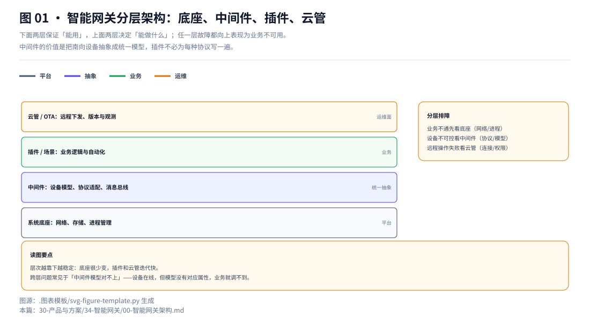
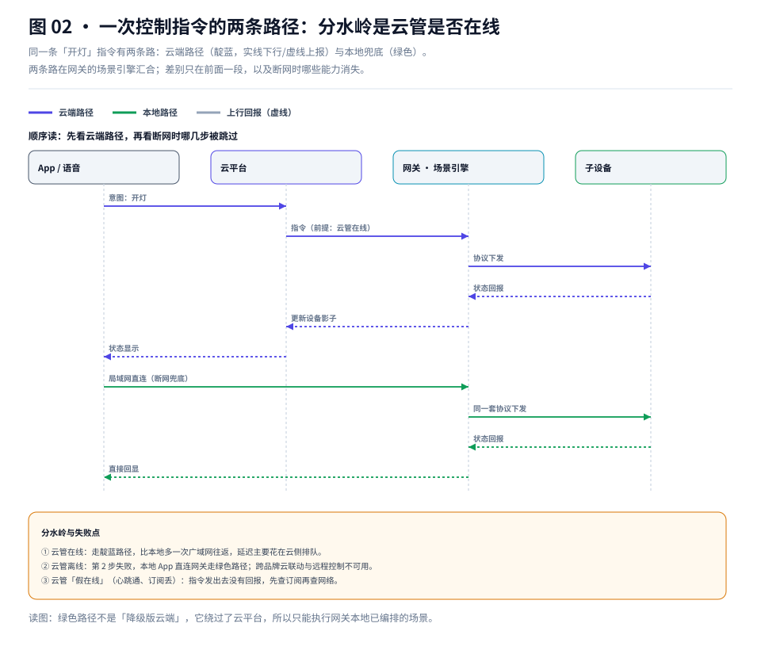
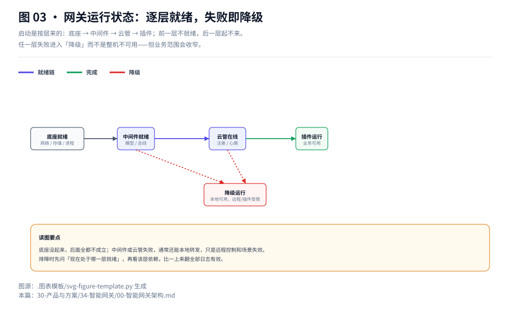

# 智能网关架构

智能网关是「路由器 + 智能家居中枢 + 云管终端」的叠加体：**它既要做 WAN/LAN/Wi-Fi 的基础网络，又要承载插件、协议转换和远程运维**。多出来的能力，也意味着多出来的攻击面和资源竞争。

> 本篇定位：智能网关的整机分层、与普通路由的差异、关键子系统与产品指标。路由转发细节去 `32-路由器`，插件与云管去 `01-插件化与云管`，协议与隔离去 `02-智能家居与安全`。

## 目录

- [1 一句话模型](#s1)
- [2 速览](#s2)
- [3 结构与字段](#s3)
- [4 交互流程](#s4)
- [5 状态机与定时器](#s5)
- [6 设计取舍与边界](#s6)
- [7 与相邻主题的关系](#s7)
- [名词解释](#名词解释)
- [8 参考与关联](#s8)

## 1 · 一句话模型：底座是路由，增值在插件

```text
云侧：设备管理 / OTA / 场景 / 数据
  └─ 网关：云管 Agent + 插件框架 + 协议栈
        └─ 底座：WAN/LAN/Wi-Fi + NAT/防火墙/QoS
              └─ 终端：手机/PC/摄像头/传感器/家电
```

这张图是**四层，不是三段串联**。云管、插件、协议栈是并列挂在底座上的三个租户，共用同一份 CPU、内存和射频；底座一旦抖动，上面三个一起表现为「业务不可用」。因为网关内的这三个租户共用同一份资源，所以「智能」的上限由底座的余量决定，而不由插件数量决定。

三个关键认知：

1. **先保住底座**：路由、Wi-Fi、NAT 不稳，插件再多也没有意义。插件不能抢底座资源。
2. **网关是「协议翻译器」**：Wi-Fi/BLE/Zigbee/Thread/Matter 在南向接入，统一抽象后向北上报。
3. **云管和本地要能分工**：断网时本地场景仍要可用，云端负责跨设备编排和远程运维。

一句类比：智能网关像一栋**带物业办公室的住宅楼**——路由是水电，插件是商铺，云管是物业的远程系统。类比失效的地方是：楼里断电，商铺可以自己发电；网关底座挂了，插件没有任何兜底，因为它们是同一颗 SoC 上的进程。

> **推论**：选型时先问底座留给插件的内存/Flash 余量，再问支持多少插件——顺序反了，就会被插件清单牵着走。
> **边界**：这套分层描述的是「一台网关内部的软件结构」。如果项目是 FTTR 主从组网或多 AP 协同，网关只是其中一个节点，跨节点的决策在主网关或云侧，不在本篇。

## 2 · 速览

| 项 | 内容 |
| --- | --- |
| 产品定位 | 家庭/企业网络中枢 + 智能家居控制 + 云管终端 |
| 核心对象 | 网络接口、SSID、插件、设备影子、场景、协议子设备 |
| 关键能力 | 路由/NAT、Wi-Fi 组网、插件运行、协议接入、云管/OTA |
| 典型形态 | 家庭智能网关、企业融合网关、FTTR 主网关 |
| 软件栈 | Linux/OpenWrt + 中间件 + 插件运行时 + 云 Agent |
| 关键标准 | Matter、Thread、Zigbee、BLE、TR-069/TR-369、MQTT |
| 主要指标 | 转发性能、Wi-Fi 覆盖、插件稳定性、断网可用性、升级成功率 |
| 本篇不覆盖 | 转发实现（`32-路由器`）、插件生命周期细节（`01`）、协议与隔离（`02`） |

因为「转发性能」要 CPU、「插件稳定性」要内存、「断网可用性」要本地状态副本，三者在同一台设备上互相抢资源，所以速览把「主要指标」与「典型形态」并列——同一份硬件，换个业务包就是另一种形态，指标权重也跟着换。

## 3 · 结构与字段

### 3.1 与普通路由的差异

| 维度 | 普通路由 | 智能网关 | 边界与误判 |
| --- | --- | --- | --- |
| 核心职责 | 转发与上网 | 转发 + 协议接入 + 业务编排 | 企业融合网关常常没有智能家居业务；「带 App」不等于智能网关 |
| 软件形态 | 单体固件 | 底座 + 插件/容器 | 插件化不等于容器化：家用网关多数仍是「进程 + 权限约束」 |
| 管理方式 | 本地 Web/App | 本地 + 云管 + 远程运维 | 运营商场景里云管可能与 TR-069/ACS 并存，改本地配置会被远程覆盖 |
| 协议栈 | IP/Wi-Fi | IP/Wi-Fi + BLE/Zigbee/Thread/Matter | 多协议要独立射频或分时共用，纯软件开关变不出来 |
| 资源压力 | 转发为主 | 转发 + 插件 + 协议栈竞争 | 峰值不在待机，而在「OTA 下载 + 场景联动 + 批量配网」叠加时 |
| 安全边界 | 内外网 | 内外网 + IoT 子网 + 插件沙箱 | 进程隔离共享内核，逃逸风险仍在；沙箱强度取决于内核能力 |

这张表的读法是**从第一列推第三列**：职责多了，软件形态就必须可拆分；管理通道多了，安全边界就必须多一层。普通路由只要守一条内外网边界，智能网关要守三条（内外网、IoT 子网、插件），任何一条没划清，前面两条都会被绕过去。

**为什么不用「路由器 + 装几个 App」来实现？** 因为 App 与路由固件同权限、同生命周期：一个 App 的内存泄漏会拖死转发，一次升级要整包替换，回滚粒度是整机。插件化的价值不在「能装」，在「装坏了只坏一个业务」。

### 3.2 硬件组成

| 部件 | 作用 | 产品关注点 | 边界与误判 |
| --- | --- | --- | --- |
| 主控 SoC | 路由、插件、协议栈 | 算力、内存、是否支持容器 | 内核支持 namespace ≠ 跑得动容器；低端 SoC 内存先见底 |
| Wi-Fi 芯片 | 家庭覆盖 | 频段、空间流、Mesh | IoT 设备多在 2.4 GHz，5/6 GHz 再好也救不了 2.4G 拥塞 |
| 交换芯片 | LAN 多口 | 端口速率、VLAN | 有交换芯片不等于支持每口独立 VLAN，看 SDK 能力 |
| 短距射频 | BLE/Zigbee/Thread | 天线、共存、协议认证 | Zigbee 与 Thread 都跑 802.15.4，单射频设计下只能二选一或分时 |
| 存储 | 固件、插件、日志、场景 | eMMC 容量、寿命、分区 | 双分区升级要求 ≥2 倍镜像空间；日志写入是寿命主要消耗 |
| 安全芯片 | 密钥、安全启动 | 是否独立、密钥注入流程 | 焊了安全芯片 ≠ 开了安全启动，密钥注入要产线配合 |
| 语音/音频 | 语音助手（部分产品） | 麦克风/扬声器、唤醒 | 语音上云会把音频送出家门，隐私策略要先定 |

因为短距射频和 Wi-Fi 天线挤在同一块小板上，所以硬件阶段就要定「谁和谁共用天线、谁需要屏蔽罩」；这些在软件层无法补救，只能在产品定义阶段做取舍。

### 3.3 软件分层

| 层 | 组件 | 职责 | 边界（越界会怎样） |
| --- | --- | --- | --- |
| 底座 | Linux、驱动、netifd、防火墙 | 网络与转发 | 插件直接改 iptables 会和云管下发互相覆盖，排障时查不出是谁改的 |
| 中间件 | 消息总线、设备模型、协议抽象 | 解耦插件与底座 | 总线是单点：它挂了所有插件一起失联，但底座转发仍在 |
| 插件运行时 | 进程/容器、生命周期、权限 | 隔离与资源限制 | 限额依赖内核 cgroup；不支持的内核上「限额」只是约定 |
| 业务 | 场景引擎、协议插件、家长控制 | 产品差异化 | 场景引擎持有 root 时，一条错误规则能改掉整个转发面 |
| 云管 | MQTT/HTTPS Agent、OTA | 注册、上报、升级 | 云管不可用时必须降级放行，不能阻塞本地业务启动 |
| 本地管理 | Web/App/语音 | 配置与交互 | 本地与云端同时改同一参数时，需要版本号仲裁，否则「改完又变回去」 |

**为什么必须分层？** 因为故障域要可切分：底座故障要能独立重启，插件崩溃不能带走 Wi-Fi，云管断线不能让灯控失效。**不分层会怎样？** 单体固件里任何一处内存越界都是整机重启，运营商远程排障只能看到「设备离线」。

> **边界**：分层是逻辑视图，物理上它们共享同一个内核。所谓「插件沙箱」在进程模型下只是权限与 cgroup 约束，不是虚拟机级隔离。

### 3.4 关键资源

| 资源 | 用途 | 不足时 | 边界与误判 |
| --- | --- | --- | --- |
| 内存 | 插件、协议栈、缓存 | OOM、插件被杀、转发抖动 | 默认 OOM 打分可能先杀底座进程，要调 `oom_score_adj` |
| Flash | 固件、插件、日志 | 升级空间不足、日志丢失 | 写满后不只是装不上插件，配置落盘也会失败 |
| CPU | 转发、插件、加密 | 高负载、时延上升 | 硬件加速只卸载转发，插件与加密仍吃 CPU |
| 射频 | Wi-Fi/BLE/Zigbee | 共存干扰、丢包 | 干扰是双向的：网关自己发 BLE 广播也会抬高 Wi-Fi 底噪 |
| 文件描述符/连接 | 云管、局域网 | 连接失败、插件异常 | conntrack 表与 socket 是两个池子，一个满不代表另一个满 |

因为资源是**叠加消耗**而不是平均消耗，所以容量预算要按最坏场景算：固件升级（双分区写入）+ 场景联动（多插件同时唤醒）+ 批量配网（射频与协议栈同时忙）。按待机功耗和待机内存做规格，量产第一批就会在升级时翻车。

> **推论**：插件准入应该由「剩余资源」反推，而不是由商务承诺反推。给出「最多 N 个插件」之前，先算出最坏叠加下的内存与 Flash 余量。

## 4 · 交互流程



**读图**：底座保证网络可用，中间件把设备/协议抽象成统一模型，插件和云管在之上运行；任何一层故障都会向上表现为「业务不可用」。

> 图源：`images/图01-智能网关分层.svg`

### 4.1 上电启动

```text
Boot → 内核 → 根文件系统 → 底座服务（netifd/firewall/Wi-Fi）
  → 中间件/消息总线 → 插件运行时
  → 云管 Agent 注册 → 拉取配置/场景
  → 协议插件启动 → 子设备上线
```

顺序不能换：没有根文件系统就没有底座，没有底座就没有可用的消息总线，云管注册也没有意义。但**云管这一步必须允许失败继续**：注册超时后走本地缓存的配置与场景，否则断网就开不了机——这是智能网关最常见的一类「装完就变砖」投诉来源。

### 4.2 一次控制指令

```text
App/语音 → 云平台 → 网关云管 Agent
  → 场景引擎 → 协议插件 → 子设备
  → 状态回传 → 设备影子更新 → App 显示
```

断网时，本地 App/面板直接走局域网到网关，场景引擎在本地执行。

同一条指令有两条路径，分水岭是「云管是否在线」，而不是「App 在不在家」：



**读图**：实线是云端路径，虚线是本地兜底。两条路径在网关的「场景引擎」汇合，差异只在前面一段——云端多一次上下行，本地少一次广域网往返。图下那张「分水岭与失败点」就是排障入口：云管离线只影响实线，本地路径仍可用。

> 图源：`images/图02-控制指令两条路径.svg`

> **推论**：用户说「App 控制慢」，先判走的是哪条路径。在家连同一 Wi-Fi 却仍走云端，说明本地发现（mDNS/局域网接口）没生效，这时优化云端链路是白费。
> **边界**：本地路径只能执行「网关本地已编排」的场景。跨品牌云联动、离家后的远程控制、依赖云端 AI 的语音，断网时都不可用。

### 4.3 异常分支

| 异常 | 现象 | 定位方向 | 容易误判成 |
| --- | --- | --- | --- |
| 底座不稳 | 全网断流/重启 | 电源、内核、驱动、转发负载 | 先怀疑插件——其实插件崩了不会带走 Wi-Fi |
| 插件崩溃 | 单个业务失效 | 插件日志、内存、权限 | 当成「云管下发失败」，反复重推配置 |
| 云管离线 | 远程不可用，本地正常 | 网络、证书、MQTT 连接 | 当成整机故障，其实本地业务全在 |
| 子设备掉线 | 单个协议设备失联 | 射频干扰、协议栈、子设备电量 | 当成网关负载问题，扩容无效 |
| 升级失败 | 网关不启动 | 双分区、签名、回滚 | 以为要返厂，实际可从备用分区回滚 |
| 资源耗尽 | 随机卡顿 | 内存/Flash/CPU/连接数 | 当成「Wi-Fi 信号差」，一直调射频 |

因为六类异常的现象都收敛成「业务不可用」，所以定位顺序必须是**从下往上**：先看底座（能不能上网、能不能重启），再看插件（单个还是全部），最后看云管与子设备。反过来从云管往下查，会把底座问题误判成云端问题。

## 5 · 状态机与定时器



**读图**：底座先就绪，云管与插件随后上线；任一层失败都会降级。

> 图源：`images/图03-网关运行状态.svg`

因为每个状态都由一个超时或心跳来判定，所以排障时先问「卡在哪个状态、等的是哪个定时器」，比直接翻日志最后一行有效。

| 对象 | 状态 | 关键参数 | 失败表现 |
| --- | --- | --- | --- |
| 网关启动 | Boot → 底座就绪 → 云管在线 → 业务就绪 | 启动超时、看门狗 | 卡在某一步反复重启，日志停在最后一条 |
| 云管连接 | 未连接 → 连接中 → 在线 → 重连 | 心跳、退避重连 | 状态显示在线但指令不下发：心跳通、订阅丢 |
| 插件 | 安装 → 启动 → 运行 → 停止/崩溃 → 重启 | 重启次数、资源上限 | 崩溃后限流禁用，界面上仍显示「已安装」 |
| 子设备 | 发现 → 配对 → 在线 → 离线 | 心跳、离线判定 | 离线不等于被移除，重连后影子状态可能过期 |
| OTA | 下载 → 校验 → 安装 → 重启 → 确认 | 回滚超时、灰度 | 重启后未确认，引导层回滚到旧分区 |

定时器与超时（具体数值随产品与平台不同，这里只给作用与设置依据）：

| 定时器/超时 | 管什么 | 设置依据 | 边界 |
| --- | --- | --- | --- |
| 底座启动超时 | 判断某个服务没起来，触发重启或降级 | 服务冷启动最坏耗时 × 2 | 设太短会在低速 eMMC 上误杀 |
| 硬件看门狗 | 内核/主进程卡死时强制复位 | 必须大于最长合法阻塞（如升级写 Flash） | 升级期间不喂狗会把正常升级判成死机 |
| 云管心跳 | 维持在线判定与 NAT 保活 | 小于运营商 NAT 老化时间 | 心跳太密会拖累低功耗与流量 |
| 退避重连 | 云端不可达时避免打爆服务端 | 指数退避 + 随机抖动 | 无抖动时大量设备同时重连，形成雪崩 |
| 插件健康检查 | 判定插件「活着但没用」 | 业务响应时间，不是进程存活 | 只看进程在不在，会漏掉死锁 |
| 子设备离线判定 | 把「没上报」变成「离线」 | 心跳周期的 2–3 倍 | 电池设备休眠周期长，阈值过小会误报 |
| OTA 确认超时 | 新版本启动后多久算成功 | 首次启动自检耗时 + 上报重试 | 没确认就回滚，会把「慢」判成「坏」 |

> **边界**：上表状态名是产品抽象，不是协议状态。比如「云管在线」由心跳定义，不同厂商的判据不同，跨厂商对比指标时不能直接对齐。
> **待验证**：各类超时的具体默认值在 OpenWrt、各厂商 SDK、运营商规范里都不一样，取值以产品规格书与实机日志为准。

## 6 · 设计取舍与边界

### 6.1 插件化 vs 单体

插件化让功能可扩展、可独立升级，但引入运行时、权限和资源隔离问题；单体固件简单稳定，但每次加功能都要整体升级。智能网关的核心矛盾就是「开放」和「稳定」的平衡。

**不用插件化会怎样？** 每加一个业务（比如家长控制、云存储、第三方协议）都要出一版整机固件，运营商要为每个型号重新认证、灰度、回滚。**代价是什么？** 网关里多了一套「操作系统之上再套一层调度」的东西：manifest、权限、限额、健康检查、日志，全部要自己维护。

**失效条件**：插件数量少于 3 个、硬件只有 128 MB 内存的项目，插件框架的运行时开销比它带来的灵活性更贵，直接单体更划算。

### 6.2 容器 vs 进程

容器隔离好、依赖打包方便，但占用更多资源、启动更慢；普通进程轻量，但依赖冲突和权限逃逸风险更高。资源受限的家用网关通常优先进程 + 权限约束。

**为什么容器在网关上不总是更优？** 容器的隔离依赖 namespace/cgroup，而这两样在低端 SoC 的内核配置里常被裁掉；即使有，容器镜像若随固件进 A/B 双分区，存储开销要按两份算。**边界**：只有当插件来自第三方、依赖版本互相冲突时，容器的「打包一致性」才值得这份开销。

### 6.3 云端 vs 本地

云端能做跨设备编排、远程诊断和持续迭代；本地能保证断网可用和低时延。关键场景（回家开灯、安防）必须本地可执行，云端只做增强。

因为家庭网络「断网」是常态而不是异常（换运营商、光猫重启、欠费），所以本地必须持有完整的场景定义与设备状态；云端只保存「意图」和「历史」。**代价**是同一份配置要在两端维护，冲突时还要有版本仲裁——这也是「改了又变回去」类问题的根因。

### 6.4 多协议共存的代价

BLE/Zigbee/Thread 与 Wi-Fi 的 2.4 GHz 射频共用同一段频谱，天线和射频共存设计不好会互相干扰。产品不能只堆协议，要做共存测试和天线隔离。

具体来说：BLE、Zigbee、Thread 都落在 2.4 GHz ISM 频段，Wi-Fi 只有 2.4 GHz 射频参与这场竞争，5/6 GHz 不参与；Zigbee 与 Thread 还共用 802.15.4 的调制方式，单射频方案里两者只能分时或二选一。**不用共存设计会怎样？** 配网时 BLE 广播把 Wi-Fi 重传率抬上去，用户看到的是「一配网就卡」。

### 6.5 什么时候不需要智能网关

只需要上网、没有智能家居设备、没有远程运维需求时，普通路由更便宜也更稳。智能网关的复杂度应该由真实业务驱动。

**反例**：只有一个运营商 App 用来改 Wi-Fi 密码，不算远程运维需求——TR-069 的简单参数下发就能覆盖，不需要插件框架。**失效条件**：一旦要远程装第三方业务、要跨协议联动、要给客服提供远程诊断，普通路由的封闭固件就会成为瓶颈。

### 6.6 产品指标怎么定

| 指标 | 怎么测 | 为什么测 | 边界与误判 |
| --- | --- | --- | --- |
| 转发性能 | 有线打流，开/关 NAT、开/关加速各测一遍 | 决定它能不能当主路由 | 只测 LAN-LAN 会漏掉 NAT 与 conntrack 瓶颈 |
| Wi-Fi 覆盖 | 多点位 RSSI/吞吐，2.4G 与 5G 分开 | 决定摆放位置与 Mesh 需求 | 空旷环境的数据不能代表承重墙户型 |
| 插件稳定性 | 长稳 + 反复启停 + OOM 注入，看崩溃率与恢复时间 | 决定「智能」能不能长期开着 | 只看单插件，漏掉多插件叠加 |
| 断网可用性 | 拔 WAN 后跑本地场景与控制 | 决定断网时是不是「一块砖」 | 只测 App 本地控制，漏掉面板/语音路径 |
| 升级成功率 | 灰度批次统计 + 断电/断网注入 | 决定远程运维敢不敢推 | 实验室全成功，不代表弱网现场成功 |

因为指标之间会互相牺牲（加密与插件吃 CPU、双分区吃 Flash、多协议吃射频），所以验收要写清「在什么业务组合下测」，否则两份报告都真实但不可比。

## 7 · 与相邻主题的关系

| 相邻对象 | 关系 | 边界（细节去哪看） |
| --- | --- | --- |
| [路由器产品架构](../32-路由器/00-路由器产品架构.md) | 底座转发能力 | 转发路径、NAT、加速实现不在本篇，本篇只把它当「必须活着的底座」 |
| [QoS 与流控方案](../32-路由器/02-QoS与流控方案.md) | 多业务带宽分配 | 插件流量如何分类、如何限速，属于 QoS 方案；本篇只提「插件会抢带宽」 |
| [插件化与云管](./01-插件化与云管.md) | 扩展与运维 | manifest、生命周期、OTA 细节在那篇；本篇只讲它们在整机里的位置 |
| [智能家居与安全](./02-智能家居与安全.md) | 协议接入与隔离 | 配网流程、VLAN/ACL 策略在那篇；本篇不展开协议报文 |
| [BLE/ZigBee/Thread](../../10-基础理论/12-通信科学/04-无线通信/04-短距无线/00-BLE-ZigBee-Thread.md) | 短距协议原理 | 组网、路由、信道机制在原理篇；本篇只讲网关承担什么角色 |
| [OpenWrt 系统框架](../../20-平台与系统/22-OpenWrt/02-系统框架/00-系统框架总览.md) | 底座实现 | procd/ubus/UCI 的实现细节在平台篇；本篇不写配置方法 |

一句话：**智能网关 = 稳定的网络底座 + 受控的插件运行时 + 统一的协议抽象 + 可回滚的云管。**

因为相邻主题各自有正本，所以这里只写「关系 + 边界」不复制正文；边界列答不出来的问题，说明该去对应目录找，而不是在本篇继续加篇幅。

## 名词解释

> 缩写给出英文全称；非缩写用“—”表示。

| 术语 | 英文全称 | 解释 |
| --- | --- | --- |
| IoT | Internet of Things | 物联网。 |
| BLE | Bluetooth Low Energy | 低功耗蓝牙。 |
| Thread | — | 基于 IPv6 的低功耗网状网络协议。 |
| Matter | — | 跨生态智能家居应用层标准。 |
| Zigbee | — | 低功耗短距网状网络协议。 |
| MQTT | Message Queuing Telemetry Transport | 轻量消息发布/订阅协议。 |
| OTA | Over-The-Air | 空中升级。 |
| SoC | System on Chip | 系统级芯片。 |
| eMMC | Embedded MultiMediaCard | 嵌入式多媒体存储卡。 |
| OOM | Out Of Memory | 内存耗尽。 |
| ACL | Access Control List | 访问控制列表。 |
| NAT | Network Address Translation | 网络地址转换；网关出口的地址与端口映射。 |
| QoS | Quality of Service | 服务质量；按业务分配带宽与优先级。 |
| Wi-Fi | — | 基于 IEEE 802.11 的无线局域网技术及联盟认证商标。 |
| netifd | Network Interface Daemon | OpenWrt 的网络接口管理守护进程，负责接口、路由与协议配置。 |
| 插件 | Plugin | 可独立安装、启停的业务单元；本篇指受运行时管理的进程或容器。 |
| 设备影子 | Device Shadow | 云端保存的设备状态副本，含期望值与上报值。 |
| 设备模型 | Device Model | 把不同协议设备抽象成统一属性/服务/事件的描述。 |
| 场景引擎 | Scene Engine | 在本地或云端执行「条件 → 动作」编排的模块。 |
| 云管 Agent | Cloud Management Agent | 网关内负责注册、心跳、指令、OTA 的客户端。 |
| 硬件加速 | Hardware Offload | 把转发/NAT 卸载到交换或网络加速单元，绕过 CPU 协议栈。 |
| 看门狗 | Watchdog | 监控进程或系统，超时未喂狗则触发复位。 |
| TR-069 | CPE WAN Management Protocol | 运营商 ACS 远程管理 CPE 的协议（CWMP）。 |
| TR-369 | User Services Platform | TR-069 的后续演进，支持多控制器与消息总线式管理（USP）。 |

因为同一缩写在相邻领域含义不同（例如 Fabric 在 Matter 里是信任域，在容器编排里是另一回事），所以本表只收本篇正文出现的词，并强制给出英文全称，避免跨篇引用时对不上。

## 8 · 参考与关联

**标准**

- Matter 1.x：应用层与设备模型
- Thread 1.3/1.4：低功耗 IPv6 网状网络
- Zigbee 3.0：应用层与网络层
- Bluetooth Core：BLE
- TR-069 / TR-369：远程管理
- MQTT 3.1.1 / 5.0：消息传输

**关联**

- [设备形态对比](../00-设备形态对比.md)
- [路由器产品架构](../32-路由器/00-路由器产品架构.md)
- [插件化与云管](./01-插件化与云管.md)
- [智能家居与安全](./02-智能家居与安全.md)

因为标准版本在滚动（Matter 1.x、Thread 1.4），所以这里只给族名与用途，具体条款号以联盟发布版本为准；引用旧版教程时先确认版本，否则用例会对不上。

---

> **本篇定位**：智能网关的整机分层、与普通路由的差异、关键子系统与资源边界。
> **素材来源**：`studyspace/1.知识体系/7.openwrt/`（底座实现）、`studyspace/3.协议应用/12.zerotier/`（插件化业务参考）。
> **待验证**：具体产品的插件运行时、云管协议、短距射频共存方案和资源规格。原说法「Wi-Fi/BLE/Zigbee/Thread 共用 2.4 GHz」已收窄为「BLE/Zigbee/Thread 在 2.4 GHz，Wi-Fi 仅 2.4G 射频参与」，5/6 GHz 不参与该共存。
