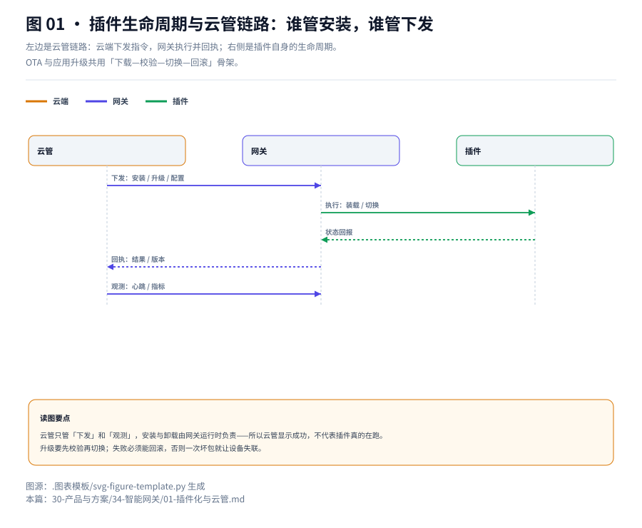
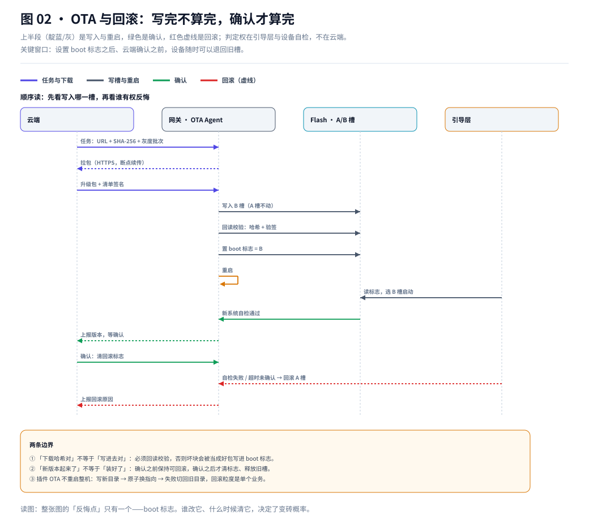
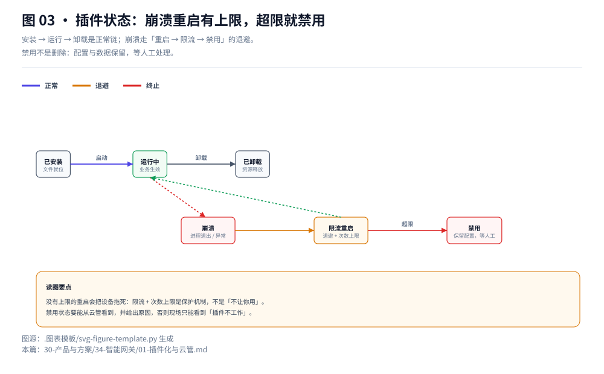

# 插件化与云管

智能网关的「智能」来自插件，规模运维来自云管。两者的共同约束是：**插件不能拖垮底座，云管不能成为单点依赖**。

> 本篇定位：插件运行时、生命周期、权限与资源限制，以及设备注册、设备影子、OTA 和远程诊断的产品方案。网络底座去 `00-智能网关架构`，协议接入去 `02-智能家居与安全`。

## 目录

- [1 一句话模型](#s1)
- [2 速览](#s2)
- [3 插件与云管字段](#s3)
- [4 交互流程](#s4)
- [5 状态机与定时器](#s5)
- [6 设计取舍与边界](#s6)
- [7 与相邻主题的关系](#s7)
- [名词解释](#名词解释)
- [8 参考与关联](#s8)

## 1 · 一句话模型：插件是租客，云管是物业

```text
插件：安装 → 启动 → 运行 → 停止/崩溃 → 重启/卸载
云管：注册 → 在线 → 上报/下发 → OTA → 诊断
```

两条线不是并列功能，而是**两个方向的责任**：插件线管「功能怎么长出来、坏了怎么收场」，云管线管「设备怎么被找到、怎么被改」。它们交汇在同一个资源池上——插件消耗资源，云管需要连接，任何一方失控，另一方都会表现为「离线」。

三个关键认知：

1. **插件必须被「限额」**：CPU、内存、磁盘、网络、重启次数都要有上限，否则一个插件能拖垮整机。
2. **云管是「最终一致」**：设备离线时指令排队，上线后补发；不能假设云端指令实时到达。
3. **OTA 必须可回滚**：下载、校验、安装、重启、确认，每一步都要有失败处理。

「租客 / 物业」这个类比好用的地方是**权责分离**：租客不能改承重墙（底座），物业不能假设租客永远在家（在线）。它失效的地方是：租客违约最多搬走，插件失控会烧掉整栋楼的电闸——所以插件必须有硬限额，不能只靠约定。

因为插件和底座共享同一颗 SoC、同一个内核，所以「限额」不是可选项，而是插件能存在的前提。

> **推论**：插件框架的设计重点不是「怎么装」，而是「装坏了怎么只坏它一个」。凡是回答不了「崩溃后谁重启、重启几次后放弃、放弃后底座还活不活」的方案，都还没设计完。
> **边界**：本篇讲单台网关上的插件与云管。多台设备的批量任务编排、灰度分组策略属于云平台产品能力，这里只写设备侧要配合什么。

## 2 · 速览

| 项 | 内容 |
| --- | --- |
| 插件形态 | 进程、容器、脚本（按产品能力选择） |
| 插件描述 | manifest：名称、版本、入口、依赖、权限、资源 |
| 生命周期 | 安装 → 启动 → 运行 → 停止 → 卸载/升级 |
| 云管协议 | MQTT/HTTPS/WebSocket，JSON 或 CBOR |
| 关键能力 | 注册、设备影子、指令下发、OTA、日志、远程诊断 |
| 安全 | 签名校验、权限最小化、密钥保护、审计 |
| 主要指标 | 插件启动时间、内存占用、崩溃率、OTA 成功率 |
| 本篇不覆盖 | 底座转发（`00`）、物模型与配网（`02`）、双分区实现（OpenWrt 升级篇） |

因为「插件启动时间」和「OTA 成功率」是互相拉扯的指标（启动越快，往往初始化越少、失败恢复越弱），所以这两项必须成对验收；只报其中一个，等于没报。

## 3 · 插件与云管字段

### 3.1 插件 manifest

manifest 是插件与运行时之间的**契约**：运行时只信 manifest 里写的东西，没写的能力一律不给。

| 字段 | 作用 | 坑/边界 |
| --- | --- | --- |
| 名称/ID | 唯一标识 | 重名会导致升级覆盖错误；ID 要跟签名主体绑定，不能只靠文件名 |
| 版本 | 升级/回滚依据 | 版本比较规则要统一（语义化版本 vs 纯字符串），否则 `1.10` 会被判成小于 `1.9` |
| 入口 | 启动命令/镜像 | 路径/架构不匹配会启动失败；脚本入口还要声明解释器 |
| 依赖 | 库、服务、内核模块 | 依赖缺失在目标机型才暴露；内核模块依赖会让「同一插件包」在不同固件上表现不同 |
| 权限 | 网络、设备、文件、总线 | 权限过大等于没有沙箱；给 `/dev` 全读写后，限额只剩「别写满磁盘」 |
| 资源限额 | CPU/内存/磁盘/重启 | 限额过小会频繁被杀；限额只写在 manifest 里而内核不支持 cgroup 时，等于没限 |
| 配置 schema | 参数定义与校验 | 配置升级要兼容旧版本；schema 只做类型校验，不做业务校验 |
| 签名/哈希 | 来源与完整性 | 只校验哈希防不了篡改（哈希也在包里），必须验签；签名要覆盖 manifest 本身 |
| 兼容范围 | 最低固件版本、CPU 架构、ABI | 不写就靠云端猜，装到老固件上才炸；ABI 变化时插件要显式拒绝启动 |
| 数据目录 | 可写路径、持久化范围 | 写在系统分区会在升级时被清掉；写在内存盘重启即丢 |

**为什么 manifest 要这么细？** 因为插件是远程安装的，运行时看不到开发者，只能靠声明做准入。**不这么细会怎样？** 出问题时无法区分「插件写错了」和「平台没给够」，责任边界立刻模糊。

> **边界**：manifest 描述的是「声明」，不是「事实」。插件运行时必须在启动后回读实际 cgroup 限额与权限位，发现与声明不符就拒绝启动——否则一份被改过的 manifest 就能提权。

### 3.2 插件运行时能力

| 能力 | 说明 | 边界 |
| --- | --- | --- |
| 进程隔离 | 独立进程/用户 | 共享内核，逃逸风险仍在；靠 uid + capability 收窄，不是真沙箱 |
| 容器隔离 | namespace/cgroup | 资源开销大，启动慢；且要求内核开启对应选项，低端固件常被裁掉 |
| 消息总线 | 插件与底座通信 | 总线故障会连带所有插件；要允许插件在总线断时降级为直连 |
| 设备模型 | 统一设备抽象 | 模型不统一会导致插件各自造轮子；抽象层变更要考虑老插件兼容 |
| 日志 | 分级、轮转、上报 | 日志过多会写满 Flash；轮转策略要按分区剩余空间反推，不是按条数 |
| 看门狗 | 心跳/重启 | 重启风暴要限流；健康检查只看进程存活会漏掉死锁 |
| 资源限额执行 | cgroup/ulimit/ionice | 只限内存不限 IO 时，插件照样能拖慢底座；限额要覆盖 IO 与 PIDs |
| 权限授予 | capability/设备节点/总线策略 | 一次性给全权限最省事，也最容易一发不可收拾；权限应随业务开关动态收放 |

因为插件与底座共享内核，所以「隔离」在这个场景里始终是**程度问题**：进程模型给的是权限收敛，容器模型给的是视图与配额收敛，两者都不是虚拟机。

### 3.3 权限域：把「权限过大」拆成可检查的项

| 权限域 | 典型需求 | 越权后果 | 边界/误判 |
| --- | --- | --- | --- |
| 网络 | 出站访问指定云服务 | 插件可扫描内网、外联任意地址 | 「能上网」和「能访问内网」是两个权限，别合成一个 |
| 设备节点 | 访问 `/dev` 下特定设备 | 可改射频、读存储、绕过协议栈 | 按节点授权比按目录授权细，但设备名会随内核版本变 |
| 文件 | 读写自己的数据目录 | 可改配置、覆盖其他插件 | 只读挂载系统分区能防误改，防不了读密钥 |
| 总线 | 订阅/发布特定对象 | 可伪造其他设备状态 | 总线权限要按对象前缀授，不能按「总线读写」一刀切 |
| 进程 | 启动子进程、发信号 | 可杀底座进程、提权 | 只能给自己进程组发信号，不能给 PID 1 |
| 系统 | 改防火墙、路由、时间 | 可改整个转发面 | 这类能力应只给「平台内置插件」，不开放给第三方 |

**为什么权限要按域拆？** 因为「权限过大」这句话无法验收；拆成六个域之后，每个域都能写成一条可测的用例。**不拆会怎样？** 安全评审只能凭感觉，出了事也定位不到是哪一项放得太宽。

### 3.4 云管对象

| 对象 | 作用 | 关键字段 | 边界与误判 |
| --- | --- | --- | --- |
| 设备注册 | 标识与鉴权 | 设备 ID、密钥、证书、型号 | 一机一密才能吊销单台；共用密钥时泄露即全网沦陷 |
| 设备影子 | 云端保存最新状态 | 期望值/上报值、版本号 | 影子是「最后一次已知」，不是实时状态；离线设备的影子会骗人 |
| 指令 | 下行控制 | 指令 ID、超时、重试、幂等 | 超时后补发必须幂等，否则「开灯」变「开关灯」 |
| 配置 | 远程参数 | 版本、生效方式、回滚 | 「已下发」不等于「已生效」，要区分下发回执与生效回执 |
| OTA 任务 | 固件/插件升级 | 包 URL、校验、灰度、回滚 | 灰度按批次而不是按随机设备，否则问题机型被平均掉 |
| 遥测 | 运行数据 | 采样周期、上报频率、隐私 | 采样越密越能定位，也越费流量与隐私预算 |
| 诊断 | 远程排障 | 日志、抓包、Ping/Traceroute | 远程诊断通道本身是高权限入口，必须限时、可审计 |

因为云端只保存「最后一次已知状态」，所以任何依赖影子做实时判断的逻辑都会在设备离线时给出错误结论；正确做法是把「在线/离线」也作为影子的一部分显式上报。

## 4 · 交互流程



**读图**：插件从安装到卸载由运行时管理，云管只负责下发和观测；OTA 与应用升级共用「下载—校验—切换—回滚」骨架。

> 图源：`images/图01-插件生命周期与云管.svg`

### 4.1 插件安装与启动

```text
云端/本地选择插件 → 下载包 → 校验签名/哈希
  → 检查依赖与资源 → 解压到插件目录
  → 注册 manifest → 启动进程/容器
  → 健康检查 → 上报运行状态
```

顺序不能换：**先校验再解压**。解压后再校验，等于把不可信内容先落盘；校验失败时目录里已经留下半个包，下次启动会读到残缺版本。同理，「检查依赖与资源」必须在解压前做——空间不足时解压到一半失败，回滚成本比拒绝安装高得多。

健康检查失败要能区分三种情况：进程没起来（启动失败）、进程在但接口不通（初始化失败）、接口通但业务不对（逻辑失败）。三者对应不同的重试策略，混成一个「启动失败」就只能全部重装。

### 4.2 云管上线与指令

```text
设备上电 → 读取设备凭证 → 连接云管（MQTT/HTTPS）
  → 注册/鉴权 → 上报影子 → 订阅指令
  → 云端下发指令 → 设备执行 → 回报结果
  → 离线指令排队 → 上线补发
```

**为什么云管必须是「最终一致」？** 因为家庭网络会断、NAT 会老化、服务端会限流。要求「指令必达且实时」的方案，在弱网现场一定失败；承认最终一致，才能把「排队、重试、过期」写成正常路径。

代价是**必须处理重复与过期**：离线指令补发时可能已经过期（用户早就不想开那盏灯），重试可能重复执行（开两次）。所以每条指令要带指令 ID、过期时间和幂等语义，设备侧按 ID 去重。

> **推论**：看到「云端显示已发、设备没动作」，先分三查：设备是否在线（影子时间戳）、指令是否过期、指令是否幂等冲突。三者的处理方向完全不同。

### 4.3 OTA

```text
创建任务 → 选择设备/灰度 → 下发 URL+校验值
  → 设备下载 → 校验 → 写入备用分区
  → 设置启动标志 → 重启
  → 新版本上报 → 云端确认/回滚
```

上面的文字只说了「有几步」，没说清「谁在什么时候可以反悔」。补一张时序图：



**读图**：绿色是成功路径，红色虚线是回滚。关键是「设置 boot 标志」到「云端确认」之间那段时间窗——这期间设备随时可能回滚，确认之前新版本都不算装好。左侧云端只负责发任务和确认，真正的判定权在引导层与设备自检。

> 图源：`images/图02-OTA与回滚时序.svg`

> **边界**：固件 OTA 靠 A/B 分区切换，插件 OTA 靠目录原子替换（新目录写完再改指向）。两者骨架相同，但**回滚粒度不同**：固件回滚是整机，插件回滚只影响一个业务。把插件升级也做成整机重启，是常见的过度设计。
> **待验证**：各平台的「确认」由谁发起（云端确认、设备自确认、看门狗超时）、超时多长，差异很大，以平台文档与实机日志为准。

### 4.4 异常分支

| 异常 | 现象 | 定位方向 | 容易误判成 |
| --- | --- | --- | --- |
| 插件装不上 | 安装失败/回滚 | 架构不匹配、依赖缺失、空间不足、签名 | 当成云端下发问题，反复重推同一个坏包 |
| 插件反复重启 | 业务时断时续 | 资源限额、崩溃日志、看门狗 | 当成网络抖动，去查 Wi-Fi |
| 云管频繁掉线 | 远程不可用 | 网络、证书、心跳、服务端限流 | 当成设备故障，其实本地业务正常 |
| 指令不生效 | 云端显示已发 | 设备离线、指令过期、幂等冲突 | 当成「设备不听话」，漏掉过期语义 |
| OTA 失败 | 版本不变/变砖 | 下载、校验、分区、回滚 | 只查下载，漏掉「写后回读」与 boot 标志 |
| 日志写满 | 设备异常/升级失败 | 日志轮转、上报策略 | 当成 Flash 坏块，其实是日志没轮转 |

因为六类异常都会表现为「功能不好用」，所以定位顺序是：**先判是单个插件还是全部插件**——单个插件的问题不要动云管，全部插件的问题不要只重启某一个。

## 5 · 状态机与定时器



**读图**：插件从安装到卸载由运行时管理；崩溃后重启限流，超限则禁用。

> 图源：`images/图03-插件与云管状态.svg`

因为所有状态迁移都挂在超时上，所以「状态卡住」和「定时器没触发」是同一类问题：先查定时器有没有跑，再查业务逻辑。

| 对象 | 状态 | 关键参数 | 失败表现 |
| --- | --- | --- | --- |
| 插件 | 未安装 → 已安装 → 启动中 → 运行 → 停止 → 卸载 | 启动超时、健康检查间隔 | 卡在「启动中」，界面显示已安装但无业务 |
| 插件异常 | 崩溃 → 重启 → 限流 → 禁用 | 最大重启次数、退避 | 禁用后仍能被云端「重新启用」，形成重启循环 |
| 云管连接 | 未连接 → 连接中 → 在线 → 重连 | 心跳、退避、凭证有效期 | 显示在线但不收指令：订阅丢失或会话被顶掉 |
| 设备影子 | 同步中 → 一致 → 冲突 | 版本号、冲突解决策略 | 冲突时后写覆盖，用户看到「设置自己变回去」 |
| OTA | 待下载 → 下载 → 校验 → 安装 → 重启 → 确认 | 超时、重试、回滚窗口 | 停在「重启」：新版本没上报，云端一直等 |

定时器与超时（具体数值随平台不同，这里给作用与设置依据）：

| 定时器/超时 | 管什么 | 设置依据 | 边界 |
| --- | --- | --- | --- |
| 安装超时 | 下载+解压+注册的总时长 | 最慢网络下的包大小 ÷ 实测带宽，再留余量 | 设太短会在弱网下反复重装 |
| 插件启动超时 | 从 fork 到健康检查通过 | 冷启动最坏耗时（含首次初始化） | 首次启动比后续慢，用稳态值会误杀 |
| 健康检查间隔 | 发现「活着但没用」 | 业务响应时间，不是进程存活 | 间隔太长故障发现慢，太短则自身耗资源 |
| 重启退避 | 崩溃后延迟重启 | 指数退避 + 上限 | 无上限会让坏插件永远占着重启循环 |
| 重启计数窗口 | 多久内重启几次算「风暴」 | 业务自愈所需次数 | 窗口过短会把偶发崩溃判成风暴 |
| 云管心跳 | 在线判定与 NAT 保活 | 小于 NAT 老化时间 | 心跳通不代表订阅在，需另有订阅检查 |
| 指令超时 | 下发后多久算失败 | 端到端最坏时延 | 只按云端发出时间算，会漏掉设备排队时间 |
| 影子同步窗口 | 期望值与上报值允许不一致的时长 | 设备执行+上报耗时 | 窗口内不一致是正常，超过才是异常 |
| OTA 下载/回滚超时 | 下载停滞判定、未确认回滚 | 包大小与网络、首次启动自检耗时 | 回滚超时设太短，会把「慢启动」判成「坏版本」 |

> **边界**：状态名是产品抽象。同一个「运行」，有的平台指进程在，有的指健康检查通过；对外报指标前先对齐定义。
> **待验证**：各产品的插件隔离级别、重启策略、云管协议和 OTA 灰度规则不同，需按平台文档确认。

## 6 · 设计取舍与边界

### 6.1 开放插件 vs 封闭系统

开放插件能快速扩展生态，但审核、权限和兼容性成本高；封闭系统稳定，但功能迭代慢。运营商网关通常只开放「白名单插件」，消费级网关可开放应用商店。

**为什么运营商倾向白名单？** 因为它的故障成本是「一省用户同时打客服」，而不是「一个用户卸载重装」。**不用白名单会怎样？** 一个第三方插件的内存泄漏会在灰度批次里放大成批量重启。**代价**是生态起不来：白名单意味着每个插件都要走兼容性测试与签名流程，上线周期以周计。

### 6.2 容器化的代价

容器提供更好的隔离和依赖打包，但内存/存储开销大，启动慢，且需要内核支持。低端网关更适合「进程 + 权限 + cgroup」的轻量方案。

**准确的边界**：容器隔离的是视图与配额，不是内核——它挡不住内核漏洞提权，也挡不住恶意插件耗尽 IO。真正需要强隔离（第三方不可信代码、多租户）时，虚拟机或独立硬件才够；网关上的容器主要是「依赖打包」而非「安全边界」。

### 6.3 云管依赖的边界

云管不能成为业务单点：本地场景、安防、基础网络必须在断网时可用。云端指令要有超时和幂等，避免恢复网络后「补发一堆过期指令」。

**为什么这条最容易破？** 因为开发阶段永远在线，测试环境不会拔网线。**验证方法**：把 WAN 拔掉跑一遍全部验收用例，任何一步卡住超过心跳周期，就说明云管被写成了强依赖。

### 6.4 OTA 的灰度

全量推送风险高，应按型号/区域/批次灰度，并保留回滚窗口。升级包要签名，设备要校验，不能只靠 HTTPS。

**为什么「只靠 HTTPS」不够？** HTTPS 保证传输通道，不保证包的内容是厂商签的：中间人、被入侵的 CDN、配置错的源站都能塞进任意包。签名把信任锚从「网络」移到「厂商密钥」，这才是 OTA 的安全边界。**代价**是密钥管理：签名密钥泄露等于全网可被升级。

### 6.5 遥测与隐私

遥测能提升运维效率，但会采集设备状态、网络质量甚至用户行为。产品要明确采集范围、脱敏方式和用户授权，避免合规风险。

**边界**：遥测的合法性来自「必要性 + 告知 + 可关闭」，不是来自「用户点了同意」这一行字。采集 MAC、SSID 列表这类可识别信息时，要先做哈希或截断，否则一份遥测日志就是一份用户画像。

### 6.6 限额怎么定：三步而不是拍脑袋

| 步骤 | 做什么 | 答错的后果 |
| --- | --- | --- |
| ① 测基线 | 单插件空载/满载的 RSS、CPU、IO、启动耗时 | 基线不准，后面所有余量都是错的 |
| ② 留余量 | 按峰值 × 1.5–2 倍设硬限，软限提前预警 | 按均值设定额，场景联动时必然 OOM |
| ③ 定优先级 | 底座进程 `oom_score_adj` 调低，插件调高 | 不调优先级，OOM 先杀底座，整机失联 |

**为什么限额不能照抄参考值？** 因为同一个插件在不同 SoC、不同固件上内存差一倍很常见（musl vs glibc、是否带调试符号）。限额要按目标机型实测，参考值只用来发现「差一个数量级」的异常。因为限额是按机型实测的，所以同一份准入结论不能直接搬到另一款硬件上。

## 7 · 与相邻主题的关系

| 相邻对象 | 关系 | 边界（细节去哪看） |
| --- | --- | --- |
| [智能网关架构](./00-智能网关架构.md) | 插件运行的底座 | 分层、资源预算、上电顺序在那篇；本篇不重复整机结构 |
| [智能家居与安全](./02-智能家居与安全.md) | 插件接入的设备与隔离 | 配网、VLAN/ACL 策略在那篇；本篇只讲插件如何拿到设备权限 |
| [TR-069 与 ACS 运维](../33-CPE/02-TR-069与ACS运维.md) | 运营商传统管理通道 | 参数模型、ACS 交互、开通流程在那篇；本篇只对比「云管与 ACS 并存」 |
| [OpenWrt 系统框架](../../20-平台与系统/22-OpenWrt/02-系统框架/00-系统框架总览.md) | procd/ubus/UCI | 进程守护、总线、配置系统的实现细节在那篇；本篇不写代码路径 |
| [OpenWrt 升级与恢复](../../20-平台与系统/22-OpenWrt/05-升级与恢复/00-升级与恢复总览.md) | 双分区与回滚 | 分区布局、镜像格式、bootloader 行为在那篇；本篇只写产品侧时序 |

一句话：**插件化解决「功能怎么长出来」，云管解决「设备怎么管得住」，两者都必须服从底座的稳定性。**

因为「插件权限」与「设备隔离」会跨到安全篇、「OTA 回滚」会跨到平台篇，所以这里只留关系和边界；把实现细节复制过来会制造两份正本，改一处忘一处。

## 名词解释

> 缩写给出英文全称；非缩写用“—”表示。

| 术语 | 英文全称 | 解释 |
| --- | --- | --- |
| OTA | Over-The-Air | 空中升级。 |
| MQTT | Message Queuing Telemetry Transport | 轻量消息发布/订阅协议。 |
| manifest | — | 插件描述文件。 |
| cgroup | Control Group | Linux 资源隔离机制。 |
| namespace | — | Linux 命名空间隔离机制。 |
| 设备影子 | Device Shadow | 云端保存的设备状态副本。 |
| 幂等 | Idempotency | 同一指令重复执行结果一致。 |
| 灰度 | Canary Release | 分批逐步放量。 |
| 看门狗 | Watchdog | 监控进程/系统并触发重启。 |
| CBOR | Concise Binary Object Representation | 简洁二进制对象表示。 |
| HTTPS | HyperText Transfer Protocol Secure | 带 TLS 的 HTTP，用于拉包与云管 API。 |
| WebSocket | — | 在单个 TCP 连接上做全双工消息的协议。 |
| JSON | JavaScript Object Notation | 文本化结构化数据格式。 |
| API | Application Programming Interface | 应用编程接口。 |
| A/B 分区 | A/B Partition | 双系统分区，升级写备用槽，失败可回滚。 |
| 签名 | Digital Signature | 用私钥对包摘要签名，设备用公钥验签确认来源与完整性。 |
| 证书 | Digital Certificate | 绑定公钥与身份的数据结构，用于双向认证。 |
| 哈希 | Hash | 对数据计算的定长摘要，用于完整性校验。 |
| ABI | Application Binary Interface | 二进制接口约定；ABI 变了老插件不能直接跑。 |
| 设备注册 | Device Registration | 设备首次接入云平台时完成身份登记与鉴权。 |
| 健康检查 | Health Check | 周期性探测插件是否真正可用，而非仅进程存活。 |
| 资源限额 | Resource Quota | 对 CPU、内存、IO、进程数等设上限，由内核或运行时执行。 |
| 退避 | Backoff | 失败后按递增间隔重试，避免雪崩。 |
| USP | User Services Platform | TR-369 定义的设备管理架构，支持多控制器。 |
| TR-069 | CPE WAN Management Protocol | 运营商 ACS 远程管理 CPE 的协议（CWMP）。 |

因为「签名」「哈希」「证书」经常被混着说，所以这里分成三行：哈希只保证内容没变，签名保证是谁发的，证书保证公钥属于谁——少一层，OTA 的信任链就断了。

## 8 · 参考与关联

**标准/文档**

- MQTT 3.1.1 / 5.0
- TR-369：USP 多控制器与消息传输
- Matter：设备模型与配网
- OpenWrt procd/ubus 文档

**关联**

- [设备形态对比](../00-设备形态对比.md)
- [智能网关架构](./00-智能网关架构.md)
- [智能家居与安全](./02-智能家居与安全.md)
- [TR-069 与 ACS 运维](../33-CPE/02-TR-069与ACS运维.md)

因为 MQTT 5.0 比 3.1.1 多了属性与原因码，混用时行为取决于 broker 实现，所以列版本时必须写清；只说「支持 MQTT」在联调时等于没说。

---

> **本篇定位**：智能网关插件运行时、生命周期、权限限额与云管/OTA 的产品方案。
> **素材来源**：`studyspace/3.协议应用/12.zerotier/`（插件化业务与设备端验证参考）、`studyspace/1.知识体系/7.openwrt/2.应用管理平面/`。
> **待验证**：具体产品的插件隔离方案、云管协议、OTA 灰度策略和遥测范围。原说法「OTA 与插件升级共用同一套切换机制」已收窄为「骨架相同，固件用 A/B 分区、插件用目录原子替换，回滚粒度不同」。
