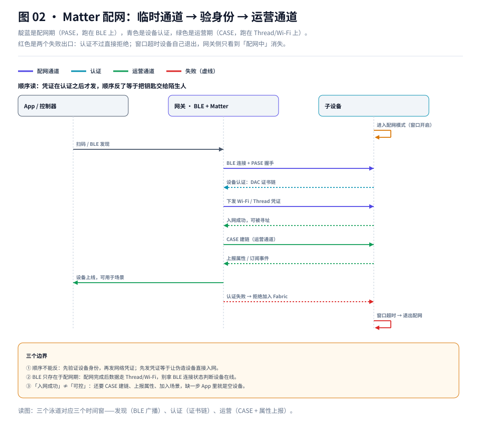

# 智能家居与安全

智能家居接入网关的核心不是「支持多少协议」，而是**协议怎么统一抽象、设备怎么隔离、密钥怎么保护**。多协议只是入口，统一模型和安全边界才是产品能力。

> 本篇定位：Wi-Fi/BLE/Zigbee/Thread/Matter 的接入角色、配网流程、网络隔离与安全底线。协议原理去 `10-基础理论/04-短距无线`，平台实现去 `20-平台与系统`。

## 目录

- [1 一句话模型](#s1)
- [2 速览](#s2)
- [3 协议与隔离字段](#s3)
- [4 交互流程](#s4)
- [5 状态机与定时器](#s5)
- [6 设计取舍与边界](#s6)
- [7 与相邻主题的关系](#s7)
- [名词解释](#名词解释)
- [8 参考与关联](#s8)

## 1 · 一句话模型：南向多协议，北向一个模型

```text
子设备（Wi-Fi/BLE/Zigbee/Thread）
  → 协议栈 → 设备抽象（属性/服务/事件）
  → 场景引擎/云管 → App/语音
```

这张图的分水岭在**设备抽象层**：往南，每种协议有自己的组网、寻址、配网方式；往北，只剩「属性/服务/事件」。上层的场景、自动化、语音都只面对抽象层，所以新增一种协议不需要改场景引擎——但前提是抽象层能表达这种协议的能力。因为南向协议各异、北向只用一套模型，所以新增协议的成本集中在抽象层，而不是场景层。

三个关键认知：

1. **协议不同，模型要统一**：上层只关心「开关/亮度/温度」，不关心底层是 Zigbee 还是 Thread。
2. **IoT 设备必须隔离**：摄像头、插座、传感器放在独立 VLAN/SSID，不能和手机/PC 混在一个二层域。
3. **安全从配网开始**：配网凭证、设备密钥、OTA 签名，任何一环丢失都可能导致批量失守。

一句类比：网关是**多语种前台**，各协议是方言，统一模型是登记表。类比失效的地方是：翻译会丢东西——厂商私有属性（多路开关的每个回路、洗衣机的自定义程序）在统一模型里常常只能映射成「未知能力」，用户看到的就是「这个设备接入了但功能不全」。

> **推论**：接入能力不等于可控能力。验收时要按「设备能力 × 模型覆盖度」列矩阵，而不是数「支持多少种协议」。
> **边界**：本篇讲网关侧的接入、配网、隔离与密钥。具体射频参数、信道、速率去 `10-基础理论`；AP/SSID 的驱动实现去 `20-平台与系统`。

## 2 · 速览

| 项 | 内容 |
| --- | --- |
| 接入协议 | Wi-Fi、BLE、Zigbee、Thread、Matter（应用层） |
| 网关角色 | Wi-Fi AP、BLE 配网、Zigbee 协调器、Thread 边界路由器、Matter 控制器/桥 |
| 关键对象 | 子设备、配网凭证、设备模型、场景、隔离策略 |
| 关键能力 | 发现/配网、控制、状态同步、场景联动、OTA |
| 安全机制 | 安全启动、签名升级、密钥存储、网络隔离、最小权限 |
| 主要风险 | 弱口令、配网劫持、IoT 横向移动、云 API 越权 |
| 本篇不覆盖 | 插件运行时与云管（`01`）、整机分层（`00`）、协议报文细节（`10`） |

因为「支持协议多」和「安全边界清」是反向关系——每多一种协议就多一个配网入口、一套密钥、一个 OTA 通道——所以速览把「主要风险」与「接入协议」并列，选型时一起看。

## 3 · 协议与隔离字段

### 3.1 协议对比

| 协议 | 物理层 | 拓扑 | 网关角色 | 典型设备 | 边界与易混 |
| --- | --- | --- | --- | --- | --- |
| Wi-Fi | 2.4/5/6 GHz | 星型 | AP | 摄像头、插座、家电 | IoT 设备多在 2.4 GHz；Wi-Fi 不省电，电池设备基本不用它常连 |
| BLE | 2.4 GHz | 点对点/广播（另有 BLE Mesh） | 配网代理 | 门锁、传感器、手环 | Matter 配网主要走 BLE，较新规范也支持经边界路由器用 IP 配网；配网完成后数据不走 BLE，别把「能连上」当成「能长期控制」 |
| Zigbee | 2.4 GHz | 网状 | 协调器 | 灯、传感器、开关 | 必须有协调器建网；与 Wi-Fi 同频，信道要错开；跨厂商互通仍看厂商实现 |
| Thread | 2.4 GHz | 网状（IPv6） | 边界路由器 | 灯、传感器、门锁 | 没有边界路由器就没有 IPv6 前缀与 RA，App 无法直接访问该网络 |
| Matter | 承载于 Wi-Fi/Thread/以太 | — | 控制器/桥 | 跨生态设备 | 是应用层标准，不解决射频与组网；桥接设备的能力映射常不完整 |
| Z-Wave | sub-GHz（区域频段不同） | 网状 | 控制器（内置或 USB 模块） | 门锁、开关 | 不参与 2.4 GHz 共存，但不同区域频点不同，模块不能混用 |

> **待验证**：Z-Wave 的区域频点（欧/美/澳等）与国内可用频段以模块规格与当地法规为准；本表只表达「sub-GHz、不参与 2.4G 共存」这一点。

因为 Matter 只规定应用层与配网流程，所以「支持 Matter」并不等于「支持 Thread」——一个 Matter 设备可以跑在 Wi-Fi 上；反过来，Thread 设备也不必是 Matter 设备。

### 3.2 网关角色

| 角色 | 作用 | 边界 |
| --- | --- | --- |
| Wi-Fi AP | 提供 IoT SSID | 2.4G 拥塞、终端数限制；IoT SSID 与主 SSID 共用射频，隔离靠 VLAN 不靠 SSID |
| BLE 配网代理 | 把 Wi-Fi/Thread 凭证传给设备 | 配网窗口、广播安全；BLE 连接数有限，批量配网会排队失败 |
| Zigbee 协调器 | 建网、路由、维护 | 信道与 Wi-Fi 干扰；协调器换信道等于全网重建，已有设备要重新入网 |
| Thread 边界路由器 | 连接 Thread 网络与 IP | 需要 IPv6 与路由通告；BR 重启后前缀变化会让旧地址失效 |
| Matter 控制器 | 配网、控制、订阅 | 依赖设备认证证书；控制器换了生态，设备要重新配网或共享 Fabric |
| Matter 桥 | 把非 Matter 设备映射成 Matter | 能力映射不完整；桥挂了，底下所有设备一起失联 |

因为一个网关同时扮演六种角色，所以「网关重启」对不同设备意味着不同事故：Wi-Fi 设备掉线重连，Zigbee 网络可能重建，Thread 前缀可能变化，Matter 订阅要重订。排障时先问「哪一类设备受影响」，比问「网关是不是坏了」有效。

### 3.3 隔离与访问控制

| 对象 | 配置 | 作用 | 边界 |
| --- | --- | --- | --- |
| IoT SSID | 独立 SSID/VLAN | 隔离 IoT 与主网络 | 部分设备只支持 2.4G；独立 SSID 不自动带 VLAN，要显式绑 |
| 访客网络 | 独立 SSID + 客户端隔离 | 访客只上网 | 不能访问内网服务；开了客户端隔离，访客之间投屏也会断 |
| ACL | 源/目的/端口 | 限制 IoT 访问范围 | 规则过多难维护；按「目的服务」写比按 IP 写可维护 |
| mDNS 反射 | 受控转发 | 跨 VLAN 发现 | 可能泄露设备信息；反射全部服务等于把内网目录广播给 IoT 网 |
| 上行限制 | 只允许必要云服务 | 降低外联风险 | 影响厂商 App 功能；云服务换域名就会误杀 |
| 本地控制 | 局域网直连 | 断网可用 | 需要本地鉴权；只靠「在内网」当鉴权，被 IoT 设备横向利用 |

**为什么隔离要放在网关而不是设备？** 因为 IoT 设备的安全能力参差不齐，很多摄像头固件几年不更新。网关是唯一能统一执行策略的位置：设备不配合，网关也能拦住它的横向流量。

### 3.4 统一设备模型：抽象层丢什么

| 抽象层 | 典型内容 | 映射时丢什么 | 边界/误判 |
| --- | --- | --- | --- |
| 属性 | 开关、亮度、色温、温度 | 厂商自定义量程与单位 | 亮度 0–100 与 0–254 混用，表现为「调到 50% 却很暗」 |
| 服务/动作 | 开、关、调光、锁定 | 组合动作（一键场景）被拆成多条指令 | 拆开后没有原子性，中途失败会停在半开状态 |
| 事件 | 按键、门磁、移动 | 事件顺序与时间戳 | 网关补发历史事件时，App 会「重放」一遍警报 |
| 设备元数据 | 厂商、型号、固件版本 | 私有能力位 | 元数据缺失时只能按「通用开关」接入，功能被砍半 |

因为上层只认模型不认协议，所以模型设计得越窄，接入越容易、能力越弱；设计得越宽，越接近「透传」，跨生态互操作又失效。产品要在「覆盖主流能力」和「保留厂商扩展」之间划线。

## 4 · 交互流程


**读图**：南向协议栈把设备抽象成统一模型，北向由场景/云管消费；IoT 设备放在独立 VLAN，通过受控规则访问外网和主网络。

> 图源：`images/图01-多协议接入与隔离.svg`

### 4.1 Matter 配网

```text
设备进入配网模式 → App 扫码/蓝牙发现
  → 传递 Wi-Fi/Thread 凭证 → 设备入网
  → 交换/验证设备证书 → 加入 Fabric
  → 上报属性 → 网关/App 可控制
```

这段文字把「凭证」和「证书」写在了同一步，实际是两件事，而且顺序不能反：



**读图**：左边是配网期（BLE/PASE，临时通道），中间是设备认证（DAC 证书链），右边才是运营期（CASE，长期通道）。红色虚线是两个失败出口：认证不过直接拒绝，窗口超时设备自己退出。顺序错了会出现「设备已入网但不受控」。

> 图源：`images/图02-Matter配网时序.svg`

> **推论**：配网失败先分三段查——发现不到（BLE/二维码）、连上但认证失败（证书链/厂商域）、入网但不通（IPv6/前缀/边界路由器）。三段的日志位置完全不同。
> **边界**：上图是「控制器直接配网」的路径。若设备通过厂商云预配或已被其他生态占用，它的 Fabric 里可能已有管理员，必须先移除或共享，否则新控制器加不进去。

### 4.2 Zigbee/Thread 入网

```text
协调器/边界路由器开网（限时）
  → 设备入网 → 分配地址 → 上报能力
  → 网关建立设备模型 → 场景可用
```

「限时」是安全设计而不是省事：开网期间任何设备都能加入，长期开网等于把网络钥匙插在门上。Zigbee 用协调器开网窗口，Thread 用边界路由器与配网器授权，两者都不应该默认常开。

### 4.3 控制与状态同步

```text
App/语音 → 云/本地 → 场景引擎
  → 协议栈下发 → 设备执行
  → 状态回报 → 设备影子 → App 更新
```

控制路径与 `00-智能网关架构` 里那张两条路径的图是同一件事，差别只在最后一跳是「协议插件 → 子设备」。所以延迟要分两段看：云端往返（几十到几百毫秒）与协议栈下发（Zigbee/Thread 的网状跳数与重传，可能到秒级）。

### 4.4 异常分支

| 异常 | 现象 | 定位方向 | 容易误判成 |
| --- | --- | --- | --- |
| 配网失败 | 设备反复闪烁 | 2.4G 信号、凭证错误、配网窗口 | 当成设备坏，忽略「窗口已关」 |
| 设备频繁掉线 | 时好时坏 | 干扰、路由深度、电量、网关负载 | 当成网关带机量不足，扩容无效 |
| 跨 VLAN 发现失败 | App 找不到设备 | mDNS 反射、ACL、组播 | 当成设备离线，其实在线只是不可见 |
| 控制延迟 | 指令慢/丢 | 云链路、协议栈拥塞、重试 | 只测 Wi-Fi 时延，漏掉网状重传 |
| 设备被劫持 | 异常外联/被控 | 弱口令、配网漏洞、固件 | 当成「用户自己配错」，没查默认口令 |
| OTA 失败 | 设备变砖 | 包校验、电量、回滚 | 当成网络问题，忽略电量阈值 |

因为「设备找不到」和「设备不在线」在 App 上长得一样，所以先看网关侧有没有该设备的链路状态：有链路无发现是隔离/组播问题，无链路才是掉线。

## 5 · 状态机与定时器


**读图**：子设备要经过配网、认证、上线才可控；离线不等于被移除。

> 图源：`images/图03-子设备与配网状态.svg`

因为「在线」是由上报周期推出来的，所以离线判定阈值一旦设错，上面所有统计（在线设备数、场景可用性）都会跟着错。

| 对象 | 状态 | 关键参数 | 失败表现 |
| --- | --- | --- | --- |
| 子设备 | 未配网 → 配网中 → 在线 → 离线 | 配网窗口、心跳、离线判定 | 离线后仍显示上次状态，用户以为还能控制 |
| Matter Fabric | 未加入 → 加入 → 移除 | 证书、Fabric ID | 移除不彻底，重配时提示「已被占用」 |
| Zigbee/Thread 网络 | 建网 → 允许入网 → 关闭 | 开网时间、信道 | 开网窗口关不掉，任何设备都能加入 |
| 场景 | 待触发 → 执行 → 完成/失败 | 超时、重试、冲突策略 | 多条场景抢同一设备，最后一条覆盖前面的 |
| OTA | 下载 → 校验 → 安装 → 确认 | 电量阈值、回滚 | 低电量设备升级中断，停在半写入 |

定时器与超时（数值随协议与产品实现不同，这里只给作用与设置依据）：

| 定时器/超时 | 管什么 | 设置依据 | 边界 |
| --- | --- | --- | --- |
| 配网窗口 | 允许新设备加入的时间段 | 用户操作耗时（开 App、扫码） | 太长等于长期开网；太短用户还没点完就关了 |
| 入网/认证超时 | 单台设备从发起到入网的上限 | 最慢配网路径（BLE 握手 + 入网） | 与窗口共用同一个倒计时，会提前踢掉正在认证的设备 |
| 设备心跳/上报周期 | 在线判定与状态刷新 | 设备功耗预算 | 电池设备周期长，用市电设备参数会误判离线 |
| 离线判定阈值 | 多久没上报算离线 | 心跳周期 × 2–3 | 网状网络深度大时丢包多，阈值过小会抖动 |
| 场景执行超时 | 一条自动化最多跑多久 | 最长设备响应时间之和 | 设太短会把「慢」判成「失败」并重试，造成重复动作 |
| OTA 电量阈值 | 低于多少电量拒绝升级 | 升级全程耗电 + 余量 | 只判开始时的电量，升到一半没电同样变砖 |
| mDNS 缓存 TTL | 发现结果保留多久 | 设备上下线频率 | 缓存过长会让「已移除设备」仍显示可点 |

> **边界**：上表状态是**网关侧视图**，不是协议状态机。Zigbee 设备在协议层还有入网/认证/路由等状态，Thread 有父节点与路由状态，那些在 `10-基础理论` 的协议篇。
> **待验证**：不同协议的配网窗口、心跳周期和离线判定不同，需按协议规范与产品实现确认。Matter 的配网窗口按规范分基础窗口（Basic）与增强窗口（Enhanced），具体时长与扩展规则以规范版本为准。

## 6 · 设计取舍与边界

### 6.1 多协议堆叠 vs 聚焦

支持协议越多，射频共存、认证和测试成本越高。产品应按目标生态选择：Matter/Thread 面向跨生态，Zigbee 面向存量设备，Wi-Fi 面向高带宽设备。

**为什么不能「全都要」？** 因为 2.4 GHz 只有一段：BLE、Zigbee、Thread 与 Wi-Fi 2.4G 抢同一块频谱，每加一种协议就要重做共存测试与天线隔离。**不用会怎样？** 少一种协议，就少一批存量设备可接，产品在换机市场缺卖点。**代价**是测试矩阵按协议数相乘增长。

### 6.2 云控制 vs 本地控制

云控制能做远程和跨设备编排，但依赖网络和云服务；本地控制低时延、断网可用，但跨品牌互操作难。关键场景应本地优先、云端增强。

**边界**：本地优先的前提是「本地有完整的设备模型与场景定义」。如果场景只存在云端，断网时本地连「按一下开关」都不知道该控谁——这时说「支持本地控制」是假的。

### 6.3 隔离的代价

IoT 独立 VLAN 能限制横向移动，但会增加配网、发现和跨网访问的复杂度。产品要提供「隔离 + 受控互通」的默认策略，而不是让用户自己配 ACL。

**为什么默认策略比可配置更重要？** 因为绝大多数用户不会配 ACL。**不用隔离会怎样？** 一台被攻陷的摄像头就能扫描并尝试登录家里的 NAS 和 PC。**代价**是发现类协议（mDNS、组播）被切断，需要做受控反射，而反射本身就是新的攻击面。

### 6.4 开放 API 的边界

开放 API 能接入第三方生态，但会扩大攻击面。API 要鉴权、限流、审计，并明确「能读什么、能控什么」，不能把整机管理权限开放给插件。

**边界**：「能控灯」和「能读全屋设备列表」是两个权限。开放 API 常在前者上做得很细，在后者上一次性放开，结果一份第三方集成就拿到了全屋设备画像。

### 6.5 安全不是一次性认证

通过 Matter/Zigbee 认证只说明协议合规，不代表整机安全。安全启动、签名升级、密钥保护、漏洞响应流程要贯穿产品生命周期。

**为什么认证不够？** 认证测的是「互操作与协议行为」，测不到你的 Web 后台弱口令、OTA 签名私钥怎么存、调试串口是否关闭。**反例**：协议层全部合规，但产线用同一把调试密钥，一台设备被拆就能批量伪造。

### 6.6 配网阶段的攻击面

| 攻击面 | 表现 | 缓解 | 边界 |
| --- | --- | --- | --- |
| 配网窗口常开 | 陌生人可把自己的设备加入 | 窗口限时 + 物理触发（按键） | 窗口太短，正常用户也配不上 |
| 凭证明文传递 | BLE/局域网可被旁听 | 用带密钥协商的配网通道（如 PASE） | 老设备只支持明文配网，只能靠物理 proximity 限制 |
| 设备身份不校验 | 伪造设备接入并上报假状态 | 校验设备证书链（DAC） | 白牌设备可能没有证书，只能降级为「不信任但可用」 |
| 默认口令 | 批量设备同一口令 | 一机一密 + 首配强制改 | 只改管理口令不改协议密钥，仍然可被仿冒 |
| 调试接口 | 串口/Telnet 未关 | 量产关闭 + 签名固件 | 关闭后售后返修成本上升 |

因为配网是「把陌生人带进家」的唯一入口，所以它的安全等级应该高于日常控制；控制接口泄露是「灯被开」，配网接口泄露是「家里多了一台别人的设备」。

## 7 · 与相邻主题的关系

| 相邻对象 | 关系 | 边界（细节去哪看） |
| --- | --- | --- |
| [BLE/ZigBee/Thread](../../10-基础理论/12-通信科学/04-无线通信/04-短距无线/00-BLE-ZigBee-Thread.md) | 短距协议原理 | 组网、路由、信道、报文在那篇；本篇只写网关角色与配网产品流程 |
| [Wi-Fi 频段信道与速率](../../10-基础理论/12-通信科学/04-无线通信/02-Wi-Fi/01-Wi-Fi频段信道与速率.md) | 2.4G 干扰与信道 | 信道规划与速率模型在那篇；本篇只说「IoT 多在 2.4G」 |
| [智能网关架构](./00-智能网关架构.md) | 整机分层 | 资源预算、上电顺序在那篇；本篇不重复整机结构 |
| [插件化与云管](./01-插件化与云管.md) | 插件与控制通道 | 插件权限、云管指令语义在那篇；本篇只讲设备侧接入 |
| [VLAN 与 Trunk](../../10-基础理论/11-网络科学/02-链路层/02-VLAN与Trunk.md) | IoT 隔离的二层基础 | VLAN 标记、Trunk、PVID 的报文细节在那篇；本篇只写隔离策略 |
| [OpenWrt 无线子系统](../../20-平台与系统/22-OpenWrt/04-无线/00-无线子系统总览.md) | AP/SSID 实现 | 驱动、hostapd、多 SSID 配置在那篇；本篇不写命令 |

一句话：**智能家居的产品能力 = 协议覆盖 × 统一模型 × 隔离强度 × 密钥安全。**

因为协议原理、VLAN 报文、无线驱动各有正本，所以这里只保留「网关承担什么角色、要做什么决策」；把报文细节抄过来，会在协议升级时留下两份过期内容。

## 名词解释

> 缩写给出英文全称；非缩写用“—”表示。

| 术语 | 英文全称 | 解释 |
| --- | --- | --- |
| IoT | Internet of Things | 物联网。 |
| BLE | Bluetooth Low Energy | 低功耗蓝牙。 |
| Thread | — | 基于 IPv6 的低功耗网状网络协议。 |
| Matter | — | 跨生态智能家居应用层标准。 |
| Zigbee | — | 低功耗短距网状网络协议。 |
| Z-Wave | — | sub-GHz 的智能家居网状协议，需专用模块。 |
| AP | Access Point | 无线接入点。 |
| SSID | Service Set Identifier | 无线网络名称。 |
| VLAN | Virtual Local Area Network | 虚拟局域网。 |
| ACL | Access Control List | 访问控制列表。 |
| mDNS | Multicast DNS | 组播域名解析，用于局域网设备发现。 |
| DNS-SD | DNS Service Discovery | 基于 DNS 的服务发现，Matter 用它广播设备服务。 |
| Fabric | — | Matter 中的信任域，由证书和 Fabric ID 标识。 |
| OTA | Over-The-Air | 空中升级。 |
| 边界路由器 | Border Router | 连接 Thread 网络与 IP 网络的设备，负责前缀与路由通告。 |
| 配网 | Commissioning | 把新设备接入网络与信任域的过程，含发现、认证、下发凭证。 |
| PASE | Passcode Authenticated Session Establishment | Matter 配网期的临时安全会话，通常跑在 BLE 上。 |
| CASE | Certificate Authenticated Session Establishment | Matter 运营期的设备间安全会话，基于证书。 |
| DAC | Device Attestation Certificate | 设备认证证书，证明设备由合规厂商生产。 |
| PAA | Product Attestation Authority | 产品认证根机构，DAC 证书链的信任锚。 |
| 6LoWPAN | IPv6 over Low-Power Wireless Personal Area Network | 在 802.15.4 上传 IPv6 的适配层，Thread 依赖它。 |
| IPv6 | Internet Protocol version 6 | 互联网协议第 6 版；Thread 网络靠它寻址。 |
| RA | Router Advertisement | IPv6 路由通告，边界路由器用它给 Thread 设备下发前缀。 |
| SRP | Service Registration Protocol | Thread 中设备向边界路由器注册服务的协议，供发现使用。 |
| 客户端隔离 | Client Isolation | 同一 SSID 内终端互相不可见的接入点策略。 |
| 组播 | Multicast | 一对多的报文投递方式，发现类协议依赖它。 |
| 凭证 | Credential | 入网所需的网络参数与密钥（Wi-Fi 口令、Thread 网络密钥等）。 |
| 信任域 | Trust Domain | 共享同一信任根的一组设备；Matter 用 Fabric 表达。 |

因为「凭证」和「证书」在中文里都常被叫「密钥」，所以拆成三行：凭证是入网用的，证书是证明身份的，Fabric 是把二者绑成一个信任域的容器；混用会直接导致配网流程设计错误。

## 8 · 参考与关联

**标准**

- Matter 1.x：应用层、设备模型、配网
- Thread 1.3/1.4：低功耗 IPv6 网状网络
- Zigbee 3.0：应用层与网络层
- Bluetooth Core：BLE
- IEEE 802.11：无线局域网
- RFC 6762：Multicast DNS

**关联**

- [设备形态对比](../00-设备形态对比.md)
- [智能网关架构](./00-智能网关架构.md)
- [插件化与云管](./01-插件化与云管.md)
- [BLE/ZigBee/Thread](../../10-基础理论/12-通信科学/04-无线通信/04-短距无线/00-BLE-ZigBee-Thread.md)

因为标准是分层的（Matter 只管应用层与配网，Thread 管网络层，BLE 只管链路），所以列参考时要按层写；只写「支持 Matter」无法回答「用什么射频、靠什么路由」。

---

> **本篇定位**：智能家居多协议接入、配网、统一设备模型、网络隔离与安全底线。
> **素材来源**：`studyspace/1.知识体系/7.openwrt/3.网络业务/2.关键组件服务/5.WiFi子系统/`、`studyspace/1.知识体系/10.wifi/wifi记录.md`。
> **待验证**：具体产品的协议栈选型、配网流程、隔离策略和认证要求。原说法「BLE 拓扑只有点对点/广播」已修正为「另有 BLE Mesh，但 Matter 配网以 BLE 为主、较新规范也支持 IP 配网」；原文把「凭证传递」与「证书验证」写在同一步，已按配网时序拆开。
