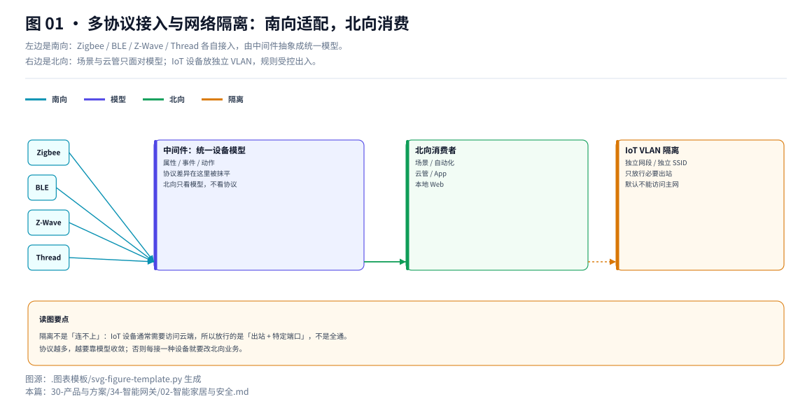
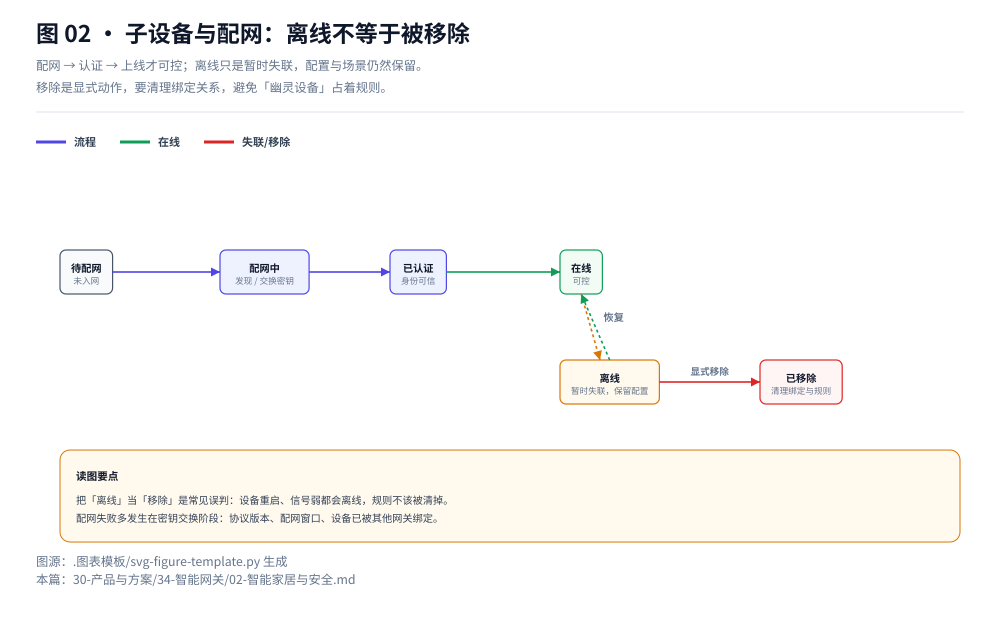

# 智能家居与安全

智能家居接入网关的核心不是「支持多少协议」，而是**协议怎么统一抽象、设备怎么隔离、密钥怎么保护**。多协议只是入口，统一模型和安全边界才是产品能力。

> 本篇定位：Wi-Fi/BLE/Zigbee/Thread/Matter 的接入角色、配网流程、网络隔离与安全底线。协议原理去 `10-基础理论/04-短距无线`，平台实现去 `20-平台与系统`。

## 目录

- [1 一句话模型](#s1)
- [2 速览](#s2)
- [3 协议与隔离字段](#s3)
- [4 交互流程](#s4)
- [5 状态机与定时器](#s5)
- [6 设计取舍与边界](#s6)
- [7 与相邻主题的关系](#s7)
- [名词解释](#名词解释)
- [8 参考与关联](#s8)

## 1 · 一句话模型：南向多协议，北向一个模型

```text
子设备（Wi-Fi/BLE/Zigbee/Thread）
  → 协议栈 → 设备抽象（属性/服务/事件）
  → 场景引擎/云管 → App/语音
```

三个关键认知：

1. **协议不同，模型要统一**：上层只关心「开关/亮度/温度」，不关心底层是 Zigbee 还是 Thread。
2. **IoT 设备必须隔离**：摄像头、插座、传感器放在独立 VLAN/SSID，不能和手机/PC 混在一个二层域。
3. **安全从配网开始**：配网凭证、设备密钥、OTA 签名，任何一环丢失都可能导致批量失守。

## 2 · 速览

| 项 | 内容 |
| --- | --- |
| 接入协议 | Wi-Fi、BLE、Zigbee、Thread、Matter（应用层） |
| 网关角色 | Wi-Fi AP、BLE 配网、Zigbee 协调器、Thread 边界路由器、Matter 控制器/桥 |
| 关键对象 | 子设备、配网凭证、设备模型、场景、隔离策略 |
| 关键能力 | 发现/配网、控制、状态同步、场景联动、OTA |
| 安全机制 | 安全启动、签名升级、密钥存储、网络隔离、最小权限 |
| 主要风险 | 弱口令、配网劫持、IoT 横向移动、云 API 越权 |

## 3 · 协议与隔离字段

### 3.1 协议对比

| 协议 | 物理层 | 拓扑 | 网关角色 | 典型设备 |
| --- | --- | --- | --- | --- |
| Wi-Fi | 2.4/5/6 GHz | 星型 | AP | 摄像头、插座、家电 |
| BLE | 2.4 GHz | 点对点/广播 | 配网代理 | 门锁、传感器、手环 |
| Zigbee | 2.4 GHz | 网状 | 协调器 | 灯、传感器、开关 |
| Thread | 2.4 GHz | 网状（IPv6） | 边界路由器 | 灯、传感器、门锁 |
| Matter | 承载于 Wi-Fi/Thread/以太 | — | 控制器/桥 | 跨生态设备 |

### 3.2 网关角色

| 角色 | 作用 | 边界 |
| --- | --- | --- |
| Wi-Fi AP | 提供 IoT SSID | 2.4G 拥塞、终端数限制 |
| BLE 配网代理 | 把 Wi-Fi/Thread 凭证传给设备 | 配网窗口、广播安全 |
| Zigbee 协调器 | 建网、路由、维护 | 信道与 Wi-Fi 干扰 |
| Thread 边界路由器 | 连接 Thread 网络与 IP | 需要 IPv6 与路由通告 |
| Matter 控制器 | 配网、控制、订阅 | 依赖设备认证证书 |
| Matter 桥 | 把非 Matter 设备映射成 Matter | 能力映射不完整 |

### 3.3 隔离与访问控制

| 对象 | 配置 | 作用 | 边界 |
| --- | --- | --- | --- |
| IoT SSID | 独立 SSID/VLAN | 隔离 IoT 与主网络 | 部分设备只支持 2.4G |
| 访客网络 | 独立 SSID + 客户端隔离 | 访客只上网 | 不能访问内网服务 |
| ACL | 源/目的/端口 | 限制 IoT 访问范围 | 规则过多难维护 |
| mDNS 反射 | 受控转发 | 跨 VLAN 发现 | 可能泄露设备信息 |
| 上行限制 | 只允许必要云服务 | 降低外联风险 | 影响厂商 App 功能 |
| 本地控制 | 局域网直连 | 断网可用 | 需要本地鉴权 |

## 4 · 交互流程



**读图**：南向协议栈把设备抽象成统一模型，北向由场景/云管消费；IoT 设备放在独立 VLAN，通过受控规则访问外网和主网络。

> 图源：`images/图01-多协议接入与隔离.svg`

### 4.1 Matter 配网

```text
设备进入配网模式 → App 扫码/蓝牙发现
  → 传递 Wi-Fi/Thread 凭证 → 设备入网
  → 交换/验证设备证书 → 加入 Fabric
  → 上报属性 → 网关/App 可控制
```

### 4.2 Zigbee/Thread 入网

```text
协调器/边界路由器开网（限时）
  → 设备入网 → 分配地址 → 上报能力
  → 网关建立设备模型 → 场景可用
```

### 4.3 控制与状态同步

```text
App/语音 → 云/本地 → 场景引擎
  → 协议栈下发 → 设备执行
  → 状态回报 → 设备影子 → App 更新
```

### 4.4 异常分支

| 异常 | 现象 | 定位方向 |
| --- | --- | --- |
| 配网失败 | 设备反复闪烁 | 2.4G 信号、凭证错误、配网窗口 |
| 设备频繁掉线 | 时好时坏 | 干扰、路由深度、电量、网关负载 |
| 跨 VLAN 发现失败 | App 找不到设备 | mDNS 反射、ACL、组播 |
| 控制延迟 | 指令慢/丢 | 云链路、协议栈拥塞、重试 |
| 设备被劫持 | 异常外联/被控 | 弱口令、配网漏洞、固件 |
| OTA 失败 | 设备变砖 | 包校验、电量、回滚 |

## 5 · 状态机与定时器




**读图**：子设备要经过配网、认证、上线才可控；离线不等于被移除。

> 图源：`images/图02-子设备与配网状态.svg`

| 对象 | 状态 | 关键参数 |
| --- | --- | --- |
| 子设备 | 未配网 → 配网中 → 在线 → 离线 | 配网窗口、心跳、离线判定 |
| Matter Fabric | 未加入 → 加入 → 移除 | 证书、Fabric ID |
| Zigbee/Thread 网络 | 建网 → 允许入网 → 关闭 | 开网时间、信道 |
| 场景 | 待触发 → 执行 → 完成/失败 | 超时、重试、冲突策略 |
| OTA | 下载 → 校验 → 安装 → 确认 | 电量阈值、回滚 |

> 待验证：不同协议的配网窗口、心跳周期和离线判定不同，需按协议规范与产品实现确认。

## 6 · 设计取舍与边界

### 6.1 多协议堆叠 vs 聚焦

支持协议越多，射频共存、认证和测试成本越高。产品应按目标生态选择：Matter/Thread 面向跨生态，Zigbee 面向存量设备，Wi-Fi 面向高带宽设备。

### 6.2 云控制 vs 本地控制

云控制能做远程和跨设备编排，但依赖网络和云服务；本地控制低时延、断网可用，但跨品牌互操作难。关键场景应本地优先、云端增强。

### 6.3 隔离的代价

IoT 独立 VLAN 能限制横向移动，但会增加配网、发现和跨网访问的复杂度。产品要提供「隔离 + 受控互通」的默认策略，而不是让用户自己配 ACL。

### 6.4 开放 API 的边界

开放 API 能接入第三方生态，但会扩大攻击面。API 要鉴权、限流、审计，并明确「能读什么、能控什么」，不能把整机管理权限开放给插件。

### 6.5 安全不是一次性认证

通过 Matter/Zigbee 认证只说明协议合规，不代表整机安全。安全启动、签名升级、密钥保护、漏洞响应流程要贯穿产品生命周期。

## 7 · 与相邻主题的关系

| 相邻对象 | 关系 |
| --- | --- |
| [BLE/ZigBee/Thread](../../10-基础理论/12-通信科学/04-无线通信/04-短距无线/00-BLE-ZigBee-Thread.md) | 短距协议原理 |
| [Wi-Fi 频段信道与速率](../../10-基础理论/12-通信科学/04-无线通信/02-Wi-Fi/01-Wi-Fi频段信道与速率.md) | 2.4G 干扰与信道 |
| [智能网关架构](./00-智能网关架构.md) | 整机分层 |
| [插件化与云管](./01-插件化与云管.md) | 插件与控制通道 |
| [VLAN 与 Trunk](../../10-基础理论/11-网络科学/02-链路层/02-VLAN与Trunk.md) | IoT 隔离的二层基础 |
| [OpenWrt 无线子系统](../../20-平台与系统/22-OpenWrt/04-无线/00-无线子系统总览.md) | AP/SSID 实现 |

一句话：**智能家居的产品能力 = 协议覆盖 × 统一模型 × 隔离强度 × 密钥安全。**

## 名词解释

> 缩写给出英文全称；非缩写用“—”表示。

| 术语 | 英文全称 | 解释 |
| --- | --- | --- |
| IoT | Internet of Things | 物联网。 |
| BLE | Bluetooth Low Energy | 低功耗蓝牙。 |
| Thread | — | 基于 IPv6 的低功耗网状网络协议。 |
| Matter | — | 跨生态智能家居应用层标准。 |
| Zigbee | — | 低功耗短距网状网络协议。 |
| AP | Access Point | 无线接入点。 |
| SSID | Service Set Identifier | 无线网络名称。 |
| VLAN | Virtual Local Area Network | 虚拟局域网。 |
| ACL | Access Control List | 访问控制列表。 |
| mDNS | Multicast DNS | 组播域名解析，用于局域网设备发现。 |
| Fabric | — | Matter 中的信任域，由证书和 Fabric ID 标识。 |
| OTA | Over-The-Air | 空中升级。 |
| 边界路由器 | Border Router | 连接 Thread 网络与 IP 网络的设备。 |

## 8 · 参考与关联

**标准**

- Matter 1.x：应用层、设备模型、配网
- Thread 1.3/1.4：低功耗 IPv6 网状网络
- Zigbee 3.0：应用层与网络层
- Bluetooth Core：BLE
- IEEE 802.11：无线局域网
- RFC 6762：Multicast DNS

**关联**

- [设备形态对比](../00-设备形态对比.md)
- [智能网关架构](./00-智能网关架构.md)
- [插件化与云管](./01-插件化与云管.md)
- [BLE/ZigBee/Thread](../../10-基础理论/12-通信科学/04-无线通信/04-短距无线/00-BLE-ZigBee-Thread.md)

---

> **本篇定位**：智能家居多协议接入、配网、统一设备模型、网络隔离与安全底线。
> **素材来源**：`studyspace/1.知识体系/7.openwrt/3.网络业务/2.关键组件服务/5.WiFi子系统/`、`studyspace/1.知识体系/10.wifi/wifi记录.md`。
> **待验证**：具体产品的协议栈选型、配网流程、隔离策略和认证要求。
