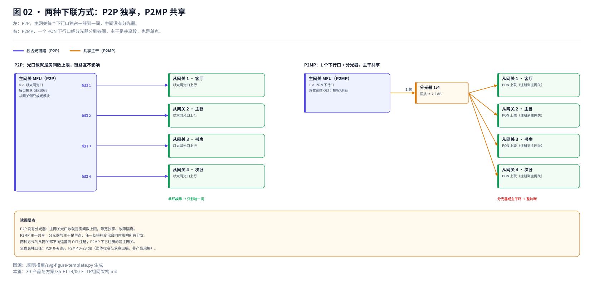
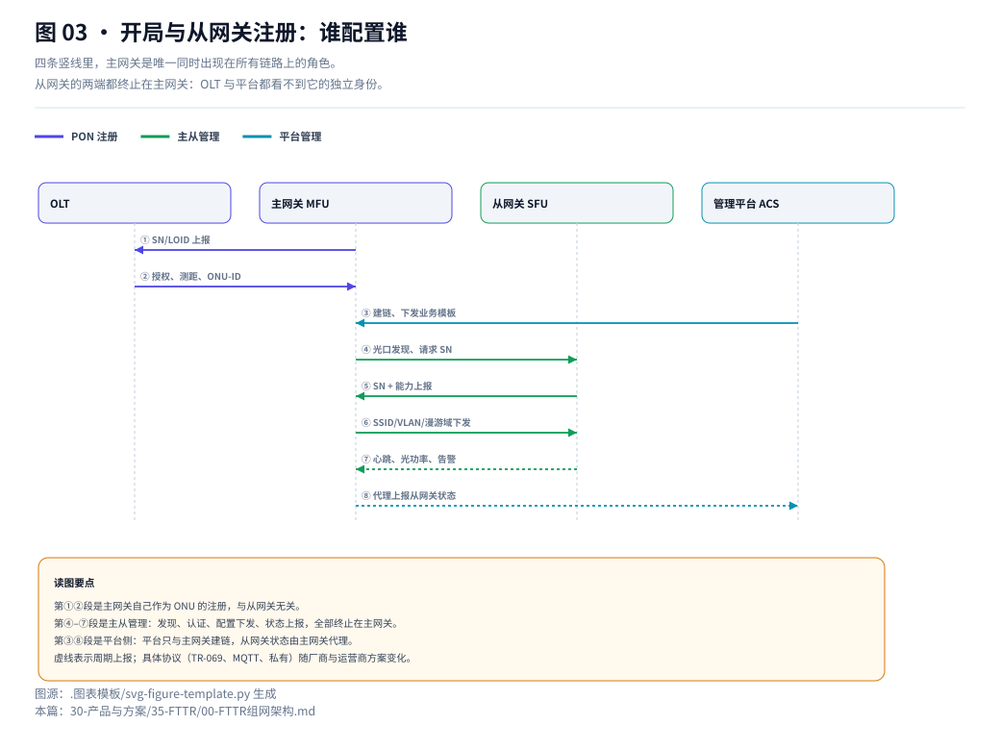
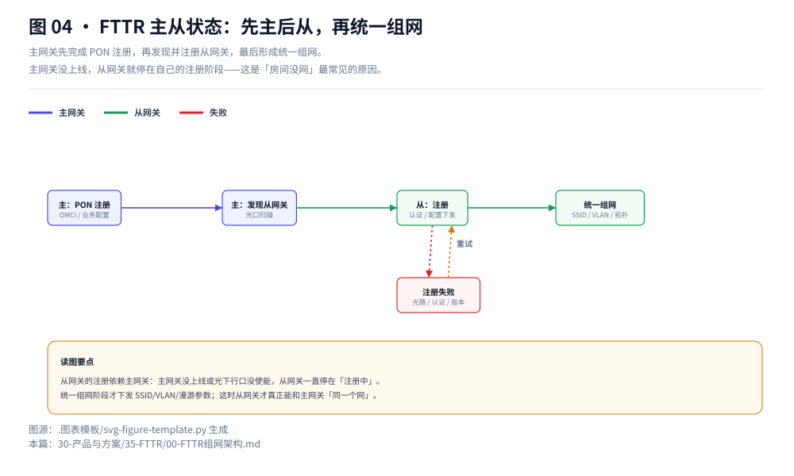

# FTTR 组网架构

FTTR（Fiber To The Room）把光纤从「入户」延伸到「每个房间」：**主网关负责 PON 上行和整网管理，从网关负责房间覆盖，主从之间用光纤而不是网线连接**。它解决的是大户型 Wi-Fi 覆盖和布线难题，不是简单的「多放几个 AP」。

> 本篇定位：FTTR 的主从角色、两种下联方式（P2P / P2MP）、拓扑骨架、业务与管理模型、开局与注册流程。PON 光层原理去 [PON 技术概览](../../10-基础理论/12-通信科学/03-光通信/00-PON技术概览.md)，EasyMesh/漫游去 [漫游与 EasyMesh](../../20-平台与系统/22-OpenWrt/04-无线/04-漫游与EasyMesh.md)，ONU 注册与 OMCI 去 [ONU/ONT 系统架构](../36-ONU-ONT/00-ONU-ONT系统架构.md)，光功率预算与故障定位去 [FTTR 光层与运维](./01-FTTR光层与运维.md)。

## 目录

- [1 一句话模型](#s1)
- [2 速览](#s2)
- [3 结构与字段](#s3)
- [4 交互流程](#s4)
- [5 状态机与定时器](#s5)
- [6 设计取舍与边界](#s6)
- [7 与相邻主题的关系](#s7)
- [名词解释](#名词解释)
- [8 参考与关联](#s8)

## 1 · 一句话模型：主网关管外，从网关管内，光纤做骨干

```text
OLT ── PON ── 主网关（MFU）
                 ├─ 光纤 ── 从网关 1（客厅）
                 ├─ 光纤 ── 从网关 2（主卧）
                 └─ 光纤 ── 从网关 3（书房）

对 OLT：只存在主网关一个 ONU，从网关不在运营商 PON 上。
对用户：一个 SSID、一个网关地址、一份运维入口。
```

三个关键认知：

1. **主网关是唯一出口**：PON 注册、路由/NAT、DHCP、管理都集中在主网关，从网关不直接上联 OLT。因为从网关没有 WAN 口、不拨号、不做 NAT，所以它的每一条业务流都必须回到主网关才能出网。
2. **主从之间是「光纤 + 管理协议」**：光纤只解决物理带宽，拓扑发现、配置下发、漫游要靠管理通道。因为光纤是无源透传介质、不携带身份，所以「插上光纤就通」只在物理层成立，能不能入网由管理协议决定。
3. **FTTR 的卖点是体验**：全屋千兆、无感漫游、统一运维；不是「光纤本身」。因为用户感知的是空口覆盖与切换时延，光纤只是把这两件事的上限抬高。

> **推论**：排障顺序天然是「主网关是否在线 → 从网关是否入网 → 终端是否漫游」，这个顺序来自上面的单向依赖，不是习惯问题。反过来先查终端，会把「主网关掉线」误判成「多个房间的 AP 同时坏了」。
> **边界**：这套模型只描述单主网关的家用形态。多主网关级联、企业 FTTR（FTTR-B）、以及用网线/无线回程的从网关另有约束，本篇只在 §3.2 与 §6 提边界，不展开。

## 2 · 速览

因为 FTTR 的形态由「下联方式 + 拓扑骨架」两个变量决定，所以下表把它们单列——只问「能带几个从网关」会选错方案。

| 项 | 内容 | 边界与注意 |
| --- | --- | --- |
| 产品定位 | 光纤到房间的全屋 Wi-Fi/业务组网方案 | 是方案不是单机；从网关单独拿出来不能上网 |
| 核心角色 | 主网关（MFU）、从网关（SFU）、分光器、光纤/光电复合缆 | MFU/SFU 与 PON 里的 SFU（单家庭单元）同名不同义 |
| 下联方式 | P2P（以太网光口，点对点）／P2MP（PON 状，1 个下行光口 + 分光器） | 同一主网关通常只支持一种，光口不能混插 |
| 关键能力 | PON 上行、主从组网、统一 SSID、漫游、IPTV/语音、远程运维 | 漫游效果取决于终端能力，不只看 AP 配置 |
| 典型拓扑 | 星型直连（home run）、一级分光、级联、混合 | 级联层数受插损与时延限制 |
| 关键协议 | PON（G.984/G.987/G.9807）、OMCI、TR-069、802.11k/v/r、EasyMesh | 主从管理多为厂商私有；新建工程按 XG(S)-PON/10G EPON 及以上，存量 GPON 仍可部署 |
| 主要指标 | 光功率、组网速率、漫游切换时延、覆盖与干扰、故障定位时间 | 指标要分「主从回程」和「空口」两段看 |
| 主要风险 | 主网关单点、从网关供电、光纤施工、分光损耗 | 具体判据在 [光层与运维](./01-FTTR光层与运维.md) |

## 3 · 结构与字段

这一节回答「谁是谁」和「线怎么接」。两件事必须分开：**角色**决定职责边界，**下联方式**决定带宽与耦合，**拓扑骨架**决定布线与故障域。因为这三层任取两层组合都能拼出一台「看着像 FTTR」的设备，所以混在一起谈，就会出现「点对点还是分光」这种把协议和布线混为一谈的问题。

### 图 01 · FTTR 主从组网拓扑


**读图**：OLT 只看到主网关；主网关通过光纤下行口连接从网关，分光器把一路光分给多个房间；管理通道从主网关统一向上。

> 图源：`images/图01-FTTR组网拓扑.svg`

> **边界**：图 01 画的是 P2MP + 一级分光。P2P 现场没有分光器，主网关到从网关是一条独占光纤——按这张图去找分光器，会找不到（两种方式的差别见 §3.2）。

### 3.1 主网关与从网关

| 角色 | 职责 | 关键接口 | 边界 |
| --- | --- | --- | --- |
| 主网关 MFU | PON 注册、路由/NAT、DHCP/DNS、整网管理、语音 | PON、LAN、光纤下行口 | 性能瓶颈和单点；全家的 NAT 会话与转发都压在它身上 |
| 从网关 SFU | 房间 Wi-Fi、LAN 接入、部分业务终结 | 光纤上行口、LAN、Wi-Fi | 依赖主网关；没有 WAN 口、不拨号、不做 NAT，脱离主网关不能独立上网 |
| 分光器 | 把一路光分成多路 | 光输入/输出 | 带来额外插损；无源不等于不会坏（脏污、断纤、接头损耗变大） |
| 光电复合缆 | 同时供光纤和供电 | 光口/电源 | 施工和取电；线径粗、弯曲半径大，长距离还有压降 |

主网关在 PON 侧是 ONU；在下联侧，P2MP 模式下它扮演的是「迷你 OLT」（授权、测距、管理由它自己做），P2P 模式下它只是一个以太网光口。两种角色叠在同一台盒子里，是 FTTR 与传统光猫最容易混淆的地方。

> **推论**：看到从网关「支持 PON 上联」，不要据此判断它能注册到运营商 OLT——P2MP 下它注册的是主网关，OLT 的 ONU 列表里不会有它。
> **边界**：P2P 模式下从网关的上行是以太网光口，此时把它当「PON 设备」去查注册状态，查的是一个不存在的对象。

### 3.2 下行组网与拓扑形态

先分清两层：

- **下联方式**（主网关 → 从网关用什么协议）：P2P 或 P2MP。它决定带宽、光预算与管理耦合。
- **拓扑骨架**（光纤怎么走）：星型直连、一级分光、级联、混合。它决定端口数、布线与故障域。

两层可以组合，所以「点对点」这个词在本篇会出现两次、含义不同：协议上的 P2P，和布线上的「一根纤只连一间」。

#### （1）下联方式：P2P 与 P2MP

为什么会有两种？因为主网关的下行口成本和覆盖能力是一对矛盾。每间房一个光口，带宽独享但端口和光模块成本随房间数线性上涨；一个光口加分光器，省端口省光纤，但带宽共享、插损叠加、主从强耦合。厂商和运营商按户型与成本各选一边，标准把两种都列为合法组网模型。

| 方式 | 物理形态 | 协议本质 | 从网关上行 | 边界与误判 |
| --- | --- | --- | --- | --- |
| P2P | 主网关每个下行口独占一纤到一间 | 以太网（IEEE 802.3），相当于把电口换成光口 | 以太网光口，GE/10GE | 不能加分光器；端口数固定，扩容只能加主网关 |
| P2MP | 主网关 1 个 PON 下行口 → 分光器 → 多个从网关 | 类 PON：下行广播、上行突发授权，主网关做「迷你 OLT」 | PON 上联，注册到主网关而非 OLT | 主从强耦合，主干是共享单点；「PON 上联」不等于「注册到 OLT」 |

#### 图 02 · 两种下联方式：P2P 独享，P2MP 共享



**读图**：上半部分 P2P，主网关四个下行光口各拉一根纤到房间，中间没有分光器，每条链路独享带宽、故障互不影响；下半部分 P2MP，主网关只有一个 PON 下行口，经一级分光器分到各房间，主干是共享段，也是单点。底部注明的是标准草案给的全程衰耗口径，不是产品规格。

> 图源：`images/图02-FTTR下联P2P与P2MP.svg`

| 维度 | P2P | P2MP | 边界与误判 |
| --- | --- | --- | --- |
| 主网关下行口 | 每房间一个以太网光口 | 1 个 PON 光口 + 分光器 | 端口数就是房间数上限；P2P 常见 4 口，不是想加就加 |
| 从网关上行 | 以太网光口 | PON 上联（注册到主网关） | 「有 PON 口」不等于「能注册到 OLT」 |
| 带宽 | 每口独享 | 下行 2.5G 广播共享、上行 1.25G 按时隙共享 | 多从网关同时跑满时，P2MP 的「千兆到房间」会打折 |
| 光预算 | 全程 0–6 dB，不能接分光器 | 全程 0–23 dB，可一级或多级分光 | 拿 P2MP 的 23 dB 去套 P2P，会漏掉过载风险 |
| 故障域 | 单纤单口，坏一条影响一间 | 分光器或主干坏，影响整片 | P2MP 下「单房间不通」要先排除主干 |
| 跨厂商 | 弱耦合（本质是以太网） | 强耦合（PON 帧 + 私有管理） | 混用不同厂商主从，P2MP 基本不通 |
| 成本结构 | 光模块多、主网关侧端口贵 | 主网关贵（多 PON MAC/FPGA），从网关便宜 | 房间少时 P2P 更划算，房间多时 P2MP 才能摊薄 |

> **推论**：选型先数房间，再看主网关端口。4 间以内、要独享带宽 → P2P；房间多、要少布线 → P2MP。两种都得先算光预算，不能只看「能带 16 个」。
> **边界**：上表的带宽是链路层能力，不是 Wi-Fi 实测。2.5G 下行经 Wi-Fi 6 2×2 空口后，单终端通常只剩 1Gbps 量级，把它当「每个房间 2.5G 无线」是过度外推。
> **待验证**：P2MP 下联的具体速率等级（2.5G/1.25G 还是更高）随主网关芯片方案变化，以设备规格书为准。

#### （2）拓扑骨架：星型、分光、级联、混合

不管选 P2P 还是 P2MP，室内光纤的走法只有这四种骨架。这里的「点对点」是布线口径——一根纤只连一间，与上面的 P2P 协议不是一回事。

| 形态 | 结构 | 优点 | 代价与边界 |
| --- | --- | --- | --- |
| 星型直连（home run） | 主网关每个下行口独占一纤到一间 | 带宽独享、故障隔离好、不需要分光器 | 主网关端口数有限、布线多；P2MP 主网关只有一个下行口，做不了星型直连 |
| 一级分光 | 主网关 → 分光器 → 多个从网关 | 省主网关端口、布线少、施工快 | 分光损耗、共享带宽；分光器位置决定后期扩容难度 |
| 级联 | 从网关再接下一下从网关，或二级分光 | 延长距离、减少布线 | 时延累积、故障影响面大；级联层数受插损限制，工程规范建议不超过 4 级 |
| 混合 | 星型 + 分光 | 兼顾灵活与成本 | 拓扑复杂、运维要求高；标识不清时定位不到分支 |

### 3.3 业务模型

业务表要回答的是「这条业务在哪一段被终结」。因为从网关只做二层桥接，所以所有需要三层处理的动作（拨号、NAT、组播复制、SIP 注册）都落在主网关，配置点找错就会「改了没效果」。

| 业务 | 承载 | 关键配置 | 边界与误判 |
| --- | --- | --- | --- |
| Internet | 主网关 WAN + 全屋 SSID | 拨号、NAT、DHCP | 主网关桥接模式下这一行不成立：拨号移交给后面的路由器，从网关仍走主网关二层 |
| Wi-Fi 漫游 | 主从统一 SSID | 802.11k/v/r、EasyMesh | 终端不支持 11r 时只能「断后重连」；不同厂商从网关之间通常不做标准漫游协同 |
| IPTV | 独立 VLAN/组播 | IGMP snooping、组播复制 | 复制点必须在主网关；从网关没配 VLAN 透传时电视是黑屏，不是「卡」 |
| VoIP | 主网关或从网关 FXS | SIP、编解码 | 从网关 FXS 需要主网关做 SIP 代理或本地注册，主网关掉线即断话 |
| 管理 | 主网关统一代理 | OMCI/TR-069、从网关注册 | OLT 看不到从网关；平台直管从网关属于例外实现 |

### 3.4 关键指标

指标不是越多越好，要能对应到「哪一段坏了」。下面每一项都标了判读边界——只报数值、不报判据的指标，在排障时没有用。

| 指标 | 说明 | 边界 |
| --- | --- | --- |
| 光功率 | 主/从网关收发光功率 | 受分光比、距离、连接器影响；只看「在范围内」不够，要看余量与波动 |
| 组网速率 | 主从之间实际吞吐 | 共享介质时按最坏分支算；P2P 按单口算，P2MP 按整口共享算 |
| 漫游切换 | 终端跨 AP 的中断时间 | 依赖终端和 AP 的 k/v/r 支持；用支持 11r 的终端测出的值不代表全部终端 |
| 覆盖 | 各房间 RSSI/SNR | 受墙体、家具、干扰影响；从网关位置比发射功率更决定覆盖 |
| 故障定位 | 从告警到定位到分支的时间 | 依赖拓扑发现和光功率监测；拓扑不可见时只能人工逐段拔纤 |
| 从网关在线率 | 在线时长与离线次数 | 频繁重启多与光电复合缆压降、温度有关，不是「固件不稳」一句话能解释 |

## 4 · 交互流程

FTTR 的开局不是一条直线，而是三条链按顺序合流：运营商侧的 PON 授权、主网关自己的路由建立、主从之间的注册与配置下发。因为后一条链的输入是前一条链的输出，所以流程顺序不能换，这也是排障必须从上游往下游查的原因。

### 4.1 开局部署

```text
OLT 配置业务 → 主网关上电 → PON 注册/认证
  → 主网关拨号 → 建立路由/NAT
  → 从网关接入光纤 → 上电 → 主网关发现
  → 下发 SSID/业务配置 → 从网关起 Wi-Fi
  → 全屋 SSID 可用 → 终端漫游
```

四步之间是硬依赖，每一步「答错」都会把后面的现象伪装成另一类故障：

| 步骤 | 问什么 | 判据 | 答错的后果 |
| --- | --- | --- | --- |
| ① OLT 侧 | 业务模板、ONU 类型、带宽配好了吗 | OLT 上能看到该 SN/LOID 的授权记录 | 后面所有「注册失败」都是白查 |
| ② 主网关 PON | 注册到运行态了吗 | 光功率在窗口内、状态进入 O5、能拨号 | 把 OLT 侧问题当成从网关问题 |
| ③ 主网关路由 | 拨号/NAT/DHCP 正常吗 | 主网关下挂的有线终端能上网 | 从网关通了但全屋没网 |
| ④ 从网关入网 | 光路、供电、认证、版本 | 主网关拓扑里能看到、SSID 已下发 | 单房间问题被当成「Wi-Fi 不好」 |

### 4.2 从网关注册

```text
从网关上电 → 光纤链路 up → 向主网关注册（认证/序列号）
  → 主网关分配管理地址/配置
  → 从网关上报能力（Wi-Fi/端口）
  → 加入组网 → 参与漫游
```

注册要同时满足四个条件，缺一个都停在「注册中」：光路（收光在窗口内）、供电（电压够）、身份（SN 在允许列表内）、版本（主从兼容）。四者里只有光路能在主网关上远程看到，另外三个往往要现场确认——这是「从网关不上线」最典型的取证难点。

#### 图 03 · 开局与从网关注册：谁配置谁



**读图**：四条竖线里，主网关是唯一同时出现在所有链路上的角色。OLT 与平台的消息都终止在主网关，从网关的两端也都终止在主网关——所以从网关的「上线」由主网关判定，OLT 和平台都看不到它的独立身份。

> 图源：`images/图03-FTTR开局与从网关注册时序.svg`

> **推论**：现场说「从网关没注册上」，要拆成两问——主网关有没有发现它（光路/供电），发现后有没有通过认证（SN/版本）。两问的处置完全不同，混在一起只能靠换设备试。
> **待验证**：图中第③段（平台 ↔ 主网关）的协议因厂商和运营商而异，TR-069/TR-369、MQTT 长连接或私有协议都有部署；从网关是否允许平台直管也随方案变化。

### 4.3 业务转发

```text
终端 → 从网关 Wi-Fi → 光纤 → 主网关 → 路由/NAT → PON → OLT
IPTV → 从网关 → 独立 VLAN → 主网关 → 组播 → PON
```

从网关只做二层桥接：它把终端的帧打上 VLAN 送到主网关，由主网关决定路由、NAT 与组播复制。所以从网关的「性能」主要看回程带宽与空口能力，不看 NAT 会话数——在从网关上找 NAT 表，找不到是正常的。

> **边界**：IPTV 的组播复制点只有一个（主网关），从网关只做 snooping 与透传。在从网关上再做一层组播代理，会出现双份流量，表现为「越优化越卡」。

### 4.4 异常分支

| 异常 | 现象 | 定位方向 | 容易误判成 |
| --- | --- | --- | --- |
| 主网关不注册 | 全屋无网 | 光功率、PON 认证、OLT 配置 | 「从网关全坏了」——其实是共因故障 |
| 从网关不上线 | 单房间无 Wi-Fi | 光纤/分光器、供电、注册认证 | 「Wi-Fi 信号弱」——实际是设备没入网 |
| 光功率偏低 | 速率低/断连 | 连接器脏污、弯折、分光比过大 | 「设备性能差」——先测收光再换机 |
| 漫游粘滞 | 走动时卡顿 | k/v/r 配置、AP 位置、终端行为 | 「AP 坏了」——终端可能根本没发起切换 |
| IPTV 卡顿 | 组播丢包 | 组播 VLAN、复制点、带宽 | 「带宽不够」——先看 VLAN 与 snooping |
| 从网关频繁重启 | 单点不稳定 | 供电（光电复合缆）、温度、固件 | 「固件 bug」——复合缆压降同样表现成重启 |

## 5 · 状态机与定时器

FTTR 没有单一状态机，而是几套状态叠加在一起：主网关的 PON 注册（标准定义）、主从链路（厂商私有）、从网关自身（未注册 → 在线）。之所以要分开看，是因为三者串行依赖——主网关没进 O5，从网关永远停在「注册中」，把两者混成一个状态机会导致「所有灯都不对」时无法定位起点。

### 图 04 · FTTR 主从状态



**读图**：主网关先注册 PON，再发现/注册从网关，最后形成统一组网。

> 图源：`images/图04-FTTR主从状态.svg`

主网关 PON 侧的 O1–O5 状态机（初始、待机、序列号、测距、运行，异常时进 O6/O7）由 ITU-T G.984 定义，细节与定时器在 [PON 复用测距与注册](../../10-基础理论/12-通信科学/03-光通信/01-PON复用测距与注册.md)，本篇不重复。这里列出跨设备的状态对象；主网关 PON 侧只保留结果态，异常态与定时器一律去 PON 篇看：

| 对象 | 状态 | 在等什么 | 失败表现 | 边界 |
| --- | --- | --- | --- | --- |
| 主网关 PON | 注册 → 测距 → 授权 → 运营 | 注册超时、保活、测距窗口 | 注册超时 → 退回初始态；运营态频繁掉线先看光功率 | 只列结果态，O1–O7 见 PON 篇 |
| 主从链路 | Down → 链路 Up → 注册 → 组网 | 光信号、SN 认证、配置下发（发现周期、心跳） | 链路 Up 但不注册 = 认证或版本问题 | 链路 Up 只代表物理层通，不代表能入网 |
| 从网关 | 未注册 → 注册中 → 在线 → 离线 | 主网关发现、心跳（离线判定、重连退避） | 反复停在「注册中」= 光功率临界或供电不足 | 「在线」由主网关判定，OLT 不参与 |
| 终端漫游 | 关联 → 认证 → 切换 | 终端判决、11k/v/r（漫游阈值） | 切了但断流 = 11r 或漫游域不一致 | 终端可以拒绝引导，AP 无法强制 |
| 升级 | 下载 → 校验 → 重启 → 确认 | 主从版本匹配（主从协同、回滚） | 从网关回滚后可能不再入网 | 主从版本窗口由厂商定义 |

| 定时器/周期 | 管什么 | 典型量级 | 边界 |
| --- | --- | --- | --- |
| PON 发现窗口 | 允许新 ONU（这里是主网关）注册 | 秒级周期 | 主网关已在线时，新装从网关不依赖它 |
| PON 测距 | 跟踪时延漂移 | 周期性 | 属于 PON 侧，与主从链路无关 |
| 主从心跳 | 判在线/离线 | 秒级，多次丢失才判离线 | 周期太短会在光功率临界时反复抖动 |
| 离线判定 | 触发告警与拓扑更新 | 心跳的 N 倍 | 去抖不足会把「瞬断」记成「离线」 |
| 升级确认 | 回滚判据 | 重启后一次确认 | 主从必须处于同一版本窗口 |

> 待验证：主从注册协议、心跳周期、离线判定和升级协同方式各厂商不同，需按产品文档确认。

## 6 · 设计取舍与边界

这一节回答「为什么长成这样」。FTTR 的每个设计选择都有代价，代价往往就是现场故障的主要来源；因为只讲优点会把产品问题误判成施工问题，所以每一条都配一句失效条件。

### 6.1 点对点（星型直连）vs 分光

点对点每房间独享光纤，带宽和故障隔离最好，但主网关端口和布线成本高；分光省端口、省布线，但带来插损和共享带宽。大平层/别墅常用「点对点为主 + 局部级联」。

判断顺序是先协议后布线：先定 P2P 还是 P2MP，再定星型还是分光。反了会出现「选了 P2MP 却按星型布线」——主网关只有一个下行口，物理上接不出四根独立纤。

> **边界**：P2P 的 0–6 dB 全程预算意味着它几乎不能加分光器（一个 1:8 就是 10.5 dB），所以「P2P + 分光」不是折中方案，是不成立的组合。
> **失效条件**：房间数超过主网关光口数时，P2P 只能靠增加主网关或改 P2MP，不能靠「多插几个模块」解决。

### 6.2 光纤 vs 网线

光纤抗干扰、距离远、线径细，适合暗管和长距离；网线可 PoE 供电、施工简单，适合已有布线。FTTR 的价值在「没有网线也能全屋千兆」，不是所有场景都必须换光纤。

代价要说清：光纤不能直接 PoE（除非用光电复合缆），断纤不能像网线一样现场重压水晶头，需要熔接或冷接工具。所以「换成光纤」同时也把施工门槛换高了。

> **失效条件**：已有全屋网线且单段小于 100 m 时，改用光纤的增量收益主要是抗干扰与寿命，覆盖问题并不会因为换介质而消失。

### 6.3 主网关集中 vs 从网关自治

集中管理保证配置一致、运维简单，但主网关故障会影响全屋；从网关自治能局部存活，但配置和漫游一致性难保证。家用产品通常选择集中管理 + 主网关冗余设计。

这里的「冗余」通常指快速换机或双主网关级联，不是从网关接管拨号——从网关没有 WAN 口，主网关宕机时它只能保持最后一份配置继续做二层转发。

> **边界**：主网关重启期间，从网关上的终端仍可能关联着 Wi-Fi，但出不了网。现象是「Wi-Fi 满格不能上网」，容易被误判成从网关故障。

### 6.4 漫游不是「自动切」

终端决定何时漫游，AP 只能通过 802.11k/v/r 和信号引导影响决策。FTTR 能做的是「统一 SSID、合理布点、开启辅助漫游」，不能保证所有终端都无感。

> **失效条件**：终端不支持 11r、或主从的漫游域/密钥不一致时，切换退化为「断开重连」，时延从几十毫秒变成秒级；老旧终端即使信号很弱也可能拒绝 BTM 引导。

### 6.5 施工是产品的一部分

FTTR 的体验很大程度取决于光纤施工：弯折半径、连接器清洁、分光器位置、取电方式。产品文档必须把施工规范写清楚，否则现场会把「光功率不足」误判为设备故障。

因为设备只能上报「收光是多少」，无法上报「这个接头脏了」或「这段纤被压了」，所以施工验收必须独立于设备自检，成为交付流程的一环。

### 6.6 为什么值得多一台设备

如果只是要覆盖，多个 AP + 网线也能做到。FTTR 多出来的价值有三条，且都能对应到具体代价：

- **单一管理入口**：一台 ACS 账号、一份拓扑、一次远程排障。多个独立 AP 各管各的，故障定位要人为拼图。代价是主网关成为单点。
- **光纤解决距离与布线**：暗管细、可长距、抗干扰、可复合供电。代价是专用光模块/分光器与施工队伍。
- **统一 SSID 与漫游域**：主从天然同域，不用手工对齐。代价是跨厂商耦合，P2MP 下尤其明显。

> **失效条件**：小户型单台路由已覆盖、已有全屋网线且单段小于 100 m、租房不能动装修——这三种情况下 FTTR 的增量收益很小，强行上马只会把成本转成施工风险。

## 7 · 与相邻主题的关系

这七条关系都有明确边界：本篇只到「产品怎么组、谁来管」，再往下就是协议或实现的正本。因为细节已有各自的唯一归属，所以这里只保留边界与跳转，不复制正文。

| 相邻对象 | 关系 | 边界（细节去哪看） |
| --- | --- | --- |
| [PON 技术概览](../../10-基础理论/12-通信科学/03-光通信/00-PON技术概览.md) | PON 上下行与复用 | 本篇只出现 PON 家族名，不展开帧结构与 DBA |
| [PON 复用测距与注册](../../10-基础理论/12-通信科学/03-光通信/01-PON复用测距与注册.md) | ONU 注册与测距，主网关 PON 侧的 O1–O5 状态机 | 本篇只引用状态名，不定时器取值 |
| [ODN 与光功率预算](../../10-基础理论/12-通信科学/03-光通信/03-ODN与光功率预算.md) | 分光/损耗/预算算法 | 本篇只给 FTTR 的 0–23 dB / 0–6 dB 口径，损耗明细在 ODN 篇 |
| [漫游与 EasyMesh](../../20-平台与系统/22-OpenWrt/04-无线/04-漫游与EasyMesh.md) | 漫游与组网协议实现 | 本篇不写 11k/v/r 报文与 EasyMesh 消息格式 |
| [FTTR 光层与运维](./01-FTTR光层与运维.md) | 本篇的光层、施工与故障定位展开 | 预算算例与定位走查不在本篇重复 |
| [ONU/ONT 系统架构](../36-ONU-ONT/00-ONU-ONT系统架构.md) | 主网关的 ONU 侧能力、OMCI | 本篇不写 OMCI MIB 与业务建模 |
| [智能网关架构](../34-智能网关/00-智能网关架构.md) | 家庭中枢、插件与云管能力 | 本篇不写插件框架；「智能」与否不影响 FTTR 组网判定 |

一句话：**FTTR = 主网关的 PON/路由能力 + 从网关的房间覆盖 + 光纤骨干 + 统一管理。** 这句是加法，不是替代——任何一项缺失，剩下的部分都不能单独成立。

## 名词解释

> 缩写给出英文全称；非缩写用“—”表示。因为同一缩写在不同语境可能指两个对象，所以冲突词分行列出——SFU 在 FTTR 与 PON 里就不是同一台设备。

| 术语 | 英文全称 | 解释 |
| --- | --- | --- |
| FTTR | Fiber To The Room | 光纤到房间。 |
| FTTH | Fiber To The Home | 光纤到户。 |
| FTTB | Fiber To The Building | 光纤到楼。 |
| MFU | Main FTTR Unit | FTTR 主网关；厂商文档也写作 Main Fiber Unit。 |
| SFU（FTTR） | Sub FTTR Unit | FTTR 从网关；厂商文档也写作 Sub Fiber Unit，不注册到 OLT。 |
| SFU（PON） | Single Family Unit | 单家庭单元；PON 语境下指桥接型光猫，与 FTTR 从网关不是同一对象。 |
| P2P | Point-to-Point | 点对点；FTTR 下指主网关与从网关之间用 IEEE 802.3 以太网光口直连。 |
| P2MP | Point-to-Multipoint | 点对多点；FTTR 下指主网关 1 个 PON 下行口经分光器连接多个从网关。 |
| IFDN | In-premises Fiber Distribution Network | 室内光分配网络；主从之间的光纤、分光器等无源设施。 |
| 分光器 | Optical Splitter | 无源光分路器件，把一路光按比例分成多路，带来插损。 |
| 光电复合缆 | Optical and Electrical Hybrid Cable | 同时含光纤与供电铜线的线缆，用于给从网关远程供电。 |
| OLT | Optical Line Terminal | 光线路终端。 |
| ONU | Optical Network Unit | 光网络单元。 |
| PON | Passive Optical Network | 无源光网络。 |
| GPON | Gigabit-capable Passive Optical Network | ITU-T G.984 系列定义的 PON，下行 2.5G、上行 1.25G。 |
| XGS-PON | 10-Gigabit-capable Symmetric Passive Optical Network | ITU-T G.9807.1 定义的对称 10G PON。 |
| ODN | Optical Distribution Network | 光分配网络。 |
| OMCI | ONT Management and Control Interface | ONT 管理控制接口，OLT 配置 ONT 的通道（ITU-T G.988）。 |
| TR-069 | CPE WAN Management Protocol | 运营商 ACS 远程管理 CPE 的协议（CWMP）。 |
| ACS | Auto Configuration Server | 自动配置服务器，TR-069 的服务端。 |
| SN | Serial Number | 设备序列号，PON 注册与从网关认证都用它做身份。 |
| LOID | Logical ONU Identifier | 逻辑 ONU 标识，部分运营商用它替代 SN 做注册。 |
| HGU | Home Gateway Unit | 家庭网关单元，即路由型光猫；FTTR 主网关通常属于这一类。 |
| VLAN | Virtual Local Area Network | 虚拟局域网，用于把 IPTV、上网、管理业务隔开。 |
| IGMP | Internet Group Management Protocol | 组播组成员管理协议，IPTV 靠它决定组播复制到哪个口。 |
| SIP | Session Initiation Protocol | 会话发起协议，VoIP 信令。 |
| FXS | Foreign Exchange Subscriber | 用户侧模拟电话接口，接普通话机。 |
| SSID | Service Set Identifier | 无线网络名称。 |
| AP | Access Point | 无线接入点。 |
| RSSI | Received Signal Strength Indicator | 接收信号强度指示，覆盖验收的常用读数。 |
| SNR | Signal-to-Noise Ratio | 信噪比，比 RSSI 更能反映可用速率。 |
| EasyMesh | — | Wi-Fi 联盟的多 AP 组网标准，负责 AP 间组网与漫游协同。 |

## 8 · 参考与关联

因为标准和厂商文档是唯一可核对的来源，所以本节只列可追溯的标准与笔记，不复制条款原文。

**标准**

- ITU-T G.984 / G.987 / G.9807：GPON / XG-PON / XGS-PON
- ITU-T G.657：弯曲不敏感光纤
- IEEE 802.11k/v/r：无线资源测量、网络选择、快速切换
- Wi-Fi Alliance EasyMesh：多 AP 组网
- TR-069 / TR-369：远程管理
- YD/T 6355-2025《基于公用电信网的宽带客户网络联网技术要求 光纤到房间 物理层》：MFU/SFU 术语与 P2P/P2MP 两种组网模型
- T/CAICI《光纤到房间（FTTR）工程技术规范》（征求意见稿）：全程衰耗 0–23 dB（P2MP）/ 0–6 dB（P2P）、分光器级联层数建议

**关联**

- [设备形态对比](../00-设备形态对比.md)
- [FTTR 光层与运维](./01-FTTR光层与运维.md)
- [ONU/ONT 系统架构](../36-ONU-ONT/00-ONU-ONT系统架构.md)
- [PON 技术概览](../../10-基础理论/12-通信科学/03-光通信/00-PON技术概览.md)

---

> **本篇定位**：FTTR 的主从角色、P2P/P2MP 下联方式、拓扑骨架、业务模型、开局与注册流程。
> **素材来源**：`studyspace/1.知识体系/7.openwrt/3.网络业务/2.关键组件服务/5.WiFi子系统/`、`studyspace/1.知识体系/10.wifi/wifi记录.md`；YD/T 6355-2025 与 T/CAICI FTTR 工程技术规范（征求意见稿）公开摘要（访问 2026-11-22）。
> **待验证**：各厂商主从注册协议、分光比/光功率规格、漫游参数和升级协同方式；团体标准为征求意见稿，正式版条款可能调整。
