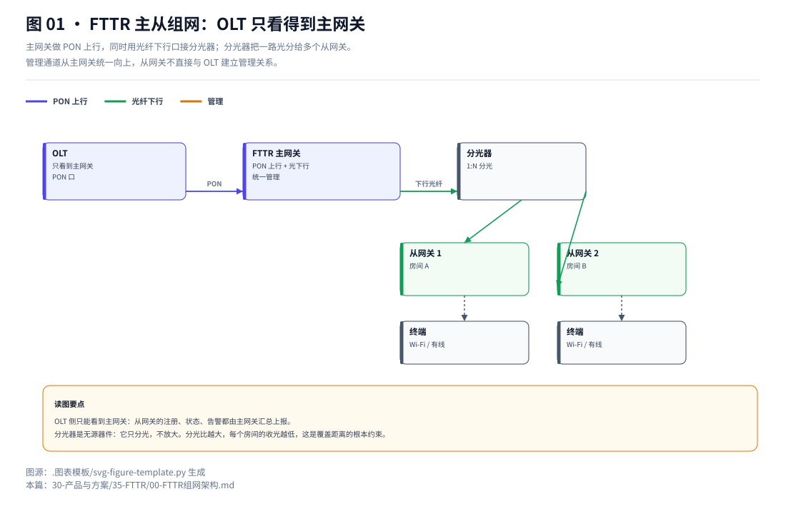
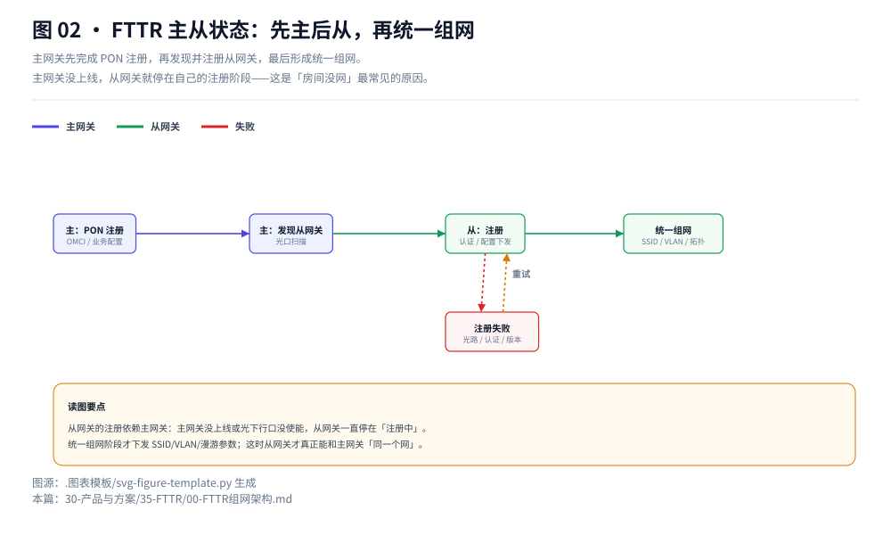

# FTTR 组网架构

FTTR（Fiber To The Room）把光纤从「入户」延伸到「每个房间」：**主网关负责 PON 上行和整网管理，从网关负责房间覆盖，主从之间用光纤而不是网线连接**。它解决的是大户型 Wi-Fi 覆盖和布线难题，不是简单的「多放几个 AP」。

> 本篇定位：FTTR 的主从架构、拓扑形态、业务与管理模型。PON 光层原理去 `10-基础理论/03-光通信`，EasyMesh/漫游去 `20-平台与系统/04-无线`，ONU 注册与 OMCI 去 `36-ONU-ONT`。

## 目录

- [1 一句话模型](#s1)
- [2 速览](#s2)
- [3 结构与字段](#s3)
- [4 交互流程](#s4)
- [5 状态机与定时器](#s5)
- [6 设计取舍与边界](#s6)
- [7 与相邻主题的关系](#s7)
- [名词解释](#名词解释)
- [8 参考与关联](#s8)

## 1 · 一句话模型：主网关管外，从网关管内，光纤做骨干

```text
OLT ── PON ── 主网关（MFU）
                 ├─ 光纤 ── 从网关 1（客厅）
                 ├─ 光纤 ── 从网关 2（主卧）
                 └─ 光纤 ── 从网关 3（书房）
```

三个关键认知：

1. **主网关是唯一出口**：PON 注册、路由/NAT、DHCP、管理都集中在主网关，从网关不直接上联 OLT。
2. **主从之间是「光纤 + 管理协议」**：光纤只解决物理带宽，拓扑发现、配置下发、漫游要靠管理通道。
3. **FTTR 的卖点是体验**：全屋千兆、无感漫游、统一运维；不是「光纤本身」。

## 2 · 速览

| 项 | 内容 |
| --- | --- |
| 产品定位 | 光纤到房间的全屋 Wi-Fi/业务组网方案 |
| 核心角色 | 主网关（MFU）、从网关（SFU）、分光器、光纤/光电复合缆 |
| 关键能力 | PON 上行、主从组网、统一 SSID、漫游、IPTV/语音、远程运维 |
| 典型拓扑 | 点对点（home run）、一级分光、级联 |
| 关键协议 | PON（G.984/G.987/G.9807）、OMCI、TR-069、802.11k/v/r、EasyMesh |
| 主要指标 | 光功率、组网速率、漫游切换时延、覆盖与干扰、故障定位时间 |

## 3 · 结构与字段

### 3.1 主网关与从网关

| 角色 | 职责 | 关键接口 | 边界 |
| --- | --- | --- | --- |
| 主网关 MFU | PON 注册、路由/NAT、DHCP/DNS、整网管理、语音 | PON、LAN、光纤下行口 | 性能瓶颈和单点 |
| 从网关 SFU | 房间 Wi-Fi、LAN 接入、部分业务终结 | 光纤上行口、LAN、Wi-Fi | 依赖主网关 |
| 分光器 | 把一路光分成多路 | 光输入/输出 | 带来额外插损 |
| 光电复合缆 | 同时供光纤和供电 | 光口/电源 | 施工和取电 |

### 3.2 拓扑形态

| 形态 | 结构 | 优点 | 边界 |
| --- | --- | --- | --- |
| 点对点 | 主网关每个下行口独占一纤 | 带宽独享、故障隔离好 | 主网关端口数有限、布线多 |
| 一级分光 | 主网关 → 分光器 → 多个从网关 | 省主网关端口、布线少 | 分光损耗、共享带宽 |
| 级联 | 从网关再接下一下从网关 | 延长距离、减少布线 | 时延累积、故障影响面大 |
| 混合 | 点对点 + 分光 | 兼顾灵活与成本 | 拓扑复杂、运维要求高 |

### 3.3 业务模型

| 业务 | 承载 | 关键配置 |
| --- | --- | --- |
| Internet | 主网关 WAN + 全屋 SSID | 拨号、NAT、DHCP |
| Wi-Fi 漫游 | 主从统一 SSID | 802.11k/v/r、EasyMesh |
| IPTV | 独立 VLAN/组播 | IGMP snooping、组播复制 |
| VoIP | 主网关或从网关 FXS | SIP、编解码 |
| 管理 | 主网关统一代理 | OMCI/TR-069、从网关注册 |

### 3.4 关键指标

| 指标 | 说明 | 边界 |
| --- | --- | --- |
| 光功率 | 主/从网关收发光功率 | 受分光比、距离、连接器影响 |
| 组网速率 | 主从之间实际吞吐 | 共享介质时按最坏分支算 |
| 漫游切换 | 终端跨 AP 的中断时间 | 依赖终端和 AP 的 k/v/r 支持 |
| 覆盖 | 各房间 RSSI/SNR | 受墙体、家具、干扰影响 |
| 故障定位 | 从告警到定位到分支的时间 | 依赖拓扑发现和光功率监测 |

## 4 · 交互流程



**读图**：OLT 只看到主网关；主网关通过光纤下行口连接从网关，分光器把一路光分给多个房间；管理通道从主网关统一向上。

> 图源：`images/图01-FTTR组网拓扑.svg`

### 4.1 开局部署

```text
OLT 配置业务 → 主网关上电 → PON 注册/认证
  → 主网关拨号 → 建立路由/NAT
  → 从网关接入光纤 → 上电 → 主网关发现
  → 下发 SSID/业务配置 → 从网关起 Wi-Fi
  → 全屋 SSID 可用 → 终端漫游
```

### 4.2 从网关注册

```text
从网关上电 → 光纤链路 up → 向主网关注册（认证/序列号）
  → 主网关分配管理地址/配置
  → 从网关上报能力（Wi-Fi/端口）
  → 加入组网 → 参与漫游
```

### 4.3 业务转发

```text
终端 → 从网关 Wi-Fi → 光纤 → 主网关 → 路由/NAT → PON → OLT
IPTV → 从网关 → 独立 VLAN → 主网关 → 组播 → PON
```

### 4.4 异常分支

| 异常 | 现象 | 定位方向 |
| --- | --- | --- |
| 主网关不注册 | 全屋无网 | 光功率、PON 认证、OLT 配置 |
| 从网关不上线 | 单房间无 Wi-Fi | 光纤/分光器、供电、注册认证 |
| 光功率偏低 | 速率低/断连 | 连接器脏污、弯折、分光比过大 |
| 漫游粘滞 | 走动时卡顿 | k/v/r 配置、AP 位置、终端行为 |
| IPTV 卡顿 | 组播丢包 | 组播 VLAN、复制点、带宽 |
| 从网关频繁重启 | 单点不稳定 | 供电（光电复合缆）、温度、固件 |

## 5 · 状态机与定时器




**读图**：主网关先注册 PON，再发现/注册从网关，最后形成统一组网。

> 图源：`images/图02-FTTR主从状态.svg`

| 对象 | 状态 | 关键参数 |
| --- | --- | --- |
| 主网关 PON | 注册 → 测距 → 授权 → 运营 | 注册超时、保活 |
| 主从链路 | Down → 链路 Up → 注册 → 组网 | 发现周期、心跳 |
| 从网关 | 未注册 → 注册中 → 在线 → 离线 | 离线判定、重连退避 |
| 终端漫游 | 关联 → 认证 → 切换 | 漫游阈值、802.11k/v/r |
| 升级 | 下载 → 校验 → 重启 → 确认 | 主从协同、回滚 |

> 待验证：主从注册协议、心跳周期、离线判定和升级协同方式各厂商不同，需按产品文档确认。

## 6 · 设计取舍与边界

### 6.1 点对点 vs 分光

点对点每房间独享光纤，带宽和故障隔离最好，但主网关端口和布线成本高；分光省端口、省布线，但带来插损和共享带宽。大平层/别墅常用「点对点为主 + 局部级联」。

### 6.2 光纤 vs 网线

光纤抗干扰、距离远、线径细，适合暗管和长距离；网线可 PoE 供电、施工简单，适合已有布线。FTTR 的价值在「没有网线也能全屋千兆」，不是所有场景都必须换光纤。

### 6.3 主网关集中 vs 从网关自治

集中管理保证配置一致、运维简单，但主网关故障会影响全屋；从网关自治能局部存活，但配置和漫游一致性难保证。家用产品通常选择集中管理 + 主网关冗余设计。

### 6.4 漫游不是「自动切」

终端决定何时漫游，AP 只能通过 802.11k/v/r 和信号引导影响决策。FTTR 能做的是「统一 SSID、合理布点、开启辅助漫游」，不能保证所有终端都无感。

### 6.5 施工是产品的一部分

FTTR 的体验很大程度取决于光纤施工：弯折半径、连接器清洁、分光器位置、取电方式。产品文档必须把施工规范写清楚，否则现场会把「光功率不足」误判为设备故障。

## 7 · 与相邻主题的关系

| 相邻对象 | 关系 |
| --- | --- |
| [PON 技术概览](../../10-基础理论/12-通信科学/03-光通信/00-PON技术概览.md) | PON 上下行与复用 |
| [PON 复用测距与注册](../../10-基础理论/12-通信科学/03-光通信/01-PON复用测距与注册.md) | ONU 注册与测距 |
| [ODN 与光功率预算](../../10-基础理论/12-通信科学/03-光通信/03-ODN与光功率预算.md) | 分光/损耗/预算 |
| [漫游与 EasyMesh](../../20-平台与系统/22-OpenWrt/04-无线/04-漫游与EasyMesh.md) | 漫游与组网协议 |
| [FTTR 光层与运维](./01-FTTR光层与运维.md) | 本篇的光层与运维展开 |
| [ONU/ONT 系统架构](../36-ONU-ONT/00-ONU-ONT系统架构.md) | 主网关的 ONU 侧能力 |
| [智能网关架构](../34-智能网关/00-智能网关架构.md) | 家庭中枢能力 |

一句话：**FTTR = 主网关的 PON/路由能力 + 从网关的房间覆盖 + 光纤骨干 + 统一管理。**

## 名词解释

> 缩写给出英文全称；非缩写用“—”表示。

| 术语 | 英文全称 | 解释 |
| --- | --- | --- |
| FTTR | Fiber To The Room | 光纤到房间。 |
| FTTH | Fiber To The Home | 光纤到户。 |
| FTTB | Fiber To The Building | 光纤到楼。 |
| MFU | Main Fiber Unit | FTTR 主网关。 |
| SFU | Slave Fiber Unit | FTTR 从网关；在 PON 语境也指单家庭单元。 |
| OLT | Optical Line Terminal | 光线路终端。 |
| ONU | Optical Network Unit | 光网络单元。 |
| PON | Passive Optical Network | 无源光网络。 |
| ODN | Optical Distribution Network | 光分配网络。 |
| OMCI | ONT Management and Control Interface | ONT 管理控制接口。 |
| SSID | Service Set Identifier | 无线网络名称。 |
| AP | Access Point | 无线接入点。 |
| EasyMesh | — | Wi-Fi 联盟的组网标准。 |

## 8 · 参考与关联

**标准**

- ITU-T G.984 / G.987 / G.9807：GPON / XG-PON / XGS-PON
- ITU-T G.657：弯曲不敏感光纤
- IEEE 802.11k/v/r：无线资源测量、网络选择、快速切换
- Wi-Fi Alliance EasyMesh：多 AP 组网
- TR-069 / TR-369：远程管理

**关联**

- [设备形态对比](../00-设备形态对比.md)
- [FTTR 光层与运维](./01-FTTR光层与运维.md)
- [ONU/ONT 系统架构](../36-ONU-ONT/00-ONU-ONT系统架构.md)
- [PON 技术概览](../../10-基础理论/12-通信科学/03-光通信/00-PON技术概览.md)

---

> **本篇定位**：FTTR 的主从角色、拓扑形态、业务模型与组网流程。
> **素材来源**：`studyspace/1.知识体系/7.openwrt/3.网络业务/2.关键组件服务/5.WiFi子系统/`、`studyspace/1.知识体系/10.wifi/wifi记录.md`。
> **待验证**：各厂商主从注册协议、分光比/光功率规格、漫游参数和升级协同方式。
