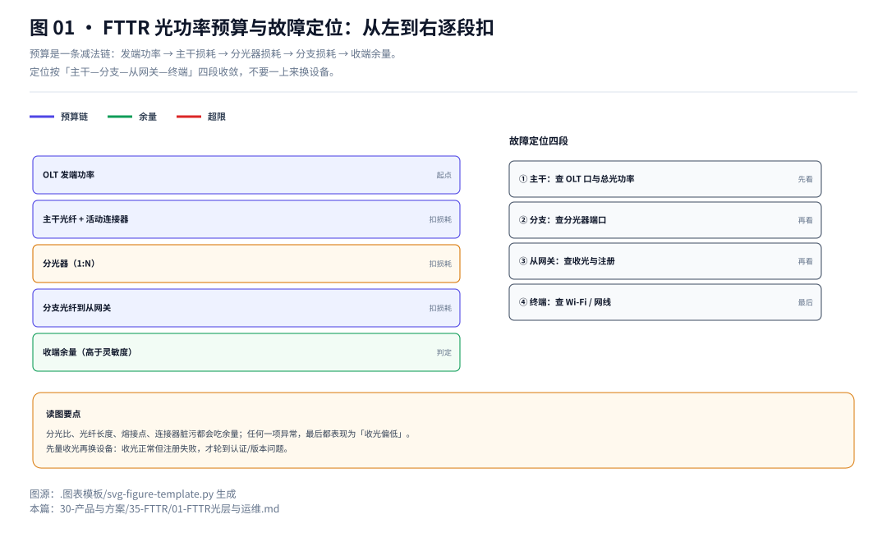
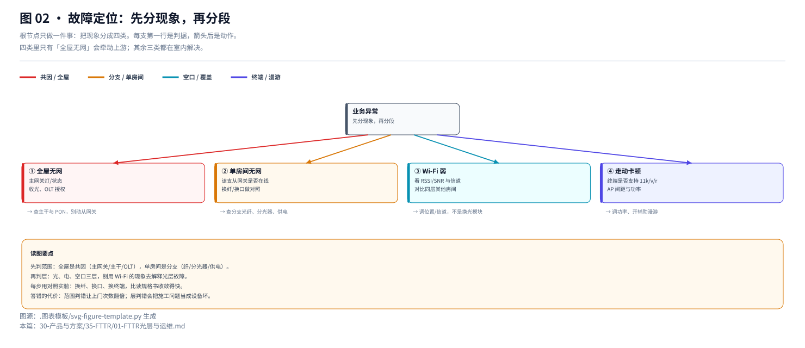

# FTTR 光层与运维

FTTR 的故障大多不在「协议」，而在「光」：**连接器脏污、光纤弯折、分光比过大、取电不稳**。运维的第一动作应该是看光功率和拓扑，而不是先怀疑 Wi-Fi 配置。

> 本篇定位：FTTR 的光功率预算、施工约束、拓扑发现、故障定位与漫游调优。光通信原理去 [PON 技术概览](../../10-基础理论/12-通信科学/03-光通信/00-PON技术概览.md)，损耗明细去 [ODN 与光功率预算](../../10-基础理论/12-通信科学/03-光通信/03-ODN与光功率预算.md)，PON 注册去 [PON 注册与 OMCI](../36-ONU-ONT/01-PON注册与OMCI.md)，主从组网去 [FTTR 组网架构](./00-FTTR组网架构.md)。

## 目录

- [1 一句话模型](#s1)
- [2 速览](#s2)
- [3 光层与施工字段](#s3)
- [4 交互流程](#s4)
- [5 状态与定时器](#s5)
- [6 设计取舍与边界](#s6)
- [7 与相邻主题的关系](#s7)
- [名词解释](#名词解释)
- [8 参考与关联](#s8)

## 1 · 一句话模型：先算光，再看拓扑，最后调漫游

```text
光功率预算：发光功率 − 光纤损耗 − 分光损耗 − 连接器损耗 ≥ 收光灵敏度
拓扑：主网关 → 分光器 → 从网关，逐级确认
漫游：统一 SSID + 合理布点 + 802.11k/v/r

顺序不能换：光是硬约束（不通就全断），拓扑是范围（决定查哪一段），漫游是体验（只影响走动）。
```

三个关键认知：

1. **光功率是硬约束**：预算不够，再好的 Wi-Fi 也跑不起来；预算够但余量太小，温度/弯折就会让链路抖动。因为光在无源网络里不能放大，损耗是一次性扣到底的，所以没留余量的链路只会「验收正常、运行掉线」。
2. **分光器是「共享 + 损耗」**：分光比越大，单户带宽和光功率越低，故障影响面越大。因为分光器把同一份光功率切开，所以它不是「多接几个口」的中性器件，而是预算的主要消耗项。
3. **运维要能定位到「段」**：主干、分支、从网关、终端，四段分开看，才能快速收敛。因为设备只能上报自己那一端的收光，段与段之间的损耗差才是定位依据。

> **推论**：现场第一句话应该问「全屋还是单房间」。全屋指向上游（主网关、主干、OLT），单房间指向下游（分支、从网关、终端），这一问就把四段砍掉一半。
> **边界**：这套顺序只适用于「业务不通/不稳」类故障。遇到配置类问题（SSID 改错、VLAN 没透传），光功率一切正常，照这个顺序会绕远路。

## 2 · 速览

因为光层、施工、运维三件事的判据都以 dB 为单位，所以下表把「谁能测、谁只能猜」单独列出来——设备能测损耗，但修不了损耗。

| 项 | 内容 | 边界与注意 |
| --- | --- | --- |
| 光层对象 | 光模块/BOSA、光纤、连接器、分光器、熔接点 | 家用场景没有光放大器，任何一段损耗都直接吃预算 |
| 关键参数 | 发光功率、收光灵敏度、插损、回波损耗、波长 | 波长决定衰减系数，拿 1310 nm 的系数算 1490 nm 会高估损耗 |
| 施工约束 | 弯曲半径、连接器清洁、拉力、暗管/明线 | 设备能测到损耗，但修不了损耗 |
| 运维手段 | 光功率查询、拓扑发现、告警、远程诊断、测速 | 光功率只能定位到「段」，定位到「点」要 OTDR/红光笔 |
| 漫游手段 | 统一 SSID、802.11k/v/r、EasyMesh、功率/信道调优 | 决策权在终端，AP 只能引导 |
| 主要风险 | 光功率不足、脏污、弯折、分光比过大、从网关断电 | 还有「收光过高」：近距离无分光时可能过载 |
| 预算口径 | P2MP 全程 0–23 dB；P2P 全程 0–6 dB（团体标准征求意见稿） | 是工程口径，不是产品规格；以规格书与工程规范为准 |

## 3 · 光层与施工字段

这一节把「哪些量决定链路能不能通」拆成三张表：预算项、施工项、观测项。因为预算给的是设计上限、施工项会悄悄吃掉余量、观测项是唯一能反推余量的手段，所以三张表必须对着看，单看任何一张都会高估链路健康度。

### 3.1 光功率预算

| 项 | 作用 | 典型关注点 | 边界与误判 |
| --- | --- | --- | --- |
| 发光功率 | 主网关/从网关发射光功率 | 是否在规格范围、随温度漂移 | 标称值是室温值；高温降额，发光会掉 |
| 收光灵敏度 | 接收端能正确解码的最小功率 | 低于灵敏度就误码/断链 | 灵敏度是「能解码」不是「能稳定」；贴着灵敏度跑，误码会随温度抖 |
| 光纤损耗 | 距离相关的衰减 | 单模光纤典型 0.3～0.4 dB/km（待验证） | 这个区间只对应 1310 nm；1490 nm 约 0.25、1550 nm 约 0.2 dB/km，系数表见 [ODN 篇](../../10-基础理论/12-通信科学/03-光通信/03-ODN与光功率预算.md) |
| 分光损耗 | 分光器带来的插损 | 1:2/1:4/1:8 逐级增加 | 分光比每翻一倍约多 3 dB；1:8 已经吃掉约 10.5 dB，室内很少超过一级 |
| 连接器损耗 | SC/LC 等连接点 | 脏污/划伤会显著增加 | 一个脏端面就能顶掉几个 dB，影响常常大于光纤长度 |
| 熔接损耗 | 熔接点 | 施工质量相关 | 家用场景以活动连接为主，熔接少；有熔接就必须留记录 |
| 余量 | 温度/老化/弯折的缓冲 | 余量太小会间歇性断链 | 建议 ≥3 dB；余量为 0 的链路验收能过、夏天掉线 |
| 过载点 | 接收端能承受的最大功率 | 近距离、无分光时最容易超 | 只查「收光低」会漏掉过载，现象同样是误码/断链 |

> 待验证：具体产品的发光功率、灵敏度、分光比和预算表以规格书为准，本篇只给计算框架。

FTTR 还有一个接入网不常强调的差异：**主从链路是单纤双向，两个方向波长不同，损耗也不同**。GPON 上行 1310 nm、下行 1490 nm（XG(S)-PON 为 1270/1577 nm），所以「收光正常」只说明一个方向，反向预算要单独算。

> **推论**：用 1:4 分光时，预算里最大的一笔是分光器（约 7.2 dB），其次是连接器（每个约 0.5 dB），30 m 光纤只有 0.01 dB 量级。所以室内 FTTR 的成败几乎不取决于「线够不够长」，而取决于「接头做了几个、做得干不干净」。

### 3.2 施工约束

| 项 | 要求 | 违反后果 | 现场判据 |
| --- | --- | --- | --- |
| 弯曲半径 | 不小于光纤规格（G.657 更耐弯） | 弯折损耗、断纤 | 收光随手指轻压变化，或拐角处明显掉 dB |
| 连接器清洁 | 插拔前清洁，避免灰尘/油污 | 插损增大、回波变差 | 同一段换一根跳线收光明显回升 |
| 拉力 | 不超过光缆承受范围 | 纤芯断裂、隐性损伤 | 当时能通、后期随机断，弯折处有微弯 |
| 暗管 | 管径/转弯半径满足穿纤 | 穿不过、拉伤 | 穿纤阻力突然增大，或需要蛮力 |
| 光电复合缆 | 供电与光纤同时布放 | 取电困难、供电不稳 | 从网关重启与用电高峰/线路长度相关 |
| 标识 | 两端标注房间/端口 | 运维找不到分支 | 拔错纤、换错口，故障面扩大 |

因为施工项违反后大多表现为「收光偏低」，所以它与设备故障的现象重叠。区别在于：施工问题的收光会稳定停在某个偏低值，设备问题的收光往往波动或直接无光。

### 3.3 运维观测项

| 观测项 | 来源 | 异常信号 | 判读边界 |
| --- | --- | --- | --- |
| 主网关收光 | 光模块 DDM | 低于阈值、波动大 | 看绝对值、波动幅度、与上次的差值三项 |
| 从网关收光 | 从网关上报 | 某分支明显偏低 | 同一分光器下横向比，差 3 dB 以上先查该支 |
| 链路状态 | 主从心跳 | 频繁 up/down | 与温度/时段相关 → 供电或光功率临界 |
| 拓扑 | 主网关发现 | 从网关缺失/重复 | 缺失看光与电，重复看 SN 冲突 |
| 速率 | 测速/端口统计 | 远低于链路能力 | 分段测：有线到主网关、有线到从网关、空口 |
| 漫游 | 终端日志/AP 统计 | 切换慢、粘滞 | 先确认终端是否发起切换，别只看 AP 侧 |
| 温度 | 设备传感器 | 高温降频/断链 | 与收光波动同时出现 → 光模块或供电问题 |

## 4 · 交互流程

因为光层故障的判据是连续量（dB），流程不能写成「通/不通」的二元判断，所以本节先给预算核算（判断还剩多少余量），再给按现象分流的定位路径（判断该测哪一段），最后才落到漫游调优。

### 图 01 · FTTR 光功率预算与故障定位



**读图**：从左到右逐段扣损耗，收光必须高于灵敏度并留余量；故障定位按「主干—分支—从网关—终端」四段收敛。

> 图源：`images/图01-FTTR光功率预算与定位.svg`

### 4.1 光功率核算

```text
发光功率（dBm）
  − 光纤损耗（dB/km × 距离）
  − 分光器插损（dB）
  − 连接器/熔接损耗（dB）
  − 设计余量（dB）
  ≥ 收光灵敏度（dBm）
```

任何一段不满足，先查施工和连接器，再考虑换分光比或调整位置。

把公式落成一次算术，才知道余量花在哪（下列数值仅演示算法，不是产品规格）：

| 项 | 取值 | 说明与边界 |
| --- | --- | --- |
| 主网关下行发光 | +2 dBm | 取规格中值；高温会降额，不能当固定值 |
| 1:4 分光器 | −7.2 dB | 理论 6 dB + 额外损耗；换成 1:8 直接多扣 3.3 dB |
| 连接器 4 个 | −2.0 dB | 主网关跳线、分光器两端、从网关跳线各 0.5 dB；少做一次接头就少扣 0.5 dB |
| 光纤 30 m | −0.01 dB | 30 m × 0.35 dB/km；室内长度不是主项 |
| 设计余量 | −3.0 dB | 老化、温度、弯折；压到 0 时验收入库、夏天掉线 |
| 合计收光 | ≈ −10.2 dBm | 只是中间结果，必须和灵敏度比较才有结论 |

若从网关灵敏度为 −20 dBm，余量约 9.8 dB，链路健康；若灵敏度为 −12 dBm，余量只剩 1.8 dB，夏天或轻微弯折就会抖动。**同一个收光读数，在不同灵敏度下结论完全相反**，所以不能只报「收光 −10 dBm 正常」。

> **边界**：这张算例把分光器放在主网关与从网关之间；P2P 组网没有分光器，全程只需 0–6 dB，此时连接器数量就是主要变量。

### 4.2 故障定位

```text
全屋无网 → 主网关 PON/光功率 → OLT/主干
单房间无网 → 该分支从网关 → 光纤/分光器/供电
Wi-Fi 弱 → 从网关位置/信道/干扰
漫游卡 → k/v/r、AP 间距、终端能力
```

上面四行是结论，真正的动作是按现象分流；分错支的代价是「查了半天，查的是没坏的那一段」。

#### 图 02 · 故障定位：先分现象，再分段



**读图**：根节点只做一件事——把现象分成四类。每条分支的两行都是判据，箭头下才是动作；分支颜色只区分故障域，不表示严重程度。四类里只有「全屋无网」会牵动上游，其余三类都在室内。

> 图源：`images/图02-FTTR故障定位决策.svg`

| 步骤 | 问什么 | 怎么答 | 答错的后果 |
| --- | --- | --- | --- |
| ① 判范围 | 全屋还是单房间 | 换一间房试，或看主网关是否在线 | 把共因故障当成多个独立故障，上门次数翻倍 |
| ② 判段 | 主干、分支、从网关、终端哪一段 | 对比同分光器下其他分支的收光 | 段判错，后面测的都是无关数据 |
| ③ 判器件 | 光纤、连接器、分光器、光模块 | 换跳线/换端口做对照 | 把脏端面当设备坏，换机后故障依旧 |
| ④ 判终端 | 有线是否正常、终端是否支持 11k/v/r | 有线对比 + 终端型号核对 | 把终端能力问题当 AP 问题，反复调参无效 |

> **推论**：能用「换一根跳线」「换一个端口」做的对照，优先于读规格书。因为光层故障的可复现性差，对照实验比参数核对更快收敛。

### 4.3 漫游调优

```text
统一 SSID/安全配置 → 开启 802.11k/v/r
  → 调整 AP 功率（避免过度覆盖）
  → 调整信道（2.4G 1/6/11，5G 非重叠）
  → 验证切换时延/丢包
```

每一步都有前置条件，跳过前置条件调参不会有效果：

- **统一 SSID/安全配置**：加密方式与密码必须完全一致，否则终端会把它当另一个网络，表现为「走到房间要重输密码」。
- **开启 802.11k/v/r**：11r 需要主从处于同一 mobility domain；11v 的 BTM 只是建议，终端可以拒绝。
- **调整功率**：降功率能让终端更早切换，但降过头会出现覆盖空洞，现象是「切换变快但角落没信号」。
- **调整信道**：2.4G 用 1/6/11，5G 用非重叠信道；从网关之间也要错开，不能只错开与邻居的。
- **验证**：用支持 11r 与不支持 11r 的两类终端各测一遍，只测一种会高估整网体验。

> **边界**：以上都是「让终端更愿意切」，没有一条能强制终端切换。厂商的「智能漫游」若实现为强制踢下线，会让部分终端断流更久，属于取舍而非优化。

### 4.4 异常分支

| 异常 | 现象 | 定位方向 | 容易误判成 |
| --- | --- | --- | --- |
| 收光低 | 链路不稳/速率低 | 连接器脏污、弯折、分光比、距离 | 「光模块坏」——先清洁再看读数 |
| 收光正常但断链 | 间歇断连 | 供电、温度、固件、光模块兼容 | 「光没问题」——余量不足与过载都表现为正常读数 |
| 从网关不在拓扑 | 单房间无业务 | 供电、光纤、注册认证 | 「Wi-Fi 覆盖不到」——设备根本没入网 |
| 速率不达标 | 测速低 | 光功率、主从带宽共享、Wi-Fi 干扰 | 「宽带不够」——先分段测，别直接找运营商 |
| 漫游粘滞 | 走动卡顿 | AP 功率、k/v/r、终端行为 | 「AP 坏了」——终端可能从未发起切换 |
| 批量故障 | 多房间同时异常 | 主网关/分光器/主干 | 「多个从网关同时坏」——概率极低，先查共因 |

## 5 · 状态与定时器

光链路没有协议状态机，只有「功率是否在窗口内」这一个连续量；但**围绕它有一组离散状态**：无光、有光但未注册、稳定、劣化、断链。因为「有光」与「能用」之间还隔着注册、认证与余量，所以必须把这几个状态分开——否则「有光」会被当成「正常」，「稳定」会被当成「有余量」。

### 图 03 · 光链路与拓扑状态


**读图**：光链路从无光到稳定，再到误码/断链；收光异常先查施工。

> 图源：`images/图03-光链路与拓扑状态.svg`

| 对象 | 状态 | 在等什么 | 失败表现 | 边界 |
| --- | --- | --- | --- | --- |
| 光链路 | 无光 → 有光 → 稳定 → 误码 | 收光进入窗口 | 有光但误码 = 余量不足、反射或模块不匹配 | 「有光」只证明发了光，不证明能解码 |
| 主从链路 | Down → Up → 注册 → 在线 | 链路、认证、配置 | Up 但不注册 = 认证/版本问题 | 链路 Up 是物理层结论 |
| 拓扑 | 发现中 → 完整 → 缺失 | 心跳/上报 | 缺失要区分「没发现」与「发现后离线」 | 拓扑完整不代表每条分支都有余量 |
| 漫游 | 关联 → 认证 → 切换 | 终端判决 | 卡在认证 = 密钥或 11r 域不一致 | 终端可拒绝引导 |
| 告警 | 产生 → 确认 → 清除 | 阈值 + 去抖 | 去抖太短会告警风暴，太长会漏掉瞬断 | 告警清除不等于故障消失 |

| 定时器/周期 | 管什么 | 典型量级 | 边界 |
| --- | --- | --- | --- |
| 光功率轮询 | 采集 DDM 读数 | 分钟级 | 太慢抓不到瞬断，太快增加管理面开销 |
| 告警去抖 | 抑制读数抖动 | 连续 N 次越限 | 与轮询周期耦合，周期改了阈值要重算 |
| 主从心跳 | 判在线/离线 | 秒级 | 光功率临界时会反复抖动 |
| 拓扑发现 | 更新拓扑 | 周期 + 事件触发 | 只靠周期会发现慢，只靠事件会漏掉静默离线 |
| 漫游判决 | 触发切换 | 由终端/AP 策略决定 | 不是固定定时器，无法用「等几秒」预测 |

> 待验证：各厂商的光功率告警门限、心跳周期和拓扑发现机制不同，需按设备文档确认。

## 6 · 设计取舍与边界

这一节解释每个参数的「另一面」：分光比、供电方式、告警阈值都没有唯一最优解，因为家庭户型的房间数、装修条件、运营商运维能力各不相同，所以取舍必须能被现场条件推翻。

### 6.1 分光比的选择

分光比越大越省光纤和主网关端口，但插损和共享带宽越差。FTTR 家庭场景常用小分光比（如 1:2/1:4），具体要按光功率预算和房间数算，不能照搬 PON 接入网的 1:32/1:64。

原因是两边的约束不同：接入网用大分光比摊薄 OLT 端口成本，FTTR 的「OLT」就在家里，省下来的是主网关的下行口，而预算只有 0–23 dB。照搬 1:32，光在分光器上就没了 17 dB。

> **失效条件**：房间数超过预算允许的分光比时，正确做法是加一级分光或改 P2P，不是继续加大分光比；级联本身也吃插损，工程规范建议不超过 4 级。

### 6.2 光纤 vs 光电复合缆

光电复合缆解决从网关取电，但施工更粗、成本更高；独立供电更灵活，但需要房间有电源。产品要按装修条件提供两种方案。

复合缆的隐性约束是压降：受电从网关的输入电压有下限（工程规范给的是不低于 38 V），线路越长、线径越细，末端电压越低。所以「复合缆供电不稳」通常不是电源坏，而是长度与线径不匹配。

> **边界**：房间没有预留电源且不愿走明线时，复合缆是唯一选项；反过来，房间已有插座时，独立供电的故障域更小（供电问题不会拖累光纤链路）。

### 6.3 集中运维 vs 本地诊断

集中运维能批量看光功率和拓扑，适合运营商；本地诊断（LED/App）适合用户自排查。两者要共享同一套阈值和告警语义，避免「App 说正常、网管说异常」。

做到这一点需要同一份门限数据：如果 App 用「是否断链」判定，网管用「余量是否小于 3 dB」判定，同一时刻就会给出两个结论。语义不统一时，用户会先信 App，再投诉网管。

> **推论**：本地诊断应该展示「余量」而不是「正常/异常」，因为余量是连续量，用户能看到趋势，也不会在临界值上得到互相矛盾的二元结论。

### 6.4 漫游优化的边界

AP 功率不是越大越好：过大会导致终端「粘」在远 AP，过小会出现覆盖空洞。优化目标是「覆盖够用 + 重叠适度」，而不是追求最大 RSSI。

> **失效条件**：终端自身有「优先保持连接」策略时，即使 AP 侧功率与 11k/v 都配好，终端仍可能不切；这类终端只能靠更密的布点缩小单 AP 覆盖半径，不能靠调参解决。

### 6.5 施工质量的边界

设备能上报光功率，但无法修复脏污和弯折。FTTR 交付必须包含施工验收（光功率、弯曲半径、标识），否则运维会长期为施工问题买单。

因为「收光偏低」这个读数同时兼容三种原因（脏、弯、分光比大），设备侧无法区分，所以验收必须记录每个分支的收光基线；没有基线，后续就无法判断是「本来就低」还是「最近变低」。

> **边界**：基线记录只对同一分光器、同一批次模块可比。跨户型横向比收光绝对值没有意义，要比「同分光器下各分支的差值」。

### 6.6 为什么先光后 Wi-Fi

因为光层故障是共因：一条主干或一个分光器出问题，会同时表现为多个房间「Wi-Fi 不好」。先查 Wi-Fi 会把一个共因拆成多个独立故障，逐间调参、逐台换机，最后发现是同一个接头。

代价是：光功率正常时容易过早排除光层。余量不足的链路读数仍在「正常范围」内，只是波动大，所以看光不能只看一次绝对值，要看趋势和同分光器下的横向差。

## 7 · 与相邻主题的关系

每一行的边界都写清了「本篇不做什么」。因为同一份损耗表、同一套漫游机制在别处已有正本，所以这里只保留 FTTR 场景的判据与跳转，避免两处维护、两处过期。

| 相邻对象 | 关系 | 边界（细节去哪看） |
| --- | --- | --- |
| [ODN 与光功率预算](../../10-基础理论/12-通信科学/03-光通信/03-ODN与光功率预算.md) | 损耗与预算计算的通用方法、分光器/波长损耗表 | 本篇只给 FTTR 的预算口径与算例，不重复损耗系数表 |
| [光模块与 SFP](../../10-基础理论/12-通信科学/03-光通信/02-光模块与SFP.md) | 光模块/DDM 的读数含义与选型 | 本篇只讲「怎么读 DDM」，不讲模块电气规格 |
| [PON 技术概览](../../10-基础理论/12-通信科学/03-光通信/00-PON技术概览.md) | PON 复用与波长 | 本篇不展开帧结构与 DBA |
| [漫游与 EasyMesh](../../20-平台与系统/22-OpenWrt/04-无线/04-漫游与EasyMesh.md) | 漫游协议与组网实现 | 本篇只讲调优顺序与边界，不写 11k/v/r 报文 |
| [FTTR 组网架构](./00-FTTR组网架构.md) | 主从拓扑、业务与开局流程 | 角色与拓扑不在本篇重复 |
| [PON 注册与 OMCI](../36-ONU-ONT/01-PON注册与OMCI.md) | 主网关的 PON 侧注册与 OMCI | 本篇只引用「注册成功」这个结果，不写 MIB |
| [无线覆盖与干扰优化](../../10-基础理论/12-通信科学/04-无线通信/05-无线测试与优化/00-无线覆盖与干扰优化.md) | 覆盖与干扰的测量方法 | 本篇只给 FTTR 场景的判据，不含通用射频方法 |

一句话：**FTTR 运维 = 光功率预算 × 拓扑可见性 × 漫游调优，三者缺一不可。** 乘号不是修辞——任一项为零，另外两项都白做。

## 名词解释

> 缩写给出英文全称；非缩写用“—”表示。因为光层术语常把「器件参数」和「链路指标」混用（例如插损与损耗），所以每条都写清它描述的是哪一级对象。

| 术语 | 英文全称 | 解释 |
| --- | --- | --- |
| FTTR | Fiber To The Room | 光纤到房间。 |
| P2P | Point-to-Point | 点对点；FTTR 下指主网关与从网关之间的以太网光口直连，无分光器。 |
| P2MP | Point-to-Multipoint | 点对多点；FTTR 下指主网关 1 个 PON 下行口经分光器连接多个从网关。 |
| IFDN | In-premises Fiber Distribution Network | 室内光分配网络；主从之间的光纤与无源器件。 |
| ODN | Optical Distribution Network | 光分配网络。 |
| OLT | Optical Line Terminal | 光线路终端。 |
| ONU | Optical Network Unit | 光网络单元。 |
| BOSA | Bidirectional Optical Sub-Assembly | 双向光组件，单纤双向收发的光器件。 |
| DDM | Digital Diagnostic Monitoring | 光模块数字诊断监控，提供收发光功率、温度、电压、电流读数。 |
| dBm | Decibel-milliwatts | 以 1 mW 为参考的功率单位，光功率用 dBm 表示。 |
| dB | Decibel | 相对功率比值单位，损耗与预算用 dB 表示。 |
| 插损 | Insertion Loss | 器件插入链路后带来的功率损耗，单位 dB。 |
| 回波损耗 | Return Loss | 反射功率与入射功率之比，用 dB 表示的正值；越大表示反射越小、端面越好。 |
| 收光灵敏度 | Receiver Sensitivity | 接收端在规定误码率下能正确解码的最小光功率。 |
| 过载点 | Receiver Overload | 接收端能承受的最大光功率；超过会误码，现象与收光过低相似。 |
| 分光比 | Split Ratio | 分光器输出路数之比（如 1:4），决定理论插损与共享程度。 |
| 余量 | Link Margin | 预算中为老化、温度、弯折预留的功率，工程建议 ≥3 dB。 |
| 光纤损耗 | Fiber Attenuation | 光纤每公里的衰减，随波长变化（1310 nm 约 0.35 dB/km）。 |
| 熔接 | Fusion Splicing | 用放电把两根纤芯永久熔接，损耗约 0.1 dB。 |
| LOS | Loss of Signal | 光信号丢失，光模块或 PON 侧的无光告警。 |
| OTDR | Optical Time Domain Reflectometer | 光时域反射仪，用于定位断点与接头事件，不能替代收光与误码测试。 |
| G.657 | — | ITU-T 弯曲不敏感单模光纤标准。 |
| 光电复合缆 | Optical and Electrical Hybrid Cable | 同时含光纤与供电铜线的线缆，用于从网关远程供电。 |
| SSID | Service Set Identifier | 无线网络名称。 |
| AP | Access Point | 无线接入点。 |
| RSSI | Received Signal Strength Indicator | 接收信号强度指示，覆盖验收的常用读数。 |
| SNR | Signal-to-Noise Ratio | 信噪比，比 RSSI 更能反映可用速率。 |
| 漫游 | Roaming | 终端在同一 SSID 下从一个 AP 切换到另一个 AP 的过程。 |
| 802.11r | Fast Basic Service Set Transition | 快速切换标准（FT），通过预认证缩短重连时间。 |
| EasyMesh | — | Wi-Fi 联盟多 AP 组网标准，负责 AP 间组网与漫游协同。 |

## 8 · 参考与关联

因为阈值和门限必须可追溯，所以本节只列标准与笔记，不在正文里编造具体数值。

**标准**

- ITU-T G.657：弯曲不敏感光纤
- ITU-T G.984 / G.987 / G.9807：PON 系列
- IEEE 802.11k/v/r：无线测量、网络选择、快速切换
- Wi-Fi Alliance EasyMesh
- YD/T 6355-2025《基于公用电信网的宽带客户网络联网技术要求 光纤到房间 物理层》：P2P/P2MP 组网模型与光接口
- T/CAICI《光纤到房间（FTTR）工程技术规范》（征求意见稿）：全程衰耗 0–23 dB（P2MP）/ 0–6 dB（P2P）、受电从网关输入电压不低于 38 V、分光器级联层数建议

**关联**

- [设备形态对比](../00-设备形态对比.md)
- [FTTR 组网架构](./00-FTTR组网架构.md)
- [ONU/ONT 系统架构](../36-ONU-ONT/00-ONU-ONT系统架构.md)
- [ODN 与光功率预算](../../10-基础理论/12-通信科学/03-光通信/03-ODN与光功率预算.md)

---

> **本篇定位**：FTTR 的光功率预算、施工约束、故障定位与漫游调优。
> **素材来源**：`studyspace/1.知识体系/10.wifi/wifi记录.md`、`studyspace/1.知识体系/7.openwrt/3.网络业务/2.关键组件服务/5.WiFi子系统/`；YD/T 6355-2025 与 T/CAICI FTTR 工程技术规范（征求意见稿）公开摘要（访问 2026-11-22）。
> **待验证**：各产品的光功率规格、分光比、告警门限和主从拓扑协议；团体标准为征求意见稿，正式版条款与数值可能调整。
