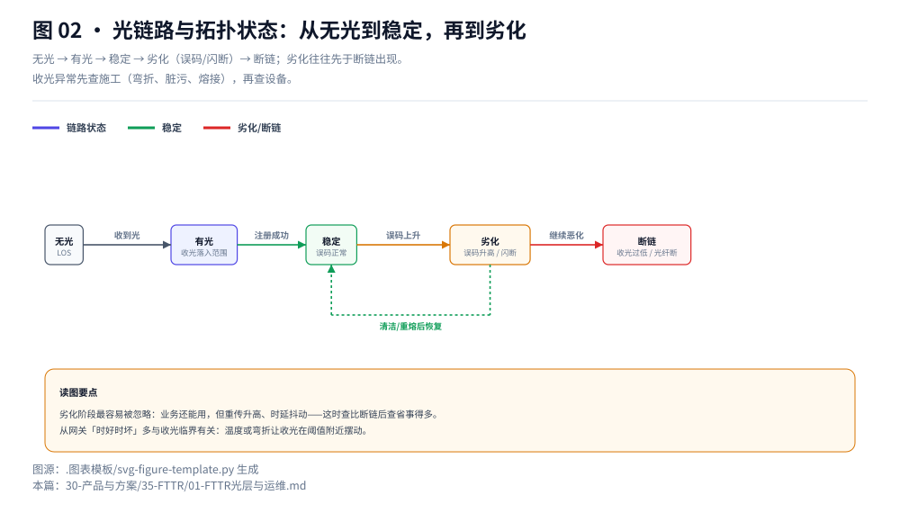

# FTTR 光层与运维

FTTR 的故障大多不在「协议」，而在「光」：**连接器脏污、光纤弯折、分光比过大、取电不稳**。运维的第一动作应该是看光功率和拓扑，而不是先怀疑 Wi-Fi 配置。

> 本篇定位：FTTR 的光功率预算、施工约束、拓扑发现、故障定位与漫游调优。光通信原理去 `10-基础理论/03-光通信`，PON 注册去 `36-ONU-ONT/01-PON注册与OMCI`。

## 目录

- [1 一句话模型](#s1)
- [2 速览](#s2)
- [3 光层与施工字段](#s3)
- [4 交互流程](#s4)
- [5 状态与定时器](#s5)
- [6 设计取舍与边界](#s6)
- [7 与相邻主题的关系](#s7)
- [名词解释](#名词解释)
- [8 参考与关联](#s8)

## 1 · 一句话模型：先算光，再看拓扑，最后调漫游

```text
光功率预算：发光功率 − 光纤损耗 − 分光损耗 − 连接器损耗 ≥ 收光灵敏度
拓扑：主网关 → 分光器 → 从网关，逐级确认
漫游：统一 SSID + 合理布点 + 802.11k/v/r
```

三个关键认知：

1. **光功率是硬约束**：预算不够，再好的 Wi-Fi 也跑不起来；预算够但余量太小，温度/弯折就会让链路抖动。
2. **分光器是「共享 + 损耗」**：分光比越大，单户带宽和光功率越低，故障影响面越大。
3. **运维要能定位到「段」**：主干、分支、从网关、终端，四段分开看，才能快速收敛。

## 2 · 速览

| 项 | 内容 |
| --- | --- |
| 光层对象 | 光模块/BOSA、光纤、连接器、分光器、熔接点 |
| 关键参数 | 发光功率、收光灵敏度、插损、回波损耗、波长 |
| 施工约束 | 弯曲半径、连接器清洁、拉力、暗管/明线 |
| 运维手段 | 光功率查询、拓扑发现、告警、远程诊断、测速 |
| 漫游手段 | 统一 SSID、802.11k/v/r、EasyMesh、功率/信道调优 |
| 主要风险 | 光功率不足、脏污、弯折、分光比过大、从网关断电 |

## 3 · 光层与施工字段

### 3.1 光功率预算

| 项 | 作用 | 典型关注点 |
| --- | --- | --- |
| 发光功率 | 主网关/从网关发射光功率 | 是否在规格范围、随温度漂移 |
| 收光灵敏度 | 接收端能正确解码的最小功率 | 低于灵敏度就误码/断链 |
| 光纤损耗 | 距离相关的衰减 | 单模光纤典型 0.3～0.4 dB/km（待验证） |
| 分光损耗 | 分光器带来的插损 | 1:2/1:4/1:8 逐级增加 |
| 连接器损耗 | SC/LC 等连接点 | 脏污/划伤会显著增加 |
| 熔接损耗 | 熔接点 | 施工质量相关 |
| 余量 | 温度/老化/弯折的缓冲 | 余量太小会间歇性断链 |

> 待验证：具体产品的发光功率、灵敏度、分光比和预算表以规格书为准，本篇只给计算框架。

### 3.2 施工约束

| 项 | 要求 | 违反后果 |
| --- | --- | --- |
| 弯曲半径 | 不小于光纤规格（G.657 更耐弯） | 弯折损耗、断纤 |
| 连接器清洁 | 插拔前清洁，避免灰尘/油污 | 插损增大、回波变差 |
| 拉力 | 不超过光缆承受范围 | 纤芯断裂、隐性损伤 |
| 暗管 | 管径/转弯半径满足穿纤 | 穿不过、拉伤 |
| 光电复合缆 | 供电与光纤同时布放 | 取电困难、供电不稳 |
| 标识 | 两端标注房间/端口 | 运维找不到分支 |

### 3.3 运维观测项

| 观测项 | 来源 | 异常信号 |
| --- | --- | --- |
| 主网关收光 | 光模块 DDM | 低于阈值、波动大 |
| 从网关收光 | 从网关上报 | 某分支明显偏低 |
| 链路状态 | 主从心跳 | 频繁 up/down |
| 拓扑 | 主网关发现 | 从网关缺失/重复 |
| 速率 | 测速/端口统计 | 远低于链路能力 |
| 漫游 | 终端日志/AP 统计 | 切换慢、粘滞 |
| 温度 | 设备传感器 | 高温降频/断链 |

## 4 · 交互流程


**读图**：从左到右逐段扣损耗，收光必须高于灵敏度并留余量；故障定位按「主干—分支—从网关—终端」四段收敛。

> 图源：`images/图01-FTTR光功率预算与定位.svg`

### 4.1 光功率核算

```text
发光功率（dBm）
  − 光纤损耗（dB/km × 距离）
  − 分光器插损（dB）
  − 连接器/熔接损耗（dB）
  − 设计余量（dB）
  ≥ 收光灵敏度（dBm）
```

任何一段不满足，先查施工和连接器，再考虑换分光比或调整位置。

### 4.2 故障定位

```text
全屋无网 → 主网关 PON/光功率 → OLT/主干
单房间无网 → 该分支从网关 → 光纤/分光器/供电
Wi-Fi 弱 → 从网关位置/信道/干扰
漫游卡 → k/v/r、AP 间距、终端能力
```

### 4.3 漫游调优

```text
统一 SSID/安全配置 → 开启 802.11k/v/r
  → 调整 AP 功率（避免过度覆盖）
  → 调整信道（2.4G 1/6/11，5G 非重叠）
  → 验证切换时延/丢包
```

### 4.4 异常分支

| 异常 | 现象 | 定位方向 |
| --- | --- | --- |
| 收光低 | 链路不稳/速率低 | 连接器脏污、弯折、分光比、距离 |
| 收光正常但断链 | 间歇断连 | 供电、温度、固件、光模块兼容 |
| 从网关不在拓扑 | 单房间无业务 | 供电、光纤、注册认证 |
| 速率不达标 | 测速低 | 光功率、主从带宽共享、Wi-Fi 干扰 |
| 漫游粘滞 | 走动卡顿 | AP 功率、k/v/r、终端行为 |
| 批量故障 | 多房间同时异常 | 主网关/分光器/主干 |

## 5 · 状态与定时器




**读图**：光链路从无光到稳定，再到误码/断链；收光异常先查施工。

> 图源：`images/图02-光链路与拓扑状态.svg`

| 对象 | 状态 | 关键参数 |
| --- | --- | --- |
| 光链路 | 无光 → 有光 → 稳定 → 误码 | 收光阈值、告警门限 |
| 主从链路 | Down → Up → 注册 → 在线 | 心跳、离线判定 |
| 拓扑 | 发现中 → 完整 → 缺失 | 发现周期、超时 |
| 漫游 | 关联 → 认证 → 切换 | 切换阈值、重连时间 |
| 告警 | 产生 → 确认 → 清除 | 抑制/去抖 |

> 待验证：各厂商的光功率告警门限、心跳周期和拓扑发现机制不同，需按设备文档确认。

## 6 · 设计取舍与边界

### 6.1 分光比的选择

分光比越大越省光纤和主网关端口，但插损和共享带宽越差。FTTR 家庭场景常用小分光比（如 1:2/1:4），具体要按光功率预算和房间数算，不能照搬 PON 接入网的 1:32/1:64。

### 6.2 光纤 vs 光电复合缆

光电复合缆解决从网关取电，但施工更粗、成本更高；独立供电更灵活，但需要房间有电源。产品要按装修条件提供两种方案。

### 6.3 集中运维 vs 本地诊断

集中运维能批量看光功率和拓扑，适合运营商；本地诊断（LED/App）适合用户自排查。两者要共享同一套阈值和告警语义，避免「App 说正常、网管说异常」。

### 6.4 漫游优化的边界

AP 功率不是越大越好：过大会导致终端「粘」在远 AP，过小会出现覆盖空洞。优化目标是「覆盖够用 + 重叠适度」，而不是追求最大 RSSI。

### 6.5 施工质量的边界

设备能上报光功率，但无法修复脏污和弯折。FTTR 交付必须包含施工验收（光功率、弯曲半径、标识），否则运维会长期为施工问题买单。

## 7 · 与相邻主题的关系

| 相邻对象 | 关系 |
| --- | --- |
| [ODN 与光功率预算](../../10-基础理论/12-通信科学/03-光通信/03-ODN与光功率预算.md) | 损耗与预算计算 |
| [光模块与 SFP](../../10-基础理论/12-通信科学/03-光通信/02-光模块与SFP.md) | 光模块/DDM |
| [PON 技术概览](../../10-基础理论/12-通信科学/03-光通信/00-PON技术概览.md) | PON 复用与波长 |
| [漫游与 EasyMesh](../../20-平台与系统/22-OpenWrt/04-无线/04-漫游与EasyMesh.md) | 漫游协议与组网 |
| [FTTR 组网架构](./00-FTTR组网架构.md) | 主从拓扑与业务 |
| [PON 注册与 OMCI](../36-ONU-ONT/01-PON注册与OMCI.md) | 主网关的 PON 侧 |
| [无线覆盖与干扰优化](../../10-基础理论/12-通信科学/04-无线通信/05-无线测试与优化/00-无线覆盖与干扰优化.md) | 覆盖与干扰 |

一句话：**FTTR 运维 = 光功率预算 × 拓扑可见性 × 漫游调优，三者缺一不可。**

## 名词解释

> 缩写给出英文全称；非缩写用“—”表示。

| 术语 | 英文全称 | 解释 |
| --- | --- | --- |
| FTTR | Fiber To The Room | 光纤到房间。 |
| ODN | Optical Distribution Network | 光分配网络。 |
| OLT | Optical Line Terminal | 光线路终端。 |
| ONU | Optical Network Unit | 光网络单元。 |
| BOSA | Bidirectional Optical Sub-Assembly | 双向光组件。 |
| DDM | Digital Diagnostic Monitoring | 光模块数字诊断监控。 |
| dBm | Decibel-milliwatts | 光功率单位。 |
| 插损 | Insertion Loss | 器件插入带来的功率损耗。 |
| 回波损耗 | Return Loss | 反射回来的功率比例。 |
| G.657 | — | 弯曲不敏感单模光纤标准。 |
| SSID | Service Set Identifier | 无线网络名称。 |
| AP | Access Point | 无线接入点。 |
| EasyMesh | — | Wi-Fi 联盟多 AP 组网标准。 |

## 8 · 参考与关联

**标准**

- ITU-T G.657：弯曲不敏感光纤
- ITU-T G.984 / G.987 / G.9807：PON 系列
- IEEE 802.11k/v/r：无线测量、网络选择、快速切换
- Wi-Fi Alliance EasyMesh

**关联**

- [设备形态对比](../00-设备形态对比.md)
- [FTTR 组网架构](./00-FTTR组网架构.md)
- [ONU/ONT 系统架构](../36-ONU-ONT/00-ONU-ONT系统架构.md)
- [ODN 与光功率预算](../../10-基础理论/12-通信科学/03-光通信/03-ODN与光功率预算.md)

---

> **本篇定位**：FTTR 的光功率预算、施工约束、故障定位与漫游调优。
> **素材来源**：`studyspace/1.知识体系/10.wifi/wifi记录.md`、`studyspace/1.知识体系/7.openwrt/3.网络业务/2.关键组件服务/5.WiFi子系统/`。
> **待验证**：各产品的光功率规格、分光比、告警门限和主从拓扑协议。
