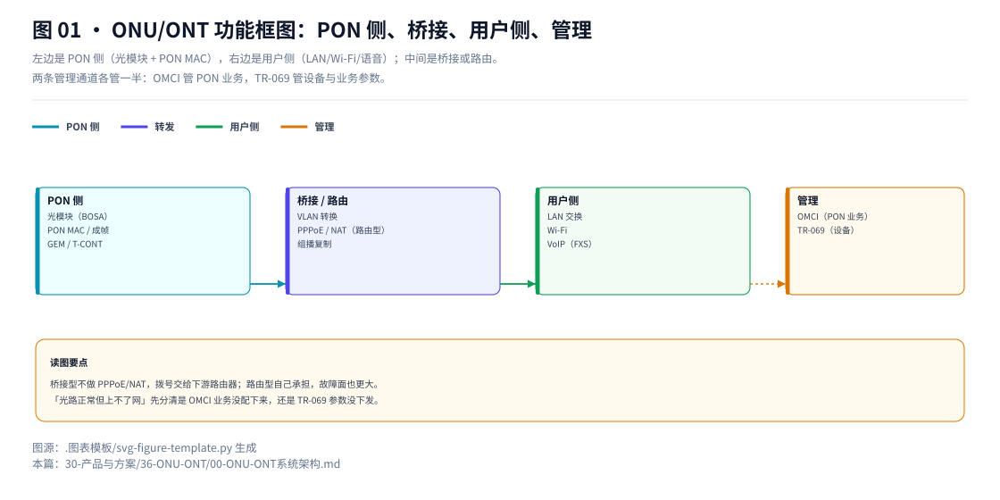

# ONU/ONT 系统架构

ONU/ONT 是 PON 的用户侧终端：**上行通过光纤接入 OLT，下行提供以太/Wi-Fi/语音接口，并由 OMCI（或 TR-069）完成业务配置**。家用场景里它通常就叫「光猫」。

> 本篇定位：ONU/ONT 的形态分类、软硬件组成、业务模型和产品指标。PON 复用/测距原理去 `10-基础理论/03-光通信`，OMCI 流程去 `01-PON注册与OMCI`，家用形态去 `03-光猫产品形态`。

## 目录

- [1 一句话模型](#s1)
- [2 速览](#s2)
- [3 结构与字段](#s3)
- [4 交互流程](#s4)
- [5 状态机与定时器](#s5)
- [6 设计取舍与边界](#s6)
- [7 与相邻主题的关系](#s7)
- [名词解释](#名词解释)
- [8 参考与关联](#s8)

## 1 · 一句话模型：PON 侧注册，用户侧终结

```text
OLT ── 光纤/分光器 ── ONU/ONT
                        ├─ PON MAC：注册/测距/授权/GEM
                        ├─ 交换/Wi-Fi：LAN 与无线接入
                        ├─ VoIP：FXS 语音
                        └─ 管理：OMCI / TR-069
```

三个关键认知：

1. **ONU 是 PON 的从设备**：它不主动「拨号上 PON」，而是被 OLT 发现、测距、授权。
2. **OMCI 管 PON 业务，TR-069 管设备业务**：前者配置 T-CONT/GEM/VLAN，后者配置 Wi-Fi/账号/升级。
3. **光猫是 ONU/ONT 的家用叫法**，不等于「低端」：桥接型、路由型、带 Wi-Fi/语音、10G 光猫都属于这个家族。

## 2 · 速览

| 项 | 内容 |
| --- | --- |
| 产品定位 | PON 用户侧终端，终结光接入并提供用户接口 |
| 典型形态 | SFU（桥接）、HGU（家庭网关）、SBU（单业务）、MDU（多住户） |
| 核心对象 | PON 端口、T-CONT、GEM Port、UNI、VLAN、VoIP 账号 |
| 关键能力 | PON 注册/测距、OMCI 配置、二层/三层转发、Wi-Fi、VoIP |
| 软件栈 | Boot + Linux + PON SDK + OMCI 栈 + Web/TR-069 |
| 关键标准 | G.984/G.987/G.9807、802.3ah/av、OMCI、TR-069、SIP |
| 主要指标 | 注册成功率、光功率、吞吐、VoIP 质量、IPTV 丢包、升级成功率 |

## 3 · 结构与字段

### 3.1 形态分类

| 形态 | 含义 | 转发能力 | 典型场景 |
| --- | --- | --- | --- |
| SFU | Single Family Unit，桥接型 | 二层桥接 | 家用光猫（桥接） |
| HGU | Home Gateway Unit | 路由/NAT/Wi-Fi | 家用光猫（路由） |
| SBU | Single Business Unit | 二层/三层 | 企业单业务 |
| MDU | Multi-Dwelling Unit | 多用户接入 | 楼道/酒店 |
| 10G ONU | XG(S)-PON 终端 | 高速率 | 千兆/万兆宽带 |

### 3.2 硬件组成

| 部件 | 作用 | 产品关注点 |
| --- | --- | --- |
| PON MAC/SerDes | PON 成帧、测距、GEM | 支持的 PON 类型、速率 |
| BOSA/光模块 | 光电转换 | 发光/收光功率、波长、DDM |
| 主控 CPU | 协议、管理、转发 | 性能、内存、是否支持路由 |
| 交换芯片 | LAN 多口/VLAN | 端口速率、DSA 支持 |
| Wi-Fi 芯片 | 无线覆盖 | 频段、空间流、FEM |
| VoIP 模块 | FXS/编解码 | 话机数、回声消除 |
| 存储 | 固件/配置 | 双镜像、配置备份 |
| 电源 | 供电 | 功耗、适配器规格 |

### 3.3 软件分层

| 层 | 组件 | 职责 |
| --- | --- | --- |
| 引导 | BootROM/U-Boot | 镜像选择、升级、恢复 |
| PON 驱动 | PON MAC/SerDes | 同步、测距、GEM 收发 |
| OMCI | OMCI 栈/MIB | 业务配置、告警、性能 |
| 网络 | bridge/路由/NAT | LAN/WAN 转发 |
| 业务 | VoIP、Wi-Fi、IPTV | 用户业务 |
| 管理 | Web、TR-069/TR-369 | 设备配置与升级 |

### 3.4 业务与对象

| 对象 | 作用 | 关键字段 |
| --- | --- | --- |
| T-CONT | 上行带宽容器 | 类型、带宽、优先级 |
| GEM Port | 业务承载通道 | GEM ID、映射的 T-CONT |
| UNI | 用户侧接口 | 端口类型、VLAN 模式 |
| VLAN | 业务隔离 | SVLAN/CVLAN、PVID |
| VoIP | 语音业务 | SIP 账号、编解码、FXS 口 |
| 管理 | OMCI/TR-069 | OMCC、ACS 地址、周期 |

## 4 · 交互流程



**读图**：PON 侧负责注册和业务通道，用户侧提供 LAN/Wi-Fi/语音；OMCI 与 TR-069 分别管理 PON 业务和设备业务。

> 图源：`images/图01-ONU功能框图.svg`

### 4.1 上电到业务可用

```text
上电 → Boot → PON 驱动加载
  → 下行同步 → 注册/测距/授权 → 建立 OMCC
  → OMCI 下发 T-CONT/GEM/VLAN → 业务通道建立
  → 路由/桥接配置 → Wi-Fi/VoIP 启动
  → TR-069 上线 → 运营商业务开通
```

### 4.2 数据路径

```text
上行：LAN/Wi-Fi → 桥/路由 → GEM 映射 → T-CONT → PON → OLT
下行：OLT → GEM → ONU → VLAN 解封装 → LAN/Wi-Fi
语音：FXS → 编解码 → SIP/RTP → 业务 VLAN → PON
```

### 4.3 异常分支

| 异常 | 现象 | 定位方向 |
| --- | --- | --- |
| 不注册 | PON 灯闪/灭 | 光功率、SN/密码、OLT 授权 |
| 注册但无业务 | 能管理不能上网 | OMCI 配置、VLAN、T-CONT/GEM |
| 光功率低 | 速率低/断连 | 连接器、弯折、分光比 |
| VoIP 不通 | 注册失败/单通 | SIP、NAT、编解码、FXS |
| IPTV 卡顿 | 组播丢包 | 组播 VLAN、IGMP、带宽 |
| 升级失败 | 不启动 | 双镜像、校验、回滚 |

## 5 · 状态机与定时器


**读图**：启动、PON 注册、OMCC、业务配置、运营五段；注册成功但业务不通要看 OMCI。

> 图源：`images/图02-ONU运行状态.svg`

| 对象 | 状态 | 关键参数 |
| --- | --- | --- |
| PON 链路 | 无光 → 同步 → 注册 → 测距 → 授权 → 运营 | 同步/注册超时、测距周期 |
| OMCC | 未建立 → 建立 → 同步 | 通道建立超时 |
| 业务 | 未配置 → 已配置 → 可用 | OMCI 下发确认 |
| TR-069 | 未连接 → 连接 → 会话 | 周期 Inform |
| 升级 | 下载 → 校验 → 写入 → 重启 → 确认 | 回滚超时 |

## 6 · 设计取舍与边界

### 6.1 桥接 vs 路由

桥接型（SFU）把拨号/路由交给下游路由器，部署简单、故障面小；路由型（HGU）一体化，功能完整但排障面大。运营商按业务模式选择，不是技术先进性问题。

### 6.2 OMCI vs TR-069

OMCI 由 OLT 直接管理，适合 PON 业务配置和性能采集；TR-069 由 ACS 管理，适合 Wi-Fi/账号/升级。两者职责要分清，避免同一参数双头管理。

### 6.3 单模/多模与 PON 类型

GPON/EPON/XG(S)-PON 的速率、波长、帧结构不同，ONU 必须匹配 OLT 侧类型。多模 ONU 能做兼容，但成本和功耗更高。

### 6.4 光猫不是越「智能」越好

增加路由、Wi-Fi、插件会提高成本和故障率。对运营商来说，稳定注册、可控管理、低故障率比「功能多」更重要。

### 6.5 升级与回滚

PON 终端分布广、现场不可达，升级必须支持双镜像和远程回滚。单镜像产品一旦升级失败，只能上门更换。

## 7 · 与相邻主题的关系

| 相邻对象 | 关系 |
| --- | --- |
| [PON 技术概览](../../10-基础理论/12-通信科学/03-光通信/00-PON技术概览.md) | PON 架构与复用 |
| [PON 复用测距与注册](../../10-基础理论/12-通信科学/03-光通信/01-PON复用测距与注册.md) | 注册与测距 |
| [光模块与 SFP](../../10-基础理论/12-通信科学/03-光通信/02-光模块与SFP.md) | 光器件 |
| [PON 注册与 OMCI](./01-PON注册与OMCI.md) | 本篇的协议展开 |
| [VoIP 与 IPTV 业务](./02-VoIP与IPTV业务.md) | 用户业务 |
| [光猫产品形态](./03-光猫产品形态.md) | 家用形态谱系 |
| [CPE 系统架构](../33-CPE/00-CPE系统架构.md) | 与 CPE 的边界 |

一句话：**ONU/ONT = PON 侧的被管理终端 + 用户侧的业务接口 + 一条 OMCI 管理通道。**

## 名词解释

> 缩写给出英文全称；非缩写用“—”表示。

| 术语 | 英文全称 | 解释 |
| --- | --- | --- |
| ONU | Optical Network Unit | 光网络单元。 |
| ONT | Optical Network Terminal | 光网络终端。 |
| OLT | Optical Line Terminal | 光线路终端。 |
| PON | Passive Optical Network | 无源光网络。 |
| SFU | Single Family Unit | 单家庭单元，常指桥接型光猫。 |
| HGU | Home Gateway Unit | 家庭网关型光猫。 |
| SBU | Single Business Unit | 单业务单元。 |
| MDU | Multi-Dwelling Unit | 多住户单元。 |
| OMCI | ONT Management and Control Interface | ONT 管理控制接口。 |
| OMCC | ONU Management and Control Channel | OMCI 管理通道。 |
| T-CONT | Transmission Container | 上行传输容器。 |
| GEM | GPON Encapsulation Method | GPON 封装方式。 |
| UNI | User-Network Interface | 用户网络接口。 |
| BOSA | Bidirectional Optical Sub-Assembly | 双向光组件。 |
| DDM | Digital Diagnostic Monitoring | 光模块数字诊断监控。 |

## 8 · 参考与关联

**标准**

- ITU-T G.984：GPON
- ITU-T G.987：XG-PON
- ITU-T G.9807：XGS-PON
- IEEE 802.3ah：EPON
- IEEE 802.3av：10G-EPON
- TR-069 / TR-369：远程管理

**关联**

- [设备形态对比](../00-设备形态对比.md)
- [PON 注册与 OMCI](./01-PON注册与OMCI.md)
- [VoIP 与 IPTV 业务](./02-VoIP与IPTV业务.md)
- [光猫产品形态](./03-光猫产品形态.md)

---

> **本篇定位**：ONU/ONT 的形态、软硬件分层、业务对象与数据路径。
> **素材来源**：`studyspace/1.知识体系/7.openwrt/3.网络业务/`、`studyspace/1.知识体系/9.lte5g相关/`（终端侧实现参考）。
> **待验证**：各厂商 PON SDK 的 T-CONT/GEM 规格、OMCI 实现差异和光功率参数。
