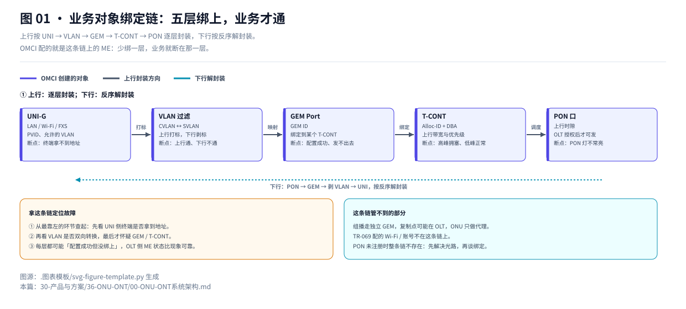
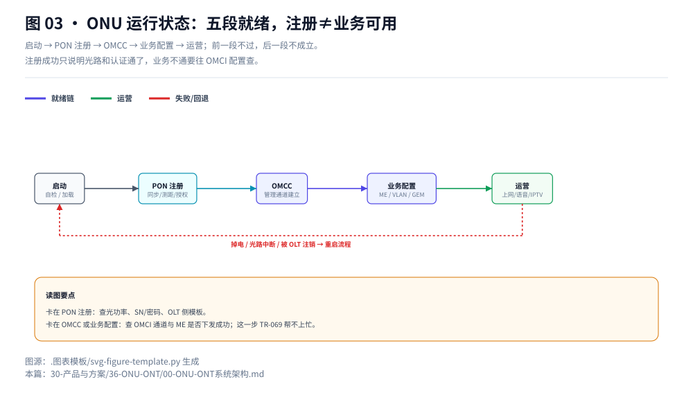

# ONU/ONT 系统架构

ONU/ONT 是 PON 的用户侧终端：**上行通过光纤接入 OLT，下行提供以太/Wi-Fi/语音接口，并由 OMCI（或 TR-069）完成业务配置**。家用场景里它通常就叫「光猫」。

> 本篇定位：ONU/ONT 的形态分类、软硬件组成、业务模型和产品指标。不覆盖三件事：PON 复用/测距的物理原理去 [03-光通信](../../10-基础理论/12-通信科学/03-光通信/.readme.md)，注册报文与 OMCI 消息逐条展开去 [01-PON注册与OMCI](./01-PON注册与OMCI.md)，家用形态选型去 [03-光猫产品形态](./03-光猫产品形态.md)。

## 目录

- [1 一句话模型](#s1)
- [2 速览](#s2)
- [3 结构与字段：五块拼出一台 ONU](#s3)
- [4 交互流程](#s4)
- [5 状态机与定时器](#s5)
- [6 设计取舍与边界](#s6)
- [7 与相邻主题的关系](#s7)
- [名词解释](#名词解释)
- [8 参考与关联](#s8)

## 1 · 一句话模型：PON 侧注册，用户侧终结

```text
OLT ── 光纤/分光器 ── ONU/ONT
                        ├─ PON MAC：注册/测距/授权/GEM
                        ├─ 交换/Wi-Fi：LAN 与无线接入
                        ├─ VoIP：FXS 语音
                        └─ 管理：OMCI / TR-069
```

三个关键认知：

1. **ONU 是 PON 的从设备**：它不主动「拨号上 PON」，而是被 OLT 发现、测距、授权。
2. **OMCI 管 PON 业务，TR-069 管设备业务**：前者配置 T-CONT/GEM/VLAN，后者配置 Wi-Fi/账号/升级。
3. **光猫是 ONU/ONT 的家用叫法**，不等于「低端」：桥接型、路由型、带 Wi-Fi/语音、10G 光猫都属于这个家族。

因为上行是**一条被所有 ONU 共享的车道**，所以 OLT 必须先测距再授权——不知道每台设备离得多远，就没法把时隙排开；ONU 侧看到的一切「注册状态」，本质都是这条车道上的排队进度。

一句话类比：ONU 像一条**分时共享车道上的车**——能不能上路、什么时候出发、能占多宽，全由 OLT 这个调度员决定；车自己只负责装货（业务）和按点发车。

> **推论**：既然上线顺序由 OLT 决定，那么「换一台同型号的光猫插上就能用」只在 OLT 侧已放行该 SN/密码时成立；换机不通，先查 OLT 的绑定关系，再查设备好坏。
> **边界**：这条模型只管 PON 接入段。ONU 下游是桥接还是路由、要不要 NAT，属于业务模式问题，与 PON 侧注册无关——桥接光猫「上不了网」很可能根本不在 PON 层。
> **类比失效处**：车道是共享的，但 ONU 之间并不互相通信；所谓「碰撞」发生在 OLT 的接收窗口里，不是设备自己感知到的。

## 2 · 速览

| 项 | 内容 | 边界与误判 |
| --- | --- | --- |
| 产品定位 | PON 用户侧终端，终结光接入并提供用户接口 | 「终端」指 PON 协议终点，不代表一定终结 IP：桥接型把三层交给下游 |
| 典型形态 | SFU（桥接）、HGU（家庭网关）、SBU（单业务）、MDU（多住户） | 形态是软件配置与产品定义，不是硬件种类；同一块板可出 SFU 也可出 HGU |
| 核心对象 | PON 端口、T-CONT、GEM Port、UNI、VLAN、VoIP 账号 | 这些对象是**绑定关系**，不是并列清单；少绑一层，业务就断在那一层 |
| 关键能力 | PON 注册/测距、OMCI 配置、二层/三层转发、Wi-Fi、VoIP | 能力清单不等于产品规格；标称支持 ≠ 运营商模板里已开通 |
| 软件栈 | Boot + Linux + PON SDK + OMCI 栈 + Web/TR-069 | 各层版本强耦合；换 OMCI 栈版本可能连带换 PON SDK |
| 关键标准 | G.984/G.987/G.9807、802.3ah/av、OMCI、TR-069、SIP | 标准只保证消息格式，不保证厂商默认值与私有属性一致 |
| 主要指标 | 注册成功率、光功率、吞吐、VoIP 质量、IPTV 丢包、升级成功率 | 注册成功率的分母是「上电次数」，不是「在线设备数」，两者算出来差很远 |

因为形态是软件配置与产品定义，不是硬件种类，所以**同一块板可以出 SFU 也可以出 HGU**；按型号或外观判断形态，是选型与排障里最常见的一步错。

## 3 · 结构与字段：五块拼出一台 ONU

一台 ONU 可以拆成五个问题来看：**卖成什么形态（3.1）→ 用什么器件（3.2）→ 跑什么软件（3.3）→ 配哪些业务对象（3.4）**。先看形态定产品定义，再看器件与软件定能力上限，最后看业务对象定「配得对不对」。

### 3.1 形态分类

| 形态 | 含义 | 转发能力 | 典型场景 | 选型边界（判错会怎样） |
| --- | --- | --- | --- | --- |
| SFU | Single Family Unit，桥接型 | 二层桥接 | 家用光猫（桥接） | 把它当路由型卖，用户会发现「没有 Wi-Fi、不能拨号」，投诉的是产品定义不是故障 |
| HGU | Home Gateway Unit | 路由/NAT/Wi-Fi | 家用光猫（路由） | 把它当桥接型部署，NAT 叠两层，排障时说不清是哪一层丢包 |
| SBU | Single Business Unit | 二层/三层 | 企业单业务 | 单业务设备接多业务时缺 VLAN/QoS 隔离，语音会被数据挤掉 |
| MDU | Multi-Dwelling Unit | 多用户接入 | 楼道/酒店 | 多住户形态的端口隔离与广播抑制要求更高，拿 SFU 顶替会引发广播风暴 |
| 10G ONU | XG(S)-PON 终端 | 高速率 | 千兆/万兆宽带 | 上行 10G 不代表整机 10G：LAN 口、Wi-Fi、CPU 转发任一环不够，实测仍卡在千兆 |

**为什么形态要单独列一张表**：因为形态决定了「谁负责拨号、谁负责管理、谁负责覆盖」这三件事的归属，而这三件事恰恰是现场排障最先要问的。同一个「上不了网」，在 SFU 与 HGU 上是两条完全不同的排查路径。

### 3.2 硬件组成

| 部件 | 作用 | 产品关注点 | 器件/设计边界 |
| --- | --- | --- | --- |
| PON MAC/SerDes | PON 成帧、测距、GEM | 支持的 PON 类型、速率 | 一颗 MAC 通常只支持一个 PON 家族；GPON 与 XGS-PON 双模要么双 MAC，要么可切换 |
| BOSA/光模块 | 光电转换 | 发光/收光功率、波长、DDM | 收光过载与收光不足都会断链；只盯「功率低」会漏掉过载 |
| 主控 CPU | 协议、管理、转发 | 性能、内存、是否支持路由 | 桥接型可以省 CPU，但 OMCI、TR-069、VoIP 仍要 CPU；低端 CPU 先卡在管理面 |
| 交换芯片 | LAN 多口/VLAN | 端口速率、DSA 支持 | 交换芯片能力决定 VLAN 表与组播表规模，规格书常只写端口数 |
| Wi-Fi 芯片 | 无线覆盖 | 频段、空间流、FEM | 光猫 Wi-Fi 多为集成方案，射频指标弱于独立 AP；大户型别指望一体机覆盖 |
| VoIP 模块 | FXS/编解码 | 话机数、回声消除 | FXS 馈电与振铃是硬件能力，软件改不出来；掉电后普通话机直接失联 |
| 存储 | 固件/配置 | 双镜像、配置备份 | 单镜像 + 无备份的产品，升级失败只能上门换机 |
| 电源 | 供电 | 功耗、适配器规格 | 语音业务要求掉电告警（Dying Gasp），电源设计要留储能给告警窗口 |

### 3.3 软件分层

| 层 | 组件 | 职责 | 这一层失效的表现 |
| --- | --- | --- | --- |
| 引导 | BootROM/U-Boot | 镜像选择、升级、恢复 | 卡在 Boot：所有灯常亮或全灭，串口无输出，远程完全失联 |
| PON 驱动 | PON MAC/SerDes | 同步、测距、GEM 收发 | PON 灯不常亮；上层 OMCI 再正确也没用 |
| OMCI | OMCI 栈/MIB | 业务配置、告警、性能 | 能注册、能 ping 管理地址，但业务 VLAN 与 GEM 没建起来 |
| 网络 | bridge/路由/NAT | LAN/WAN 转发 | 业务通道通了但终端拿不到地址 / 地址拿到了出不去 |
| 业务 | VoIP、Wi-Fi、IPTV | 用户业务 | 上网正常、语音或电视单独不通 |
| 管理 | Web、TR-069/TR-369 | 设备配置与升级 | 本地能配、远程配不了；批量开通与升级失败 |

**为什么必须分层**：因为故障现象几乎都是「上不了网」这一句话，只有按层切开，才能把一句话变成一个可验证的判断。分层不是为了画得整齐，是为了让每一层都有独立的观测点——灯态、OMCI ME 状态、WAN 地址、SIP 注册状态。

> **推论**：OMCI 层以上的问题，TR-069 帮不上忙；PON 驱动层的问题，OMCI 也帮不上忙。所以排障第一步不是看配置，而是确定「断在第几层」。

### 3.4 业务与对象

| 对象 | 作用 | 关键字段 | 配错/未绑的表现 |
| --- | --- | --- | --- |
| T-CONT | 上行带宽容器 | 类型、带宽、优先级 | 类型错（如全配固定带宽）表现为高峰期整体拥塞或带宽浪费 |
| GEM Port | 业务承载通道 | GEM ID、映射的 T-CONT | GEM 建了但没绑 T-CONT，业务「配置成功」却发不出去 |
| UNI | 用户侧接口 | 端口类型、VLAN 模式 | UNI 的 VLAN 模式（tag/untag/translate）与下游设备不匹配，终端拿不到地址 |
| VLAN | 业务隔离 | SVLAN/CVLAN、PVID | 只配一侧 VLAN 转换，上行能通、下行不通（或反之） |
| VoIP | 语音业务 | SIP 账号、编解码、FXS 口 | 账号对但 VLAN 不对，注册超时；表现为「话机有音无网」 |
| 管理 | OMCI/TR-069 | OMCC、ACS 地址、周期 | OMCC 通、ACS 不通：能开通不能升级，问题常被误判成「设备不支持远程管理」 |

这六个对象不是并列关系，而是一条**从用户口一路绑到光口的链**：

### 图 01 · 业务对象绑定链



**读图**：从左到右是上行封装顺序——UNI 收帧、VLAN 过滤打标、GEM 承载、T-CONT 排队、PON 口按时隙发出；下行按反序解封装。每个框下标注的是「这一层没配对时的表现」。

> 图源：`images/图01-业务对象绑定链.svg`

> **推论**：既然是一条链，那么「业务不通」永远可以定位到**最靠左的那个没绑上的环节**；从右往左查（先怀疑 PON）是最费时间的顺序，因为 PON 侧一旦不通，连管理都进不来。
> **边界**：组播业务不完全走这条链——组播 GEM 通常是独立的，且复制点可能在 OLT 侧，ONU 只做转发与 IGMP 代理，见 [02-VoIP与IPTV业务](./02-VoIP与IPTV业务.md)。

## 4 · 交互流程


**读图**：PON 侧负责注册和业务通道，用户侧提供 LAN/Wi-Fi/语音；OMCI 与 TR-069 分别管理 PON 业务和设备业务。左右两半的分界线不是硬件位置，而是「谁下发的配置」——左边听 OLT 的，右边听 ACS 的。

> 图源：`images/图02-ONU功能框图.svg`

### 4.1 上电到业务可用

```text
上电 → Boot → PON 驱动加载
  → 下行同步 → 注册/测距/授权 → 建立 OMCC
  → OMCI 下发 T-CONT/GEM/VLAN → 业务通道建立
  → 路由/桥接配置 → Wi-Fi/VoIP 启动
  → TR-069 上线 → 运营商业务开通
```

这条链上有三道**互不替代**的门槛，卡在不同位置，现场看到的现象完全不同：

| 门槛 | 过了才有什么 | 卡住时的现象 | 常见误判 |
| --- | --- | --- | --- |
| 下行同步 + 注册授权 | PON 灯常亮、OLT 能看到这台 ONU | 灯闪/灭，OLT 侧无记录 | 直接换机，忽略光功率与 OLT 白名单 |
| OMCC + OMCI 业务配置 | 业务 VLAN/GEM 建立，二层通道通 | 能远程管理，终端拿不到业务地址 | 当成「上层网络问题」，去查 BRAS/DHCP |
| 路由/桥接 + TR-069 | 上网、语音、电视可用，可远程运维 | 网络通但语音/电视单独不通，或无法远程升级 | 把业务问题当成注册问题，反复重启 |

**为什么顺序不能颠倒**：注册是 OLT 与 ONU 之间的物理层契约，OMCI 是建立在这条契约上的管理通道，业务又是 OMCI 配出来的。前一层不成立时，后一层的「配置」要么下不来，要么下来了也不生效。

### 4.2 数据路径

```text
上行：LAN/Wi-Fi → 桥/路由 → GEM 映射 → T-CONT → PON → OLT
下行：OLT → GEM → ONU → VLAN 解封装 → LAN/Wi-Fi
语音：FXS → 编解码 → SIP/RTP → 业务 VLAN → PON
```

三条路径在 ONU 内部共用同一条 PON 上行，但在 ONU 之前就分开了：上网走路由/桥接，语音走 SIP 客户端，IPTV 走组播代理。**因为它们分开得足够早，所以可以做到「上网正常、语音不通」**——这不是矛盾现象，而是设计使然。

> **边界**：桥接型 ONU 没有「路由」这一步，上行帧直接按 VLAN 映射进 GEM；此时若在下游路由器上看不到带 VLAN tag 的帧，问题在 ONU 的 VLAN 透传配置，不在 PON。

### 4.3 异常分支

| 异常 | 现象 | 定位方向 | 先验证什么 |
| --- | --- | --- | --- |
| 不注册 | PON 灯闪/灭 | 光功率、SN/密码、OLT 授权 | 收光功率是否在灵敏度与过载之间 |
| 注册但无业务 | 能管理不能上网 | OMCI 配置、VLAN、T-CONT/GEM | OLT 侧该 ONU 的 ME 是否全部创建成功 |
| 光功率低 | 速率低/断连 | 连接器、弯折、分光比 | 换尾纤/清洁端面后功率是否回升 |
| VoIP 不通 | 注册失败/单通 | SIP、NAT、编解码、FXS | 话机是否能拿到语音 VLAN 与 SIP 服务器地址 |
| IPTV 卡顿 | 组播丢包 | 组播 VLAN、IGMP、带宽 | 单播是否正常（区分「全断」与「只组播断」） |
| 升级失败 | 不启动 | 双镜像、校验、回滚 | Boot 是否能进备份镜像 |

## 5 · 状态机与定时器



**读图**：启动、PON 注册、OMCC、业务配置、运营五段；注册成功但业务不通要看 OMCI。这条链是**串行**的，前一段不过，后一段不会开始。

> 图源：`images/图03-ONU运行状态.svg`

因为五段是串行的，所以「业务不通」有两种完全不同的含义：卡在 OMCC 之前是**配不下来**，卡在业务配置之后是**配了但没生效**；两者的排查对象不同。

> **推论**：现场拿到「PON 灯常亮 + 能远程管理 + 终端无地址」这组现象，就可以跳过光路与注册，直接查 OMCI 业务对象与绑定链。

| 对象 | 状态 | 在等什么 | 失败表现 |
| --- | --- | --- | --- |
| PON 链路 | 无光 → 同步 → 注册 → 测距 → 授权 → 运营 | OLT 的下行帧与授权消息 | 停在某一态并周期重试，PON 灯闪烁节奏随之变化 |
| OMCC | 未建立 → 建立 → 同步 | OMCI 通道的 GEM 与 OLT 响应 | 注册正常但 ME 读不到，表现为「OLT 看得到、配不了」 |
| 业务 | 未配置 → 已配置 → 可用 | OMCI 下发确认与二层连通 | ME 已创建但流量不通，多为映射/绑定漏配 |
| TR-069 | 未连接 → 连接 → 会话 | ACS 可达与认证 | 本地功能正常，远程升级/改参全部失败 |
| 升级 | 下载 → 校验 → 写入 → 重启 → 确认 | 镜像完整性与回滚判据 | 重启后回到旧版本（回滚生效）或直接不启动（无备份） |

| 定时器 | 管什么 | 说明与边界 |
| --- | --- | --- |
| 注册/测距超时 | 单次注册尝试的等待上限 | 与距离、光功率相关；超时后重试，重试间隔由 OLT 侧模板决定 |
| OMCC 建立超时 | 管理通道多久算失败 | 超时后业务配置根本不会开始，现象与「OMCI 不兼容」相似 |
| TR-069 周期 Inform | 设备心跳与配置核对 | 周期由 ACS 下发，不是固定值；改小会增加 ACS 与设备负担 |
| 升级回滚窗口 | 新镜像启动后多久确认有效 | 窗口内掉电会被判为失败并回滚，现场「升级后自己变回旧版」多半是这个机制 |
| Dying Gasp 上报窗口 | 掉电后维持告警上报的时间 | 依赖电源储能；窗口太短，OLT 只看到「突然消失」 |

> **待验证**：各厂商对上述定时器的默认值差异较大，且部分参数由 OLT 模板下发而非本地配置，核对时以现网 OLT/ONU 文档为准。

## 6 · 设计取舍与边界

### 6.1 桥接 vs 路由

桥接型（SFU）把拨号/路由交给下游路由器，部署简单、故障面小；路由型（HGU）一体化，功能完整但排障面大。运营商按业务模式选择，不是技术先进性问题。

**代价**：桥接型把「用户体验」的责任交给用户设备，运营商只保证管道质量，出问题时责任边界清楚但用户自助能力差；路由型把责任收回来，也就把 Wi-Fi 干扰、NAT 性能、账号配置这些故障一起收了进来。

> **失效条件**：用户自购路由器不支持 VLAN tag 或 PPPoE 透传时，桥接方案直接不成立——这不是光猫的问题，是下游设备能力不匹配。

### 6.2 OMCI vs TR-069

OMCI 由 OLT 直接管理，适合 PON 业务配置和性能采集；TR-069 由 ACS 管理，适合 Wi-Fi/账号/升级。两者职责要分清，避免同一参数双头管理。

**为什么不能合并成一条通道**：OMCI 的生命周期与 PON 绑定——OLT 一旦看不到 ONU，配置通道同时消失；而设备级运维（改 Wi-Fi 密码、推固件）必须独立于 PON 存在，否则光路一断就彻底失去运维手段。

> **边界**：双头管理的典型冲突是「Wi-Fi 参数既在 OMCI 私有 ME 里又在 TR-069 里」。冲突时后写入者生效，表现为「刚改的配置过一会儿自己变回去」。

### 6.3 单模/多模与 PON 类型

GPON/EPON/XG(S)-PON 的速率、波长、帧结构不同，ONU 必须匹配 OLT 侧类型。多模 ONU 能做兼容，但成本和功耗更高。

因为三者的速率、波长与帧结构必须匹配，所以「同族」是物理层要求而不是商务选项：波长错了，光功率再正常也同步不上。

**代价**：多模通常意味着更大的光模块选型空间、更复杂的校准与更长的互通测试周期；对集采产品，单模 + 明确场景往往比「全兼容」更好卖。

> **边界**：「支持 XGS-PON」要问清是**同一端口可切换**还是**双端口/双模块**——前者换 PON 类型要重配，后者才能与 GPON 并存过渡。

### 6.4 光猫不是越「智能」越好

增加路由、Wi-Fi、插件会提高成本和故障率。对运营商来说，稳定注册、可控管理、低故障率比「功能多」更重要。

**为什么**：运营商考核的是注册成功率、平均故障间隔和上门率，功能多带来的边际收益远小于故障率上升带来的成本；而「智能」能力一旦由第三方插件提供，安全与合规责任也随之上移。

> **失效条件**：在需要差异化增值业务（安防、家长控制、边缘存储）的场景，纯管道型产品反而留不住用户——这时「智能」是产品定义的一部分，不是负担。

### 6.5 升级与回滚

PON 终端分布广、现场不可达，升级必须支持双镜像和远程回滚。单镜像产品一旦升级失败，只能上门更换。

**代价**：双镜像占掉一半 Flash，且要求 Boot 能在两个镜像间可靠切换；低容量产品常因此砍掉备份镜像，把风险留给现场。

> **推论**：判断一台光猫是否「可远程运维」，先看它有没有备份镜像和回滚窗口，而不是看它支不支持 TR-069 升级接口。

### 6.6 四个常见误判

| 误判 | 实际 | 后果 |
| --- | --- | --- |
| 「能 ping 通管理地址就是好的」 | 管理面通只说明 IP 可达，业务 VLAN/GEM 可能没建 | 把业务故障当网络故障，反复重启无效 |
| 「PON 灯常亮就是注册成功」 | 常亮通常表示已授权，但 OMCC 与业务配置是后一步 | 漏查 OMCI，问题被拖到二线 |
| 「换个光猫试试」 | 换机要同步 OLT 侧 SN/密码绑定 | 换了也不通，还多了一次解绑/绑定操作 |
| 「Wi-Fi 不好就换光猫」 | 一体机射频能力弱是产品定义，不是故障 | 换同档产品无改善，成本白花 |

## 7 · 与相邻主题的关系

| 相邻对象 | 关系 | 边界 |
| --- | --- | --- |
| [PON 技术概览](../../10-基础理论/12-通信科学/03-光通信/00-PON技术概览.md) | PON 架构与复用 | 讲的是 ODN 与复用原理，不涉及 ONU 内部软件分层；要查分层回本篇 |
| [PON 复用测距与注册](../../10-基础理论/12-通信科学/03-光通信/01-PON复用测距与注册.md) | 注册与测距的物理机制 | 那篇推的是时隙与 EqD 的算法，本篇只讲它落在产品哪一层 |
| [光模块与 SFP](../../10-基础理论/12-通信科学/03-光通信/02-光模块与SFP.md) | 光器件 | 光模块是器件级话题；「模块不兼容」不等于「光猫故障」，别混为一谈 |
| [PON 注册与 OMCI](./01-PON注册与OMCI.md) | 本篇的协议展开 | 本篇给结构，那篇给报文与 ME；查具体 ME 编号去那篇 |
| [VoIP 与 IPTV 业务](./02-VoIP与IPTV业务.md) | 用户业务 | 本篇只点到「有这条业务通道」，VLAN/QoS/组播细节在那篇 |
| [光猫产品形态](./03-光猫产品形态.md) | 家用形态谱系 | 那篇从选型角度切，本篇从整机结构切；同一台设备两种视角，不要互相抄 |
| [CPE 系统架构](../33-CPE/00-CPE系统架构.md) | 与 CPE 的边界 | CPE 是按部署位置与管理归属定义的上位概念；PON 侧协议细节不在 CPE 篇 |

因为每篇只保留一份正本，所以具体报文去 10、实现细节去 20/40，本篇只留产品层的判断与边界。

一句话：**ONU/ONT = PON 侧的被管理终端 + 用户侧的业务接口 + 一条 OMCI 管理通道。**

> **推论**：这七条里只有两条会真正改变操作顺序——PON 物理层（光功率、测距）和 OMCI 业务对象；其余是背景知识。排障时先修这两条，再扩展阅读。

## 名词解释

> 缩写给出英文全称；非缩写用“—”表示。

| 术语 | 英文全称 | 解释 |
| --- | --- | --- |
| ONU | Optical Network Unit | 光网络单元，PON 用户侧设备的统称。 |
| ONT | Optical Network Terminal | 光网络终端，强调单个用户终端的 ONU。 |
| OLT | Optical Line Terminal | 光线路终端，PON 局侧设备，负责发现、测距、授权与调度。 |
| PON | Passive Optical Network | 无源光网络，用分光器替代有源汇聚设备。 |
| ODN | Optical Distribution Network | 光分配网，由光纤、分光器、接头盒等无源器件组成。 |
| SFU | Single Family Unit | 单家庭单元，常指桥接型光猫。 |
| HGU | Home Gateway Unit | 家庭网关型光猫，带路由/NAT/Wi-Fi。 |
| SBU | Single Business Unit | 单业务单元，面向企业单业务接入。 |
| MDU | Multi-Dwelling Unit | 多住户单元，楼道/酒店多用户接入形态。 |
| OMCI | ONT Management and Control Interface | ONT 管理控制接口，OLT 侧配置 ONU 业务的标准通道。 |
| OMCC | ONU Management and Control Channel | OMCI 管理通道，承载 OMCI 消息的 GEM 连接。 |
| T-CONT | Transmission Container | 上行传输容器，承载上行带宽与优先级。 |
| GEM | GPON Encapsulation Method | GPON 封装方式，业务帧在 PON 上的承载格式。 |
| UNI | User-Network Interface | 用户网络接口，ONU 面向用户侧的端口。 |
| BOSA | Bidirectional Optical Sub-Assembly | 双向光组件，收发一体的光器件。 |
| DDM | Digital Diagnostic Monitoring | 光模块数字诊断监控，读取收发光功率、温度等。 |
| ACS | Auto Configuration Server | 自动配置服务器，TR-069 架构中管理 CPE 的服务端。 |
| TR-069 | CPE WAN Management Protocol | 面向 CPE 的远程管理协议，常与 ACS 一起提。 |
| DBA | Dynamic Bandwidth Allocation | 动态带宽分配，OLT 按需分配上行时隙。 |
| VLAN | Virtual Local Area Network | 虚拟局域网，用于业务隔离与标记。 |
| SVLAN | Service VLAN | 外层业务 VLAN，运营商侧标识业务。 |
| CVLAN | Customer VLAN | 内层用户 VLAN，用户侧标识业务。 |
| PVID | Port VLAN Identifier | 端口默认 VLAN，untag 帧进入时打上的 VLAN。 |
| NAT | Network Address Translation | 网络地址转换，路由型光猫的私网出口能力。 |
| DHCP | Dynamic Host Configuration Protocol | 动态主机配置协议，自动分配地址。 |
| PPPoE | Point-to-Point Protocol over Ethernet | 以太网上的 PPP 拨号，常见于宽带认证。 |
| VoIP | Voice over IP | IP 语音。 |
| SIP | Session Initiation Protocol | 会话发起协议，语音注册与呼叫信令。 |
| FXS | Foreign Exchange Subscriber | 连接普通话机的语音接口。 |
| IPTV | Internet Protocol Television | IP 电视，含直播与点播。 |
| QoS | Quality of Service | 服务质量，按业务优先级调度与丢包策略。 |

## 8 · 参考与关联

**标准**

- ITU-T G.984：GPON
- ITU-T G.987：XG-PON
- ITU-T G.9807：XGS-PON
- IEEE 802.3ah：EPON
- IEEE 802.3av：10G-EPON
- TR-069 / TR-369：远程管理

**关联**

- [设备形态对比](../00-设备形态对比.md)
- [PON 注册与 OMCI](./01-PON注册与OMCI.md)
- [VoIP 与 IPTV 业务](./02-VoIP与IPTV业务.md)
- [光猫产品形态](./03-光猫产品形态.md)

---

> **本篇定位**：ONU/ONT 的形态、软硬件分层、业务对象与数据路径。
> **素材来源**：`studyspace/1.知识体系/7.openwrt/3.网络业务/`、`studyspace/1.知识体系/9.lte5g相关/`（终端侧实现参考）。
> **待验证**：各厂商 PON SDK 的 T-CONT/GEM 规格、OMCI 实现差异和光功率参数；Dying Gasp 的维持时间由电源设计与厂商实现决定，未见统一标准值。
