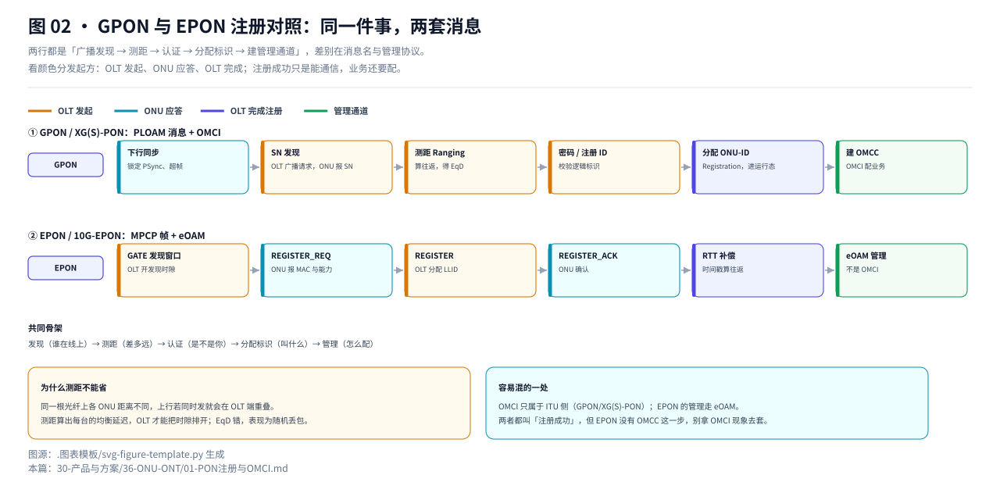
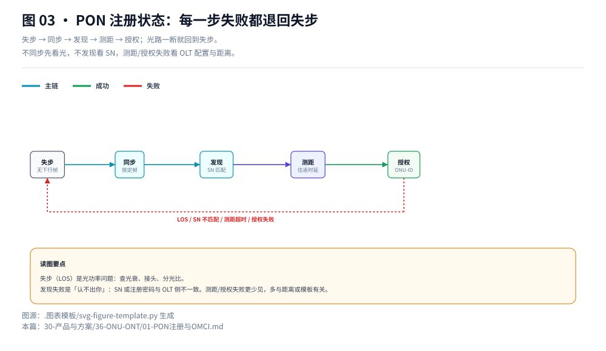

# PON 注册与 OMCI

ONU 上线分两段：**PON 侧完成「发现—测距—授权」，OMCI 侧完成「建通道—配业务」**。注册失败和业务不通是两类问题，排障时不能混在一起。

> 本篇定位：GPON/EPON/XG(S)-PON 的注册流程、测距与授权，以及 OMCI 的管理通道、MIB 和业务配置。PON 复用与测距的物理原理去 [03-光通信](../../10-基础理论/12-通信科学/03-光通信/.readme.md)，整机形态去 [00-ONU-ONT系统架构](./00-ONU-ONT系统架构.md)，OMCI 配出来的语音/组播业务去 [02-VoIP与IPTV业务](./02-VoIP与IPTV业务.md)。

## 目录

- [1 一句话模型](#s1)
- [2 速览](#s2)
- [3 注册与 OMCI 字段](#s3)
- [4 交互流程](#s4)
- [5 状态机与定时器](#s5)
- [6 设计取舍与边界](#s6)
- [7 与相邻主题的关系](#s7)
- [名词解释](#名词解释)
- [8 参考与关联](#s8)

## 1 · 一句话模型：先让 OLT 认识你，再让 OLT 配置你

```text
下行同步 → 发现（SN/Registration ID）→ 测距（EqD）→ 授权（ONU-ID/密码）
  → 建立 OMCC → MIB 同步 → 下发 T-CONT/GEM/VLAN → 业务可用
```

三个关键认知：

1. **注册是「被动的」**：ONU 等 OLT 发起发现，不能自己宣布上线。
2. **测距决定上行时隙**：距离不同的 ONU 必须用不同的均衡延迟，否则上行会碰撞。
3. **OMCI 是业务配置通道**：注册成功只代表「能通信」，业务能不能通要看 OMCI 的 MIB 配置。

因为上行是共享的，ONU 不能自己决定何时发、发多宽，所以「注册」本质上是 OLT 授予发言权的动作——授权之前，这台设备连一句完整的话都说不出。

一句话类比：这条链像**进场登记**——门口排队（下行同步）、报名字（SN）、量步距（测距）、验证件（密码）、领工牌（ONU-ID），最后才谈今天干什么活（业务配置）。前四步任何一步不过，后面都不会开始。

> **推论**：注册是**串行**的，所以「OLT 上看不到这台 ONU」时，不要去查 OMCI——链路根本没到那一层。
> **边界**：这套顺序是 ITU 侧（GPON/XG(S)-PON）的；EPON 用 MPCP 帧和 eOAM，消息名完全不同，现象可比、报文不可套。
> **类比失效处**：登记只发生在**上电或掉线重连**时，不是周期性握手；在线设备不刷新登记，所以「刚还能用突然没了」通常是光路或 OLT 侧去激活，不是登记过期。

## 2 · 速览

| 项 | 内容 | 边界与误判 |
| --- | --- | --- |
| PON 家族 | GPON、XG-PON、XGS-PON、EPON、10G-EPON | 家族决定消息集；ONU 与 OLT 必须同族，混插不通是设计使然，不是故障 |
| 注册要素 | 序列号 SN、Registration ID/密码、ONU-ID、均衡延迟 EqD | 缺一个都不算注册成功；只配 SN 的网元在换机时会静默失败 |
| 管理通道 | OMCC（基于 GEM 的 OMCI 通道） | OMCC 建立 ≠ OMCI 可用：MIB 版本不匹配时能连上但配不下去 |
| OMCI 能力 | 创建/删除/读写 ME、告警、性能、软件下载、重启 | 能力是标准给的，能不能用取决于厂商实现与 OLT 模板 |
| 关键 ME | ONT-G、T-CONT、UNI-G、GEM Port、VLAN 过滤 | ME 之间是引用关系，删被引用的对象会连带失败或留下悬空配置 |
| 典型故障 | 不注册、注册后无业务、上行拥塞、MIB 不同步 | 「不注册」与「无业务」分属两层，混查会浪费一半时间 |

因为 PON 家族决定消息集，所以「注册失败」的第一步不是看配置，而是确认两端同族——不同族连不上，不是参数问题。

## 3 · 注册与 OMCI 字段

### 3.1 PON 家族

| 标准 | 下行/上行速率 | 下行/上行波长 | 说明 | 边界与误判 |
| --- | --- | --- | --- | --- |
| GPON（G.984） | 2.5 / 1.25 Gbps | 1490 / 1310 nm | 存量最大 | 标称 2.5G 是线路速率，扣掉开销后可用带宽更低；拿它当「2.5G 宽带」会失望 |
| XG-PON（G.987） | 10 / 2.5 Gbps | 1577 / 1270 nm | 非对称 10G | 上行仍是 2.5G，直播回传、云盘上传会先顶到上行 |
| XGS-PON（G.9807） | 10 / 10 Gbps | 1577 / 1270 nm | 对称 10G | 对称指线路，不指 LAN 口；2.5G/10G 电口配不齐仍是瓶颈 |
| EPON（802.3ah） | 1.25 / 1.25 Gbps | 1490 / 1310 nm | 以太帧封装 | 管理走 eOAM 而非 OMCI；用 OMCI 思路排查会找不到入口 |
| 10G-EPON（802.3av） | 10 / 10 Gbps 或 10 / 1 Gbps | 1577 / 1270 nm | 对称/非对称 | 10/1G 非对称型号容易被当成对称卖点，验收要确认上行速率 |

> **待验证**：波长和速率组合以具体标准和光模块规格为准；视频 overlay 常占用 1550 nm。

PON 家族这张表最关键的一列不是速率，是**波长**：GPON 与 XG(S)-PON 下行波长不同，同一根光纤可以波分共存，这就是「GPON 平滑升级到 XGS-PON」的物理基础。速率只是结果，波长才是能不能共存的前提。

> **边界**：波分共存要求 ODN 与光模块都支持；老 ODN 上的连接器、分光器对 1577 nm 的插损与反射更敏感，升级后「个别用户光功率掉档」并不罕见。

### 3.2 注册关键字段

| 字段 | 作用 | 坑/边界 |
| --- | --- | --- |
| 序列号 SN | ONU 唯一标识 | 厂商前缀/格式不匹配会注册失败；部分 OLT 只比对前缀+后 4 位，容易被误认为「SN 全匹配」 |
| Registration ID | 运营商下发的逻辑标识/密码 | 与 SN 绑定，换机要同步；国内常用逻辑 ID（LOID）+ 密码的形态，字段名与长度随运营商而变 |
| ONU-ID | OLT 分配的 PON 内标识 | 冲突或未分配会导致无法上行；它由 Registration 消息下发，不是 ONU 自选 |
| EqD | 均衡延迟，补偿距离差 | 测距错误会导致上行碰撞；EqD 由 OLT 算，ONU 只执行，别在 ONU 侧「调」 |
| PLOAM | 物理层操作管理维护消息 | 注册/测距/授权都靠它；PLOAM 不通时，上层任何配置都看不到 |
| OMCC | OMCI 管理通道 | 未建立时无法下发业务；OMCC 用的 GEM 端口通常由 OLT 指定，改错就彻底失联 |

**为什么注册要有「密码」这一层**：SN 写在设备上、可被读取和伪造，单靠 SN 等于「谁拿到这台设备谁就能上线」。加一层运营商侧下发的 Registration ID，把「设备身份」和「业务归属」分开，换机时才需要人工解绑——代价是运维多了一步。

> **边界**：不是所有网络都开密码校验。只做 SN 白名单的网络里，「换机即通」是配置使然，不代表别的网络也能这么干。

### 3.3 OMCI 管理实体

| ME | 作用 | 关键属性 | 边界与误判 |
| --- | --- | --- | --- |
| ONT-G | ONT 全局配置 | 设备信息、告警门限 | 全局对象只有一个实例，读不到它通常意味着 OMCC 没通，不是 ME 缺失 |
| T-CONT | 上行带宽容器 | 类型、带宽、优先级 | 类型（固定/保证/非保证/尽力）决定拥塞时的表现，配错像「网络时好时坏」 |
| UNI-G | 用户侧接口 | 端口类型、管理状态 | 管理状态 shutdown 时链路灯可能仍亮，容易被判成「硬件正常」 |
| GEM Port | 业务承载通道 | GEM ID、T-CONT 绑定 | 只建 GEM 不绑 T-CONT，配置显示成功但流量发不出去 |
| VLAN 过滤 | VLAN 处理 | SVLAN/CVLAN、PVID、过滤规则 | 单向配通（只配上行或只配下行）是「能上不能下」的典型成因 |
| MAC 桥 | 二层转发 | 端口成员、学习 | 桥端口成员漏配，表现为同一 ONU 下两个 LAN 口互不通 |
| VoIP | 语音业务 | SIP/MGCP、编解码、FXS | 语音 ME 建好但业务 VLAN 没通，注册状态一直停在失败 |

> **边界**：ME 编号和属性以 G.988 为准；不同厂商的 OMCI 实现会有私有扩展，互通时要按 OLT 侧要求核对。

**为什么 OMCI 用「对象 + 属性」而不是命令行**：因为 OLT 要面对成千上万台不同厂商的 ONU，所以 OMCI 把能力抽象成统一的对象模型，才能批量下发同一份业务模板。也正因为标准只管形状不管语义，同名属性在不同厂商设备上的默认值和取值范围可能不同，互通测试才省不掉。

## 4 · 交互流程


**读图**：上半段是 PON 物理层注册（同步→发现→测距→授权），下半段是 OMCI 业务配置（OMCC→MIB→业务 ME）；注册成功不等于业务可用。分界线在「建立 OMCC」——它之前的所有动作由 PON MAC 完成，之后才轮到 OMCI 栈。

> 图源：`images/图01-注册与OMCI流程.svg`

### 4.1 GPON 注册

```text
① 下行同步：接收 PSync，锁定超帧
② 发现：OLT 请求序列号，ONU 上报 SN
③ 测距：OLT 发 Ranging Request，ONU 回响应
   → OLT 计算 EqD 并下发
④ 密码/Registration ID 校验
⑤ Registration：OLT 下发 ONU-ID，进入运行态
⑥ 建立 OMCC → ONU 自动 MIB 上传
```

**一处顺序修正**：原稿把「分配 ONU-ID」列在测距之前。按 G.984.3 的激活顺序，ONU 在测距阶段仍以 SN 标识，ONU-ID 由 Registration 消息在测距与密码校验之后下发；部分厂商日志会在测距前显示一个临时索引，容易被读成「已分配 ONU-ID」。判据是：**ONU-ID 没下来，就不算进入运行态**。

### 4.2 EPON 注册（对比）

```text
OLT 周期发 GATE → ONU 发 REGISTER_REQ（含 MAC/能力）
  → OLT 分配 LLID → REGISTER → ONU 回 REGISTER_ACK
  → 进入运行；管理使用 eOAM 而非 OMCI
```

两套流程放在一起看，同构关系一目了然：

### 图 02 · GPON 与 EPON 注册对照



**读图**：两行各六个方框，从左到右是同一套动作——发现、测距、认证、分配标识、建管理通道。颜色区分谁发起：OLT 发起（琥珀）、ONU 应答（青）、OLT 完成（靛蓝）、管理通道（绿）。

> 图源：`images/图02-GPON与EPON注册对照.svg`

> **只换三样**：消息名（PLOAM ↔ MPCP 帧）、标识（ONU-ID ↔ LLID）、管理协议（OMCI ↔ eOAM）。骨架完全一样，所以排障顺序可以照搬：先光、再发现、再测距、最后才看管理。
> **别混**：EPON 没有 OMCC，也没有 OMCI ME；在这一层用 OMCI 的思路去找配置，永远找不到。

### 4.3 OMCI 业务配置

```text
OMCC 建立 → ONU 上传 MIB → OLT 创建/设置 ME
  → T-CONT（上行带宽）
  → GEM Port（业务通道）并绑定 T-CONT
  → UNI-G / VLAN 过滤（用户侧映射）
  → 业务通道 up → 流量可通
```

顺序不是任意的：T-CONT 是带宽容器，GEM 要绑到容器上，UNI 与 VLAN 再决定「哪个口、哪个 VLAN 的帧进哪个 GEM」。因为引用不闭合时配置照样「成功」，所以先配下游再配上游会出现「ME 都在、流量不通」的中间态——这不是配置丢失，而是引用还没闭合。

> **推论**：OLT 侧看到某台 ONU 的 ME 全部创建成功但仍不通，先查引用（GEM→T-CONT、VLAN→GEM、UNI→VLAN），而不是重下发整份模板。

### 4.4 异常分支

| 异常 | 现象 | 定位方向 | 先验证什么 |
| --- | --- | --- | --- |
| 不同步 | PON 灯闪/灭 | 光功率、波长、PON 类型 | 收光是否在灵敏度与过载之间；OLT 端口 PON 类型是否匹配 |
| 发现失败 | OLT 看不到 SN | SN 格式、注册模式、OLT 白名单 | OLT 侧该 PON 口是否处于发现使能状态 |
| 测距失败 | 注册超时/反复重来 | 距离、光功率、上行干扰 | 是否所有 ONU 都失败（OLT 侧问题）还是单台 |
| 授权失败 | 注册但被拒 | Registration ID/密码、绑定关系 | 密码长度与字符集是否被截断 |
| OMCC 建不起来 | 能注册不能配业务 | GEM/OMCC 配置、MIB 兼容 | OLT 侧 OMCC 的 GEM 端口与 ONU 实现是否一致 |
| 业务不通 | 有 ONU-ID 无流量 | T-CONT/GEM/VLAN 映射 | ME 引用是否闭合（GEM 是否绑上 T-CONT） |
| 上行拥塞 | 高峰丢包 | T-CONT 带宽/优先级、DBA | 是「带宽不够」还是「类型配错」（低峰也丢则更像类型问题） |

## 5 · 状态机与定时器



**读图**：失步→同步→发现→测距→授权；不同步/不发现先查光，测距/授权再查配置。光路一断就回失步，这是唯一会「自动重来」的分支。

> 图源：`images/图03-PON注册状态.svg`

ITU 侧把这几个状态编号为 O1–O7，现场看到的现象与编号能对上。因为 O1–O7 是**串行**的，所以状态编号本身就是排查顺序：编号越小越靠近光路，越大越靠近配置。

> **推论**：ONU 反复在 O3/O4 之间循环，说明「OLT 认得出 SN、但测距过不去」——先量光功率与距离，不要重下发业务模板。

| 状态 | 现场叫法 | 在等什么 | 进入条件 | 失败/退出 |
| --- | --- | --- | --- | --- |
| O1 初始态 | 无光/失步 | 等下行光，持续搜索 | 上电、复位、持续失步 | 收到有效下行帧 → O2；持续无光则报 LOS |
| O2 待机 | 同步 | 等 OLT 的 SN 请求 | 下行已同步 | 收到请求 → O3；同步丢失 → O1 |
| O3 串行号 | 发现 | 上报 SN，等 OLT 认可 | SN 被接受 | 收到测距请求 → O4；被拒 → 回 O2 等下一次请求 |
| O4 测距 | 测距 | 响应 Ranging，等 EqD | 收到测距请求 | 密码/Registration 通过 → O5；超时则重试 |
| O5 运行（授权） | 授权 | 校验密码，等 OLT 放行 | 测距完成、密码正确 | 拒绝则回发现态，等下一轮 |
| O5 运行（运营） | 运营 | 建立 OMCC、配业务 | 拿到 ONU-ID | 业务不通但保持注册（失步 → O6） |
| O6 间歇 LOS | 掉线 | 等重同步 | 短暂失步 | 恢复 → O5（EqD 可保留）；持续失步 → O1 重新注册 |
| O7 紧急停止 | — | 停止发光 | OLT 下发或本地严重故障 | 需复位或人工干预，不会自愈 |

| 定时器 | 作用 | 说明与边界 |
| --- | --- | --- |
| 同步丢失门限 | 判定 LOS，标准中的 TO1 | 标准/厂商实现不同；门限太短会把瞬时误码判成掉线 |
| 测距超时 | 重试测距，标准中的 TO2 | 与距离和光功率相关；反复超时优先查光路，不是查 OLT 模板 |
| OMCC 超时 | 管理通道建立 | 超时则无法配业务；现象与「OLT 不支持该 ONU」高度相似 |
| DBA 周期 | 上行授权 | OLT 侧调度；周期内没拿到授权的 ONU 只能等，表现为上行抖动 |
| 告警去抖 | 抑制闪断告警 | 厂商实现不同；去抖过长会掩盖真实掉线 |
| 密钥更新周期 | 下行加密（XG(S)-PON 等） | 由 OLT 侧策略决定，与业务中断无直接关系，别拿它解释掉线 |

> **待验证**：各标准的定时器默认值和厂商私有扩展不同，需按 OLT/ONU 文档核对；TO1/TO2 的具体取值以 G.984.3 的常量定义为准，本表只给用途。

## 6 · 设计取舍与边界

### 6.1 SN 注册 vs 密码注册

SN 注册简单，OLT 按序列号白名单放行；密码/Registration ID 增加一层认证，适合租赁/共享场景。运营商通常两者组合，换机时要同步解绑/绑定。

**代价**：密码注册把「换机」从「插上就行」变成「要先解绑」，一线装机多一个流程；好处是被盗设备无法在别的网络上线。

> **边界**：SN 注册下「换机即通」只在同厂商、同 OLT 模板、同 PON 类型三者都一致时成立；换型号通常连 OMCI 模板都要换。

### 6.2 OMCI vs TR-069 的职责

OMCI 管 PON 业务（T-CONT/GEM/VLAN），TR-069 管设备业务（Wi-Fi/账号/升级）。把 Wi-Fi 参数塞进 OMCI 会导致跨厂商互通困难；把 PON 业务交给 TR-069 则无法保证实时性。

**为什么不能互换**：因为 OMCI 的通道随 PON 注册存在（PON 一断就没有管理面），而 TR-069 走 IP 通道、依赖 ONU 已经能上网，所以两者恰好互补——一个在光路上，一个在 IP 上。

> **边界**：TR-069 需要 ONU 先拿到管理 IP；纯桥接设备若管理 VLAN 未通，TR-069 永远上不了线，此时只能用 OMCI 或本地 Web。

### 6.3 单播 GEM vs 组播 GEM

IPTV 组播通常用独立 GEM/组播 VLAN，避免占用单播带宽。组播复制点越靠近 ONU，主干带宽越省，但 ONU 侧处理压力越大。

**代价**：把复制点下沉到 ONU，意味着每台 ONU 都要维护组播组成员与复制逻辑，低端芯片的组播表容量先成为瓶颈。

> **失效条件**：ONU 不支持独立组播 GEM 时，组播只能走单播 GEM，一台 ONU 一个流，OLT 侧带宽随用户数线性增长。

### 6.4 DBA 与 T-CONT 类型

固定带宽（Fixed）保证时延但浪费；保证带宽（Assured）平衡；非保证（Best Effort）适合普通上网。类型配错会表现为「高峰拥塞、低峰正常」。

**为什么不能全配固定带宽**：上行总带宽是所有 ONU 共享的，固定带宽一旦超订，OLT 只能拒绝新请求或违约——所以固定带宽通常只留给语音这类硬实时业务。

> **边界**：低峰也丢包时，问题多半不在 DBA，而在光功率、误码或 LAN 侧拥塞；把它当 DBA 问题调参数只会掩盖真因。

### 6.5 互通是最大的边界

OMCI 标准只定义消息和 ME，厂商私有属性、默认值、告警语义仍有差异。跨厂商组网必须做互通测试，不能假设「标准一致就能通」。

**为什么标准不够**：标准留了大量可选属性与厂商自定义范围，OLT 模板往往按某一家 ONU 的行为写成；换一家 ONU，模板里「看起来一样」的字段含义可能已经变了。

> **推论**：集采换厂商时，测试重点不是「能不能注册」，而是「同一份业务模板能不能配出同样的业务」——后者才是互通的真实验收项。

### 6.6 换机的正确顺序

换 ONU 不是「拆旧装新」，顺序错了会出现「新机也注册不上、旧机回不去」：

| 步骤 | 做什么 | 答错的后果 |
| --- | --- | --- |
| ① 解绑 | 在 OLT/网管侧解除旧 SN（或旧 SN+密码）的绑定 | 新机 SN 与旧记录冲突，注册被拒且日志指向「SN 重复」 |
| ② 核对 PON 类型 | 确认新机与 OLT 端口同族（GPON / XGS-PON / EPON） | 光功率正常但永远不同步，容易被判成光模块坏 |
| ③ 绑定并放行 | 录入新 SN 与 Registration ID/LOID，加入白名单 | 停在上报 SN 后无响应，现象是「一直闪灯」 |
| ④ 验证业务 | 看 OMCC 是否建立、ME 是否下发、语音/组播是否恢复 | 只验证「能上网」，语音与电视的问题留到用户投诉才发现 |

> **边界**：如果网络用「自动发现 + 自动开通」，①②可能由系统完成，人工只做③④；但这依赖自动开通平台与 OLT 模板一致，跨厂商时经常退化成手工。

## 7 · 与相邻主题的关系

| 相邻对象 | 关系 | 边界 |
| --- | --- | --- |
| [PON 技术概览](../../10-基础理论/12-通信科学/03-光通信/00-PON技术概览.md) | PON 复用与帧结构 | 那篇讲 ODN 与帧格式，不展开 OMCI ME；查 ME 回本篇 |
| [PON 复用测距与注册](../../10-基础理论/12-通信科学/03-光通信/01-PON复用测距与注册.md) | 测距与上行时隙 | 那篇推公式与时间预算，本篇只讲状态与现象，避免两份正本 |
| [ODN 与光功率预算](../../10-基础理论/12-通信科学/03-光通信/03-ODN与光功率预算.md) | 光功率与分光 | 光功率预算决定「能不能同步」，注册成功与否是它的结果，不是替代 |
| [ONU/ONT 系统架构](./00-ONU-ONT系统架构.md) | 整机与业务对象 | 那篇给分层与绑定链，本篇给消息与 ME；两份不重复同一张表 |
| [VoIP 与 IPTV 业务](./02-VoIP与IPTV业务.md) | OMCI 配置的业务 | 本篇只到「ME 下发成功」，业务侧 VLAN/QoS/组播在那篇 |
| [TR-069 与 ACS 运维](../33-CPE/02-TR-069与ACS运维.md) | 设备侧管理 | 那条通道依赖 IP 可达；PON 不通时它帮不上忙 |
| [光猫产品形态](./03-光猫产品形态.md) | 家用形态 | 形态决定「注册后干什么」，不影响注册流程本身 |

因为注册是每台设备上线都要走一遍的动作，而 OMCI 只在开通与变更时才忙，所以两类问题的排查频率与深度完全不同：前者看状态与光功率，后者看 ME 引用与模板。

一句话：**注册解决「OLT 认不认识你」，OMCI 解决「认识之后给你开什么业务」。**

> **推论**：判断该读哪一篇，只看问题落在「能不能通信」还是「通信了给什么业务」——前者在本篇，后者在 00/02。

## 名词解释

> 缩写给出英文全称；非缩写用“—”表示。

| 术语 | 英文全称 | 解释 |
| --- | --- | --- |
| PON | Passive Optical Network | 无源光网络。 |
| OLT | Optical Line Terminal | 光线路终端，PON 局侧设备。 |
| ONU | Optical Network Unit | 光网络单元。 |
| OMCI | ONT Management and Control Interface | ONT 管理控制接口。 |
| OMCC | ONU Management and Control Channel | OMCI 管理通道。 |
| PLOAM | Physical Layer Operations, Administration and Maintenance | 物理层操作管理维护消息，注册/测距/授权的载体。 |
| PSync | Physical Synchronization | GPON 下行帧的同步码字，锁上它才算下行同步。 |
| SN | Serial Number | 序列号，ONU 的出厂唯一标识。 |
| Registration ID | — | 运营商侧下发的注册逻辑标识/密码，常与 SN 组合校验。 |
| LOID | Logical ONU Identifier | 逻辑 ONU 标识，国内运营商常用作注册账号。 |
| ONU-ID | — | OLT 在 PON 内分配给 ONU 的标识，由 Registration 消息下发。 |
| Alloc-ID | Allocation Identifier | 上行带宽分配的标识，T-CONT 与授权消息按它对应。 |
| EqD | Equalization Delay | 均衡延迟，补偿不同距离 ONU 的往返时差。 |
| T-CONT | Transmission Container | 上行传输容器。 |
| GEM | GPON Encapsulation Method | GPON 封装方式。 |
| DBA | Dynamic Bandwidth Allocation | 动态带宽分配。 |
| ME | Managed Entity | OMCI 管理实体。 |
| MIB | Management Information Base | 管理信息库，ME 实例的集合。 |
| TC | Transmission Convergence | 传输汇聚层，GPON 成帧与 PLOAM 所在层。 |
| LLID | Logical Link Identifier | EPON 逻辑链路标识，兼作 ONU 标识与上行队列标识。 |
| MPCP | Multi-Point Control Protocol | 多点控制协议，EPON 的注册与授权机制。 |
| GATE | — | MPCP 的下行授权帧，也用于开发现窗口。 |
| eOAM | Ethernet Operations, Administration and Maintenance | 以太网 OAM，EPON 的管理通道。 |
| LOS | Loss of Signal | 信号丢失。 |
| FEC | Forward Error Correction | 前向纠错，PON 线路上的误码纠正机制。 |

## 8 · 参考与关联

**标准**

- ITU-T G.984.3 / G.984.4：GPON 传输汇聚 / OMCI
- ITU-T G.987 / G.9807：XG-PON / XGS-PON
- ITU-T G.988：OMCI 规范
- IEEE 802.3ah / 802.3av：EPON / 10G-EPON

**关联**

- [设备形态对比](../00-设备形态对比.md)
- [ONU/ONT 系统架构](./00-ONU-ONT系统架构.md)
- [VoIP 与 IPTV 业务](./02-VoIP与IPTV业务.md)
- [PON 复用测距与注册](../../10-基础理论/12-通信科学/03-光通信/01-PON复用测距与注册.md)

---

> **本篇定位**：GPON/EPON/XG(S)-PON 的注册、测距、授权与 OMCI 业务配置。
> **素材来源**：`studyspace/1.知识体系/7.openwrt/`（终端实现参考）、`studyspace/1.知识体系/2.TCP IP协议/`（VLAN/组播基础）。
> **待验证**：各厂商 OMCI 私有扩展、ME 默认值、DBA/T-CONT 规格与互通差异；原稿「先分配 ONU-ID 再测距」已按 G.984.3 的激活顺序修正为「测距与密码校验之后由 Registration 下发」，具体消息顺序以现网 OLT 日志复核。
