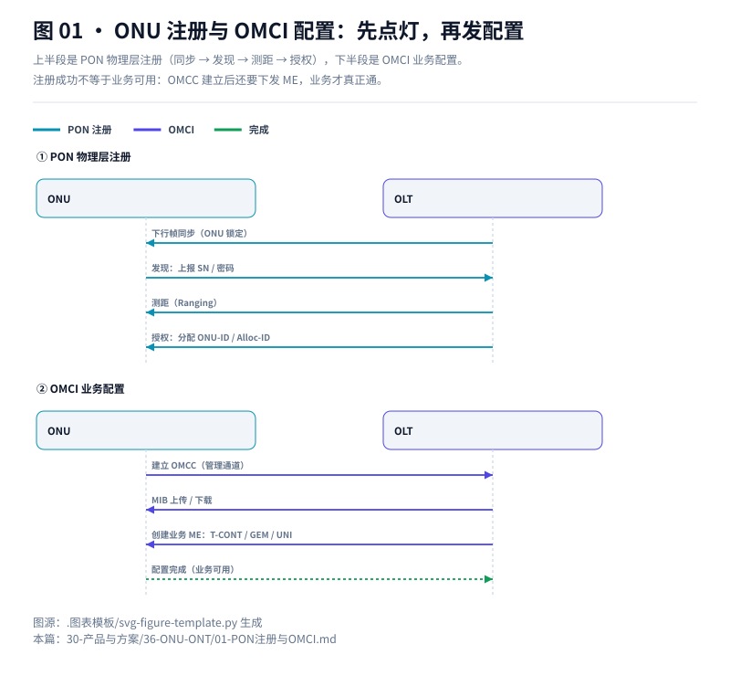

# PON 注册与 OMCI

ONU 上线分两段：**PON 侧完成「发现—测距—授权」，OMCI 侧完成「建通道—配业务」**。注册失败和业务不通是两类问题，排障时不能混在一起。

> 本篇定位：GPON/EPON/XG(S)-PON 的注册流程、测距与授权，以及 OMCI 的管理通道、MIB 和业务配置。PON 复用原理去 `10-基础理论/03-光通信`，整机形态去 `00-ONU-ONT系统架构`。

## 目录

- [1 一句话模型](#s1)
- [2 速览](#s2)
- [3 注册与 OMCI 字段](#s3)
- [4 交互流程](#s4)
- [5 状态机与定时器](#s5)
- [6 设计取舍与边界](#s6)
- [7 与相邻主题的关系](#s7)
- [名词解释](#名词解释)
- [8 参考与关联](#s8)

## 1 · 一句话模型：先让 OLT 认识你，再让 OLT 配置你

```text
下行同步 → 发现（SN/Registration ID）→ 测距（EqD）→ 授权（ONU-ID/密码）
  → 建立 OMCC → MIB 同步 → 下发 T-CONT/GEM/VLAN → 业务可用
```

三个关键认知：

1. **注册是「被动的」**：ONU 等 OLT 发起发现，不能自己宣布上线。
2. **测距决定上行时隙**：距离不同的 ONU 必须用不同的均衡延迟，否则上行会碰撞。
3. **OMCI 是业务配置通道**：注册成功只代表「能通信」，业务能不能通要看 OMCI 的 MIB 配置。

## 2 · 速览

| 项 | 内容 |
| --- | --- |
| PON 家族 | GPON、XG-PON、XGS-PON、EPON、10G-EPON |
| 注册要素 | 序列号 SN、Registration ID/密码、ONU-ID、均衡延迟 EqD |
| 管理通道 | OMCC（基于 GEM 的 OMCI 通道） |
| OMCI 能力 | 创建/删除/读写 ME、告警、性能、软件下载、重启 |
| 关键 ME | ONT-G、T-CONT、UNI-G、GEM Port、VLAN 过滤 |
| 典型故障 | 不注册、注册后无业务、上行拥塞、MIB 不同步 |

## 3 · 注册与 OMCI 字段

### 3.1 PON 家族

| 标准 | 下行/上行速率 | 下行/上行波长 | 说明 |
| --- | --- | --- | --- |
| GPON（G.984） | 2.5 / 1.25 Gbps | 1490 / 1310 nm | 存量最大 |
| XG-PON（G.987） | 10 / 2.5 Gbps | 1577 / 1270 nm | 非对称 10G |
| XGS-PON（G.9807） | 10 / 10 Gbps | 1577 / 1270 nm | 对称 10G |
| EPON（802.3ah） | 1.25 / 1.25 Gbps | 1490 / 1310 nm | 以太帧封装 |
| 10G-EPON（802.3av） | 10 / 10 Gbps 或 10 / 1 Gbps | 1577 / 1270 nm | 对称/非对称 |

> 待验证：波长和速率组合以具体标准和光模块规格为准；视频 overlay 常占用 1550 nm。

### 3.2 注册关键字段

| 字段 | 作用 | 坑/边界 |
| --- | --- | --- |
| 序列号 SN | ONU 唯一标识 | 厂商前缀/格式不匹配会注册失败 |
| Registration ID | 运营商下发的逻辑标识/密码 | 与 SN 绑定，换机要同步 |
| ONU-ID | OLT 分配的 PON 内标识 | 冲突或未分配会导致无法上行 |
| EqD | 均衡延迟，补偿距离差 | 测距错误会导致上行碰撞 |
| PLOAM | 物理层操作管理维护消息 | 注册/测距/授权都靠它 |
| OMCC | OMCI 管理通道 | 未建立时无法下发业务 |

### 3.3 OMCI 管理实体

| ME | 作用 | 关键属性 |
| --- | --- | --- |
| ONT-G | ONT 全局配置 | 设备信息、告警门限 |
| T-CONT | 上行带宽容器 | 类型、带宽、优先级 |
| UNI-G | 用户侧接口 | 端口类型、管理状态 |
| GEM Port | 业务承载通道 | GEM ID、T-CONT 绑定 |
| VLAN 过滤 | VLAN 处理 | SVLAN/CVLAN、PVID、过滤规则 |
| MAC 桥 | 二层转发 | 端口成员、学习 |
| VoIP | 语音业务 | SIP/MGCP、编解码、FXS |

> ME 编号和属性以 G.988 为准；不同厂商的 OMCI 实现会有私有扩展，互通时要按 OLT 侧要求核对。

## 4 · 交互流程



**读图**：上半段是 PON 物理层注册（同步→发现→测距→授权），下半段是 OMCI 业务配置（OMCC→MIB→业务 ME）；注册成功不等于业务可用。

> 图源：`images/图01-注册与OMCI流程.svg`

### 4.1 GPON 注册

```text
① 下行同步：接收 PSync，锁定超帧
② 发现：OLT 请求序列号，ONU 上报 SN
③ 分配 ONU-ID
④ 测距：OLT 发 Ranging Request，ONU 回响应
   → OLT 计算 EqD 并下发
⑤ 授权：校验 Registration ID/密码
⑥ 建立 OMCC → ONU 自动 MIB 上传
```

### 4.2 EPON 注册（对比）

```text
OLT 周期发 GATE → ONU 发 REGISTER_REQ（含 MAC/能力）
  → OLT 分配 LLID → REGISTER → ONU 回 REGISTER_ACK
  → 进入运行；管理使用 eOAM 而非 OMCI
```

### 4.3 OMCI 业务配置

```text
OMCC 建立 → ONU 上传 MIB → OLT 创建/设置 ME
  → T-CONT（上行带宽）
  → GEM Port（业务通道）并绑定 T-CONT
  → UNI-G / VLAN 过滤（用户侧映射）
  → 业务通道 up → 流量可通
```

### 4.4 异常分支

| 异常 | 现象 | 定位方向 |
| --- | --- | --- |
| 不同步 | PON 灯闪/灭 | 光功率、波长、PON 类型 |
| 发现失败 | OLT 看不到 SN | SN 格式、注册模式、OLT 白名单 |
| 测距失败 | 注册超时/反复重来 | 距离、光功率、上行干扰 |
| 授权失败 | 注册但被拒 | Registration ID/密码、绑定关系 |
| OMCC 建不起来 | 能注册不能配业务 | GEM/OMCC 配置、MIB 兼容 |
| 业务不通 | 有 ONU-ID 无流量 | T-CONT/GEM/VLAN 映射 |
| 上行拥塞 | 高峰丢包 | T-CONT 带宽/优先级、DBA |

## 5 · 状态机与定时器


**读图**：失步→同步→发现→测距→授权；不同步/不发现先查光，测距/授权再查配置。

> 图源：`images/图02-PON注册状态.svg`

| 状态 | 动作 | 失败后 |
| --- | --- | --- |
| 无光/失步 | 等下行同步 | 持续搜索，报 LOS |
| 发现 | 上报 SN | 等下一次请求 |
| 测距 | 响应 Ranging | 超时重试 |
| 授权 | 校验密码 | 拒绝则回发现 |
| 运营 | 建立 OMCC、配业务 | 业务不通但保持注册 |
| 掉线 | 失步/去激活 | 重新注册 |

| 定时器 | 作用 | 说明 |
| --- | --- | --- |
| 同步丢失门限 | 判定 LOS | 标准/厂商实现不同 |
| 测距超时 | 重试测距 | 与距离和光功率相关 |
| OMCC 超时 | 管理通道建立 | 超时则无法配业务 |
| DBA 周期 | 上行授权 | OLT 侧调度 |
| 告警去抖 | 抑制闪断告警 | 厂商实现不同 |

> 待验证：各标准的定时器默认值和厂商私有扩展不同，需按 OLT/ONU 文档核对。

## 6 · 设计取舍与边界

### 6.1 SN 注册 vs 密码注册

SN 注册简单，OLT 按序列号白名单放行；密码/Registration ID 增加一层认证，适合租赁/共享场景。运营商通常两者组合，换机时要同步解绑/绑定。

### 6.2 OMCI vs TR-069 的职责

OMCI 管 PON 业务（T-CONT/GEM/VLAN），TR-069 管设备业务（Wi-Fi/账号/升级）。把 Wi-Fi 参数塞进 OMCI 会导致跨厂商互通困难；把 PON 业务交给 TR-069 则无法保证实时性。

### 6.3 单播 GEM vs 组播 GEM

IPTV 组播通常用独立 GEM/组播 VLAN，避免占用单播带宽。组播复制点越靠近 ONU，主干带宽越省，但 ONU 侧处理压力越大。

### 6.4 DBA 与 T-CONT 类型

固定带宽（Fixed）保证时延但浪费；保证带宽（Assured）平衡；非保证（Best Effort）适合普通上网。类型配错会表现为「高峰拥塞、低峰正常」。

### 6.5 互通是最大的边界

OMCI 标准只定义消息和 ME，厂商私有属性、默认值、告警语义仍有差异。跨厂商组网必须做互通测试，不能假设「标准一致就能通」。

## 7 · 与相邻主题的关系

| 相邻对象 | 关系 |
| --- | --- |
| [PON 技术概览](../../10-基础理论/12-通信科学/03-光通信/00-PON技术概览.md) | PON 复用与帧结构 |
| [PON 复用测距与注册](../../10-基础理论/12-通信科学/03-光通信/01-PON复用测距与注册.md) | 测距与上行时隙 |
| [ODN 与光功率预算](../../10-基础理论/12-通信科学/03-光通信/03-ODN与光功率预算.md) | 光功率与分光 |
| [ONU/ONT 系统架构](./00-ONU-ONT系统架构.md) | 整机与业务对象 |
| [VoIP 与 IPTV 业务](./02-VoIP与IPTV业务.md) | OMCI 配置的业务 |
| [TR-069 与 ACS 运维](../33-CPE/02-TR-069与ACS运维.md) | 设备侧管理 |
| [光猫产品形态](./03-光猫产品形态.md) | 家用形态 |

一句话：**注册解决「OLT 认不认识你」，OMCI 解决「认识之后给你开什么业务」。**

## 名词解释

> 缩写给出英文全称；非缩写用“—”表示。

| 术语 | 英文全称 | 解释 |
| --- | --- | --- |
| PON | Passive Optical Network | 无源光网络。 |
| OLT | Optical Line Terminal | 光线路终端。 |
| ONU | Optical Network Unit | 光网络单元。 |
| OMCI | ONT Management and Control Interface | ONT 管理控制接口。 |
| OMCC | ONU Management and Control Channel | OMCI 管理通道。 |
| PLOAM | Physical Layer Operations, Administration and Maintenance | 物理层操作管理维护消息。 |
| SN | Serial Number | 序列号。 |
| EqD | Equalization Delay | 均衡延迟。 |
| T-CONT | Transmission Container | 上行传输容器。 |
| GEM | GPON Encapsulation Method | GPON 封装方式。 |
| DBA | Dynamic Bandwidth Allocation | 动态带宽分配。 |
| ME | Managed Entity | OMCI 管理实体。 |
| MIB | Management Information Base | 管理信息库。 |
| LLID | Logical Link Identifier | EPON 逻辑链路标识。 |
| eOAM | Ethernet Operations, Administration and Maintenance | 以太网 OAM。 |
| LOS | Loss of Signal | 信号丢失。 |

## 8 · 参考与关联

**标准**

- ITU-T G.984.3 / G.984.4：GPON 传输汇聚 / OMCI
- ITU-T G.987 / G.9807：XG-PON / XGS-PON
- ITU-T G.988：OMCI 规范
- IEEE 802.3ah / 802.3av：EPON / 10G-EPON

**关联**

- [设备形态对比](../00-设备形态对比.md)
- [ONU/ONT 系统架构](./00-ONU-ONT系统架构.md)
- [VoIP 与 IPTV 业务](./02-VoIP与IPTV业务.md)
- [PON 复用测距与注册](../../10-基础理论/12-通信科学/03-光通信/01-PON复用测距与注册.md)

---

> **本篇定位**：GPON/EPON/XG(S)-PON 的注册、测距、授权与 OMCI 业务配置。
> **素材来源**：`studyspace/1.知识体系/7.openwrt/`（终端实现参考）、`studyspace/1.知识体系/2.TCP IP协议/`（VLAN/组播基础）。
> **待验证**：各厂商 OMCI 私有扩展、ME 默认值、DBA/T-CONT 规格与互通差异。
