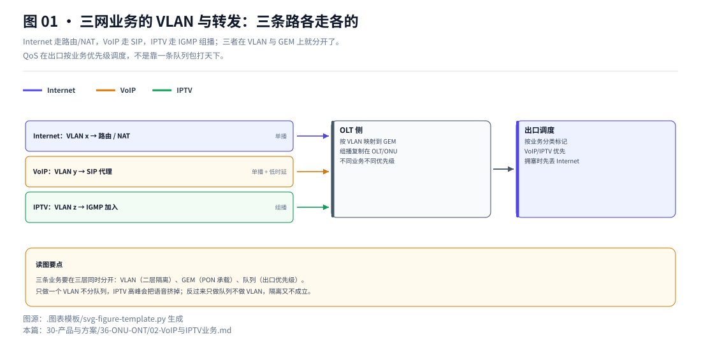
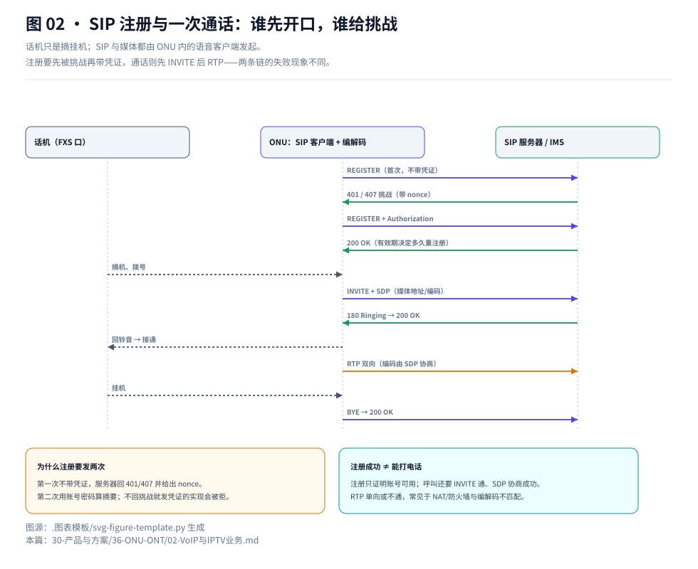
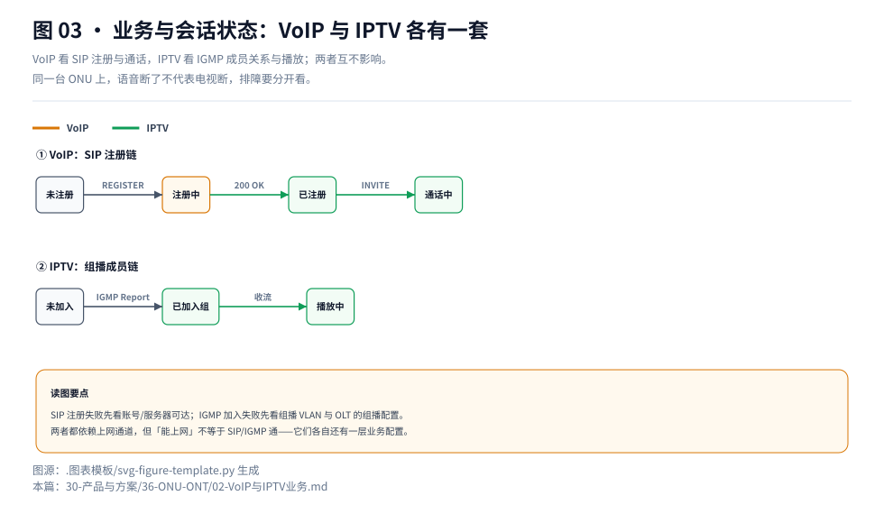

# VoIP 与 IPTV 业务

光猫/ONU 的「三网融合」不是把三个业务塞进一个 LAN，而是**用 VLAN 把 Internet、VoIP、IPTV 分开，各自走独立的业务通道和 QoS**。分错 VLAN 或漏配组播，表现为「上网正常、电视黑屏、电话无声」。

> 本篇定位：VoIP 与 IPTV 的业务模型、VLAN/QoS 配置、协议与排障边界。SIP/IMS/媒体协议原理去 [06-语音与实时通信](../../10-基础理论/12-通信科学/06-语音与实时通信/.readme.md)，VLAN 原理去 [02-链路层](../../10-基础理论/11-网络科学/02-链路层/.readme.md)，PON 通道去 [01-PON注册与OMCI](./01-PON注册与OMCI.md)。

## 目录

- [1 一句话模型](#s1)
- [2 速览](#s2)
- [3 业务与字段](#s3)
- [4 交互流程](#s4)
- [5 状态机与定时器](#s5)
- [6 设计取舍与边界](#s6)
- [7 与相邻主题的关系](#s7)
- [名词解释](#名词解释)
- [8 参考与关联](#s8)

## 1 · 一句话模型：三张网，三条路

```text
Internet：普通 VLAN → 路由/NAT → 上网
VoIP：语音 VLAN → SIP/RTP → FXS 话机
IPTV：组播 VLAN → IGMP → 机顶盒
```

三个关键认知：

1. **业务隔离靠 VLAN**，不是靠端口「大概分开」；同一 LAN 口也可能承载多个业务 VLAN。
2. **IPTV 是组播业务**：IGMP snooping/proxy 决定组播会不会泛洪，组播 VLAN 决定它走哪条通道。
3. **VoIP 对时延/丢包敏感**：需要独立队列和优先级，和下载抢带宽就会「断断续续」。

因为三条业务在 ONU 内部就分了 VLAN 与队列，所以「上网正常、电视黑屏」不是矛盾，而是隔离生效的证据——问题被关在电视那条管子里。

一句话类比：三条业务像**三根独立的管子**——口径（VLAN）、入口（UNI 口）、限速阀（队列）各自独立；把三根并成一根，再想靠「标记优先级」补救，已经晚了。

> **推论**：只要看到「上网正常、语音/电视不通」，就说明管子是分开的——问题在语音或组播那根管子，不在出口带宽。
> **边界**：三根管子都终结在同一台 ONU 上，所以 ONU 的 CPU、组播表、队列数仍是共同瓶颈；隔离 VLAN 不等于隔离资源。
> **类比失效处**：管子之间并不完全独立——它们共享同一条 PON 上行，带宽超订时最先被挤掉的往往是没做队列保障的那根。

## 2 · 速览

| 项 | 内容 | 边界与误判 |
| --- | --- | --- |
| 业务类型 | Internet、VoIP、IPTV（含 VoD） | VoD 是单播，别按直播的组播方式规划带宽 |
| 承载方式 | 独立 VLAN、独立 GEM Port、独立 QoS 队列 | 三者要同时成立；只做 VLAN 不做队列，拥塞时语音照样断 |
| VoIP 协议 | SIP、MGCP、H.248；RTP/RTCP 承载媒体 | 信令通不代表媒体通；SDP 里协商的地址才是媒体终点 |
| IPTV 协议 | IGMP/MLD、组播、HTTP 单播（VoD） | IGMP 只负责「加入/离开」，不负责选频道与解码 |
| 关键配置 | VLAN、PVID、IGMP 版本、组播 VLAN、DSCP/队列 | 配置项之间有依赖，改一项可能让另一项失效（如改 PVID 影响语音口） |
| 主要风险 | VLAN 错配、组播泛洪、SIP NAT 问题、带宽争抢 | 「泛洪」与「丢包」现象相似，判据是交换机/ONU 侧组播表项与端口流量 |
| 关键指标 | 语音 MOS、IPTV 丢包/卡顿、换台时延、组播复制效率 | 指标要分业务看；用「整机吞吐」证明 IPTV 质量是无效的 |

因为直播与点播走两条完全不同的路径（组播 vs 单播），所以规划带宽时必须分开算；用一个「IPTV 带宽」数字会同时高估直播、低估点播。

## 3 · 业务与字段

### 3.1 三网业务模型

| 业务 | 二层承载 | 三层处理 | 典型终端 | 边界与误判 |
| --- | --- | --- | --- | --- |
| Internet | 普通业务 VLAN | 路由/NAT/DHCP | PC/手机/路由 | 桥接型不做三层，这一列由下游路由器承担 |
| VoIP | 语音 VLAN | SIP 注册/RTP | FXS 话机 | 语音口配了 VLAN 但没配 QoS，忙时 MOS 掉到不可用 |
| IPTV 直播 | 组播 VLAN | IGMP proxy/snooping | 机顶盒 | 组播 VLAN 通但 IGMP 版本不一致，加入被忽略 |
| IPTV 点播 | 单播 VLAN/Internet | HTTP/RTSP | 机顶盒 | 点播走单播，组播配置再对也不会让点播恢复 |

### 3.2 VoIP 关键字段

| 字段 | 作用 | 坑/边界 |
| --- | --- | --- |
| SIP 服务器/端口 | 注册与呼叫 | 地址/端口错会导致注册失败；域名解析失败与服务器不可达现象相同 |
| 账号/密码 | 鉴权 | 特殊字符、域匹配；密码含 `@`、`:` 时被截断会一直 401 |
| 编解码 | G.711/G.729 等 | 带宽与音质权衡；两端交集为空时协商失败，表现为「接通即断」 |
| FXS 口 | 接话机 | 馈电/振铃/脉冲拨号；FXS 是硬件能力，软件改不出振铃功率 |
| 拨号计划 | 号码变换 | 前缀/紧急号码；改错会出现「能打进不能打出」 |
| NAT/ALG | 媒体穿越 | ALG 可能破坏 SIP；关掉 ALG 后单通，多半是 NAT 绑定超时 |
| QoS | 语音优先级 | 与下载争抢；只标记不排队等于没做 |

**为什么语音字段里有一半是「网络侧」的**：ONU 只负责把话机变成 SIP 客户端，剩下的注册、鉴权、媒体穿越都要经过运营商网络。所以语音故障天然分两段——**ONU 内**（FXS、编解码、VLAN）与**网络侧**（SIP 服务器、NAT、带宽）。

> **边界**：如果同一台 ONU 上两个 FXS 口一个通一个不通，问题基本在 ONU 内部（端口/账号映射），不必去查 SIP 服务器。

### 3.3 IPTV 关键字段

| 字段 | 作用 | 坑/边界 |
| --- | --- | --- |
| 组播 VLAN | 承载直播流 | 配错则黑屏；VLAN 通了但没加入组，同样是黑屏 |
| IGMP 版本 | v2/v3 | 与上游/机顶盒一致；v3 源过滤配置错会让加入「看起来成功但不收流」 |
| IGMP snooping | 按需复制 | 关闭会泛洪；开启但未学习到成员，表现为「个别端口黑屏」 |
| IGMP proxy | 代理加入 | 与 snooping 二选一；同时开容易出现重复加入/离开抖动 |
| 组播路由 | 上游复制点 | 跨网段需要；同网段不需要，别为「以防万一」加一层 |
| QoS | 视频优先级 | 丢包导致花屏/卡顿；视频对丢包比对时延更敏感 |
| VoD | 单播 | 带宽与并发；点播卡顿先看单播路径，不要改组播 |

### 3.4 先分清三层：承载、信令、媒体

同一句「电视看不了」，可能断在三层中的任意一层。把三层分开，判据才立得住：

| 层 | 这一层管什么 | 语音对应 | 电视对应 | 这一层断了的判据 |
| --- | --- | --- | --- | --- |
| 承载 | 帧能不能从 A 到 B | 语音 VLAN / GEM | 组播 VLAN / 组播 GEM | 同 VLAN 内互 ping/ARP 不通 |
| 信令 | 会话建不建立 | SIP REGISTER / INVITE | IGMP Report / Leave | 信令有去无回，或返回错误码 |
| 媒体 | 声音/画面传不传 | RTP/RTCP | 组播/UDP 流 | 信令正常但无媒体包，或媒体单向 |

**为什么要分**：因为三层的故障现象会互相伪装——媒体不通看起来像「网络不通」，信令失败看起来像「账号错」，承载断了则所有业务一起挂。分开之后，「谁能通、谁不能通」本身就是判据。

> **推论**：语音「能振铃但无声」是媒体层问题（RTP 不通/单向）；「拨号没反应」是信令层问题（注册或 INVITE 失败）；「话机完全没音」先看承载层（VLAN/馈电）。

## 4 · 交互流程



**读图**：三条业务分别进入不同 VLAN/GEM，Internet 走路由，VoIP 走 SIP，IPTV 走组播；QoS 在出口按业务优先级调度。三条路在 ONU 内部就分开，出口才重新汇到同一条 PON 上行。

> 图源：`images/图01-三网业务VLAN.svg`

因为三条业务在 ONU 内部就分开，所以任何一条出问题时，都可以用另外两条是否正常来划界——先划界，再深挖。

### 4.1 VoIP 注册与呼叫

```text
FXS 上电 → 读取 SIP 配置 → REGISTER → 401/407 挑战
  → 带凭证再注册 → 200 OK
  → 摘机 → INVITE → 振铃/应答 → RTP 双向
  → 挂机 → BYE
```

这段文字流程里最容易漏掉的是「谁在说话」：话机只做摘挂机和模拟音，SIP 消息全部由 ONU 内的语音客户端发出。展开成时序看：

### 图 02 · SIP 注册与一次通话



**读图**：三条竖线分别是话机、ONU 内的 SIP 客户端、SIP 服务器。前四条消息是注册（无凭证 → 挑战 → 带凭证 → 200 OK），后七条是通话（摘机 → INVITE → 振铃/应答 → RTP → 挂机 → BYE）。虚线是话机与 ONU 之间的模拟侧，实线是 SIP/RTP。

> 图源：`images/图02-SIP注册与呼叫时序.svg`

> **推论**：注册与通话是两条独立的链——注册成功只说明账号可用。所以「能打进来、打不出去」优先查拨号计划与出局路由，不必怀疑注册。
> **边界**：IMS 场景下 ONU 可能只是 SIP 代理/网关，真正的注册由 IMS 侧完成；此时在 ONU 上看不到完整的 REGISTER 流程，不代表注册没发生。

### 4.2 IPTV 直播

```text
机顶盒上电 → 获取地址（DHCP/静态）→ 加入组播组（IGMP Report）
  → ONU/OLT 复制组播流 → 机顶盒解码
  → 换台：Leave 旧组 + Join 新组
```

换台时延由两段构成：**Leave/Join 的处理时延**与**第一帧到达的缓冲时延**。前者靠 IGMP 快速离开（fast leave）压缩，后者靠编码的关键帧间隔（GOP）决定——GOP 越长，换台越慢，这与带宽无关。

> **边界**：fast leave 需要上游设备支持；下游开了、上游没开时，旧组不会立即停止，表现为「换台后短暂花屏」。

### 4.3 IPTV 点播

```text
机顶盒 → HTTP/RTSP 请求 → 单播流 → 解码
  → 暂停/拖动 → 重新请求分片
```

### 4.4 异常分支

| 异常 | 现象 | 定位方向 | 先验证什么 |
| --- | --- | --- | --- |
| VoIP 注册失败 | 话机无拨号音/忙音 | SIP 地址/账号/网络/VLAN | ONU 是否能 ping 通 SIP 服务器（同 VLAN） |
| VoIP 单通 | 能听不能说 | NAT/防火墙/RTP 端口/编解码 | SDP 协商的媒体地址是否可达 |
| 语音断续 | 有杂音/断句 | 丢包/抖动/QoS/带宽 | 忙时与非忙时是否都断（区分拥塞与线路） |
| IPTV 黑屏 | 无画面 | 组播 VLAN/IGMP/复制点 | 机顶盒是否成功加入组（IGMP 有无响应） |
| 换台慢 | 等待久 | IGMP 加入时延/组播路由 | 首次开机是否也慢（区分 GOP 与加入时延） |
| IPTV 花屏 | 马赛克 | 丢包/带宽不足/线路误码 | 单播点播是否也花屏（区分组播复制与线路） |
| 上网正常电视不通 | 单业务故障 | 业务 VLAN/PON 通道 | 组播 GEM 是否建立（对照单播 GEM） |

## 5 · 状态机与定时器



**读图**：VoIP 看 SIP 注册，IPTV 看 IGMP 成员关系；两者独立排障。同一台 ONU 上语音断了不代表电视断。

> 图源：`images/图03-业务与会话状态.svg`

因为 SIP 与 IGMP 各自维护独立的状态与定时器，所以同一台 ONU 上「语音断了、电视正常」并不说明设备整体异常，只说明一条业务链断了。

> **推论**：判断语音故障在 ONU 内还是网络侧，看同一台设备上另一个 FXS 口或另一条业务是否正常——同机都失败查 ONU 配置与上行，只有一口失败查端口与账号映射。

| 对象 | 状态 | 在等什么 | 失败表现 |
| --- | --- | --- | --- |
| SIP 注册 | 未注册 → 注册中 → 已注册 → 失败 | 服务器响应（200/401/403/超时） | 停在失败并周期重试；话机侧表现为无拨号音或「网络不可用」提示音 |
| 呼叫 | 空闲 → 振铃 → 通话 → 结束 | 对端应答与媒体建立 | 振铃后无媒体（单通）、或 INVITE 超时（无回铃） |
| IGMP 主机 | 非成员 → 加入 → 成员 → 离开 | 上游查询与组播流 | 加入无响应：黑屏；加入有响应但无流：复制点/VLAN 问题 |
| 组播流 | 未复制 → 复制中 → 停止 | 成员关系与复制点 | 该停不停（泛洪）或该复制不复制（黑屏） |
| QoS 队列 | 空 → 排队 → 调度 | 出口带宽与优先级 | 队列满时丢包；语音队列满表现为连续断句 |

| 定时器 | 管什么 | 说明与边界 |
| --- | --- | --- |
| SIP 注册有效期 | 多久必须重注册一次 | 由服务器在 200 OK 里下发；有效期过长会让「服务器侧已注销、终端仍以为在线」 |
| SIP 重试间隔 | 注册失败后多久再试 | 多为递增退避；间隔过短会触发服务器限流，看起来像「一直注册失败」 |
| 会话超时（Session Timer） | 通话中周期刷新 | 刷新失败会单向拆线，现象是「通话突然中断」 |
| RTP 超时 | 多久没收到媒体判定断流 | 与实现相关；超时太长会让「单通」长时间不被发现 |
| IGMP 查询间隔 | 上游多久问一次成员 | 由查询器决定；查询间隔越长，离开越迟钝 |
| 组成员超时 | 多久没响应就停止复制 | 与查询间隔联动；超时太短会导致频繁抖动（画面闪断） |
| 换台缓冲 | 等待首个关键帧 | 与 GOP 相关，不是纯网络参数 |

> **待验证**：SIP 注册周期、IGMP 查询/超时参数由运营商网络和协议版本决定，需按现网配置；上表给的是「这些定时器在哪一层起作用」，不是推荐值。

## 6 · 设计取舍与边界

### 6.1 独立 VLAN vs 共用 Internet

独立 VLAN 能保证语音/视频的带宽和安全，但增加配置和排障复杂度；共用 Internet 简单，但下载会直接影响通话和电视。运营商通常选择独立 VLAN。

**代价**：每条业务 VLAN 都要在 OLT、ONU、上游设备上同时开通，任何一处漏配，业务「单点不通」但整机看起来正常。

> **失效条件**：家庭内部若用不支持 802.1Q 的交换机串接机顶盒，VLAN 在中途被剥掉，独立 VLAN 的优势立刻归零。

### 6.2 IGMP snooping vs proxy

snooping 在二层按需复制，配置简单；proxy 在第三层代理加入，适合跨网段。两者选择取决于组播复制点和网络层次，不能同时乱开。

**为什么不能都开**：snooping 与 proxy 都会维护成员表，同时开启时两张表可能不同步，出现「表里有、端口没流」或「已离开、仍在复制」。

> **边界**：ONU 做纯桥接时通常只需要 snooping；一旦 ONU 承担路由并跨网段转发组播，才需要 proxy。

### 6.3 SIP ALG 的取舍

ALG 能改写 SIP/SDP 解决 NAT 穿越，但实现不好会破坏注册或媒体。现代部署更倾向「终端/服务器侧穿透 + 关闭 ALG」，而不是依赖设备 ALG。

**为什么**：ALG 要解析并改写应用层内容，等于把协议语义塞进 NAT 设备；SIP 加密（TLS/SRTP）之后 ALG 直接失效，还会把消息改坏。

> **边界**：在无法控制终端与服务器的老网络里，ALG 仍是唯一手段；此时要接受「某几个字段被改写」的兼容性风险。

### 6.4 语音编码的选择

G.711 音质好、带宽高；G.729 省带宽、音质略差。选择要考虑链路质量、并发数和终端支持，不是「越省越好」。

**代价**：G.729 是压缩编码，丢包与抖动的听感劣化比 G.711 更明显；链路质量差时，省下的带宽换不来可用语音。

> **边界**：两端没有共同编码时协商直接失败，表现为「接通即断」或「无媒体」；这类问题看 SDP 的编码列表比看带宽更快。

### 6.5 IPTV 的带宽边界

直播是组播，带宽由「同时观看的频道数」决定，不是「用户数」；点播是单播，按并发计。产品规格要区分两者，不能用一个「IPTV 带宽」笼统描述。

**为什么**：因为组播在复制点之后才分叉，所以 100 户看同一个频道主干只占一份带宽；而 100 户各点播不同影片就是 100 份单播。两者的容量模型完全不同。

> **边界**：ONU 侧的组播复制能力有上限（组播表项、复制带宽）；复制点下沉得越靠近用户，ONU 压力越大，低端设备会先在这里崩。

## 7 · 与相邻主题的关系

| 相邻对象 | 关系 | 边界 |
| --- | --- | --- |
| [VLAN 与 Trunk](../../10-基础理论/11-网络科学/02-链路层/02-VLAN与Trunk.md) | 业务隔离 | 那篇讲标签与转发规则，不讲三网业务怎么分；业务划分回本篇 |
| [组播 IGMP/MLD](../../10-基础理论/11-网络科学/03-网络层/07-组播IGMP-MLD.md) | IGMP 原理 | 那篇推协议报文与查询机制，本篇只讲它在 ONU 上的配置与现象 |
| [SIP](../../10-基础理论/12-通信科学/05-协议与标准/01-接入网标准索引.md) | 语音信令（标准索引） | 这里只到索引；SIP 报文细节去 06-语音与实时通信 |
| [QoS 与流控方案](../32-路由器/02-QoS与流控方案.md) | 队列与优先级 | 那篇是通用队列机制；本篇讲三业务在 ONU 上怎么分队列 |
| [ONU/ONT 系统架构](./00-ONU-ONT系统架构.md) | 业务承载 | 那篇给绑定链，本篇给业务侧的 VLAN/信令/媒体三层 |
| [PON 注册与 OMCI](./01-PON注册与OMCI.md) | T-CONT/GEM/VLAN | 语音/组播的 GEM 由那篇的 OMCI 配出来，本篇不重复 ME 细节 |
| [光猫产品形态](./03-光猫产品形态.md) | 家用接口形态 | 有没有 FXS 口、几个 LAN 口由形态决定，不影响业务配置逻辑 |

因为语音与视频的指标口径不同（MOS 看主观听感，丢包看重建质量），所以验收报告不能只写「业务可用」，必须写清每条业务各自的判据。

一句话：**三网融合的关键不是「都接进来」，而是「各走各的 VLAN、各拿各的带宽」。**

> **推论**：报「电视卡」时先按 §3.4 分成承载/信令/媒体三层，再决定去查 VLAN、IGMP 报文还是丢包；跳过分层直接读协议，通常会在错误的一层里找证据。

## 名词解释

> 缩写给出英文全称；非缩写用“—”表示。

| 术语 | 英文全称 | 解释 |
| --- | --- | --- |
| VoIP | Voice over IP | IP 语音。 |
| SIP | Session Initiation Protocol | 会话发起协议。 |
| MGCP | Media Gateway Control Protocol | 媒体网关控制协议。 |
| H.248 | Gateway Control Protocol | 网关控制协议（Megaco），用于媒体网关控制。 |
| RTP | Real-time Transport Protocol | 实时传输协议。 |
| RTCP | RTP Control Protocol | RTP 控制协议。 |
| FXS | Foreign Exchange Subscriber | 连接普通话机的语音接口。 |
| MOS | Mean Opinion Score | 语音质量主观评分。 |
| IPTV | Internet Protocol Television | IP 电视。 |
| IGMP | Internet Group Management Protocol | 互联网组管理协议。 |
| MLD | Multicast Listener Discovery | 组播侦听发现，IPv6 版的 IGMP。 |
| IGMP snooping | IGMP Snooping | 二层交换机/ONU 侦听 IGMP 报文，按需复制组播。 |
| IGMP proxy | IGMP Proxy | 由设备代理下游主机向上游加入组播。 |
| VoD | Video on Demand | 视频点播，走单播。 |
| RTSP | Real Time Streaming Protocol | 实时流传输协议，点播常用的控制协议。 |
| STB | Set-Top Box | 机顶盒。 |
| VLAN | Virtual Local Area Network | 虚拟局域网。 |
| PVID | Port VLAN Identifier | 端口默认 VLAN，untag 帧进入时打上的 VLAN。 |
| QoS | Quality of Service | 服务质量。 |
| DSCP | Differentiated Services Code Point | 差分服务代码点，IP 头的优先级标记。 |
| ALG | Application Layer Gateway | 应用层网关，改写应用层内容以穿越 NAT。 |
| SDP | Session Description Protocol | 会话描述协议，SIP 用它协商媒体地址与编码。 |
| GOP | Group of Pictures | 图像组，关键帧间隔，直接影响换台与首帧时延。 |

## 8 · 参考与关联

**标准**

- RFC 3261：SIP
- RFC 3550：RTP/RTCP
- RFC 3435：MGCP
- RFC 2236 / 3376：IGMPv2 / IGMPv3
- RFC 4541：IGMP/MLD Snooping 考虑
- ITU-T G.711 / G.729：语音编码

**关联**

- [设备形态对比](../00-设备形态对比.md)
- [ONU/ONT 系统架构](./00-ONU-ONT系统架构.md)
- [PON 注册与 OMCI](./01-PON注册与OMCI.md)
- [光猫产品形态](./03-光猫产品形态.md)
- [组播 IGMP/MLD](../../10-基础理论/11-网络科学/03-网络层/07-组播IGMP-MLD.md)

---

> **本篇定位**：ONU/光猫的 VoIP/IPTV 业务模型、VLAN/QoS 配置与排障边界。
> **素材来源**：`studyspace/1.知识体系/2.TCP IP协议/m-8-IGMP和MLD.md`、`studyspace/1.知识体系/7.openwrt/3.网络业务/`。
> **待验证**：各运营商的语音协议/编码、IPTV VLAN/组播地址和 QoS 标记；SIP 会话超时与 IGMP 查询/超时参数的现网取值。
