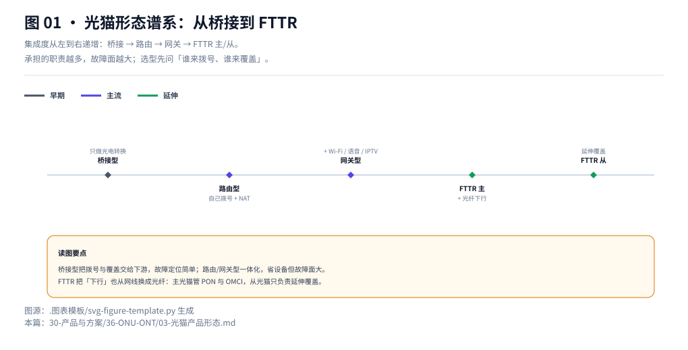
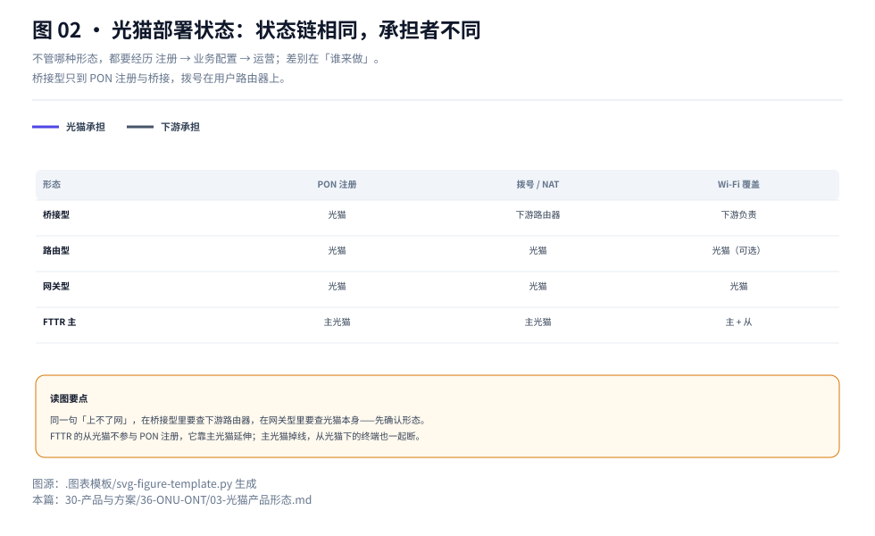
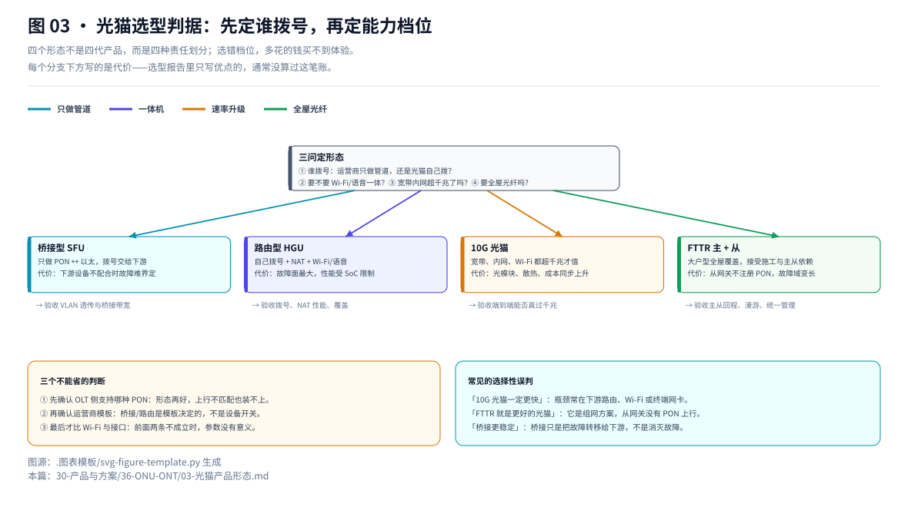

# 光猫产品形态

「光猫」是家用 ONU/ONT 的俗称，产品上是一族设备而不是一种：**桥接型只做光电转换，路由型带 NAT/Wi-Fi，10G 型提升上行，FTTR 主光猫再向下延伸光纤**。选型的核心是「谁来拨号、谁来管、谁来覆盖」。

> 本篇定位：光猫的形态谱系、与 ONU/ONT/CPE/路由的边界、典型配置与选型判据。PON 注册去 [01-PON注册与OMCI](./01-PON注册与OMCI.md)，整机架构去 [00-ONU-ONT系统架构](./00-ONU-ONT系统架构.md)，家用网关能力去 [33-CPE](../33-CPE/.readme.md)，FTTR 组网细节去 [35-FTTR](../35-FTTR/.readme.md)。

## 目录

- [1 一句话模型](#s1)
- [2 速览](#s2)
- [3 形态与字段](#s3)
- [4 交互流程](#s4)
- [5 状态与定时器](#s5)
- [6 设计取舍与边界](#s6)
- [7 与相邻主题的关系](#s7)
- [名词解释](#名词解释)
- [8 参考与关联](#s8)

## 1 · 一句话模型：光猫是「PON 侧的家用终端」，形态由下游需求决定

```text
纯桥接（SFU）        ：光猫只做 PON ↔ 以太，路由拨号交给下游
路由型（HGU）        ：光猫自己做路由/NAT/Wi-Fi/语音
10G 光猫             ：上行升级到 XG(S)-PON，接口/ Wi-Fi 同步升级
FTTR 主光猫          ：在 HGU 基础上增加光纤下行，带从网关
```

三个关键认知：

1. **光猫 ≠ 路由器**：桥接型只是「光电转换 + VLAN」，路由型才具备 NAT/DHCP/Wi-Fi。
2. **形态由「谁拨号」决定**：运营商让光猫桥接、用户自备路由，和光猫一体路由，是两种完全不同的产品定义。
3. **「光猫」是俗称，规范名是 ONU/ONT**；写规格、做认证时要用标准名称，避免和「光模块」「光端机」混淆。

因为形态由「谁拨号、谁管理、谁覆盖」决定，所以同一款硬件在不同运营商手里会被叫成不同产品；只比硬件参数，永远比不出差别。

一句话类比：光猫是**同一个盒子戴不同的帽子**——帽子（软件模式与产品定义）决定了它此刻是「管道」「路由器」还是「全屋网络的主节点」；盒子（PON MAC + CPU + 接口）不变。

> **推论**：既然形态是帽子，那「这台光猫能不能改桥接」问的不是硬件，而是**运营商模板与固件是否开放该模式**；参数表里找不到答案。
> **边界**：帽子的数量有限——桥接和路由可以切换，但从网关永远不是 ONU：它没有 PON 上行，也谈不上注册。
> **类比失效处**：换帽子不换盒子，但换形态常常要换盒子：10G 形态需要不同的光模块与散热，FTTR 主光猫需要额外的光纤下行口。

## 2 · 速览

| 项 | 内容 | 边界与误判 |
| --- | --- | --- |
| 规范名 | ONU（光网络单元）/ ONT（光网络终端） | 规范名不区分桥接/路由；拿规范名当「一定带路由」会错 |
| 俗称 | 光猫、光纤猫、宽带猫 | 俗称不带技术含义，电商页面与工单里的「光猫」可能指任何一种 |
| 主要形态 | 桥接型 SFU、路由型 HGU、10G 光猫、FTTR 主光猫、企业 ONU | 形态并列但不是同层：10G 与 FTTR 是在桥接/路由之上的能力叠加 |
| 上行 | GPON / XG-PON / XGS-PON / EPON / 10G-EPON | 上行类型必须与 OLT 端口一致，不由「光猫档次」决定 |
| 下行接口 | 以太口、Wi-Fi、FXS、USB（部分） | 接口数受形态与成本限制；同型号不同批次可能砍掉 USB/FXS |
| 管理 | OMCI（PON 业务）+ TR-069（设备业务） | 两条通道都可能被运营商关闭；关掉后本地 Web 是唯一入口 |
| 选型关键 | 谁拨号、是否要 Wi-Fi/语音、上行速率、覆盖方式 | 四项里前两项是「责任划分」，后两项才是「性能档位」 |

因为四项里前两项是责任划分、后两项才是性能档位，所以先问「谁拨号」能砍掉一半候选型号，也能提前排除装不上的上行类型。

## 3 · 形态与字段

### 3.1 形态谱系

| 形态 | 转发能力 | 典型接口 | 适用 | 边界 |
| --- | --- | --- | --- | --- |
| 桥接型 SFU | 二层桥接 | 1×PON + 1~4×LAN | 用户自备路由/企业专线 | 不能拨号、无 Wi-Fi；下游不支持 VLAN/PPPoE 时方案不成立 |
| 路由型 HGU | 路由/NAT/Wi-Fi | PON + LAN + Wi-Fi + FXS | 家庭一体机 | 故障面大、性能有限；Wi-Fi 覆盖别指望顶独立 AP |
| 10G 光猫 | 路由/桥接 | PON 10G + 2.5G/10G LAN + Wi-Fi 6/7 | 千兆/万兆宽带 | 成本高、散热要求高；LAN 口与 Wi-Fi 不配套时仍跑不过千兆 |
| FTTR 主光猫 | 路由 + 光纤下行 | PON + 光纤下行口 + LAN + Wi-Fi | 全屋光纤组网 | 依赖从网关、施工复杂；从网关不注册 PON |
| 企业 ONU | 二层/三层 | 多 LAN、光口、语音 | 政企/园区 | 管理方式不同（OMCI/网管）；家用 ACS 模板套不上 |
| 模块化 ONU | 桥接 | SFP/板卡 | 嵌入式/设备内置 | 无独立外壳/管理；散热与供电由宿主设备决定 |

### 3.2 关键配置

| 配置项 | 桥接型 | 路由型 | 说明 | 边界与误判 |
| --- | --- | --- | --- | --- |
| WAN 模式 | 透传/桥接 | PPPoE/DHCP/静态 | 决定谁拨号 | 桥接模式下 WAN 配置页通常整个消失，不是固件坏了 |
| VLAN | 必须 | 必须 | 业务隔离 | 桥接型要「透传」而不是「终结」VLAN，模式选错下游拿不到 tag |
| NAT/DHCP | 无 | 有 | 路由型才需要 | 桥接光猫 + 下游路由 = 只有一层 NAT；两层 NAT 会让端口映射与游戏联机变难 |
| Wi-Fi | 无 | 有 | SSID/信道/功率 | 光猫 Wi-Fi 多与路由共用 CPU，跑满转发时无线先掉速 |
| VoIP | 无/可选 | 有 | FXS/SIP | 桥接型若带 FXS，语音仍需单独管理通道，不随桥接消失 |
| TR-069 | 有 | 有 | 运营商管理 | 桥接型也要有管理 IP；管理 VLAN 未通时 ACS 永远上不了线 |
| OMCI | 有 | 有 | PON 业务配置 | 与 WAN 模式无关；注册与业务通道始终由 OLT 管 |

### 3.3 与相邻形态的边界

| 形态 | 与光猫的关系 | 区别 | 误判后果 |
| --- | --- | --- | --- |
| ONU/ONT | 同义词（规范名） | 光猫是家用俗称 | 招标文件写「光猫」会被供应商按不同理解报价 |
| CPE | 上位概念 | CPE 包含 xDSL/PON/蜂窝终端 | 把「CPE 必须支持 PON」写进需求，排除掉 xDSL 产品线 |
| 路由器 | 下游或集成 | 桥接光猫 + 独立路由；路由光猫 = 二合一 | 在桥接光猫上找 NAT 设置，永远找不到 |
| 智能网关 | 功能叠加 | 光猫可演进为带插件/云管的网关 | 以为「智能」等于性能更好，选型漏掉转发能力 |
| 光端机 | 不同设备 | 光端机多指 PDH/SDH/视频光端设备，不是 PON ONU | 采购/排障时混淆，把「设备类型不对」当成「设备坏了」 |

### 3.4 形态背后是三个归属

把 3.1 那张表按「归属」重排，形态差异立刻变成三列是非题：

| 形态 | 拨号归谁 | 管理归谁 | 覆盖归谁 |
| --- | --- | --- | --- |
| 桥接型 SFU | 下游路由器/用户 | 运营商（OMCI + TR-069） | 用户自备 AP |
| 路由型 HGU | 光猫自己 | 运营商（OMCI + TR-069 + 本地 Web） | 光猫自带 Wi-Fi |
| 10G 光猫 | 看模式（桥接或路由） | 同上 | 同上，Wi-Fi 档位更高 |
| FTTR 主光猫 | 主光猫 | 运营商（主网关统一管） | 主 + 从，从网关延伸 |

**为什么按归属看而不是按功能看**：因为归属决定「出问题谁受理」，所以产品定义、报价与 SLA 都挂在这三列上，而不是挂在功能清单上——桥接型的 Wi-Fi 问题与运营商无关，路由型的 Wi-Fi 问题就是运营商的工单。

> **推论**：同一句「上不了网」，在桥接型里第一站是用户路由器，在路由型里第一站是光猫 WAN 状态——先问形态，再问现象。

## 4 · 交互流程



**读图**：从桥接到 FTTR 主光猫，集成度越来越高；桥接型把拨号和覆盖交给下游，路由型自己承担，FTTR 再向下延伸光纤。集成度越高，故障面越大——这是选型时要付的账。

> 图源：`images/图01-光猫形态谱系.svg`

### 4.1 桥接型部署

```text
OLT → 光猫（桥接，透传 VLAN）→ 用户路由器拨号 → LAN/Wi-Fi
```

光猫只负责 PON 注册、OMCI 配置和二层透传；拨号、NAT、Wi-Fi 都在下游路由器。

**为什么桥接型排障最快**：链路上只有两个可配置点（光猫透传、下游拨号），任一段出问题都能用「换一台已知好的路由器」二分定位。代价是用户设备千差万别，运营商无法保证体验。

### 4.2 路由型部署

```text
OLT → 光猫（路由，PPPoE/NAT）→ LAN/Wi-Fi/语音
```

光猫自己完成拨号、NAT、DHCP、Wi-Fi 和 VoIP，用户无需额外路由。

**为什么运营商偏爱这个形态**：因为拨号账号在运营商手里，所以业务可以远程开通与变更，故障也能远程定位；代价是所有家庭网络问题都变成运营商工单，哪怕根因是用户手机或墙体。

### 4.3 FTTR 主光猫部署

```text
OLT → 主光猫（路由 + 光纤下行）→ 从网关（房间）
```

主光猫承担 PON、路由和整网管理，从网关只做房间覆盖。

> **边界**：从网关没有 PON 上行，也不参与 OMCI 注册；「从网关不注册」是正常现象，查的是主从回程与配对，不是 PON。

### 4.4 异常分支

| 异常 | 现象 | 定位方向 | 先验证什么 |
| --- | --- | --- | --- |
| 桥接型不能上网 | 下游路由拨号失败 | 光猫 VLAN/透传、下游拨号配置 | 光猫 LAN 口能否看到带 tag 的帧 |
| 路由型不能上网 | 光猫 WAN 无地址 | PON 注册、VLAN、账号 | WAN 状态是「未连接」还是「认证失败」 |
| 改桥接后 IPTV 不通 | 电视黑屏 | 桥接 VLAN/组播透传 | 组播 VLAN 是否随桥接一起透传 |
| 换光猫不注册 | PON 灯异常 | SN/密码、OLT 绑定、PON 类型 | OLT 侧是否已解绑旧 SN |
| 10G 光猫协商不到 10G | 速率低 | 光模块/线缆/对端端口能力 | LAN 口与线缆是否支持 2.5G/10G |
| FTTR 从网关不上线 | 单房间无网 | 光纤/供电/主从注册 | 主光猫管理页里从网关是否被发现 |

## 5 · 状态与定时器



**读图**：不同形态状态链相同，但拨号/管理/覆盖的承担者不同。同一格在桥接型里是「下游负责」，在路由型里是「光猫负责」。

> 图源：`images/图02-光猫部署状态.svg`

因为拨号、桥接、管理各自有独立的定时器，所以「周期性掉线几秒」这类现象要按定时器归因，而不是笼统记成「网络不稳」。

| 对象 | 状态 | 在等什么 | 失败表现 |
| --- | --- | --- | --- |
| PON 注册 | 同步 → 发现 → 测距 → 授权 → 运营 | OLT 的发现与授权消息 | 停在某一态并周期性重试，PON 灯随之闪烁 |
| WAN（路由型） | 未连接 → 拨号 → 已连接 | PPPoE 认证或 DHCP 应答 | 「认证失败」与「无响应」是两类问题：前者查账号，后者查 VLAN/链路 |
| 桥接口 | Down → Up | 下游设备链路与 VLAN 匹配 | 灯亮但无流量：VLAN 模式不匹配，不是链路坏 |
| 管理 | OMCI/TR-069 在线/离线 | OLT 与 ACS 的会话 | 在线但改不动：模板权限或双头管理冲突 |
| 升级 | 下载 → 校验 → 重启 → 确认 | 镜像完整性与回滚判据 | 回到旧版本（回滚生效）或不启动（无备份镜像） |

| 定时器 | 管什么 | 说明与边界 |
| --- | --- | --- |
| 拨号重试间隔 | PPPoE 失败后多久重拨 | 多为递增退避；间隔太短会被 BRAS 判为异常频繁拨号 |
| PPPoE 保活（LCP Echo） | 判断 WAN 是否还活着 | 对端不回 Echo 就重拨，表现为「周期性掉线几秒」 |
| DHCP 租期 | WAN/LAN 地址多久续租 | 租期过半开始续租；续租失败会保留旧地址直到过期，容易误判「还有地址所以正常」 |
| OMCI 心跳/告警上报 | 管理通道是否可用 | 心跳缺失时 OLT 侧显示离线，但业务可能仍在跑 |
| TR-069 周期 Inform | 设备参数核对 | 周期由 ACS 下发；调短会增加 ACS 负载，调长会让参数漂移发现变慢 |
| 升级回滚窗口 | 新镜像多久内算「未确认」 | 窗口内掉电触发回滚，现场看到「升级后自己变回旧版」 |
| 桥接口去抖 | 链路抖动多久算真断 | 去抖过长会掩盖接触不良，过短会产生大量无意义告警 |

> **待验证**：上述定时器的默认值随厂商与运营商模板变化，拨号与 ACS 参数尤其如此，核对时以现网配置为准。

## 6 · 设计取舍与边界

### 6.1 桥接 vs 路由：谁掌握控制权

桥接把拨号、NAT、Wi-Fi 交给用户，运营商只保证管道；路由型把控制权收回运营商，便于远程管理和业务开通，但故障面更大、性能受限。集采产品通常两种模式都支持，出厂默认由运营商决定。

**代价**：控制权收回来的同时，责任也收回来了——路由型的每一个 Wi-Fi 投诉都会变成工单；桥接型则要接受「用户体验不由自己决定」。

> **失效条件**：用户自备路由器不支持 VLAN tag、或坚持用老式只做 PPPoE 的网关时，桥接方案会连带影响 IPTV 与语音，最终仍要回到路由型。

### 6.2 一体机 vs 分离式

一体机省设备、省空间，适合普通家庭；分离式（光猫 + 路由/AP）性能更好、升级灵活，适合大户型/高要求用户。FTTR 是分离式的进一步演进。

**为什么分离式性能更好**：Wi-Fi 与转发不再抢同一颗 SoC，天线位置也不再受光猫安装位置限制；代价是多一台设备、多一个电源、多一个故障点。

> **边界**：分离式的前提是有地方放、有电可用、有网线可走；老房子没有布线时，一体机反而是唯一可行方案。

### 6.3 10G 光猫的必要性

只有宽带速率、内网设备、Wi-Fi 都超过千兆时，10G 光猫才有意义；否则瓶颈在路由/Wi-Fi/终端，换光猫不会提升体验。

**为什么容易买错**：用户看到「万兆光猫」就以为整条链路都变快。因为链路是串联的——光猫、网线、路由器、终端网卡任何一环是千兆，端到端就是千兆——所以只换光猫通常买不到速度。

> **失效条件**：只有单台设备测速、且该设备支持 2.5G/10G 网口时，10G 光猫才可能带来可感知提升；多设备并发场景下瓶颈通常先出现在 Wi-Fi。

### 6.4 光猫的「智能」边界

加插件、云管、智能家居能把光猫变成智能网关，但会增加成本、功耗和故障率。运营商产品应优先保证注册稳定、管理可控、升级可回滚。

**为什么运营商克制**：光猫是「必须在线」的设备，插件带来的内存占用与后台任务会直接侵蚀转发与管理面资源；一次插件崩溃导致的批量重启，代价远大于增值业务收益。

> **边界**：在差异化竞争场景（安防、家长控制、边缘存储），「智能」是产品卖点而非负担；此时应把插件资源与转发面隔离，而不是简单叠加。

### 6.5 光猫不是「光模块」

光猫是整机（PON MAC + CPU + 接口 + 电源），光模块只是光电转换器件。采购/排障时混用这两个词，容易把「模块不兼容」误判为「光猫故障」。

**为什么这个混淆代价高**：光模块有兼容性与波长差异，换模块可能立刻恢复；而一旦判成「光猫坏」，流程就变成上门换机，时间与成本都翻倍。

> **推论**：PON 灯不亮时先确认是「整机不上电」还是「模块不收光」——串口/本地页面能进，就说明整机是活的。

### 6.6 选型三问

选型不需要先比参数，先把三个归属问清楚，档位自然收敛：

### 图 03 · 光猫选型判据



**读图**：上方根节点是「三问定形态」，四个分支对应四种形态；每个分支第二行写的是代价，第三行是验收重点。判断顺序是先定「谁拨号」，再看要不要一体、要不要 10G、要不要全屋光纤。

> 图源：`images/图03-光猫选型判据.svg`

| 步骤 | 问什么 | 答错的后果 |
| --- | --- | --- |
| ① 判上行 | OLT 端口是 GPON 还是 XG(S)-PON/EPON | 形态选得再好也注册不上，等于买错设备 |
| ② 判责任 | 运营商只做管道，还是光猫自己拨号 | 责任划分错，工单会在运营商与用户之间来回踢 |
| ③ 判档位 | 宽带、内网、Wi-Fi 是否都超过千兆 | 只为「万兆」买单，端到端仍是千兆 |
| ④ 判覆盖 | 单点覆盖够不够，是否需要全屋光纤 | 用一体机硬撑大户型，最后仍要加 AP 或改 FTTR |

> **推论**：四步里只有第③步是性能问题，前三步都是责任与兼容问题——这也是为什么「参数更好」的光猫经常在现网表现更差。

## 7 · 与相邻主题的关系

| 相邻对象 | 关系 | 边界 |
| --- | --- | --- |
| [ONU/ONT 系统架构](./00-ONU-ONT系统架构.md) | 整机分层与业务对象 | 那篇讲内部结构与绑定链，本篇讲对外形态与归属，不重复硬件表 |
| [PON 注册与 OMCI](./01-PON注册与OMCI.md) | 注册与业务配置 | 形态不影响注册流程；本篇不展开 ME 与状态机 |
| [VoIP 与 IPTV 业务](./02-VoIP与IPTV业务.md) | 三网业务 | 有没有 FXS 口由形态决定，业务配置逻辑与形态无关 |
| [CPE 系统架构](../33-CPE/00-CPE系统架构.md) | CPE 上位概念 | CPE 按部署位置与管理归属定义；PON 侧细节不在 CPE 篇 |
| [路由器产品架构](../32-路由器/00-路由器产品架构.md) | 桥接型的下游设备 | 桥接方案里路由器的性能与 NAT 能力决定体验，责任在下游 |
| [FTTR 组网架构](../35-FTTR/00-FTTR组网架构.md) | 主光猫的组网延伸 | FTTR 是方案不是单机；主从回程、漫游细节在那篇 |
| [设备形态对比](../00-设备形态对比.md) | 全产品形态边界 | 那篇横向比较九种设备，本篇只纵向展开光猫一族 |

一句话：**光猫的形态选择，本质是「拨号、管理、覆盖」三件事由谁来做。**

因为光猫的形态只是同一套 PON 接入能力的不同封装，所以形态选择不会改变注册与 OMCI 的判据；先定形态，再按 01 排查，顺序反了会先怀疑硬件。

> **推论**：选型时先看本篇与 [设备形态对比](../00-设备形态对比.md) 的边界列，再决定要不要去 35-FTTR 或 33-CPE；把光猫当 FTTR 或当 CPE 讨论，都会在错误的责任主体上做决策。

## 名词解释

> 缩写给出英文全称；非缩写用“—”表示。

| 术语 | 英文全称 | 解释 |
| --- | --- | --- |
| 光猫 | — | 家用 ONU/ONT 的俗称。 |
| ONU | Optical Network Unit | 光网络单元。 |
| ONT | Optical Network Terminal | 光网络终端。 |
| OLT | Optical Line Terminal | 光线路终端，PON 局侧设备。 |
| PON | Passive Optical Network | 无源光网络。 |
| GPON | Gigabit-capable Passive Optical Network | 千兆无源光网络，ITU-T G.984 系列。 |
| XGS-PON | 10-Gigabit-capable Symmetric Passive Optical Network | 对称 10G 无源光网络，ITU-T G.9807。 |
| EPON | Ethernet Passive Optical Network | 以太网无源光网络，IEEE 802.3ah。 |
| SFU | Single Family Unit | 单家庭单元，常指桥接型光猫。 |
| HGU | Home Gateway Unit | 家庭网关型光猫。 |
| CPE | Customer Premises Equipment | 用户侧设备。 |
| OMCI | ONT Management and Control Interface | ONT 管理控制接口。 |
| TR-069 | CPE WAN Management Protocol | 面向 CPE 的远程管理协议。 |
| ACS | Auto Configuration Server | 自动配置服务器，TR-069 的服务端。 |
| VLAN | Virtual Local Area Network | 虚拟局域网。 |
| PPPoE | Point-to-Point Protocol over Ethernet | 以太网 PPP 拨号。 |
| NAT | Network Address Translation | 网络地址转换。 |
| DHCP | Dynamic Host Configuration Protocol | 动态主机配置协议。 |
| WAN | Wide Area Network | 广域网接口，指上行出口。 |
| LAN | Local Area Network | 局域网接口，指用户侧端口。 |
| SFP | Small Form-factor Pluggable | 小型可插拔光模块封装，模块化 ONU 的接口形态。 |
| PDH | Plesiochronous Digital Hierarchy | 准同步数字体系，早期光端机常用。 |
| SDH | Synchronous Digital Hierarchy | 同步数字体系，光端机另一类制式。 |
| FTTR | Fiber To The Room | 光纤到房间，主网关 + 从网关的组网方案。 |
| AP | Access Point | 无线接入点。 |

## 8 · 参考与关联

**标准**

- ITU-T G.984 / G.987 / G.9807：GPON / XG-PON / XGS-PON
- IEEE 802.3ah / 802.3av：EPON / 10G-EPON
- ITU-T G.988：OMCI
- TR-069 / TR-369：远程管理

**关联**

- [设备形态对比](../00-设备形态对比.md)
- [ONU/ONT 系统架构](./00-ONU-ONT系统架构.md)
- [PON 注册与 OMCI](./01-PON注册与OMCI.md)
- [VoIP 与 IPTV 业务](./02-VoIP与IPTV业务.md)
- [CPE 系统架构](../33-CPE/00-CPE系统架构.md)

---

> **本篇定位**：光猫的形态谱系、与 ONU/ONT/CPE/路由的边界、配置与选型判据。
> **素材来源**：`studyspace/1.知识体系/7.openwrt/3.网络业务/`、`studyspace/1.知识体系/2.TCP IP协议/`。
> **待验证**：各运营商的桥接/路由默认策略、10G 光猫规格和 FTTR 主光猫形态定义；各定时器默认值随模板变化。
