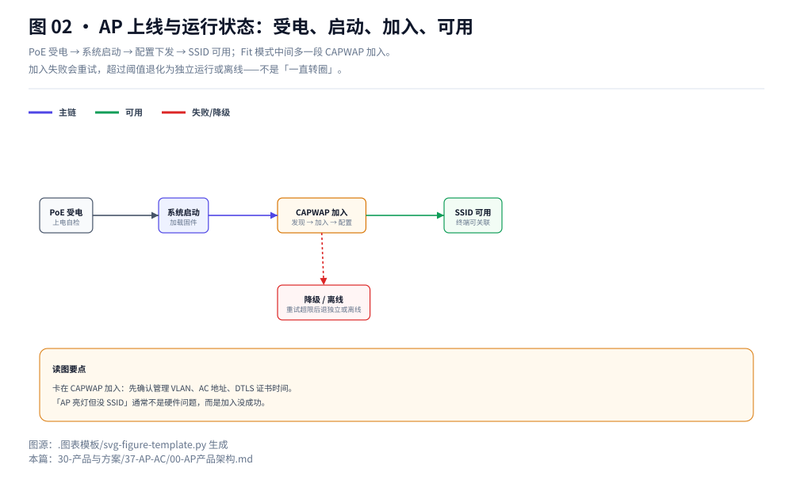

# AP 产品架构

AP（Access Point）是无线侧的「最后一跳」：**把以太网/PON 上行转成 Wi-Fi 空口，并接受 AC、云平台或本地管理**。产品差异不在「能不能发 Wi-Fi」，而在射频能力、供电、安装形态和管理方式。

> 本篇定位：AP 的形态分类、软硬件组成、Fat/Fit 模式和产品指标。802.11 帧与接入流程去 [10-基础理论：Wi-Fi](../../10-基础理论/12-通信科学/04-无线通信/02-Wi-Fi/.readme.md)，驱动/hostapd 去 [20-平台与系统：无线子系统](../../20-平台与系统/22-OpenWrt/04-无线/.readme.md)，AC 与 CAPWAP 去 [01-AC产品架构与CAPWAP](./01-AC产品架构与CAPWAP.md)。

## 目录

- [1 一句话模型](#s1)
- [2 速览](#s2)
- [3 结构与字段](#s3)
- [4 交互流程](#s4)
- [5 状态机与定时器](#s5)
- [6 设计取舍与边界](#s6)
- [7 与相邻主题的关系](#s7)
- [名词解释](#名词解释)
- [8 参考与关联](#s8)

## 1 · 一句话模型：射频决定覆盖，上行决定吞吐，管理决定运维

```text
以太网/PON 上行（PoE 供电）
  └─ AP：桥接/转发 + 射频（2.4/5/6 GHz）
        └─ 终端：SSID 接入 → 认证 → 加密 → 转发
  管理：Fat 本地 / Fit（CAPWAP）/ 云管
```

三个关键认知：

1. **AP 不是路由器**：它主要做二层桥接，把无线帧转到有线侧；NAT/路由通常在网关或 AC 侧。因为空口只是「一根共享的网线」，帧出了 AP 仍要交给有线侧的网关做三层决策，所以 AP 的转发多半停在二层。
2. **供电和上行是硬约束**：PoE 等级决定能不能带动 4x4/多射频；上行 1G 会让 Wi-Fi 6/7 的峰值无处可去。因为空口峰值是共享介质下的理论值，而供电与上行是物理上限，所以整机能力由三者中最小的一项决定。
3. **Fat/Fit 是产品定义**：Fat AP 自己能配，Fit AP 依赖 AC；同一硬件可以刷不同固件，但运维模式完全不同。因为配置的「所有者」不同——一个在 AP 本地，一个在 AC 模板——所以排障起点也不同：前者看本地 Web，后者看 AC 侧记录。

一句类比：AP 像一根「会拐弯的网线」，把有线的最后一米换成了空口。**类比失效的地方**是介质属性——网线是独占总线，空口是共享介质，插上网线得到的带宽，在空口上要跟同信道的所有终端一起分。

> **推论**：先算 PoE 与上行，再谈射频档位。射频是三者中最容易被标称值放大的那一项，也是唯一天花板由「环境与终端」而非「网线与电源」决定的一项。
> **边界**：这套模型只回答「这台 AP 撑不撑得住这个场景」，不解释帧聚合、重传、EDCA 这些空口细节，那去 [802.11 原理与接入流程](../../10-基础理论/12-通信科学/04-无线通信/02-Wi-Fi/00-802.11原理与接入流程.md)。

## 2 · 速览

为什么速览表要带第三列：因为销售口径每一项都会写「支持」，而工程判断要问「在什么条件下不成立」，所以这一列写的是失效条件，不是参数。

| 项 | 内容 | 读法（边界/误判） |
| --- | --- | --- |
| 产品定位 | 无线接入点，提供 Wi-Fi 覆盖与终端接入 | 默认不含 NAT/拨号；一体化面板/家用 AP 是例外（见 3.5） |
| 典型形态 | 吸顶、面板、放装、室外、工业、嵌入式 | 形态由安装环境与天线朝向决定，不是性能档位 |
| 关键能力 | 双频/三频、Wi-Fi 6/7、PoE、集中管理、漫游 | 写「Wi-Fi 7」不等于支持 320 MHz 或 MLO，要逐项对 |
| 关键对象 | 射频、SSID、VLAN、功率/信道、上行口、PoE 等级 | 功率与信道受国家码与法规约束，配不上就是不可用 |
| 管理方式 | Fat 本地 Web、Fit + AC（CAPWAP）、云管 | 混合模式必须先定配置源优先级，否则改完会被覆盖 |
| 关键标准 | IEEE 802.11a/b/g/n/ac/ax/be、802.3af/at/bt、802.1X、CAPWAP | 802.11be 的 320 MHz 只在 6 GHz 频段成立 |
| 主要指标 | 覆盖、并发、吞吐、漫游、功耗、MTBF | 并发与吞吐必须在真实终端、忙时条件下测，实验室空口数据不可直接套用 |

## 3 · 结构与字段

这一节回答「一台 AP 由哪些可替换的部件与模式组成」。因为产品差异集中在射频链、供电链与管理模式三处，所以按「形态 → 硬件 → 软件 → 参数 → 转发位置」的顺序拆，先定装在哪，再定里面有什么，最后定帧从哪出去。

### 3.1 形态分类：安装方式决定覆盖几何

因为安装位置决定了天线朝向与覆盖几何，所以形态不是外观差异，而是「覆盖形状 + 施工方式 + 防护等级」的组合。同一块主板换外壳与天线，就能从吸顶变面板。

| 形态 | 安装 | 典型场景 | 差异点 | 边界与误判 |
| --- | --- | --- | --- | --- |
| 吸顶 AP | 天花板 | 办公室/商场/教室 | 全向覆盖、PoE、隐藏布线 | 全向是「水平面为主、垂直方向弱」；装角落会把方向图打偏，覆盖变成单侧 |
| 面板 AP | 墙面 86 盒 | 酒店/宿舍/家庭 | 面板式、端口少、覆盖近 | 面板朝房间内，穿墙后衰减大；一间一台，别指望覆盖隔壁房间 |
| 放装 AP | 桌面/壁挂 | 小型办公/临时 | 成本低、天线内置 | 放桌面会被金属柜、人体遮挡，覆盖随摆放剧烈变化 |
| 室外 AP | 抱杆/壁挂 | 园区/广场 | 防水防雷、外置天线、宽温 | 防护等级与宽温是硬指标；室内型号外装会进水、夏季降频 |
| 工业 AP | 导轨/机柜 | 工厂/仓储 | 抗干扰、宽温、防护 | 金属货架与叉车会造成阴影；抗干扰是「能扛」，不是「不受影响」 |
| 嵌入式 AP | 模块/板卡 | 设备内置 | 无独立外壳、定制供电 | 没有外壳意味着散热与天线要由整机设计负责，不能按独立 AP 核算 |

> **推论**：布点前先定形态，再定数量。吸顶的覆盖半径与面板差一个量级，用同一张「每 AP 覆盖多少平米」的表去套两种形态，结果一定偏。

### 3.2 硬件组成：一条从 PoE 到天线的链

因为整机指标由这条链上最弱的一环决定，所以看规格书要横向比同一环，而不是比某一项的峰值。

| 部件 | 作用 | 产品关注点 | 边界与误判 |
| --- | --- | --- | --- |
| 主控 SoC | 协议栈、转发、管理 | 是否支持多射频/多空间流 | 低端 SoC 集成射频，成本低但射频指标与并发受限；CPU 核数不决定空口能力 |
| 射频芯片 | 2.4/5/6 GHz 收发 | 频段、带宽、空间流、Wi-Fi 6/7 | 芯片支持 6 GHz，不等于整机配了 6 GHz 射频链——产品可能裁掉 |
| FEM | 功率放大/低噪放大 | 发射功率、噪声系数、线性度 | 功放放大信号也放大噪声；EIRP 受法规封顶，FEM 再强也不能超 |
| 天线 | 辐射与接收 | 增益、方向图、内置/外置、MIMO | 增益是方向性的代价：高增益必然窄波束；天线增益与 FEM 增益不能简单相加 |
| 以太网 PHY | 上行接口 | 1G/2.5G/5G/10G、PoE 受电 | 2.5G PHY 要求网线与对端同时支持，否则协商回 1G |
| PoE 控制器 | 受电/分级 | 802.3af/at/bt、功耗预算 | PD 分级靠硬件特征与 LLDP 协商，接非标注入器可能只给到 af |
| Flash/内存 | 固件、配置、缓存 | 双镜像、剩余空间 | 双镜像占两份空间，小 Flash 上会反过来限制固件功能 |
| 安全芯片 | 密钥/安全启动（部分） | 证书注入、防克隆 | 没有安全芯片时证书只能软存，设备克隆成本低 |

因为射频芯片、FEM、天线三段各自有损，所以「射频芯片支持 4x4」与「整机能跑 4x4」是两件事：中间任何一段按 2x2 设计，整机就是 2x2。

### 3.3 软件模式：Fat / Fit / 云

因为三种模式差的不是功能，而是「配置归谁所有」，所以同一硬件刷不同固件，等于换了一套运维流程与故障定位路径。

| 模式 | 管理 | 配置 | 适用 | 边界 |
| --- | --- | --- | --- | --- |
| Fat AP | 本地 Web/CLI | 每台独立 | 小规模、无 AC | 配置难统一；AP 数量一多，改一次 SSID 要逐台登录 |
| Fit AP | AC（CAPWAP） | AC 统一下发 | 企业/园区 | 依赖 AC 可达；AC 不可达时 AP 退化为「能发信号但改不了配置」 |
| 云 AP | 云平台 | 云端模板 | 连锁/分散站点 | 依赖公网和云；断网后本地保活能力取决于产品设计 |
| 混合 | 本地 + 云/AC | 双通道 | 容灾/过渡 | 配置源要定优先级，否则两边互相覆盖 |

Fit/云管场景的配置源优先级（典型实现）：

```text
云端/AC 模板（AP 组 → SSID 模板 → 射频模板）
  └─ AP 本地 Web/CLI 修改
        └─ 下一次心跳/下发被模板覆盖
```

> **推论**：在 Fit/云管环境里直接登录 AP 改 SSID，改动会在下一次下发时消失——要改模板，不是改 AP。这条推论能解释一大类「改完当时好、过一会儿又变回去」的工单。
> **边界**：有的产品支持「本地锁定」，锁定项忽略云端下发；是否支持、锁在哪一级，各厂商不同，需查产品文档（**待验证**）。

### 3.4 关键参数：标称值怎么读

因为参数之间互相挤压（频宽换信道数、增益换角度、空间流换功耗），所以每一项都要连着它的代价一起读。

| 参数 | 含义 | 边界与误判 |
| --- | --- | --- |
| 空间流 | 2x2/4x4 等 | 终端多为 2x2，4x4 提升多用户容量，不提升单终端峰值 |
| 频宽 | 20/40/80/160/320 MHz | 320 MHz 只在 6 GHz 可用；频宽越大，非重叠信道越少 |
| 发射功率/EIRP | 空口覆盖能力 | EIRP = 发射功率 + 天线增益 − 线损；受法规与国家码限制，不是越大越好 |
| 天线增益 | 定向/全向 | 高增益牺牲覆盖角度；室内高增益常把能量打到墙上而不是终端上 |
| PoE 等级 | af/at/bt | af 的 PD 上限 12.95 W，带不动 4x4 双频满功率 |
| 上行速率 | 1G/2.5G/10G | 要匹配空口峰值和多 AP 汇聚；空口峰值大于上行时，瓶颈在上行不在空口 |
| 并发终端 | 每射频建议值 | 与业务类型、带宽需求相关；「最大关联数」是表项上限，不是体验上限 |

### 3.5 转发位置：AP 到底在哪一层

因为「AP 不做 NAT」只在企业 Fit 部署里成立，所以先判转发位置，再判断这台设备是不是纯 AP。

| 转发方式 | 帧怎么走 | 谁做网关 | 典型产品 | 边界 |
| --- | --- | --- | --- | --- |
| 本地桥接 | 空口帧 → AP 桥 → 上行 VLAN → 网关 | 外部网关 | 企业 Fit AP（本地转发） | 上行必须是 trunk，能按 SSID 打业务 VLAN tag |
| CAPWAP 隧道 | 802.11 帧 → CAPWAP 数据通道 → AC → 网关 | AC 侧或其后的网关 | 企业 Fit AP（集中转发） | 封装后受 MTU 限制；AC 成为带宽与故障的单点 |
| AP 内置 NAT/路由 | 空口帧 → AP 内部路由/NAT → 上行 WAN | AP 自己 | 面板/酒店/家用一体化 AP | 此时 IP 由 AP 分配；排障要找 AP 的 WAN 口与地址池，而不是找上级网关 |

> **边界**：把一体化 AP 当纯 AP 排障，会在「终端拿到 192.168.x.x 却上不了网」时去查上级网关的 DHCP，而问题实际在 AP 自己的 NAT/路由表。

## 4 · 交互流程


**读图**：上行经 PoE 以太网进入 AP，SoC 做桥接/管理，射频经 FEM 到天线；Fit 模式下管理流量走 CAPWAP，数据可按隧道或本地转发。

> 图源：`images/图01-AP软硬件架构.svg`

### 4.1 上电到 SSID 可用

```text
PoE 受电 → Boot → 固件加载
  → 读取配置（本地/AC/云）
  → 射频初始化 → 信道/功率设置
  → 建立 SSID → 认证/加密
  → Fit：CAPWAP 加入 AC；Fat：本地配置生效
  → 终端可接入
```

因为每一步都在给下一步提供前提（国家码决定可用信道与功率上限，管理可达决定配置来源，配置决定 SSID 参数），所以跳过任何一步都不是「少个功能」，而是「起不来」：

| 步骤 | 在等什么 | 答错/缺失的后果 |
| --- | --- | --- |
| PoE 受电 | 分级完成、功率预算够 | 反复重启或降功率运行，表现为「能启动但射频起不来」 |
| Boot/固件 | 镜像校验通过 | 进恢复模式或循环重启，网络侧看不到任何请求 |
| 读配置 | 配置来源可达（AC/云/本地） | 用默认配置起来，SSID 与预期不符 |
| 射频初始化 | 国家码、信道、DFS 静默 | 5 GHz 迟迟不亮，实际是在等 DFS 检测 |
| 建立 SSID | 安全参数与证书 | SSID 可见但认证全失败 |

### 4.2 终端接入

```text
扫描 → 认证/关联 → 802.1X/PSK/Portal → 密钥协商
  → DHCP 获取地址 → 数据转发（本地/隧道）
  → 漫游时重新关联目标 AP
```

因为 802.1X 在关联之后、DHCP 之前完成，所以认证失败的现象是「连上了但没有地址」——把它当 DHCP 问题查，方向就反了。反过来，PSK 场景没有这一步，拿不到地址才是 DHCP/VLAN 问题。

> **推论**：判断「认证问题还是地址问题」，看终端状态即可：显示已连接无 IP → 先看认证与授权 VLAN；完全连不上 → 先看关联与安全参数。

### 4.3 异常分支

这张表按「现象」索引，不按「根因」索引；每行的定位方向是起点，不是结论。因为同一个现象可能来自供电、配置或射频三层，所以先看现象落在哪一段，再决定去查哪一层。

| 异常 | 现象 | 定位方向 |
| --- | --- | --- |
| AP 不上电 | 指示灯不亮 | PoE 供电、网线、受电等级 |
| AP 起不来 | 反复重启 | 镜像损坏、供电不足、看门狗 |
| Fit AP 不上线 | 无法被 AC 管理 | CAPWAP 可达性、Option 43、证书 |
| SSID 搜不到 | 终端看不到网络 | 射频未起、SSID 隐藏、信道/功率 |
| 能连不能上网 | 有地址无转发 | VLAN、上行链路、DHCP、ACL |
| 速率低 | 协商速率低/丢包 | 频宽、干扰、空间流、上行瓶颈 |
| 漫游卡顿 | 走动时断流 | k/v/r、AP 间距、AC 间漫游 |

## 5 · 状态机与定时器



**读图**：AP 从 PoE 受电、启动、配置下发到 SSID 可用；Fit 模式多一段 CAPWAP 加入，失败会重试或降级。

> 图源：`images/图02-AP上线与运行状态.svg`

因为 AP 是没有屏幕的设备，状态只能从指示灯、AC 侧记录和日志反推，所以状态机是排障时的共同语言：先定位停在哪一态，再谈原因。Fit 模式里「发现 → DTLS → Join → 配置」的细分状态与报文，去 [01-AC产品架构与CAPWAP](./01-AC产品架构与CAPWAP.md)，本篇不重复。

| 状态 | 在等什么（判据） | 失败表现 | 退出条件 |
| --- | --- | --- | --- |
| 受电 | PoE 检测/分级完成，功率预算够 | 灯不亮、反复重启 | 供电达标 → 启动 |
| 启动 | Boot/内核/根文件系统校验 | 循环重启、进恢复模式 | 镜像可用 → 配置 |
| 配置 | 本地/AC/云下发或版本比对 | AP 在线但 SSID 不对；下发失败时退回默认配置 | 版本一致 → 射频就绪 |
| 射频就绪 | 国家码、信道/功率、DFS 静默 | 某频段不亮；雷达检测到信号或法规不允许则换信道 | 信道可用 → 运行 |
| 运行 | 终端接入/转发、Echo 保活 | 掉线、降速 | 异常 → 重启/回配置 |
| 升级 | 下载/校验/重启 | 升级失败回滚旧镜像 | 新镜像起来 → 配置 |

| 定时器 | 作用 | 典型值与边界 |
| --- | --- | --- |
| CAPWAP Echo | Fit AP 与 AC 保活 | RFC 5415 默认 30 s；超时后 AP 回发现流程 |
| 发现重试 | AC 发现 | RFC 5415：`DiscoveryInterval` 5 s、`MaxDiscoveryInterval` 20 s（2–180 s 可调） |
| 信道扫描 | 射频管理 | DFS 信道需静默检测；CAC 常见 60 s，气象雷达信道 600 s（按地区） |
| 终端空闲 | 踢除低活跃终端 | 阈值由产品/AC 配置；设太短会把待机终端误踢 |
| 看门狗 | 进程/系统异常重启 | 与「供电不足反复重启」现象相似，要分开判：看门狗有日志，掉电没有 |

> **待验证**：各厂商的 CAPWAP 心跳、DFS 静默时间、终端空闲阈值和 PoE 分级策略不同，需按设备文档确认。
> **边界**：上表是「AP 自身」的状态；整网视角下还有 AC 侧记录的 AP 在线状态，两者可能短暂不一致（Echo 未超时前，AC 仍认为 AP 在线）。

## 6 · 设计取舍与边界

本篇不涉及协议状态机的报文细节（那在 01），只讲产品层的取舍：每一种选择都在换什么，代价落在谁身上。

### 6.1 Fat vs Fit

Fat AP 部署简单、无 AC 依赖，但配置分散、漫游和射频管理弱；Fit AP 集中管理、支持漫游和射频调优，但依赖 AC 可达。小规模/临时场景 Fat 更划算，企业园区应选 Fit。

- **代价**：Fit 把「可用性」押在 AC 上。AC 不可达时，AP 通常仍能按最后一次配置发信号，但改不了、也看不到细节。
- **失效条件**：AP 数量少（个位数）、又没有专职网管时，Fit 的集中管理收益抵不过 AC 的采购与维护成本。

### 6.2 Wi-Fi 6 vs Wi-Fi 7

Wi-Fi 7 的 320 MHz、MLO、4K-QAM 提升峰值和时延，但需要终端、信道和上行一起匹配；终端仍是 Wi-Fi 6 时，升级收益有限。产品选型要看终端代际和业务带宽，而不是只看标称速率。

- **边界**：320 MHz 需要 6 GHz 频段与连续频谱，国内目前未把 6 GHz 开放给 WLAN（以最新无线电管理规定为准），这一项在国内项目里通常等于不存在；MLO 还需要 AP 与终端同时支持并正确配置。
- **失效条件**：终端以 2x2 Wi-Fi 6 为主、业务是办公与视频会议时，换 Wi-Fi 7 AP 的体感提升远小于把上行从 1G 换成 2.5G。

### 6.3 2x2 vs 4x4

4x4 提升多用户容量和覆盖，但成本、功耗、天线体积更高；终端普遍 2x2 时，4x4 的优势主要体现在多终端并发和上行 MIMO。覆盖不足优先加 AP，而不是盲目上 4x4。

- **代价**：4x4 的功耗与发热会反过来挤压 PoE 预算与外壳设计，室外机型还要考虑散热与防雷。
- **失效条件**：单终端大文件场景里，4x4 对单流终端没有增益；此时瓶颈在终端侧或上行。

### 6.4 内置天线 vs 外置天线

内置天线美观、施工简单，适合吸顶/面板；外置天线能调整方向和增益，适合室外/长距离。外置不是「更强」，装错方向反而更差。

- **误判**：把「外置天线增益高」当成覆盖更广。高增益是把能量压进更窄的波束，方向对才有效；装反或俯仰角不对，覆盖会明显劣化。
- **边界**：室外必须做防雷与接地，天线与 AP 之间的馈线损耗要计入 EIRP，长馈线会把增益吃掉。

### 6.5 PoE 与上行的边界

Wi-Fi 6/7 AP 功耗上升，802.3af 可能不够，需要 at/bt；上行 1G 会成为多射频 AP 的瓶颈。PoE 交换机、网线等级和 AP 功耗要一起核算，不能只看 AP 规格。


**读图**：三条上限从上到下叠在一起——供电预算、空口峰值、上行带宽；下面那一条把三者合成「实测吞吐 = min(...)」，再往下是核算顺序（PoE → 上行 → 射频档位）。所以读法是：先看哪条最短，再看自己有没有按这个顺序算。

> 图源：`images/图03-AP三道天花板.svg`

| 环节 | 上限（典型） | 什么时候成为瓶颈 |
| --- | --- | --- |
| PoE 供电 | 802.3af：PD 12.95 W；at：25.5 W；bt：51–71 W | 三频/4x4 满功率发射时；bt 需要 8 芯全接、支持 bt 的 PSE |
| 空口 | 理论峰值 × 空口效率（共享介质） | 终端少、信号好、频宽大时才接近理论值 |
| 上行 | 1G/2.5G/10G 线速 | 多 AP 汇聚、大文件并发、集中转发隧道叠加时 |

因为供电是「能不能开机」的问题、上行是「跑不跑得满」的问题，所以核算顺序是 PoE → 上行 → 射频档位；顺序反过来，会得到一张纸面很好看、现场带不动的配置单。

> **推论**：验收时如果单终端速率始终撞在上行线速附近，先查上行与汇聚，不要继续调空口参数。

## 7 · 与相邻主题的关系

因为跨目录内容只保留一份正本，所以这张表每条只写「关系 + 边界 + 去哪看」，不复制正文。

| 相邻对象 | 关系 | 边界（细节去哪看） |
| --- | --- | --- |
| [802.11 原理与接入流程](../../10-基础理论/12-通信科学/04-无线通信/02-Wi-Fi/00-802.11原理与接入流程.md) | BSS/ESS、接入与漫游 | 本篇只用到「关联/认证/加密」这几个词，帧格式与状态机不在这里 |
| [Wi-Fi 频段信道与速率](../../10-基础理论/12-通信科学/04-无线通信/02-Wi-Fi/01-Wi-Fi频段信道与速率.md) | 信道、MCS、空间流 | 本篇不推导速率表，只讲这些参数怎么影响选型 |
| [无线子系统总览](../../20-平台与系统/22-OpenWrt/04-无线/00-无线子系统总览.md) | hostapd/mac80211 实现 | 本篇不写配置项与代码路径 |
| [WiFi6-7 与射频参数](../../20-平台与系统/22-OpenWrt/04-无线/03-WiFi6-7与射频参数.md) | 射频能力与配置 | 本篇不写具体寄存器/驱动参数 |
| [AC 产品架构与 CAPWAP](./01-AC产品架构与CAPWAP.md) | Fit AP 的管理侧 | CAPWAP 报文、Join/DTLS 状态机在 01，本篇只讲 AP 侧结果 |
| [AC-AP 组网与漫游](./02-AC-AP组网与漫游.md) | 组网与漫游 | 二层/三层组网、漫游域不在本篇 |
| [WLAN 覆盖与验收](./03-WLAN覆盖与验收.md) | 覆盖设计与验收 | 布点、功率、容量估算不在本篇 |
| [设备形态对比](../00-设备形态对比.md) | AP 在整个设备谱系里的位置 | 形态归类方法在总览篇，本篇只展开 AP 内部 |

一句话：**AP 产品 = 射频能力 × 供电/上行能力 × 管理方式，三者必须匹配场景。** 边界在于：这里说的是「整机选型」，不是「单板设计」——射频链的内部实现去 [40-平台与芯片](../../40-平台与芯片/.readme.md)。

## 名词解释

> 缩写给出英文全称；非缩写用“—”表示。

因为同一个缩写在无线与有线语境里可能指不同对象（如 AC、AP、BSS），所以下表按本篇语境解释。

| 术语 | 英文全称 | 解释 |
| --- | --- | --- |
| AP | Access Point | 无线接入点。 |
| AC | Access Controller | 无线控制器。 |
| Fat AP | — | 具备完整本地管理能力的 AP。 |
| Fit AP | — | 依赖 AC 管理的瘦 AP。 |
| SSID | Service Set Identifier | 无线网络名称。 |
| BSS | Basic Service Set | 基本服务集，一个 AP 上一个射频的一套参数。 |
| ESS | Extended Service Set | 扩展服务集，多个 BSS 用同一 SSID 组成的漫游域。 |
| MIMO | Multiple-Input Multiple-Output | 多输入多输出，多天线同时收发。 |
| MLO | Multi-Link Operation | 多链路操作，Wi-Fi 7 允许终端同时使用多个频段链路。 |
| 4K-QAM | 4096 Quadrature Amplitude Modulation | 4096 阶正交幅度调制，Wi-Fi 7 的高阶调制方式。 |
| FEM | Front-End Module | 射频前端模块，含功放、低噪放与滤波。 |
| EIRP | Equivalent Isotropically Radiated Power | 等效全向辐射功率，发射功率与天线增益的合成值。 |
| PoE | Power over Ethernet | 以太网供电（IEEE 802.3af/at/bt）。 |
| PSE | Power Sourcing Equipment | 供电设备，如 PoE 交换机。 |
| PD | Powered Device | 受电设备，如 AP。 |
| 国家码 | Regulatory Domain | 规定可用频段、信道与功率上限的法规域，配置错误会导致射频不可用。 |
| CAPWAP | Control and Provisioning of Wireless Access Points | AP 控制与配置协议（RFC 5415/5416）。 |
| DFS | Dynamic Frequency Selection | 动态频率选择，5 GHz 雷达信道的避让机制。 |
| MTBF | Mean Time Between Failures | 平均无故障时间。 |

## 8 · 参考与关联

**标准**

因为标准编号与厂商实现都会演进，所以这里只列编号与入口，具体条款按发布版本核对。

- IEEE 802.11a/b/g/n/ac/ax/be
- IEEE 802.3af/at/bt：PoE
- IEEE 802.1X：端口接入认证
- RFC 5415 / 5416：CAPWAP

**关联**

- [设备形态对比](../00-设备形态对比.md)
- [AC 产品架构与 CAPWAP](./01-AC产品架构与CAPWAP.md)
- [AC-AP 组网与漫游](./02-AC-AP组网与漫游.md)
- [WLAN 覆盖与验收](./03-WLAN覆盖与验收.md)

---

> **本篇定位**：AP 的形态、软硬件、Fat/Fit 模式与上线流程；不含 CAPWAP 报文、802.11 帧格式与覆盖设计。
> **素材来源**：`studyspace/1.知识体系/10.wifi/wifi记录.md`、`studyspace/1.知识体系/7.openwrt/3.网络业务/2.关键组件服务/5.WiFi子系统/`；CAPWAP 定时器默认值按 RFC 5415 §4.7 核对（访问 2026-11-22）。
> **待验证**：各型号的射频规格、PoE 功耗、并发建议值和 CAPWAP 实现差异；「本地锁定」类配置优先级为厂商行为。
