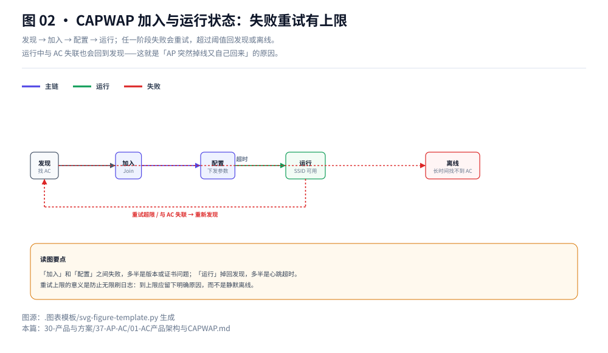
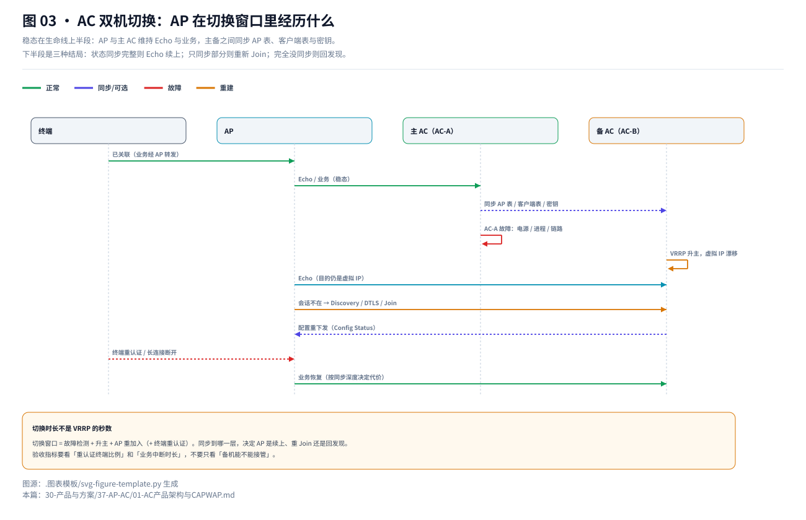

# AC 产品架构与 CAPWAP

AC（Access Controller）是 Fit AP 的「大脑」：**发现 AP、下发配置、管理射频、控制漫游和认证**。AP 与 AC 之间靠 CAPWAP 建控制/数据通道；AC 的性能瓶颈通常不是转发，而是 AP 数量、并发终端和加密/认证开销。

> 本篇定位：AC 的形态、CAPWAP 会话与关键字段、容量与高可用边界。AP 硬件去 [00-AP产品架构](./00-AP产品架构.md)，组网与漫游去 [02-AC-AP组网与漫游](./02-AC-AP组网与漫游.md)，802.11 协议细节去 [10-基础理论：Wi-Fi](../../10-基础理论/12-通信科学/04-无线通信/02-Wi-Fi/.readme.md)。

## 目录

- [1 一句话模型](#s1)
- [2 速览](#s2)
- [3 结构与字段](#s3)
- [4 交互流程](#s4)
- [5 状态机与定时器](#s5)
- [6 设计取舍与边界](#s6)
- [7 与相邻主题的关系](#s7)
- [名词解释](#名词解释)
- [8 参考与关联](#s8)

## 1 · 一句话模型：AC 管控制，转发看模式

```text
AP ── CAPWAP 控制通道（UDP 5246）── AC
AP ── CAPWAP 数据通道（UDP 5247，可选）── AC
        └─ 集中转发：数据过 AC
        └─ 本地转发：数据在 AP 本地出以太网
```

三个关键认知：

1. **CAPWAP 有两条通道**：控制通道管加入/配置/升级，数据通道管业务报文；本地转发时数据通道可以不用。因为控制报文小、要求可靠与加密，业务报文大、要求低时延且可能被旁路，所以两者从一开始就分了端口。
2. **AC 的核心资源是「AP 数 + 客户端数 + 加密会话」**，不是简单的吞吐数字。因为每个加入的 AP 都占一条控制通道与一份状态，每个终端都占一份密钥与转发表项，所以容量要先算「表项」，再算「带宽」。
3. **AC 不是必须的**：Fat AP、云 AC、AP 内置控制器都能替代，选型要看规模、可靠性和运维模式。因为 AC 的价值是「统一 + 可算」，规模小到统一带来的收益抵不过一台设备与一条依赖链时，就不该上 AC。

一句类比：AC 像园区的「调度室」——登记谁能进、发工牌、排班、偶尔广播换岗通知，但不替员工干活。**类比失效的地方**是集中转发：这时调度室同时也是唯一的走廊，人（数据）必须从它里面过，它一停，全楼停。

> **推论**：判断该不该上 AC，先看「配置变更频率 × AP 数量」。十个 AP、一年改两次配置，Fat 更省事；一百个 AP、每月调射频，没有 AC 就不可运维。
> **边界**：本篇的「AC 管控制」默认指旁挂/管理面部署；直连或集中转发部署下，AC 同时在数据面，容量与故障域要按网关来算。

## 2 · 速览

因为 AC 的规格书把「管理能力」和「转发能力」混在一页写，所以第三列专门标出「这条规格在哪失效」。

| 项 | 内容 | 读法（边界/误判） |
| --- | --- | --- |
| 产品定位 | Fit AP 的集中管理、射频控制、认证与漫游控制点 | 不等于网关；旁挂部署时用户数据不经过它 |
| 典型形态 | 硬件 AC、软件 AC、云 AC、融合 AC（路由/网关内置） | 云 AC 不代表数据走公网，转发仍可本地 |
| 关键能力 | AP 发现/加入、配置下发、射频调优、漫游、认证、升级 | 「支持漫游」通常指同 AC；跨 AC 要另看漫游域 |
| 关键协议 | CAPWAP（RFC 5415/5416）、802.11k/v/r、802.1X、RADIUS | 802.11r 要终端与 AP 同时支持，AC 只是下发参数 |
| 关键资源 | AP license、客户端容量、加密吞吐、会话表 | license 是「能管几个 AP」的上限，不是并发能力 |
| 部署方式 | 直连、旁挂、二层/三层组网、双机热备 | 双机热备要状态同步，切换不是无感 |
| 主要指标 | 最大 AP 数、并发终端、新建/并发会话、切换时间、可靠性 | 这几个指标要同时满足，取最小值才是真实容量 |

## 3 · 结构与字段

这一节回答「AC 由哪些形态、哪些协议字段、哪些资源配额组成」。因为 AC 的选型错误多半发生在「把管理容量当转发容量」上，所以先讲形态与字段，再把容量单独拆成 3.4。

### 3.1 AC 形态

因为形态由「管理面放在哪、数据面过不过」两个问题决定，所以同名 AC 可能承担完全不同的故障责任。

| 形态 | 部署 | 优点 | 边界 |
| --- | --- | --- | --- |
| 硬件 AC | 独立机箱/盒式 | 性能稳定、功能完整 | 成本高、占机架；备机闲置是常态 |
| 软件 AC | 服务器/虚机 | 灵活扩容、易备份 | 依赖服务器和虚拟化；虚拟化抖动会放大为 AP 掉线 |
| 云 AC | 公有/私有云 | 多站点统一、免本地运维 | 依赖公网、时延敏感；断网后的本地保活能力因厂商而异 |
| 融合 AC | 路由/网关内置 | 省设备、适合中小网络 | AP 容量和性能受限；网关重启会带走 AC |
| AP 内置控制 | 主 AP 管理从 AP | 无独立 AC、部署快 | 规模和可靠性有限；主 AP 掉线等于控制器掉线 |

> **边界**：云 AC 常被理解成「数据也上云」。实际上多数产品只把管理面放云上，业务流量仍从本地 AP 或本地 AC 出；判断方法是看数据通道是否指向公网地址。

### 3.2 CAPWAP 关键字段

CAPWAP 控制与数据报文共用同一个通用头，靠 UDP 端口和 `T` 位区分载荷。因为头和端口决定了「这条报文归谁处理」，所以排障时先确认它落在 5246 还是 5247。

```text
CAPWAP 通用头（控制/数据共用）
  Preamble(Version | Type) | HLEN | RID | WBID | T F L W M K | Flags
  Fragment ID | Frag Offset
  [可选] Radio MAC   [可选] Wireless Specific Info
  Payload：控制报文（Discovery/Join/Config/Echo…）或 802.11 帧
```

| 字段 | 作用 | 边界与误判 |
| --- | --- | --- |
| 控制通道 | AP 加入/配置/升级 | UDP 5246，需 ACL 放行；只放通 ICMP 不算通 |
| 数据通道 | 业务报文隧道 | UDP 5247，本地转发可不用；不用不等于不占配置 |
| DTLS | 控制/数据加密 | 证书/时间不同步会导致加入失败；数据通道 DTLS 是可选项，各厂商默认不同 |
| AP MAC/序列号 | AP 标识 | 白名单/预配置绑定；改 MAC 或换主板后要重新登记 |
| AC 名称/地址 | 发现目标 | DHCP Option 43、DNS、静态配置；三种来源可能互相覆盖 |
| Echo 间隔 | 保活 | 超时判定 AP 离线；RFC 5415 默认 30 s |
| 配置版本 | 配置一致性 | 版本不一致会触发重下发；重下发期间终端可能短暂断流 |
| RID | Radio ID，标识 AP 的哪一路射频 | 取值范围 1–31；多射频 AP 上按射频分通道 |
| WBID | Wireless Binding ID | 1 表示 IEEE 802.11；其它绑定（如 EPCGlobal）不适用于 Wi-Fi 项目 |
| T 位 | 载荷格式：1 = 原生无线帧，0 = 802.3 帧 | 本地转发与隧道转发的封装差异就体现在这里 |
| F / L 位 | 分片标志 / 最后一片 | 分片开启时抓到的报文不是完整帧，看单包长度会误判为丢包 |

因为 CAPWAP 把「无线帧」当载荷再套一层 UDP/IP，所以同一条链路上会同时出现两种长度的报文：控制报文几十到几百字节，数据报文接近 MTU。看到「大包丢、小包通」时，先怀疑 MTU 与分片，而不是无线信号。

### 3.3 AC 的功能模块

因为模块之间共享同一份 AP 与终端状态，所以任何一个模块的配置错误都会以「AP 在线但业务不对」的形式出现。

| 模块 | 作用 | 关键配置 | 失效表现 |
| --- | --- | --- | --- |
| AP 管理 | 发现、加入、固件升级 | AP 组、白名单、镜像 | AP 反复加入/掉线，或版本永远升不上去 |
| SSID/模板 | 统一下发无线参数 | SSID、安全、VLAN、限速 | AP 在线但 SSID 缺失或参数与模板不符 |
| 射频管理 | 信道/功率/DFS | 自动选信道、功率调优 | 同频干扰、频繁换信道导致终端抖动 |
| 漫游 | 同 AC/跨 AC 漫游 | 漫游域、k/v/r、AC 间隧道 | 走动断流、跨楼层重认证 |
| 认证 | PSK/802.1X/Portal | RADIUS、Portal 服务器 | 关联成功但拿不到地址/被拒 |
| 安全 | 防私接/隔离/黑白名单 | ACL、无线 IPS（部分产品） | 隔离过度导致投屏/打印不可用 |
| 高可用 | 双机热备/集群 | VRRP、状态同步、license | 切换期间 AP 重加入、终端重认证 |

### 3.4 容量与许可

因为 AC 的每个「容量」都是不同维度的表项，所以选型要把四个数字一起算，取最先撞到的那一个。

| 资源 | 说明 | 不足时 | 怎么核算 |
| --- | --- | --- | --- |
| AP license | 可管理 AP 数 | 新 AP 无法加入 | 按「现有 AP 数 × 1.2」留余量，备机 license 另算 |
| 客户端容量 | 并发终端/会话 | 新终端关联失败 | 按忙时并发终端数算，不按员工总数 |
| 加密吞吐 | DTLS/802.11i 开销 | 吞吐下降、CPU 高 | 按「并发终端 × 人均带宽」并与加密吞吐取小 |
| 配置/镜像存储 | AP 固件与模板 | 升级失败、配置丢失 | 按机型数 × 镜像大小估算，双版本要翻倍 |
| 管理通道带宽 | CAPWAP 控制/数据 | 加入慢、心跳超时 | 集中转发时数据也走这里，要按业务带宽算 |

> **推论**：AC 的「最大 AP 数」是 license 上限，「最大客户端数」是表项上限，两者都不能直接当成交付容量。真实容量 = min(license, 表项, 加密吞吐, 管理带宽)，再乘一个 0.7–0.8 的工程余量。

### 3.5 MTU 与分片

因为 CAPWAP 数据报文要在 1500 字节的以太网 MTU 里塞下「UDP + CAPWAP 头 + 802.11 帧」，所以封装开销会直接吃掉可用载荷。

| 项 | 数值/机制 | 边界与误判 |
| --- | --- | --- |
| DTLS 默认 MTU | RFC 5415 给出默认 1468 字节 | 跨 WAN 或加隧道（VXLAN/IPsec）后实际 PMTU 更小 |
| MTU 发现 | RFC 5415 §3.5，用 MTU Discovery Padding 探测 | 很多实现默认关闭或只做一次，路径变化后不重探 |
| 分片 | F/L 位标记分片与末片 | 分片增大重组缓冲与乱序风险；高吞吐下 Fragment ID 会回绕 |
| mini-jumbo | 中间设备支持 1800 字节时可免分片 | 需要端到端都支持，任何一跳 1500 就会退回分片 |

> **边界**：三层组网 + 集中转发 + 跨 WAN 是最容易踩 MTU 的组合。现象是「AP 能加入、终端能关联，但大包业务不通」，此时不要从无线侧找原因。

## 4 · 交互流程


**读图**：从上到下是一条严格顺序——发现、DTLS、Join、镜像/配置、回执，最后才是 Echo 保活；DTLS 在 Join 之前，数据通道只在集中转发时建立。顺序错位会让排障指向错误的阶段：证书问题时 AP 停在 DTLS，根本走不到 Join。

> 图源：`images/图01-AC与CAPWAP.svg`

### 4.1 AP 发现 AC

```text
静态配置 AC 地址
  → DHCP Option 43 下发 AC 列表
  → DNS 解析 AC 域名
  → 二层广播发现（同网段）
  → 选中 AC → 建立 DTLS → 发起 CAPWAP Join
```

因为四种发现方式的前提不同，所以现场「AP 找不到 AC」先要问「它被期望用哪一种方式找」，而不是笼统查网络。

| 方式 | 前提 | 跨三层能否用 | 失效条件 |
| --- | --- | --- | --- |
| 静态配置 | AP 本地已写入 AC 地址 | 能（依赖路由可达） | AC 换地址后需逐台改；量产机常不带 |
| DHCP Option 43 | DHCP 服务器按厂商格式下发 | 能（需 DHCP 中继） | 格式随厂商不同（十六进制/ASCII/IP 列表），配错等于没配 |
| DNS | AP 能解析约定域名，且 DNS 可达 | 能（需 AP→DNS 路由） | 内网 DNS 不接管该域名，或 AP 拿到的是公网 DNS |
| 二层广播 | AP 与 AC 同广播域 | 不能 | 跨网段，或交换机过滤广播/组播时失效 |

### 4.2 加入与配置

CAPWAP 的顺序是「先发现、再建安全通道、再加入、最后配置」。DTLS 在 Join 之前建立，这是 RFC 5415 的流程；把 DTLS 当成 Join 之后的一步，会在排障时把「证书失败」误判成「Join 被拒」。

```text
Discovery Request / Response（选 AC）
  → DTLS 握手（先建安全通道，控制报文此后加密）
  → Join Request / Response（AP 认证：证书/MAC/白名单/license）
  → Image Data（版本不一致时先升级并重启）
  → Configure（下发 SSID/VLAN/射频，回 Config Status）
  → Data Check（数据通道保活确认）→ 运行
```

| 阶段 | 在交换什么 | 失败后的表现 |
| --- | --- | --- |
| Discovery | AC 的能力、地址、是否需要 DTLS | AP 停留在发现态，AC 侧可能完全无记录 |
| DTLS | 证书、密钥、加密套件 | 加入中断并重试；证书过期/时间不同步时反复失败 |
| Join | AP 型号、版本、射频能力、认证信息 | 被拒后进入静默期再重试，AC 侧有拒绝原因 |
| Image Data | 镜像分片传输与校验 | 升级失败回滚旧镜像，或卡在升级态反复重启 |
| Configure | 配置消息元素（SSID/VLAN/射频/ACL） | AP 在线但参数不对，或配置版本反复重下发 |
| Data Check | 数据通道保活 | 集中转发建不起隧道时，终端能连不能通 |

> **推论**：AC 侧「看不到 AP」与「看得到但拒绝」是两类问题。前者查发现（广播/Option 43/DNS/路由），后者查认证（证书/时间/白名单/license），中间不要混着查。

### 4.3 数据转发

```text
集中转发：AP → CAPWAP 数据隧道 → AC → 网关/核心
本地转发：AP → 本地以太网 → 网关/核心（AC 只管理）
```

因为集中转发把 AC 放进了数据路径，所以它的容量与故障域都按网关来算；本地转发把 AC 移出数据路径，代价是策略与排障分散到每台 AP。

| 项 | 集中转发 | 本地转发 | 边界与误判 |
| --- | --- | --- | --- |
| 数据经过 AC | 是 | 否 | 「经过 AC」不等于「受 AC 限速」，限速可能在 AC 或网关 |
| 终端 VLAN 终点 | AC 侧 | AP 上行的交换网络 | VLAN 终点在 AC 侧时，AC 上行必须是 trunk |
| AC 故障影响 | 业务中断 | 已关联终端继续转发，但改不了配置 | 本地转发只在会话建立后不受影响；新终端认证仍要 AC |
| MTU 敏感度 | 高（多一层封装） | 低 | 只在跨 WAN 或叠加隧道时暴露，局域网内常看不出 |
| 典型限制 | AC 吞吐、隧道数 | AP 上行必须 trunk、网关要认识业务 VLAN | AP 上行配成 access 口，是本地转发最常见的失败原因 |

### 4.4 异常分支

因为 CAPWAP 的失败点分布在「发现—安全—认证—配置—数据」五段，所以异常表按段排列，避免在同一段里反复试。

| 异常 | 现象 | 定位方向 |
| --- | --- | --- |
| AP 发现不到 AC | AP 一直重启/不上线 | Option 43、DNS、AC 可达性、ACL |
| Join 失败 | 控制通道建不起来 | 证书、时间、白名单、license |
| DTLS 失败 | 加入中断/反复重试 | 证书、加密套件、时间同步 |
| 配置不下发 | AP 在线但 SSID 不对 | 配置版本、模板绑定、AP 组 |
| 数据不通 | 终端有地址不能上网 | 转发模式、VLAN、AC 上行 |
| 大包不通 | 小包正常、大包丢 | MTU/分片：隧道叠加、跨 WAN、ACL 放行 fragmented |
| AP 频繁离线 | 心跳超时 | 网络抖动、AC 负载、Echo 参数 |
| AC 切换后 AP 掉线 | 双机切换中断 | 状态同步、VRRP、license |

## 5 · 状态机与定时器



**读图**：AP 在发现、加入、配置、运行之间迁移；任一阶段失败会重试，超过阈值则回到发现或离线。

> 图源：`images/图02-CAPWAP加入与运行状态.svg`

CAPWAP 的状态机是 AP 与 AC 共用的（RFC 5415 图 4）。因为失败后不能无限重试（会把 AC 和网络打爆），所以协议专门定义了一个「静默期」状态 `Sulking`：被拒或超时后先安静一段时间，再重新发现。

| 状态 | 在等什么 | 失败表现 | 退出条件 |
| --- | --- | --- | --- |
| Idle / 启动 | 上电、拿到管理地址 | 无地址则永远不发起发现 | 有地址 → Discovery |
| 发现（Discovery） | Discovery Response | 一直停在发现，AC 无记录 | 收到响应并选中 AC → 授权/DTLS |
| Sulking | 静默计时（默认 30 s） | AC 侧表现为「AP 消失一阵又回来」 | 计时到期 → 重新发现 |
| 授权（Authorize） | AC 对 AP 的准入判断 | 被拒 → Sulking | 通过 → DTLS |
| DTLS | 证书与密钥协商 | 握手失败、反复重连 | 安全通道建立 → Join |
| Join | Join Response | 被拒/超时 → 重试或 Sulking | 成功 → 镜像或配置 |
| 镜像（Image Data） | 镜像传输与校验 | 升级失败回滚 | 版本一致 → 配置 |
| 配置（Configure） | 配置下发与 Config Status | 版本不一致则重下发 | 配置确认 → 数据校验 |
| 数据校验（Data Check） | 数据通道保活 | 建不起隧道 | 通过 → 运行 |
| 运行（Run） | Echo 保活、业务转发 | Echo 超时 → 回发现 | 重置 → 重启/重新加入 |
| 升级 | 下载镜像、重启 | 失败回滚/重试 | 新镜像起来 → 配置 |

| 定时器 | RFC 5415 默认值 | 作用与边界 |
| --- | --- | --- |
| `DiscoveryInterval` | 5 s | 收到 Discovery Response 后等待，避免抢跑；太短会同时向多台 AC 发起 |
| `MaxDiscoveryInterval` | 20 s（2–180 s） | Discovery Request 间隔上限；跨 WAN 时可放宽 |
| `SilentInterval` | 30 s | Sulking 静默期；被拒的 AP 在这段时间内不被处理 |
| `RetransmitInterval` | 3 s | 未确认报文的重传起点；高丢包链路上会放大加入时间 |
| `EchoInterval` | 30 s | 保活间隔；超时判定 AP 离线 |
| `DataChannelKeepAlive` | 60 s | AC 侧数据通道保活；必须小于 `DataCheckTimer` 才有意义 |
| `DataCheckTimer` | 30 s | Data Check 等待；过期则重置状态机 |
| `ImageDataStartTimer` | 30 s | 等待 Image Data Request；大镜像/慢链路要放宽 |
| `IdleTimeout` | 300 s | 空闲超时；与「终端空闲踢除」不是同一个东西 |
| `StatisticsTimer` | 120 s | 统计上报周期；影响监控曲线的最小分辨率 |

> **待验证**：不同厂商的 CAPWAP 定时器、DTLS 策略和 license 校验方式不同，需按 AC/AP 文档确认。
> **边界**：上表是 RFC 5415 的默认值，厂商私有扩展、云 AC 的心跳策略可能完全不同；现场以设备实际配置为准。

## 6 · 设计取舍与边界

### 6.1 硬件 AC vs 云 AC

硬件 AC 时延低、可控性强，适合园区和数据中心；云 AC 适合多分支、连锁门店，部署快但依赖公网。关键业务可做「本地 AC + 云备份」，而不是二选一。

- **代价**：云 AC 把「管理面可用性」押在公网与云服务上；断网时 AP 通常继续按最后的配置发信号，但新增/变更全部停摆。
- **失效条件**：门店数量少（一两家）、没有专线时，云 AC 的公网依赖会变成日常故障源。

### 6.2 集中转发 vs 本地转发

集中转发便于统一策略和审计，但 AC 成为流量瓶颈和单点；本地转发把数据留在 AP 侧，性能好、AC 压力小，但策略下发和排障更分散。园区通常按业务混合使用。

- **代价**：集中转发的每一字节业务都要过 AC，AC 的加密吞吐与隧道数直接决定整网上限；本地转发则要求 AP 上行是 trunk，接入交换机的 VLAN 规划必须提前做。
- **失效条件**：跨广域网分支场景下，集中转发会把所有分支业务拉回总部，时延与带宽都不可接受，应改本地转发。

### 6.3 二层组网 vs 三层组网

二层组网 AP 与 AC 同广播域，发现简单、漫游好做；三层组网跨网段，需要 Option 43/DNS 和 CAPWAP 路由，适合大规模/跨区域。三层组网要特别关注 MTU 和 ACL。

- **代价**：三层组网把「发现」从广播变成显式配置（Option 43/DNS），多了一个必须维护的依赖；CAPWAP 端口未放行时，表现为「AP 有地址但永远不上线」。
- **失效条件**：ACL 只按「允许 UDP 5246」放行、忘了 5247 时，AP 能加入但集中转发不通——这类「半通」比完全不通更难查。

### 6.4 双机热备的代价

双机热备提升可靠性，但需要状态同步、license 一致和切换演练；切换期间 AP 可能重新加入。不要假设「备机起来就无缝」。



**读图**：上半段是稳态：AP 与主 AC 维持 Echo 与业务，主备之间同步 AP 表、客户端表与密钥。中间是故障与 VRRP 升主；下半段是三种结局——状态同步完整则 Echo 直接续上，只同步了部分则 AP 重新 Join，完全没同步则 AP 回发现流程。切换时长由「检测 + 升主 + 重加入」三段相加，不是单看 VRRP 的秒数。

> 图源：`images/图03-AC双机切换时序.svg`

因为 AP 只认「虚拟 IP + 会话状态」两样东西，所以备机接管后能不能无缝，取决于状态同步到了哪一层：

| 同步内容 | 不同步的后果 | 说明 |
| --- | --- | --- |
| AP 表与控制会话 | AP 需要重新 Join | 控制通道重建，配置可能重下发 |
| 客户端表与密钥 | 终端需要重新认证 | 表现为切换后大面积重连/Portal 重弹 |
| 转发状态（集中转发） | 已有连接断流 | 会话表不同步时，长连接会断 |
| license | 备机拒绝加入 | 备机 license 不足时切换等于没切 |

> **推论**：「双机热备」的验收指标不是「备机能起来」，而是「切换窗口内的终端重认证比例与业务中断时长」。这两个数字要写进验收，不然演练时看不出差别。

### 6.5 AC 不是越大越好

AC 标称「管理 1000 AP」不等于「1000 AP 满负载仍能加密转发」。选型要按并发终端、加密吞吐和漫游频率核算，而不是只看 AP license。

- **误判**：拿 license 数当容量做方案，交付时在忙时出现「AP 在线、终端连不上」，实际是客户端表或加密吞吐先到顶。
- **失效条件**：以本地转发为主、AC 只做管理时，AC 的转发能力确实不重要——此时该看的是控制面 CPU 与配置下发能力。

## 7 · 与相邻主题的关系

因为 AC 同时挨着协议、组网和运维三块内容，所以这里每条只给「边界 + 去哪看」，避免与 02 和 10/20 重复。

| 相邻对象 | 关系 | 边界（细节去哪看） |
| --- | --- | --- |
| [AP 产品架构](./00-AP产品架构.md) | 被管理的 Fit AP | AP 的射频、供电、形态不在本篇 |
| [AC-AP 组网与漫游](./02-AC-AP组网与漫游.md) | 组网、转发与漫游 | 二层/三层组网拓扑、漫游域划分不在本篇 |
| [WLAN 覆盖与验收](./03-WLAN覆盖与验收.md) | 容量与验收 | 布点、功率、容量估算不在本篇 |
| [802.11 原理与接入流程](../../10-基础理论/12-通信科学/04-无线通信/02-Wi-Fi/00-802.11原理与接入流程.md) | 关联/认证/漫游 | 802.11 帧与状态机不在本篇，CAPWAP 只做封装 |
| [漫游与 EasyMesh](../../20-平台与系统/22-OpenWrt/04-无线/04-漫游与EasyMesh.md) | 漫游实现对照 | 家用 Mesh 的控制器模型与 CAPWAP 不同，不能互相套用 |
| [TR-069 与 ACS 运维](../33-CPE/02-TR-069与ACS运维.md) | 另一种集中管理模型 | ACS 管 CPE 参数，不管射频与空口；两者常在同一张网里并存 |

一句话：**AC 的价值 = 统一配置 × 射频可控 × 漫游可管 × 容量可算。** 边界在于：AC 只对「纳入管理域的 Fit AP」负责，Fat AP 与家用 Mesh 不走这套模型。

## 名词解释

> 缩写给出英文全称；非缩写用“—”表示。

因为 CAPWAP 的缩写与厂商私有术语容易混（如 WTP 与 AP、RID 与接口名），所以下表按 RFC 5415 的定义解释。

| 术语 | 英文全称 | 解释 |
| --- | --- | --- |
| AC | Access Controller | 无线控制器。 |
| AP | Access Point | 无线接入点。 |
| WTP | Wireless Termination Point | CAPWAP 中对被管理 AP 的称呼。 |
| CAPWAP | Control and Provisioning of Wireless Access Points | AP 控制与配置协议（RFC 5415/5416）。 |
| DTLS | Datagram Transport Layer Security | 数据报传输层安全，为 CAPWAP 提供加密与认证。 |
| RID | Radio ID | CAPWAP 头中标识 AP 某一路射频的编号（1–31）。 |
| WBID | Wireless Binding ID | CAPWAP 头中标识无线技术类型的字段，1 表示 IEEE 802.11。 |
| Sulking | — | CAPWAP 的静默期状态：被拒或超时后暂停重试，避免打爆 AC。 |
| SSID | Service Set Identifier | 无线网络名称。 |
| VLAN | Virtual Local Area Network | 虚拟局域网。 |
| ACL | Access Control List | 访问控制列表。 |
| RADIUS | Remote Authentication Dial-In User Service | 远程认证拨号用户服务（RFC 2865）。 |
| Portal | — | 基于 Web 的接入认证方式。 |
| VRRP | Virtual Router Redundancy Protocol | 虚拟路由器冗余协议，双机热备常用的地址漂移机制。 |
| license | — | 软件许可，常按 AP 数/功能授权。 |
| MTU | Maximum Transmission Unit | 最大传输单元。 |
| PMTU | Path Maximum Transmission Unit | 路径最大传输单元，端到端实际可通的最大包长。 |
| Option 43 | — | DHCP 选项 43，厂商自定义字段，常用于下发 AC 地址列表。 |

## 8 · 参考与关联

**标准**

因为 RFC 与厂商扩展会分叉（标准给默认值、厂商给私有时序），所以这里列的是核对入口，不是实现清单。

- RFC 5415：CAPWAP Protocol Specification
- RFC 5416：CAPWAP Binding for IEEE 802.11
- IEEE 802.11k/v/r：无线测量、网络选择、快速切换
- IEEE 802.1X / RFC 2865：接入认证 / RADIUS

**关联**

- [设备形态对比](../00-设备形态对比.md)
- [AP 产品架构](./00-AP产品架构.md)
- [AC-AP 组网与漫游](./02-AC-AP组网与漫游.md)
- [WLAN 覆盖与验收](./03-WLAN覆盖与验收.md)

---

> **本篇定位**：AC 的形态、CAPWAP 会话、容量许可与高可用边界；不含组网拓扑、漫游域设计与空口协议。
> **素材来源**：`studyspace/1.知识体系/10.wifi/wifi记录.md`、`studyspace/1.知识体系/7.openwrt/3.网络业务/2.关键组件服务/5.WiFi子系统/`；CAPWAP 状态机、报文头与定时器默认值按 RFC 5415 核对（访问 2026-11-22）。
> **待验证**：各厂商 CAPWAP 私有扩展、license 规则、双机切换指标和容量规格；原稿「Discovery/Join → DTLS」的顺序已按 RFC 5415 修正为 DTLS 在 Join 之前。
