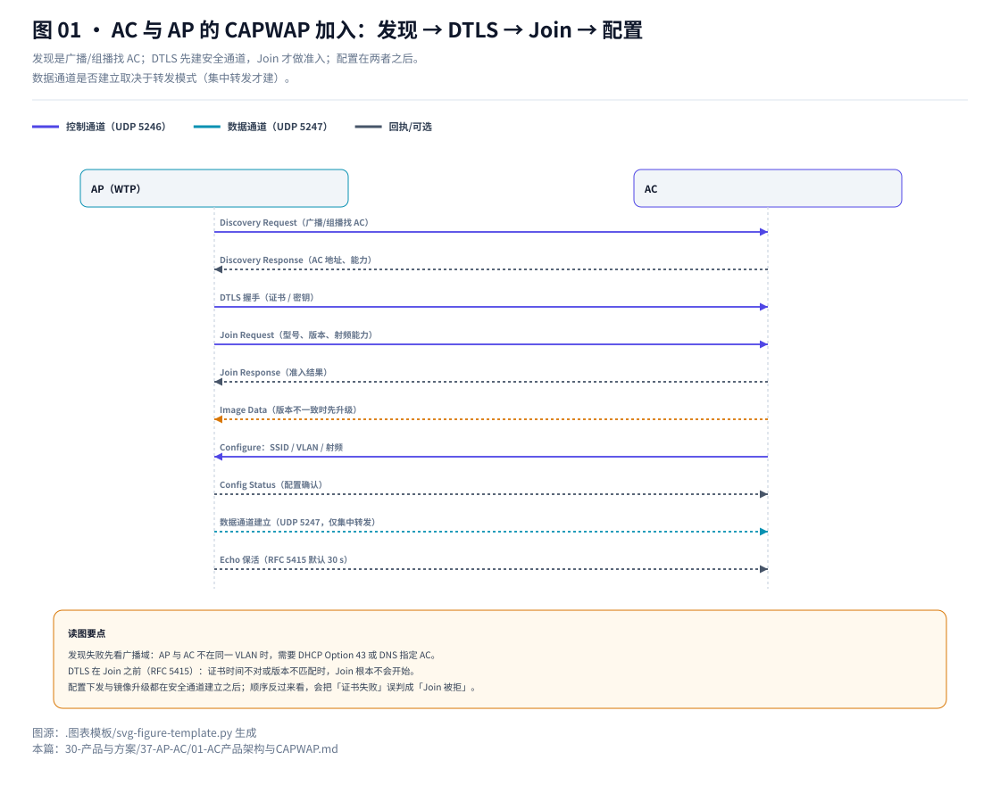

# AC 产品架构与 CAPWAP

AC（Access Controller）是 Fit AP 的「大脑」：**发现 AP、下发配置、管理射频、控制漫游和认证**。AP 与 AC 之间靠 CAPWAP 建控制/数据通道；AC 的性能瓶颈通常不是转发，而是 AP 数量、并发终端和加密/认证开销。

> 本篇定位：AC 的形态、CAPWAP 会话与关键字段、容量与高可用边界。AP 硬件去 `00-AP产品架构`，组网与漫游去 `02-AC-AP组网与漫游`，协议细节去 `10-基础理论`。

## 目录

- [1 一句话模型](#s1)
- [2 速览](#s2)
- [3 结构与字段](#s3)
- [4 交互流程](#s4)
- [5 状态机与定时器](#s5)
- [6 设计取舍与边界](#s6)
- [7 与相邻主题的关系](#s7)
- [名词解释](#名词解释)
- [8 参考与关联](#s8)

## 1 · 一句话模型：AC 管控制，转发看模式

```text
AP ── CAPWAP 控制通道（UDP 5246）── AC
AP ── CAPWAP 数据通道（UDP 5247，可选）── AC
        └─ 集中转发：数据过 AC
        └─ 本地转发：数据在 AP 本地出以太网
```

三个关键认知：

1. **CAPWAP 有两条通道**：控制通道管加入/配置/升级，数据通道管业务报文；本地转发时数据通道可以不用。
2. **AC 的核心资源是「AP 数 + 客户端数 + 加密会话」**，不是简单的吞吐数字。
3. **AC 不是必须的**：Fat AP、云 AC、AP 内置控制器都能替代，选型要看规模、可靠性和运维模式。

## 2 · 速览

| 项 | 内容 |
| --- | --- |
| 产品定位 | Fit AP 的集中管理、射频控制、认证与漫游控制点 |
| 典型形态 | 硬件 AC、软件 AC、云 AC、融合 AC（路由/网关内置） |
| 关键能力 | AP 发现/加入、配置下发、射频调优、漫游、认证、升级 |
| 关键协议 | CAPWAP（RFC 5415/5416）、802.11k/v/r、802.1X、RADIUS |
| 关键资源 | AP license、客户端容量、加密吞吐、会话表 |
| 部署方式 | 直连、旁挂、二层/三层组网、双机热备 |
| 主要指标 | 最大 AP 数、并发终端、新建/并发会话、切换时间、可靠性 |

## 3 · 结构与字段

### 3.1 AC 形态

| 形态 | 部署 | 优点 | 边界 |
| --- | --- | --- | --- |
| 硬件 AC | 独立机箱/盒式 | 性能稳定、功能完整 | 成本高、占机架 |
| 软件 AC | 服务器/虚机 | 灵活扩容、易备份 | 依赖服务器和虚拟化 |
| 云 AC | 公有/私有云 | 多站点统一、免本地运维 | 依赖公网、时延敏感 |
| 融合 AC | 路由/网关内置 | 省设备、适合中小网络 | AP 容量和性能受限 |
| AP 内置控制 | 主 AP 管理从 AP | 无独立 AC、部署快 | 规模和可靠性有限 |

### 3.2 CAPWAP 关键字段

| 字段 | 作用 | 坑/边界 |
| --- | --- | --- |
| 控制通道 | AP 加入/配置/升级 | UDP 5246，需 ACL 放行 |
| 数据通道 | 业务报文隧道 | UDP 5247，本地转发可不用 |
| DTLS | 控制/数据加密 | 证书/时间不同步会导致加入失败 |
| AP MAC/序列号 | AP 标识 | 白名单/预配置绑定 |
| AC 名称/地址 | 发现目标 | DHCP Option 43、DNS、静态配置 |
| Echo 间隔 | 保活 | 超时判定 AP 离线 |
| 配置版本 | 配置一致性 | 版本不一致会触发重下发 |

### 3.3 AC 的功能模块

| 模块 | 作用 | 关键配置 |
| --- | --- | --- |
| AP 管理 | 发现、加入、固件升级 | AP 组、白名单、镜像 |
| SSID/模板 | 统一下发无线参数 | SSID、安全、VLAN、限速 |
| 射频管理 | 信道/功率/DFS | 自动选信道、功率调优 |
| 漫游 | 同 AC/跨 AC 漫游 | 漫游域、k/v/r、AC 间隧道 |
| 认证 | PSK/802.1X/Portal | RADIUS、Portal 服务器 |
| 安全 | 防私接/隔离/黑白名单 | ACL、无线 IPS（部分产品） |
| 高可用 | 双机热备/集群 | VRRP、状态同步、license |

### 3.4 容量与许可

| 资源 | 说明 | 不足时 |
| --- | --- | --- |
| AP license | 可管理 AP 数 | 新 AP 无法加入 |
| 客户端容量 | 并发终端/会话 | 新终端关联失败 |
| 加密吞吐 | DTLS/802.11i 开销 | 吞吐下降、CPU 高 |
| 配置/镜像存储 | AP 固件与模板 | 升级失败、配置丢失 |
| 管理通道带宽 | CAPWAP 控制/数据 | 加入慢、心跳超时 |

## 4 · 交互流程



**读图**：AP 先发现 AC，再走 Join 与 DTLS，之后才接受配置下发，最后进入运行；数据通道是否建立取决于转发模式（各实现的 DTLS 时机略有差异，**待验证**）。

> 图源：`images/图01-AC与CAPWAP.svg`

### 4.1 AP 发现 AC

```text
静态配置 AC 地址
  → DHCP Option 43 下发 AC 列表
  → DNS 解析 AC 域名
  → 二层广播发现（同网段）
  → 选中 AC → 发起 CAPWAP Join
```

### 4.2 加入与配置

```text
CAPWAP Discovery/Join → DTLS 握手（可选）
  → Join Request/Response → AP 认证（证书/MAC/白名单）
  → 配置下发（SSID/VLAN/射频）
  → 镜像升级（版本不一致时）
  → Echo 保活 → 运行
```

### 4.3 数据转发

```text
集中转发：AP → CAPWAP 数据隧道 → AC → 网关/核心
本地转发：AP → 本地以太网 → 网关/核心（AC 只管理）
```

### 4.4 异常分支

| 异常 | 现象 | 定位方向 |
| --- | --- | --- |
| AP 发现不到 AC | AP 一直重启/不上线 | Option 43、DNS、AC 可达性、ACL |
| Join 失败 | 控制通道建不起来 | 证书、时间、白名单、license |
| DTLS 失败 | 加入中断/反复重试 | 证书、加密套件、时间同步 |
| 配置不下发 | AP 在线但 SSID 不对 | 配置版本、模板绑定、AP 组 |
| 数据不通 | 终端有地址不能上网 | 转发模式、VLAN、AC 上行 |
| AP 频繁离线 | 心跳超时 | 网络抖动、AC 负载、Echo 参数 |
| AC 切换后 AP 掉线 | 双机切换中断 | 状态同步、VRRP、license |

## 5 · 状态机与定时器


**读图**：AP 在发现、加入、配置、运行之间迁移；任一阶段失败会重试，超过阈值则回到发现或离线。

> 图源：`images/图02-CAPWAP加入与运行状态.svg`

| 状态 | 动作 | 失败后 |
| --- | --- | --- |
| 发现 | 广播/DNS/Option 43/静态 | 重试，超时重新发现 |
| Join | 建立控制通道、认证 AP | 拒绝则重试/告警 |
| DTLS | 证书/密钥协商 | 失败则断开重连 |
| 配置 | 下发 SSID/VLAN/射频 | 版本不一致则升级/重下发 |
| 运行 | Echo 保活、数据转发 | 超时判定离线 |
| 升级 | 下载镜像、重启 | 失败回滚/重试 |

| 定时器 | 作用 | 说明 |
| --- | --- | --- |
| Discovery 重试 | 找 AC | 间隔/次数可配 |
| Echo Interval | 保活 | 超时进入离线 |
| Join 超时 | 加入等待 | 防止悬挂 |
| 配置下发超时 | 模板应用 | 失败回滚 |
| 镜像下载超时 | 升级 | 大包/慢链路要放宽 |

> 待验证：不同厂商的 CAPWAP 定时器、DTLS 策略和 license 校验方式不同，需按 AC/AP 文档确认。

## 6 · 设计取舍与边界

### 6.1 硬件 AC vs 云 AC

硬件 AC 时延低、可控性强，适合园区和数据中心；云 AC 适合多分支、连锁门店，部署快但依赖公网。关键业务可做「本地 AC + 云备份」，而不是二选一。

### 6.2 集中转发 vs 本地转发

集中转发便于统一策略和审计，但 AC 成为流量瓶颈和单点；本地转发把数据留在 AP 侧，性能好、AC 压力小，但策略下发和排障更分散。园区通常按业务混合使用。

### 6.3 二层组网 vs 三层组网

二层组网 AP 与 AC 同广播域，发现简单、漫游好做；三层组网跨网段，需要 Option 43/DNS 和 CAPWAP 路由，适合大规模/跨区域。三层组网要特别关注 MTU 和 ACL。

### 6.4 双机热备的代价

双机热备提升可靠性，但需要状态同步、license 一致和切换演练；切换期间 AP 可能重新加入。不要假设「备机起来就无缝」。

### 6.5 AC 不是越大越好

AC 标称「管理 1000 AP」不等于「1000 AP 满负载仍能加密转发」。选型要按并发终端、加密吞吐和漫游频率核算，而不是只看 AP license。

## 7 · 与相邻主题的关系

| 相邻对象 | 关系 |
| --- | --- |
| [AP 产品架构](./00-AP产品架构.md) | 被管理的 Fit AP |
| [AC-AP 组网与漫游](./02-AC-AP组网与漫游.md) | 组网、转发与漫游 |
| [WLAN 覆盖与验收](./03-WLAN覆盖与验收.md) | 容量与验收 |
| [802.11 原理与接入流程](../../10-基础理论/12-通信科学/04-无线通信/02-Wi-Fi/00-802.11原理与接入流程.md) | 关联/认证/漫游 |
| [漫游与 EasyMesh](../../20-平台与系统/22-OpenWrt/04-无线/04-漫游与EasyMesh.md) | 漫游实现对照 |
| [TR-069 与 ACS 运维](../33-CPE/02-TR-069与ACS运维.md) | 另一种集中管理模型 |

一句话：**AC 的价值 = 统一配置 × 射频可控 × 漫游可管 × 容量可算。**

## 名词解释

> 缩写给出英文全称；非缩写用“—”表示。

| 术语 | 英文全称 | 解释 |
| --- | --- | --- |
| AC | Access Controller | 无线控制器。 |
| AP | Access Point | 无线接入点。 |
| CAPWAP | Control and Provisioning of Wireless Access Points | AP 控制与配置协议。 |
| DTLS | Datagram Transport Layer Security | 数据报传输层安全。 |
| SSID | Service Set Identifier | 无线网络名称。 |
| VLAN | Virtual Local Area Network | 虚拟局域网。 |
| ACL | Access Control List | 访问控制列表。 |
| RADIUS | Remote Authentication Dial-In User Service | 远程认证拨号用户服务。 |
| Portal | — | 基于 Web 的接入认证方式。 |
| VRRP | Virtual Router Redundancy Protocol | 虚拟路由器冗余协议。 |
| license | — | 软件许可，常按 AP 数/功能授权。 |
| MTU | Maximum Transmission Unit | 最大传输单元。 |

## 8 · 参考与关联

**标准**

- RFC 5415：CAPWAP Protocol Specification
- RFC 5416：CAPWAP Binding for IEEE 802.11
- IEEE 802.11k/v/r：无线测量、网络选择、快速切换
- IEEE 802.1X / RFC 2865：接入认证 / RADIUS

**关联**

- [设备形态对比](../00-设备形态对比.md)
- [AP 产品架构](./00-AP产品架构.md)
- [AC-AP 组网与漫游](./02-AC-AP组网与漫游.md)
- [WLAN 覆盖与验收](./03-WLAN覆盖与验收.md)

---

> **本篇定位**：AC 的形态、CAPWAP 会话、容量许可与高可用边界。
> **素材来源**：`studyspace/1.知识体系/10.wifi/wifi记录.md`、`studyspace/1.知识体系/7.openwrt/3.网络业务/2.关键组件服务/5.WiFi子系统/`。
> **待验证**：各厂商 CAPWAP 私有扩展、license 规则、双机切换指标和容量规格。
