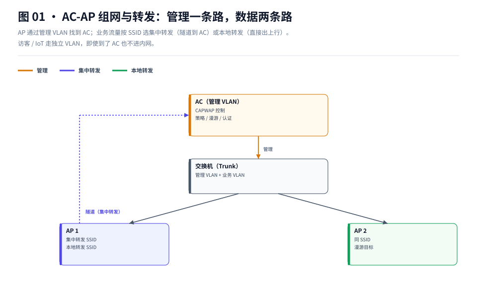
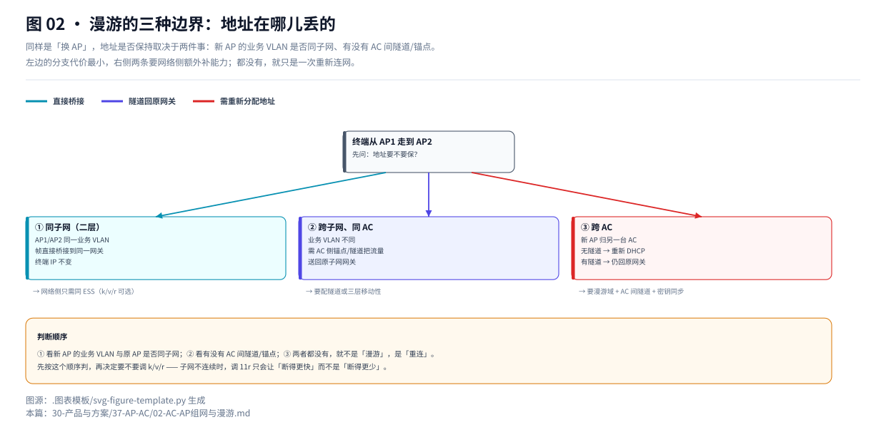

# AC-AP 组网与漫游

AC+AP 的组网要回答三个问题：**AP 怎么找到 AC、业务流量从哪里出、终端走动时怎么不断**。这三个问题分别对应发现方式、转发模式和漫游域，配置错任何一个，表现都是「能连但不好用」。

> 本篇定位：AC-AP 的二层/三层组网、集中/本地转发、漫游与认证的产品方案。CAPWAP 会话去 [01-AC产品架构与CAPWAP](./01-AC产品架构与CAPWAP.md)，AP 硬件去 [00-AP产品架构](./00-AP产品架构.md)，协议原理去 [10-基础理论：Wi-Fi](../../10-基础理论/12-通信科学/04-无线通信/02-Wi-Fi/.readme.md)。

## 目录

- [1 一句话模型](#s1)
- [2 速览](#s2)
- [3 组网与字段](#s3)
- [4 交互流程](#s4)
- [5 状态机与定时器](#s5)
- [6 设计取舍与边界](#s6)
- [7 与相邻主题的关系](#s7)
- [名词解释](#名词解释)
- [8 参考与关联](#s8)

## 1 · 一句话模型：发现定归属，转发定路径，漫游定体验

```text
AP 发现 AC（二层广播 / 三层 Option 43/DNS）
  └─ 加入后按模板下发 SSID/VLAN
        ├─ 集中转发：业务 → CAPWAP 隧道 → AC → 网关
        └─ 本地转发：业务 → AP 本地以太网 → 网关
漫游：同一 ESS + k/v/r + 漫游域 → 终端换 AP 不断流
```

三个关键认知：

1. **二层组网靠广播发现，三层组网靠 Option 43/DNS**；跨网段还要保证 CAPWAP 的 UDP 5246/5247 可达。因为发现方式的可行性由「二层是否可达」决定，所以跨网段后广播必然失效，只能换成显式配置。
2. **转发模式决定故障域**：集中转发把流量压到 AC，本地转发把策略分散到 AP。因为数据路径就是故障路径，所以「谁转发」同时决定了「出问题先查谁」。
3. **漫游是终端主导、网络辅助**：k/v/r 只能引导，不能强制；漫游域和密钥缓存决定切换快不快。因为最终换不换 AP 是终端自己的算法，所以网络侧能做的只有「提供信息、缩短认证、必要时劝离」。

一句类比：漫游像学生在同一所学校里换教室——学籍（IP 地址）不变，只换座位；跨 AC 漫游才像转学，要办手续（隧道/锚点），手续不齐就得重新登记。**类比失效的地方**是：转学（跨 AC）在校园网里是常态，而「重新登记」对终端来说往往表现为一次断流，用户感知比换教室强烈得多。

> **推论**：判断一次「走动断网」是漫游问题还是组网问题，先看换 AP 后终端 IP 有没有变。IP 变了，说明业务 VLAN/子网就不连续，调 k/v/r 是白费。
> **边界**：本篇讲的是「企业 AC+AP」的组网与漫游；家用 Mesh 的组网与漫游由 EasyMesh/厂商私有协议完成，模型不同（见 [漫游与 EasyMesh](../../20-平台与系统/22-OpenWrt/04-无线/04-漫游与EasyMesh.md)）。

## 2 · 速览

因为组网方案常被简化成「二层还是三层」一句口号，而真正的差异在发现、转发、漫游三处同时发生，所以第三列标出每项在什么条件下不成立。

| 项 | 内容 | 读法（边界/误判） |
| --- | --- | --- |
| 组网方式 | 二层直连、三层旁挂、AC 内置网关、云 AC | 「旁挂」只保证管理可达，不保证漫游 |
| 发现方式 | 广播、DHCP Option 43、DNS、静态 | 广播只在同广播域有效；Option 43 格式随厂商 |
| 转发模式 | 集中转发（隧道）、本地转发、混合 | 本地转发要求 AP 上行是 trunk，不是 access |
| 漫游类型 | 同 AC 二层/三层、跨 AC、跨厂商（受限） | 跨厂商漫游基本要统一认证体系，别指望 11r 互通 |
| 关键协议 | CAPWAP、802.11k/v/r、802.1X、RADIUS、Portal | 协议只提供能力，是否启用与终端支持是另一回事 |
| 关键对象 | AP 组、SSID 模板、VLAN、漫游域、认证策略 | 模板绑错组，现象是「SSID 对但 VLAN 错」 |
| 主要指标 | 加入成功率、漫游切换时延、丢包、认证时延 | 切换时延要在真实业务流量下测，静止ping 测不出来 |

## 3 · 组网与字段

这一节按「AP 怎么找到 AC → 业务怎么出去 → 终端怎么续上」的顺序展开。因为三件事分别落在管理面、数据面和终端侧，所以配置也分散在三处，排障时要先确认问题落在哪一面。

### 3.1 组网方式

因为「AP 与 AC 是否同广播域」决定了发现方式、漫游难度和广播域大小，所以组网方式是后面所有配置的前提。

| 方式 | AP 与 AC 关系 | 优点 | 边界 |
| --- | --- | --- | --- |
| 二层直连 | 同 VLAN/广播域 | 发现简单、漫游好做 | 广播域大、扩展受限；一个二层域里的广播与故障会互相牵连 |
| 三层旁挂 | 跨网段，AC 旁路 | 适合大规模/多楼层 | 需 Option 43/DNS、路由可达；旁挂不等于数据不经过 AC（取决于转发模式） |
| AC 内置网关 | AC 与网关合一 | 省设备、适合中小网络 | 容量/性能受限；AC 重启等于网关重启 |
| 云 AC | AP 经公网注册 | 多站点统一 | 依赖公网、时延和合规；断网后的本地保活能力因厂商而异 |

> **边界**：三层旁挂常被理解成「AC 只在管理面」。实际上旁挂只描述 AC 的物理位置，转发模式仍可选中集中转发，让数据绕回 AC。两个维度要分开问。

### 3.2 发现与加入字段

因为 AP 的发现过程是「多来源竞争」，所以现场必须知道哪一个来源最终生效，否则改了一个不生效的地方会白忙。

| 字段 | 作用 | 边界与误判 |
| --- | --- | --- |
| AC 地址 | AP 找谁 | 静态/域名/Option 43 不一致会找不到；多来源时按实现优先级取一个 |
| Option 43 | DHCP 下发 AC 列表 | 格式随厂商不同（十六进制子选项/ASCII/IP 列表），需按文档配；中继链路上要确认选项被透传 |
| AP 白名单 | 允许哪些 AP 加入 | 未加入白名单会被拒；现象是「AP 有地址、AC 有拒绝记录」 |
| 证书/预共享密钥 | DTLS/加入认证 | 时间不同步会导致证书校验失败；设备换主板后证书要重签 |
| AP 组 | 配置模板绑定 | 绑错组会下发错误 SSID/VLAN；现象是「能连但地址段不对」 |
| CAPWAP 端口 | UDP 5246/5247 | 防火墙/ACL 漏放会加入失败；只放 5246 会「能加入、不能集中转发」 |

> **待验证**：Option 43 的具体编码各厂商不同（子选项类型、长度、是否压缩），没有统一标准；跨厂商 AC 混用时必须按目标 AC 的文档配。

### 3.3 转发与 VLAN

因为转发模式决定了「终端地址由谁分配、策略在哪台设备上生效」，所以它同时是容量问题与运维问题。

| 模式 | 数据路径 | 适用 | 风险 |
| --- | --- | --- | --- |
| 集中转发 | AP → CAPWAP 隧道 → AC → 网关 | 统一策略、审计 | AC 瓶颈、单点；封装后 MTU 变小 |
| 本地转发 | AP → 本地以太网 → 网关 | 高吞吐、低时延 | 策略分散、VLAN 需预配；AP 上行必须是 trunk |
| 混合转发 | 按 SSID/业务选择 | 园区多业务 | 配置复杂、排障难；同一终端在不同 SSID 上体验不同 |

| VLAN 对象 | 作用 | 说明 | 边界与误判 |
| --- | --- | --- | --- |
| 管理 VLAN | AP 管理地址/CAPWAP | AP 上线依赖 | 与业务 VLAN 混用会把管理面暴露给终端 |
| 业务 VLAN | 终端地址池 | 按 SSID 映射 | 同一 SSID 跨 AP 必须映射到同一子网，否则漫游会换地址 |
| 访客 VLAN | 访客隔离 | 只放行互联网 | 隔离策略要落在网关/ACL，不是 SSID 上 |
| IoT VLAN | 物联网设备 | 限制横向访问 | 过度隔离会挡住投屏、打印、设备发现 |

因为本地转发把业务帧直接从 AP 送上行，所以 AP 的上行口必须能携带多个业务 VLAN（trunk），并且接入交换机要在对应 VLAN 上放行——这一步没做，现象是「AP 在线、SSID 正常、终端拿不到地址」。

### 3.4 漫游与认证

因为漫游的体验由「认证要不要重来」决定，所以先分清三种加速机制各自省掉了哪一段。

| 对象 | 作用 | 关键配置 | 边界与误判 |
| --- | --- | --- | --- |
| ESS/SSID | 漫游的边界 | 同一 ESS 才能自然漫游 | SSID 不同就是换网 |
| 漫游域 | 跨 AC 的信任范围 | 成员 AC、密钥同步 | 域外 AC 不认彼此的密钥 |
| 802.11k | 邻居报告 | 帮助终端快速找目标 AP | 只是「告知」，不改变终端决策 |
| 802.11v | 网络引导 | BSS Transition 建议 | 终端可以不接受 |
| 802.11r | 快速切换 | FT/密钥层级，需终端支持 | 配错会导致「连不上」 |
| OKC/PMK 缓存 | 省去重新认证 | 跨 AC 需同步 | OKC 是厂商事实标准，不是 802.11 标准 |
| 802.1X/Portal | 接入认证 | RADIUS/Portal 可达性 | 认证服务器慢会放大切换时延 |

| 机制 | 省掉哪一段 | 前提 | 边界 |
| --- | --- | --- | --- |
| PMKSA 缓存 | 802.1X 认证（EAP） | 同一 AC/同一 PMK 缓存域 | 换 AC 且未同步缓存时退回完整认证 |
| OKC | 802.1X 认证，且允许跨 AP 复用 PMK | 同一移动域、厂商实现一致 | 非标准机制；不同厂商互通性差 |
| FT（802.11r） | 重新做 802.1X 与部分密钥派生 | 终端与 AP 都支持，mobility domain 一致 | PSK 与 802.1X 都可用，但终端兼容性差异大 |
| 完整认证 | —（每次都重来） | 无 | 切换时延最长，Portal 场景可能弹页 |

> **推论**：切换慢先分「认证慢」还是「扫描慢」。认证慢看 RADIUS 与缓存机制；扫描慢看 k 邻居报告与终端扫描策略。两者的处理手段完全不同。

## 4 · 交互流程



**读图**：AP 通过管理 VLAN 找到 AC；业务流量按 SSID 选择集中或本地转发；访客/IoT 走独立 VLAN，不进入内网。

> 图源：`images/图01-AC-AP组网与转发.svg`

### 4.1 三层组网上线

```text
AP 上电 → 获取管理地址（DHCP）
  → Option 43/DNS/静态得到 AC 地址
  → CAPWAP 发现/加入（跨三层路由）
  → AC 下发 AP 组模板
  → 业务 VLAN/SSID 生效
```

因为三层组网把「发现」变成了显式配置，所以上线失败的第一分水岭是「AP 有没有拿到管理地址」，第二分水岭才是「能不能到 AC」。两道都过，问题才轮到模板与 VLAN。

| 卡点 | 现象 | 下一步查什么 |
| --- | --- | --- |
| 拿不到管理地址 | AP 无 IP，AC 无记录 | 管理 VLAN、DHCP 中继、端口 PVID |
| 有地址找不到 AC | AP 有 IP，AC 无记录 | Option 43/DNS、UDP 5246 路由与 ACL |
| 找到但不加入 | AC 有拒绝/白名单记录 | 证书、时间、白名单、license |
| 加入但无 SSID | AP 在线，空口无信号 | AP 组模板、SSID 绑定、射频状态 |
| 有 SSID 无地址 | 终端关联成功无 IP | 业务 VLAN、DHCP 中继、本地转发 trunk |

### 4.2 终端接入与认证

```text
终端关联 SSID → 802.1X/PSK/Portal
  → RADIUS 返回授权（VLAN/ACL/限速）
  → DHCP 获取地址 → 转发
```

因为 RADIUS 的授权属性可以直接改 VLAN（`Tunnel-Private-Group-ID`），所以「同一个 SSID 的终端落在不同 VLAN」是正常现象；排障时不能假设 SSID 与 VLAN 一一对应。

### 4.3 漫游

```text
终端信号下降 → 扫描邻居（k）
  → 选择目标 AP（v 引导）
  → 快速认证（r/OKC/PMK 缓存）
  → 重新关联 → 业务继续
  → 跨 AC 时通过漫游隧道/三层漫游保持地址
```

因为「漫游后地址是否保持」取决于新 AP 的业务子网与 AC 间的隧道，所以同样的 k/v/r 配置，在二层组网里顺滑，在三层组网里可能表现为「切过去就重连」。下图把三种边界摊开。



**读图**：根节点问「换 AP 之后地址要不要保」，三个分支对应三种边界：同子网直接桥接、跨子网靠隧道绕回、跨 AC 靠漫游域 + 隧道。每支下面那行「→ …」是网络侧要补的能力；分支越靠右，代价越大。底部给出判断顺序：先看业务 VLAN 是否同子网，再看有没有 AC 间隧道/锚点，两者都没有就只是「重新连一次」。

> 图源：`images/图02-漫游三种边界.svg`

| 场景 | 帧怎么走 | 终端 IP | 网络侧要补什么 |
| --- | --- | --- | --- |
| 同子网、同 AC | 新 AP 直接桥接到同一网关 | 不变 | 同 ESS + 密钥缓存（可选 k/v/r） |
| 跨子网、同 AC | 需要 AC 侧锚点/隧道才能保持原地址 | 不变（有隧道）/ 变（无隧道） | 隧道或三层移动性配置 |
| 跨 AC | AC 间隧道，把流量送回原网关 | 不变（有隧道）/ 变（无隧道） | 漫游域、AC 间隧道、密钥同步 |

> **边界**：跨 AC 漫游的「地址保持」不是 802.11 标准能力，而是厂商在 AC 之间做的隧道/锚点方案。没有这套方案时，跨 AC 就是一次完整的重连 + 重新 DHCP，只是用户不一定察觉，因为重新关联很快。

### 4.4 异常分支

因为组网问题的现象高度相似（都是「能连但不好用」），所以异常表按「卡在哪一段」排序，而不是按设备排序。

| 异常 | 现象 | 定位方向 |
| --- | --- | --- |
| AP 找不到 AC | AP 反复重启/不上线 | Option 43/DNS、路由、ACL |
| 能加入但无 SSID | AP 在线、无信号 | AP 组模板、SSID 绑定 |
| 终端拿不到地址 | 关联成功无 IP | 业务 VLAN、DHCP 中继、AC 上行 |
| 集中转发慢 | 全楼吞吐低 | AC 容量、隧道 MTU、链路带宽 |
| 本地转发不通 | 单 AP 业务异常 | AP 上行 VLAN、网关配置 |
| 漫游断流 | 走动时重连 | 同 ESS、k/v/r、漫游域、密钥缓存 |
| 跨 AC 漫游失败 | 换楼层断网 | AC 间隧道、漫游域、地址保持 |
| 漫游后地址变了 | 切换后重新 DHCP | 业务 VLAN 跨 AP 不一致，或缺少隧道 |

## 5 · 状态机与定时器


**读图**：终端在源 AP 关联，信号下降后扫描/选择目标 AP，完成认证后切换；失败则保持原关联或重连。

> 图源：`images/图03-终端漫游状态.svg`

因为漫游的决策权在终端，所以这张状态机描述的是「终端」而不是「AP」。网络侧只是在每一步提供输入：k 给候选列表，v 给建议，r 给快速认证的密钥材料。

| 状态 | 在等什么 | 失败表现 | 退出条件 |
| --- | --- | --- | --- |
| 已关联 | 正常转发，RSSI/速率稳定 | 信号恶化仍不触发扫描（粘滞） | 触发扫描 → 扫描 |
| 扫描 | 收集邻居 AP（主动/被动） | 扫描期间业务抖动；扫描过频耗电 | 得到候选 → 选择 |
| 选择 | 按信号/负载/策略选目标 | 选了负载高或回程差的目标 | 目标可用 → 认证 |
| 认证 | 802.11r/OKC/完整认证 | 认证失败回原 AP；r 配错则完全连不上 | 认证通过 → 切换 |
| 切换 | 重新关联、更新转发表 | 关联失败则重连或断流 | 关联成功 → 稳定 |
| 稳定 | 新 AP 转发 | 再次恶化则重复 | 信号恶化 → 扫描 |

| 定时器 | 作用 | 说明与边界 |
| --- | --- | --- |
| 漫游扫描间隔 | 终端/AP 触发扫描 | 过于频繁耗电，且会打断业务；由终端实现决定 |
| k 邻居报告有效期 | 候选 AP 信息 | 过期需重新请求；报告里的候选可能已下线 |
| 密钥缓存寿命 | 快速漫游 | PMK/OKC 过期需完整认证；寿命由 AC 配置，跨 AC 要一致 |
| 认证超时 | 802.1X/Portal | 超时回退/拒绝；RADIUS 慢会直接表现为「走动断流」 |
| CAPWAP Echo | AP-AC 保活 | 超时 AP 离线；与终端漫游无关，别混为一谈 |

> **待验证**：终端漫游决策由厂商实现主导，k/v/r 的支持程度和阈值差异很大，需以实测为准。
> **边界**：AP 侧常见的「强制踢下线」不是漫游，是让终端重新扫描；用得太狠会表现为「走两步断一次」。

## 6 · 设计取舍与边界

因为每一项取舍都是拿一种代价换另一种，所以下面每条都写清「代价」和「失效条件」，而不是只给推荐值。

### 6.1 二层组网 vs 三层组网

二层组网配置简单、漫游天然，但广播域大；三层组网扩展性好，但发现、漫游和 ACL 都更复杂。超过单楼层/单园区规模时，三层组网更现实。

- **代价**：二层组网把「漫游简单」建立在「广播域大」上，广播风暴与故障域随之变大；三层组网换来控制面清晰，代价是每条跨网段路径都要显式放行与规划。
- **失效条件**：单栋楼、AP 数在几十台以内时，二层组网足够；硬上三层会把配置复杂度提前引入。

### 6.2 集中转发 vs 本地转发

集中转发让 AC 看到全部流量，便于审计和策略，但 AC 容量和链路成为瓶颈；本地转发性能好，但策略分散、故障定位跨设备。混合转发是折中，但配置和排障成本最高。

- **代价**：集中转发的隧道把 MTU 压小，跨 WAN 时还要叠加 IPsec/VXLAN；本地转发要求 AP 上行 trunk 与交换机 VLAN 规划一次到位。
- **失效条件**：以访客与办公上网为主、没有审计要求时，集中转发的收益不足以抵消 AC 的带宽成本。

### 6.3 同 AC 漫游 vs 跨 AC 漫游

同 AC 漫游靠 AP 间协调，简单可靠；跨 AC 漫游需要漫游域、隧道或三层移动性，配置复杂且受厂商限制。大园区应尽量把相邻区域划在同一 AC/漫游域。

- **代价**：把区域划大，单台 AC 的容量与故障域也变大；划小则跨 AC 漫游变多。
- **失效条件**：楼层之间本来就不连续走动（如独立厂房），跨 AC 漫游的投入可以省掉。

### 6.4 802.11r 的代价

802.11r 能显著缩短切换时间，但需要终端和 AP 都支持，且密钥层级配置错误会导致「连不上」。不支持的终端仍走完整认证，不能假设全网都快。

- **误判**：把 11r 当「开了就快」。终端不支持时配置无效；终端支持但 mobility domain/密钥配置不一致时，表现为关联被拒，比不开还差。
- **边界**：11r 只缩短「重新认证」，不解决「终端不换 AP」（粘滞）和「换了但地址变了」（子网不连续）。

### 6.5 访客/IoT 隔离

访客和 IoT 必须独立 SSID/VLAN，限制内网访问；但过度隔离会影响投屏、打印、智能家居发现。产品应提供「隔离 + 受控互通」模板，而不是让用户手写 ACL。

- **代价**：隔离越彻底，跨网段的服务发现（mDNS/SSDP/组播）越难穿透；每放开一条，都是一条需要维护的 ACL。
- **失效条件**：酒店/公寓场景里访客设备之间也需要互通（如投屏），「完全隔离」会变成投诉源。

## 7 · 与相邻主题的关系

因为组网与漫游天然跨 VLAN、协议、Mesh 三块，所以这里只标边界与去向，正文留在各自的目录。

| 相邻对象 | 关系 | 边界（细节去哪看） |
| --- | --- | --- |
| [AP 产品架构](./00-AP产品架构.md) | AP 侧能力 | AP 的射频、供电、形态不在本篇 |
| [AC 产品架构与 CAPWAP](./01-AC产品架构与CAPWAP.md) | AC 侧与协议 | CAPWAP 报文、Join/DTLS 状态机不在本篇 |
| [WLAN 覆盖与验收](./03-WLAN覆盖与验收.md) | 覆盖/容量/漫游验收 | 布点、功率、容量估算不在本篇 |
| [802.11 原理与接入流程](../../10-基础理论/12-通信科学/04-无线通信/02-Wi-Fi/00-802.11原理与接入流程.md) | 关联/认证/漫游 | 802.11 帧格式与状态机不在本篇，本篇只讲产品侧配置 |
| [漫游与 EasyMesh](../../20-平台与系统/22-OpenWrt/04-无线/04-漫游与EasyMesh.md) | 家用 Mesh 对照 | Mesh 用 1905.1/厂商协议做决策，不走 CAPWAP，不能互相套用 |
| [VLAN 与 Trunk](../../10-基础理论/11-网络科学/02-链路层/02-VLAN与Trunk.md) | 业务/管理 VLAN | 交换机侧 VLAN 配置与转发细节不在本篇 |
| [智能家居与安全](../34-智能网关/02-智能家居与安全.md) | IoT 隔离策略 | 网关侧的发现与安全策略不在本篇 |

一句话：**AC-AP 组网的核心是「管理可达、业务可出、漫游可续」，三者缺一都会表现为体验问题。** 边界在于：本篇只描述企业 AC+AP 模型，家用 Mesh 与运营商 FTTR 的组网逻辑另有一套。

## 名词解释

> 缩写给出英文全称；非缩写用“—”表示。

因为 PMK、OKC、FT 常被当成同义词混用，所以下表按「省掉哪一段」分别解释。

| 术语 | 英文全称 | 解释 |
| --- | --- | --- |
| AC | Access Controller | 无线控制器。 |
| AP | Access Point | 无线接入点。 |
| CAPWAP | Control and Provisioning of Wireless Access Points | AP 控制与配置协议（RFC 5415/5416）。 |
| ESS | Extended Service Set | 扩展服务集，漫游的边界。 |
| BSS | Basic Service Set | 基本服务集，一个 AP 上一路射频的一套参数。 |
| SSID | Service Set Identifier | 无线网络名称。 |
| VLAN | Virtual Local Area Network | 虚拟局域网。 |
| DHCP | Dynamic Host Configuration Protocol | 动态主机配置协议（RFC 2131）。 |
| RADIUS | Remote Authentication Dial-In User Service | 远程认证拨号用户服务（RFC 2865）。 |
| OKC | Opportunistic Key Caching | 机会密钥缓存，跨 AP 复用 PMK 的加速漫游方式，属厂商事实标准。 |
| PMK | Pairwise Master Key | 成对主密钥，WPA2/WPA3 密钥体系的根。 |
| PMKSA | Pairwise Master Key Security Association | PMK 安全关联，PMK 缓存的基本单位。 |
| FT | Fast Transition | 802.11r 定义的快速切换机制。 |
| BTM | BSS Transition Management | 802.11v 的 BSS 切换管理，AP 可向终端发出切换建议。 |
| ACL | Access Control List | 访问控制列表。 |
| MTU | Maximum Transmission Unit | 最大传输单元。 |
| Option 43 | — | DHCP 选项 43，厂商自定义字段，常用于下发 AC 地址列表。 |
| 漫游域 | Mobility Domain | 允许快速/无缝漫游的一组 AP 或 AC，成员间共享密钥与策略。 |

## 8 · 参考与关联

**标准**

因为跨 AC 漫游、Option 43 这类能力大多没有统一标准，所以下面只列有编号的标准，厂商行为在正文标了「待验证」。

- IEEE 802.11k/v/r：无线资源测量、网络选择、快速切换
- IEEE 802.1X / RFC 2865：接入认证 / RADIUS
- RFC 5415 / 5416：CAPWAP
- RFC 2131：DHCP

**关联**

- [设备形态对比](../00-设备形态对比.md)
- [AP 产品架构](./00-AP产品架构.md)
- [AC 产品架构与 CAPWAP](./01-AC产品架构与CAPWAP.md)
- [WLAN 覆盖与验收](./03-WLAN覆盖与验收.md)

---

> **本篇定位**：AC-AP 的二层/三层组网、转发模式、漫游与认证方案；不含 CAPWAP 报文、空口协议与覆盖设计。
> **素材来源**：`studyspace/1.知识体系/10.wifi/wifi记录.md`、`studyspace/1.知识体系/7.openwrt/3.网络业务/2.关键组件服务/5.WiFi子系统/`。
> **待验证**：各厂商跨 AC 漫游方案、Option 43 格式、k/v/r 默认策略和终端兼容性；「跨 AC 地址保持」依赖厂商隧道/锚点实现，非标准能力。
