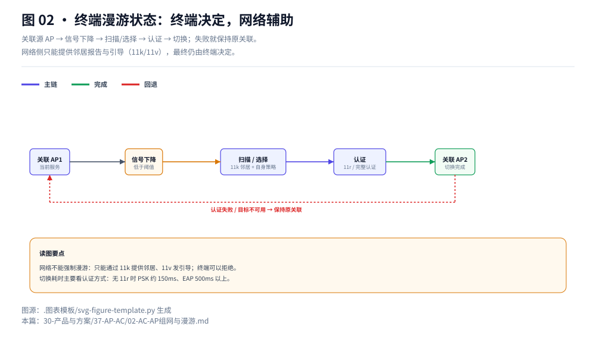

# AC-AP 组网与漫游

AC+AP 的组网要回答三个问题：**AP 怎么找到 AC、业务流量从哪里出、终端走动时怎么不断**。这三个问题分别对应发现方式、转发模式和漫游域，配置错任何一个，表现都是「能连但不好用」。

> 本篇定位：AC-AP 的二层/三层组网、集中/本地转发、漫游与认证的产品方案。CAPWAP 会话去 `01-AC产品架构与CAPWAP`，AP 硬件去 `00-AP产品架构`，协议原理去 `10-基础理论`。

## 目录

- [1 一句话模型](#s1)
- [2 速览](#s2)
- [3 组网与字段](#s3)
- [4 交互流程](#s4)
- [5 状态机与定时器](#s5)
- [6 设计取舍与边界](#s6)
- [7 与相邻主题的关系](#s7)
- [名词解释](#名词解释)
- [8 参考与关联](#s8)

## 1 · 一句话模型：发现定归属，转发定路径，漫游定体验

```text
AP 发现 AC（二层广播 / 三层 Option 43/DNS）
  └─ 加入后按模板下发 SSID/VLAN
        ├─ 集中转发：业务 → CAPWAP 隧道 → AC → 网关
        └─ 本地转发：业务 → AP 本地以太网 → 网关
漫游：同一 ESS + k/v/r + 漫游域 → 终端换 AP 不断流
```

三个关键认知：

1. **二层组网靠广播发现，三层组网靠 Option 43/DNS**；跨网段还要保证 CAPWAP 的 UDP 5246/5247 可达。
2. **转发模式决定故障域**：集中转发把流量压到 AC，本地转发把策略分散到 AP。
3. **漫游是终端主导、网络辅助**：k/v/r 只能引导，不能强制；漫游域和密钥缓存决定切换快不快。

## 2 · 速览

| 项 | 内容 |
| --- | --- |
| 组网方式 | 二层直连、三层旁挂、AC 内置网关、云 AC |
| 发现方式 | 广播、DHCP Option 43、DNS、静态 |
| 转发模式 | 集中转发（隧道）、本地转发、混合 |
| 漫游类型 | 同 AC 二层/三层、跨 AC、跨厂商（受限） |
| 关键协议 | CAPWAP、802.11k/v/r、802.1X、RADIUS、Portal |
| 关键对象 | AP 组、SSID 模板、VLAN、漫游域、认证策略 |
| 主要指标 | 加入成功率、漫游切换时延、丢包、认证时延 |

## 3 · 组网与字段

### 3.1 组网方式

| 方式 | AP 与 AC 关系 | 优点 | 边界 |
| --- | --- | --- | --- |
| 二层直连 | 同 VLAN/广播域 | 发现简单、漫游好做 | 广播域大、扩展受限 |
| 三层旁挂 | 跨网段，AC 旁路 | 适合大规模/多楼层 | 需 Option 43/DNS、路由可达 |
| AC 内置网关 | AC 与网关合一 | 省设备、适合中小网络 | 容量/性能受限 |
| 云 AC | AP 经公网注册 | 多站点统一 | 依赖公网、时延和合规 |

### 3.2 发现与加入字段

| 字段 | 作用 | 坑/边界 |
| --- | --- | --- |
| AC 地址 | AP 找谁 | 静态/域名/Option 43 不一致会找不到 |
| Option 43 | DHCP 下发 AC 列表 | 格式随厂商不同，需按文档配 |
| AP 白名单 | 允许哪些 AP 加入 | 未加入白名单会被拒 |
| 证书/预共享密钥 | DTLS/加入认证 | 时间不同步会导致证书校验失败 |
| AP 组 | 配置模板绑定 | 绑错组会下发错误 SSID/VLAN |
| CAPWAP 端口 | UDP 5246/5247 | 防火墙/ACL 漏放会加入失败 |

### 3.3 转发与 VLAN

| 模式 | 数据路径 | 适用 | 风险 |
| --- | --- | --- | --- |
| 集中转发 | AP → CAPWAP 隧道 → AC → 网关 | 统一策略、审计 | AC 瓶颈、单点 |
| 本地转发 | AP → 本地以太网 → 网关 | 高吞吐、低时延 | 策略分散、VLAN 需预配 |
| 混合转发 | 按 SSID/业务选择 | 园区多业务 | 配置复杂、排障难 |

| VLAN 对象 | 作用 | 说明 |
| --- | --- | --- |
| 管理 VLAN | AP 管理地址/CAPWAP | AP 上线依赖 |
| 业务 VLAN | 终端地址池 | 按 SSID 映射 |
| 访客 VLAN | 访客隔离 | 只放行互联网 |
| IoT VLAN | 物联网设备 | 限制横向访问 |

### 3.4 漫游与认证

| 对象 | 作用 | 关键配置 |
| --- | --- | --- |
| ESS/SSID | 漫游的边界 | 同一 ESS 才能自然漫游 |
| 漫游域 | 跨 AC 的信任范围 | 成员 AC、密钥同步 |
| 802.11k | 邻居报告 | 帮助终端快速找目标 AP |
| 802.11v | 网络引导 | BSS Transition 建议 |
| 802.11r | 快速切换 | FT/密钥层级，需终端支持 |
| OKC/PMK 缓存 | 省去重新认证 | 跨 AC 需同步 |
| 802.1X/Portal | 接入认证 | RADIUS/Portal 可达性 |

## 4 · 交互流程


**读图**：AP 通过管理 VLAN 找到 AC；业务流量按 SSID 选择集中或本地转发；访客/IoT 走独立 VLAN，不进入内网。

> 图源：`images/图01-AC-AP组网与转发.svg`

### 4.1 三层组网上线

```text
AP 上电 → 获取管理地址（DHCP）
  → Option 43/DNS/静态得到 AC 地址
  → CAPWAP 发现/加入（跨三层路由）
  → AC 下发 AP 组模板
  → 业务 VLAN/SSID 生效
```

### 4.2 终端接入与认证

```text
终端关联 SSID → 802.1X/PSK/Portal
  → RADIUS 返回授权（VLAN/ACL/限速）
  → DHCP 获取地址 → 转发
```

### 4.3 漫游

```text
终端信号下降 → 扫描邻居（k）
  → 选择目标 AP（v 引导）
  → 快速认证（r/OKC/PMK 缓存）
  → 重新关联 → 业务继续
  → 跨 AC 时通过漫游隧道/三层漫游保持地址
```

### 4.4 异常分支

| 异常 | 现象 | 定位方向 |
| --- | --- | --- |
| AP 找不到 AC | AP 反复重启/不上线 | Option 43/DNS、路由、ACL |
| 能加入但无 SSID | AP 在线、无信号 | AP 组模板、SSID 绑定 |
| 终端拿不到地址 | 关联成功无 IP | 业务 VLAN、DHCP 中继、AC 上行 |
| 集中转发慢 | 全楼吞吐低 | AC 容量、隧道 MTU、链路带宽 |
| 本地转发不通 | 单 AP 业务异常 | AP 上行 VLAN、网关配置 |
| 漫游断流 | 走动时重连 | 同 ESS、k/v/r、漫游域、密钥缓存 |
| 跨 AC 漫游失败 | 换楼层断网 | AC 间隧道、漫游域、地址保持 |

## 5 · 状态机与定时器



**读图**：终端在源 AP 关联，信号下降后扫描/选择目标 AP，完成认证后切换；失败则保持原关联或重连。

> 图源：`images/图02-终端漫游状态.svg`

| 状态 | 动作 | 失败后 |
| --- | --- | --- |
| 已关联 | 正常转发 | 信号恶化触发扫描 |
| 扫描 | 收集邻居 AP | 无候选则保持 |
| 选择 | 按信号/负载/策略选目标 | 目标不可用则重选 |
| 认证 | 802.11r/OKC/完整认证 | 失败回原 AP |
| 切换 | 重新关联、更新转发表 | 失败重连/断流 |
| 稳定 | 新 AP 转发 | 再次恶化则重复 |

| 定时器 | 作用 | 说明 |
| --- | --- | --- |
| 漫游扫描间隔 | 终端/AP 触发扫描 | 过于频繁耗电 |
| k 邻居报告有效期 | 候选 AP 信息 | 过期需重新请求 |
| 密钥缓存寿命 | 快速漫游 | PMK/OKC 过期需完整认证 |
| 认证超时 | 802.1X/Portal | 超时回退/拒绝 |
| CAPWAP Echo | AP-AC 保活 | 超时 AP 离线 |

> 待验证：终端漫游决策由厂商实现主导，k/v/r 的支持程度和阈值差异很大，需以实测为准。

## 6 · 设计取舍与边界

### 6.1 二层组网 vs 三层组网

二层组网配置简单、漫游天然，但广播域大；三层组网扩展性好，但发现、漫游和 ACL 都更复杂。超过单楼层/单园区规模时，三层组网更现实。

### 6.2 集中转发 vs 本地转发

集中转发让 AC 看到全部流量，便于审计和策略，但 AC 容量和链路成为瓶颈；本地转发性能好，但策略分散、故障定位跨设备。混合转发是折中，但配置和排障成本最高。

### 6.3 同 AC 漫游 vs 跨 AC 漫游

同 AC 漫游靠 AP 间协调，简单可靠；跨 AC 漫游需要漫游域、隧道或三层移动性，配置复杂且受厂商限制。大园区应尽量把相邻区域划在同一 AC/漫游域。

### 6.4 802.11r 的代价

802.11r 能显著缩短切换时间，但需要终端和 AP 都支持，且密钥层级配置错误会导致「连不上」。不支持的终端仍走完整认证，不能假设全网都快。

### 6.5 访客/IoT 隔离

访客和 IoT 必须独立 SSID/VLAN，限制内网访问；但过度隔离会影响投屏、打印、智能家居发现。产品应提供「隔离 + 受控互通」模板，而不是让用户手写 ACL。

## 7 · 与相邻主题的关系

| 相邻对象 | 关系 |
| --- | --- |
| [AP 产品架构](./00-AP产品架构.md) | AP 侧能力 |
| [AC 产品架构与 CAPWAP](./01-AC产品架构与CAPWAP.md) | AC 侧与协议 |
| [WLAN 覆盖与验收](./03-WLAN覆盖与验收.md) | 覆盖/容量/漫游验收 |
| [802.11 原理与接入流程](../../10-基础理论/12-通信科学/04-无线通信/02-Wi-Fi/00-802.11原理与接入流程.md) | 关联/认证/漫游 |
| [漫游与 EasyMesh](../../20-平台与系统/22-OpenWrt/04-无线/04-漫游与EasyMesh.md) | 家用 Mesh 对照 |
| [VLAN 与 Trunk](../../10-基础理论/11-网络科学/02-链路层/02-VLAN与Trunk.md) | 业务/管理 VLAN |
| [智能家居与安全](../34-智能网关/02-智能家居与安全.md) | IoT 隔离策略 |

一句话：**AC-AP 组网的核心是「管理可达、业务可出、漫游可续」，三者缺一都会表现为体验问题。**

## 名词解释

> 缩写给出英文全称；非缩写用“—”表示。

| 术语 | 英文全称 | 解释 |
| --- | --- | --- |
| AC | Access Controller | 无线控制器。 |
| AP | Access Point | 无线接入点。 |
| CAPWAP | Control and Provisioning of Wireless Access Points | AP 控制与配置协议。 |
| ESS | Extended Service Set | 扩展服务集，漫游的边界。 |
| BSS | Basic Service Set | 基本服务集。 |
| SSID | Service Set Identifier | 无线网络名称。 |
| VLAN | Virtual Local Area Network | 虚拟局域网。 |
| DHCP | Dynamic Host Configuration Protocol | 动态主机配置协议。 |
| RADIUS | Remote Authentication Dial-In User Service | 远程认证拨号用户服务。 |
| OKC | Opportunistic Key Caching | 机会密钥缓存，加速漫游。 |
| PMK | Pairwise Master Key | 成对主密钥。 |
| FT | Fast Transition | 802.11r 快速切换。 |
| ACL | Access Control List | 访问控制列表。 |
| MTU | Maximum Transmission Unit | 最大传输单元。 |

## 8 · 参考与关联

**标准**

- IEEE 802.11k/v/r：无线资源测量、网络选择、快速切换
- IEEE 802.1X / RFC 2865：接入认证 / RADIUS
- RFC 5415 / 5416：CAPWAP
- RFC 2131：DHCP

**关联**

- [设备形态对比](../00-设备形态对比.md)
- [AP 产品架构](./00-AP产品架构.md)
- [AC 产品架构与 CAPWAP](./01-AC产品架构与CAPWAP.md)
- [WLAN 覆盖与验收](./03-WLAN覆盖与验收.md)

---

> **本篇定位**：AC-AP 的二层/三层组网、转发模式、漫游与认证方案。
> **素材来源**：`studyspace/1.知识体系/10.wifi/wifi记录.md`、`studyspace/1.知识体系/7.openwrt/3.网络业务/2.关键组件服务/5.WiFi子系统/`。
> **待验证**：各厂商跨 AC 漫游方案、Option 43 格式、k/v/r 默认策略和终端兼容性。
