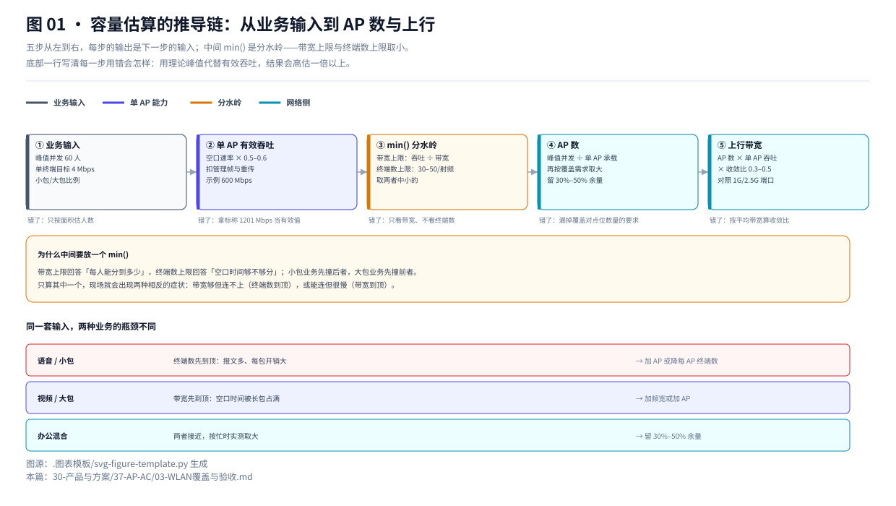
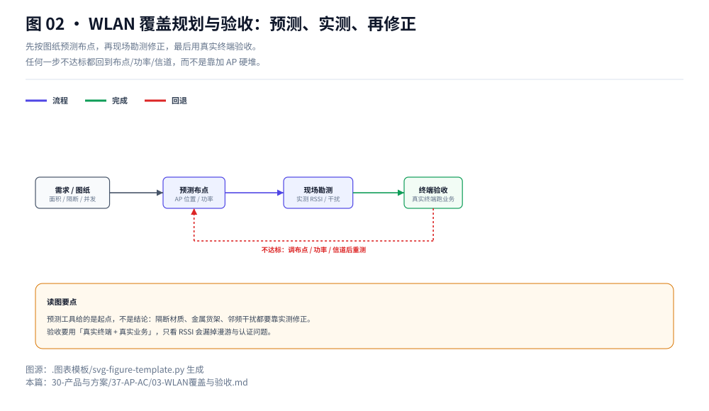
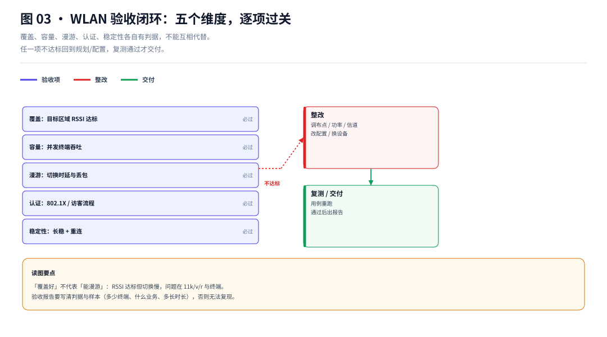

# WLAN 覆盖与验收

WLAN 的质量不是「信号满格」，而是**覆盖够、容量够、干扰可控、漫游不断**。覆盖设计决定 AP 放哪、功率多大；验收决定这套设计在真实终端和真实业务下是否成立。

> 本篇定位：AP 布点、信道/功率规划、容量估算和验收方法。802.11 速率计算去 [10-基础理论：Wi-Fi 频段信道与速率](../../10-基础理论/12-通信科学/04-无线通信/02-Wi-Fi/01-Wi-Fi频段信道与速率.md)，射频/天线去 [01-射频与天线](../../10-基础理论/12-通信科学/04-无线通信/01-射频与天线/.readme.md)，AC/AP 产品去 [00-AP产品架构](./00-AP产品架构.md)、[01-AC产品架构与CAPWAP](./01-AC产品架构与CAPWAP.md)。

## 目录

- [1 一句话模型](#s1)
- [2 速览](#s2)
- [3 覆盖与容量字段](#s3)
- [4 交互流程](#s4)
- [5 状态机与定时器](#s5)
- [6 设计取舍与边界](#s6)
- [7 与相邻主题的关系](#s7)
- [名词解释](#名词解释)
- [8 参考与关联](#s8)

## 1 · 一句话模型：先算覆盖，再算容量，最后用终端验收

```text
覆盖：AP 位置 × 发射功率 × 天线方向 → RSSI/SNR
容量：AP 数 × 空间流 × 信道宽度 × 并发 → 每终端带宽
干扰：信道规划 × 功率控制 × 非 Wi-Fi 噪声
验收：覆盖/容量/漫游/认证/稳定性
```

三个关键认知：

1. **覆盖和容量是两件事**：信号够不代表带得动；会议室/教室要按并发算，而不是按面积。因为覆盖只回答「能不能连上」，容量回答「连上之后每人能分到多少空口时间」，所以两个指标必须分别定目标、分别验收。
2. **2.4G 只适合覆盖和 IoT**：信道少、干扰大，业务优先 5G/6G。因为 2.4 GHz 只有三段互不重叠的 20 MHz 信道，AP 一密就必然同频，所以它天生不适合承载高吞吐业务。
3. **验收要用真实终端和真实业务**：只用测试仪打流，发现不了终端兼容性和漫游问题。因为测试仪只验证「空口能跑多快」，而真实终端会挑频段、挑加密、挑漫游时机，所以验收必须把终端行为纳进来。

一句类比：覆盖像「灯够不够亮」，容量像「门口有多宽」。**类比失效的地方**是：灯可以一直加，空口不能——多加一盏灯（AP）会互相干扰，所以容量不是线性叠加。

> **推论**：方案阶段就要把「覆盖目标」和「容量目标」写成两个数字（如 -65 dBm、每人 4 Mbps），否则验收时只能凭感觉争论。
> **边界**：本篇给的是通用工程目标与流程，具体数值要按业务 SLA、终端类型与地区法规调整；不覆盖射频传播模型推导（去 [无线传播与射频基础](../../10-基础理论/12-通信科学/04-无线通信/01-射频与天线/00-无线传播与射频基础.md)）。

## 2 · 速览

因为覆盖设计最容易被简化成「多少平米一台 AP」，而这个比值在会议室、仓库、酒店三种场景里能差一个数量级，所以第三列写的是「这个数字什么时候不算数」。

| 项 | 内容 | 读法（边界/误判） |
| --- | --- | --- |
| 设计输入 | 面积/户型、终端数、业务类型、墙体材质、干扰源 | 只给面积就出方案，等于按平均值设计，高密区必然不够 |
| 关键指标 | RSSI、SNR、信道利用率、并发、单终端吞吐、漫游时延 | 指标要带测试位置与终端型号，否则不可复现 |
| 规划手段 | 预测仿真、现场勘测、上线验证 | 仿真只解决布点，不解决干扰与终端行为 |
| 关键对象 | AP 点位、功率、信道、频宽、SSID/VLAN、漫游域 | 功率不是越大越好；功率过大是漫游粘滞的常见原因 |
| 验收工具 | 无线测试仪/笔记本网卡、打流工具、漫游测试工具、频谱仪 | 不同网卡的接收灵敏度差异可达数 dB，验收要固定终端 |
| 主要风险 | 覆盖空洞、同频干扰、容量不足、漫游粘滞、认证失败 | 这五项要分别有判据，不能合并成「体验不好」 |

## 3 · 覆盖与容量字段

这一节按「覆盖参数 → 信道频宽 → 容量 → 验收项」展开。因为前三项是设计输入、最后一项是判定标准，所以设计阶段就要想清楚验收怎么测，否则会出现「设计时没定目标、验收时没有判据」。

### 3.1 覆盖设计参数

因为覆盖是「双向」的（AP 发得出、终端也发得出），而手机发射功率通常远低于 AP，所以下行 RSSI 达标不等于上行可用。

| 参数 | 典型目标 | 说明 | 边界与误判 |
| --- | --- | --- | --- |
| RSSI | 数据 ≥ -70 dBm，语音/视频 ≥ -65 dBm | 具体目标按业务和终端调整（待验证） | 手机发射功率低，下行 -65 dBm 时上行可能已接近边缘 |
| SNR | ≥ 25 dB | 低于门限会降 MCS/重传 | 干扰一上来 SNR 掉得比 RSSI 快，只看 RSSI 会漏判 |
| 信道利用率 | 忙时 < 50%～60% | 过高说明容量/干扰问题 | 是「同信道所有 AP」的合计，只看单 AP 会低估 |
| 重叠覆盖 | 相邻 AP 有适度重叠 | 太少会空洞，太多会干扰 | 重叠区两 AP 信号差太小会导致来回切换（乒乓） |
| AP 间距 | 按覆盖半径和墙体衰减 | 不能只按面积平均 | 每穿一堵承重墙约损失 10–15 dB，户型比面积更重要 |
| 天线方向 | 朝向用户区 | 吸顶全向、室外定向 | 吸顶装角落、定向装反，方向图比参数更能决定结果 |

### 3.2 信道与频宽

因为频宽与信道数是一对矛盾（频宽翻倍，可用非重叠信道减半），所以「上大频宽」从来不是免费的。

| 频段 | 可用信道 | 建议 | 边界 |
| --- | --- | --- | --- |
| 2.4 GHz | 1～13（区域不同） | 只用 1/6/11，20 MHz | 干扰大，不适合高吞吐；1/6/11 是「互不重叠」的最小集合，不是唯一组合 |
| 5 GHz | UNII-1/2A/2C/3 | 非重叠信道，20/40/80 MHz | DFS 信道需雷达检测；检测期间该信道不可用 |
| 6 GHz | dependent on region | 320 MHz（Wi-Fi 7） | 终端和法规支持有限；国内目前未把 6 GHz 开放给 WLAN（以最新规定为准），这一项在国内项目里通常不成立 |

频宽越大，峰值越高但信道越少、越容易重叠。高密场景优先「多 AP + 较窄频宽」，而不是「少 AP + 320 MHz」。

| 频宽 | 非重叠信道数（相对 20 MHz） | 适用 | 代价 |
| --- | --- | --- | --- |
| 20 MHz | 基准 | 高密、2.4 GHz、IoT | 单终端峰值低 |
| 40 MHz | 约一半 | 办公、中等密度 | 2.4 GHz 上可用组合极少，工程上按不可用处理 |
| 80 MHz | 约四分之一 | 低密、视频 | 5 GHz 非重叠信道数降到个位数（常见 3 个以内） |
| 160/320 MHz | 更少 | 单终端大带宽、实验室 | 高密场景会制造同频干扰，且需要连续频谱 |

> **推论**：会议室、教室、展厅这类高密场景，正确的方向是「多加 AP + 20/40 MHz + 降功率」，而不是「少加 AP + 80 MHz + 升功率」。

### 3.3 容量估算

因为空口是共享介质，容量不是「AP 数 × 单 AP 峰值」的线性叠加，所以估算要按「空口时间」算，而不是按「标称速率」算。

```text
单 AP 有效吞吐 ≈ 空口速率 × 效率（0.5–0.6，含管理帧、重传、竞争开销）
单 AP 承载终端 ≈ min(有效吞吐 ÷ 单终端目标带宽, 每射频终端数上限)
AP 数        ≈ 峰值并发 ÷ 单 AP 承载终端
上行带宽      ≈ AP 数 × 单 AP 有效吞吐 × 收敛比（0.3–0.5）
```

| 项 | 估算方式 | 说明 | 边界与误判 |
| --- | --- | --- | --- |
| 单 AP 并发 | 按业务带宽/空口效率估算 | 不是按「最大关联数」 | 关联数上限是表项，不是体验；超过 30–50 个活跃终端就该考虑加 AP |
| 单终端带宽 | 总容量 / 并发终端 | 留 30%～50% 余量 | 余量是给突发与重传的，不是给「未来扩容」的 |
| 空口时间 | 报文数 × 速率 × 重传 | 小包/重传会显著降低效率 | 语音等小包业务先撞「终端数」上限，视频等大包先撞「带宽」上限 |
| SSID 数 | 每 SSID 有 beacon/管理开销 | SSID 越多，空口开销越大 | 每多一个 SSID，beacon 与探测响应都多一份；4 个以上要评估 |
| 上行带宽 | AP 上行 × AP 数 | 汇聚口容易成为瓶颈 | 收敛比按实际业务峰值为准，不能按「平均每人 1 Mbps」 |



**读图**：五步从左到右，每一步的输出是下一步的输入；中间那个 `min()` 是分水岭——容量同时受「带宽」和「终端数」两个上限约束，取小的那个。底部一行写清每一步用错会怎样：用理论峰值代替有效吞吐，结果会高估一倍以上。

> 图源：`images/图01-容量推导链.svg`

> **边界**：这套估算是「稳态平均」模型，不覆盖突发（如全场同时下载）与协议开销突变（如大量重传）。突发场景要么加余量，要么在验收时按峰值打流。

### 3.4 验收项

因为验收的判据必须可复现，所以每一项都要写清「在哪测、用什么终端、什么业务、什么时段」。

| 项 | 方法 | 判据 | 边界与误判 |
| --- | --- | --- | --- |
| 覆盖 | 逐点测 RSSI/SNR | 达到设计目标，无空洞 | 只测走廊不测房间角落，会漏掉最差点 |
| 容量 | 多终端并发打流 | 单终端/总吞吐达标 | 用测试仪代替真实终端会高估；要混入手机/笔记本 |
| 漫游 | 走动中持续打流 | 切换时延/丢包在业务允许范围 | 慢走与快走结果不同；要按真实走动速度测 |
| 认证 | 802.1X/Portal/PSK | 成功率、时延达标 | 只测一次不算；要测并发认证与失败重试 |
| 干扰 | 频谱/信道利用率 | 无持续高噪声/同频重叠 | 忙时测才有意义；闲时频谱干净是常态 |
| 稳定性 | 长时间连接/漫游 | 无掉线、无 AP 重启 | 至少覆盖一个忙时 + 一个闲时，最好跨天 |
| 供电 | PoE 功率/温升 | 不超预算、不降频 | 夏季高温或满功率发射时才暴露；验收要记录环境温度 |

## 4 · 交互流程



**读图**：从需求/图纸开始，先做预测布点，再现场勘测修正，最后用真实终端验收；任何一步不达标都要回到布点/功率/信道调整。

> 图源：`images/图02-覆盖规划与验收.svg`

### 4.1 覆盖规划

```text
收集需求（面积/终端/业务/墙体）
  → 预测仿真（AP 点位/功率/天线）
  → 现场勘测（RSSI/SNR/干扰）
  → 调整点位/功率/信道
  → 输出 AP 清单和配置基线
```

因为仿真用的是通用墙体衰减模型，而现场有金属货架、玻璃幕墙、消防管道这些模型外的物体，所以「仿真出图」只是起点，勘测才是修正。

### 4.2 容量规划

```text
估算峰值并发 → 计算单 AP 可承载带宽
  → 确定 AP 数和频宽
  → 核算上行/汇聚带宽
  → 预留 30%～50% 余量
```

因为容量由「带宽」和「终端数」两个上限共同决定，所以规划时要同时给出 AP 数和每 AP 终端数上限；只给其中一个，现场就会出现「带宽够但连不上」或「能连但很慢」。

### 4.3 上线验收

```text
AP 上线 → 配置核对（SSID/VLAN/功率/信道）
  → 覆盖测试 → 容量测试 → 漫游测试
  → 认证/安全测试 → 长稳观察
  → 输出验收报告
```

| 步骤 | 要留的证据 | 缺失后果 |
| --- | --- | --- |
| 配置核对 | 每个 AP 的信道/功率/SSID/VLAN 快照 | 后续改配置无法回溯，争议时说不清基线 |
| 覆盖测试 | 点位图 + RSSI/SNR 记录 | 只能证明「测过」，不能证明「覆盖到」 |
| 容量测试 | 并发数、业务模型、吞吐曲线 | 无法判断瓶颈在空口还是上行 |
| 漫游测试 | 走动路线、切换次数、丢包/时延 | 只能定性说「还行」 |
| 长稳观察 | 时间跨度、告警记录 | 慢性问题（发热降频、内存泄漏）测不出来 |

### 4.4 异常分支

因为验收不通过的原因往往不在「无线」本身，所以异常表按「先排除设计、再排除配置、最后怀疑终端」的顺序排。

| 异常 | 现象 | 定位方向 |
| --- | --- | --- |
| 覆盖空洞 | 某区域信号弱/断连 | AP 点位、功率、墙体、天线方向 |
| 同频干扰 | 速率低、重传高 | 信道规划、功率过大、AP 过密 |
| 容量不足 | 人多就卡 | AP 数、频宽、空口效率、上行 |
| 漫游粘滞 | 走动不断/切换慢 | 功率、k/v/r、AP 间距、终端 |
| 认证失败 | 连不上/反复认证 | RADIUS/Portal、证书、VLAN |
| 终端兼容性 | 个别终端异常 | 加密/频宽/11r/厂商特性 |
| 夜间变差 | 特定时段干扰 | 邻居 AP、微波/蓝牙/非 Wi-Fi 干扰 |

## 5 · 状态机与定时器

本篇没有协议连接状态机——终端关联与漫游的状态机在 [02-AC-AP组网与漫游](./02-AC-AP组网与漫游.md)，这里只有「验收阶段」与几个影响空口的定时器。因为验收本来就是「测—改—复测」的循环，所以这里画的是闭环而不是流水线。



**读图**：覆盖、容量、漫游、认证、稳定性逐项验收；不达标回到规划/配置调整，复测通过才交付。

> 图源：`images/图03-WLAN验收闭环.svg`

| 阶段 | 动作 | 不通过时 |
| --- | --- | --- |
| 需求 | 明确业务/终端/区域 | 重新确认指标 |
| 预测 | 布点/功率/信道仿真 | 调整模型/点位 |
| 勘测 | 现场测 RSSI/SNR/干扰 | 调整 AP/功率/信道 |
| 验收 | 覆盖/容量/漫游/认证 | 回配置或补 AP |
| 长稳 | 持续连接/漫游/吞吐 | 查干扰/设备/终端 |
| 交付 | 报告/基线/运维文档 | 补齐记录 |

| 定时器/阈值 | 作用 | 说明与边界 |
| --- | --- | --- |
| Beacon 间隔 | 管理帧开销 | 常见 100 TU（约 102.4 ms）；调大省电但发现变慢 |
| 漫游扫描 | 终端找邻居 | 过于频繁耗电；扫描期间业务会抖动 |
| 认证超时 | 802.1X/Portal | 超时拒绝/回退；RADIUS 慢会被误判为无线问题 |
| 空闲踢除 | 释放空口资源 | 阈值按业务配置；太短会踢掉待机终端，太长会占着表项 |
| 长稳观察 | 发现慢性问题 | 建议覆盖忙时/闲时；至少一个完整工作日 |

> **待验证**：RSSI/SNR 目标、漫游时延和丢包判据应结合业务 SLA 与终端类型确定，本篇给的是通用参考。
> **边界**：Beacon 间隔是 AP 侧参数，扫描间隔是终端侧行为，两者不在同一台设备上，验收时不能互相替代。

## 6 · 设计取舍与边界

因为覆盖与容量互相挤占（加功率换覆盖、减功率换容量），所以下面每条取舍都写清代价与失效条件。

### 6.1 覆盖优先 vs 容量优先

覆盖优先用少量 AP + 大功率，成本低但容量和干扰差；容量优先用多 AP + 低功率，体验好但布线和成本高。高密场景必须容量优先。

- **代价**：多 AP 意味着更多 PoE 端口、更多布线、更多信道规划工作；低功率意味着单个 AP 的覆盖半径变小，点位密度上升。
- **失效条件**：仓库、停车场这类「人少但面积大、物体遮挡多」的场景，覆盖优先更合理，强行高密布点会浪费端口。

### 6.2 2.4G 的定位

2.4G 穿透好、终端全，但信道少、干扰大。正确做法是「2.4G 保覆盖/IoT，5G/6G 保业务」，而不是让所有业务挤在 2.4G。

- **误判**：把 2.4G 当「备用频段」全开大功率，结果把邻居和自己的 2.4G 都打满，IoT 设备反而更不稳。
- **边界**：老旧终端只支持 2.4G 的场景（如部分 POS、工业手持机），2.4G 必须保留并单独规划。

### 6.3 频宽的取舍

80/160/320 MHz 提升单终端峰值，但减少非重叠信道，增加同频干扰。高密区域用 20/40 MHz，开阔/低密区域才用大频宽。

- **代价**：大频宽下的「峰值」只在信道干净、终端少时成立；一旦邻区重叠，重传会把收益吃掉。
- **失效条件**：单终端大文件备份、AR/VR 这类场景确实需要大频宽，但只应开在专用 AP 上，不要全网默认。

### 6.4 预测仿真 vs 现场勘测

仿真能快速布点，但墙体材质、家具、金属和邻居 AP 很难准确建模；现场勘测更真实但耗时。正确流程是「仿真布点 + 现场修正」。

- **代价**：勘测要闭馆/停工配合，且要在 AP 装好之后再做一次，工期与人力成本都不低。
- **失效条件**：小型办公室、单层商铺这类简单场景，仿真 + 上线后抽测即可，不必做完整勘测。

### 6.5 验收的边界

验收通过只代表「当时的终端、业务、环境」达标。终端换代、邻居 AP 增加、装修变化都会改变结果，交付时要留下复测方法和基线。

- **误判**：把「验收报告平均值达标」当成「全场达标」。平均值会掩盖最差点，而用户永远坐在最差点。
- **边界**：验收报告要写清测试终端型号、AP 固件版本、测试时段与环境温度；缺任何一项，复测都无法对齐。

## 7 · 与相邻主题的关系

因为覆盖与验收依赖大量射频与协议细节，所以这里只写边界，推导与方法去 10/20 的对应笔记。

| 相邻对象 | 关系 | 边界（细节去哪看） |
| --- | --- | --- |
| [802.11 原理与接入流程](../../10-基础理论/12-通信科学/04-无线通信/02-Wi-Fi/00-802.11原理与接入流程.md) | 接入、重传、漫游 | 帧格式与重传机制不在本篇 |
| [Wi-Fi 频段信道与速率](../../10-基础理论/12-通信科学/04-无线通信/02-Wi-Fi/01-Wi-Fi频段信道与速率.md) | 信道/速率计算 | MCS 表与速率推导不在本篇 |
| [无线传播与射频基础](../../10-基础理论/12-通信科学/04-无线通信/01-射频与天线/00-无线传播与射频基础.md) | 路径损耗/衰减 | 传播模型与天线理论不在本篇 |
| [无线覆盖与干扰优化](../../10-基础理论/12-通信科学/04-无线通信/05-无线测试与优化/00-无线覆盖与干扰优化.md) | 覆盖/干扰方法 | 具体优化手法与工具操作不在本篇 |
| [AP 产品架构](./00-AP产品架构.md) | AP 能力 | 射频规格、供电与形态不在本篇 |
| [AC 产品架构与 CAPWAP](./01-AC产品架构与CAPWAP.md) | AC 管理 | AC 容量与许可不在本篇 |
| [AC-AP 组网与漫游](./02-AC-AP组网与漫游.md) | 组网与漫游 | 漫游配置与漫游域设计不在本篇 |

一句话：**WLAN 验收 = 覆盖达标 × 容量达标 × 漫游达标 × 真实终端可用。** 边界在于：本篇给的是「验收判据与方法」，具体射频调优参数要去 10/20 的对应笔记。

## 名词解释

> 缩写给出英文全称；非缩写用“—”表示。

因为 RSSI、SNR、空口时间常被混着说，所以下表按本篇的用法解释。

| 术语 | 英文全称 | 解释 |
| --- | --- | --- |
| WLAN | Wireless Local Area Network | 无线局域网。 |
| AP | Access Point | 无线接入点。 |
| AC | Access Controller | 无线控制器。 |
| RSSI | Received Signal Strength Indicator | 接收信号强度指示。 |
| SNR | Signal-to-Noise Ratio | 信噪比。 |
| dBm | decibel-milliwatt | 以 1 mW 为基准的功率对数单位，用于表示接收电平与发射功率。 |
| MCS | Modulation and Coding Scheme | 调制与编码策略，决定空口速率档位。 |
| DFS | Dynamic Frequency Selection | 动态频率选择，5 GHz 雷达信道的避让机制。 |
| CAC | Channel Availability Check | 信道可用性检查，DFS 信道启用前的静默检测时间。 |
| UNII | Unlicensed National Information Infrastructure | 美国 5 GHz 非授权频段的分段命名（UNII-1/2A/2C/3）。 |
| 空口时间 | Air Time | 一段统计周期内信道被占用（发送、重传、管理帧）的比例。 |
| 同频邻区 | Overlapping BSS | 使用同一信道的相邻 BSS，彼此构成同频干扰。 |
| SSID | Service Set Identifier | 无线网络名称。 |
| VLAN | Virtual Local Area Network | 虚拟局域网。 |
| PoE | Power over Ethernet | 以太网供电。 |
| SLA | Service Level Agreement | 服务等级协议。 |
| IoT | Internet of Things | 物联网。 |

## 8 · 参考与关联

**标准/方法**

因为验收判据没有统一标准（只有厂商建议与业务 SLA），所以这里列标准与方法来源，数值判据在正文标了「待验证」。

- IEEE 802.11a/b/g/n/ac/ax/be
- IEEE 802.11k/v/r：测量、引导、快速切换
- Wi-Fi Alliance 测试与认证
- RFC 2544（有线打流方法，可参考）

**关联**

- [设备形态对比](../00-设备形态对比.md)
- [AP 产品架构](./00-AP产品架构.md)
- [AC 产品架构与 CAPWAP](./01-AC产品架构与CAPWAP.md)
- [AC-AP 组网与漫游](./02-AC-AP组网与漫游.md)
- [无线覆盖与干扰优化](../../10-基础理论/12-通信科学/04-无线通信/05-无线测试与优化/00-无线覆盖与干扰优化.md)

---

> **本篇定位**：WLAN 覆盖/容量规划、信道功率设计和验收方法；不含射频传播模型推导与 AC/AP 产品细节。
> **素材来源**：`studyspace/1.知识体系/10.wifi/wifi记录.md`、`studyspace/1.知识体系/1.计算机网络/m-6-无线网络和移动网络.md`。
> **待验证**：RSSI/SNR/漫游判据、AP 并发建议值和不同业务的容量模型；原稿「Beacon 间隔 100 ms」按 802.11 时间单位修正为 100 TU（约 102.4 ms）。
