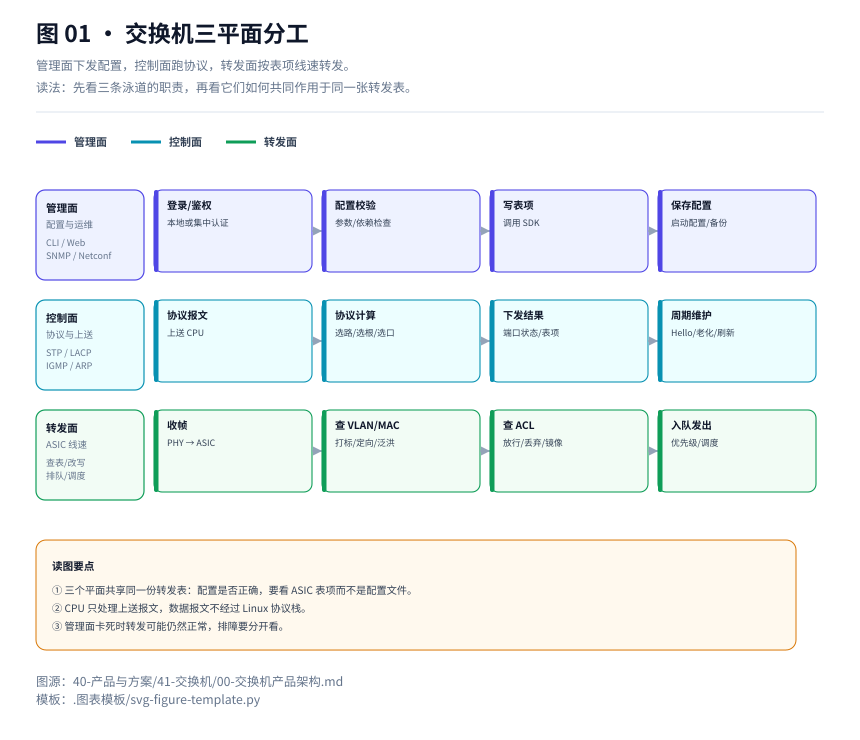
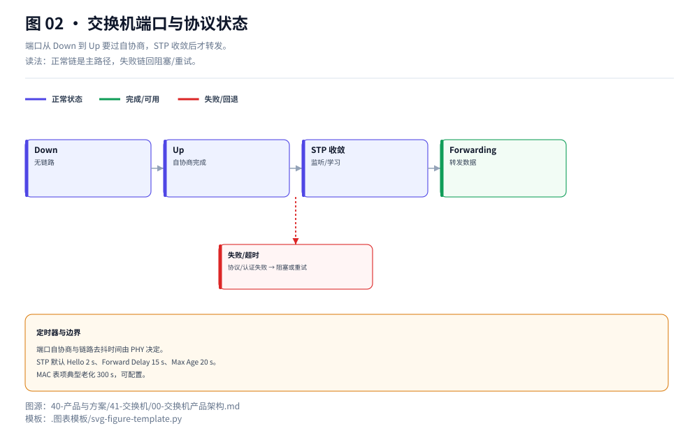

# 交换机产品架构

交换机是「专用交换芯片做线速转发 + 通用 CPU 做协议和管理」的分工型设备。产品差异不在「会不会转发」，而在端口形态、表项容量、软件特性、可靠性和可运维性。

> 本篇定位：讲整机分层、硬件组成、关键表项和启动/转发路径，属于产品层。VLAN/STP/LACP 的原理去 `10-基础理论`，OpenWrt/DSA 实现去 `20-平台与系统`，具体芯片去 `30-平台与芯片`。

## 目录

- [1 一句话模型](#s1)
- [2 速览](#s2)
- [3 结构与字段](#s3)
- [4 交互流程](#s4)
- [5 状态机与定时器](#s5)
- [6 设计取舍与边界](#s6)
- [7 与相邻主题的关系](#s7)
- [名词解释](#名词解释)
- [8 参考与关联](#s8)

## 1 · 一句话模型：CPU 管规则，ASIC 管转发

```text
管理面  CLI / Web / SNMP / Netconf
   │  下发配置
控制面  STP、LACP、IGMP snooping、ARP、路由协议
   │  写表项
转发面  MAC 表 + VLAN 表 + ACL + 队列，线速转发
   │
   └─ 端口 PHY / 光模块 / 堆叠口
```

三个关键认知：

1. **转发面不跑 Linux**：报文由 ASIC 按表项直接转发，CPU 只处理上送报文（协议报文、异常报文、管理报文）。
2. **表项容量决定产品档位**：MAC 表、VLAN 数、ACL 条目、路由前缀数、队列数，比「端口数量」更能区分低端和高端。
3. **管理型和无管理型是两类产品**：无管理交换机没有 CPU 软件栈，只有固定转发逻辑，不能拿来套管理型的功能清单。

## 2 · 速览

| 项 | 内容 |
| --- | --- |
| 产品定位 | 二层/三层以太网转发设备，按端口密度和软件能力分档 |
| 核心对象 | 端口、VLAN、MAC 表、ACL、队列、聚合组、生成树实例 |
| 关键能力 | 线速转发、VLAN 隔离、环网保护、链路聚合、端口镜像、PoE 供电 |
| 典型形态 | 无管理、Web 管理、二层管理、三层管理、数据中心/堆叠 |
| 软件栈 | Boot + Linux + 交换 SDK + 管理应用（部分产品基于 OpenWrt） |
| 关键标准 | IEEE 802.3、802.1Q、802.1D/w、802.3ad、802.1X、RFC 2544 |
| 主要成本项 | 交换芯片、PHY/光模块、PoE 电源、散热、外壳与认证 |

## 3 · 结构与字段

### 3.1 三个平面

| 平面 | 承载 | 典型实现 | 失效表现 |
| --- | --- | --- | --- |
| 管理面 | CLI、Web、SNMP、Netconf、Syslog | Linux 用户态进程 | 能转发但配不了、告警丢失 |
| 控制面 | STP、LACP、IGMP snooping、ARP/ND、路由协议 | Linux 协议栈 + 协议进程 | 环路、聚合不生效、组播泛洪 |
| 转发面 | 以太帧查表、改写、排队、调度 | 交换 ASIC | 丢包、时延抖动、吞吐不达标 |

分工边界：**协议报文上送 CPU，数据报文走 ASIC**。CPU 端口通常有速率限制（如 1G/2.5G 内联口），所以「上送报文过多」会先打满 CPU 链路，而不是打满业务端口。

### 3.2 硬件组成

| 部件 | 作用 | 产品关注点 |
| --- | --- | --- |
| 交换 ASIC | MAC 学习、查表、VLAN/ACL、队列调度 | 交换容量、包转发率、表项容量、是否支持堆叠 |
| CPU | 启动、协议、管理、上送报文处理 | 核数/主频、内存、是否够跑管理应用 |
| PHY | 电口编码解码、自协商 | 速率组合、PoE 支持、浪涌防护 |
| 光模块接口 | SFP/SFP+/SFP28 等 | 速率/距离/波长、DDM、兼容性 |
| PoE 控制器 | 给 AP/IPC 供电 | 总功率预算、单口功率、802.3af/at/bt |
| Flash/内存 | 固件、配置、日志 | 双镜像、配置备份、日志容量 |
| 电源/风扇 | 供电与散热 | 冗余电源、温控调速、噪声 |

### 3.3 转发面关键表项

| 表项 | 查什么 | 容量不足时 | 边界 |
| --- | --- | --- | --- |
| MAC 表 | 目的 MAC → 出端口 | 退化为泛洪，性能下降 | 有老化时间，典型 300 s |
| VLAN 表 | VLAN ID → 成员端口 | 新 VLAN 建不起来 | 802.1Q 可用 4094 个 |
| ACL | 五元组/二层字段 → 动作 | 规则下发失败或被合并 | 依赖 TCAM 资源，规则顺序敏感 |
| 三层表 | 目的 IP → 下一跳 | 转 CPU 或丢包 | 主机路由和网段路由占不同空间 |
| 队列/调度表 | 优先级 → 队列 | 高优先级无法保证 | 队列数由芯片决定 |
| 组播表 | 组播组 → 出端口 | 退化为广播 | 依赖 IGMP snooping |

> 待验证：不同芯片的 MAC/ACL/路由表项数量和共享方式差异很大，选型时必须查具体 datasheet，不能按「同档位」估算。

## 4 · 交互流程



**读图**：上行是配置和协议，下行是表项；真正决定转发结果的是 ASIC 里的表，不是 Linux 里的配置文本。

> 图源：`images/图01-交换机三平面.svg`

### 4.1 上电启动

```text
上电 → BootROM → U-Boot → 加载固件（双镜像择一）
  → Linux 内核启动 → 挂载根文件系统
  → 交换 SDK 初始化（复位 ASIC、加载默认表）
  → 管理应用启动（CLI/Web/SNMP）
  → 读取启动配置并下发 → 端口 up
```

产品层的两个关键点：

- **双镜像**：升级失败要能回滚，镜像选择逻辑通常在 U-Boot 里。
- **配置恢复**：配置文件和固件版本绑定，跨版本恢复要做兼容处理。

### 4.2 一个数据帧的转发路径

```text
端口收帧 → PHY → ASIC 解析
  → 查 VLAN 表（是否带 tag、PVID 怎么打）
  → 查 MAC 表（命中则定向，未命中则泛洪）
  → 查 ACL（是否重定向/丢弃/限速）
  → 入队 → 调度 → 出端口
```

CPU 只在以下情况介入：目的 MAC 是设备自己、协议报文（STP/LACP/IGMP/ARP）、TTL 耗尽、需要采样/镜像到 CPU 口的报文。

### 4.3 管理面下发配置

配置不是「改一个文件就生效」，而是一条链：

```text
CLI/Web/SNMP → 配置管理进程 → 校验
  → 写 SDK 表项 → 读回确认 → 保存配置
```

异常分支：

| 异常 | 表现 | 定位方向 |
| --- | --- | --- |
| 配置成功但转发不生效 | 显示已配置，流量不符预期 | 表项是否真正写入、是否有更高优先级规则覆盖 |
| 重启后配置丢失 | 运行配置在、启动配置无 | 保存动作、配置文件权限、双镜像配置分区 |
| 管理面卡死但转发正常 | 业务不断，Web/CLI 无响应 | CPU 被上送报文打满、内存泄漏、进程崩溃 |
| 升级后无法启动 | 卡在 U-Boot 或内核 | 镜像校验、分区偏移、回滚标志 |

## 5 · 状态机与定时器




**读图**：正常链是 Down→Up→STP 收敛→Forwarding；协议/认证失败则回到阻塞或重试。

> 图源：`images/图02-交换机端口与协议状态.svg`

交换机没有「整机连接状态机」，但有端口和协议状态：

| 对象 | 状态 | 关键定时器/参数 |
| --- | --- | --- |
| 端口 | Down → Up（自协商完成） | 自协商时间、链路去抖 |
| STP 端口 | Blocking → Listening → Learning → Forwarding | Hello 2 s、Forward Delay 15 s、Max Age 20 s（802.1D 默认） |
| LACP 端口 | Detached → Attached | Fast 1 s / Slow 30 s |
| MAC 表项 | 学习 → 老化删除 | 典型 300 s，可配置 |
| PoE 端口 | 检测 → 分级 → 供电 → 故障 | 检测/分级时间由标准定义 |

产品验收时要区分「协议定时器」和「产品去抖」：前者是标准行为，后者是厂商为了抑制闪断加的，参数不公开时只能实测。

## 6 · 设计取舍与边界

### 6.1 无管理 vs 管理型

无管理交换机成本低、即插即用，但没有 VLAN/STP/镜像，也不能远程运维；管理型增加 CPU、软件和认证成本，换来可配置和可观测。**不要把无管理机型放进需要环网或隔离的拓扑**。

### 6.2 存储转发 vs 直通

存储转发收完整帧再校验，能丢弃 CRC 错帧，时延略高；直通转发边收边转，时延低，但会把坏帧传下去。多数企业级产品默认存储转发，低时延场景才考虑直通。

### 6.3 交换芯片转发 vs CPU 转发

全走 CPU 的「软交换」灵活但性能有限，适合低流量或需要复杂策略的场景；ASIC 转发性能高，但受表项容量和特性支持限制。产品定义阶段就要把「哪些流量必须走硬件」写清楚。

### 6.4 堆叠的代价

堆叠把多台设备当成一台管理，换来统一配置和跨设备聚合，代价是堆叠口带宽、堆叠线缆可靠性和分裂（split-brain）处理。堆叠不是免费的「端口扩展」。

### 6.5 什么时候不需要管理型交换机

家庭/小微场景只要即插即用、没有 VLAN 隔离和环路风险时，无管理交换机更合适；一旦有 AP 多 SSID、摄像头隔离、双上行，就必须上管理型。

## 7 · 与相邻主题的关系

| 相邻对象 | 关系 |
| --- | --- |
| [以太网与 MAC](../../10-基础理论/11-网络科学/02-链路层/01-以太网与MAC.md) | 交换机的转发对象和 MAC 学习基础 |
| [VLAN 与 Trunk](../../10-基础理论/11-网络科学/02-链路层/02-VLAN与Trunk.md) | 端口隔离与 tag 处理的原理 |
| [STP/RSTP/MSTP](../../10-基础理论/11-网络科学/02-链路层/03-STP-RSTP-MSTP.md) | 环网保护的协议基础 |
| [链路聚合 LACP](../../10-基础理论/11-网络科学/02-链路层/04-链路聚合LACP.md) | 多链路带宽叠加与冗余 |
| [DSA 与 bridge/VLAN](../../20-平台与系统/22-OpenWrt/03-网络数据面/02-DSA与bridge-VLAN.md) | Linux/OpenWrt 侧如何配置交换芯片 |
| [交换机业务与组网](./01-交换机业务与组网.md) | 本篇的配置与组网展开 |
| [交换机测试与验收](./02-交换机测试与验收.md) | 产品交付前的验证方法 |

一句话：**交换机产品 = 端口与芯片的硬件组合 + 一套把业务意图翻译成表项的软件。**

## 名词解释

> 缩写给出英文全称；非缩写用“—”表示。

| 术语 | 英文全称 | 解释 |
| --- | --- | --- |
| ASIC | Application-Specific Integrated Circuit | 专用集成电路，这里指交换芯片。 |
| MAC | Media Access Control | 介质访问控制，MAC 表存目的 MAC 到端口的映射。 |
| PHY | Physical Layer Device | 物理层收发器件。 |
| ACL | Access Control List | 访问控制列表，按字段匹配并执行放行/丢弃/重定向。 |
| TCAM | Ternary Content-Addressable Memory | 三态内容寻址存储器，常用于 ACL 和路由查找。 |
| PoE | Power over Ethernet | 以太网供电。 |
| STP | Spanning Tree Protocol | 生成树协议。 |
| LACP | Link Aggregation Control Protocol | 链路聚合控制协议。 |
| DSA | Distributed Switch Architecture | Linux 下的分布式交换架构。 |
| SFP | Small Form-factor Pluggable | 可插拔光模块封装。 |
| DDM | Digital Diagnostic Monitoring | 光模块数字诊断监控。 |

## 8 · 参考与关联

**标准**

- IEEE 802.3：Ethernet
- IEEE 802.1Q：VLAN 与优先级
- IEEE 802.1D / 802.1w / 802.1s：STP / RSTP / MSTP
- IEEE 802.3ad：Link Aggregation
- IEEE 802.1X：端口接入认证
- RFC 2544：网络互连设备基准测试方法

**关联**

- [设备形态对比](../00-设备形态对比.md)
- [交换机业务与组网](./01-交换机业务与组网.md)
- [交换机测试与验收](./02-交换机测试与验收.md)
- [平台对比](../../30-平台与芯片/00-平台对比.md)

---

> **本篇定位**：交换机整机的三平面分工、硬件组成、表项与启动/转发路径。
> **素材来源**：`studyspace/1.知识体系/8.路由与交换/`（VLAN/STP/LACP 素材）、`studyspace/1.知识体系/7.openwrt/5.驱动/1.以太网switch驱动.md`。
> **待验证**：各芯片的 MAC/ACL/路由表项容量、CPU 上送带宽、PoE 总功率与散热设计。
