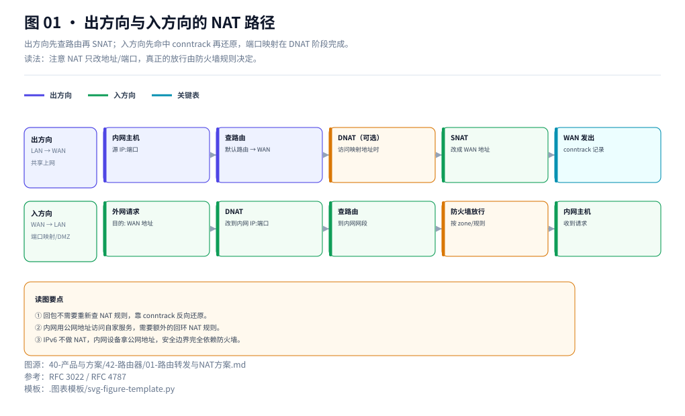
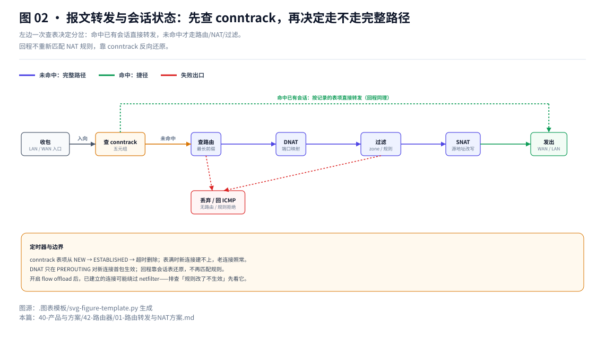

# 路由转发与 NAT 方案

路由器的转发方案可以拆成四步：**查路由决定出口 → DNAT 改目的 → SNAT 改源 → conntrack 记住映射**。IPv6 不走 NAT，靠前缀下发和防火墙放行，这是双栈产品最容易出问题的地方。

> 本篇定位：产品配置视角的路由表、策略路由、NAT/端口映射/DMZ/UPnP、IPv6 双栈与回环 NAT。协议细节链接到 `10-基础理论`，OpenWrt 的 fw3/fw4 和 offload 链接到 `20-平台与系统`。

## 目录

- [1 一句话模型](#s1)
- [2 速览](#s2)
- [3 规则与字段](#s3)
- [4 交互流程](#s4)
- [5 状态与定时器](#s5)
- [6 设计取舍与边界](#s6)
- [7 与相邻主题的关系](#s7)
- [名词解释](#名词解释)
- [8 参考与关联](#s8)

## 1 · 一句话模型：先选路，再改地址，最后记住

```text
出方向：查路由 → DNAT（可选）→ 过滤 → SNAT → 发出
入方向：命中 conntrack → 反向还原 → 查路由 → 交给内网
```

三个关键认知：

1. **路由决定「从哪个口出」，NAT 决定「源/目的地址长什么样」**，两者顺序不能颠倒。
2. **NAT 是有状态的**：所有回包都依赖 conntrack 表项，表项超时或丢失，连接就断。
3. **IPv6 默认不做 NAT**：内网拿到公网前缀，靠防火墙控制访问；把 IPv4 的 NAT 思维套到 IPv6 会出问题。

## 2 · 速览

| 项 | 内容 |
| --- | --- |
| 核心对象 | 路由表、策略路由规则、NAT 规则、conntrack、防火墙 zone |
| 常见业务 | 多 WAN 选路、端口映射、DMZ、UPnP、双栈上网、VPN 分流 |
| 关键机制 | 最长前缀匹配、源地址路由、SNAT/DNAT、NAPT、NPTv6（少用） |
| 典型配置 | 默认路由、静态路由、策略路由、端口转发、IPv6 PD |
| 主要风险 | 路由环路、NAT 回环、非对称路由、IPv6 暴露内网 |
| 诊断入口 | 路由表、conntrack、防火墙计数器、抓包 |

## 3 · 规则与字段

### 3.1 路由表

| 字段 | 作用 | 坑/边界 |
| --- | --- | --- |
| 目的前缀 | 匹配目标网段 | 最长前缀优先，默认路由是 `0.0.0.0/0` |
| 下一跳 | 交给谁 | 下一跳不可达时路由不生效 |
| 出接口 | 从哪个口发 | 多 WAN 时出接口决定源地址 |
| 度量值 | 多路径优先级 | 同前缀多路由时按度量选择 |
| 表号 | 策略路由的多张表 | 主表之外的表要配合规则使用 |

### 3.2 策略路由

| 字段 | 作用 | 坑/边界 |
| --- | --- | --- |
| 匹配条件 | 源地址、目的地址、端口、Mark | 条件越细，规则越多，排障越难 |
| 优先级 | 规则匹配顺序 | 顺序错会导致流量走错 WAN |
| 动作 | 查指定路由表 / 丢弃 | 表里没有默认路由会直接丢包 |
| 标记 | fwmark 在防火墙和路由间传递 | 标记被后续规则覆盖是常见问题 |

### 3.3 NAT 规则

| 类型 | 作用 | 典型场景 | 边界 |
| --- | --- | --- | --- |
| SNAT | 改源地址 | 家庭/企业共享上网 | 多 WAN 要按出接口选源地址 |
| DNAT | 改目的地址 | 端口映射、DMZ | 只能映射到内网可达地址 |
| NAPT | 地址+端口转换 | 多个内网主机共用公网 IP | 端口耗尽、并发受限 |
| 回环 NAT | 内网访问公网映射地址 | 内网用域名访问自家服务 | 需要额外规则，否则不通 |
| NPTv6 | IPv6 前缀转换 | 少数过渡场景 | 破坏端到端，一般不推荐 |

### 3.4 端口映射与 DMZ

| 对象 | 字段 | 说明 |
| --- | --- | --- |
| 端口映射 | 外网口、外网端口、内网 IP、内网端口、协议 | 一对一或端口段映射 |
| DMZ 主机 | 内网 IP | 把所有未映射入站流量转给一台主机，风险高 |
| UPnP IGD | 启用开关、租期 | 应用自动开端口，方便但有安全风险 |
| 端口触发 | 触发端口、开放端口 | 按出站连接临时放行入站 |

## 4 · 交互流程



**读图**：出方向先查路由再 SNAT，入方向先命中 conntrack 再还原；端口映射在 DNAT 阶段改变目的地址，回程由 conntrack 自动处理。

> 图源：`images/图01-NAT转发路径.svg`

### 4.1 出方向

```text
内网主机 → LAN → 路由查表（默认路由指向 WAN）
  → PREROUTING：DNAT（如果访问的是映射地址）
  → FORWARD：防火墙放行
  → POSTROUTING：SNAT（改成 WAN 地址）
  → conntrack 记录五元组映射 → 发出
```

### 4.2 入方向（端口映射）

```text
外网请求 → WAN → PREROUTING：DNAT 到内网 IP:端口
  → 查路由 → FORWARD 放行 → 内网主机
内网回包 → conntrack 反向还原 → 从 WAN 发出
```

### 4.3 IPv6 双栈

```text
WAN 获取 IPv6 地址 + 前缀（PD）
  → LAN 用前缀做 SLAAC/RA 或 DHCPv6
  → 终端拿到全球地址
  → 防火墙默认拒绝入站，按需放行
```

IPv6 没有 NAT，内网设备地址对外可见，安全边界完全依赖防火墙。PD 前缀变化时，内网地址会变，DDNS 和防火墙规则要能跟随。

### 4.4 异常分支

| 异常 | 现象 | 定位方向 |
| --- | --- | --- |
| 端口映射外网不通 | 内网可访问，外网不行 | 防火墙、运营商封端口、DNAT 目标不可达 |
| 内网访问映射地址不通 | 用公网 IP/域名回环失败 | 缺回环 NAT 规则 |
| 双 WAN 部分业务异常 | 银行/游戏登录失败 | 源地址漂移、连接未保持 |
| IPv6 能 ping 不能上网 | 有地址无路由/DNS | RA 默认路由、DNS、防火墙 |
| 大包不通 | 网页能开、下载失败 | MTU/MSS、PPPoE 开销、隧道封装 |
| NAT 表满 | 新连接失败 | conntrack 容量、超时时间、P2P 连接 |

## 5 · 状态与定时器




**读图**：第一站是 conntrack——命中已有会话就直接转发（顶部捷径），未命中才走查路由→DNAT→过滤→SNAT。无路由或规则拒绝从下方出口丢弃/回 ICMP。

> 图源：`images/图02-报文转发与会话状态.svg`

| 对象 | 状态 | 关键参数 |
| --- | --- | --- |
| 路由表项 | 有效/无效 | 依赖下一跳可达性 |
| conntrack 表项 | NEW → ESTABLISHED → 超时 | TCP 建立/关闭、UDP、ICMP 超时不同 |
| NAT 映射 | 建立 → 刷新 → 回收 | 与 conntrack 生命周期绑定 |
| DHCPv6-PD 租约 | 请求 → 绑定 → 续租 → 过期 | 租期由上游决定 |
| UPnP 映射 | 创建 → 续租 → 过期 | 租期由应用请求 |

> 待验证：各系统的 conntrack 默认超时和容量不同，高并发场景要按实测调优。

## 6 · 设计取舍与边界

### 6.1 NAT 的代价

NAT 让 IPv4 地址复用成为可能，但破坏了端到端连接：外网主动访问内网必须靠映射，P2P/游戏/VoIP 需要 STUN/TURN/UPnP。NAT 不是安全机制，防火墙才是。

### 6.2 端口映射 vs DMZ

端口映射只暴露必要端口，风险可控；DMZ 把所有未映射入站流量转给一台主机，排障简单但攻击面大。生产环境优先端口映射。

### 6.3 策略路由 vs 多 WAN 负载均衡

策略路由按规则选路，行为可预测；负载均衡按权重/哈希分流，能提高总带宽，但会破坏需要固定源 IP 的会话。两者可以组合，但要先保证关键业务有稳定出口。

### 6.4 IPv6 要不要开 NAT66

NAT66 能让内网地址不暴露，但违背 IPv6 端到端设计，且部分应用会异常。除非有明确合规要求，否则用防火墙而不是 NAT66。

### 6.5 硬件 offload 与 NAT 的冲突

开启 flow offload 后，已建立的连接绕过 netfilter，端口映射、QoS、流量统计可能失效。需要精细策略时，建议关闭 offload 或只对特定流量开启。

## 7 · 与相邻主题的关系

| 相邻对象 | 关系 |
| --- | --- |
| [路由与路由协议](../../10-基础理论/11-网络科学/03-网络层/04-路由与路由协议.md) | 最长前缀匹配、静态/动态路由 |
| [NAT](../../10-基础理论/11-网络科学/03-网络层/05-NAT.md) | SNAT/DNAT/NAPT 与 conntrack |
| [IPv6](../../10-基础理论/11-网络科学/03-网络层/02-IPv6.md) | 地址、RA、SLAAC、PD |
| [DHCPv6](../../10-基础理论/11-网络科学/05-应用层/02-DHCPv6.md) | 前缀下发与地址分配 |
| [NAT 与 offload](../../20-平台与系统/22-OpenWrt/03-网络数据面/03-NAT与offload.md) | OpenWrt 实现与加速 |
| [路由器产品架构](./00-路由器产品架构.md) | 整机转发链 |
| [QoS 与流控方案](./02-QoS与流控方案.md) | 转发链上的带宽控制 |

一句话：**路由解决「往哪走」，NAT 解决「以谁的身份走」，conntrack 保证「回得来」。**

## 名词解释

> 缩写给出英文全称；非缩写用“—”表示。

| 术语 | 英文全称 | 解释 |
| --- | --- | --- |
| NAT | Network Address Translation | 网络地址转换。 |
| SNAT | Source NAT | 源地址转换。 |
| DNAT | Destination NAT | 目的地址转换。 |
| NAPT | Network Address Port Translation | 地址+端口转换。 |
| DMZ | Demilitarized Zone | 隔离区，这里指把所有入站流量转给一台内网主机。 |
| UPnP | Universal Plug and Play | 通用即插即用。 |
| IGD | Internet Gateway Device | UPnP 的网关设备规范。 |
| PD | Prefix Delegation | DHCPv6 前缀委派。 |
| SLAAC | Stateless Address Autoconfiguration | 无状态地址自动配置。 |
| RA | Router Advertisement | 路由器通告。 |
| MSS | Maximum Segment Size | TCP 最大报文段长度。 |
| NPTv6 | Network Prefix Translation for IPv6 | IPv6 前缀转换。 |
| STUN | Session Traversal Utilities for NAT | NAT 会话穿越工具。 |

## 8 · 参考与关联

**标准**

- RFC 791：Internet Protocol
- RFC 3022：Traditional IP Network Address Translator
- RFC 4787：NAT Behavioral Requirements for Unicast UDP
- RFC 4861 / 4862：Neighbor Discovery / SLAAC
- RFC 8415：DHCPv6
- RFC 6296：IPv6-to-IPv6 Network Prefix Translation

**关联**

- [设备形态对比](../00-设备形态对比.md)
- [路由器产品架构](./00-路由器产品架构.md)
- [QoS 与流控方案](./02-QoS与流控方案.md)
- [NAT](../../10-基础理论/11-网络科学/03-网络层/05-NAT.md)

---

> **本篇定位**：路由器路由表、策略路由、NAT/端口映射/DMZ/UPnP 与 IPv6 双栈的产品方案。
> **素材来源**：`studyspace/1.知识体系/2.TCP IP协议/m-6-NAT协议.md`、`studyspace/1.知识体系/7.openwrt/3.网络业务/2.关键组件服务/3.NAT&防火墙/`。
> **待验证**：各平台的 conntrack 容量/超时、offload 与 QoS 的兼容性、运营商对入站端口的限制。
