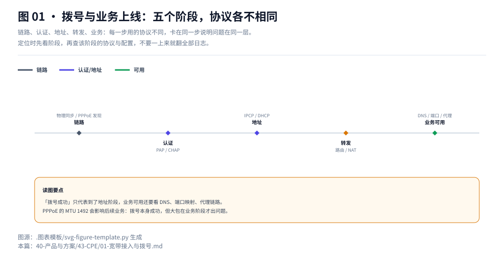
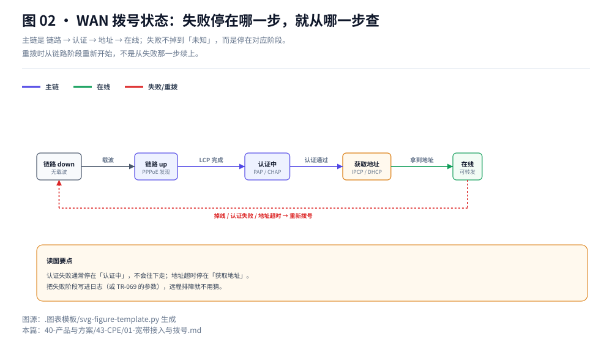

# 宽带接入与拨号

CPE 的第一件事是「把上行接通」：**选对接入方式 → 完成认证/拨号 → 拿到地址/DNS/前缀 → 建立默认路由 → 下发 NAT**。任何一步失败，用户看到的现象都只是「上不了网」。

> 本篇定位：xDSL/PON/以太/蜂窝四类上行的拨号方案、双栈与多 WAN 切换，以及接入失败的定位顺序。PPPoE 报文和 DHCP 协议细节去 `10-基础理论`，OpenWrt 的 netifd 实现去 `20-平台与系统`。

## 目录

- [1 一句话模型](#s1)
- [2 速览](#s2)
- [3 接入方式与字段](#s3)
- [4 交互流程](#s4)
- [5 状态机与定时器](#s5)
- [6 设计取舍与边界](#s6)
- [7 与相邻主题的关系](#s7)
- [名词解释](#名词解释)
- [8 参考与关联](#s8)

## 1 · 一句话模型：先通链路，再验身份，最后配地址

```text
物理/链路层（DSL 训练、PON 注册、蜂窝注册、以太 Link Up）
  → 认证/拨号（PPPoE / 802.1X / SIM）
  → 地址配置（IPCP / DHCP / RA / PD）
  → 默认路由 + DNS → 业务可用
```

三个关键认知：

1. **「拨号失败」要分层看**：链路没起来、认证被拒、地址没拿到，是三类完全不同的问题。
2. **PPPoE 有 8 字节开销**，MTU 通常是 1492，不处理会导致「小包通、大包不通」。
3. **IPv6 不靠 NAT**：WAN 拿地址和 PD 前缀，LAN 通过 RA/DHCPv6 下发，防火墙默认拒绝入站。

## 2 · 速览

| 项 | 内容 |
| --- | --- |
| 接入方式 | PPPoE、DHCP、静态 IP、蜂窝（QMI/MBIM/ECM/RNDIS） |
| 认证方式 | PPP 的 PAP/CHAP、802.1X、SIM 鉴权、绑定 MAC/SN |
| 地址来源 | IPCP、DHCPv4、RA/SLAAC、DHCPv6-PD |
| 关键对象 | WAN 接口、拨号配置、默认路由、DNS、MTU/MSS |
| 典型业务 | 家庭宽带、企业专线、5G 备份、双 WAN 负载 |
| 主要风险 | MTU 不匹配、双栈优先级、多 WAN 源地址漂移、重拨风暴 |

## 3 · 接入方式与字段

### 3.1 四类上行

| 方式 | 链路建立 | 认证/地址 | 典型问题 |
| --- | --- | --- | --- |
| xDSL | DSL 训练/同步 | PPPoE + IPCP | 线路噪声、训练速率、重训练 |
| PON | ONU 注册/测距/授权 | OMCI 配置 + PPPoE/DHCP | 光功率、注册失败、VLAN |
| 以太 | Link Up | PPPoE/DHCP/静态 | 自协商、VLAN、802.1X |
| 蜂窝 | 搜网/注册/附着 | SIM 鉴权 + 数据连接 | 信号、APN、制式、IP 分配 |

### 3.2 WAN 连接字段

| 字段 | 作用 | 坑/边界 |
| --- | --- | --- |
| 连接类型 | PPPoE/DHCP/静态 | 选错类型直接不通 |
| VLAN ID | 运营商业务 VLAN | 漏配或优先级错会导致拨号失败 |
| 账号/密码 | PPP 认证 | 特殊字符转义、大小写 |
| 服务名 | PPPoE 服务匹配 | 多 BRAS 环境可能要求匹配 |
| MTU/MRU | 最大收发单元 | PPPoE 常见 1492，PPPoE+隧道更小 |
| DNS | 域名解析 | 自动获取 vs 手动指定 |
| IPv6 开关 | 双栈 | 只开 v4 会拿不到前缀 |
| 拨号模式 | 自动/手动/按需 | 按需拨号容易「假在线」 |

### 3.3 蜂窝接入的接口模型

| 模式 | 宿主侧看到 | 适用 | 边界 |
| --- | --- | --- | --- |
| QMI | /dev/cdc-wdm + wwan | 高通 Modem，控制面丰富 | 需要 qmi_wwan 驱动 |
| MBIM | /dev/cdc-wdm + wwan | 标准化的移动宽带接口 | 功能集取决于 Modem |
| ECM | usbnet 网卡 | 免驱、简单 | 控制能力弱 |
| RNDIS | usbnet 网卡 | Windows 兼容好 | Linux 下性能和稳定性一般 |
| NDIS | 厂商私有 | 特定平台 | 依赖厂商驱动 |

## 4 · 交互流程



**读图**：先链路、再认证、再地址、最后路由/NAT；任何一步失败都会停在对应阶段，定位时按阶段向上排查。

> 图源：`images/图01-拨号与业务上线.svg`

### 4.1 PPPoE 拨号

```text
WAN Link Up → PADI/PADO/PADR/PADS 拿 Session ID
  → LCP 协商（MRU/认证/魔术字）
  → PAP/CHAP 认证
  → IPCP 拿 IPv4/DNS；IPv6CP 拿接口 ID
  → 建立默认路由 → NAT 生效
```

### 4.2 DHCP / 静态

```text
DHCP：Discover → Offer → Request → Ack（拿地址/网关/DNS/租期）
静态：配置地址/掩码/网关/DNS → 直接建默认路由
```

### 4.3 IPv6 双栈

```text
WAN：DHCPv6-PD 申请前缀 + RA 获取默认路由
LAN：用 PD 前缀做 RA/SLAAC，或 DHCPv6 下发地址
防火墙：默认拒绝入站，按需放行
```

### 4.4 多 WAN 与切换

```text
主 WAN 探测（Ping/DNS/HTTP）→ 失败计数 → 切备 WAN
  → 更新默认路由/源地址 → 已有连接按策略保持或重建
```

### 4.5 异常分支

| 现象 | 阶段 | 优先排查 |
| --- | --- | --- |
| WAN 灯不亮 | 物理/链路 | 网线/光功率/DSL 训练/模块供电 |
| 一直发 PADI | 发现 | VLAN、BRAS 可达性、广播隔离 |
| 认证被拒 | 认证 | 账号密码、绑定、欠费、认证方式 |
| 拿到地址但无法上网 | 路由/NAT | 默认路由、NAT 规则、DNS |
| 小包通大包不通 | MTU | PPPoE 开销、MSS 钳制、隧道封装 |
| IPv6 有地址不能上网 | 双栈 | RA 默认路由、DNS、防火墙 |
| 频繁重拨 | 保活 | LCP Echo、链路误码、运营商限制 |

## 5 · 状态机与定时器




**读图**：链路→认证→地址→在线，失败停在对应阶段；排障先定位阶段再查配置。

> 图源：`images/图02-WAN拨号状态.svg`

| 对象 | 状态 | 关键定时器/参数 |
| --- | --- | --- |
| PPPoE | 发现 → 会话 → 认证 → 网络 → 断开 | PADI/PADR 重传、LCP Echo |
| DHCP | INIT → SELECTING → REQUESTING → BOUND → RENEW | 租期、续租 T1/T2 |
| IPv6 RA | 等待 → 收到 RA → 配置地址/默认路由 | RA 间隔、路由生命周期 |
| 蜂窝 | 搜网 → 注册 → 附着 → 数据连接 | 重试间隔、APN 超时 |
| 多 WAN 探测 | 正常 → 怀疑 → 切换 → 回切 | 探测周期、失败阈值、回切抑制 |

> 待验证：各运营商的 LCP Echo、DHCP 租期、PD 前缀长度和重拨抑制策略不同，需按现网配置。

## 6 · 设计取舍与边界

### 6.1 PPPoE vs DHCP/IPoE

PPPoE 认证和计费成熟，但多 8 字节开销、需要客户端；DHCP/IPoE 简单、开销小，但认证依赖 802.1X/Option 82 等机制。选哪种由运营商认证体系决定，不是纯技术优劣。

### 6.2 自动拨号 vs 按需拨号

自动拨号保持在线，适合常驻业务；按需拨号省连接数，但首次访问有延迟，且容易被探测流量「误唤醒」。CPE 默认自动拨号更稳。

### 6.3 双栈优先级

IPv4/IPv6 同时可用时，终端按 RFC 6724 选择地址。CPE 要保证两条路径的 DNS、MTU、防火墙一致，否则会出现「有的应用走 v6 不通」。

### 6.4 多 WAN 的边界

多 WAN 提高可用性，但会破坏需要固定源 IP 的会话；切换时连接重建，VoIP/游戏会中断。关键业务应做「主备 + 连接保持」，而不是简单负载均衡。

### 6.5 蜂窝 CPE 的特殊性

蜂窝接入有流量资费、信号波动和运营商 NAT（可能拿不到公网 IP）。产品要支持流量统计、信号质量显示、APN 配置和断线重连，不能照搬有线 CPE 的假设。

## 7 · 与相邻主题的关系

| 相邻对象 | 关系 |
| --- | --- |
| [PPP 与 PPPoE](../../10-基础理论/11-网络科学/02-链路层/06-PPP与PPPoE.md) | 拨号报文与三阶段 |
| [DHCPv4](../../10-基础理论/11-网络科学/05-应用层/01-DHCPv4.md) | 动态地址 |
| [DHCPv6](../../10-基础理论/11-网络科学/05-应用层/02-DHCPv6.md) | 前缀委派 |
| [IPv6](../../10-基础理论/11-网络科学/03-网络层/02-IPv6.md) | 地址与 RA |
| [PON 复用测距与注册](../../10-基础理论/12-通信科学/03-光通信/01-PON复用测距与注册.md) | PON 上行注册 |
| [WAN 接入与 PPPoE](../../20-平台与系统/22-OpenWrt/03-网络数据面/04-WAN接入与PPPoE.md) | OpenWrt 实现 |
| [CPE 系统架构](./00-CPE系统架构.md) | 整机业务模型 |
| [运营商定制与入网](./03-运营商定制与入网.md) | 现网差异 |

一句话：**拨号方案的本质是「链路、认证、地址」三段式，排障也必须按这三段走。**

## 名词解释

> 缩写给出英文全称；非缩写用“—”表示。

| 术语 | 英文全称 | 解释 |
| --- | --- | --- |
| PPPoE | Point-to-Point Protocol over Ethernet | 以太网上的 PPP 拨号。 |
| IPCP | Internet Protocol Control Protocol | PPP 上的 IPv4 配置协议。 |
| IPv6CP | IPv6 Control Protocol | PPP 上的 IPv6 配置协议。 |
| DHCP | Dynamic Host Configuration Protocol | 动态主机配置协议。 |
| PD | Prefix Delegation | DHCPv6 前缀委派。 |
| RA | Router Advertisement | 路由器通告。 |
| SLAAC | Stateless Address Autoconfiguration | 无状态地址自动配置。 |
| MTU | Maximum Transmission Unit | 最大传输单元。 |
| MSS | Maximum Segment Size | TCP 最大报文段长度。 |
| BRAS | Broadband Remote Access Server | 宽带远程接入服务器。 |
| APN | Access Point Name | 蜂窝接入点名称。 |
| QMI | Qualcomm MSM Interface | 高通 Modem 接口。 |
| MBIM | Mobile Broadband Interface Model | 移动宽带接口模型。 |
| ECM | Ethernet Control Model | USB 以太网控制模型。 |
| RNDIS | Remote NDIS | 远程网络驱动接口规范。 |

## 8 · 参考与关联

**标准**

- RFC 2516：PPPoE
- RFC 1661 / 1332 / 1994：PPP / IPCP / CHAP
- RFC 2131 / 8415：DHCPv4 / DHCPv6
- RFC 4861 / 4862：ND / SLAAC
- RFC 6724：Default Address Selection
- 3GPP TS 27.010 / 27.007：终端与 Modem 的 AT/QMI 相关规范

**关联**

- [设备形态对比](../00-设备形态对比.md)
- [CPE 系统架构](./00-CPE系统架构.md)
- [TR-069 与 ACS 运维](./02-TR-069与ACS运维.md)
- [运营商定制与入网](./03-运营商定制与入网.md)

---

> **本篇定位**：CPE 四类上行的拨号配置、双栈/多 WAN 流程与接入失败定位。
> **素材来源**：`studyspace/1.知识体系/7.openwrt/3.网络业务/1.基础网络模型/1.WAN/`、`7.5G拨号/5G拨号.md`、`studyspace/3.协议应用/6.pppoe/pppoe.md`。
> **待验证**：各运营商的 VLAN/认证/PD 前缀/重拨策略与蜂窝 APN 参数。
