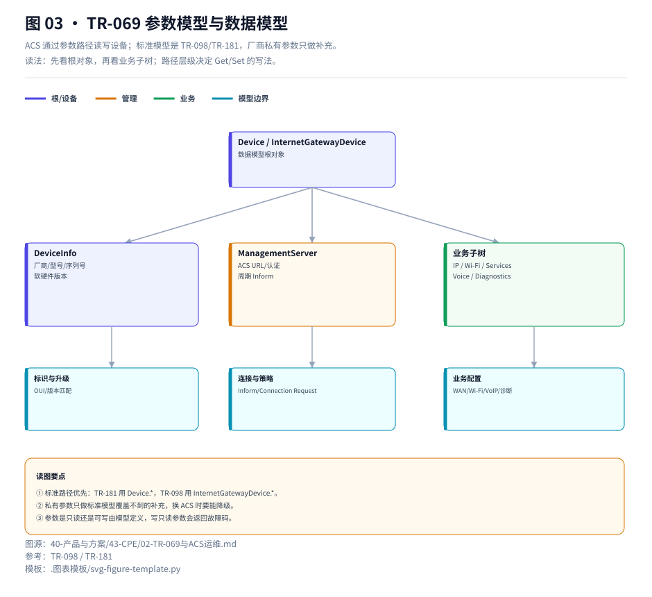
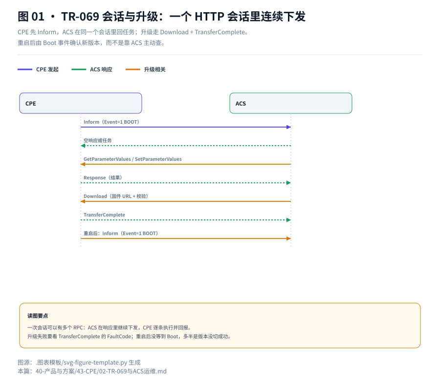
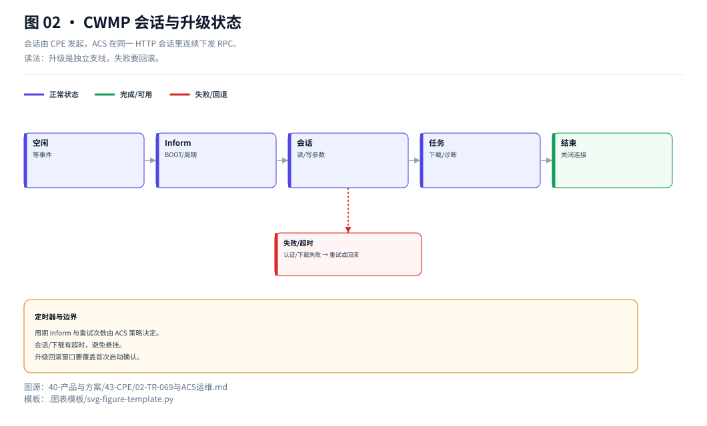

# TR-069 与 ACS 运维

运营商批量管理 CPE，靠的是「设备主动上报 + ACS 下发任务」：**上电 Inform 报到，ACS 读参数、改配置、推升级、做诊断**。TR-069 不负责业务转发，但没有它，CPE 就无法远程开通和运维。

> 本篇定位：CWMP 会话、参数模型、连接请求、固件升级与诊断的产品实现。协议报文细节去 `10-基础理论/05-应用层/07-TR-069.md`，OpenWrt 实现去 `20-平台与系统`。

## 目录

- [1 一句话模型](#s1)
- [2 速览](#s2)
- [3 会话与参数模型](#s3)
- [4 交互流程](#s4)
- [5 状态机与定时器](#s5)
- [6 设计取舍与边界](#s6)
- [7 与相邻主题的关系](#s7)
- [名词解释](#名词解释)
- [8 参考与关联](#s8)

## 1 · 一句话模型：设备报到，ACS 派活

```text
CPE 上电 → Inform（我是谁、我有哪些参数）
  → ACS 认证/绑定 → 下发任务（读/写/升级/诊断/重启）
  → CPE 执行 → 回响应 → 会话结束
```

三个关键认知：

1. **TR-069 是「拉」模型**：CPE 主动连 ACS；ACS 想主动下发，要先发 Connection Request 让 CPE 回连。
2. **参数模型是合同**：TR-098（InternetGatewayDevice）和 TR-181（Device）定义路径和语义，厂商私有参数不能替代标准参数。
3. **升级是高风险动作**：必须校验、双分区、失败回滚，不能「下载完直接覆盖」。

## 2 · 速览

| 项 | 内容 |
| --- | --- |
| 协议 | CWMP（TR-069），基于 HTTP/HTTPS 的 SOAP RPC |
| 角色 | CPE（客户端）、ACS（服务器） |
| 关键能力 | 参数读写、属性通知、文件下载/上传、重启、诊断、定时任务 |
| 数据模型 | TR-098、TR-181、厂商扩展 |
| 传输 | HTTP/HTTPS，默认端口由 ACS 指定（常见 7547） |
| 认证 | CPE 侧 Basic/Digest；ACS 侧可校验证书 |
| 典型周期 | 上电 Inform、周期 Inform（如 30 min～24 h，待运营商确认） |

## 3 · 会话与参数模型



**读图**：根对象下是 DeviceInfo、ManagementServer、业务子树与厂商扩展；ACS 按路径读写，标准模型优先、私有参数补充。

> 图源：`images/图03-TR069参数模型.svg`

### 3.1 会话中的主要 RPC

| RPC | 方向 | 作用 | 边界 |
| --- | --- | --- | --- |
| Inform | CPE → ACS | 上报事件、参数、序列号 | 事件码决定 ACS 后续动作 |
| InformResponse | ACS → CPE | 确认收到 | 空响应也算成功 |
| GetParameterValues | ACS → CPE | 读参数 | 路径不存在返回故障码 |
| SetParameterValues | ACS → CPE | 写参数 | 可能触发重启/重连 |
| GetParameterNames | ACS → CPE | 遍历参数树 | 数据模型版本要对齐 |
| AddObject / DeleteObject | ACS → CPE | 增删实例（如 WAN 连接） | 实例号由 CPE 分配 |
| Download | ACS → CPE | 下载固件/配置文件 | 需要文件类型、校验和、URL |
| Upload | ACS → CPE | 上传日志/配置 | 大文件要限速/分段 |
| Reboot | ACS → CPE | 远程重启 | 要确认业务影响 |
| Diagnostic | ACS → CPE | Ping/Traceroute/测速 | 依赖 CPE 实现 |
| Connection Request | ACS → CPE | 通知 CPE 回连 | 依赖 CPE 可达或 STUN |

### 3.2 关键参数

| 参数组 | 典型内容 | 产品关注点 |
| --- | --- | --- |
| 设备信息 | 厂商、型号、序列号、硬件/软件版本 | 与 ACS 绑定、升级匹配 |
| 管理服务器 | ACS URL、用户名/密码、周期 Inform | 首次上线和换 ACS |
| WAN | 连接类型、VLAN、账号、IP/DNS | 业务开通 |
| LAN/DHCP | 网段、地址池、租期 | 用户侧配置 |
| Wi-Fi | SSID、密码、信道、功率 | 远程改 Wi-Fi |
| 语音 | SIP 账号、注册状态 | VoIP 开通 |
| 防火墙/QoS | 规则、限速 | 业务策略 |
| 日志/诊断 | 日志级别、诊断结果 | 远程排障 |

### 3.3 事件码

| 事件 | 含义 | ACS 常见动作 |
| --- | --- | --- |
| `0 BOOTSTRAP` | 首次连接/恢复出厂 | 下发全量配置 |
| `1 BOOT` | 每次上电 | 检查版本/配置 |
| `2 PERIODIC` | 周期上报 | 巡检、拉日志 |
| `4 VALUE CHANGE` | 参数变化 | 同步配置 |
| `6 CONNECTION REQUEST` | ACS 主动请求 | 建立会话 |
| `7 TRANSFER COMPLETE` | 下载完成 | 校验/重启 |
| `8 DIAGNOSTICS COMPLETE` | 诊断完成 | 取结果 |
| `M Reboot` / `M ScheduleReboot` | 重启相关 | 计划任务 |

## 4 · 交互流程



**读图**：CPE 先 Inform，ACS 在同一个 HTTP 会话里连续下发 RPC；升级走 Download + TransferComplete，重启后由 Boot 事件确认新版本。

> 图源：`images/图01-TR069会话与升级.svg`

### 4.1 首次上线

```text
CPE 上电 → 读取 ACS 地址 → 建立 HTTPS → Inform（BOOTSTRAP/1 BOOT）
  → ACS 认证/绑定（序列号/OUI/证书）
  → 下发 WAN/Wi-Fi/语音配置 → CPE 应用 → 回响应
  → 业务开通完成
```

### 4.2 周期巡检

```text
周期 Inform（2 PERIODIC）→ ACS 读版本/状态/告警
  → 需要时下发 SetParameterValues 或诊断
  → 记录结果 → 结束
```

### 4.3 远程升级

```text
ACS 下发 Download（URL、文件类型、校验和）
  → CPE 下载到临时分区 → 校验（大小/哈希/签名）
  → 写升级标志 → 重启
  → 新镜像启动 → Inform（1 BOOT + 版本）→ ACS 确认
  → 失败则回滚到旧分区
```

### 4.4 ACS 主动下发

```text
ACS → Connection Request（HTTP GET 到 CPE）
  → CPE 返回 200 → 反向建立会话 → Inform（6 CONNECTION REQUEST）
  → 执行任务
```

CPE 在 NAT 后面时，ACS 可能连不进来，需要 CPE 保持长连接、使用 STUN，或等周期 Inform。

### 4.5 异常分支

| 异常 | 现象 | 定位方向 |
| --- | --- | --- |
| 一直不上线 | ACS 看不到设备 | ACS 地址/DNS/端口/证书/时间 |
| 认证失败 | 401/403 | 账号密码、证书、绑定关系 |
| 参数写不进去 | 返回故障码 | 参数路径、只读属性、数据模型版本 |
| 升级失败 | 版本没变/变砖 | URL 可达、校验和、分区空间、回滚 |
| Connection Request 失败 | ACS 主动任务下发不了 | CPE 在 NAT 后、端口未放行 |
| 周期 Inform 风暴 | ACS 压力大 | 周期过短、随机抖动缺失 |

## 5 · 状态机与定时器




**读图**：升级写的是备用分区：下载、校验、写分区、切换、确认五步；任一步失败都能回滚到旧版本，「重启」不等于完成。

> 图源：`images/图02-CWMP会话与升级状态.svg`

| 对象 | 状态 | 关键参数 |
| --- | --- | --- |
| CWMP 会话 | 空闲 → 连接 → 会话 → 结束 | 会话超时、最大并发 |
| Inform | 未上报 → 上报中 → 成功/失败 | 周期、重试、随机抖动 |
| 下载 | 未开始 → 下载 → 校验 → 应用 | 超时、重试、校验方式 |
| 升级 | 待升级 → 已写入 → 重启 → 确认/回滚 | 回滚超时、看门狗 |
| Connection Request | 空闲 → 收到 → 回连 | 认证、超时 |

> 待验证：各运营商 ACS 的 Inform 周期、重试次数、证书校验和升级确认策略不同，必须以现网规范为准。

## 6 · 设计取舍与边界

### 6.1 TR-069 vs TR-369

TR-069 成熟、运营商存量最大；TR-369（USP）支持 MQTT/WebSocket、多控制器和更灵活的数据模型，适合云管和智能网关。新产品可双栈共存，但不要假设 ACS 一定支持 USP。

### 6.2 标准参数 vs 厂商私有参数

标准参数保证互通，私有参数能快速实现定制。原则是「业务配置尽量用标准参数，私有参数只做补充」，否则换 ACS 或换平台时迁移成本很高。

### 6.3 远程升级的边界

升级包要签名/校验，升级过程不能断电；双分区是底线，单分区产品必须保留恢复模式。批量升级要分批灰度，不能一次推全网。

### 6.4 管理通道与业务通道

管理流量可以走业务 WAN，也可以走独立管理 VLAN。走业务 WAN 成本低，但受 NAT/防火墙影响；独立通道更可靠，但增加组网复杂度。

### 6.5 隐私与安全

TR-069 能读 Wi-Fi 密码、设备位置、连接记录，必须用 HTTPS、最小权限和审计。ACS 账号泄露等于批量设备失守。

## 7 · 与相邻主题的关系

| 相邻对象 | 关系 |
| --- | --- |
| [TR-069](../../10-基础理论/11-网络科学/05-应用层/07-TR-069.md) | CWMP 协议与报文 |
| [TR-369](../../10-基础理论/11-网络科学/05-应用层/08-TR-369.md) | USP 协议 |
| [OMA-DM](../../10-基础理论/11-网络科学/05-应用层/09-OMA-DM.md) | 移动设备管理协议 |
| [CPE 系统架构](./00-CPE系统架构.md) | 被管理对象的整体 |
| [宽带接入与拨号](./01-宽带接入与拨号.md) | 管理通道依赖的 WAN |
| [运营商定制与入网](./03-运营商定制与入网.md) | ACS 参数与集采要求 |
| [OpenWrt 系统框架](../../20-平台与系统/22-OpenWrt/02-系统框架/00-系统框架总览.md) | UCI/ubus 配置落地 |

一句话：**TR-069 的价值 = 设备可被发现 × 参数可被读写 × 升级可被回滚。**

## 名词解释

> 缩写给出英文全称；非缩写用“—”表示。

| 术语 | 英文全称 | 解释 |
| --- | --- | --- |
| TR-069 | — | CPE WAN 管理协议标准，协议名 CWMP。 |
| CWMP | CPE WAN Management Protocol | TR-069 定义的协议。 |
| ACS | Auto Configuration Server | 自动配置服务器。 |
| RPC | Remote Procedure Call | 远程过程调用。 |
| SOAP | Simple Object Access Protocol | 简单对象访问协议。 |
| TR-098 | — | InternetGatewayDevice 数据模型。 |
| TR-181 | — | Device:2 数据模型。 |
| TR-369 | — | USP 用户服务平台协议。 |
| USP | User Services Platform | TR-369 定义的平台协议。 |
| OUI | Organizationally Unique Identifier | 组织唯一标识符。 |
| STUN | Session Traversal Utilities for NAT | NAT 会话穿越工具。 |
| HTTPS | Hypertext Transfer Protocol Secure | 安全超文本传输协议。 |

## 8 · 参考与关联

**标准**

- TR-069：CPE WAN Management Protocol
- TR-098：Internet Gateway Device Data Model
- TR-181：Device Data Model
- TR-369：User Services Platform
- TR-111：TR-069 的 NAT 穿透扩展

**关联**

- [设备形态对比](../00-设备形态对比.md)
- [CPE 系统架构](./00-CPE系统架构.md)
- [宽带接入与拨号](./01-宽带接入与拨号.md)
- [运营商定制与入网](./03-运营商定制与入网.md)

---

> **本篇定位**：TR-069 会话、参数模型、连接请求、升级回滚和 ACS 运维边界。
> **素材来源**：`studyspace/3.协议应用/1.tr069/`、`studyspace/1.知识体系/7.openwrt/3.网络业务/2.关键组件服务/6.CPE专属业务/1.TR069&TR369.md`。
> **待验证**：各运营商 ACS 的 URL/认证/周期/证书/升级确认策略，以及私有参数清单。
