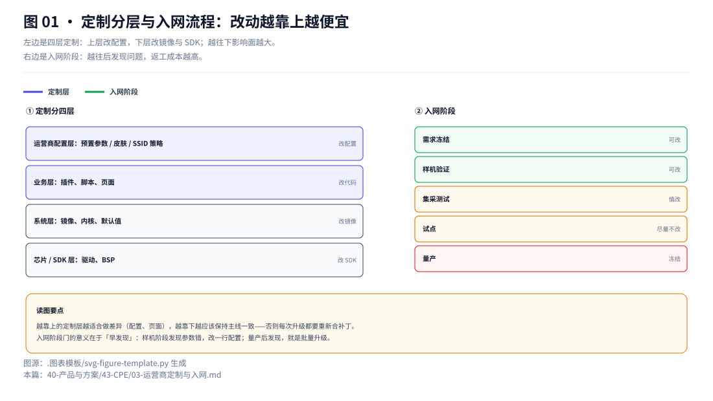
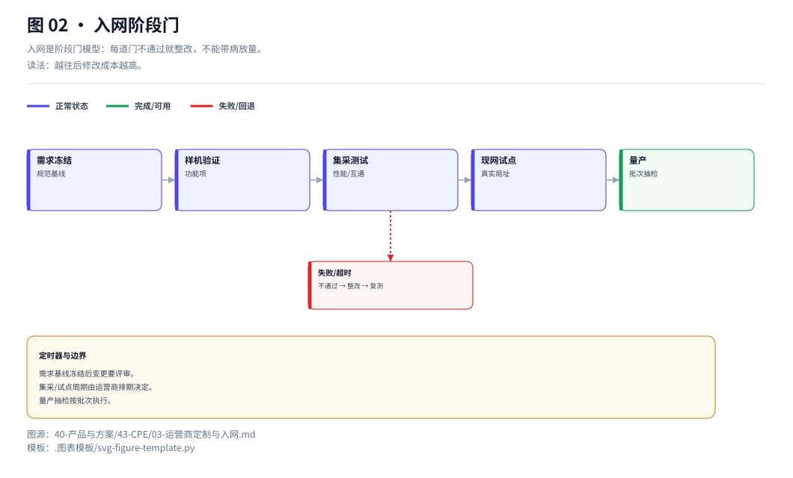

# 运营商定制与入网

同一个硬件平台卖给不同运营商，差异不在主板，而在「**默认配置、界面、管理参数、业务模板、认证与锁网**」。定制做得好是配置分层，做得差就是一堆互不兼容的固件分支。

> 本篇定位：运营商定制的分层模型、典型定制项、入网测试流程和版本管理边界。协议细节链接到 10，平台实现链接到 20/30。

## 目录

- [1 一句话模型](#s1)
- [2 速览](#s2)
- [3 定制分层与字段](#s3)
- [4 交互流程](#s4)
- [5 状态与定时器](#s5)
- [6 设计取舍与边界](#s6)
- [7 与相邻主题的关系](#s7)
- [名词解释](#名词解释)
- [8 参考与关联](#s8)

## 1 · 一句话模型：平台做一次，定制做一层

```text
平台基线（内核/驱动/SDK/基础服务）
  └─ 产品型号（硬件配置、端口、Wi-Fi）
       └─ 运营商定制（默认配置、ACS、业务模板、UI）
            └─ 区域/项目差异（频段、语言、法规、锁网）
```

三个关键认知：

1. **能配置的不要改代码**：默认值、开关、SSID 模板、ACS 地址都应该走配置，而不是每个运营商拉一个分支。
2. **定制项要能追溯**：哪个版本、哪个运营商、哪个项目、改了哪些参数，必须可查。
3. **入网不是「测完就行」**：集采测试、互通测试、现网试点、量产抽检，每一关的判据不同。

## 2 · 速览

| 项 | 内容 |
| --- | --- |
| 定制对象 | 默认配置、Web/App、ACS、业务模板、LOGO/语言、锁网 |
| 关键差异 | 频段/信道、VoIP 参数、IPTV VLAN、TR-069 参数、升级策略 |
| 入网阶段 | 需求对齐 → 样机 → 集采测试 → 试点 → 量产 |
| 交付物 | 固件、默认配置、MIB/数据模型、测试报告、升级包 |
| 主要风险 | 分支爆炸、认证不通过、锁网误伤、升级不可回滚 |
| 管理方式 | 配置分层、特性开关、版本矩阵、灰度发布 |

## 3 · 定制分层与字段

### 3.1 分层模型

| 层 | 内容 | 谁维护 | 变更频率 |
| --- | --- | --- | --- |
| 平台基线 | 内核、驱动、SDK、基础服务 | 平台/芯片团队 | 低 |
| 产品型号 | 硬件配置、端口、Wi-Fi、语音 | 产品团队 | 中 |
| 运营商定制 | 默认配置、ACS、业务模板、UI | 定制/项目团队 | 高 |
| 区域/项目 | 频段、语言、法规、锁网 | 项目团队 | 高 |

### 3.2 典型定制项

| 类别 | 定制内容 | 实现方式 | 边界 |
| --- | --- | --- | --- |
| 网络 | WAN 模式、VLAN、MTU、DNS | 默认配置/业务模板 | 运营商间差异大 |
| 无线 | SSID 前缀、默认密码、信道、功率 | 配置/区域码 | 法规限制 |
| 语音 | SIP 服务器、编解码、拨号计划 | 配置 | 需要互通测试 |
| IPTV | VLAN、组播、IGMP 版本 | 配置/驱动参数 | 依赖上游网络 |
| 管理 | ACS URL、认证、周期、参数集 | 配置/插件 | 数据模型要对齐 |
| 界面 | LOGO、语言、菜单、向导 | 前端资源 | 不要改业务逻辑 |
| 安全 | 默认密码策略、端口封闭、锁网 | 配置/代码 | 锁网要有解锁流程 |
| 升级 | 升级服务器、灰度策略、回滚 | 配置/后台 | 必须可回滚 |

### 3.3 版本矩阵

| 维度 | 示例 | 说明 |
| --- | --- | --- |
| 硬件版本 | HW V1/V2 | 器件替换要兼容 |
| 软件基线 | 主版本.次版本.补丁 | 平台统一 |
| 运营商 | A/B/C | 配置差异 |
| 区域 | 国内/海外 | 频段/语言/法规 |
| 项目 | 集采/试点/定制 | 特殊需求 |

> 待验证：具体运营商的定制项清单、参数路径和验收判据以其集采规范为准，本篇只给分类框架。

## 4 · 交互流程



**读图**：左边是四层定制，越往下变更越频繁；右边是入网阶段，越往后修改成本越高。

> 图源：`images/图01-定制分层与入网.svg`

### 4.1 定制落地流程

```text
运营商需求 → 差异分析（配置/插件/代码）
  → 配置模板 + 特性开关 → 内部验证
  → 生成定制包（固件 + 默认配置 + 文档）
  → 入网测试 → 试点 → 量产
```

### 4.2 入网测试阶段

| 阶段 | 目标 | 典型内容 | 退出条件 |
| --- | --- | --- | --- |
| 需求对齐 | 确认规范 | 业务清单、参数、界面 | 需求基线冻结 |
| 样机验证 | 功能可用 | 拨号、Wi-Fi、VoIP、IPTV、ACS | 功能项通过 |
| 集采测试 | 满足入网门槛 | 性能、稳定性、互通、安全 | 测试报告通过 |
| 现网试点 | 真实环境验证 | 不同局址、不同 BRAS/OLT | 试点无阻断问题 |
| 量产 | 一致性 | 抽检、烧号、校准 | 批次合格 |

### 4.3 异常分支

| 异常 | 现象 | 定位方向 |
| --- | --- | --- |
| 定制后无法拨号 | 特定运营商失败 | VLAN/账号/认证方式/MTU |
| ACS 不上线 | 只在某省失败 | ACS 地址/证书/时间/网络可达 |
| VoIP 单通 | 注册成功无声音 | NAT/SIP ALG/编解码/防火墙 |
| IPTV 黑屏 | 组播不通 | VLAN/IGMP/组播复制点 |
| 升级变砖 | 定制包不启动 | 镜像签名/分区/配置兼容 |
| 锁网误伤 | 合法卡不能用 | 锁网策略/白名单/解锁流程 |

## 5 · 状态与定时器




**读图**：需求、样机、集采、试点、量产是阶段门；越往后修改成本越高。

> 图源：`images/图02-入网阶段门.svg`

定制与入网是项目流程，不是设备状态机，但有几个关键「门」：

| 门 | 进入条件 | 退出条件 | 风险 |
| --- | --- | --- | --- |
| 需求冻结 | 规范确认 | 变更评审通过 | 后期变更导致返工 |
| 样机通过 | 功能项全过 | 问题关闭 | 带病进入集采 |
| 集采通过 | 测试报告合格 | 运营商准入 | 指标临界被拒 |
| 试点通过 | 现网无阻断 | 批量放号 | 局部环境差异 |
| 量产放行 | 抽检合格 | 持续交付 | 批次一致性 |

## 6 · 设计取舍与边界

### 6.1 配置化 vs 分支化

配置化让一套固件覆盖多个运营商，升级和维护成本低；分支化能快速满足特殊需求，但分支越多越难合并。原则是「差异优先配置，配置不了做插件，最后才改代码」。

### 6.2 统一固件 vs 定制固件

统一固件便于灰度与回滚，但包体大、默认配置复杂；定制固件精简，但版本矩阵膨胀。运营商集采通常要求定制固件，内部要用同一基线构建，避免「同名不同源」。

### 6.3 锁网 vs 开放

锁网满足运营商补贴机要求，但会带来二手流通和出国漫游问题。产品要提供明确的解锁流程和合规说明，不能把锁网做成「永久砖」。

### 6.4 入网测试的边界

实验室通过不等于现网通过：不同 BRAS/OLT/ACS 版本、不同局址的 VLAN 和组播配置都会引入差异。试点阶段必须覆盖「最差的现网环境」，而不是只挑一个顺利的局址。

### 6.5 定制文档的价值

定制项、参数路径、默认值、升级方式要形成交付文档。没有文档的定制，下一次换人就得反向猜配置，维护成本会指数上升。

## 7 · 与相邻主题的关系

| 相邻对象 | 关系 |
| --- | --- |
| [CPE 系统架构](./00-CPE系统架构.md) | 被定制的整机 |
| [宽带接入与拨号](./01-宽带接入与拨号.md) | WAN 定制项 |
| [TR-069 与 ACS 运维](./02-TR-069与ACS运维.md) | 管理面定制项 |
| [OpenWrt 定制与裁剪](../../20-平台与系统/22-OpenWrt/06-定制与裁剪/00-产品化定制总览.md) | 平台侧定制方法 |
| [平台对比](../../30-平台与芯片/00-平台对比.md) | 芯片/SDK 差异 |
| [设备形态对比](../00-设备形态对比.md) | 产品形态边界 |

一句话：**定制的目标是「一套基线 + 多套配置」，而不是「一个运营商一个固件」。**

## 名词解释

> 缩写给出英文全称；非缩写用“—”表示。

| 术语 | 英文全称 | 解释 |
| --- | --- | --- |
| CPE | Customer Premises Equipment | 用户侧设备。 |
| ACS | Auto Configuration Server | 自动配置服务器。 |
| OLT | Optical Line Terminal | 光线路终端。 |
| BRAS | Broadband Remote Access Server | 宽带远程接入服务器。 |
| VLAN | Virtual Local Area Network | 虚拟局域网。 |
| SSID | Service Set Identifier | 无线网络名称。 |
| SIP | Session Initiation Protocol | 会话发起协议。 |
| IPTV | Internet Protocol Television | IP 电视。 |
| IGMP | Internet Group Management Protocol | 互联网组管理协议。 |
| MIB | Management Information Base | 管理信息库。 |
| OUI | Organizationally Unique Identifier | 组织唯一标识符。 |
| 锁网 | — | 限制设备只能在指定运营商网络使用的机制。 |

## 8 · 参考与关联

**标准/规范**

- TR-069 / TR-369：远程管理
- TR-098 / TR-181：数据模型
- ITU-T G.984 / G.987：PON 接入
- 3GPP TS 23.003 / 31.102：蜂窝终端标识与配置
- 各运营商集采测试规范（内部资料，不公开）

**关联**

- [设备形态对比](../00-设备形态对比.md)
- [CPE 系统架构](./00-CPE系统架构.md)
- [宽带接入与拨号](./01-宽带接入与拨号.md)
- [TR-069 与 ACS 运维](./02-TR-069与ACS运维.md)

---

> **本篇定位**：运营商定制的分层模型、典型定制项、入网阶段与版本管理边界。
> **素材来源**：`studyspace/1.知识体系/7.openwrt/3.网络业务/2.关键组件服务/6.CPE专属业务/`、`studyspace/3.协议应用/1.tr069/`。
> **待验证**：各运营商的具体定制清单、参数路径、集采判据和锁网合规要求。
