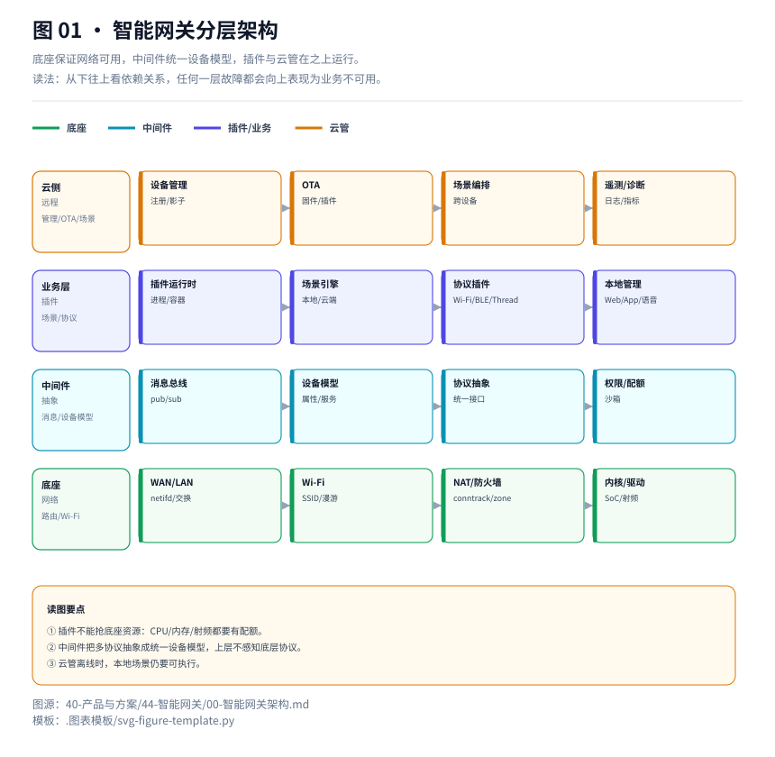
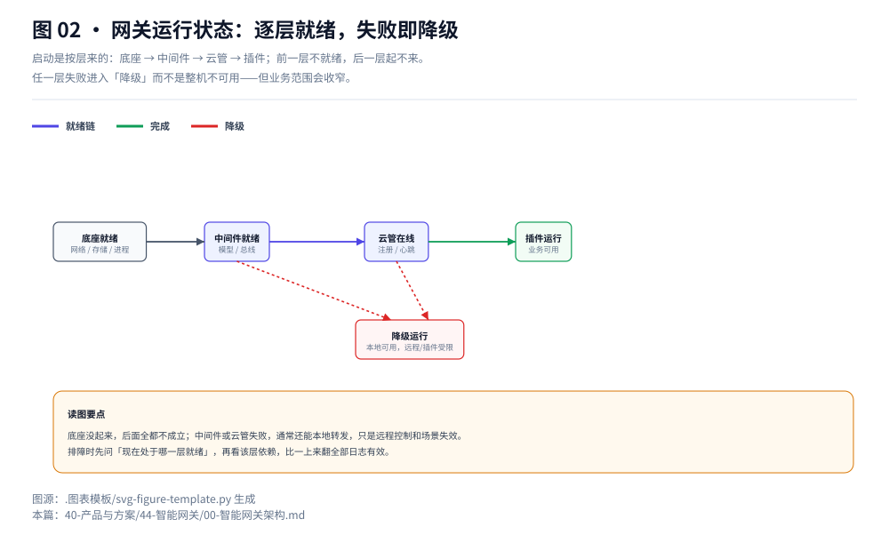

# 智能网关架构

智能网关是「路由器 + 智能家居中枢 + 云管终端」的叠加体：**它既要做 WAN/LAN/Wi-Fi 的基础网络，又要承载插件、协议转换和远程运维**。多出来的能力，也意味着多出来的攻击面和资源竞争。

> 本篇定位：智能网关的整机分层、与普通路由的差异、关键子系统与产品指标。路由转发细节去 `42-路由器`，插件与云管去 `01-插件化与云管`，协议与隔离去 `02-智能家居与安全`。

## 目录

- [1 一句话模型](#s1)
- [2 速览](#s2)
- [3 结构与字段](#s3)
- [4 交互流程](#s4)
- [5 状态机与定时器](#s5)
- [6 设计取舍与边界](#s6)
- [7 与相邻主题的关系](#s7)
- [名词解释](#名词解释)
- [8 参考与关联](#s8)

## 1 · 一句话模型：底座是路由，增值在插件

```text
云侧：设备管理 / OTA / 场景 / 数据
  └─ 网关：云管 Agent + 插件框架 + 协议栈
        └─ 底座：WAN/LAN/Wi-Fi + NAT/防火墙/QoS
              └─ 终端：手机/PC/摄像头/传感器/家电
```

三个关键认知：

1. **先保住底座**：路由、Wi-Fi、NAT 不稳，插件再多也没有意义。插件不能抢底座资源。
2. **网关是「协议翻译器」**：Wi-Fi/BLE/Zigbee/Thread/Matter 在南向接入，统一抽象后向北上报。
3. **云管和本地要能分工**：断网时本地场景仍要可用，云端负责跨设备编排和远程运维。

## 2 · 速览

| 项 | 内容 |
| --- | --- |
| 产品定位 | 家庭/企业网络中枢 + 智能家居控制 + 云管终端 |
| 核心对象 | 网络接口、SSID、插件、设备影子、场景、协议子设备 |
| 关键能力 | 路由/NAT、Wi-Fi 组网、插件运行、协议接入、云管/OTA |
| 典型形态 | 家庭智能网关、企业融合网关、FTTR 主网关 |
| 软件栈 | Linux/OpenWrt + 中间件 + 插件运行时 + 云 Agent |
| 关键标准 | Matter、Thread、Zigbee、BLE、TR-069/TR-369、MQTT |
| 主要指标 | 转发性能、Wi-Fi 覆盖、插件稳定性、断网可用性、升级成功率 |

## 3 · 结构与字段

### 3.1 与普通路由的差异

| 维度 | 普通路由 | 智能网关 |
| --- | --- | --- |
| 核心职责 | 转发与上网 | 转发 + 协议接入 + 业务编排 |
| 软件形态 | 单体固件 | 底座 + 插件/容器 |
| 管理方式 | 本地 Web/App | 本地 + 云管 + 远程运维 |
| 协议栈 | IP/Wi-Fi | IP/Wi-Fi + BLE/Zigbee/Thread/Matter |
| 资源压力 | 转发为主 | 转发 + 插件 + 协议栈竞争 |
| 安全边界 | 内外网 | 内外网 + IoT 子网 + 插件沙箱 |

### 3.2 硬件组成

| 部件 | 作用 | 产品关注点 |
| --- | --- | --- |
| 主控 SoC | 路由、插件、协议栈 | 算力、内存、是否支持容器 |
| Wi-Fi 芯片 | 家庭覆盖 | 频段、空间流、Mesh |
| 交换芯片 | LAN 多口 | 端口速率、VLAN |
| 短距射频 | BLE/Zigbee/Thread | 天线、共存、协议认证 |
| 存储 | 固件、插件、日志、场景 | eMMC 容量、寿命、分区 |
| 安全芯片 | 密钥、安全启动 | 是否独立、密钥注入流程 |
| 语音/音频 | 语音助手（部分产品） | 麦克风/扬声器、唤醒 |

### 3.3 软件分层

| 层 | 组件 | 职责 |
| --- | --- | --- |
| 底座 | Linux、驱动、netifd、防火墙 | 网络与转发 |
| 中间件 | 消息总线、设备模型、协议抽象 | 解耦插件与底座 |
| 插件运行时 | 进程/容器、生命周期、权限 | 隔离与资源限制 |
| 业务 | 场景引擎、协议插件、家长控制 | 产品差异化 |
| 云管 | MQTT/HTTPS Agent、OTA | 注册、上报、升级 |
| 本地管理 | Web/App/语音 | 配置与交互 |

### 3.4 关键资源

| 资源 | 用途 | 不足时 |
| --- | --- | --- |
| 内存 | 插件、协议栈、缓存 | OOM、插件被杀、转发抖动 |
| Flash | 固件、插件、日志 | 升级空间不足、日志丢失 |
| CPU | 转发、插件、加密 | 高负载、时延上升 |
| 射频 | Wi-Fi/BLE/Zigbee | 共存干扰、丢包 |
| 文件描述符/连接 | 云管、局域网 | 连接失败、插件异常 |

## 4 · 交互流程



**读图**：底座保证网络可用，中间件把设备/协议抽象成统一模型，插件和云管在之上运行；任何一层故障都会向上表现为「业务不可用」。

> 图源：`images/图01-智能网关分层.svg`

### 4.1 上电启动

```text
Boot → 内核 → 根文件系统 → 底座服务（netifd/firewall/Wi-Fi）
  → 中间件/消息总线 → 插件运行时
  → 云管 Agent 注册 → 拉取配置/场景
  → 协议插件启动 → 子设备上线
```

### 4.2 一次控制指令

```text
App/语音 → 云平台 → 网关云管 Agent
  → 场景引擎 → 协议插件 → 子设备
  → 状态回传 → 设备影子更新 → App 显示
```

断网时，本地 App/面板直接走局域网到网关，场景引擎在本地执行。

### 4.3 异常分支

| 异常 | 现象 | 定位方向 |
| --- | --- | --- |
| 底座不稳 | 全网断流/重启 | 电源、内核、驱动、转发负载 |
| 插件崩溃 | 单个业务失效 | 插件日志、内存、权限 |
| 云管离线 | 远程不可用，本地正常 | 网络、证书、MQTT 连接 |
| 子设备掉线 | 单个协议设备失联 | 射频干扰、协议栈、子设备电量 |
| 升级失败 | 网关不启动 | 双分区、签名、回滚 |
| 资源耗尽 | 随机卡顿 | 内存/Flash/CPU/连接数 |

## 5 · 状态机与定时器




**读图**：底座先就绪，云管与插件随后上线；任一层失败都会降级。

> 图源：`images/图02-网关运行状态.svg`

| 对象 | 状态 | 关键参数 |
| --- | --- | --- |
| 网关启动 | Boot → 底座就绪 → 云管在线 → 业务就绪 | 启动超时、看门狗 |
| 云管连接 | 未连接 → 连接中 → 在线 → 重连 | 心跳、退避重连 |
| 插件 | 安装 → 启动 → 运行 → 停止/崩溃 → 重启 | 重启次数、资源上限 |
| 子设备 | 发现 → 配对 → 在线 → 离线 | 心跳、离线判定 |
| OTA | 下载 → 校验 → 安装 → 重启 → 确认 | 回滚超时、灰度 |

## 6 · 设计取舍与边界

### 6.1 插件化 vs 单体

插件化让功能可扩展、可独立升级，但引入运行时、权限和资源隔离问题；单体固件简单稳定，但每次加功能都要整体升级。智能网关的核心矛盾就是「开放」和「稳定」的平衡。

### 6.2 容器 vs 进程

容器隔离好、依赖打包方便，但占用更多资源、启动更慢；普通进程轻量，但依赖冲突和权限逃逸风险更高。资源受限的家用网关通常优先进程 + 权限约束。

### 6.3 云端 vs 本地

云端能做跨设备编排、远程诊断和持续迭代；本地能保证断网可用和低时延。关键场景（回家开灯、安防）必须本地可执行，云端只做增强。

### 6.4 多协议共存的代价

Wi-Fi/BLE/Zigbee/Thread 共用 2.4 GHz，天线和射频共存设计不好会互相干扰。产品不能只堆协议，要做共存测试和天线隔离。

### 6.5 什么时候不需要智能网关

只需要上网、没有智能家居设备、没有远程运维需求时，普通路由更便宜也更稳。智能网关的复杂度应该由真实业务驱动。

## 7 · 与相邻主题的关系

| 相邻对象 | 关系 |
| --- | --- |
| [路由器产品架构](../42-路由器/00-路由器产品架构.md) | 底座转发能力 |
| [QoS 与流控方案](../42-路由器/02-QoS与流控方案.md) | 多业务带宽分配 |
| [插件化与云管](./01-插件化与云管.md) | 扩展与运维 |
| [智能家居与安全](./02-智能家居与安全.md) | 协议接入与隔离 |
| [BLE/ZigBee/Thread](../../10-基础理论/12-通信科学/04-无线通信/04-短距无线/00-BLE-ZigBee-Thread.md) | 短距协议原理 |
| [OpenWrt 系统框架](../../20-平台与系统/22-OpenWrt/02-系统框架/00-系统框架总览.md) | 底座实现 |

一句话：**智能网关 = 稳定的网络底座 + 受控的插件运行时 + 统一的协议抽象 + 可回滚的云管。**

## 名词解释

> 缩写给出英文全称；非缩写用“—”表示。

| 术语 | 英文全称 | 解释 |
| --- | --- | --- |
| IoT | Internet of Things | 物联网。 |
| BLE | Bluetooth Low Energy | 低功耗蓝牙。 |
| Thread | — | 基于 IPv6 的低功耗网状网络协议。 |
| Matter | — | 跨生态智能家居应用层标准。 |
| Zigbee | — | 低功耗短距网状网络协议。 |
| MQTT | Message Queuing Telemetry Transport | 轻量消息发布/订阅协议。 |
| OTA | Over-The-Air | 空中升级。 |
| SoC | System on Chip | 系统级芯片。 |
| eMMC | Embedded MultiMediaCard | 嵌入式多媒体存储卡。 |
| OOM | Out Of Memory | 内存耗尽。 |
| ACL | Access Control List | 访问控制列表。 |

## 8 · 参考与关联

**标准**

- Matter 1.x：应用层与设备模型
- Thread 1.3/1.4：低功耗 IPv6 网状网络
- Zigbee 3.0：应用层与网络层
- Bluetooth Core：BLE
- TR-069 / TR-369：远程管理
- MQTT 3.1.1 / 5.0：消息传输

**关联**

- [设备形态对比](../00-设备形态对比.md)
- [路由器产品架构](../42-路由器/00-路由器产品架构.md)
- [插件化与云管](./01-插件化与云管.md)
- [智能家居与安全](./02-智能家居与安全.md)

---

> **本篇定位**：智能网关的整机分层、与普通路由的差异、关键子系统与资源边界。
> **素材来源**：`studyspace/1.知识体系/7.openwrt/`（底座实现）、`studyspace/3.协议应用/12.zerotier/`（插件化业务参考）。
> **待验证**：具体产品的插件运行时、云管协议、短距射频共存方案和资源规格。
